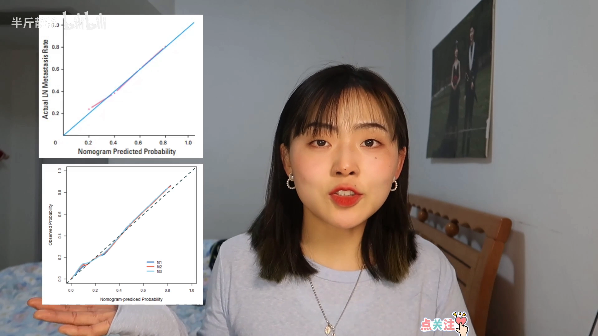
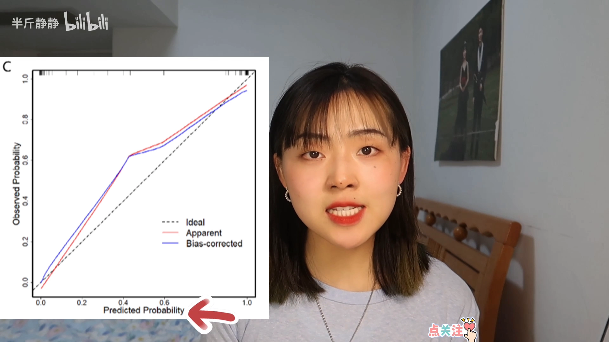
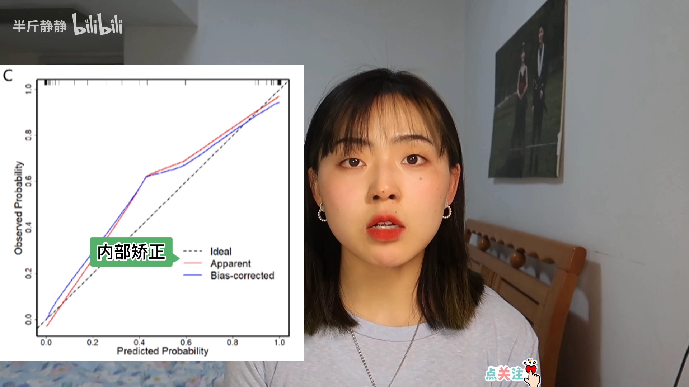

# 风险预测模型的校准曲线：理想线、表观线与偏差校正线

> 视频来源：[科研干货｜三分钟了解模型评价中的校准曲线，生信必备知识](https://www.bilibili.com/video/BV1Hs4y1J76Q/)（B 站 · 半斤静静）｜时长约 4 分钟
> 这支视频从临床风险预测模型的角度讲校准曲线：它和区分度（AUC/C 指数）不是一回事，画法是把样本按预测概率排序分组，再比较组内平均预测概率与实际发生频率。视频还区分了表观（apparent）曲线和偏差校正（bias-corrected）曲线，并说明校准不当会怎样影响治疗决策。本文按视频顺序整理，并保留其临床例子。

## 本讲要解决的核心问题（SCQA）

**背景**：风险预测模型（如列线图/nomogram）会给每个病人算一个发生某结局的概率，医生据此决定治疗强度。评价这类模型时，常用区分度指标（如 C 指数、AUC）衡量它能不能把高风险和低风险的人分开。

**冲突**：区分度高只说明排序对，不说明"预测 25% 就真的约 25% 发生"。如果模型系统性低估风险，被判断为"低危"的病人可能被推迟手术或治疗。

**疑问**：怎么用一条校准曲线检查"预测概率和实际发生概率是否一致"？图上的理想线、表观线、偏差校正线分别是什么？该看哪一条？

**回答（中心思想）**：校准曲线把预测概率与实际发生频率按组对照，理想状态是落在 45° 对角线上；表观线用全部数据拟合并评估，通常偏乐观，偏差校正线用 bootstrap 估计并扣除这种乐观偏差，读图时应让两条实线彼此接近、且都贴近对角线。

## 一、校准度回答的是"数值对不对"，不是"排序好不好"

视频开篇把上一期讲的**区分度**和这一期的**校准度**并列 [【跳转到 00:17】](https://www.bilibili.com/video/BV1Hs4y1J76Q/?t=17)：

- **区分度**：模型能不能把会发生结局的人排在前面（ROC、AUC、C 指数）；
- **校准度**：模型说的概率，和实际发生频率是否一致。

校准度一般用**校准曲线**（calibration curve，也常称可靠性曲线）来表现。它评价的是逻辑回归一类概率模型的一致性，即**预测发生概率和实际发生概率之间的一致性** [【跳转到 00:25】](https://www.bilibili.com/video/BV1Hs4y1J76Q/?t=25)。用视频的原话说，校准曲线本身可以理解成"实际发生概率和预测发生概率的散点图"，也是 Hosmer–Lemeshow 拟合优度检验结果的可视化。

### 校准不当的后果

视频给了一个临床例子 [【跳转到 00:41】](https://www.bilibili.com/video/BV1Hs4y1J76Q/?t=41)：某个模型预测某组病人的死亡率约 25%，医生可能因此选择药物治疗、推迟手术；但这组病人的实际死亡概率可能在 50% 左右。按这个偏低的预测做决策，就会让病人错过更合适的手术时机。

这个例子的要点不是"25% 这个数字算错了"，而是**误差有方向、有代价**：概率被系统性低估时，风险被低估，后续决策跟着偏。

## 二、曲线怎么画：先排序，再分组，最后对照

视频把画法拆成四步 [【跳转到 01:02】](https://www.bilibili.com/video/BV1Hs4y1J76Q/?t=62)：

1. **算概率**：用建好的模型（视频里的例子是列线图/nomogram）预测每位研究对象的结局概率；
2. **排序**：把所有研究对象按预测概率从低到高排成一个队列；
3. **分组**：按四分位或其他分位方法切成若干组（四分位就得到 4 组）；
4. **算两个坐标**：
   - 横坐标 = 组内每个个体预测概率的平均值；
   - 纵坐标 = 组内实际发生结局的比例，也就是频率。

视频用 10 个人、3 人患病举例 [【跳转到 01:41】](https://www.bilibili.com/video/BV1Hs4y1J76Q/?t=101)：这一组的**实际发生概率就是 30%**（3/10，按频率理解）；而**预测发生概率**是先把 10 个人的预测概率相加再取平均。两组数各自算完，就得到一个校准点。

分几组就得到几个点，把这些点连起来就是校准曲线 [【跳转到 02:06】](https://www.bilibili.com/video/BV1Hs4y1J76Q/?t=126)。这也解释了为什么同一个模型换一种分组方式，曲线形状会略有不同：**分组数决定了曲线的分辨率**。

## 三、三条线：理想线、表观线、偏差校正线

视频展示了常见的几种校准曲线，并挑其中一张详细拆解 [【跳转到 02:28】](https://www.bilibili.com/video/BV1Hs4y1J76Q/?t=148)。

### 3.1 理想线（ideal）

黑色虚线是 45° 对角线，代表**理想模型**：预测概率和实际发生概率完全吻合。预测 0.4 就真有 0.4 的人发生，预测 0.8 就真有 0.8 [【跳转到 02:38】](https://www.bilibili.com/video/BV1Hs4y1J76Q/?t=158)。

### 3.2 表观线（apparent）

红色实线是**表观曲线**：用已有的全部数据拟合模型，再用同一批数据评估。视频也把它理解为"内部校正"——模型是在这批数据上训练出来的，所以它对自己的表现往往估计得偏乐观 [【跳转到 03:03】](https://www.bilibili.com/video/BV1Hs4y1J76Q/?t=183)。

### 3.3 偏差校正线（bias-corrected）

蓝色实线是**偏差校正曲线**。视频描述的做法是：对全部数据做约 1000 次有放回抽样（bootstrap），计算拟合的平均误差，再用表观曲线的结果减去这部分误差，得到校正后的曲线 [【跳转到 03:03】](https://www.bilibili.com/video/BV1Hs4y1J76Q/?t=183)。

视频还给了另一种理解：红线是"内部"的（用现有数据训练并评估），蓝线相当于用重采样构造出的"外部"数据来检验。两种说法指向同一件事——**蓝线是对"换一批数据还能不能保持校准"的估计**。

### 3.4 读图的两个判据

视频给出两条判据 [【跳转到 03:28】](https://www.bilibili.com/video/BV1Hs4y1J76Q/?t=208)：

1. **红线与蓝线应该位置相近**。如果表观线和校正线差得很远，说明模型对自身表现的估计很不稳定，模型本身可能就有较大问题（典型原因是过拟合或样本量不足）。
2. **良好的校准曲线应该靠近理想对角线**。两条实线都贴着 45° 线，才说明预测概率与实际频率一致。

注意这两条判据的分工：第一条看**乐观偏差有多大**，第二条看**校准本身好不好**。一条曲线可以很靠近对角线但两条线分得很开（样本少、波动大），也可以两条线几乎重合但整体偏离对角线（系统性高估或低估）。

## 四、和区分度指标一起看，才是一张完整的模型评价

视频在结尾处同时提到了 C 指数和 Hosmer–Lemeshow 拟合优度检验 [【跳转到 03:28】](https://www.bilibili.com/video/BV1Hs4y1J76Q/?t=208)。这提醒我们：报告一个风险模型时，至少要回答两个不同的问题。

| 问题 | 指标 | 看什么 |
| --- | --- | --- |
| 能不能把高风险的人排在前面 | C 指数 / AUC | 排序与区分 |
| 说的概率数值准不准 | 校准曲线、Hosmer–Lemeshow 检验 | 预测概率与实际频率的一致性 |

一个 C 指数很高的模型，校准曲线仍可能明显偏离对角线；反过来，校准良好的模型也可能区分能力有限。**两者不能互相替代**，也不能只报一个就宣称模型可靠。

## 小结

- **校准度 ≠ 区分度**：前者看预测概率与实际频率是否一致，后者看排序与区分能力。
- **画法**：按预测概率排序 → 按四分位等方法分组 → 每组算"平均预测概率"（横轴）与"实际发生频率"（纵轴）→ 连点成线。
- **理想线**是 45° 对角线，代表预测与实际完全吻合。
- **表观线**用同一批数据拟合并评估，通常偏乐观；**偏差校正线**用 bootstrap 估计并扣除乐观偏差。
- **读图两条判据**：表观线与校正线应彼此接近；两条线都应贴近对角线。
- **校准不当有实际代价**：系统性低估风险会让本该积极治疗的人被推迟处理。

## 关键术语速查

| 术语 | 一句话解释 |
| --- | --- |
| 校准度（calibration） | 预测概率与实际发生频率的一致程度 |
| 校准曲线 / 可靠性曲线 | 横轴为分组平均预测概率、纵轴为组内实际发生频率的曲线 |
| 理想线（ideal） | 45° 对角线，预测概率等于实际频率的参照 |
| 表观曲线（apparent） | 用全部数据拟合并用同一批数据评估得到的曲线，通常偏乐观 |
| 偏差校正曲线（bias-corrected） | 用 bootstrap 重采样估计乐观偏差并扣除后得到的曲线 |
| 区分度（discrimination） | 模型把高风险与低风险个体分开的能力，常用 C 指数/AUC 衡量 |
| Hosmer–Lemeshow 检验 | 按预测概率分组比较预测与实际的拟合优度检验，校准曲线是其可视化 |
| 列线图（nomogram） | 把回归模型转成逐项打分、再加总得到风险概率的图示工具 |