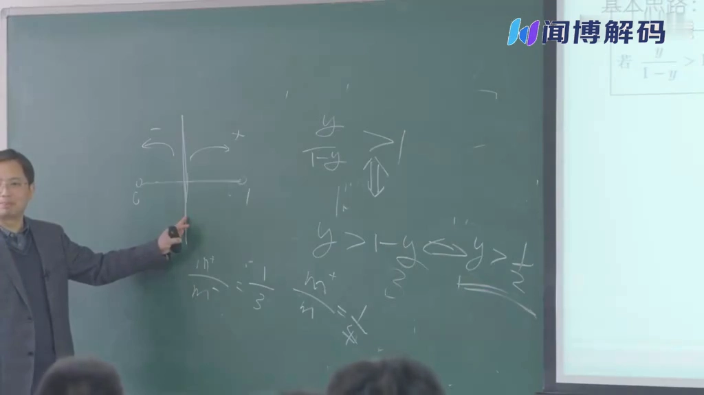
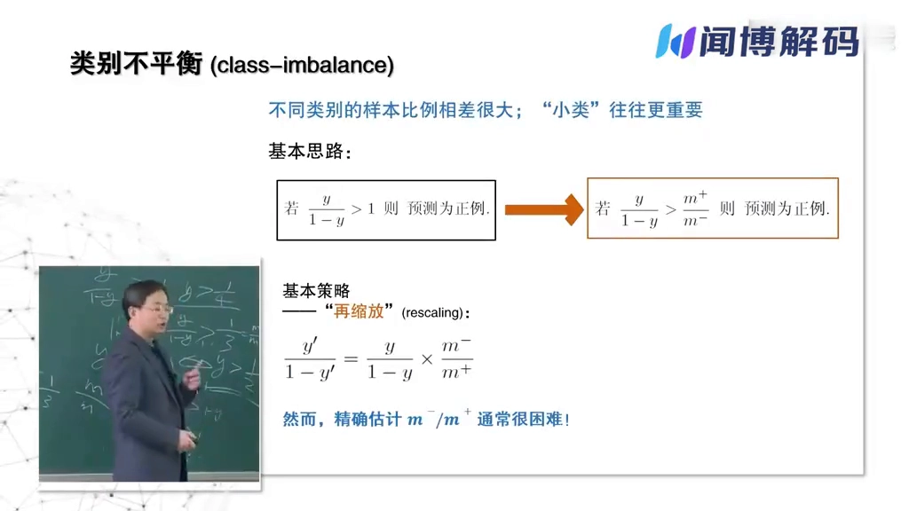
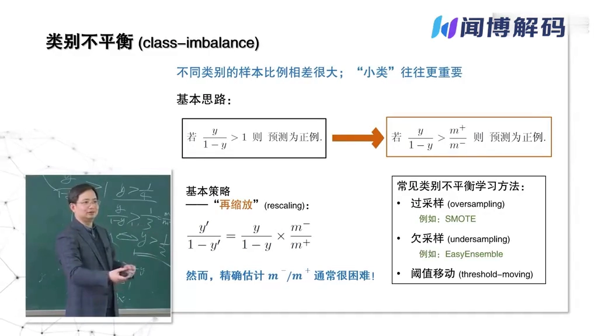

# 类别不平衡：先问代价，再决定移阈值还是改数据

> 视频来源：[22. 类别不平衡](https://www.bilibili.com/video/BV1EwjHzJEUh/)（Bilibili · 闻博解码）｜时长约 10 分钟
> 导读：这支课把"类别不平衡"从"必须处理的脏数据问题"还原成一个决策问题：只有当小类更重要（代价更高）时才需要动手；动手的三条路是过采样、欠采样、阈值移动。本文与同节的《代价敏感分类》互补——那篇给出代价到阈值的公式，这篇给出"什么时候值得用、用哪条路"的判断。

## 本讲要解决的核心问题（SCQA）

**背景**：拿到一份 99:1 的数据，几乎所有人的第一反应是"不平衡，得处理"：上采样、下采样、SMOTE、调 class_weight，一套流程走完再训练。

**冲突**：视频开头就举了一个反例。100 个样本里 99 个正类、1 个负类，一个"谁多猜谁"的模型准确率就有 99%，但它把那唯一的负类彻底丢掉了。然而——如果负类本来就不重要，这个模型没有任何问题（[【跳转到 00:28】](https://www.bilibili.com/video/BV1EwjHzJEUh/?t=28)）。反过来，信用卡场景里 100 万笔交易只有 100 笔欺诈，全判"正常"的准确率是 99.99%，这个模型却毫无意义。

**疑问**：同样是不平衡，为什么一个可以不管、一个必须处理？如果必须处理，是改数据、改算法，还是只改判决门槛？

**回答（中心思想）**：**不平衡本身不是问题，两类错误的代价不对称才是问题。** 只有当小类更重要（漏掉它更贵）时才需要处理；处理的三条典型路线是过采样（把小类造多）、欠采样（把大类删少）、阈值移动（把 0.5 换成先验决定的门槛）。三者目标一致——让模型别再"嫌贫爱富"，但副作用不同。

## 一、判断标准是代价，不是样本比例

视频给出的判据非常干脆，值得逐条抄下来（[【跳转到 00:53】](https://www.bilibili.com/video/BV1EwjHzJEUh/?t=53)）：

| 情形 | 要不要处理 | 原因 |
| --- | --- | --- |
| 小类不比大类重要 | 不处理 | 反正要犯错，宁可犯在代价小的那一类上 |
| 小类与大类同等重要 | 不处理 | 两类错误等价，错误率就是对的尺子 |
| 小类比大类更重要 | 必须处理 | 丢掉小类的代价高，准确率掩盖了真实损失 |

"如果总要犯错误，那我就宁可犯在代价小的这个问题上"——这句话是整个判据的通俗版。它和上一节《代价敏感分类》里的期望代价公式是同一件事：当 $C(0,1) \ne C(1,0)$ 时，最小化错误个数不再等于最小化损失。

所以正确的顺序是：**先估两类错误的代价比，再看样本比例**。样本比例只告诉我们"默认阈值会偏向哪边"，代价才告诉我们"该不该纠正这个偏向"。只看到 99:1 就上 SMOTE，等于在没确认小类是否更贵之前，先假设了它更贵。

## 二、默认的 0.5，其实是"几率大于 1"

为什么分类器默认在 0.5 处切？视频用几率（odds）把它讲清楚了（[【跳转到 01:54】](https://www.bilibili.com/video/BV1EwjHzJEUh/?t=114)）：

$$
\frac{y}{1-y} > 1 \;\Longleftrightarrow\; y > \frac{1}{2}
$$

其中 $y$ 是模型输出的正类概率。也就是说，"判为正类"等价于"正类的几率大于负类的几率"——这仍然是一个"两类一样重要"的假设，只不过写成了比值形式。

一旦承认两类不等价，这个 1 就该换掉。视频用正负样本 1:3 的例子推进（[【跳转到 03:38】](https://www.bilibili.com/video/BV1EwjHzJEUh/?t=218)）：此时正类只占总体的 1/4，直觉上"模型说有 1/4 以上的可能就该判正"，即阈值从 1/2 移到 1/4。写成几率就是：

$$
\frac{y}{1-y} > \frac{1}{3}
$$

黑板上那几步推导（$\frac{y}{1-y}>1 \Leftrightarrow y>\frac12$，以及 1:3 时阈值落在 1/4）就是这条直觉的形式化。

## 三、按先验移动阈值：再缩放公式

把上一节的例子推广，就得到视频幻灯片上的核心公式（[【跳转到 04:19】](https://www.bilibili.com/video/BV1EwjHzJEUh/?t=259)）。设 $m^+$、$m^-$ 分别是正类与负类的样本数，则判别规则从"几率 > 1"变成"几率 > 先验比"：

$$
\frac{y}{1-y} > \frac{m^+}{m^-}
$$

幻灯片还给了等价的**再缩放（rescaling）**写法：

$$
\frac{y'}{1-y'} = \frac{y}{1-y} \times \frac{m^-}{m^+}
$$

它的作用是把"真实先验下的几率"折算成"平衡数据上的几率"，这样模型又可以回到熟悉的"与 1 比较"。两种写法完全等价：把 $y'/(1-y')>1$ 代回去，立刻得到 $y/(1-y) > m^+/m^-$。换句话说，**再缩放不是新方法，只是把同一个阈值换了个坐标系**。

这里有一个必须记住的坑。视频紧接着提醒：实际中很难精确估计 $m^-/m^+$，而"直接拿训练集里的 100:10 代进去"要求一个很强的假设——**训练集是潜在总体的无偏采样**（[【跳转到 04:46】](https://www.bilibili.com/video/BV1EwjHzJEUh/?t=286)）。稀有类本身样本就少，这个假设很难保证。所以这个比例要么来自可靠的外部统计（真实患病率、真实欺诈率），要么就别假装知道，改用下面三条工程路线之一。

## 四、三条工程路线：改数据、改判决、改集成

视频把常见做法归成三类（[【跳转到 06:12】](https://www.bilibili.com/video/BV1EwjHzJEUh/?t=372)）：

### 4.1 过采样：把小类造多，但别只会复制

最简单的过采样是把小类样本复制到大类一样多。视频明确警告：**直接 copy 会大幅提高过拟合风险**，因为如果被复制的样本带噪声，等于把这份噪声的影响加倍甚至加几倍（[【跳转到 06:47】](https://www.bilibili.com/video/BV1EwjHzJEUh/?t=407)）。

SMOTE 的做法是在已有小类样本之间做**插值**：取一个小类样本与它的近邻，在连线上生成新点。这样新增的样本带有邻域信息，而不是原样复制。视频把它称为当前过采样里最经典、也最常被工具包内置的做法（[【跳转到 07:37】](https://www.bilibili.com/video/BV1EwjHzJEUh/?t=457)）。

### 4.2 欠采样：删大类，但别删掉边界

欠采样反过来，把大类删到与小类相当。好处是训练快，风险是"你不知道丢掉的是不是关键样本"。视频用一张示意图说明后果：原本的分类边界在删掉某些大类样本后会**显著改变**（[【跳转到 08:27】](https://www.bilibili.com/video/BV1EwjHzJEUh/?t=507)）。

对应的改进是 **EasyEnsemble**：不做一次性的删除，而是把小类固定，每次从大类里抽一批与小类等量的样本，训练一个"平衡"的子模型；重复多次后投票集成。每个子模型都平衡，但没有任何一个大类样本被永久丢弃，集成还顺带带来精度收益（[【跳转到 09:17】](https://www.bilibili.com/video/BV1EwjHzJEUh/?t=557)）。这条思路把"欠采样"从数据操作升级成了集成学习。

### 4.3 阈值移动：不动数据，只动门槛

第三条路最轻：不增删样本，只把判决阈值从 0.5 移到先验或代价决定的位置。视频提到"少数算法可以这样做到，其中支持向量机就是一种"（[【跳转到 06:20】](https://www.bilibili.com/video/BV1EwjHzJEUh/?t=380)）。

三条路可以并到一张表里比较：

| 路线 | 动什么 | 主要风险 | 副作用 |
| --- | --- | --- | --- |
| 过采样（SMOTE） | 训练集的小类 | 复制会放大噪声；插值可能造出不在真实分布上的点 | 训练分布改变，输出概率不再对应真实频率 |
| 欠采样（EasyEnsemble） | 训练集的大类 | 随机删除会移动分类边界 | 同上，且需要训练多个模型 |
| 阈值移动 | 判决门槛 | 需要知道先验比或代价比 | 不改概率、不改排序，只换工作点 |

## 五、把三条路接回代价（编者补充）

视频在结尾把话题引向"代价敏感学习"，但没有把两条线并成一个公式。这里补上这个连接：

- 阈值移动的判据 $y/(1-y) > m^+/m^-$ 只考虑了**先验不平衡**；若再叠加**代价不对称**，右边应换成代价加权后的比值，即上一节推出的 $C(1,0)/(C(1,0)+C(0,1))$。两者形式一致，只是把"样本数之比"换成了"代价之比"。
- 因此"类别不平衡"可以看成"代价敏感"的一个特例：当两类代价相同时，先验不平衡恰好等价于给少数类更高的代价。
- 反过来，如果两类代价差异极大，即使数据完全平衡（50:50），仍然需要移动阈值——这正是只看样本比例会误判的地方。
- 重采样改变的是训练分布，模型输出的概率会被"掰"过，需要重新校准（4.2.1）；阈值移动只改判决，校准曲线不变。若下游要读概率本身，优先考虑阈值移动或后校准；若下游只要一个划算的判决，重采样更省事。

## 小结

- 不平衡本身不是问题；**小类是否更重要（代价更高）**才是要不要处理的判据。
- 默认的 0.5 阈值等价于"正类几率 > 1"，即假设两类同等重要。
- 按先验移动阈值：判据从 $y/(1-y)>1$ 改为 $y/(1-y) > m^+/m^-$；再缩放公式只是同一规则的另一种写法。
- 精确估计 $m^-/m^+$ 需要"训练集是无偏采样"这一强假设，稀有类场景下很难成立。
- 三条工程路线：过采样（SMOTE 插值，别只复制）、欠采样（EasyEnsemble 用集成避免永久丢样本）、阈值移动（最轻，SVM 等可直接支持）。
- 阈值移动不改排序与校准，重采样会改分布进而改概率——选路线要看下游要的是判决还是概率。

## 关键术语速查

| 术语 | 一句话解释 |
| --- | --- |
| 类别不平衡 | 不同类别的样本比例相差很大，小类往往才是关注对象。 |
| 几率（odds） | 正类概率与负类概率之比 $y/(1-y)$；大于 1 等价于 $y>0.5$。 |
| 先验比 $m^+/m^-$ | 正负样本数之比；不平衡时它取代 1 成为几率判据的门槛。 |
| 再缩放（rescaling） | 把真实先验下的几率折算成平衡数据上的几率，使门槛回到 1。 |
| 过采样 | 增加小类样本使其与大类相当；简单复制会放大噪声。 |
| SMOTE | 在小类样本与其近邻的连线上插值生成新样本的过采样方法。 |
| 欠采样 | 减少大类样本使其与小类相当；随机删除可能移动分类边界。 |
| EasyEnsemble | 多次抽取与小类等量的大类样本训练子模型，再投票集成。 |
| 阈值移动 | 不改数据与模型，只把判决门槛从 0.5 移到先验或代价决定的位置。 |