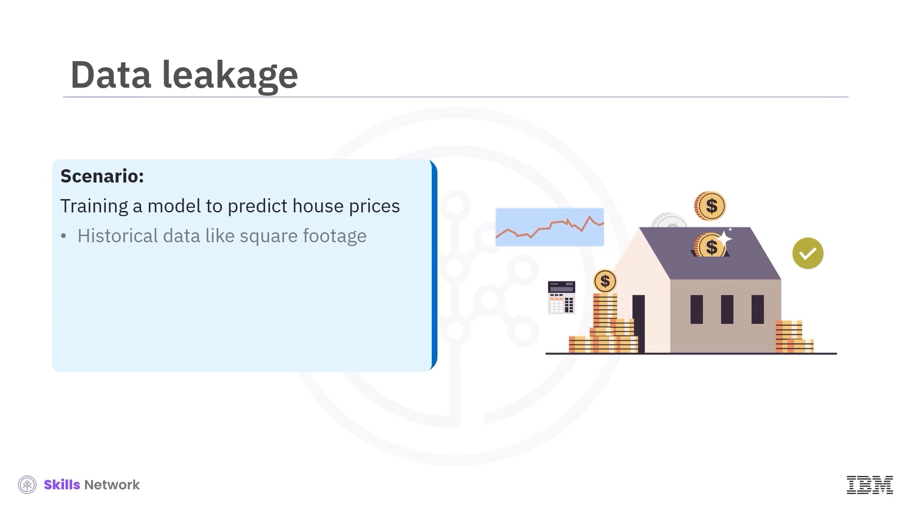
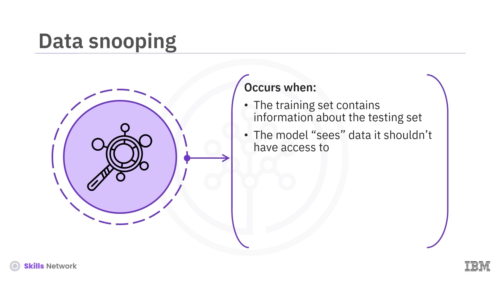
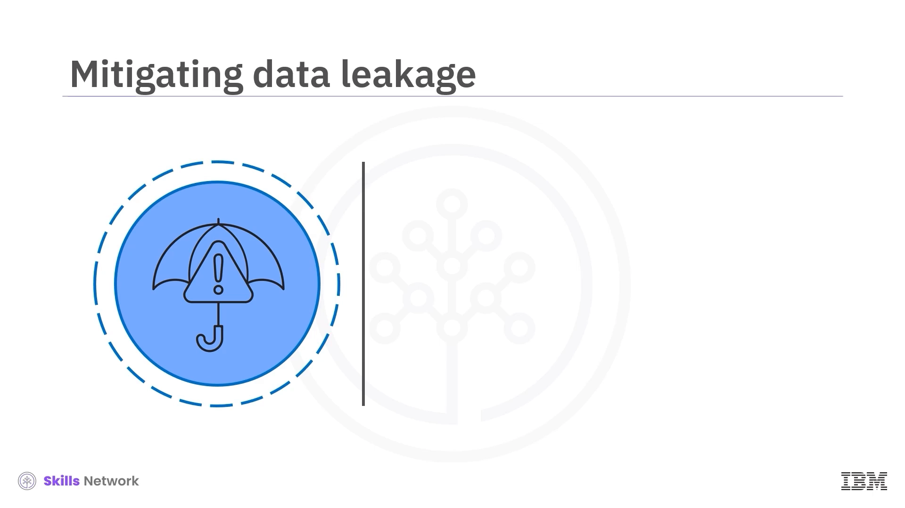
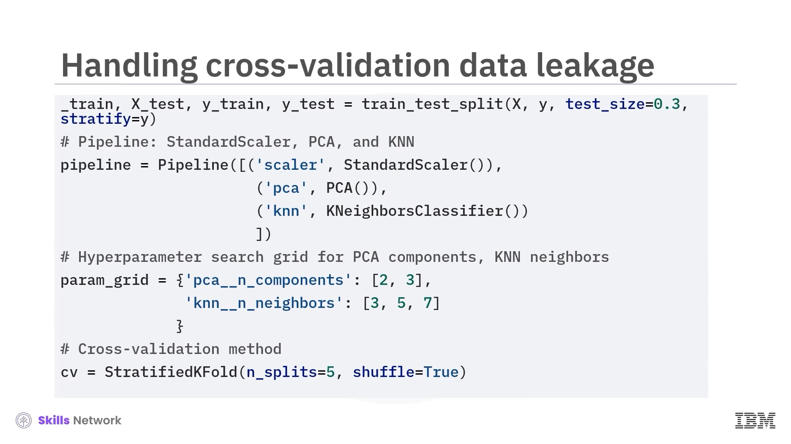
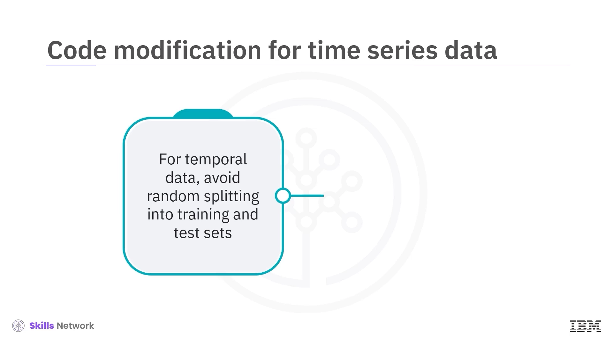
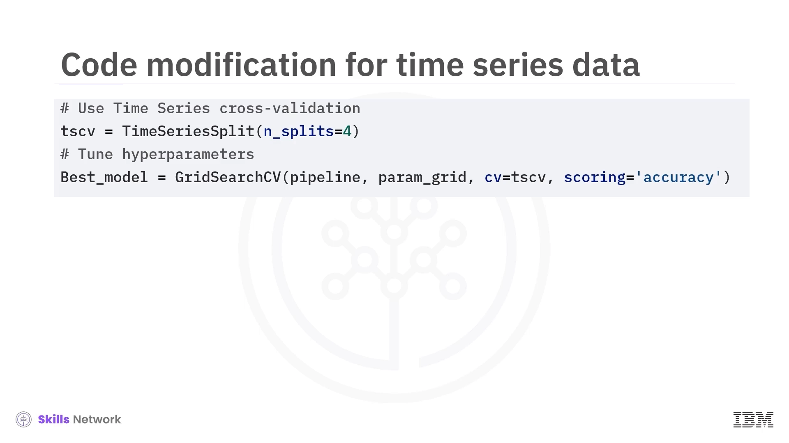
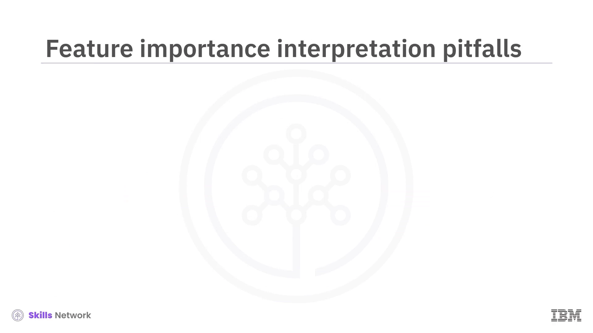
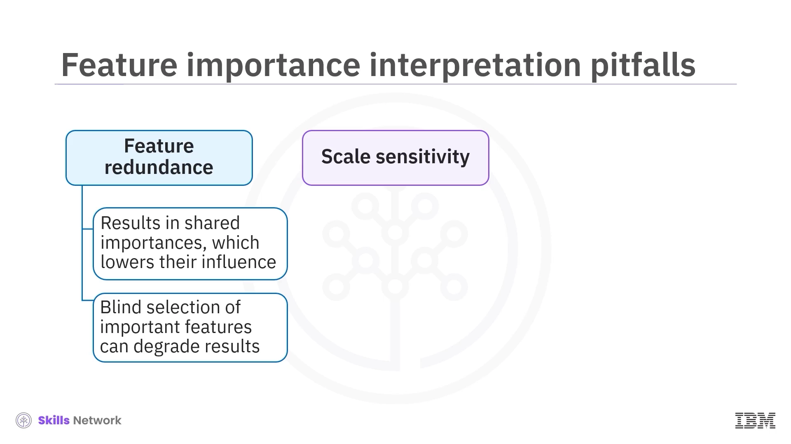
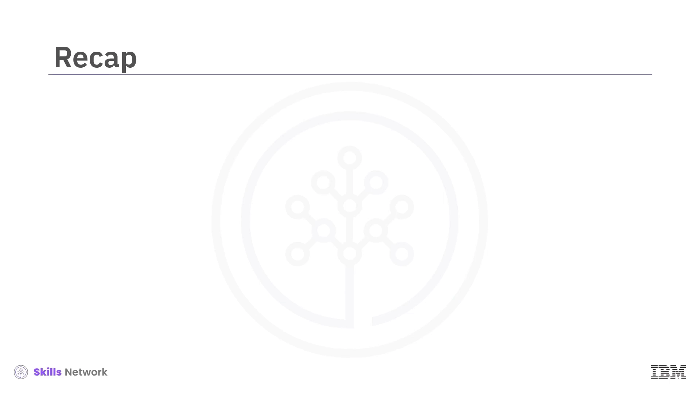

# 数据泄露的三个入口：目标泄漏、全数据特征工程与交叉验证中的管道

> 视频来源：[使用 Python 进行机器学习 第三十一节：数据泄露和其他陷阱](https://www.bilibili.com/video/av114001014954004)（Bilibili · 约 6 分 47 秒，IBM Skills Network 课程片段，中文字幕为 B 站 AI 自动生成）
> 导读：这是一支短课，先用「预测房价」一个例子把**目标泄漏**讲透，再把泄漏拆成三类入口——用了未来信息、用整个数据集造特征、交叉验证里管道放错位置——最后用同一段 scikit-learn 代码演示「管道必须作为网格搜索的输入」。后半段转向**特征重要性的解释陷阱**：冗余特征分摊重要性、尺度扭曲重要性、相关不等于因果、单特征重要性看不见交互。本文按「定义 → 三种入口 → 防线 → 重要性陷阱」重排，术语（data snooping、pipeline、TimeSeriesSplit、scaler 等）已按幻灯片订正。

## 本讲要解决的核心问题（SCQA）

**背景**：训练一个模型，最直观的流程是「拿历史数据 → 拟合 → 在测试集上看分数」。分数高，就以为模型能用[【跳转到 00:18】](https://www.bilibili.com/video/av114001014954004/?t=18)。



**冲突**：讲者给的第一个例子就翻车了。除了平方英尺这类历史特征，你还用**整个数据集的实际房价平均值**工程了一个新特征。模型在测试数据上表现很好，你很高兴——但训练时它已经用到了「未来才有」的信息，部署到生产环境后拿不到这些信息，实际表现不会像测试结果那样好[【跳转到 00:23】](https://www.bilibili.com/video/av114001014954004/?t=23)。

**疑问**：这种「偷看」到底从哪些地方进来？为什么测试分数也跟着虚高？写代码时又该把哪一步放在什么位置？

**回答（中心思想）**：**数据泄露 = 训练数据里包含了现实世界中拿不到的信息**。它有三个常见入口：**目标泄漏**（用全数据集的标签统计造特征）、**全数据特征工程**（用整个数据集算均值、方差、主成分）、**交叉验证里的管道错位**（在折外 fit 预处理器）。防线只有一条：**任何从数据里学参数的步骤，都只能在当折训练集上 fit，再 transform 到验证/测试折**；时间相关数据还要按时间顺序切分。分数虚高的机制是：测试集里也带着同样的泄漏信息，所以直到部署才暴露泛化能力差[【跳转到 00:48】](https://www.bilibili.com/video/av114001014954004/?t=48)。

## 一、定义：泄漏让训练和验证都「误导性地好」

讲者给出的定义很短：数据泄露发生在**模型的训练数据包含现实世界中不可用的信息**，例如部署之后根本看不到的数据[【跳转到 00:44】](https://www.bilibili.com/video/av114001014954004/?t=44)。

它的危害不是「训练不收敛」，而是**评估被抬高**：

- 模型在训练和验证期间表现得**误导性地好**；
- 原因是**测试数据集也包含这些泄漏数据**——泄漏不是训练集独有的，它是整个数据集共有的信息；
- 所以直到把模型部署到生产环境，才会检测到泛化能力差。

这一点很重要：泄漏不会以「报错」的形式出现，它只会让一条本来该下降的分数曲线保持漂亮。判断标准因此不是「分数高不高」，而是「这一步在推理时还做得了吗」。

## 二、目标泄漏：用全数据集的房价均值造特征

第一个入口就是开场那个例子。要预测房价，却把**整个数据集的实际房价平均值**拿来做一个特征。这个平均值里包含了测试样本的房价，也包含了「未来成交」的房价——它本身就是目标变量的统计量[【跳转到 00:23】](https://www.bilibili.com/video/av114001014954004/?t=23)。

从信息流看，这一步把标签 $y$ 的信息提前写进了特征 $X$：

- 训练时：模型可以通过这个特征「感知」到整体价格水平，误差自然小；
- 测试时：测试样本的价格也参与过这个平均值的计算，所以测试分数同样虚高；
- 部署时：新样本的价格未知，这个特征要么算不出来，要么只能用历史均值近似——模型立刻退化。

这就是**目标泄漏**（target leakage）的典型形态：特征在构造时用到了预测目标本身，或用了只在事后才能获得的信息。它和「特征选得好不好」无关，是**特征与标签之间的信息通道**问题。

## 三、数据窥探：训练集里含测试集的信息

讲者用幻灯片上的术语 **data snooping**（数据窥探）描述另一类入口：训练集包含了关于测试集的信息，或者模型「看到」了它不该访问的数据[【跳转到 01:06】](https://www.bilibili.com/video/av114001014954004/?t=73)。



这一类不一定是「标签」泄漏，也可能是**样本层面的重叠或污染**：同一条记录、同一个个体、同一段来源同时出现在训练和测试两边。讲者在后面给防线时把它和「训练/验证/测试集之间的重叠或污染」并列，说明它和特征工程是两条独立的路：一条沿列（特征）走，一条沿行走。

> 字幕在这里把 data snooping 译成了「数据挖掘」，按幻灯片应理解为**数据窥探**：模型提前接触了评测数据。

## 四、时间方向：用「明天」预测「今天」

第三类入口与时间有关。讲者的例子是：**用明天的股票价格去预测今天的**——把未来信息放进了预测结果的输入里[【跳转到 01:17】](https://www.bilibili.com/video/av114001014954004/?t=77)。

这类泄漏在时间序列里几乎必然出现，只要你用了随机切分或普通 k 折：

- 随机切分会让「未来」的样本落进训练集；
- 普通 k 折会让每一折的训练集里都混有相邻时间点的样本；
- 模型于是学到「时间上的插值」，而不是「从过去外推到未来」。

讲者给的对策很直接：**这种数据要用时间序列切分，而不是通常的训练/测试切分**，并且交叉验证也要按时间顺序做，避免跨折泄漏[【跳转到 02:04】](https://www.bilibili.com/video/av114001014954004/?t=124)。

## 五、全数据特征工程：管道必须在每折训练集内 fit

把上面几条收拢，讲者给出一句总规矩：**数据处理管道应该在训练数据和测试数据上独立运行**，以降低泄漏风险[【跳转到 01:23】](https://www.bilibili.com/video/av114001014954004/?t=83)。

具体到操作，他列了四条缓解措施[【跳转到 01:38】](https://www.bilibili.com/video/av114001014954004/?t=98)：



1. **避免使用全局平均值**，或其他从整个数据集衍生出来的统计量；
2. 确保训练、验证、测试三份数据之间**适当分离**，避免重叠或污染；
3. 确保特征里**不包含部署时拿不到的信息**；
4. 谨慎实现交叉验证，**不要跨折泄漏**；时间相关数据尤其如此。

第 1 条正是「全数据预处理」的核心：标准化用的均值/标准差、PCA 用的主成分方向、特征选择用的统计量，全都是**从数据里学出来的参数**。如果它们在划分之前、用全部样本算好，测试集的信息就已经进入训练。

讲者用一段 scikit-learn 代码把正确位置演示了一遍[【跳转到 02:21】](https://www.bilibili.com/video/av114001014954004/?t=141)：



```python
X_train, X_test, y_train, y_test = train_test_split(X, y, test_size=0.3, stratify=y)

pipeline = Pipeline([
    ('scaler', StandardScaler()),
    ('pca', PCA()),
    ('knn', KNeighborsClassifier()),
])

param_grid = {
    'pca__n_components': [2, 3],
    'knn__n_neighbors': [3, 5, 7],
}

cv = StratifiedKFold(n_splits=5, shuffle=True)
```

关键在于**把 pipeline 作为网格搜索的输入**，而不是先在全数据上 `fit` 好 scaler/PCA 再送进网格搜索。这样：

- 每一折里，scaler 和 PCA 只在**该折的训练部分**上 `fit`；
- 拟合好的管道再 `transform`/预测对应的验证折；
- 找到最佳参数后，才在**留出的测试集**上评估一次，得到无偏估计[【跳转到 03:09】](https://www.bilibili.com/video/av114001014954004/?t=189)。


反过来说，**特征选择**也属于这条管道：如果先用全部样本挑出「与标签最相关」的基因/特征，再划分做交叉验证，那么挑选这一步已经看过了验证折的标签，分数必然偏高。正确做法是把选择器放进管道，让它随每折重新拟合。

## 六、时间序列切分：训练集永远在测试集之前

对时间相关数据，讲者把代码改了一处[【跳转到 03:21】](https://www.bilibili.com/video/av114001014954004/?t=201)：



```python
tscv = TimeSeriesSplit(n_splits=4)
best_model = GridSearchCV(pipeline, param_grid, cv=tscv, scoring='accuracy')
```

`TimeSeriesSplit(n_splits=4)` 把数据按时间顺序切成四个等大小的折，**保留时间顺序**：每个分割用过去的数据训练、用剩余的未来数据验证；随着折数推进，训练集包含的数据越来越多，测试集相应缩小[【跳转到 03:51】](https://www.bilibili.com/video/av114001014954004/?t=231)。



注意这里改的只是 `cv` 参数，管道仍然整体交给网格搜索——**时间顺序**和**管道位置**是两条独立的防线，缺一条都不够。

## 七、特征重要性的四个解释陷阱

视频后半段从「泄漏」转到「读重要性」。讲者的前提是：训练模型时，理解常见的陷阱并正确评估特征重要性至关重要[【跳转到 04:06】](https://www.bilibili.com/video/av114001014954004/?t=246)。



**（1）冗余特征会分摊重要性。** 模型里如果有高度相关或冗余的特征，它们会**共享**重要性，导致每一个看起来都不那么重要[【跳转到 04:16】](https://www.bilibili.com/video/av114001014954004/?t=256)。两个几乎相同的基因表达量，可能各自只拿到一半的分数——不是它们没用，而是信息被拆开了。

**（2）盲目按重要性筛特征会让结果退化。** 直接把「看起来最重要」的几个特征挑出来做后续建模，可能反而更差[【跳转到 04:19】](https://www.bilibili.com/video/av114001014954004/?t=259)。原因和第（1）条连着：被分摊掉的特征可能携带互补信息，砍掉后模型失去的比得到的多。

**（3）尺度会扭曲重要性。** 有些算法（讲者举线性回归）本身不考虑特征的尺度，**未缩放的数据会扭曲重要性**[【跳转到 04:27】](https://www.bilibili.com/video/av114001014954004/?t=267)。一个以「米」为单位、数值很小的特征，和一个以「毫米」为单位、数值很大的特征，系数不可直接比较。

**（4）重要性排名是相关性，不是因果。** 讲者重复了两遍这句话：**特征重要性的排名表明相关性，不是因果关系；重要的特征不一定驱动结果**[【跳转到 04:34】](https://www.bilibili.com/video/av114001014954004/?t=274)。



**（5）单特征重要性看不见交互。** 一些模型只评估单个特征的重要性，不考虑特征之间的相互作用，这会低估或高估特征组合的影响[【跳转到 04:45】](https://www.bilibili.com/video/av114001014954004/?t=285)。

讲者给了一个具体例子：假设两个特征单独都不足以让线性回归给出足够信息，但它们的**交互项或乘积**能提升性能。这时，非线性算法（如随机森林回归）可以隐式地检测到这种交互，从而表现更好；而在线性模型里，这两个单独的特征会被错误地认为不重要，它们的重要性还会被随机森林「共享」，你也就不知道**它们的乘积才是关键解释变量**[【跳转到 05:09】](https://www.bilibili.com/video/av114001014954004/?t=309)。

## 八、其他建模陷阱

讲者在结尾列了一串与泄漏相邻、但性质不同的陷阱[【跳转到 05:18】](https://www.bilibili.com/video/av114001014954004/?t=318)：

- **用原始数据、不做适当的特征选择或变换**，会让你找不到最好的模型；
- **选错评估指标或误读指标**，会误导评价；
- **不处理类别不平衡**，预测会偏向多数类；
- **自动化机器学习工具很强，但你仍要理解数据和它替你生成的模型**；
- **如果模型缺少对目标变量有因果影响的特征**，它生成的假设情景可能没有因果关系、是无效的；基于假设变化的预测可能严重误导[【跳转到 05:44】](https://www.bilibili.com/video/av114001014954004/?t=344)。

最后一条和第七节的「相关非因果」是同一件事的两面：模型可以做预测，但不能自动给出干预结论。

## 九、整讲串起来

讲者的收尾把全片压成两句话[【跳转到 06:00】](https://www.bilibili.com/video/av114001014954004/?t=360)：

- **数据泄露**发生在模型训练数据包含现实世界中不可用的信息，或部署后才见到的数据；缓解办法是避免训练/验证/测试之间的重叠或污染、确保训练特征在现实中可用、谨慎使用交叉验证与超参数调优；
- **特征重要性的陷阱**包括特征冗余、尺度敏感、假设因果、忽视交互；其他建模陷阱包括选错特征、误读指标、类别不平衡、盲目依赖自动化、基于非因果关系做情景假设。



## 小结

- **定义**：训练数据里包含推理时拿不到的信息；它让训练和验证都「误导性地好」，因为测试集也带着同样的泄漏，直到部署才暴露。
- **入口一，目标泄漏**：用整个数据集的实际房价均值造特征，等于把标签信息写进输入。
- **入口二，数据窥探**：训练集含测试集信息，或模型看到了不该访问的数据（重叠、污染）。
- **入口三，时间方向**：用「明天」预测「今天」；时间相关数据必须按顺序切分。
- **防线**：任何从数据里学参数的步骤（标准化、PCA、特征选择）都只能在当折训练集上 `fit`；把整个 pipeline 交给 `GridSearchCV`，而不是先在全数据上 `fit`。
- **时间序列**：`TimeSeriesSplit` 保留顺序，训练集永远在测试集之前；它和「管道位置」是两条独立防线。
- **特征重要性**：冗余会分摊、尺度会扭曲、排名只是相关、单特征看不见交互。
- **其他陷阱**：原始数据不做变换、误读指标、类别不平衡、盲信 AutoML、缺少因果特征却做情景假设。

## 关键术语速查

| 术语 | 一句话解释 |
| --- | --- |
| 数据泄露（data leakage） | 训练数据包含现实世界中不可用的信息，使评估虚高 |
| 目标泄漏（target leakage） | 特征构造时用到了预测目标本身或事后信息 |
| 数据窥探（data snooping） | 训练集包含测试集信息，或模型看到了不该访问的数据 |
| 全局统计量 | 用整个数据集算出的均值、方差等；在划分前使用即造成泄漏 |
| 管道（Pipeline） | 把 scaler、PCA、分类器串成一个整体，随每折重新 fit |
| 网格搜索（GridSearchCV） | 用交叉验证挑超参数；pipeline 应作为它的输入 |
| 时间序列切分（TimeSeriesSplit） | 按时间顺序切折，训练集始终在测试集之前 |
| 特征冗余 | 高度相关的特征共享重要性，单个看起来都不重要 |
| 尺度敏感 | 未缩放的数据会扭曲线性模型的系数与重要性 |
| 特征交互 | 两个特征单独无用、乘积有用；单特征重要性看不见它 |