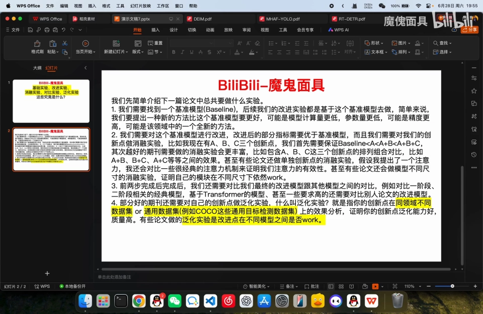
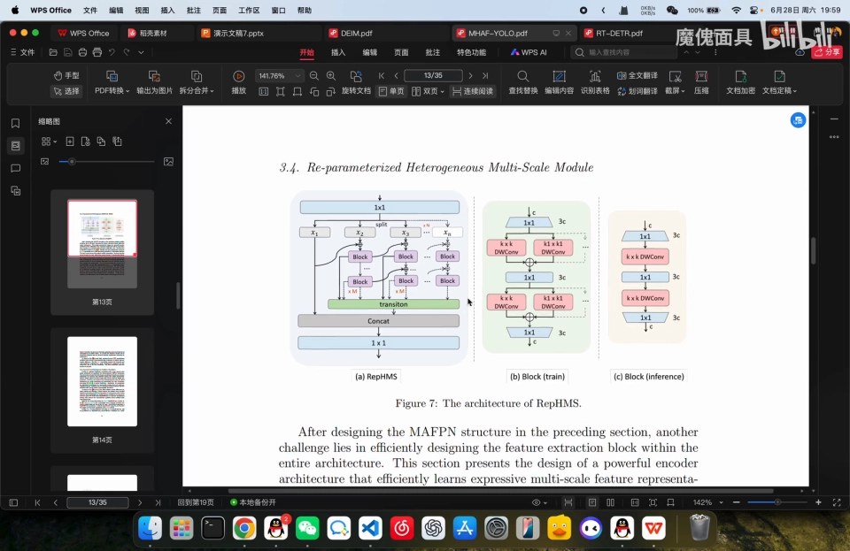
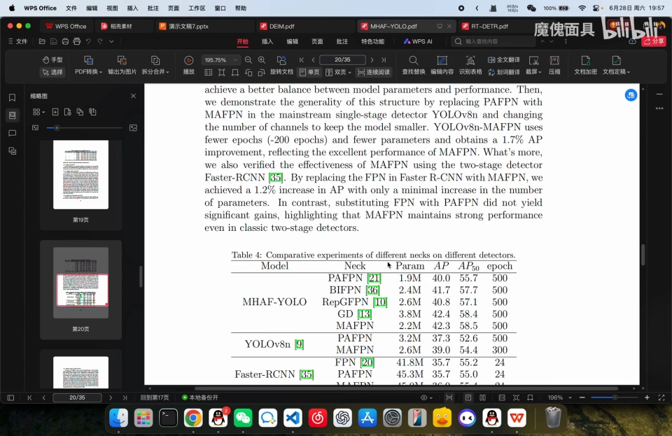
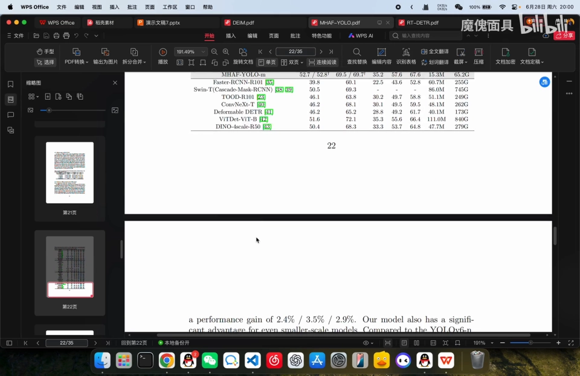
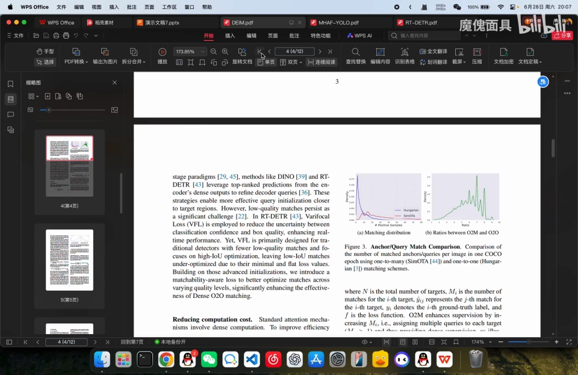
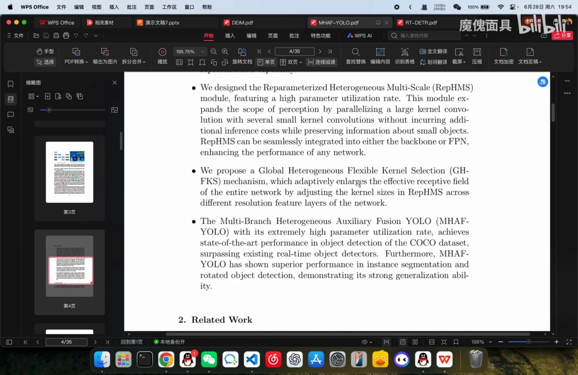

# 一篇论文的四类实验：基线、消融、对比与泛化

> 视频来源：[深度学习论文中的基础实验、改进实验、消融实验、对比实验、泛化实验｜这些究竟是什么？](https://www.bilibili.com/video/BV1NYKUz2E6b/?t=0)（Bilibili · 魔鬼面具）
> 本文基于视频演说图文稿整理，配图截自视频。视频以目标检测（YOLO / DETR 系列）论文为例讲，但四类实验的分工与判据对任何"提出一个模块、声称比原来更好"的工作都适用。

## 本讲要解决的核心问题（SCQA）

**背景**：一篇方法类论文的实验部分通常有几个固定栏目——基准模型、消融实验、对比实验、泛化实验。做过一两次的人都能照着别人的表格摆出来。

**冲突**：摆得出来不等于站得住。消融实验里 A 加 B 反而不如 A 好，却靠 A 加 B 加 C 拉回来；对比实验里给别人的模型配了不适合它的优化器；泛化实验只在自家数据集上跑了一遍——这些表格都能填满，但结论经不起追问。更麻烦的是，"消融要控制变量、对比可以不控制变量"这条看似矛盾的要求，很多人在写作时是混着用的。

**疑问**：这四类实验各自要回答什么问题？每一类里哪些量必须固定、哪些可以放开？做到什么程度才算够？

**回答（中心思想）**：四类实验对应四个不同的问题——**基线**定义"跟谁比"，**消融**证明"我的每个改动都在起作用"，**对比**证明"我比现有方法好"，**泛化**证明"这个好处不只在我这一份数据上成立"。控制变量的严格程度随问题而变：消融必须同参同环境，对比允许各用各的最优配置，泛化则要主动更换数据分布或宿主模型。

---

## 一、基线（baseline）：先把"跟谁比"钉死

整支视频的骨架就是这一页幻灯片：先找基准模型，再改它，然后做消融、对比、泛化 [【跳转到 03:23】](https://www.bilibili.com/video/BV1NYKUz2E6b/?t=203)。

### 1.1 baseline 是"改进前的那条线"

**是什么**：baseline（基准模型）就是你要超越的那个已有模型。后面的改进实验都是基于它做的。**为什么需要**：没有 baseline，"我的方法效果好"这句话没有主语——好是相对谁好？**怎么做**：在论文里明确写出 baseline 是哪个模型、哪个规模、哪个配置 [【跳转到 01:01】](https://www.bilibili.com/video/BV1NYKUz2E6b/?t=61)。

读论文时有个很实用的入口：**直接翻实验表格**。视频举的例子是某篇工作的 table 5，从表里能看出它们的 baseline 是 YOLOv10n [【跳转到 01:26】](https://www.bilibili.com/video/BV1NYKUz2E6b/?t=86)。所以判断一篇文章的起点，不必读完整篇方法，看表头那一列就够。

### 1.2 "更好"可以是精度、也可以是效率

改进的方向不止一条：

- 计算量、参数量更低（更省）；
- 精度更高（更准）；
- 两者同时改善（最理想）；
- 或者只往效率走、只往精度走，把另一头当约束。

这决定了你后面表格要放哪些列。如果目标是"又小又准"，那参数量、FLOPs 和 AP 必须同时出现在表里，只报 AP 是不够的 [【跳转到 01:26】](https://www.bilibili.com/video/BV1NYKUz2E6b/?t=86)。

### 1.3 改进后"部分指标更好"是常态

绝大多数论文是**部分指标**优于 baseline，只有效果特别好的工作才能所有指标全面领先 [【跳转到 02:58】](https://www.bilibili.com/video/BV1NYKUz2E6b/?t=178)。这一点值得初学者记住：不要因为自己某一列掉了 0.2 就以为实验失败，关键是掉的那一列是不是你的目标，以及能不能解释。

---

## 二、消融实验：证明"每个改动都在干活"

### 2.1 一条必须满足的单调关系

假设你有 A、B、C 三个创新点，那么必须保证：

$$
\text{baseline} \;<\; A \;<\; A+B \;<\; A+B+C
$$

这里的"$<$"读作"效果不如"：以 AP（平均精度）为例，就是 baseline 的 AP 最低，每加一个创新点 AP 都要往上走。创新点更多就以此类推 [【跳转到 03:23】](https://www.bilibili.com/video/BV1NYKUz2E6b/?t=203)。

**为什么这条关系是底线**：如果 A 加 B 反而不如 A，但 A 加 B 加 C 又比 A 好，你就没法说清 B 到底贡献了什么——读者会怀疑 B 是负作用、只是被 C 掩盖了。

### 2.2 遇到"协同作用"怎么办

有些同学会辩解说 B 和 C 有协同作用，单独加上去没效果、一起加才有效。视频给的处理办法很干脆：**把 B 加 C 合并成一个模块去说明**。否则按定义你就只有两个创新点，而不是三个 [【跳转到 04:28】](https://www.bilibili.com/video/BV1NYKUz2E6b/?t=268)。这是一个写作层面的取舍：与其硬撑三个贡献点，不如老实讲两个，但每个都能独立验证。

### 2.3 更丰富的消融：排列组合

基础的消融是逐步累加（A、A+B、A+B+C）。更严格的版本会把组合都跑一遍：单独的 A、B、C，两两组合 A+C、B+C，再三三组合 [【跳转到 05:08】](https://www.bilibili.com/video/BV1NYKUz2E6b/?t=308)。

视频举的例子是一个叫 MAFPN 的结构，由三个部分组成，论文把单独、两两、三三的组合都列了出来。作者的评价是：这是最详细的消融，能证明"两两组合都有不错的效果"，也就是每个部件都不是凑数的。但他也承认，这种情况比较难达到，一般来说**首先要保证逐步累加那一块** [【跳转到 05:33】](https://www.bilibili.com/video/BV1NYKUz2E6b/?t=333)。

### 2.4 模块内部的消融

还有一类容易被忽略：**创新点内部**的消融。比如某篇论文的模块内部由三个小模块组合而成，作者就分别去掉/替换这三个小模块各跑一次 [【跳转到 07:01】](https://www.bilibili.com/video/BV1NYKUz2E6b/?t=421)。

所以"消融实验"这个词在这支视频里被明确限定为两种形态：

1. **创新点之间**的消融（A、B、C 的组合）；
2. **创新点内部小模块**的消融。

它始终跟你的创新点绑定，不是随便删几层网络就叫消融 [【跳转到 07:37】](https://www.bilibili.com/video/BV1NYKUz2E6b/?t=457)。

### 2.5 换掉一个组件、换一个尺寸，也算消融

再往细里做，还有两种常见形式：

- **替换同类组件**：比如你提出了一个新的注意力，就拿它去替换几个经典注意力机制，逐一比较，证明你的注意力本身有效 [【跳转到 08:02】](https://www.bilibili.com/video/BV1NYKUz2E6b/?t=482)。
- **换模型尺寸**：同一个方法在 N 版、S 版等不同规模上各跑一次，证明它在不同容量下依然 work [【跳转到 08:22】](https://www.bilibili.com/video/BV1NYKUz2E6b/?t=502)。

视频里有一句很实在的话：**消融做得越多，越能证明你模块的创新度**——实验其实能一定程度上反映创新度，实验做得越多，论文能写的东西也越多 [【跳转到 08:38】](https://www.bilibili.com/video/BV1NYKUz2E6b/?t=518)。

### 2.6 消融必须同参同环境

这是全片最容易被忽略的一条硬规矩：**消融实验的训练参数必须保持一致**，尤其是创新点的消融——学习率、训练轮数、数据增强，全都要对齐 [【跳转到 09:33】](https://www.bilibili.com/video/BV1NYKUz2E6b/?t=573)。

唯一的例外是**不同尺寸**的消融。视频举了 DEIM 的例子：在它的模型配置文件里，越小的版本训练轮数越多，所以尺寸之间没法保证一致，这时学习率也可以不同 [【跳转到 10:03】](https://www.bilibili.com/video/BV1NYKUz2E6b/?t=603)。但**同一尺寸内部必须一致** [【跳转到 10:59】](https://www.bilibili.com/video/BV1NYKUz2E6b/?t=659)。

---

## 三、对比实验：跟别人的模型比，参数可以各用各的

### 3.1 对比实验问的是另一个问题

消融回答"我的改动有没有用"，对比回答"我的最终模型跟别人比怎么样" [【跳转到 09:08】](https://www.bilibili.com/video/BV1NYKUz2E6b/?t=548)。

### 3.2 参数不必统一——因为统一反而不公平

这是与消融相反的一条：对比实验里，**参数和环境都可以不一样**。原因是不同模型的最优配置本来就不同。视频举的例子很具体：YOLO 系列适合用 SGD，而 DETR 系列用 SGD 可能"差到不行、甚至没有进度"，一般要用 AdamW。硬把两者统一到同一套超参，等于故意削弱对手 [【跳转到 13:26】](https://www.bilibili.com/video/BV1NYKUz2E6b/?t=806)。

所以正确的做法是：**每个对比对象都用它自己论文推荐的最优配置**，然后在表格里写清来源。

### 3.3 不知道该对比谁？按家族列一遍

视频给了一份按架构家族划分的清单，照着填基本不会漏 [【跳转到 11:19】](https://www.bilibili.com/video/BV1NYKUz2E6b/?t=679)：

| 家族 | 代表模型 |
| --- | --- |
| 二阶段 | Faster R-CNN、Cascade R-CNN |
| 一阶段（非 anchor-based） | ATSS、TOOD、GFL、RetinaNet |
| 一阶段（anchor-based） | YOLOX、YOLOv8 / v10 / v11 / v12 / v13 及变体 |
| Transformer 类 | DINO、DAB 系列、RT-DETR、DEIM 等 |

配套的工程细节也要交代：用什么框架（如 MMDetection）、训练配置、以及各种主流指标 [【跳转到 12:44】](https://www.bilibili.com/video/BV1NYKUz2E6b/?t=764)。

### 3.4 高要求期刊还要对比"同期的新工作"

如果投的是要求较高的期刊，还要对比别人论文里的改进模型，特别是 2024、2025 年较新的文章提出的模型 [【跳转到 13:01】](https://www.bilibili.com/video/BV1NYKUz2E6b/?t=781)。这一条本质上是防止"跟三年前的方法比赢了自己很开心"。

---

## 四、泛化实验：证明好处不只在一份数据上成立

### 4.1 换数据集

泛化实验的第一种形态是**同领域、不同数据集**。比如你做小目标检测，就找几个小目标的经典数据集，看改进模型相对基础模型是否还能提点 [【跳转到 14:16】](https://www.bilibili.com/video/BV1NYKUz2E6b/?t=856)。

第二种是**换到通用数据集**，比如 COCO。这证明你的创新点不只服务于自己那个领域，在通用数据上一样有效 [【跳转到 15:06】](https://www.bilibili.com/video/BV1NYKUz2E6b/?t=906)。

### 4.2 换宿主模型

第三种形态更容易被忽略：**改进点在不同模型之间是否 work**。视频以 DEIM 为例——严格说 DEIM 是一种训练策略、一种损失函数的组合，它不改变模型结构（DEIM 版的 D-FINE 结构就是 D-FINE，DEIM 版的 RT-DETR v2 结构就是 RT-DETR v2），主要是在训练上加了数据增强来解决稀疏一对一匹配的问题，再加一个匹配损失 [【跳转到 15:36】](https://www.bilibili.com/video/BV1NYKUz2E6b/?t=936)。

正因为不改结构，它理论上可以无缝嵌进类似的 DETR 类模型，于是作者就在多个宿主模型上各验一遍 [【跳转到 16:26】](https://www.bilibili.com/video/BV1NYKUz2E6b/?t=986)。

### 4.3 尺寸消融其实更像泛化

视频作者自己也修正了一次分类：前面说的"不同尺寸的消融"，既像消融也像泛化，但他觉得**更该归到泛化**——因为它检验的是"这个改动在别的容量下还成立吗"，而不是"这个改动本身有没有用" [【跳转到 16:41】](https://www.bilibili.com/video/BV1NYKUz2E6b/?t=1001)。这个自我修正本身挺有价值：分类不是目的，**每类实验在回答哪个问题**才是。

---

## 五、做到什么程度，取决于你要投哪里

视频反复强调的一句话是：**去看你要投的期刊上同类文章做到什么程度**。如果大家都只做逐步累加，你做到逐步累加也可以；如果大家都做了完整的排列组合，你也要跟上 [【跳转到 06:02】](https://www.bilibili.com/video/BV1NYKUz2E6b/?t=362)。

审稿人看一篇文章，首先看的就是实验做到什么程度。如果只有最基础的消融，却要投较好的期刊，那肯定还要加码——对比实验、相关实验、方法实验都要做得全面，才能撑住你提出的东西 [【跳转到 17:06】](https://www.bilibili.com/video/BV1NYKUz2E6b/?t=1026)。

这张图正好说明"贡献点"与"消融表"的对应关系：论文列了三个贡献（RepHMS 模块、GH-FKS 核选择机制、MHAF-YOLO 整体模型），消融实验就得能逐条回答"去掉它分别会怎样" [【跳转到 02:06】](https://www.bilibili.com/video/BV1NYKUz2E6b/?t=126)。

---

## 小结

- **四类实验对应四个问题**：基线（跟谁比）、消融（我的改动有没有用）、对比（我比别人好不好）、泛化（好处是否只在原地成立）。
- **消融的底线是单调**：baseline < A < A+B < A+B+C；做不到就把有协同作用的两个点合并成一个贡献。
- **消融必须同参同环境**，唯一例外是不同尺寸之间的比较；**对比实验反而不能强行统一参数**，否则是在削弱对手。
- **消融有两种粒度**：创新点之间、创新点内部的小模块；此外还有"替换同类组件"和"换模型尺寸"两种常见变体。
- **泛化有三种换法**：同领域换数据集、换到通用数据集、换宿主模型。
- **实验深度是相对的**：以目标期刊同类文章为标尺，贡献点写了几条，消融就要能对上几条。

## 关键术语速查

| 术语 | 一句话解释 |
| --- | --- |
| baseline（基准模型） | 你要超越的那个已有模型，所有改进都相对它来度量 |
| 消融实验（ablation） | 逐个去掉或加上某个改动，看指标怎么变，用来证明每个改动都有贡献 |
| 对比实验 | 最终模型与其他已有模型的横向比较，各模型可用自己的最优配置 |
| 泛化实验 | 换数据集或换宿主模型再验一次，检验结论是否只在一份数据上成立 |
| 协同作用 | 两个改动单独无效、合起来才有效的说法；写作上建议合并为一个贡献点 |
| anchor-based / anchor-free | 检测器是否依赖预设的候选框（锚框）来生成预测 |
| SGD / AdamW | 两种优化器；不同架构适配的优化器不同，这是对比实验不能统一超参的原因 |