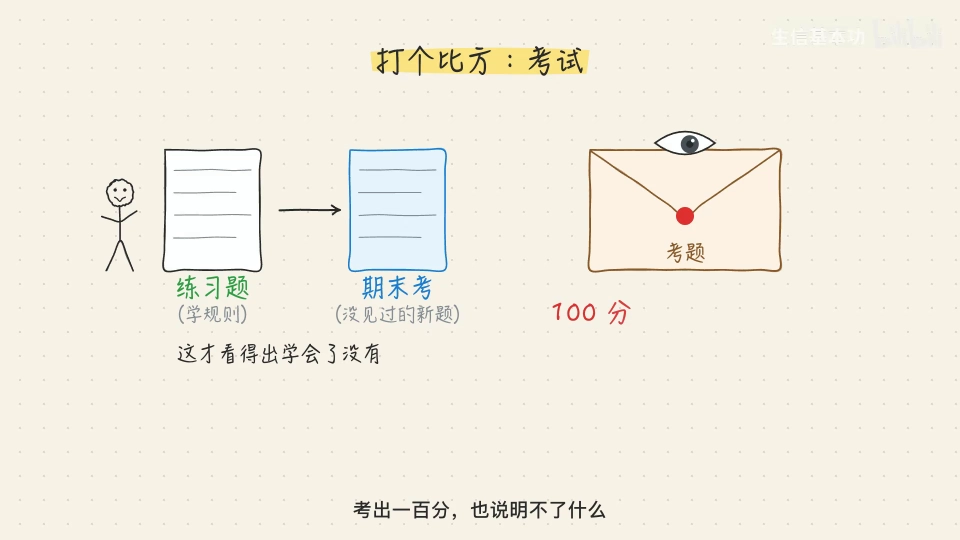
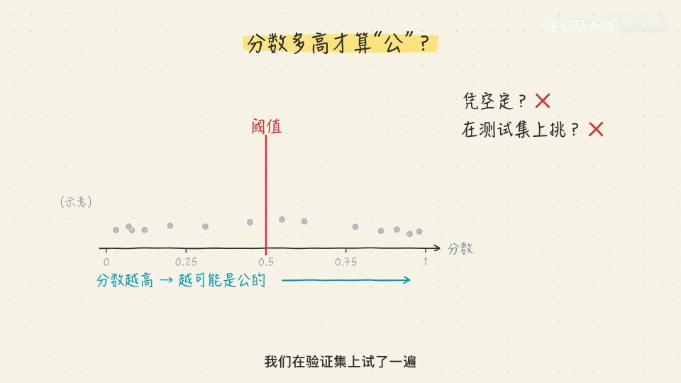
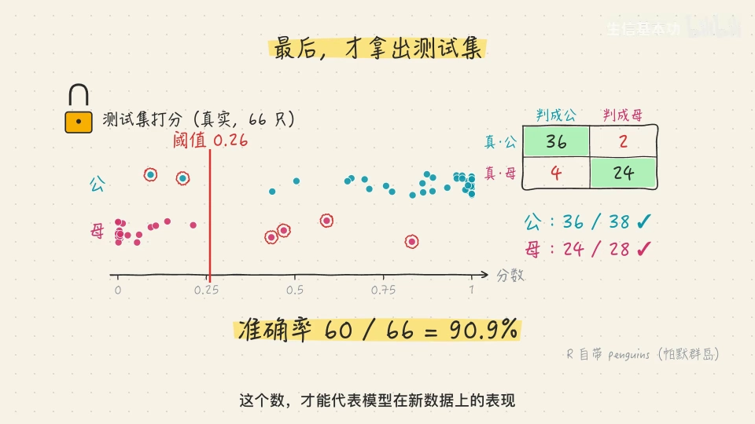
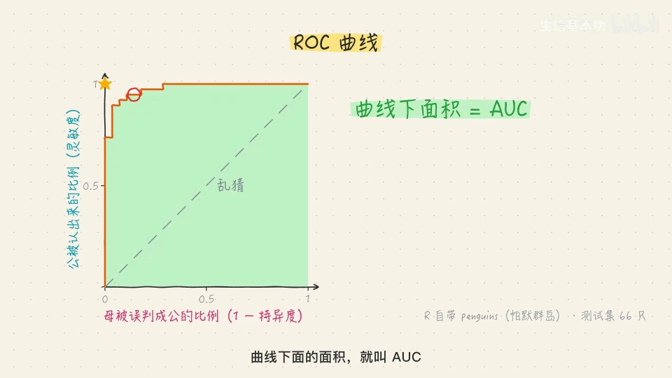
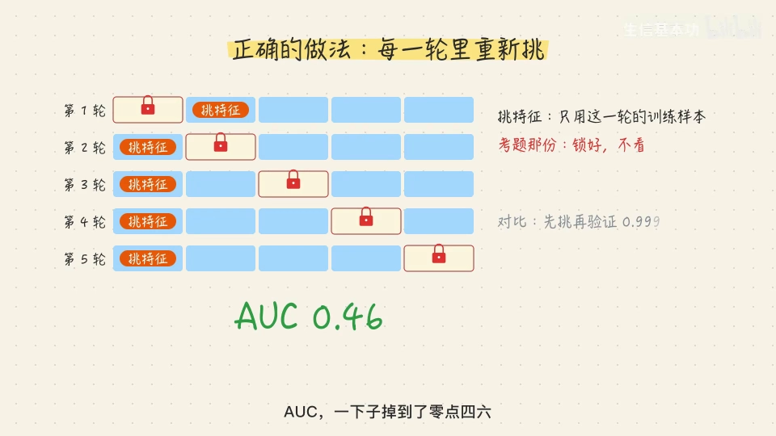
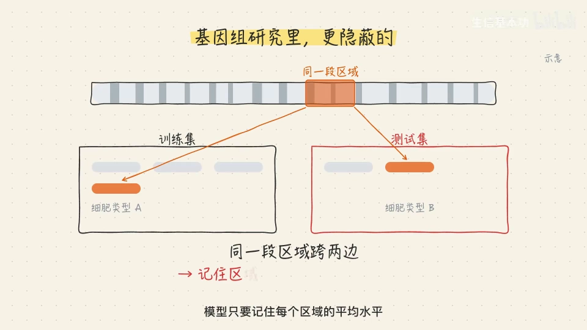
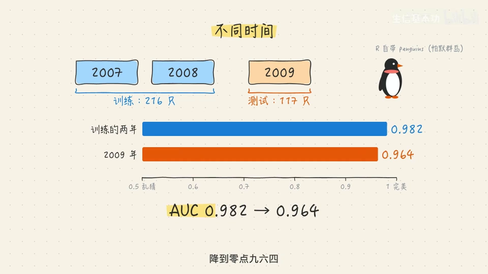
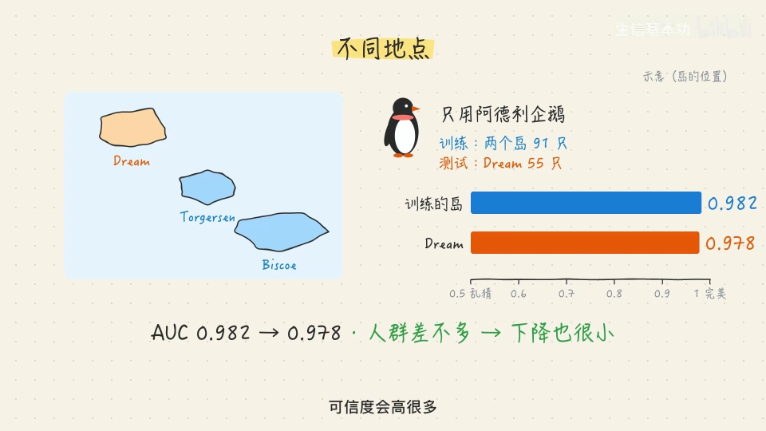
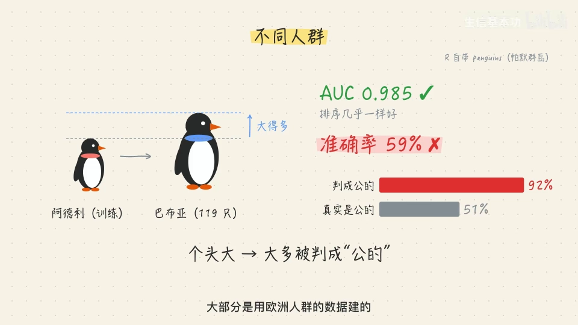
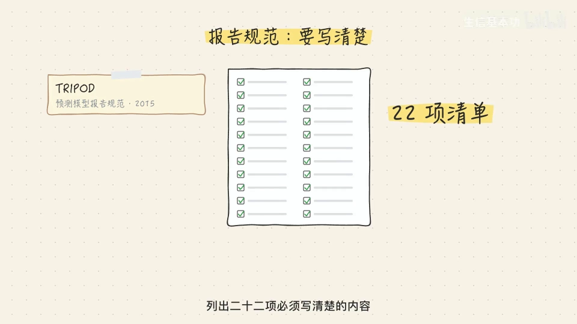

# 高分不等于成功：数据泄漏、AUC与外部验证

> 视频来源：[生信入门 第34讲：机器学习与数据泄露｜零基础公开课](https://www.bilibili.com/video/BV11BWx61EmZ/?t=0)（Bilibili · 生信基本功）
> 本文基于视频演说图文稿整理，配图截自视频。视频用一份企鹅数据和一份基因芯片数据，把"模型看起来很准"到"模型真的可信"之间缺的每一步都走了一遍。

## 本讲要解决的核心问题（SCQA）

**背景**：这几年越来越多的论文用机器学习从基因表达里预测疾病分型或预后。审稿人和读者看到的通常是一个漂亮的数字：准确率 90%、AUC 0.95。

**冲突**：这个数字可能什么都不是。视频里有一个极端实验：40 个样本、每个样本 1 万个**完全随机**的数、标签和数据毫无关系——只要先用全部样本挑特征再做交叉验证，AUC 能到 0.999；改成正确流程，AUC 掉到 0.46，也就是乱猜。同样的落差在真实数据上也会出现：一份病人/对照标签被打乱的芯片数据，能做出 AUC 0.95。

**疑问**：一个高分到底要经过哪些关卡，才能算"实验成功"？哪些环节会把分数虚抬上去？

**回答（中心思想）**：**分数只有在"考题从未被偷看"的前提下才有意义**。这条前提拆成三件事：数据要按个体/来源分组切分（防泄漏）、指标要看清它衡量的是排序还是阈值（防误读）、结论要在独立的时间/地点/人群上再验一次（防过拟合到一份数据）。三者缺一，高分就只是"在自己考过的卷子上又考了一遍"。

---

## 一、预测模型是什么：先立一个"考试"的比喻

**是什么**：预测模型就是从已知答案的数据里学出一套规则，再用这套规则去猜新数据的答案。比如看一个人的基因表达猜他是不是病人，看一块地的土壤和气候猜今年产量，看一封邮件猜它是不是垃圾邮件 [【跳转到 00:25】](https://www.bilibili.com/video/BV11BWx61EmZ/?t=25)。

**为什么需要这个比喻**：因为后面所有概念都是这个比喻的变体。练习题 = 训练集，期末考 = 测试集，**提前看到考题 = 数据泄漏**。学生提前看了卷子考出 100 分，说明不了他学会了；模型提前看过测试样本拿到 0.99，也说明不了它有用 [【跳转到 00:50】](https://www.bilibili.com/video/BV11BWx61EmZ/?t=50)。

---

## 二、三份数据：训练学规则、验证做选择、测试只考一次

### 2.1 分工

标准做法是把数据分成三份 [【跳转到 01:40】](https://www.bilibili.com/video/BV11BWx61EmZ/?t=100)：

| 数据 | 作用 | 考试类比 |
| --- | --- | --- |
| 训练集 | 学规则（拟合参数） | 练习题 |
| 验证集 | 做选择（定阈值、挑超参、选模型） | 模拟考 |
| 测试集 | 只在最后用一次 | 期末考试 |

关键纪律：**测试集在整个过程中一眼都不能看**。注意"做选择"这件事被明确划给了验证集——阈值、超参数、模型结构的选择都算"从数据里学东西"。

### 2.2 一个完整的例子：333 只企鹅

视频用 R 自带的企鹅数据做一个和医学无关的例子：只用身体测量去猜一只企鹅是公是母，一共 333 只，雌雄各一半左右。随机分成训练 200 只、验证 67 只、测试 66 只 [【跳转到 02:05】](https://www.bilibili.com/video/BV11BWx61EmZ/?t=125)。

模型给每只企鹅打一个分，分数越高越可能是公的。但"多高才算公"这条线——阈值——不能凭空定，也不能在测试集上挑。

在验证集上试的结果是：阈值从 0.11 到 0.43，准确率都是最高的 91%，于是取中间的 0.26 [【跳转到 02:55】](https://www.bilibili.com/video/BV11BWx61EmZ/?t=175)。

### 2.3 最后才打开测试集

66 只企鹅猜对 60 只，准确率 90.9%；38 只公的认对 36 只，28 只母的认对 24 只 [【跳转到 02:55】](https://www.bilibili.com/video/BV11BWx61EmZ/?t=175)。

**这个数才能代表模型在新数据上的表现**。验证集上那个 91% 是"挑选过程"的一部分，测试集上这个 90.9% 才是"交付成绩"。两者接近，说明挑选没有过拟合到验证集。

### 2.4 样本少的时候用交叉验证

分成三份太浪费，常用办法是交叉验证：把数据分成五份，轮流拿一份当考题、其余四份当练习，最后把五次成绩平均 [【跳转到 03:20】](https://www.bilibili.com/video/BV11BWx61EmZ/?t=200)。

要记住一条：**交叉验证的每一轮同样不能偷看那一份考题**。这句话看起来是废话，但它正是后面所有泄漏案例的判据。

---

## 三、AUC：它只看排序，不看阈值

### 3.1 两个比例：灵敏度和特异度

准确率只是评价模型的一个数，更常见的指标是 AUC。先认识两个比例 [【跳转到 03:45】](https://www.bilibili.com/video/BV11BWx61EmZ/?t=225)：

- **灵敏度**（sensitivity）：真正的公企鹅里被认出来的比例（视频例子：阈值 0.26 时 36/38 = 94.7%）；
- **特异度**（specificity）：真正的母企鹅里被认对的比例（24/28）。

阈值调低，更多企鹅被判成公的，灵敏度上升，但母的也会被误判、特异度下降——两者此消彼长 [【跳转到 04:10】](https://www.bilibili.com/video/BV11BWx61EmZ/?t=250)。

### 3.2 ROC 曲线与 AUC

把阈值从高到低划一遍，每个阈值都得到一对比例，画成一条曲线：横轴是母企鹅被误判成公的比例（$1-\text{特异度}$），纵轴是公企鹅被认出来的比例（灵敏度）。曲线越靠近左上角模型越好；如果模型只是乱猜，曲线就是一条对角线 [【跳转到 04:35】](https://www.bilibili.com/video/BV11BWx61EmZ/?t=275)。

曲线下面的面积就叫 AUC，在 0.5 到 1 之间，0.5 等于乱猜，1 是完美。这个企鹅模型在测试集上的 AUC 是 0.977 [【跳转到 05:00】](https://www.bilibili.com/video/BV11BWx61EmZ/?t=300)。

### 3.3 AUC 的概率含义

AUC 有一个很直观的解释：随便挑一只公企鹅、一只母企鹅，模型给公的打分更高的概率正好就是 AUC。数一数：38 只公的、28 只母的，一共 1064 对，其中公的分数更高的有 1040 对，$1040 \div 1064 = 0.977$ [【跳转到 05:25】](https://www.bilibili.com/video/BV11BWx61EmZ/?t=325)。

**这个定义直接决定了 AUC 的局限**：它只看排序，不看阈值。所以"AUC 很高"不代表"在某个具体阈值下准确率就一定高"。这个伏笔会在外部验证那一节兑现。

---

## 四、数据泄漏：一个 AUC 0.999 的空模型

### 4.1 故意做一个没有任何信息的实验

一个 AUC 0.95 的模型听起来很厉害，可它会不会是偷看了考题？视频做了一个故意没有任何信息的实验 [【跳转到 05:50】](https://www.bilibili.com/video/BV11BWx61EmZ/?t=350)：

- 40 个样本随机分成两组；
- 每个样本 1 万个**完全随机**的数；
- 标签和数据之间没有任何关系，任何模型都应该只能猜对一半左右。

### 4.2 错误流程 vs 正确流程

**错误流程**（很多分析真的这么做）：先用全部 40 个样本挑出两组之间差别最大的 20 个特征，再拿这 20 个特征去做交叉验证，重复 50 次 → 交叉验证 AUC 平均 **0.999**。

**正确流程**：在交叉验证的每一轮里，只用那一轮的训练样本重新挑特征 → AUC 掉到 **0.46**，和乱猜一样 [【跳转到 06:30】](https://www.bilibili.com/video/BV11BWx61EmZ/?t=390)。

**为什么会这样**：1 万个随机的数里总有一些碰巧和标签对得上。用全部样本挑特征，等于考题里的样本也参与了挑选，答案早就被偷看过了 [【跳转到 06:55】](https://www.bilibili.com/video/BV11BWx61EmZ/?t=415)。这就是**数据泄漏**（data leakage）：任何"从数据里学东西"的步骤跑在了切分之前。

### 4.3 真实数据上也一样

视频把一份肾小球芯片数据的病人/对照标签随机打乱，再做同样的对比：先挑基因再交叉验证，AUC 平均 0.95；把挑基因放进每一轮里，AUC 只有 0.5 左右 [【跳转到 07:20】](https://www.bilibili.com/video/BV11BWx61EmZ/?t=440)。

有意思的是后半段：换回**真实**标签，正确流程的 AUC 也是 1 左右。作者没有把这个 1 当成好消息——这份数据的病人和对照是分两批扫描的，光凭批次就能把它们分开，所以这个 1 证明不了疾病信号 [【跳转到 07:20】](https://www.bilibili.com/video/BV11BWx61EmZ/?t=440)。

这里有一个很关键的区分：**正确的验证流程能戳破"偷看考题"造成的假信号，却管不了实验设计上的混杂**。两件事需要两套办法。

### 4.4 这个坑 2002 年就被指出过

网上很多套路文章也是这样：在公共数据库里挑出几个基因，再在同一批病人里算预测效果，从头到尾只用一个数据集，结果看起来很漂亮，换一批人就不灵了 [【跳转到 07:39】](https://www.bilibili.com/video/BV11BWx61EmZ/?t=459)。

这个问题 2002 年就有统计学家专门指出过：当时一些基因芯片的预测研究报告了接近零的错误率，原因正是挑基因这一步没有放进交叉验证里面 [【跳转到 07:56】](https://www.bilibili.com/video/BV11BWx61EmZ/?t=476)。

**小结这一节**：凡是从数据里学的步骤——挑特征、调参数——都只能在训练集里做，否则连随机数都能造出完美的模型。

---

## 五、泄漏还有别的样子

### 5.1 同一个个体跨了训练和测试

第二种泄漏：同一个个体同时出现在训练集和测试集里。比如同一个病人的两次测量、同一只小鼠的两个组织、同一份样本的技术重复 [【跳转到 08:21】](https://www.bilibili.com/video/BV11BWx61EmZ/?t=501)。

模拟：40 个个体，每个测两次，标签同样是随机的。

- 按**测量**随机分（八成的测试样本），它的重复测量就在训练集里 → 准确率 **91%**；
- 改成按**个体**分（同一个体的两次测量必须在同一边）→ 准确率回到 **51%** [【跳转到 08:46】](https://www.bilibili.com/video/BV11BWx61EmZ/?t=526)。

模型并没有学会区分病人和对照，它只是**认出了这个人**。

### 5.2 预处理用了全部数据

第三种：标准化、批次校正这类预处理用了全部数据。在企鹅例子里，先用全部数据缩放再分组，结果几乎没有变化——要老实说，这一种的影响有时很小 [【跳转到 09:11】](https://www.bilibili.com/video/BV11BWx61EmZ/?t=551)。

但如果预处理本身用到了标签，或者从成千上万个特征里学东西（比如批次校正、挑特征），泄漏就会变得很严重。

### 5.3 基因组区域跨了两边

更隐蔽的一种：同一段基因组区域同时出现在训练集和测试集里，模型只要记住每个区域的平均水平就能显得很准 [【跳转到 09:36】](https://www.bilibili.com/video/BV11BWx61EmZ/?t=576)。

再叠加批次问题：如果病人都在一个批次、对照都在另一个批次，模型学到的可能只是批次而不是病。**在这样的数据上准确率可以接近百分之百，却毫无用处。**

### 5.4 一条总规矩

**先分组，再做任何从数据里学东西的事**。同一个个体、同一个来源的样本必须分在同一边 [【跳转到 10:01】](https://www.bilibili.com/video/BV11BWx61EmZ/?t=601)。

---

## 六、外部验证：换时间、换地点、换人群

就算没有任何泄漏，模型在自己的数据上表现好，换到别人的数据上也不一定还能这么好。外部验证就是拿一份完全独立的数据——不同的时间、不同的地点、不同的人群——再测一次 [【跳转到 10:26】](https://www.bilibili.com/video/BV11BWx61EmZ/?t=626)。

### 6.1 换时间：小幅下降

企鹅数据是 2007 到 2009 年采集的。用前两年的企鹅训练，去猜 2009 年的：

AUC 从 0.982 降到 0.964 [【跳转到 10:49】](https://www.bilibili.com/video/BV11BWx61EmZ/?t=649)。

### 6.2 换地点：下降更小

用两个岛上的阿德利企鹅训练，去猜第三个岛上的：

AUC 从 0.982 降到 0.978——人群差不多，下降也很小 [【跳转到 10:49】](https://www.bilibili.com/video/BV11BWx61EmZ/?t=649)。

视频还提了生信里的对应做法：给糖尿病肾病准备两份数据，一份芯片数据用来发现、一份测序数据用来验证，平台不同、病人不同。如果结论在两份里都站得住，可信度会高很多。

### 6.3 换人群：AUC 还行，准确率崩了

这是全片最有价值的一个案例。把只用阿德利企鹅训练的模型拿去猜巴布亚企鹅：

- AUC 还是 **0.985**，排序几乎一样好；
- 准确率只剩下 **59%**——因为巴布亚企鹅整体个头大得多，模型把 92% 都判成了公的，而真实只有一半多 [【跳转到 11:14】](https://www.bilibili.com/video/BV11BWx61EmZ/?t=674)。

这正是第三节埋的伏笔：**AUC 只看排序，不看阈值**。排序在新人群里还成立，可阈值已经不合适了。所以外部验证要**排序和阈值两样都检查** [【跳转到 11:39】](https://www.bilibili.com/video/BV11BWx61EmZ/?t=699)。

基因风险评分也是这样：大部分是用欧洲人群的数据建的，放到其他人群里预测能力常常明显下降。

### 6.4 无监督结果也要能重复

还要分清两件事：有标签、预测谁会得病，是有监督学习；没有标签、在病人里自己找亚型，是无监督学习（降维与聚类）。找到的亚型一样要在新数据里重复出来 [【跳转到 11:39】](https://www.bilibili.com/video/BV11BWx61EmZ/?t=699)。

现在热门的基础模型、多组学预测模型同样要过外部验证这一关，还要问它对不同人群是否公平、能不能说清它为什么这样判断 [【跳转到 12:04】](https://www.bilibili.com/video/BV11BWx61EmZ/?t=724)。

---

## 七、读论文时先问三个问题

### 7.1 报告规范：22 项清单

2015 年，预测模型的报告规范发布了一份清单，列出 22 项必须写清楚的内容，包括数据怎么分、怎么验证；2024 年又发布了针对机器学习的新版本 [【跳转到 12:29】](https://www.bilibili.com/video/BV11BWx61EmZ/?t=749)。

### 7.2 三个问题

读论文时看到一个预测模型，先问 [【跳转到 12:29】](https://www.bilibili.com/video/BV11BWx61EmZ/?t=749)：

1. **测试集是不是一直没被碰过？**
2. **有没有任何一步用了全部数据？**（挑特征、调参、标准化、批次校正都算）
3. **有没有在独立的数据上验证过？**

三个问题对应三种失败：第 1 个对应"边挑边考"，第 2 个对应数据泄漏，第 3 个对应"只在自己数据上成立"。三个都过关，那个高分才值得相信。

---

## 小结

- **预测模型 = 从已知答案学规则，用没见过的数据评价**；提前看到考题，考 100 分也说明不了什么。
- **三份数据分工**：训练集学规则、验证集做选择（含阈值）、测试集只在最后用一次；样本少用交叉验证，每一轮同样不能偷看那一份。
- **AUC 是排序指标**：等于随机一对里排序正确的概率，不看阈值——所以 AUC 高不代表某个阈值下准确率高。
- **数据泄漏的本质**是"从数据里学东西的步骤跑在了切分之前"：先挑特征再验证，随机数都能做出 AUC 0.999。
- **泄漏还有别的形态**：同一个体跨两边、预处理用了全部数据、同一基因组区域跨两边、批次与标签完全重合。
- **外部验证换三样东西**：时间、地点、人群。换人群时 AUC 可能几乎不变而准确率崩掉，所以排序和阈值都要看。
- **三个问题**：测试集碰过没有、有没有一步用了全部数据、有没有独立数据验证过。

## 关键术语速查

| 术语 | 一句话解释 |
| --- | --- |
| 数据泄漏（data leakage） | 测试样本的信息通过挑特征、调参、预处理等步骤提前进入模型，使评估虚高 |
| 训练集 / 验证集 / 测试集 | 分别用于学参数、做选择、最终评估一次；测试集全程不可见 |
| 交叉验证 | 把数据分成 k 份轮流做考题，每轮都必须把当轮考题完全隔离 |
| 阈值 | 把连续打分变成二分类判定的那条线；只能在验证集上定 |
| 灵敏度 / 特异度 | 真阳性里被认出的比例 / 真阴性里被认对的比例，随阈值此消彼长 |
| ROC 曲线 / AUC | 扫描所有阈值得到的灵敏度—误判率曲线；曲线下面积等于随机一对排序正确的概率 |
| 外部验证 | 用不同时间、地点、人群的独立数据再测一次，同时检查排序与阈值 |
| 批次效应 | 样本因处理批次不同产生的系统性差异，若与标签重合会被模型当成信号 |
| TRIPOD | 预测模型报告规范，2015 年版本列 22 项必写内容，2024 年有机器学习版 |