# 可复现与记录：随机种子、版本、路径与一条命令重跑

> 视频来源：[生信入门 第54讲：可复现与记录｜零基础公开课](https://www.bilibili.com/video/BV19asP6PEzU/)（Bilibili · 生信基本功）｜时长约 42 分钟
> 导读：这一讲用六个可以亲手重跑的玩具实验，把「看不见但会让结果变调」的东西一样一样揪出来——随机种子、集合的遍历顺序、浮点加法的顺序、软件包版本、抽样规则的版本、电脑的语言设置；再拿课程自己的数据包开刀，讲项目目录、分析日志、校验和、git 与流程管理工具。本文按「为什么需要 → 什么会变调 → 怎么记下来 → 怎么一条命令重跑」重排，数字与原话尽量保留，方便对照复现。

## 本讲要解决的核心问题（SCQA）

**背景**：上一讲讲的是用 AI 做分析之后怎么核对——办法是用独立的代码，从原始文件把关键的数字重新算一遍[【跳转到 01:40】](https://www.bilibili.com/video/BV19asP6PEzU/?t=100)。

**冲突**：可这里有一个前提——**要能重算**。你得知道原来是用什么数据、什么代码、什么参数、什么版本的软件算出来的。这些没记下来，谁也没法重算，**连半年以后的你自己也算不出来**。而真去重跑别人的分析，能原样跑出来的比例低得惊人。

**疑问**：到底有哪些看不见的东西会让结果悄悄变掉？一份分析要记下什么，别人才能在另一台电脑上用一条命令，得到和你一模一样的结果？

**回答（中心思想）**：**可复现 = 同样的数据 + 同样的代码 → 同样的结果**，而「同样的代码」远不止代码本身：种子、版本、顺序、路径、语言设置都会参与决定数字。要固定它们，靠的不是更小心，而是三样可检查的东西——**只读的原始数据 + 集中在一处的参数 + 由程序自动写出的运行日志**，再用版本管理锁住代码与参数的那一版。

---

## 一、可复现是最低标准，但真去重跑时很少能做到

### 1.1 可复现与可重复是两个不同的要求

「可复现」这个词在不同的书里意思不完全一样，本讲用的是最基本的一层：**同样的数据、同样的代码，别人或者半年以后的你，能得到同样的结果**。还有一个更高的要求：换一批新的样本、重新做一次实验，还能得到同样的结论，这叫**可重复**（英文常用 replication）[【跳转到 01:40】](https://www.bilibili.com/video/BV19asP6PEzU/?t=100)。

2011 年《科学》上的一篇评论说：当完全独立地重做一次研究做不到的时候，**可复现可以作为评判一项科学结论的最低标准**。本讲讲的主要就是这个最低标准——同一份数据重新算一遍。

### 1.2 重跑别人的分析：数字差得很远，但原因很集中

听起来这是最低的要求了，可真去查的时候结果并不好。讲者列了一串跨度极大的调查：

| 调查 | 对象 | 结果 |
| --- | --- | --- |
| 2009 年，两组分析师 | 《自然·遗传学》2005–2006 年 18 篇基因芯片论文 | 基本做出来 **2 篇**，部分有出入 6 篇，完全做不出 10 篇；主因不是算错，而是**拿不到数据** |
| 2018 年，抽查 2011 年《科学》数据政策之后的论文 | 204 篇 | 能拿到材料 **44%**，能把结论重新算出来 **26%** |
| 2022 年，真的去要数据 | 1792 篇写着「数据可向作者索取」的论文 | 93% 没回复或拒绝；真发来数据 **6.8%** |
| 2022 年，在干净电脑上跑 | 哈佛公开仓库的 9000 多个 R 脚本 | **74% 报错**，自动清理后仍 56% 报错 |
| 2019 年，统计组学软件 | 2005–2017 年 3.6 万多个工具 | 约 **28%** 在论文给的网址上已找不到 |
| 2024 年，重跑 Jupyter 笔记本 | 2.7 万多个 | 能从头跑到尾不报错 1203 个，**结果一模一样只有 879 个（3.2%）** |

[【跳转到 02:30】](https://www.bilibili.com/video/BV19asP6PEzU/?t=150)、[【跳转到 03:20】](https://www.bilibili.com/video/BV19asP6PEzU/?t=200)、[【跳转到 04:10】](https://www.bilibili.com/video/BV19asP6PEzU/?t=250)、[【跳转到 04:35】](https://www.bilibili.com/video/BV19asP6PEzU/?t=275)

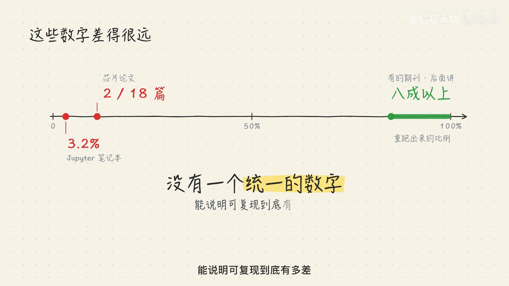

注意 3.2% 这个数字的含义：**大多数笔记本并不是算出了不同的结果，而是连跑都跑不起来**，根本走不到比较结果那一步。这些比例差得很远，因为每项研究查的东西、查的方法都不一样。但它们找到的原因有一个共同点，大多出在两件事上：**没交出来，或者没记下来**——数据在哪、代码是哪一版、参数是多少、软件是什么版本、在什么样的电脑上跑的[【跳转到 05:25】](https://www.bilibili.com/video/BV19asP6PEzU/?t=325)、[【跳转到 05:50】](https://www.bilibili.com/video/BV19asP6PEzU/?t=350)。

---

## 二、六个小实验：让结果悄悄变调的东西

为了看清楚，讲者在电脑上做了六个小实验。数据都是故意编出来的玩具数据，**屏幕上标的程序和版本都是真的**[【跳转到 06:15】](https://www.bilibili.com/video/BV19asP6PEzU/?t=375)。

### 2.1 随机种子：起点一样，这一串数就一模一样

很多分析里都有随机的一步：微生物组里按同样深度**抽平**、机器学习里随机分出训练集和测试集、置换检验里把分组标签随机打乱很多次。

电脑里的随机其实是用一个公式一步一步算出来的，一串数看起来没有规律，但这个公式要有一个起点，就叫**随机种子**。起点一样，算出来的这一串数就一模一样。

讲者从 100 条玩具读段里随机抽 10 条，数每个菌属各有几条：**不设种子跑三次，得到三张不一样的表；设种子 512 跑三次，三张表一模一样**。所以只要有随机的步骤，就要在代码里写明种子，并且记下来[【跳转到 07:05】](https://www.bilibili.com/video/BV19asP6PEzU/?t=425)。


### 2.2 看不见的顺序：集合不保证顺序

Python 里有一种数据结构叫**集合（set）**，它只管装了哪些东西，**不保证顺序**。把五个基因名放进一个集合再打印出来，程序开五次，五次的顺序各不相同。如果后面的步骤依赖这个顺序——比如只取前三个——结果就会变。解决办法很简单：**用之前先排好序**[【跳转到 07:05】](https://www.bilibili.com/video/BV19asP6PEzU/?t=425)。

### 2.3 加法的顺序：浮点数不满足结合律

电脑存小数用的是二进制，很多十进制小数在二进制里写不尽，只能存一个和它极其接近的数。于是：

```text
(0.1 + 0.2) + 0.3 = 0.6000000000000001
0.1 + (0.2 + 0.3) = 0.6
```

差别非常小，平时不用管，可它说明**同样几个数、加的顺序不同，结果就可能不同**。更明显的例子：一个非常大的数 $10^{16}$ 加上 1 再减掉 $10^{16}$，数学上答案是 1，可电脑里加上去的那个 1 太小、被吞掉了，结果是 0。用 Python 自带的求和函数算同样三个数，**Python 3.9 给出 0，Python 3.12 给出 1**——因为 3.12 版改进了求和的算法，官方更新说明里写着新版更准。可如果你的论文是用旧版算的，别人用新版重算，数字就对不上[【跳转到 07:30】](https://www.bilibili.com/video/BV19asP6PEzU/?t=450)、[【跳转到 08:20】](https://www.bilibili.com/video/BV19asP6PEzU/?t=500)。

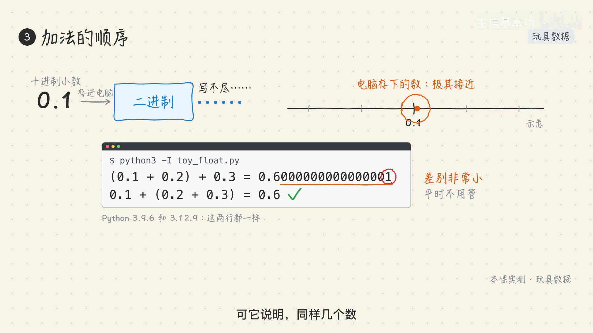

### 2.4 软件包的版本：警告不报错，数字已经变了

pandas 是 Python 里最常用的表格工具。讲者写了一个六行的小脚本：把表格里一个负数的计数改成零，再求和。

- **pandas 2.2**：负数被改成了零，总和 **42**；
- **pandas 3.0**：同一个脚本，改的那一行**悄悄没有起作用**，总和 **41**。

两个版本都只是在屏幕上打出了警告，**没有报错，照常给出了结果**。这种写法的规则在 pandas 3.0 里改了，官方更新说明里也写着。如果你没有记下 pandas 的版本，别人就不知道该用哪一个[【跳转到 08:45】](https://www.bilibili.com/video/BV19asP6PEzU/?t=525)。

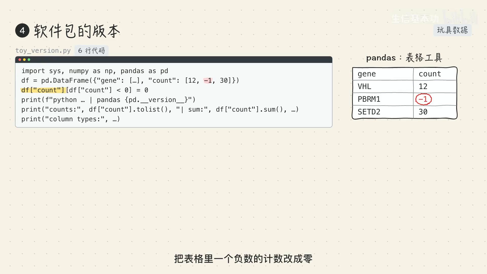

### 2.5 抽样规则的版本：同一个种子，顺序完全不同

R 在 **3.6.0 版改了随机抽样的算法**。同样 `set.seed(42)` 把 1~10 打乱顺序，新规则和旧规则给出的顺序完全不同。R 的官方更新说明还特意写了：需要重现旧结果的时候，可以把旧规则调回来（`RNGkind(sample.kind = "Rounding")`）——**前提是你记下了当年用的是哪个版本**[【跳转到 09:35】](https://www.bilibili.com/video/BV19asP6PEzU/?t=575)。

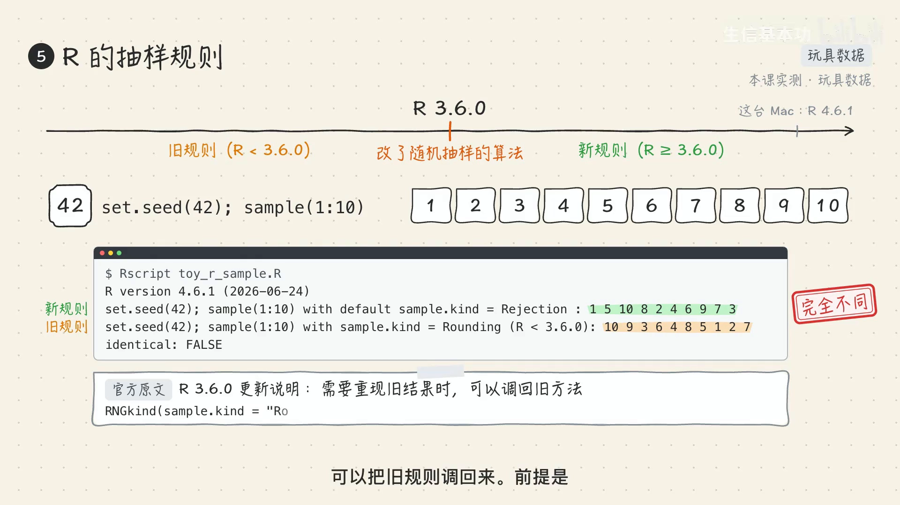

### 2.6 电脑的语言设置：排序规则会跟着变

同样八个基因名让电脑排序：在**最基础的 C 设置**下，大写字母开头的全排在前面、小写的排在后面；在**英文或者中文设置**下，大小写混在一起排。R 里也一样。讲者这台 Mac 上 R 默认就是中文设置，连报错信息都是中文的。

排序会影响什么？**取排名前几的基因、按名字合并两张表、图里各组的先后**，都可能跟着变[【跳转到 10:00】](https://www.bilibili.com/video/BV19asP6PEzU/?t=600)。

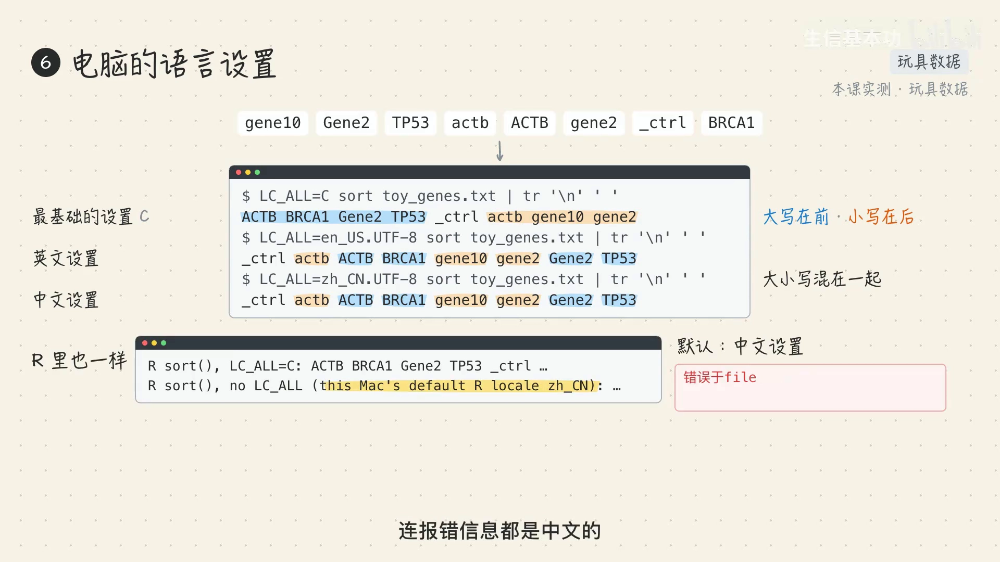

### 2.7 真实研究里，版本的影响有多大

这些是玩具实验，真实分析里的版本效应同样可观：

- **2012 年，脑影像软件**：同样 30 份脑部磁共振扫描，只是软件版本不同，新版和旧版算出的脑区体积**平均差 8.8%，最多的差到 64%**；换一台不同牌子的电脑或换一个操作系统版本，差别大约是它的一半。作者的建议是：一项研究做到一半，**不要升级软件或操作系统，也不要换电脑**，除非把分析全部重做一遍。
- **2015 年，操作系统里的数学函数库**：不同版本之间有细小差别，步骤少的流程几乎不受影响，**步骤一长差别就累积起来**；有一种脑功能影像分析，1/3 的受试者在不同操作系统上得到了不同结果。
- **Excel 的基因名事故**：Excel 在默认设置下会把一些基因名自动改成日期或数字。2016 年有研究者扫描几本基因组学期刊，附带 Excel 基因列表的论文里**约 1/5 有基因名被改错**；文章发表后问题并没有减少，2021 年（含原作者之一的团队）再查 2014–2020 年的论文，比例是 **30.9%**。

[【跳转到 10:34】](https://www.bilibili.com/video/BV19asP6PEzU/?t=634)、[【跳转到 11:11】](https://www.bilibili.com/video/BV19asP6PEzU/?t=671)

六个小实验加上这几项真实研究说的是同一件事：**结果不光取决于数据和代码，还取决于种子、版本、顺序和电脑的设置**。这些东西不记下来，结果就没法原样重现[【跳转到 12:01】](https://www.bilibili.com/video/BV19asP6PEzU/?t=721)。

---

## 三、拿自己的数据包开刀：记录够不够，要真跑一遍才知道

说别人容易，那课程自己做得怎么样？第五部分每一讲屏幕上的数字都不是编的，都来自真跑的分析：**14 个数据包、288 个脚本、222 个输出文件**。每个数据包都有一份**来源清单**，写着每个文件从哪个网址下载、校验和是多少；大多数数据包还有一个**数字核对程序**，把讲义里引用的每一个数字回到对应输出文件的那一行自动重新读一遍[【跳转到 12:26】](https://www.bilibili.com/video/BV19asP6PEzU/?t=746)。

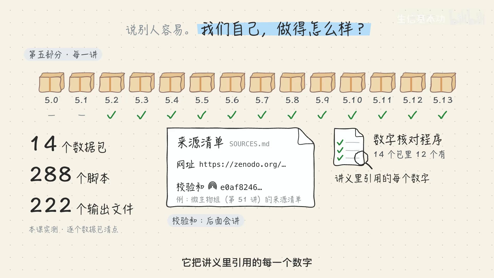

### 3.1 从屏幕上的一个数字，一路追到产生它的代码

举例：微生物组那一讲的讲义里写着「结果是 2900 个序列变体」，后面注明来自哪个输出文件的第几行；打开那个文件，那一行写着 2900；生成这个文件的脚本，第二行写着它是用什么命令跑的、要填哪些参数；参数的具体数值记在输出文件里。**从屏幕上的一个数字，可以一路追到产生它的代码**[【跳转到 12:51】](https://www.bilibili.com/video/BV19asP6PEzU/?t=771)。

这就是后面「十条规则」里的第九条：文字里的每一句结论都要能连到产生它的结果。

### 3.2 光有记录还不够：绝对路径会偷偷读回原文件

讲者把微生物组那一讲的三个脚本复制到新文件夹里重跑，再和原来的输出一个字节一个字节地比：

- **Python 脚本**：从自己所在的文件夹出发找输入，重跑结果完全一样；把复制品里的输入删掉，它立刻报错——说明它确实用的是复制品里的数据。
- **R 脚本**：第四行写死了一个完整路径（从这台电脑的用户文件夹一直写下去）。把复制品里的输入删掉，它**居然照样跑通、结果也一样**——因为它根本没用复制品，而是顺着那个完整路径悄悄回去读了原来的文件。模拟换一台电脑（用户名不一样），它马上停下来报错「无法打开文件」。把这行改成从脚本自己所在的文件夹出发，结果完全一样，整个文件夹搬到哪里都能跑。

[【跳转到 13:27】](https://www.bilibili.com/video/BV19asP6PEzU/?t=807)、[【跳转到 14:13】](https://www.bilibili.com/video/BV19asP6PEzU/?t=853)

这就是**绝对路径和相对路径**的区别：绝对路径从电脑的最顶层一直写下来，只在你这台电脑上成立；相对路径从项目文件夹出发，整个文件夹搬到哪里都能用。**项目里的路径一律用相对路径。**

### 3.3 换一个种子：结论稳不稳，要看它跨不跨过那条线

第三个是多样性分析脚本，用到好几个 R 包，里面有 100 次随机抽平、还有好几次置换检验（每次打乱 9999 遍），脚本在三个地方写了种子 512。重跑一遍约 2 分钟，**十个输出文件全部一模一样，连四张图都一个字节不差**[【跳转到 14:38】](https://www.bilibili.com/video/BV19asP6PEzU/?t=878)。

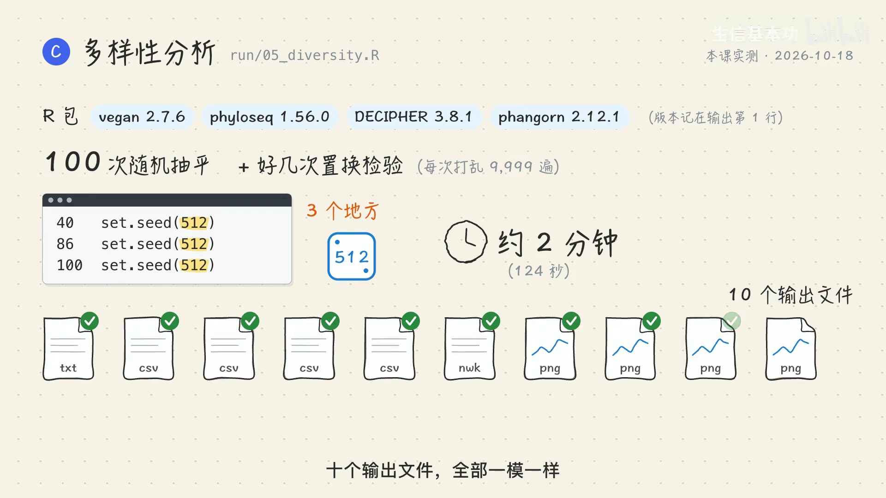

然后只改一个地方：把种子从 512 换成 1。十个输出里**九个变了**：

| 指标 | 种子 512 | 种子 1 | 结论 |
| --- | --- | --- | --- |
| 抽平后留下的序列变体 | 2862 | 2866 | — |
| 三组菌群组成差异（置换检验 P） | 0.0002 | 0.0004 | 仍显著 |
| 离散程度检验 | 0.027 | 0.025 | 仍显著 |
| 两组病人比较（加权 UniFrac） | 不显著 | 不显著 | 不变 |
| **三组离散程度（加权 UniFrac）** | **0.033** | **0.062** | **跨过了 0.05** |

[【跳转到 15:03】](https://www.bilibili.com/video/BV19asP6PEzU/?t=903)、[【跳转到 15:28】](https://www.bilibili.com/video/BV19asP6PEzU/?t=928)

那一讲说过的结论都站得住，可有一个数那一讲没有讲、却很能说明问题：在加权 UniFrac 下，三组离散程度的检验 P 值从 0.033 变成 0.062——**一个种子下显著，换一个种子就不显著了**。这说明书里有两件事：

1. **P 值靠近 0.05 时要格外小心**，它可能只是随机抽样带来的波动；更稳妥的做法是换几个种子都算一遍，看结论变不变。
2. **如果脚本里没有写明种子，就没有人能再得到你论文里印的那个数，包括你自己。**

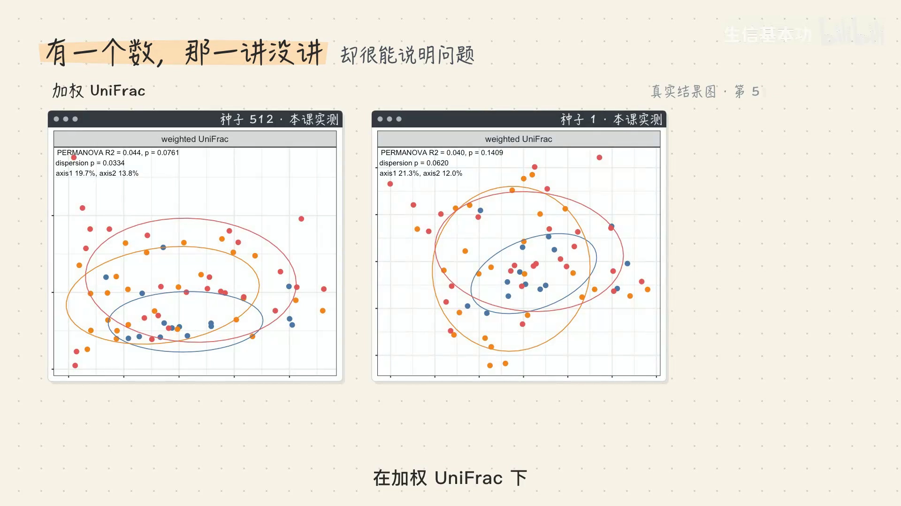

### 3.4 自查出来的漏洞，也要写清楚

课程的数据包也有经典的漏洞：第 14 个包里有 41 个脚本写着绝对路径；原始下载和中间文件都放在一个临时文件夹里（14 个包加起来 1.7 万多个文件、36.8 G），这个文件夹一旦被清掉，重跑就得重新下载——好在每个包的来源清单都写了下载地址和校验和，能重新下载，下载后也能核对是不是同一个文件[【跳转到 16:18】](https://www.bilibili.com/video/BV19asP6PEzU/?t=978)。

**可复现不是全有或全无**：做到了一部分，也清楚地知道哪里还没做到。

---

## 四、项目目录：原始数据只读、参数集中一处、结果可重建

怎么把一项分析整理好，其实早有人总结过。2009 年生物信息学家 William Noble 写了一篇短文，讲计算生物学的项目文件怎么组织，他的第一条原则是：**一个完全不了解你项目的人，看了你的文件就应该能弄明白你做了什么、为什么这样做**。这个人可能是读了你论文想重做的人、可能是合作者、也可能是接手的师弟师妹——而他说最常见的那个人就是你自己，因为过一段时间你很可能已经记不清当时在做什么了[【跳转到 17:08】](https://www.bilibili.com/video/BV19asP6PEzU/?t=1028)。

2017 年的《足够好的科研计算习惯》给出的目录几乎一样，只多了几个文件：`README`（这是什么项目、怎么运行）、`LICENSE`（别人能不能用）、`CITATION`（别人该怎么引用）、`requirements`（列出要装哪些软件包）——原话是「**要把依赖和要求写明白**」[【跳转到 18:48】](https://www.bilibili.com/video/BV19asP6PEzU/?t=1128)。

2013 年的《可复现计算研究的十条简单规则》把这件事压成了十条：

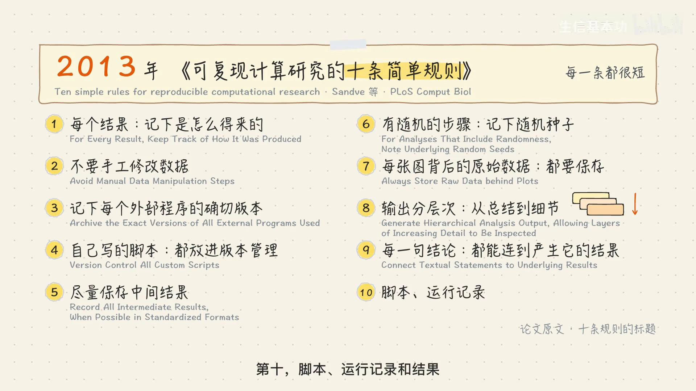

把这些建议合在一起，就是这一讲练习用的项目目录[【跳转到 20:03】](https://www.bilibili.com/video/BV19asP6PEzU/?t=1203)：

```text
gwas_region_project/
├─ README.md            中文说明：什么问题、用哪条命令跑完
├─ data/raw/            只读，不许改
│   ├─ gcst005895_chr6_88.9-91.0Mb.tsv   原始输入
│   └─ SOURCE.txt       来源说明：从哪来、校验和
├─ config/              只有一个参数文件，所有阈值都在这里
├─ R/                   分析步骤，按编号排：01 检查输入、02 统计、03 画图
├─ run_all.R            那一条命令：按顺序跑完所有步骤，顺便写日志
├─ results/             跑完才生成，可以整个删掉再重新生成
└─ logs/                跑完才生成
```

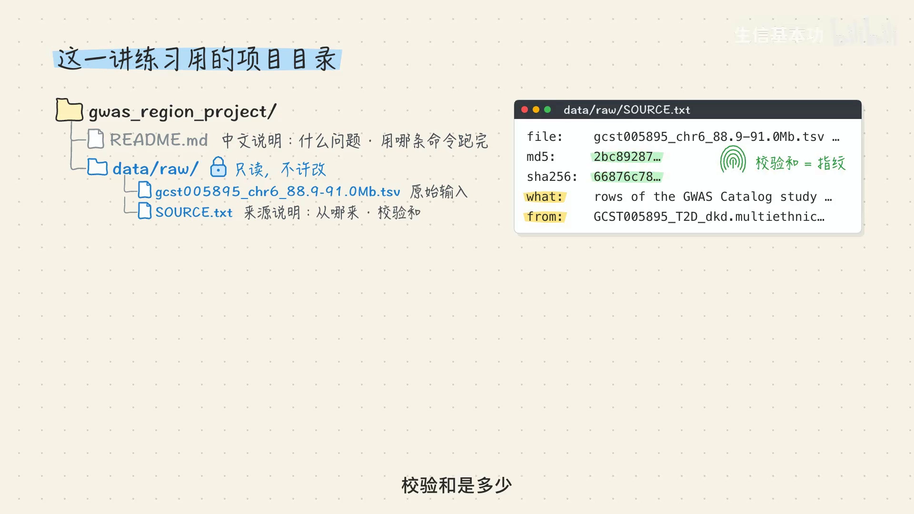

原则就三条：**原始数据只读；参数集中在一处（要改参数只改这一个地方）；结果都能重新生成**。另外两条习惯是：分析步骤的脚本文件名前面加上编号，顺序一眼看清；文件夹的名字说清楚里面放的是什么[【跳转到 20:53】](https://www.bilibili.com/video/BV19asP6PEzU/?t=1253)。

---

## 五、分析日志：让程序自己写实验记录

目录解决的是**东西放在哪里**，日志解决的是**这一次到底是怎么跑的**。做过实验的同学都知道实验记录本：哪一天做的、用的什么试剂、哪个批号、温度多少、结果怎样，都要写下来。计算分析也一样需要一本记录本，只是这本记录**最好让程序自己来写，不靠人记**[【跳转到 21:18】](https://www.bilibili.com/video/BV19asP6PEzU/?t=1278)。

### 5.1 日志里记什么

练习项目的日志每运行一次就自动记下[【跳转到 21:43】](https://www.bilibili.com/video/BV19asP6PEzU/?t=1303)：

- **开始的时间**；
- **R 的版本和它运行在什么平台上**；
- **排序用的语言设置**（就是前面那个会影响排序的东西）；
- **这一次用的每一个参数**；
- **每一步花了多少时间**；
- **每一个结果文件的校验和**；
- 最后附上一份 R 自带的会话信息：R 版本、操作系统、底层数学计算库的位置；如果用到了别的 R 包，每个包的版本也都会列在里面。

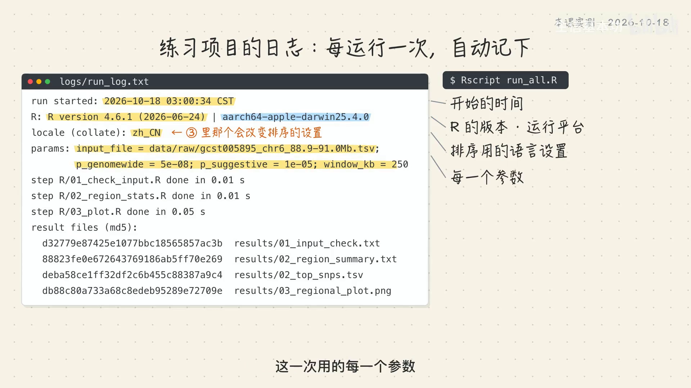

### 5.2 校验和：文件的指纹

**校验和**是用一个固定的算法，把一个文件的全部内容算成一串字符，像文件的指纹。文件里哪怕只改了一个字，算出来的字符串就完全不同。常用算法有 MD5 和 SHA256[【跳转到 21:58】](https://www.bilibili.com/video/BV19asP6PEzU/?t=1318)。

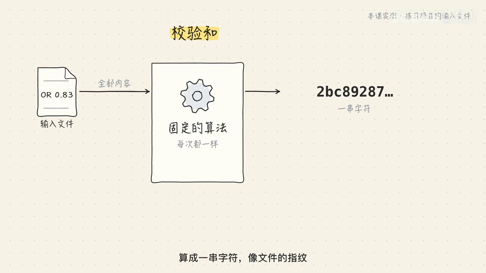

所以比较两个文件是不是完全一样，不用一个字一个字地看，比校验和就行。下载完一个大文件，跟数据库公布的校验和比一比，就知道它下载完不完整、有没有被改过。**日志里再加上随机种子和代码的版本号，就是一份完整的记录**[【跳转到 22:23】](https://www.bilibili.com/video/BV19asP6PEzU/?t=1343)。

数据本身也有一套记录原则。2014 年一批来自学术界和产业界的人在荷兰莱顿开了一次研讨会，2016 年正式发表了 **FAIR 原则**：可被找到（Findable）、可被访问（Accessible）、可互操作（Interoperable）、可被再利用（Reusable）。他们特别强调，不光要让人找得到、用得上，还要让**机器**能自动找到和使用这些数据；其中一条说数据要附上详细的来源记录——从哪里来、怎么处理过，这和前面的分析日志道理相通。还要注意 **FAIR 不等于全部公开**：原则里写着必要的时候可以有身份认证和授权的步骤，比如病人数据可以设门槛，但要让人找得到、知道怎么申请、拿到以后看得懂、能再用[【跳转到 23:13】](https://www.bilibili.com/video/BV19asP6PEzU/?t=1393)。

---

## 六、git：给代码和参数拍一张快照

目录和日志都有了，还剩一个问题：**代码和参数是会改的**。很多同学是这样管理版本的——「最终版分析」「最终版二分析」「真的最终版」，过了两个月，谁也说不清论文里的那张图是哪一版跑出来的[【跳转到 24:28】](https://www.bilibili.com/video/BV19asP6PEzU/?t=1468)。

版本管理工具就是专门解决这个问题的。今天最常用的一个叫 **git**，2005 年诞生，本来是为管理 Linux 内核写的，不是为科研写的，可后来科研人员发现它很合适：2013 年有文章说 git 很适合管理研究的全部产出——数据集、统计代码、图、实验笔记、论文稿。还要分清一件事：**git 是装在你电脑上的一个程序**，不联网、不注册账号也能用；**GitHub 是一个网站**，可以把用 git 管理的项目放到网上，方便分享和协作[【跳转到 25:43】](https://www.bilibili.com/video/BV19asP6PEzU/?t=1543)。

做科研先学五个命令就够了。讲者在一个练习文件夹里真跑了一遍：项目里有三个文件——一个说明、一个参数文件（写着每个样本至少要有 1000 条读段）、还有一个小脚本按这个阈值筛样本。先跑一下，留下了 S1 和 S3 两个样本。

| 命令 | 作用 |
| --- | --- |
| `git init` | 开始在项目文件夹里做记录 |
| `git add` | 选好这次要记录哪些文件 |
| `git commit` | 真正拍下来，同时写一句说明 |
| `git diff` | 看改了什么（减号那行 1000，加号那行 2000） |
| `git log` | 看历史：每次提交的编号、作者、时间、说明 |

[【跳转到 26:08】](https://www.bilibili.com/video/BV19asP6PEzU/?t=1568)、[【跳转到 26:58】](https://www.bilibili.com/video/BV19asP6PEzU/?t=1618)、[【跳转到 27:25】](https://www.bilibili.com/video/BV19asP6PEzU/?t=1645)

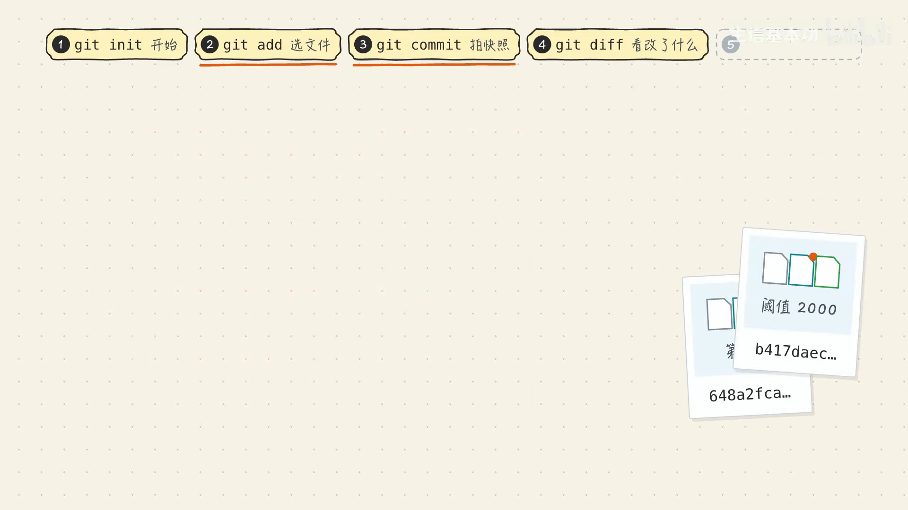

把参数文件里的阈值从 1000 改成 2000 再跑，这次只剩下 S3，S1 被筛掉了；再 `add` + `commit` 一次，说明写「阈值提高到 2000，S1 被去掉了」。以后有人问「论文里的那张图是哪一版参数跑出来的」，**只要把提交编号写进日志或者方法里，就能准确回到那一版**。还有一个 `git status` 看现在的状态（哪些文件改了、还没提交），这是平时敲得最多的一个，可它只是看看，什么也不记录[【跳转到 27:50】](https://www.bilibili.com/video/BV19asP6PEzU/?t=1670)。

最后一个有意思的细节：**提交编号不是随机的**。git 里的每一样东西都用它内容的指纹来命名，算法是 SHA1——就是前面那种校验和。讲者在另一个文件夹里，用同样的文件、同样的作者、同样的时间把整个过程又做了一遍（时间是为了演示特意固定的），两次得到的提交编号**一模一样**；内容一样，编号就一样；内容差一个字，编号就完全不同。所以一个提交编号，就准确锁定了项目的一个版本[【跳转到 28:15】](https://www.bilibili.com/video/BV19asP6PEzU/?t=1695)。

放进 git 的是你自己写的东西——代码、参数和说明。几十个 G 的测序数据通常不直接放进去，而是像数据包那样，**记下下载地址和校验和**。

---

## 七、流程管理工具：只重做受影响的那部分

练习项目只有三步，真实的分析可能有几十步、上百个样本，有的步骤一跑就是好几个小时。这时候一个总脚本就不太够用了：改了一个样本，难道要把 100 个样本全部重跑一遍？**流程管理工具**解决的就是这类问题。2021 年的一篇综述这样总结它们的作用：简化流程开发、合理使用计算资源、管理软件的安装和版本、在不同的计算平台上运行，让流程能搬走、能分享[【跳转到 29:05】](https://www.bilibili.com/video/BV19asP6PEzU/?t=1745)。

生信里最常用的有两个：

- **Snakemake**（2012 年发表）：用一种基于 Python、很好读的写法描述流程，同一条流程从一台电脑的单个处理器到大型计算集群，流程本身不用改就能跑。它的思路是一条一条的**规则**：每条规则写清楚从哪个输入文件、用什么命令、生成哪个输出文件；你告诉它最终想要哪个文件，它自己往回推算需要先做哪些步骤。
- **Nextflow**（2013 年开源，2017 年发表论文）：把每一步叫做一个**过程**，数据像水流一样从一个过程流到下一个过程。在它之上还有社区共同维护的流程合集 **nf-core**（2018 年发起，2020 年发表），网站上的流程数量一直在增长。

[【跳转到 29:30】](https://www.bilibili.com/video/BV19asP6PEzU/?t=1770)、[【跳转到 30:20】](https://www.bilibili.com/video/BV19asP6PEzU/?t=1820)

讲者用一个两步的玩具流程把两个工具都真跑了一遍：三个样本文件先各自数一数有几行，再汇总成一张表。

- Snakemake 先预演一遍，列出要做的五件事（三次计数、一次汇总、加上最终目标）；真跑五步全部做完，得到 S1=5、S2=3、S3=4。什么都不改再跑一次，它说「没有什么要做的」——所有需要的文件都在，而且都是最新的。给 S2 加一条读段再跑，**它只重做了三步**（S2 的计数、汇总、最终目标），S1 和 S3 没有动。
- Nextflow 也一样：第一次跑四个任务全部完成；加上继续运行的选项再跑，四个任务全部直接用缓存；改了 S2 以后再跑，两个任务重新算、另外两个用缓存。

[【跳转到 30:45】](https://www.bilibili.com/video/BV19asP6PEzU/?t=1845)、[【跳转到 31:06】](https://www.bilibili.com/video/BV19asP6PEzU/?t=1866)、[【跳转到 31:31】](https://www.bilibili.com/video/BV19asP6PEzU/?t=1891)

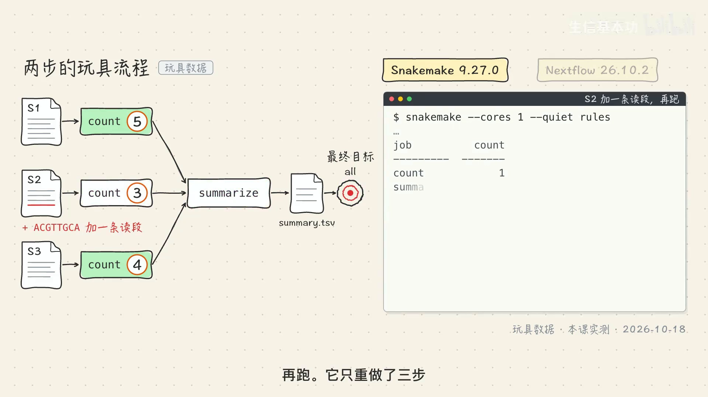

两个工具都知道哪个输出是从哪个输入来的，所以只重做受影响的那一部分。这两个玩具流程都是在普通电脑上跑的，计算本身不到一秒——**流程管理工具不只是给大型计算机群用的**。

但它们有一个前提：**只知道你告诉它的依赖关系**。讲者在后面的练习里真的踩到了这个陷阱：用 `touch` 让画图的脚本看起来被修改过，再跑 Snakemake，它还是说「没有什么要做的」——因为流程文件里画图的那条规则**没有把这个脚本列为输入**，它根本不知道结果依赖这个脚本。改参数文件就不一样了，参数文件列在输入里，三步全部重跑[【跳转到 34:51】](https://www.bilibili.com/video/BV19asP6PEzU/?t=2091)、[【跳转到 35:16】](https://www.bilibili.com/video/BV19asP6PEzU/?t=2116)。

初学阶段不用急着学流程管理工具：**先把项目目录、分析日志、git 用好**，等分析步骤多了、样本多了，再挑一个学；需要标准流程的时候，先去 nf-core 看看有没有现成的[【跳转到 32:21】](https://www.bilibili.com/video/BV19asP6PEzU/?t=1941)。

---

## 八、一条命令重跑：GWAS 练习的六次运行

把前面讲的都用上，做一个练习。数据来自群体遗传那一讲：二型糖尿病病人里有肾病和没有肾病的人做比较的全基因组关联分析，只取 6 号染色体上大约 210 万个碱基的一段、6378 个变异位点。问题很简单：这一段里 P 值最小的位点在哪、有多少个位点过了显著线、再画一张区域图；只用 R 自带的功能，不用装任何包[【跳转到 32:46】](https://www.bilibili.com/video/BV19asP6PEzU/?t=1966)。

第一次运行，在项目文件夹里敲**一条命令**，三步不到一秒就跑完了，生成四个结果文件：一份输入检查记录、一份汇总、一张位点表、一张图。P 值最小的位点 P 值是 $5.1\times10^{-7}$，全基因组显著线是 $5\times10^{-8}$，没有一个位点过线；过了提示性显著线（$10^{-5}$）的有 34 个，其中 33 个在这个位点两侧 250 kb 以内[【跳转到 33:11】](https://www.bilibili.com/video/BV19asP6PEzU/?t=1991)。

接下来六次运行，构成了这一讲的验收清单：

| 次数 | 做了什么 | 结果 |
| --- | --- | --- |
| A 第一次 | 一条命令跑完三步 | 四个结果文件 |
| B 再跑一遍 | 同一个文件夹 | 四个文件**一个字节都不差**，图片也不例外 |
| C 搬到别处 | 整个文件夹复制到另一个地方、从另一个目录启动 | 还是**一个字节都不差**（因为全是相对路径） |
| D 改一个参数 | 提示性显著线从 $10^{-5}$ 改成 $10^{-6}$ | 四个结果里三个变了，过线位点从 34 变成 21；**日志里记着这次用的是新值** |
| E 改坏输入 | 把最小 P 值那行的比值比从 0.83 改成 0.88 | 第一步就停了：报错「输入文件和记录的不一致」，一个结果文件也没写出来 |
| F 用 Snakemake | 跑同样的三步 | 结果和第一次一个字节不差；但漏写依赖时它会守着旧结果 |

[【跳转到 33:36】](https://www.bilibili.com/video/BV19asP6PEzU/?t=2016)、[【跳转到 34:01】](https://www.bilibili.com/video/BV19asP6PEzU/?t=2041)、[【跳转到 34:26】](https://www.bilibili.com/video/BV19asP6PEzU/?t=2066)、[【跳转到 34:51】](https://www.bilibili.com/video/BV19asP6PEzU/?t=2091)

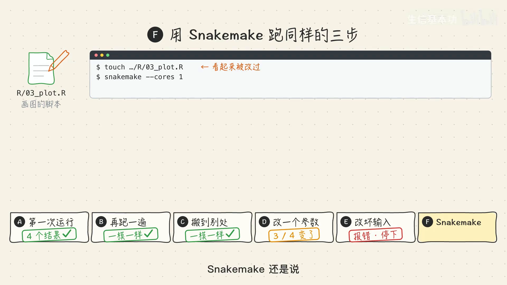

E 这一步值得单独说：**这就是第一步核对校验和的用处**。数据被人动过、或者下载得不完整，你马上就会知道，而不是拿着错的数据算出看起来很正常的结果。

最后一个细节：比较两次完全相同的运行，结果文件和日志里唯一不同的是**日志里的开始时间和其中一步的耗时**，结果文件一个字节都没变。所以交给别人的时候，**只交这个项目文件夹、不带结果和日志**，对方用一条命令就能把结果全部重新生成，再拿日志里的校验和跟你的比一比[【跳转到 36:00】](https://www.bilibili.com/video/BV19asP6PEzU/?t=2160)。

讲者也说明了这个练习的边界：只在 Mac 上跑过，只用了 R 自带的功能和相对路径，按理在 Windows 上也能跑，但**没有测过**。

---

## 九、跨领域的同一规律：看有没有交出数据和代码

可复现的问题不是生物信息学独有的。看别的领域之前，先分清两种检查：一种是**同样的数据重新算一遍**，看数字对不对，这是本讲说的可复现；另一种是**重新做一次实验**，看效应还在不在，叫可重复[【跳转到 36:25】](https://www.bilibili.com/video/BV19asP6PEzU/?t=2185)。

- **心理学**：2015 年一个大型合作项目重新做了三本心理学期刊上的 100 项研究，原来 97% 结果显著，重做以后只有 36% 显著，效应大约只有原来的一半——这是**重新做实验**。只做重新计算的也有：2018 年检查一本强制公开数据的期刊，35 篇数据可用的论文里重算 1324 个数值，64 个差别超过 10%；2021 年检查 25 篇带开放数据标志的论文，不靠作者帮忙能原样算出来的只有 9 篇，总结的原因是**分析步骤写得不清楚**。为此越来越多的研究做**预注册**：在看数据之前，把假设、样本量和分析方法登记下来。
- **经济学与政治学**：2026 年 300 多位研究者合作，重跑了 110 篇来自强制交出数据和代码的顶级期刊的论文，**85% 以上的结论能原样计算出来**；再换几种合理的做法检验，72% 的显著结果仍然显著、方向也不变。
- **生态学**：随机抽查 346 篇论文（所在期刊都要求或鼓励交代码），给了数据的将近八成，**给了代码的只有 27%**——没有代码，数据再全也很难原样算出同一个数。
- **水文学**：2017 年六本期刊的 360 篇论文里，实际尝试重现的只有 **1.6%** 成功，89% 连怎么使用的说明都没有。
- **物理学**：2016 年人类宣布第一次直接探测到引力波，2020 年有人用公开的代码重算这次探测的显著性，主要结果重算出来了，但因为原来那批数据没有公开，**没法一模一样地复现**。

[【跳转到 36:50】](https://www.bilibili.com/video/BV19asP6PEzU/?t=2210)、[【跳转到 37:40】](https://www.bilibili.com/video/BV19asP6PEzU/?t=2260)、[【跳转到 38:05】](https://www.bilibili.com/video/BV19asP6PEzU/?t=2285)、[【跳转到 38:30】](https://www.bilibili.com/video/BV19asP6PEzU/?t=2310)、[【跳转到 38:55】](https://www.bilibili.com/video/BV19asP6PEzU/?t=2335)、[【跳转到 39:20】](https://www.bilibili.com/video/BV19asP6PEzU/?t=2360)

不同的领域，同样的规律：**能不能重算出来，主要不看是哪个领域，而看有没有交出数据和代码、有没有把步骤和环境写清楚。**

---

## 小结

- **可复现 ≠ 可重复**：前者是同样的数据、同样的代码得到同样的结果（最低标准）；后者是换一批新样本重做实验还能得到同样的结论。
- **真去重跑时比例很低，原因集中在两件事**：没交出来，或者没记下来——数据在哪、代码哪一版、参数多少、软件什么版本、在什么电脑上跑的。
- **会让结果悄悄变调的六样东西**：随机种子、集合的遍历顺序、浮点加法的顺序、软件包版本（pandas 2.2 vs 3.0：42 vs 41）、抽样规则版本（R 3.6.0 前后同一 seed 排列不同）、电脑的语言设置（排序规则）。
- **真实量级**：脑影像软件换版本，脑区体积平均差 8.8%、最多 64%；Excel 把基因名改成日期的问题，2014–2020 年论文里仍占 30.9%。
- **换种子要看结论稳不稳**：同一个分析换种子后，加权 UniFrac 的离散程度检验 P 从 0.033 变成 0.062，跨过了 0.05；P 值靠近阈值时要多跑几个种子。
- **项目目录三条原则**：原始数据只读、参数集中在一处、结果都能用一条命令重新生成；路径一律用相对路径。
- **日志要记**：开始时间、软件与包版本、运行平台、语言设置（locale）、每一个参数、每步耗时、每个结果文件的校验和；再加上随机种子和代码版本号，就是一份完整记录。
- **git 锁住代码与参数的那一版**：`init` / `add` / `commit` / `diff` / `log` 五个命令够用；提交编号是内容指纹，写进日志或方法就能准确回到那一版。大数据记下载地址与校验和，不进仓库。
- **流程管理工具只重做受影响的部分，但只知道你声明过的依赖**：漏写一个依赖，它会守着旧结果告诉你「一切都是最新的」。

## 关键术语速查

| 术语 | 一句话解释 |
| --- | --- |
| 可复现（reproducible） | 同样的数据 + 同样的代码 → 同样的结果；本讲讨论的最低标准 |
| 可重复（replication） | 换一批新样本、重新做一次实验，结论仍然成立 |
| 随机种子（seed） | 伪随机公式的起点；起点相同，生成的一串随机数完全相同 |
| 校验和（checksum） | 用固定算法把文件全部内容算成一串字符，相当于文件指纹；常用 MD5、SHA256 |
| 绝对路径 / 相对路径 | 从电脑最顶层写下来（只在本机成立）/ 从项目文件夹出发（搬到哪都能用） |
| locale（语言设置） | 决定排序、大小写比较、日期格式等行为的系统设置；会改变结果顺序 |
| 来源清单（SOURCES） | 记录每个原始文件从哪个网址下载、校验和是多少，用于重新下载与核对 |
| 分析日志（run log） | 每次运行自动写下的时间、版本、平台、参数、耗时与结果校验和 |
| git 提交编号 | 由内容指纹（SHA1）生成的标识，内容相同则编号相同，用来锁定一个版本 |
| FAIR 原则 | 数据可被找到、可被访问、可互操作、可被再利用；不等于全部公开 |
| 流程管理工具 | Snakemake / Nextflow 一类工具，按声明的输入输出依赖只重做受影响的部分 |
| 预注册（preregistration） | 看数据之前先把假设、样本量和分析方法登记下来 |