# 嵌入层就是查表：nn.Embedding 与 one-hot 矩阵乘的等价

> 视频来源：[Token Embeddings Explained: nn.Embedding as a Lookup Table in PyTorch (GPT-2)](https://www.youtube.com/watch?v=M5EVXP7SCKI&t=0)（YouTube · The Modern SDE，LLM Course 第 18 讲）
> 本文基于视频演说图文稿整理，配图截自视频。本篇只讲"嵌入层怎么把 id 变成向量"这一件事：词表如何决定行号、查表与 one-hot 矩阵乘为何等价、梯度为什么只落在被用到的那几行、以及特殊标记为什么必须占一行。

## 本讲要解决的核心问题（SCQA）

**背景**：上一讲的数据加载器已经交给我们一批 token id，形状是 `8 × 4`。这些 id 是从 tokenizer 的词表里查出来的整数，比如 12,558 这样一个数字。

**冲突**：但一个 id 只是一个**名字**，不是语义。模型后面所有的层做的是加法和乘法，它们需要的是向量；而 id 本身既不能相加也不能求距离。更麻烦的是，GPT-2 的这张"id 到向量"的表，占了整个模型约 30% 的参数——接近 3900 万个数字，可它偏偏是全网里最简单的一层。

**疑问**：这张表长什么样？一个 id 是怎么变成一串浮点数的？为什么说它"只是查表"，却又是一个货真价实的神经网络层、能被反向传播训练？词表大小和特殊标记又在这张表里扮演什么角色？

**回答（中心思想）**：**嵌入层（embedding layer）是一张"一个 token 一行"的可学习矩阵，id 就是行号，取向量就是取行。** 它等价于"把 id 变成 one-hot 向量、再乘这张矩阵"，只是 PyTorch 跳过了那次全是零的乘法，直接拷贝一行出来 [【跳转到 02:37】](https://www.youtube.com/watch?v=M5EVXP7SCKI&t=157)。正因为等价于一个无偏置的线性层，它才能像别的层一样被梯度下降训练；也正因为"取行"依赖行号，词表里有多少个 token，这张表就必须有多少行——少一行，特殊标记就会直接报 `IndexError`。

---

## 一、词表就是一张"名字到行号"的清单

先看最小可运行的例子。视频里造了一个只有六个 token 的玩具词表，来自一个故事：`Mini`、`the`、`Cabuliwallah`、`raisins`、`gave`、`father`。句子是 "the Cabuliwallah gave Mini raisins"，编码成 id 就是 `1 2 4 0 3` [【跳转到 00:32】](https://www.youtube.com/watch?v=M5EVXP7SCKI&t=32)。

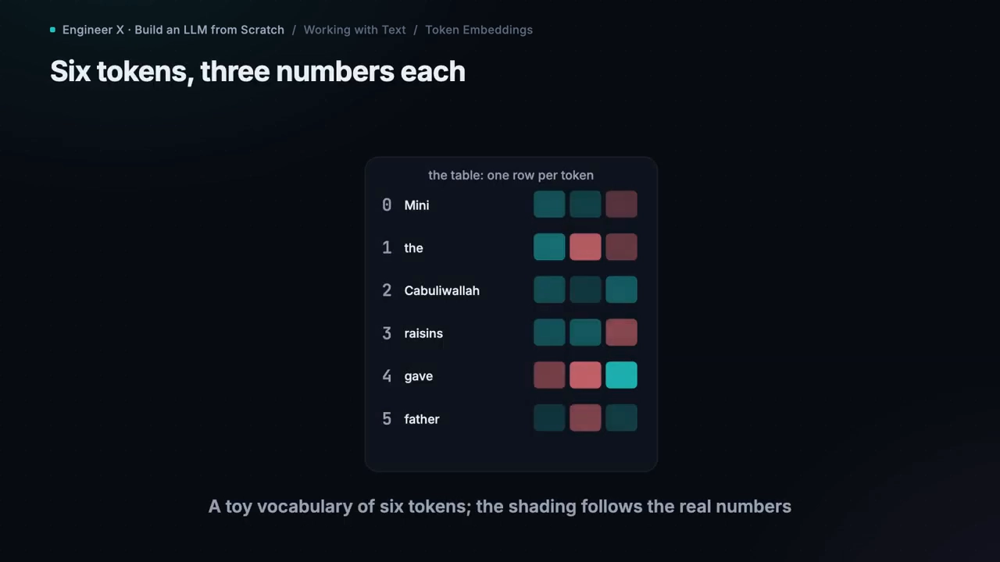

这里有两个要点，初学者最容易混：

1. **id 是词表里的位置**。视频里的词表在代码中就是一个 Python 列表，token 的 id 就是它在列表中的下标。真实模型里这份清单由 tokenizer 提供，上一节讲的 BPE 词表就是它。
2. **表是"一行一个 token"，不是"一列一个 token"**。所以 id 天然就是行号，取某个 token 的向量，就是读第几行。

把句子里的每个 id 依次当成行号去表里取，句子就变成"按原顺序排好的五个向量"。注意 `father` 那一行在这句话里完全没被用到——这个细节后面讲梯度时会变得很重要 [【跳转到 00:57】](https://www.youtube.com/watch?v=M5EVXP7SCKI&t=57)。

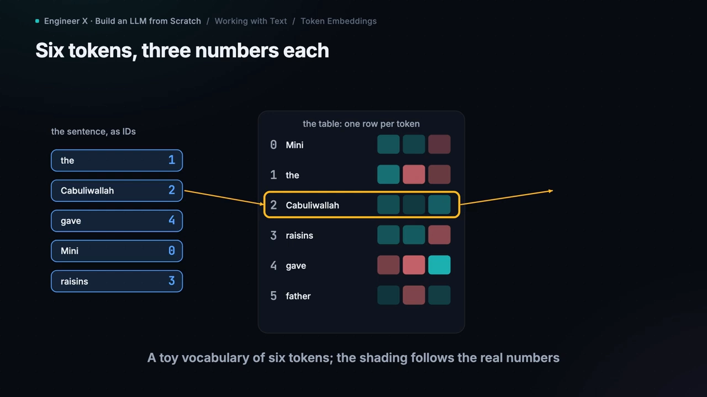

## 二、`nn.Embedding(6, 3)`：两个参数，一张表

在 PyTorch 里，这张表由一行代码创建：

```python
import torch
from torch import nn

vocab = ["Mini", "the", "Cabuliwallah", "raisins", "gave", "father"]
torch.manual_seed(18)
emb = nn.Embedding(6, 3)          # 6 行（词表大小），每行 3 个数（向量维度）
ids = torch.tensor([1, 2, 4, 0, 3])
vectors = emb(ids)                # 5 个 id 进，5 个向量出
by_hand = emb.weight[ids]         # 手动按行号索引，结果完全一样
```

`nn.Embedding` 的两个参数正好对应这张表的两个维度：**行数 = 词表大小**，**列数 = 向量维度**。视频里把这两件事说得更直白：`nn.Embedding(vocab, dim)`，每个 id 挑走它自己那一行 [【跳转到 04:42】](https://www.youtube.com/watch?v=M5EVXP7SCKI&t=282)。

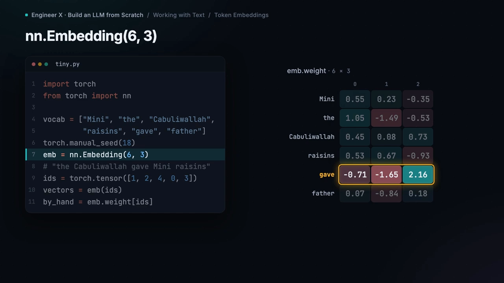

表里的数字一开始是随机的，比如 `gave` 初始是 −0.71、−1.65、2.16，它们此刻**没有任何含义**，含义是训练出来的。这一点很重要：嵌入层不是"预先塞进去的语义字典"，而是一块和其他权重一样、从随机初始化开始学的参数。

## 三、查表与 one-hot 矩阵乘：同一个结果，两种算法

"查表"听起来不像神经网络。要看清它为什么算一层网络，可以把 id 换一种写法：**one-hot 向量**。

一个 id 变成 one-hot，就是造一个长度等于词表大小的向量，只有 id 那一格是 1，其余全是 0。六个 token 的词表里，`Cabuliwallah` 的 id 是 2，它的 one-hot 就是 `[0, 0, 1, 0, 0, 0]`。把这句话的五个 id 都变成 one-hot，就得到一个 `5 × 6` 的矩阵 [【跳转到 02:12】](https://www.youtube.com/watch?v=M5EVXP7SCKI&t=132)。

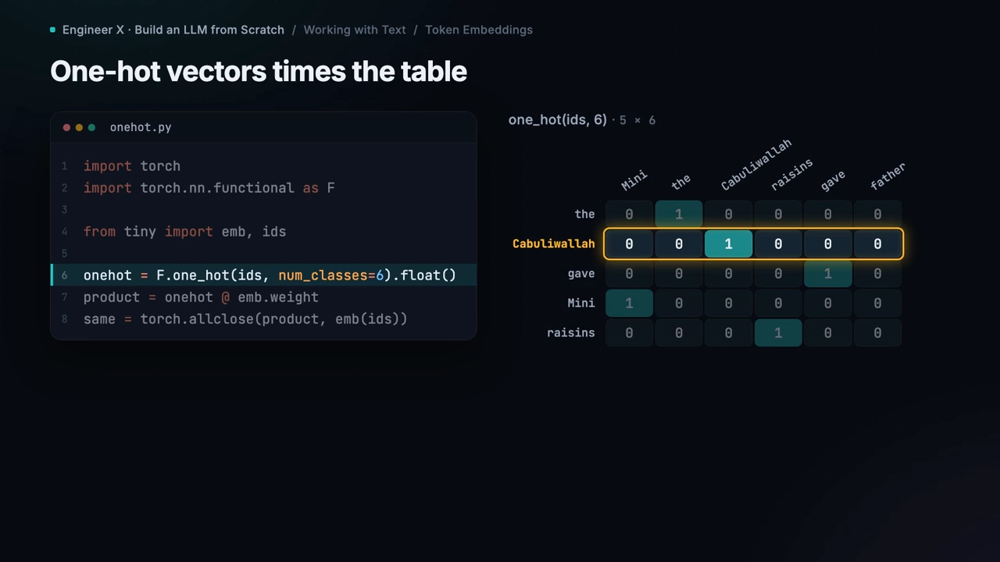

现在用这个 `5 × 6` 的 one-hot 矩阵去乘 `6 × 3` 的嵌入矩阵：

$$
\mathbf{X} = \mathbf{O} \cdot \mathbf{E}, \qquad \mathbf{O} \in \{0,1\}^{5\times 6},\ \mathbf{E} \in \mathbb{R}^{6\times 3}
$$

矩阵乘的每一行输出，都是嵌入矩阵各行按 one-hot 权重做的加权和。而 one-hot 里只有一个 1、其余全是 0，所以"加权和"退化成"把那一行原样抄出来"。视频里跑代码验证了这一点：`onehot @ emb.weight` 与 `emb(ids)` 的结果逐元素相等 [【跳转到 02:37】](https://www.youtube.com/watch?v=M5EVXP7SCKI&t=157)。

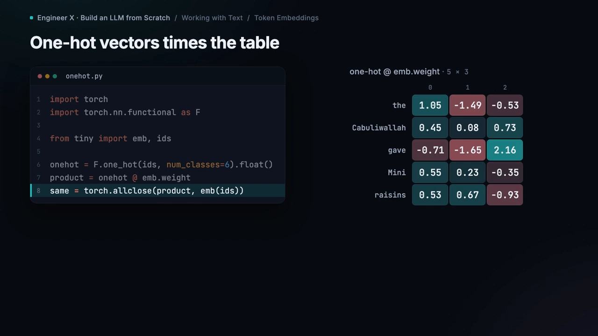

由此得到一句可以直接背下来的结论：**嵌入层 = 输入是 one-hot 的、没有偏置项的线性层**。这也解释了两件事：

- 它为什么能被反向传播训练：线性层能训，它就一样能训；
- 它为什么可以"偷懒"：既然 one-hot 里 99.99% 是零，乘法算出来的结果和直接取行一模一样，那就别乘了。

## 四、为什么必须偷懒：一次乘法 3860 万次加，一次拷贝 768 个数

偷懒不是风格问题，是成本问题。以 GPT-2 为例，词表 50,257、向量维度 768：

- 一个 one-hot 向量有 50,257 个数，其中 50,256 个是零；
- 拿它去乘嵌入矩阵，每个 token 要做约 **38,597,376 次乘加**；
- 而查表只需要**拷贝 768 个数**。

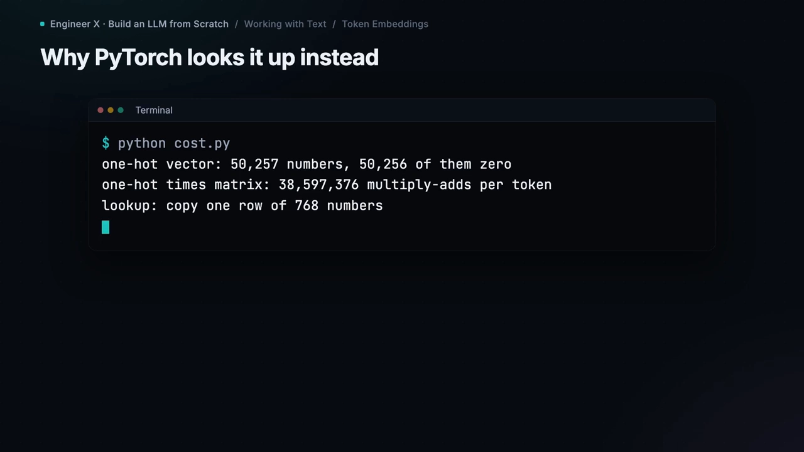

同样的答案，代价差了几个数量级。PyTorch 因此把这一步实现成"按下标取行"，而不是真的做矩阵乘。这也是面试里常被问的那道题——"嵌入层是不是就是一个线性层？"答案是：**在 one-hot 输入上，是** [【跳转到 03:27】](https://www.youtube.com/watch?v=M5EVXP7SCKI&t=207)。

## 五、训练只更新"被查到的那几行"

理解了"取行"，梯度的行为就顺理成章了。视频里给句子算了一个玩具损失（输出的平方均值），然后 `backward()`：

- 句子里出现过的每个 token，它那一行都拿到了非零梯度；
- `father` 这一行**全是 0**——因为这句话根本没查过它，它对损失没有贡献，一次普通梯度下降之后它保持原样。

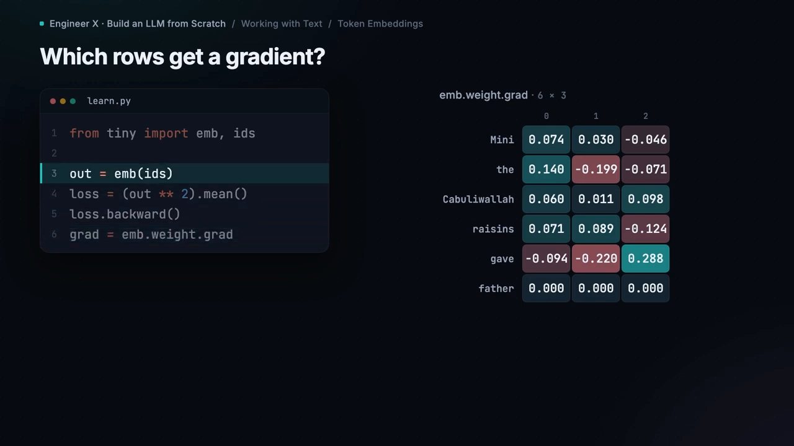

放到真实规模上，结论不变。一个 `8 × 4` 的批次有 32 个位置，但只有 30 个不同的 id（句号和空格各重复了一次），所以一次反向传播之后，50,257 行里只有 30 行有梯度，其余全部"这一批缺席" [【跳转到 04:17】](https://www.youtube.com/watch?v=M5EVXP7SCKI&t=257)。

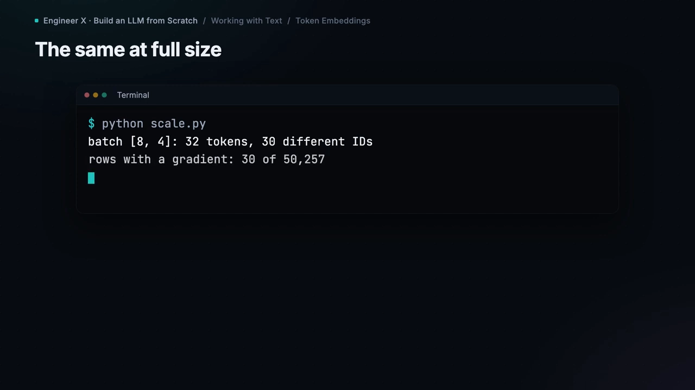

这条机制带来两个直接推论：

1. **相似用法的 token 会被推向相似的向量**。经过几百万个批次，经常一起出现在类似上下文里的 token 反复共享梯度方向，向量就慢慢靠近——这就是"king 和 queen 会挨在一起"的来源。
2. **稀有 token 很难学好**。一个几乎不出现的 token，也就几乎拿不到梯度，它的向量长期停在接近初始化的状态。这是词表设计里"长尾词该不该进词表"的底层原因之一（词表大小本身的账另见 1.2.4）。

## 六、形状：从 `batch × context` 到 `batch × context × d`

嵌入层对形状做的事情非常规整：**在最右边长出一个新维度**。

```python
tok_emb = nn.Embedding(50257, 256)
x = tok_emb(ids)      # ids: [8, 4]  ->  x: [8, 4, 256]
```

输入 `8 × 4`（batch × context），输出 `8 × 4 × 256`（batch × context × 向量维度）。每一个 id 都变成了一个 256 维向量，之后所有层都工作在这个三维张量上 [【跳转到 05:57】](https://www.youtube.com/watch?v=M5EVXP7SCKI&t=357)。

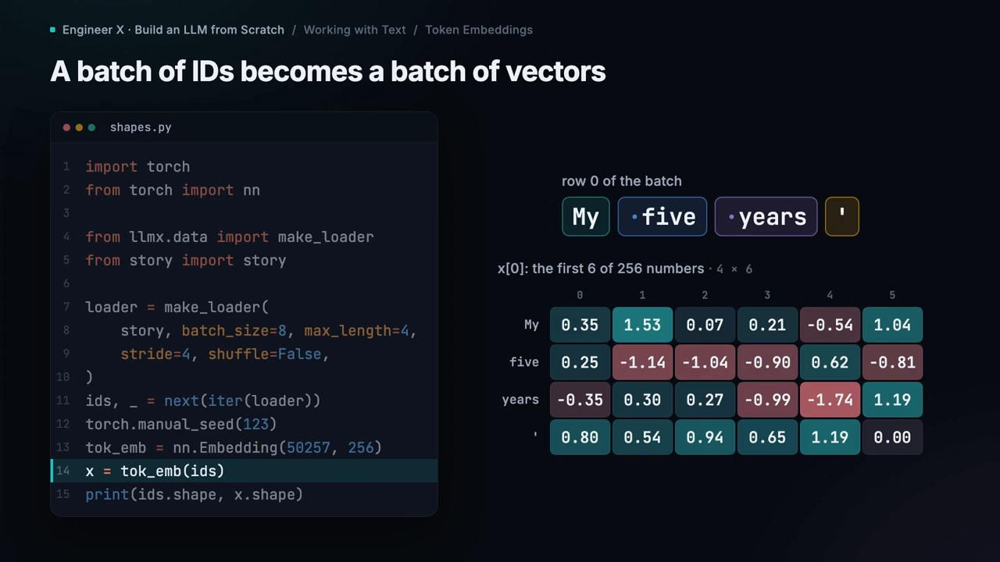

顺带一提 GPT-2 的真实尺寸：表是 `50,257 × 768`，共 38,597,376 个参数，占 1.24 亿参数模型的 31%，用 32 位浮点存约 154 MB [【跳转到 05:07】](https://www.youtube.com/watch?v=M5EVXP7SCKI&t=307)。

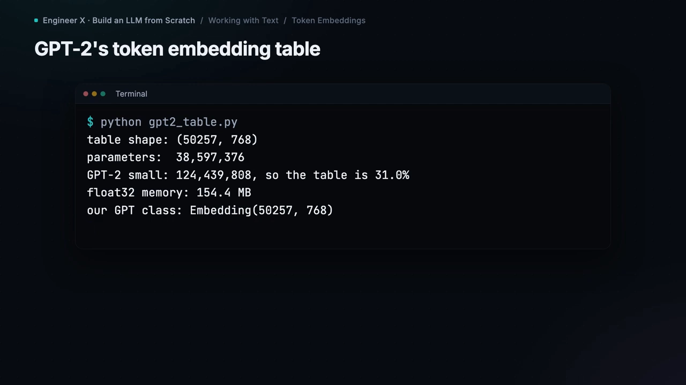

## 七、特殊标记必须占一行：那个 `IndexError` 的坑

最后是一个真实踩过的坑，它恰好把"词表"和"嵌入矩阵"绑在了一起。

一段很短的文本以**文本结束标记**（end-of-text，id 50,256）结尾。有人图省事，把嵌入表做成 50,000 行——一个整数。结果最后那个 id 在表里**没有对应的行**，PyTorch 直接报错：

```
IndexError: index out of range in self
```

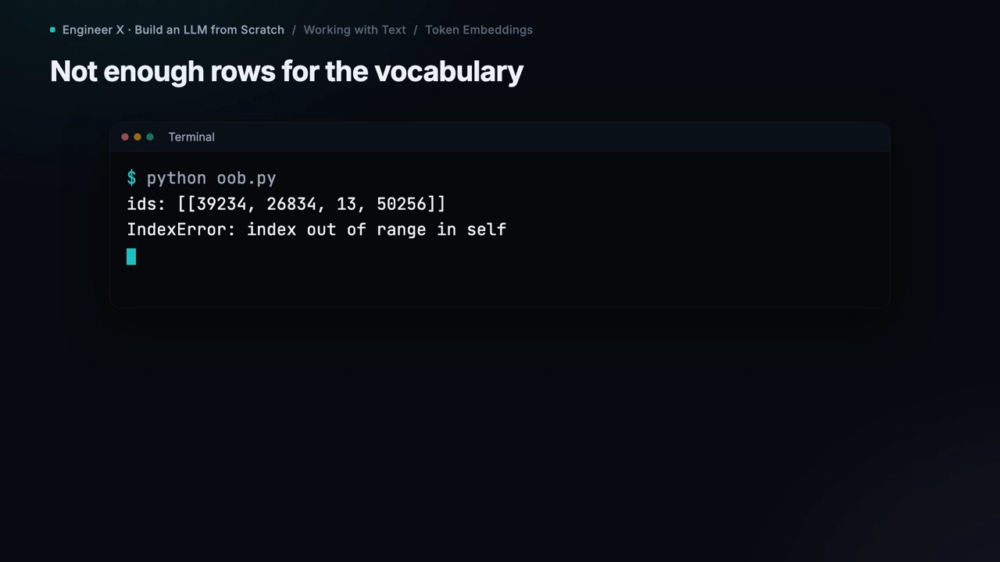

修法只有一句话：**表的行数要照 tokenizer 的词表来定，不能凭记忆拍一个整数**。GPT-2 的词表是 50,257 个 token，表就必须是 50,257 行 [【跳转到 06:32】](https://www.youtube.com/watch?v=M5EVXP7SCKI&t=392)。在 Nvidia GPU 上，同一个错误往往表现为一句含糊的 device-side assert，更难定位，所以更值得记住。

这个坑的普适含义是：**任何要进模型的 id——包括 BOS、EOS、PAD、UNK 这些特殊标记——都必须是词表里的合法行号**。特殊标记不是"字符串约定"，它们在嵌入层这里就是一行实实在在的参数；词表和嵌入表一旦对不上，模型连第一步都走不过去。PAD 之所以能被 mask 掉、BOS 之所以能携带"序列开始"的信号，前提都是它们各自占了一行、各有一个可学习的向量（这些标记在训练与推理中的控制作用见 1.2.5）。

## 小结

- **id 只是名字，向量才是输入**。词表给出"token → 行号"的映射，嵌入矩阵给出"行号 → 向量"的映射，两步合起来才把文本变成模型能算的张量。
- **嵌入层 = 一张 `词表大小 × 向量维度` 的可学习矩阵**，`nn.Embedding(V, d)` 的两个参数就是这两个数。
- **查表等价于 one-hot 乘矩阵**：因为 one-hot 只有一个 1，加权和退化为取行；PyTorch 因此跳过乘法，把 3860 万次乘加换成 768 个数的拷贝。
- **它是无偏置的线性层**，所以能被反向传播训练；梯度只落在本批次被查到的行上，没出现的行整行为 0。
- **稀有 token 学不好**是这条机制的直接后果：没被查到就没有梯度。
- **形状上只做一件事**：`batch × context` 在最右边长出一维，变成 `batch × context × d`。
- **词表行数必须覆盖所有 id**，包括 EOT、BOS、EOS、PAD 这些特殊标记；否则第一步就 `IndexError`。

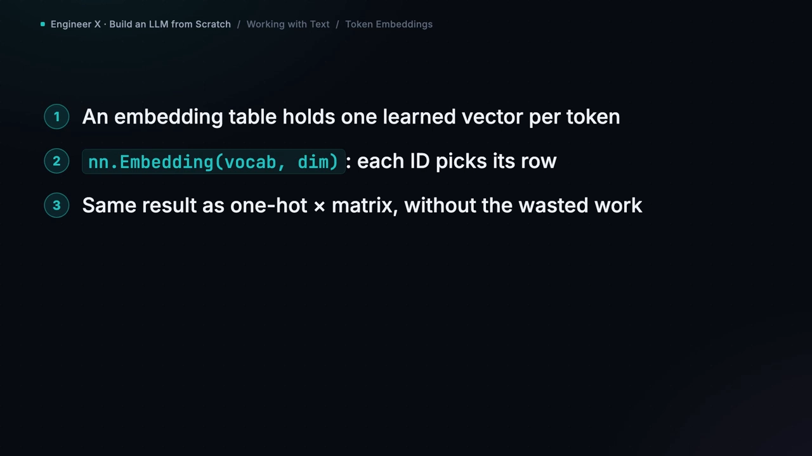

## 关键术语速查

| 术语 | 一句话解释 |
| --- | --- |
| 词表（vocabulary） | token 到整数 id 的清单，id 就是 token 在清单里的位置 |
| 嵌入矩阵（embedding matrix） | 形状为 `词表大小 × 向量维度` 的可学习参数表，一行对应一个 token |
| 查表（lookup） | 用 id 作行号，直接从嵌入矩阵里取出对应的一行向量 |
| one-hot 向量 | 长度等于词表大小、只有 id 位置为 1 的稀疏向量 |
| `nn.Embedding(V, d)` | PyTorch 的嵌入层，创建 `V × d` 的表，调用时按 id 取行 |
| 梯度稀疏性 | 一次反向传播只给本批次出现过的 token 所在行写梯度，其余行为 0 |
| `IndexError: index out of range` | id 超出嵌入表行数时的报错，通常由表大小与词表不一致引起 |