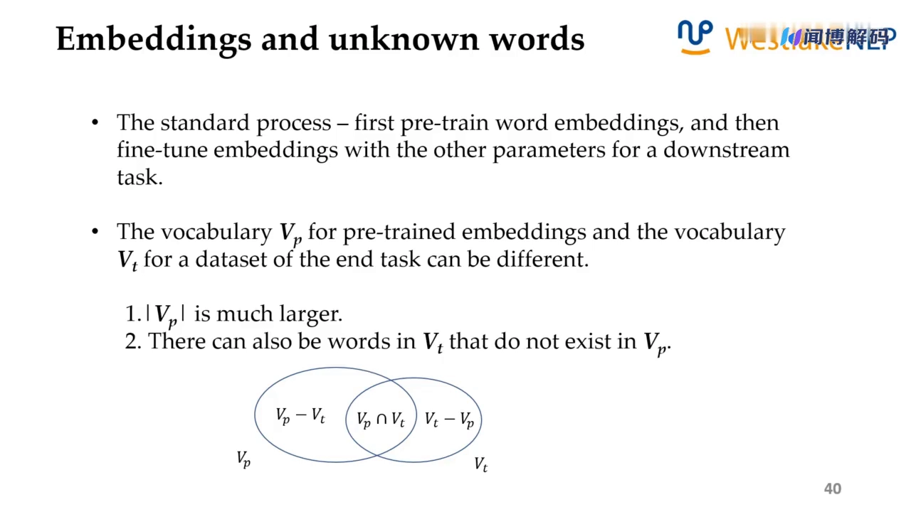
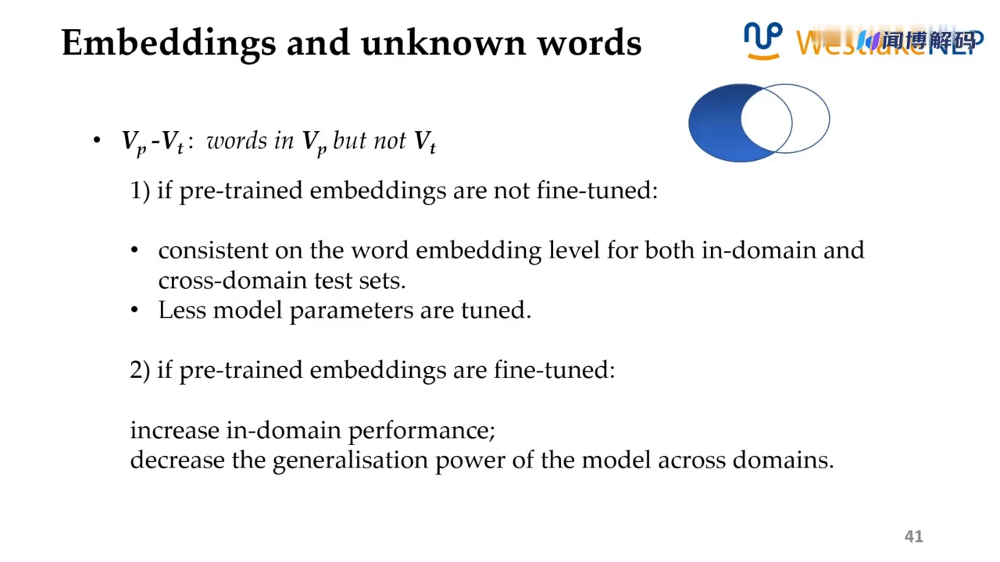
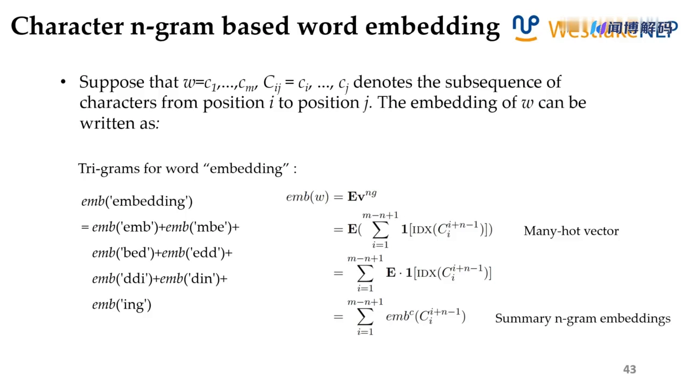
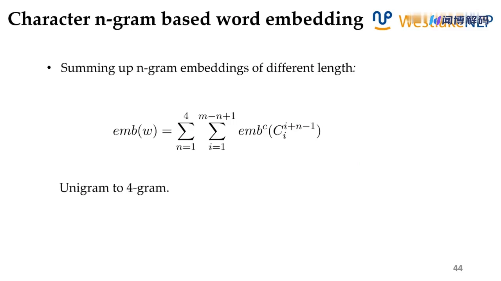

# 未登录词的两张词表：预训练词表与下游词表的差集怎么处理

> 视频来源：[122.XHDX_[15.7.1]--词嵌入模型中的OOV问题](https://www.bilibili.com/video/BV1P9NEzoEqu/?t=0)（Bilibili · 闻博解码，BV1P9NEzoEqu）
> 本文基于视频演说图文稿整理，配图截自视频。字幕中的英文术语已按上下文订正（如 `此表`→词表、`AGRAM`→n-gram、`SUBBD`→subword）。本篇只讲一件事：当下游任务的词表与预训练词表不一致时，嵌入矩阵该怎么处理。

## 本讲要解决的核心问题（SCQA）

**背景**：用词嵌入（word embedding）训练模型，标准流程是两步：先用语言模型在大规模语料上预训练好词向量，再用这些向量去初始化神经网络输入层的嵌入矩阵，最后在下游任务的训练数据上微调整个网络，包括输入层这份嵌入参数 [【跳转到 00:16】](https://www.bilibili.com/video/BV1P9NEzoEqu/?t=16)。

**冲突**：这套流程藏着一个默认假设——下游任务用到的词，都包含在预训练词表里。但事实上并不永远如此。预训练词表（记作 $V_P$）和下游任务训练数据的词表（记作 $V_T$）是两个不同的集合，它们互相都有"对方没有"的部分。这些词就是**未登录词**（out-of-vocabulary，OOV）——而嵌入层是按 id 取行的，一个词不在词表里，它连行号都没有，根本进不了模型。

**疑问**：$V_P$ 与 $V_T$ 的差异到底分几种情况？每种情况对下游性能有什么影响？一个词如果不在预训练词表里，我们能用什么办法给它一个向量？

**回答（中心思想）**：**把两张词表画成两个相交的圆，未登录词就分成"只在预训练里有"（$V_P - V_T$）和"只在下游任务里有"（$V_T - V_P$）两类，两类各有各的处理办法。** 前者决定"预训练好的嵌入要不要跟着微调"，是一个**一致性与性能的权衡**；后者决定"没有行号的词怎么造出向量"，有三条路：扩展词表并随机初始化、统一映射到 `<UNK>`、或者用字符/子词把词拆小 [【跳转到 06:31】](https://www.bilibili.com/video/BV1P9NEzoEqu/?t=391)。

---

## 一、先立两个词表：$V_P$ 与 $V_T$

视频先把记号定清楚：

- $V_P$：预训练（pretrained）词嵌入的词汇表，也就是嵌入矩阵的行集合；
- $V_T$：下游任务（task）训练数据的词汇表。

一般情况下两者的关系如图：中间是交集 $V_P \cap V_T$（两边都有），左边是 $V_P - V_T$（预训练过、但下游任务没用到），右边是 $V_T - V_P$（下游任务里有、但预训练词表里没有）[【跳转到 01:56】](https://www.bilibili.com/video/BV1P9NEzoEqu/?t=116)。

这个划分是 MECE 的：一个词要么两边都有、要么只在一边有，没有第四种情况。而"未登录"这个词其实有两种含义——站在下游任务的角度，$V_T - V_P$ 里的词是未登录词；站在预训练词表的角度，$V_P - V_T$ 里的词也是"下游没见过"的词。两种未登录词，处理方式完全不同。

## 二、$V_P - V_T$：预训练过、下游没用到，要不要跟着微调

先看左边。$V_P - V_T$ 这些词在预训练时学过，但在下游任务的训练数据里根本没出现，因此不会被下游数据直接训练到。真正的选择在于**交集那部分**：微调时要不要动它？

**方案一：冻结嵌入，只训练其他参数。** 下游任务无论如何训练，$V_P$ 这份嵌入表保持原样。

- 优点：整个 $V_P$ 在词嵌入层面保持**一致**——无论同分布测试集还是跨领域测试集，词与词之间的相对位置都没被破坏。
- 缺点：参与优化的参数实质上变少了，在训练集与测试集分布一致时，测试集性能可能下降 [【跳转到 05:16】](https://www.bilibili.com/video/BV1P9NEzoEqu/?t=316)。

**方案二：微调交集部分的嵌入。** 这是大多数研究工作采取的做法。

- 优点：交集部分的词作为模型参数参与了损失函数的最小化，对降低训练损失有直接贡献，同分布性能更好。
- 缺点：微调之后，交集词的取值偏离了预训练值，于是它们和 $V_P - V_T$ 里的词**不再处在同一个嵌入空间**。视频举的例子是：交集里有个词 `dog`，左差集里有个词 `emu`，原本这两个词向量可能非常接近；下游微调之后，它们可能被拉远了，这在上一节课讲的内部评价指标上是一种损失 [【跳转到 04:01】](https://www.bilibili.com/video/BV1P9NEzoEqu/?t=241)。

所以这是一个**权衡**，不是对错：要同分布的分数，还是跨域泛化的稳健性。视频也补了一句理论上的反向情形——如果测试集分布与训练集不同、且里面含有 $V_P - V_T$ 这类词，那么冻结嵌入的模型反而可能表现更好 [【跳转到 05:41】](https://www.bilibili.com/video/BV1P9NEzoEqu/?t=341)。

## 三、$V_T - V_P$：下游有、预训练没有，怎么给它一个向量

右边这块才是真正意义上的"未登录词"：它们在下游任务数据里出现，但在预训练嵌入表里**没有对应的行**。按嵌入层的查表逻辑，没有行号就等于没有向量，连前向都跑不起来。视频给了三条路 [【跳转到 07:21】](https://www.bilibili.com/video/BV1P9NEzoEqu/?t=441)：

**办法一：扩展词表。** 把词表从 $V_P$ 扩成 $V_P \cup V_T$，给新增的词**随机初始化**向量，然后在训练时同时微调交集部分和新增部分。这样所有训练数据里出现的词都能被正常调整 [【跳转到 06:56】](https://www.bilibili.com/video/BV1P9NEzoEqu/?t=416)。代价是嵌入矩阵变大了——行数增加意味着参数增加，这部分账在 1.2.4 里算过。

**办法二：统一映射到 `<UNK>`。** 如果 $V_T - V_P$ 的数量非常少，可以用一个特殊的 `<UNK>` 符号代表它们，用零向量或随机向量初始化，再在微调中让它被调整。好处是：当测试集里出现训练集和预训练词表里都没有的词时，模型至少能通过 `<UNK>` 做一点猜测，而不是直接崩掉。

这里要注意 `<UNK>` 的身份：它和 BOS、EOS、PAD 一样是**特殊标记**，在嵌入矩阵里占**一行**实实在在的参数。它之所以能"代表所有不认识的词"，正是因为它有一个可学习的向量，能在训练中收敛到"这一类未知词的平均样子"。

**办法三：用字符或子词派生向量。** 前两章分别讲过用字符（character）和用子词（subword）来计算一个词的向量。共同思路是**把"词"这个单位缩小**，从而降低未登录词的比例：字符集合是封闭的，子词词表也远比词表小且覆盖更全，任何词都能被拆成已知单元的组合 [【跳转到 08:36】](https://www.bilibili.com/video/BV1P9NEzoEqu/?t=516)。

## 四、第三种办法的细节：字符 n-gram 与 many-hot 向量

视频最后展开讲的是第三种办法里的一种具体形式——**字符 n-gram**（character n-gram）。以 trigram（三字符）为例，用一个长度为 3 的滑动窗口扫过整个词，取出所有字符三元组。对 `embedding` 这个词，得到的是 `emb`、`mbe`、`bed`、`edd`、`ddi`、`din`、`ing` [【跳转到 09:26】](https://www.bilibili.com/video/BV1P9NEzoEqu/?t=566)。

基本思路很直接：**给每个三元组查一个 embedding，把所有三元组的 embedding 加起来，作为这个词的 embedding**：

$$
\mathrm{emb}(w) = \sum_{i=1}^{m-n+1} \mathrm{emb}^c\!\left(C_i^{\,i+n-1}\right)
$$

其中 $w = c_1, \dots, c_m$ 是词，$C_i^{\,i+n-1}$ 表示从第 $i$ 个字符开始、长度为 $n$ 的字符片段。

关键在于这一步和"查表"的关系。查三元组表的过程可以写成一个 **many-hot 向量**：向量长度等于所有可能的字符三元组的个数，给定一个词，用滑动窗口查到一个三元组，就在对应那一维上加一。于是

$$
\mathrm{emb}(w) = \mathbf{E} \cdot \mathbf{v}^{ng}, \qquad \mathbf{v}^{ng} = \sum_{i=1}^{m-n+1} \mathbf{1}\left[\mathrm{IDX}\left(C_i^{\,i+n-1}\right)\right]
$$

这正是本篇第一部分讲过的"one-hot 乘矩阵"的推广：one-hot 只有一个 1，取出一行；many-hot 有多个 1，取出多行再相加。**嵌入层是线性层**这条性质在这里又一次兑现——求和之所以成立，就是因为查表本质上是一次线性运算 [【跳转到 10:16】](https://www.bilibili.com/video/BV1P9NEzoEqu/?t=616)。

和纯字符、纯子词相比，字符 n-gram 还有一个好处：交叠的三元组能提取更多有用的特征（比如 `emb` 和 `mbe` 共享了两个字符）。这套做法还可以把不同长度的 n-gram 组合起来，比如把一元组到四元组的结果全部加起来：

$$
\mathrm{emb}(w) = \sum_{n=1}^{4}\ \sum_{i=1}^{m-n+1} \mathrm{emb}^c\!\left(C_i^{\,i+n-1}\right)
$$

## 五、把三条路放回"嵌入层"这一层来看

这一节的所有讨论，其实都指向同一个事实：**嵌入层的行号来自词表，词表覆盖不到的词就没有行号**。三条处理办法分别对应三种"补行号"的方式：

| 情形 | 问题 | 处理 | 对嵌入矩阵的影响 |
| --- | --- | --- | --- |
| $V_T - V_P$ 数量多 | 没有行号 | 扩展词表 $V_P \cup V_T$，新行随机初始化 | 行数变多，参数变多 |
| $V_T - V_P$ 数量少 | 没有行号 | 全部映射到 `<UNK>` 一行 | 行数不变，用一个特殊标记兜底 |
| 任意未见词 | 没有行号 | 拆成字符/子词/n-gram，用已知单元的组合表示 | 词表变成字符或子词表，覆盖封闭 |

而 $V_P - V_T$ 那一侧的问题不是"没有行号"，而是"有行号但下游用不到"——它影响的是**要不要让这些行（以及交集的行）在微调中移动**，也就是嵌入空间的一致性。

## 小结

- **未登录词要分两种**：$V_P - V_T$（预训练有、下游没有）和 $V_T - V_P$（下游有、预训练没有），两者处理方式不同。
- **$V_P - V_T$ 的核心是权衡**：冻结嵌入 → 跨域一致、可调参数少、同分布性能可能降；微调嵌入 → 同分布性能升、跨域泛化降。多数工作选后者。
- **$V_T - V_P$ 的核心是补行号**：扩展词表随机初始化、映射到 `<UNK>`、或用字符/子词派生向量。
- **`<UNK>` 是特殊标记，在嵌入矩阵里占一行**，它的向量同样是被训练出来的，所以能代表"所有不认识的词"。
- **字符 n-gram 是"many-hot 乘嵌入表"**：词的向量等于其所有字符 n-gram 向量之和，本质上仍是查表加线性组合，只是取出的行不止一行。
- **把词拆小是降低 OOV 的通用手段**：字符集合封闭、子词覆盖更全，任何词都能被拆成已知单元。

## 关键术语速查

| 术语 | 一句话解释 |
| --- | --- |
| OOV（未登录词） | 不在当前词表里、因而没有对应嵌入行的词 |
| $V_P$ | 预训练词嵌入使用的词表，决定了嵌入矩阵有哪些行 |
| $V_T$ | 下游任务训练数据的词表 |
| 冻结嵌入（frozen embedding） | 微调时保持预训练嵌入参数不变，只训练其他层 |
| `<UNK>` | 代表所有未登录词的特殊标记，在嵌入矩阵中占一行，向量可训练 |
| 字符 n-gram | 用长度为 n 的滑动窗口把词切成字符片段，用片段向量之和表示词 |
| many-hot 向量 | 长度等于 n-gram 表大小、多个位置为 1 的稀疏向量，乘嵌入表等价于取出多行求和 |