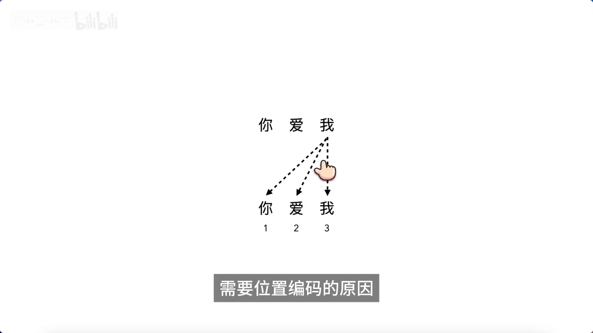
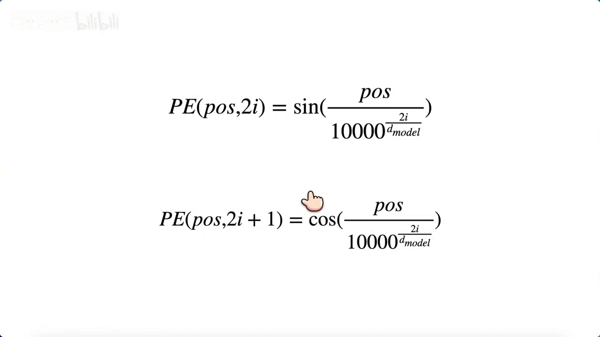
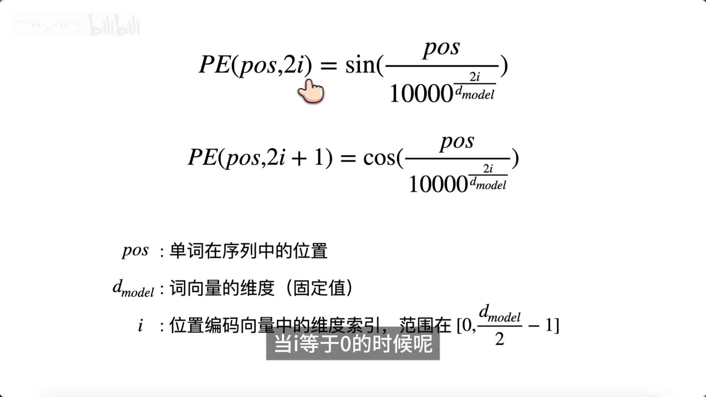
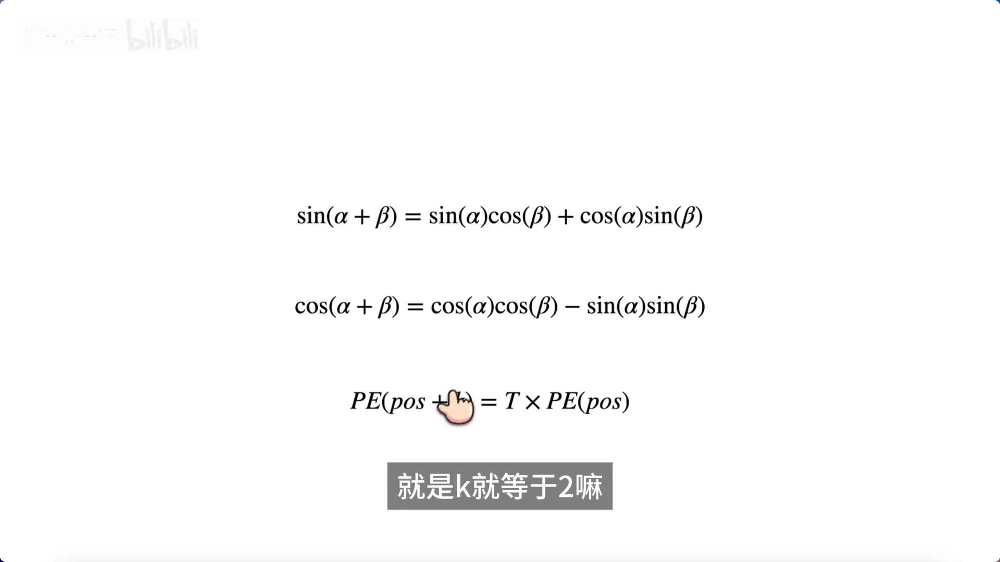
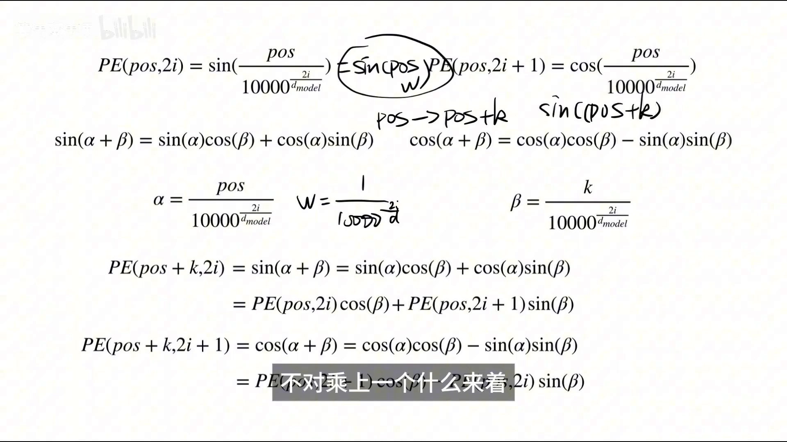
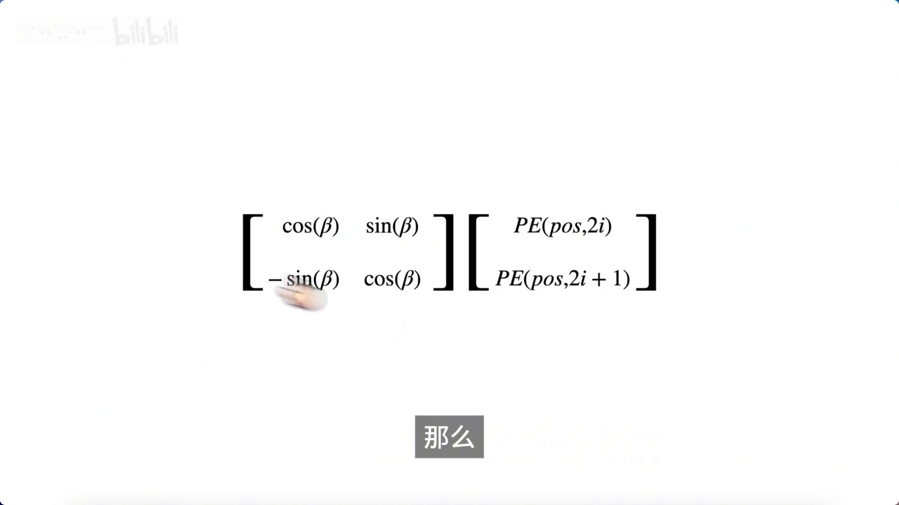
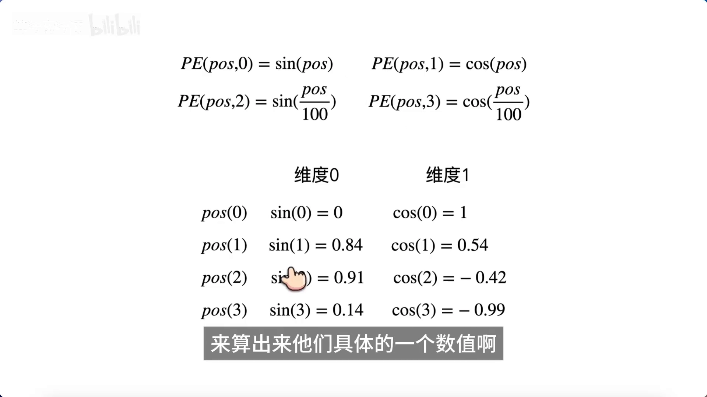
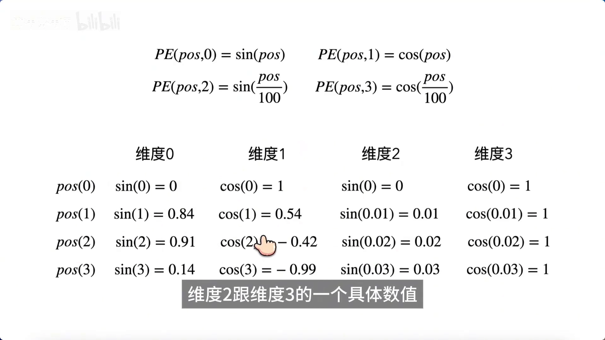
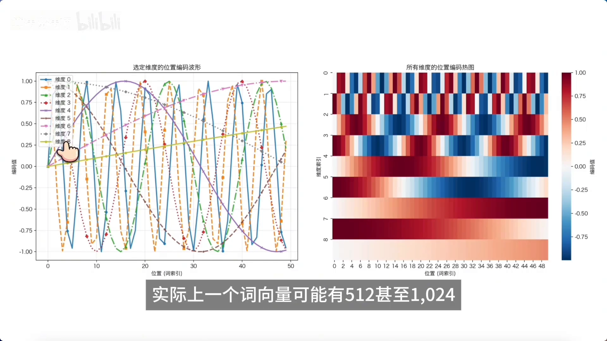

# 位置编码加在词向量上：为什么用正弦余弦而不是 1、2、3

> 视频来源：[为什么不用1,2,3？深度解密Transformer位置编码，带公式推导！](https://www.bilibili.com/video/BV1aLCsBhE7i/?t=0)（Bilibili · 算法魔法师）
> 本文基于视频演说图文稿整理，配图截自视频。导读：这支视频只做一件事——把原始 Transformer 的正弦位置编码从"为什么要加"讲到"公式怎么推出来"，中间用和角公式证明 `pos+k` 的编码是 `pos` 编码的固定线性变换，最后用数值表和波形图解释"低维看局部、高维看全局"。本篇不涉及 RoPE、ALiBi 等后续方案。

## 本讲要解决的核心问题（SCQA）

**背景**：Transformer 的每一层都是矩阵乘法和加法，注意力分数由 query 和 key 的内积算出。位置编码（positional encoding）是加在词向量上的一个同维度向量，让模型知道"谁在前、谁在后"。

**冲突**：既然只是"告诉模型第几个"，为什么不干脆把位置编号 1、2、3……直接加到词向量上？更奇怪的是，原始论文给出的公式里既有 `sin` 又有 `cos`，分母还带着一个 10000 的幂——这个式子看上去像是为了复杂而复杂。

**疑问**：位置信息到底加在哪一步？为什么 1、2、3 不行？正弦公式里那些 `sin`/`cos`、$10000^{2i/d_{model}}$ 各自在起什么作用？它凭什么能被模型学明白？

**回答（中心思想）**：**位置编码是"加在词向量上、进入注意力之前"的一层输入改造；用正弦余弦而不是整数编号，是为了让编码值有界、且每个维度自带不同周期。** 前者避免位置数值随序列变长而爆炸，后者让同一套公式在任意长度上都有定义；而 `sin`/`cos` 的**和角公式**进一步保证了"往后挪 k 个位置"等价于对编码向量做一次固定的线性变换——这正是模型能通过权重学到相对位置的原因 [【跳转到 02:45】](https://www.bilibili.com/video/BV1aLCsBhE7i/?t=165)。

---

## 一、位置信息加在词向量上，因为注意力本身不看顺序

先说清楚"为什么需要"。自注意力在计算时，每个词都要和其他所有词算一次缩放点积，然后按分数加权求和。这个过程对输入顺序是不敏感的：把「我爱你」和「你爱我」这两句话喂进去，算出来的结果是一样的 [【跳转到 00:21】](https://www.bilibili.com/video/BV1aLCsBhE7i/?t=21)。

如果不加位置编码，模型理解「我爱你」和理解「你爱我」就是一回事。所以位置编码要做的事很朴素：**给每个词加一个"地理坐标"，告诉模型谁在前、谁在后** [【跳转到 00:42】](https://www.bilibili.com/video/BV1aLCsBhE7i/?t=42)。

这里要记住一个关键位置关系：位置编码不是加在注意力分数上，也不是加在输出上，而是**加在查表得到的词向量上**，加完之后这个"词向量 + 位置向量"的整体才去投影出 Q、K、V。也就是说，位置信息从模型的第一层起就混在表示里，跟着词一起往前走。词向量是 $d_{model}$ 维，位置编码也必须同样是 $d_{model}$ 维，才能逐元素相加。

## 二、为什么不用 1、2、3：两个理由

最省事的做法是第 1 个词加 1、第 2 个词加 2……一直到第 512 个词加 512。视频给出两条反对理由 [【跳转到 00:47】](https://www.bilibili.com/video/BV1aLCsBhE7i/?t=47)。

**理由一：数值太大，会破坏词向量的分布。** 词向量本身的数值是有量级的，如果位置项随序列变长一路涨到 512、1024，它在相加后的向量里就会占据主导，把原本的语义分布冲散，进而影响训练稳定性。

**理由二：只能固定表达若干个长度。** 训练数据都是 512 长度以内的句子，就按 512 来设；但用户输入不受这个约束——跟大模型聊天时 token 数量随随便便上千，甚至上万。用一个"最大值写死"的编码，超出部分就没有对应的表示，泛化能力很差 [【跳转到 01:12】](https://www.bilibili.com/video/BV1aLCsBhE7i/?t=72)。

正弦编码正是针对这两点设计的：`sin`/`cos` 的取值永远落在 $[-1, 1]$，不会随位置增长；而公式对任意 `pos` 都有定义，不需要预先知道最大长度。

## 三、公式拆开看：每个维度一对 sin 和 cos

原始 Transformer 的写法是 [【跳转到 02:02】](https://www.bilibili.com/video/BV1aLCsBhE7i/?t=122)：

$$
PE(pos, 2i) = \sin\left(\frac{pos}{10000^{2i/d_{model}}}\right)
$$

$$
PE(pos, 2i+1) = \cos\left(\frac{pos}{10000^{2i/d_{model}}}\right)
$$

三个符号各管一件事 [【跳转到 02:20】](https://www.bilibili.com/video/BV1aLCsBhE7i/?t=140)：

- `pos` 是词在序列里的位置。句子「我爱你」中，「我」的位置是 0，「爱」是 1，「你」是 2——从 0 开始编号。
- $d_{model}$ 是词向量的维度，是一个固定值（原始论文是 512）。
- $i$ 是"维度对"的索引，范围是 $[0, \frac{d_{model}}{2} - 1]$。512 维时 $i$ 取 0 到 255。

为什么是两个公式而不是一个？因为**每个维度对 $(2i, 2i+1)$ 用同一套频率，一个取 `sin`、一个取 `cos`**。$i=0$ 时，$2i=0$、$2i+1=1$，第 0 维走 `sin`、第 1 维走 `cos`；$i=1$ 时就是第 2、3 维。这样交替下去，512 维被分成 256 对。

## 四、和角公式：往后挪 k 位，等于乘一个固定矩阵

正弦编码最漂亮的性质，来自中学学过的和角公式：

$$
\sin(\alpha + \beta) = \sin\alpha \cos\beta + \cos\alpha \sin\beta
$$

$$
\cos(\alpha + \beta) = \cos\alpha \cos\beta - \sin\alpha \sin\beta
$$

视频先提出一个猜想：`pos + k` 的位置编码，能不能由 `pos` 的位置编码线性表示出来？如果能，就说明公式里天然含有相对位置信息——这里的 `k` 就是"你跟我隔了几个"，隔两个 `k` 就等于 2 [【跳转到 03:10】](https://www.bilibili.com/video/BV1aLCsBhE7i/?t=190)。

把分母记作 $w = 10000^{2i/d_{model}}$，那么 $PE(pos, 2i) = \sin(pos \cdot w)$。令

$$
\alpha = pos \cdot w, \qquad \beta = k \cdot w
$$

于是 $PE(pos+k, 2i) = \sin\big((pos+k) \cdot w\big) = \sin(\alpha + \beta)$，套和角公式展开：

$$
\begin{aligned}
PE(pos+k, 2i) &= \sin(\alpha)\cos(\beta) + \cos(\alpha)\sin(\beta) \\
&= PE(pos, 2i)\cos\beta + PE(pos, 2i+1)\sin\beta
\end{aligned}
$$

奇数维同理：

$$
\begin{aligned}
PE(pos+k, 2i+1) &= \cos(\alpha+\beta) = \cos\alpha\cos\beta - \sin\alpha\sin\beta \\
&= PE(pos, 2i+1)\cos\beta - PE(pos, 2i)\sin\beta
\end{aligned}
$$

把同一对维度的两条式子写成矩阵 [【跳转到 05:40】](https://www.bilibili.com/video/BV1aLCsBhE7i/?t=340)：

$$
\begin{bmatrix} PE(pos+k, 2i) \\ PE(pos+k, 2i+1) \end{bmatrix}
=
\begin{bmatrix} \cos\beta & \sin\beta \\ -\sin\beta & \cos\beta \end{bmatrix}
\begin{bmatrix} PE(pos, 2i) \\ PE(pos, 2i+1) \end{bmatrix}
$$

这个矩阵里只有 $\cos\beta$ 和 $\sin\beta$，而 $\beta = k \cdot w$ **只和相对位移 $k$、维度 $i$ 有关，与绝对位置 $pos$ 无关**。结论是：任意位置 $pos+k$ 的编码，都可以由 $pos$ 的编码做一次固定的线性变换得到 [【跳转到 05:56】](https://www.bilibili.com/video/BV1aLCsBhE7i/?t=356)。

这件事为什么重要？因为注意力机制本身就是一堆线性变换（Q、K、V 的投影都是矩阵乘）。既然"往后挪 k 位"是一个固定矩阵，模型就可以通过调整权重来学会并利用这种相对关系。比如模型需要理解"我在你后面一个位置"，也就是 $k=1$，它不必精确记住自己在绝对位置 2 还是绝对位置 3，只需学会一个针对 $k=1$ 的变换模式即可——这极大增强了泛化能力 [【跳转到 06:21】](https://www.bilibili.com/video/BV1aLCsBhE7i/?t=381)。

## 五、多尺度：低维看局部，高维看全局

第二个理由是"多尺度"。一个词的词向量有很多维度，如果按 1、2、3、4 那样编码，实际上只有一个维度承载了位置数字；而正弦编码让**每个维度都对应一个不同周期的波**，于是每个维度都携带一种尺度的位置信息 [【跳转到 07:11】](https://www.bilibili.com/video/BV1aLCsBhE7i/?t=431)。

- 低维度：分母小、周期短，波动快，相邻位置的编码值差异大，适合精确表示**相近**的位置。
- 高维度：分母大、周期长，波动慢，相邻位置几乎一样，只有拉开很远才显出差别，适合表达**全局**位置。

视频用 $d_{model}=4$ 的小例子把这件事算了出来。前两维（维度 0、1）取 $i=0$，分母是 1，于是直接是 $\sin(pos)$、$\cos(pos)$：

后两维（维度 2、3）分母变成 100，位置 0 到 3 算出来是 $\sin(0.01)$、$\sin(0.02)$、$\sin(0.03)$ 这样的值：

对比两张表就明白了：维度 0、1 上第 0 个位置（0）和第 1 个位置（0.84）差得很远，区分度大；维度 2、3 上词一和词二的差别就很小，词二和词三也一样。视频还特意加了第 100 个词的位置编码——只有差这么多间隔，数值上才体现得明显，说明高维对小幅位移不敏感 [【跳转到 08:26】](https://www.bilibili.com/video/BV1aLCsBhE7i/?t=506)。

把 8 个维度在 50 个位置上的取值画出来，就是左边这张波形图；右边是把所有维度的编码强度画成的热图 [【跳转到 09:29】](https://www.bilibili.com/video/BV1aLCsBhE7i/?t=569)：

- 左图里第 0 维的周期最短，来回振荡；维度越大周期越长，有一条线甚至跨出图形界面、看不完全。
- 右图里维度越小，每个词之间的颜色区别越大；维度越大，区别越小。

两张图印证的是同一个结论：**低维度表示局部信息，高维度表示全局信息** [【跳转到 09:54】](https://www.bilibili.com/video/BV1aLCsBhE7i/?t=594)。这样同一个词的表示里，既能体现它和前一个词的关系，也能体现它和前一段话的关系。

## 六、这套编码的边界

视频最后留了一个开放问题：正弦位置编码有什么缺点，为什么现在的大模型大多不用它了 [【跳转到 11:50】](https://www.bilibili.com/video/BV1aLCsBhE7i/?t=710)。按视频里的讲法可以归纳成两点，具体的外推方案不在本篇展开：

- **它给的仍然是绝对位置**。虽然和角公式保证了相对位移可以线性变换得到，但编码本身是"第几个"的函数，模型要自己去学那个变换矩阵；而且实际计算中模型并不会直接使用推导出的矩阵 $T$，而是从数据里学一个近似版本，所以严格等式在工程上只是近似。
- **长度上限来自训练分布**。公式对任意 `pos` 有定义，但模型在训练中只见过有限范围内的位置模式，超出这个范围的表现要靠额外的处理。

## 小结

- 位置编码加在**词向量上**（不是加在注意力分数上），维度必须与词向量一致才能逐元素相加；加完之后才去投影 Q、K、V。
- 自注意力对顺序不敏感，不加位置编码时「我爱你」和「你爱我」算出来一样。
- 不用 1、2、3 的两个理由：数值随长度增长会破坏词向量分布；固定最大值无法覆盖更长的输入。
- 正弦编码每个维度对 $(2i, 2i+1)$ 共用一套频率，偶数维取 `sin`、奇数维取 `cos`，取值恒在 $[-1, 1]$。
- 和角公式给出 $PE(pos+k) = T_k \cdot PE(pos)$，其中 $T_k$ 只与相对位移 $k$ 有关——这是模型能学到相对位置的结构性原因。
- 频率阶梯带来多尺度：低维周期短、区分近邻；高维周期长、表达全局。

## 关键术语速查

| 术语 | 一句话解释 |
| --- | --- |
| 位置编码（positional encoding） | 与词向量同维、逐元素相加的向量，用来告诉模型 token 在序列中的位置 |
| $d_{model}$ | 词向量（也是位置编码、隐状态）的维度，原始 Transformer 取 512 |
| 维度对 | 第 $2i$ 与第 $2i+1$ 维共用同一个分母频率，一个取 sin、一个取 cos |
| 和角公式 | $\sin(\alpha+\beta)$、$\cos(\alpha+\beta)$ 的展开式，是相对位移可线性变换的来源 |
| 多尺度 | 不同维度对应不同周期的正弦波，短周期管局部、长周期管全局 |
| 外推（extrapolation） | 在训练时没见过的更长位置上继续使用位置编码；本篇只指出它存在边界，不展开具体方案 |