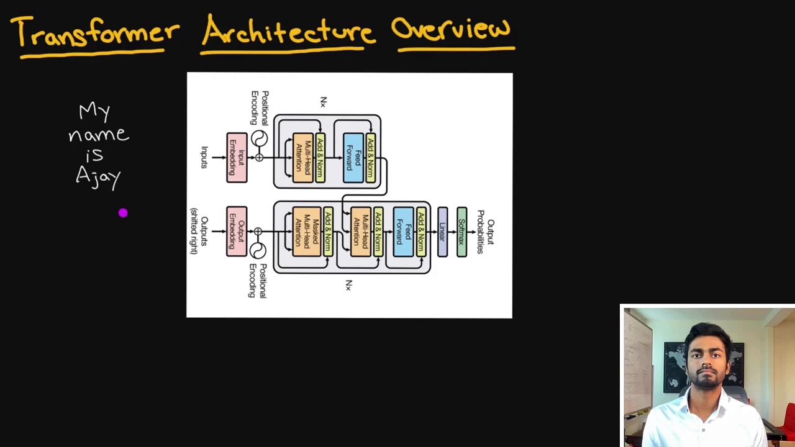
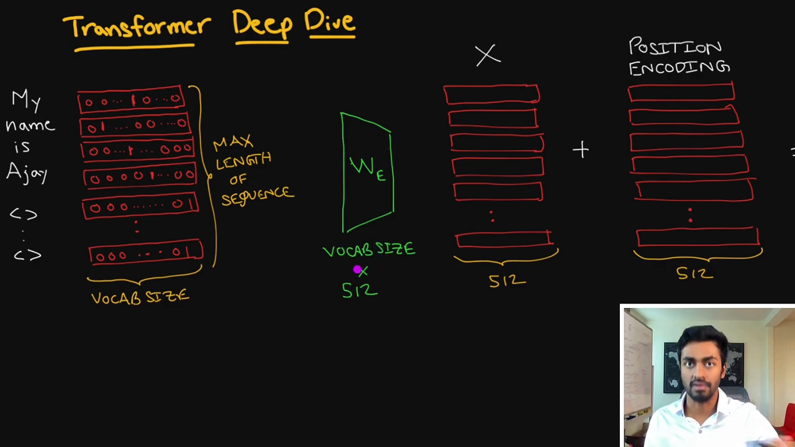
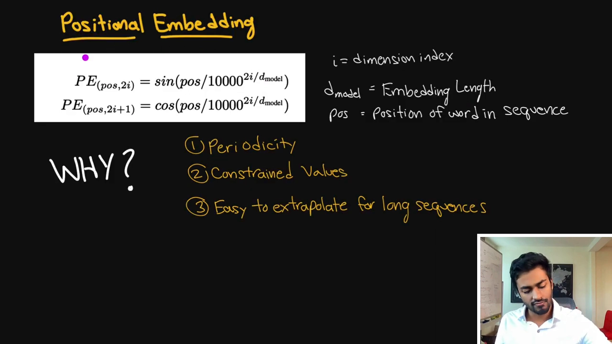
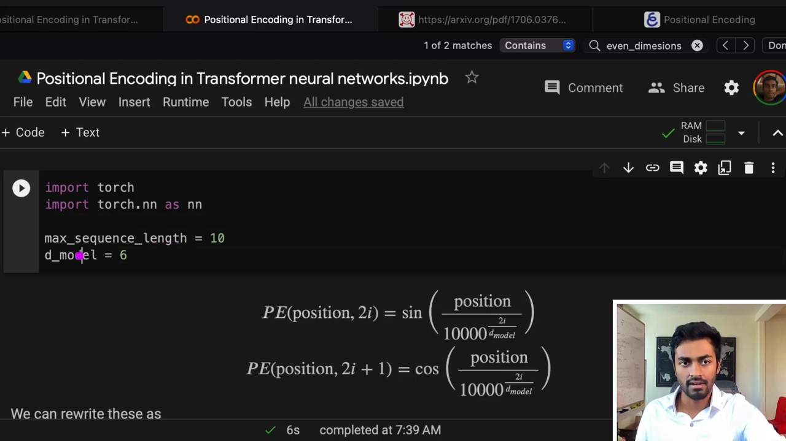
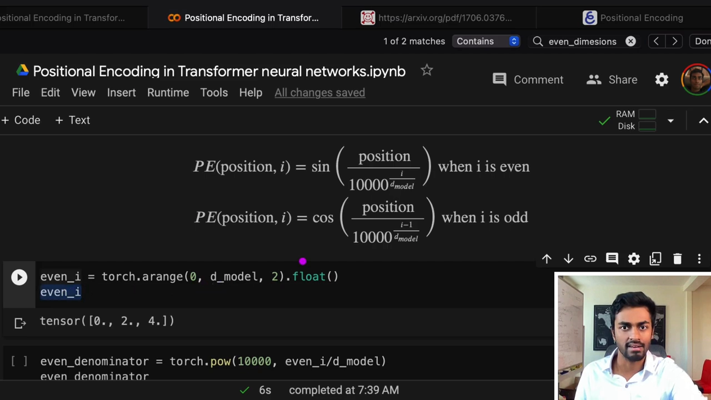
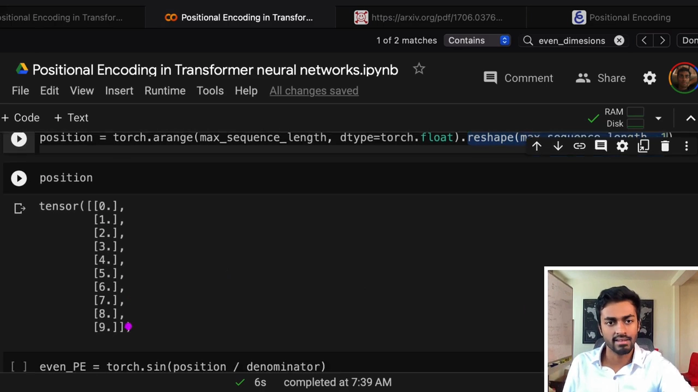
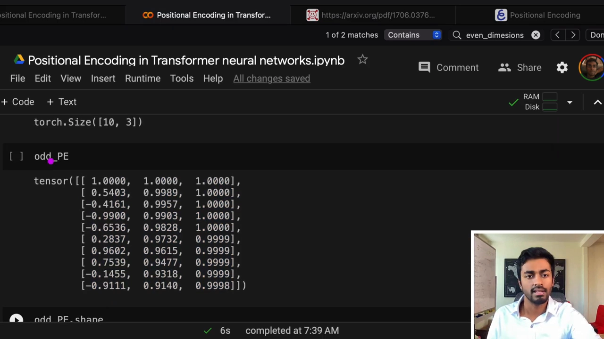

# 位置编码插在嵌入之后：PyTorch 里把 sin、cos 拼进 512 维

> 视频来源：[Positional Encoding in Transformer Neural Networks Explained](https://www.youtube.com/watch?v=ZMxVe-HK174&t=0)（YouTube · CodeEmporium）
> 本文基于视频演说图文稿整理，配图截自视频。导读：这支视频先画出 Transformer 从 one-hot 到 Q/K/V 的完整数据流，指出位置编码究竟插在哪一步，再给出正弦编码的三条设计理由，最后用 PyTorch 一行行把它实现出来（偶数维分母、奇数维分母、交错拼接）。本篇只讲绝对位置编码，不涉及相对位置方案。

## 本讲要解决的核心问题（SCQA）

**背景**：Transformer 是序列到序列模型，输入是一串 token。模型只认识数字和向量，所以每个 token 先被 one-hot 编码，再乘一个可学习的嵌入矩阵，变成 512 维的向量。

**冲突**：到这一步为止，一句话里的每个词都只带着"我是谁"，没带"我在第几个"。而注意力对所有位置一视同仁，顺序信息就此丢失。位置编码要补上这一块，但它必须和词向量**同尺寸**才能相加，还得保证数值不会把词向量冲垮。

**疑问**：这个位置向量到底加在流程的哪一步？为什么用 `sin`/`cos` 而不是别的函数？在 PyTorch 里怎么把它算出来、又怎么和词向量对齐？

**回答（中心思想）**：**位置编码加在嵌入层输出、Q/K/V 投影之前，是一个与词向量同尺寸、逐元素相加的矩阵。** 用 `sin`/`cos` 的理由有三条：周期性让不同距离的模式可复用、取值被约束在 $[-1,1]$ 不会压过词向量、公式确定因而容易外推到更长序列 [【跳转到 05:27】](https://www.youtube.com/watch?v=ZMxVe-HK174&t=327)。实现上，偶数维用 `sin`、奇数维用 `cos`，两者共用同一个分母 $10000^{2i/d_{model}}$，最后交错拼成一个 $L \times d_{model}$ 的矩阵。

---

## 一、先定位：位置编码加在嵌入之后、Q/K/V 之前

视频用一个翻译例子开场：把 "My name is Aj" 翻成卡纳达语，编码器一次读入整句，解码器一个词一个词往外吐。真正要细看的是编码器最前面那一段 [【跳转到 02:24】](https://www.youtube.com/watch?v=ZMxVe-HK174&t=144)。



数据流可以拆成五步：

1. **补齐到固定长度**。为了让每次送进模型的都是一个固定形状的矩阵，句子后面要用占位符补到"最大序列长度"。
2. **one-hot 编码**。词表有多大，one-hot 向量就有多长；词表大小就是模型能认的词的个数。
3. **乘嵌入矩阵**。这一步等价于一个前馈层，把 one-hot 映射成 512 维向量。参数是可学习的，数量是"词表大小 × 512"。
4. **加上位置编码**。得到的仍是 512 维向量，形状不变。
5. **投影出 Q、K、V**。每个 512 维向量分别乘三个 512×512 的权重矩阵，得到 query、key、value。



注意第 4 步的位置很关键：**位置编码不是加在注意力分数上，而是加在进入注意力之前的表示上**。加完之后，位置信息就混在向量里，跟着 Q/K/V 的投影一路往下走。也正因为要逐元素相加，位置编码的尺寸必须和词向量完全一致——词向量是 512 维，位置编码也必须是 512 维。

## 二、为什么是 sin 和 cos：三条理由

公式长这样 [【跳转到 05:12】](https://www.youtube.com/watch?v=ZMxVe-HK174&t=312)：

$$
PE_{(pos,\,2i)} = \sin\left(\frac{pos}{10000^{2i/d_{model}}}\right)
$$

$$
PE_{(pos,\,2i+1)} = \cos\left(\frac{pos}{10000^{2i/d_{model}}}\right)
$$

其中 `pos` 是词在序列中的位置，`i` 是维度索引，$d_{model}$ 是嵌入长度（这里取 512）。



视频给出三条理由：

**理由一：周期性。** `sin`/`cos` 是周期函数，走过一个周期就重复。这意味着同一个词在计算注意力时，对"后面第 5 个词""后面第 10 个词""后面第 15 个词"可以用同一种可复用的模式去处理，而不必为每个距离单独准备一套表示 [【跳转到 05:57】](https://www.youtube.com/watch?v=ZMxVe-HK174&t=357)。

**理由二：取值被约束住。** `sin`/`cos` 的值永远落在 $[-1, 1]$ 之间。如果没有这个约束，位置编码就会随位置单调增大：第 1 个位置比第 0 个大，第 2 个又比第 1 个大……那么在算注意力时，靠后的位置数值更大，前面的向量就很难被注意到，也就无法从远处取到上下文。取值有界保证了不同位置的编码在数值上是对等的 [【跳转到 06:28】](https://www.youtube.com/watch?v=ZMxVe-HK174&t=388)。

**理由三：容易外推。** 这是一个完全确定的公式，计算简单。即使训练集里没出现过某些序列长度，测试时也能照样算出对应位置的编码并解释它 [【跳转到 07:06】](https://www.youtube.com/watch?v=ZMxVe-HK174&t=426)。

## 三、PyTorch 实现：先算分母，再分奇偶

理论讲完，视频打开一个 notebook 逐行写代码。先设两个常量：最大序列长度取 10（真实场景是几千），$d_{model}$ 取 6（真实场景通常是 512，这里为了看清数字）[【跳转到 07:26】](https://www.youtube.com/watch?v=ZMxVe-HK174&t=446)。



为了好写，公式被改写成"按维度索引 $i$ 分奇偶"的版本：

$$
PE(position, i) = \sin\left(\frac{position}{10000^{i/d_{model}}}\right) \quad \text{当 } i \text{ 为偶数}
$$

$$
PE(position, i) = \cos\left(\frac{position}{10000^{(i-1)/d_{model}}}\right) \quad \text{当 } i \text{ 为奇数}
$$



### 3.1 偶数维的分母

```python
even_i = torch.arange(0, d_model, 2).float()   # tensor([0., 2., 4.])
even_denominator = torch.pow(10000, even_i / d_model)
```

`torch.arange(0, 6, 2)` 得到 0、2、4，正好是偶数维的下标；除以 $d_{model}$ 后作为指数，让 10000 升幂。

### 3.2 奇数维的分母其实和偶数维一样

```python
odd_i = torch.arange(1, d_model, 2).float()    # tensor([1., 3., 5.])
odd_denominator = torch.pow(10000, (odd_i - 1) / d_model)
```

视频在这里点出一个容易忽略的细节：奇数下标比对应的偶数下标正好大 1，而公式里又要先减 1，所以奇数下标先减 1 再除以 `d_model`，与偶数下标直接除以 `d_model` **算出来完全相同**。既然如此，就不必维护两份分母，只留一个 `denominator` 给两种情况共用 [【跳转到 09:06】](https://www.youtube.com/watch?v=ZMxVe-HK174&t=546)。

### 3.3 位置列向量与 sin、cos 两张表

```python
position = torch.arange(max_sequence_length, dtype=torch.float).reshape(max_sequence_length, 1)
even_PE = torch.sin(position / denominator)    # 形状 10 × 3
odd_PE  = torch.cos(position / denominator)    # 形状 10 × 3
```

位置被排成一个 10×1 的列向量，除以分母时自动广播到 3 列上，于是每个位置得到 3 个 sin 值和 3 个 cos 值 [【跳转到 09:56】](https://www.youtube.com/watch?v=ZMxVe-HK174&t=596)。



这张输出表本身就是"多尺度"的证据：第一列的分母最小、周期最短，值在 ±1 之间剧烈摆动；第三列的分母最大、周期最长，10 个位置过去几乎还停在 1.0 附近。

### 3.4 交错拼接：把两张表合成一个矩阵

现在手上有两张 10×3 的表，但需要的是 10×6 的矩阵，而且顺序必须是"第 0 维 sin、第 1 维 cos、第 2 维 sin、第 3 维 cos……" [【跳转到 10:22】](https://www.youtube.com/watch?v=ZMxVe-HK174&t=622)。

做法是沿最后一维把两张表堆起来，得到 10×3×2 的张量，再展平：

```python
pe = torch.stack([even_PE, odd_PE], dim=2)   # 10 × 3 × 2
pe = torch.flatten(pe, start_dim=1)          # 10 × 6
```



`stack` 让同一对的两个值挨在一起，`flatten` 之后自然就是 sin、cos、sin、cos 的顺序。这样第一个词拿到一行编码，第二个词拿到下一行，依次类推。

### 3.5 包成一个可复用的类

最后把上面所有步骤装进一个小类：构造时算好分母，`forward` 里生成位置、取 sin/cos、堆叠展平，返回形状为 $L \times d_{model}$ 的矩阵 [【跳转到 11:11】](https://www.youtube.com/watch?v=ZMxVe-HK174&t=671)。这个矩阵是**确定的、不含可学习参数**的——它只由 `max_len` 和 $d_{model}$ 决定，算一次就能缓存下来反复用，训练时不需要更新。

## 四、和"可学习位置编码"的对照

视频里的实现是固定式（正弦）版本。对照着看，两种绝对位置编码的差别很清楚：

| 对比项 | 固定式（正弦） | 学习式（位置嵌入矩阵） |
| --- | --- | --- |
| 参数 | 无，由公式算出 | 有一张 $L \times d_{model}$ 的表，随训练更新 |
| 长度上限 | 公式对任意位置有定义 | 表有多少行就只能表示多少位置 |
| 数值范围 | 恒在 $[-1, 1]$ | 由训练决定，无先验约束 |
| 归纳偏置 | 自带多尺度周期结构 | 完全由数据决定 |

固定式的代价是"结构被写死"，收益是不占参数、长度上更从容；学习式反过来，灵活但受表的行数限制。这条对照线在后续讲 RoPE 时会再次用到——那里要解决的是"绝对编码给不出干净的距离信息"。

## 小结

- 位置编码加在**嵌入层输出之后、Q/K/V 投影之前**，与词向量同尺寸、逐元素相加，形状不变。
- 三条设计理由：周期性让距离模式可复用；取值有界（$[-1,1]$）不会压过词向量、不会让远处 token 失去注意力；公式确定、便于外推。
- 偶数维用 `sin`、奇数维用 `cos`，两者共用分母 $10000^{2i/d_{model}}$；因为奇数下标先减 1，实际只需算一份分母。
- 实现路径：`arange` 取维度下标 → `pow` 算分母 → 位置列向量广播相除 → 分别取 sin/cos → `stack` 后 `flatten` 交错。
- 这个矩阵不含可学习参数，算一次即可缓存；与学习式位置嵌入相比，它省参数、长度上更从容，但结构被公式写死。

## 关键术语速查

| 术语 | 一句话解释 |
| --- | --- |
| 位置编码（positional encoding） | 与词向量同维、逐元素相加的矩阵，补上注意力丢失的顺序信息 |
| one-hot 编码 | 词表长度的向量，只有对应词的那一位是 1，其余为 0 |
| 嵌入矩阵 | 形状为"词表大小 × $d_{model}$"的可学习矩阵，one-hot 乘它即查表 |
| 分母（denominator） | $10000^{2i/d_{model}}$，控制第 $i$ 对维度的波长 |
| 交错拼接（interleave） | 把 sin 表和 cos 表按维度对交替排列，得到 sin、cos、sin、cos 的顺序 |
| 外推（extrapolation） | 在训练未见过的更长位置上继续使用编码；固定式公式对任意位置都有定义 |