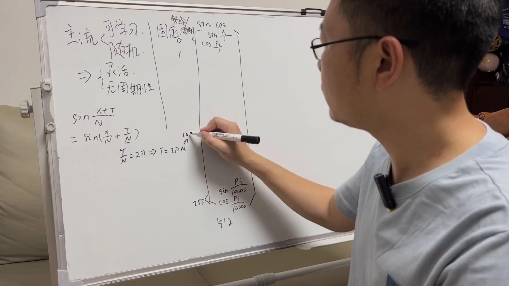
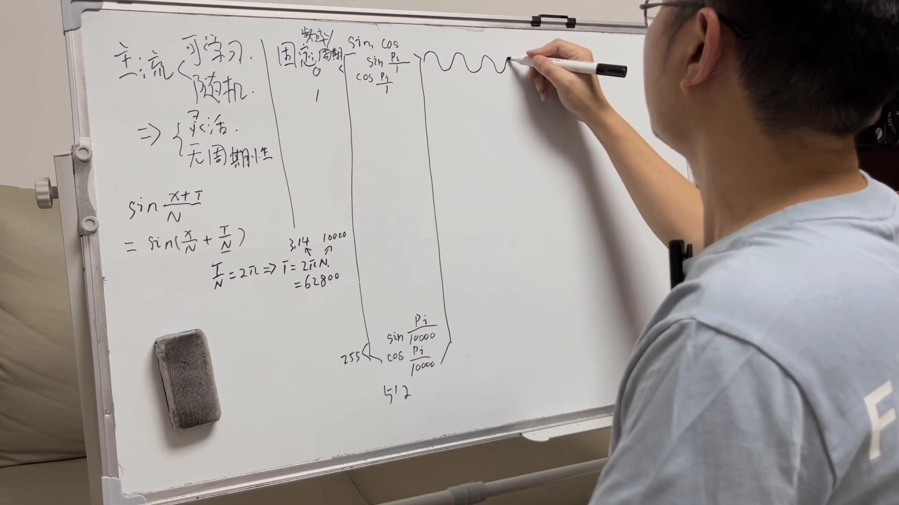
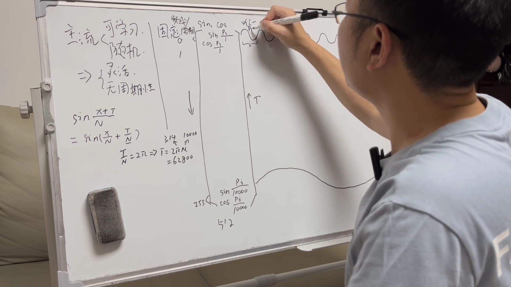
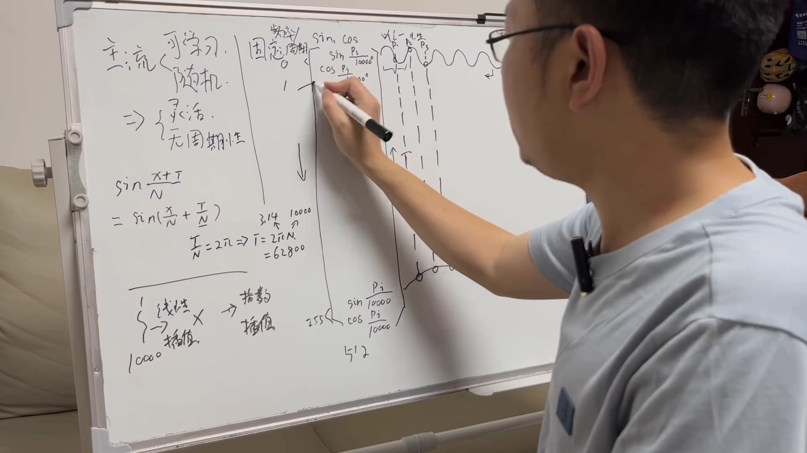
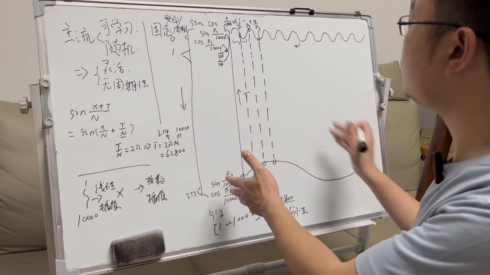

# 频率从 1 到 10000：正弦位置编码为什么用指数插值

> 视频来源：[【位置编码：设计原理】GPT绝对位置编码手推！](https://www.bilibili.com/video/BV1oALVzQEU2/?t=0)（Bilibili · 白板GPT学堂 · 阿鹏）
> 本文基于视频演说图文稿整理，配图截自视频。导读：这支视频在白板上手推 GPT 的固定正弦位置编码，重点不是"公式长什么样"，而是"频率因子为什么从 1 排到 10000、中间为什么用指数插值而不是线性插值"，最后拿可学习位置编码作对照，说明两种绝对编码各自的边界。

## 本讲要解决的核心问题（SCQA）

**背景**：绝对位置编码有两条路。一条是**可学习的位置嵌入**——给每个位置一行可训练的参数，初始值随机；这也是当前更主流的做法。另一条是 GPT 用的**固定正弦编码**——位置向量由 `sin`/`cos` 公式直接算出来，不含可训练参数。

**冲突**：正弦公式里那个 $10000^{2i/d_{model}}$ 的分母最让人费解。既然要让不同维度有不同周期，为什么不让周期从 1 均匀地排到 10000？为什么偏偏要用"指数"去插值？这个 10000 又为什么是 10000？

**疑问**：512 维的位置向量是怎么由 256 对 `sin`/`cos` 拼出来的？每一对的周期到底是多少？指数插值解决了线性插值解决不了的什么问题？这套固定编码在哪里会失效？

**回答（中心思想）**：**正弦位置编码把 512 维切成 256 对，每对用一个不同周期的三角函数；周期因子从 1 指数地铺到 10000，是为了让"高频维度负责区分近邻、低频维度负责兜住远处的唯一性"。** 频率因子取 $n$ 时周期是 $2\pi n$，最大的那一档对应约 62800 个位置；指数插值让这 256 档在 1 到 10000 之间均匀地"按比例"铺开，而不是在数值上等距 [【跳转到 09:35】](https://www.bilibili.com/video/BV1oALVzQEU2/?t=575)。

---

## 一、两种绝对位置编码：可学习 vs 固定

视频开场先把两条路摆出来 [【跳转到 00:22】](https://www.bilibili.com/video/BV1oALVzQEU2/?t=22)。

**可学习的位置编码**：给每个位置一行向量，初始值随机，跟着训练一起更新。它的好处是灵活——不受固定格式的限制，也没有预先设定的假设；更关键的是**没有周期性约束**，不会因为三角函数走完一个周期就开始重复。

**固定的正弦编码**：GPT 用的就是这一种，位置向量由公式算出，训练中不变。视频接下来的全部篇幅都在拆它。

## 二、512 维切成 256 对，每对共用一套频率

先看结构。假设 $d_{model} = 512$，那么位置向量也是 512 维。它不是 512 个独立的数，而是**两两配对**：第一个用 `sin`，就配一个对应的 `cos`；最后一对如果 `sin` 在前，`cos` 也跟在后面 [【跳转到 02:04】](https://www.bilibili.com/video/BV1oALVzQEU2/?t=124)。

于是 512 维 = 256 对。因为编号从 0 开始，所以是第 0 对、第 1 对，一直到第 255 对 [【跳转到 02:30】](https://www.bilibili.com/video/BV1oALVzQEU2/?t=150)。

这 256 对靠什么区分？靠**周期因子（频率因子）**：最上面那一对的因子是 1，最底下那一对的因子是 10000 [【跳转到 03:23】](https://www.bilibili.com/video/BV1oALVzQEU2/?t=203)。

## 三、周期到底是多少：T = 2πn

视频用一个简单推导把"频率因子"翻译成"周期" [【跳转到 04:24】](https://www.bilibili.com/video/BV1oALVzQEU2/?t=264)。考虑函数

$$
f(x) = \sin\left(\frac{x}{n}\right)
$$

要问它的周期 $T$，就看 $x$ 加上 $T$ 之后函数值是否复原：

$$
\sin\left(\frac{x+T}{n}\right) = \sin\left(\frac{x}{n} + \frac{T}{n}\right)
$$

`sin` 的最小正周期是 $2\pi$，所以要求 $\frac{T}{n} = 2\pi$，即

$$
T = 2\pi n
$$

代入 $n = 10000$：$2\pi \times 10000 \approx 62800$。也就是说，**周期因子最大的那一档，波长覆盖约 6.28 万个位置** [【跳转到 04:40】](https://www.bilibili.com/video/BV1oALVzQEU2/?t=280)。

## 四、为什么要"唯一性"：高频管近邻，低频兜远处

现在把 256 对看成 256 条不同频率的波，位置向量就是"在位置 $p$ 处把这 256 条波各取一个值，拼成一个向量"。要让这个向量能唯一代表位置 $p$，就不能让它在几个位置之内就绕回原样 [【跳转到 05:07】](https://www.bilibili.com/video/BV1oALVzQEU2/?t=307)。

- **周期短的那几档（高频）**：波动快，相邻位置取值差别大，适合精确区分**近邻** [【跳转到 05:27】](https://www.bilibili.com/video/BV1oALVzQEU2/?t=327)。
- **周期长的那几档（低频）**：波动平缓，相邻位置几乎一样，只有拉开很远才显出差别，适合表达**全局**位置。

视频用一个具体的取点过程说明唯一性怎么成立：假设位置 $P_1$ 在这里，向下切到高频波得到一个值，再切到低频波得到另一个值；$P_2$、$P_3$ 同理。**每个位置都能从这 256 条曲线上切下一组数，所有维度的取值凑成一个向量，就是它的位置向量** [【跳转到 08:55】](https://www.bilibili.com/video/BV1oALVzQEU2/?t=535)。

关键就在这里：如果只有高频那几档，走几个位置就会周期性地重叠，位置向量变得一样，无法区分；**正因为后面还有周期被放大的低频维度，即使高频维度已经绕回，整体向量仍然不同**。所以"维度越高、周期越长"不是审美选择，而是唯一性的必要条件。

## 五、指数插值：从 1 到 10000 怎么铺

已知最低维要因子 1、最高维要因子 10000，中间 254 档怎么填？最朴素的想法是**线性插值**：让周期因子在 1 到 10000 之间等距排开 [【跳转到 09:35】](https://www.bilibili.com/video/BV1oALVzQEU2/?t=575)。

但这样需要把数据放缩到 1 到 10000 之间、每个间隔相等，处理起来别扭，而且从"频率"的角度看并不自然。视频采取的是**指数插值**，写法更优雅 [【跳转到 10:20】](https://www.bilibili.com/video/BV1oALVzQEU2/?t=620)：

$$
\text{分母}_i = 10000^{\,i / (d_{model}/2)}
$$

把 10000 看成 $10000^1$，那么：

- 第 0 对的指数是 $0/256$，分母是 $10000^0 = 1$；
- 第 1 对的指数是 $1/256$，分母是 $10000^{1/256}$；
- ……
- 最后一对（第 255 对）的指数是 $255/256$，分母是 $10000^{255/256}$。

这里有个细节值得注意：最后一对的指数是 $255/256$ 而不是 $256/256$，所以它的分母**约等于** 10000，而不是精确等于 10000。视频认为这个差别影响不大 [【跳转到 11:36】](https://www.bilibili.com/video/BV1oALVzQEU2/?t=696)。

指数插值的好处在于：它让 256 档频率在**比例**上均匀铺开——每一档的分母都是上一档乘以同一个因子 $10000^{1/256}$，频率的"阶梯"是等比的；而线性插值是在 1 到 10000 这个数值区间上等分，还得先把数据放缩进这个区间，处理起来更别扭。

## 六、边界：超过 62800 个位置就开始重复

把前面的结论合起来：最低频那档的周期是 62800，所以**只要上下文长度在 6 万个词以内，位置向量还能保持较高的区分度**；一旦超过这个长度，位置信息就会开始周期性地重复，不同位置的向量可能撞在一起 [【跳转到 13:05】](https://www.bilibili.com/video/BV1oALVzQEU2/?t=785)。

这也正好回应了开头的对照：**可学习的位置编码没有周期性约束**，它不需要靠"周期够长"来维持唯一性，因为每个位置本来就是一行独立的参数；代价是表的行数写死了长度上限，超出范围就没有对应的行。两种绝对编码的取舍，本质上是"结构写死换长度从容"与"参数自由换长度受限"之间的交换。

## 小结

- 绝对位置编码有两条路：可学习的位置嵌入（灵活、无周期性约束、受表的行数限制）与固定正弦编码（无参数、公式对任意位置有定义）。
- 512 维切成 256 对，每对共用一套频率，一个取 `sin`、一个取 `cos`；频率因子从 1 铺到 10000。
- 频率因子为 $n$ 时周期是 $T = 2\pi n$；$n = 10000$ 对应约 62800 个位置。
- 唯一性靠"高低频搭配"：高频区分近邻，低频保证远处不撞车；只有高频会在几个位置内周期性重叠。
- 中间档用指数插值 $10000^{i/(d_{model}/2)}$ 而不是线性插值，让 256 档频率按比例均匀铺开；最后一档指数是 255/256，分母约等于 10000。
- 超过约 62800 个位置后正弦编码开始周期性重复，这是它长度上的硬边界。

## 关键术语速查

| 术语 | 一句话解释 |
| --- | --- |
| 可学习位置编码 | 每个位置一行可训练参数的嵌入表，初始随机，随训练更新 |
| 固定正弦编码 | 由 `sin`/`cos` 公式直接算出、不含可训练参数的位置向量 |
| 频率因子 / 周期因子 | 公式分母上的 $n$，决定这一对维度的波长 |
| 周期 $T = 2\pi n$ | 频率因子为 $n$ 时，函数值重复一次所需的位置跨度 |
| 指数插值 | 让分母按 $10000^{i/(d/2)}$ 变化，使各档频率按比例均匀铺开 |
| 唯一性 | 不同位置必须得到不同的位置向量，否则模型无法区分它们 |