# 反向互补不是免费的数据增强：链对称的三种做法与标签安全

> 视频来源：[Benchmarking Reverse-Complement Strategies for Deep Learning Models in Genomics (MLCB 2020)](https://www.youtube.com/watch?v=ROPhxdKHBE8&t=0)（YouTube · MLCB 2020 · Avanti Shrikumar，与 Hannah Zhou、Anshul Kundaje 合作）
> 本文基于视频演说图文稿整理，配图截自视频。本篇只讲生物序列上的一个对称性——**反向互补**：它为什么让"翻转序列"看起来像免费的增强、为什么普通 CNN 学不到它、以及三种把它写进模型的工程做法各自会在哪里踩坏标签。

## 本讲要解决的核心问题（SCQA）

**背景**：基因组深度学习模型的输入是一段 DNA，输出是实验测出来的调控信号——比如某个转录因子（transcription factor，一种能结合到 DNA 特定短序列上的蛋白）在每一段基因组上的结合强度。这类模型的主流骨架是卷积神经网络（CNN），它从序列里学出转录因子偏好的短模式，称为 motif（基序）。

**冲突**：DNA 是双链的，A 总与 T 配对、G 总与 C 配对。所以同一段 DNA 从另一条链读过去，得到的是一串"反向互补"（reverse complement）的序列，而**生物学上它们是同一个分子、同一个实验信号**。既然输入变了、标签没变，把序列反向互补一下丢进训练集，看起来是零成本的翻倍增强。可现实是：普通 CNN 学不到这个对称性，正链和反链上的预测可以差得很远——**即使训练集已经做过反向互补增强**。

**疑问**：既然增强不够，那要怎么才能让模型"天生"尊重这个对称性？文献里的做法有什么区别？把这些做法搬到逐碱基的信号形状预测任务上时，又会冒出哪些新坑？

**回答（中心思想）**：**反向互补对称是一条"必须显式写进去"的约束，而写进去有三种力度：数据增强（最弱，只改样本分布）、事后合并（推理时把正反链预测平均）、参数共享（最强，把对称性焊进权重）。** 这篇工作系统对比了这三种力度，结论有点反直觉：**训练时就把两条链的预测合起来，反而比"照常训练、只在测试时合并"更差** [【跳转到 11:54】](https://www.youtube.com/watch?v=ROPhxdKHBE8&t=714)——因为平均会把"这条链错了"的梯度信号抵消掉。而参数共享虽然表达力足够，却常常收敛不到理想解。所以作者的建议是：**想用反向互补对称，先用"增强 + 事后合并"这个默认档，再考虑参数共享** [【跳转到 15:23】](https://www.youtube.com/watch?v=ROPhxdKHBE8&t=923)。

---

## 一、双链给了模型一个免费的对称性，但 CNN 不会自己去用

### 1.1 先把任务摆清楚：输入序列，输出实验信号

视频里的任务设定很朴素：输入是 DNA 序列，输出是"在这段序列上测到的实验信号"。标签来自测量全基因组调控活性的实验，例如 ChIP-seq——它给出某个转录因子在基因组每个区域上的结合强度 [【跳转到 00:15】](https://www.youtube.com/watch?v=ROPhxdKHBE8&t=15)。

输出任务分两类，后面会一直用到这个区分：

1. **二分类（binary）**：这段序列里"有没有"信号峰。输出是一个数。
2. **信号形状预测（profile prediction）**：信号沿着序列每个碱基的分布长什么样。输出是一条曲线。

第二类更细，也更容易暴露对称性处理上的错误——这正是这篇工作要补的空白。

### 1.2 反向互补在 one-hot 上就是"两个轴各翻一次"

模型看到的 DNA 是 one-hot 编码：每个位置一个 4 维向量，按 A、C、G、T 的顺序排。视频里给的例子是一条长度 12 的序列，每一列只有一个 1 [【跳转到 03:22】](https://www.youtube.com/watch?v=ROPhxdKHBE8&t=202)。

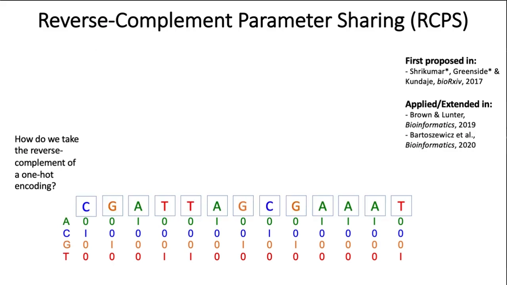

取反向互补要做两件事：

- **reverse**：沿**长度轴**把整条序列倒过来；
- **complement**：把每个碱基换成它的配对碱基，A↔T、C↔G。

关键的一句观察是：当通道顺序恰好是 A、C、G、T 时，**"换配对碱基"等价于沿通道轴翻转**（A 在第 0 位、T 在第 3 位，C 在第 1 位、G 在第 2 位，正好首尾对称）。于是"反向互补"这个生物学操作，在张量上就变成了**长度轴和通道轴各翻转一次**，也就是把这张 one-hot 矩阵**旋转 180 度** [【跳转到 04:12】](https://www.youtube.com/watch?v=ROPhxdKHBE8&t=252)。

这个"两个轴一起翻"的视角非常重要，后面所有的架构设计都建立在它上面。

### 1.3 为什么 CNN 学不会：motif 有方向

CNN 的第一层卷积核在序列上滑动，学出的是 motif 的"模板"。视频举的例子是 GATA：序列里出现 `GATA` 就激活 [【跳转到 01:05】](https://www.youtube.com/watch?v=ROPhxdKHBE8&t=65)。

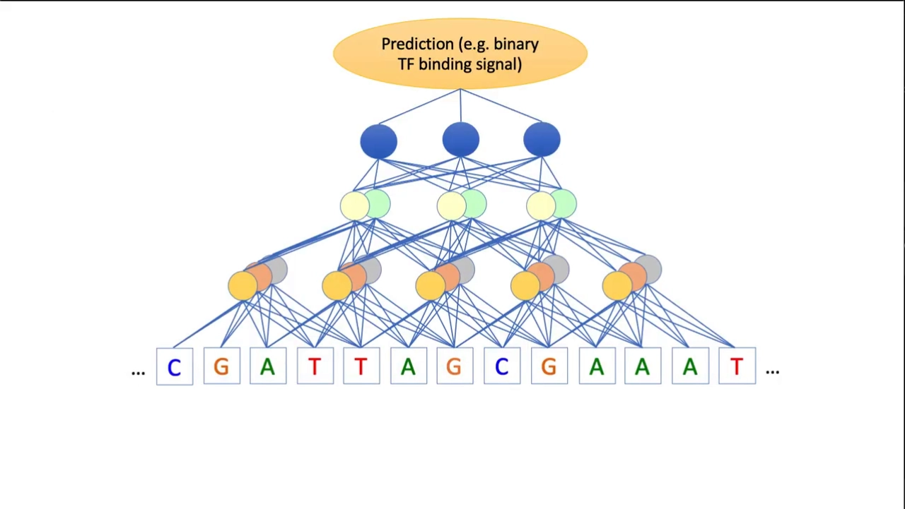

问题就在这里：**卷积核是有方向的**。一个学会了识别正方向 `GATA` 的卷积核，并不会因此识别反方向的 `TATC`（`GATA` 的反向互补）。对卷积核来说，这是两个完全不同的模式，需要两套独立的权重去学。

更麻烦的是，光靠数据增强补不上这个缺口。视频引用了一张 2017 年的散点图：横轴是模型在正链序列上的预测，纵轴是同一个模型在其反向互补序列上的预测。如果对称性成立，所有点应该落在对角线上；实际却是一大片散开的云 [【跳转到 01:47】](https://www.youtube.com/watch?v=ROPhxdKHBE8&t=107)。

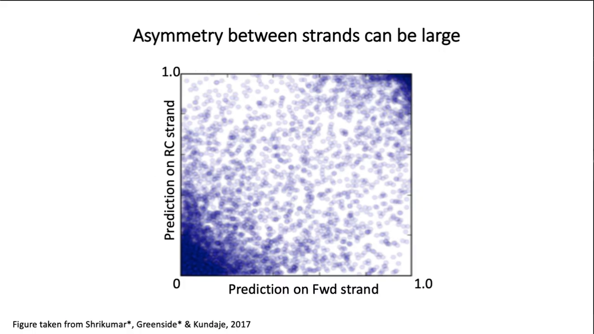

这张图是整篇工作的动机：**"我把反向互补样本加进训练集了"并不等于"模型学会了反向互补不变"**。增强只是让模型见过更多样本，它没有任何机制强制 `f(x) = f(RC(x))`。

## 二、三种把对称性写进模型的力度

文献里出现过两条主要路线，加上"什么都不做"的基线，正好构成三种力度。

### 2.1 事后合并与训练时合并：conjoined / Siamese 架构

最直接的做法：把原序列和它的反向互补**各跑一遍同一个模型**，再把两个预测合起来（相加或平均）。这类结构叫 conjoined（连体）或 Siamese（孪生）架构 [【跳转到 02:17】](https://www.youtube.com/watch?v=ROPhxdKHBE8&t=137)。

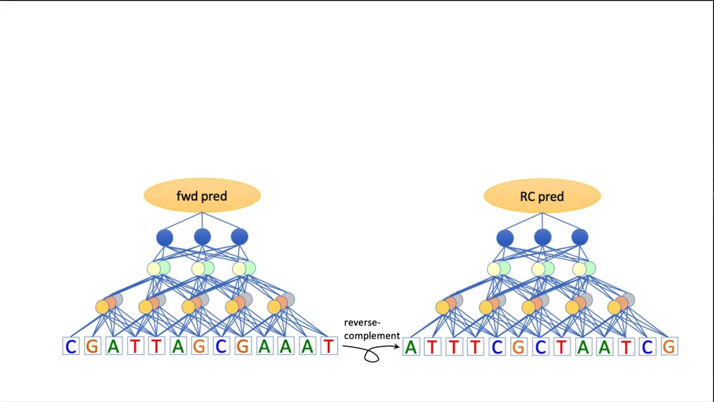

这里有个容易被忽略的岔路：**合并发生在什么时候**。

| 做法 | 训练时 | 推理时 | 备注 |
| --- | --- | --- | --- |
| 训练时合并（conjoined during training） | 两条链的预测先合并，再算损失 | 合并 | 梯度只看到"平均后"的误差 |
| 事后合并（post-hoc conjoined） | 两条链当独立样本训练（配合 RC 增强） | 合并 | 梯度分别看到每条链的误差 |

在本文之前，**"事后合并"从来没被拿来和"训练时合并"做过基准对比**——大家都默认"训练时就把约束加进去"应该更好。后面第四节会看到，这个直觉是错的。

conjoined 架构的代价也很清楚：卷积层仍然要把每个 motif 的正反两个方向当成两个独立模式来学，参数没有省，只是输出被强制对称了。

### 2.2 参数共享 RCPS：把对称性焊进权重

第二条路线是反向互补参数共享（reverse-complement parameter sharing，RCPS），2017 年由 Shrikumar、Greenside 与 Kundaje 提出，之后被多篇工作沿用和扩展 [【跳转到 02:57】](https://www.youtube.com/watch?v=ROPhxdKHBE8&t=177)。

思路：**每一个卷积核都配一个"RC 伙伴"，伙伴的权重不是学出来的，而是由前者翻转得到** [【跳转到 02:57】](https://www.youtube.com/watch?v=ROPhxdKHBE8&t=177)。

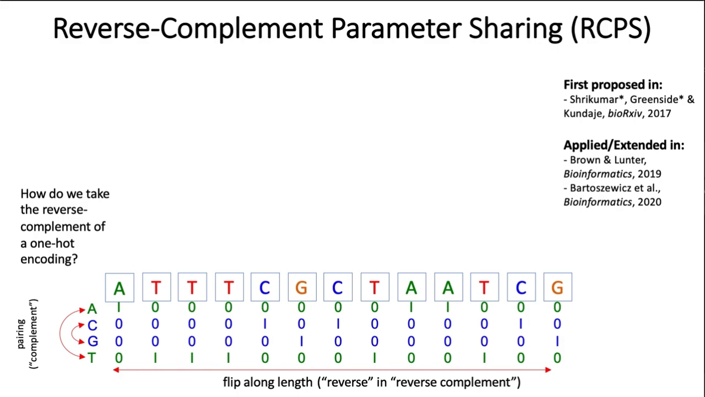

具体怎么翻？视频给了一张权重矩阵图：横轴是输入长度轴，纵轴是输入通道轴 [【跳转到 05:15】](https://www.youtube.com/watch?v=ROPhxdKHBE8&t=315)。

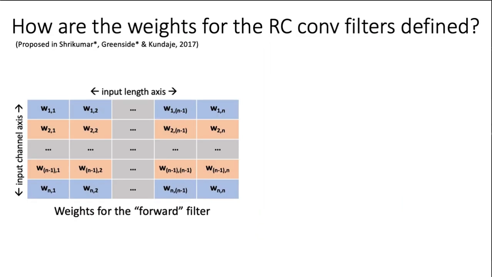

$$
W^{\text{RC}} = \mathrm{flip}_{\text{channel}}\left(\mathrm{flip}_{\text{length}}\left(W\right)\right)
$$

也就是把前向卷积核的权重**沿长度轴翻一次、沿通道轴翻一次**。这样，只要网络用前向卷积核学会了识别某个 motif，它的 RC 伙伴就自动会识别这个 motif 的反向互补——不需要额外训练。

这个配对不只存在于第一层，而是**每一层都配**。于是得到一个很强的性质——**等变（equivariance）**：

$$
\mathrm{revcomp}\left(\text{activations}(x)\right) = \text{activations}\left(\mathrm{revcomp}(x)\right)
$$

用大白话说：**把某一层的激活值做一次反向互补，等于把输入做一次反向互补后再过这一层**。等变和不变（invariance）不一样：不变说的是"输出完全一样"，等变说的是"输出跟着一起翻"。卷积层保持的是等变，直到最后把正反链通道合并、送进全连接层时，才把等变"收缩"成不变 [【跳转到 05:02】](https://www.youtube.com/watch?v=ROPhxdKHBE8&t=302)。

### 2.3 三种力度的对比

| 力度 | 机制 | 参数开销 | 能否保证对称 | 主要风险 |
| --- | --- | --- | --- | --- |
| 仅数据增强 | 训练集加入 RC 样本 | 无 | 不能 | 模型可以"看见"却"不学会" |
| conjoined（事后/训练时） | 两条链各跑一遍再合并 | 推理 2 倍算力 | 能 | 训练时合并会削弱梯度信号 |
| RCPS | 卷积核权重成对绑定 | 无（权重减半共享） | 能 | 优化更难，可能收敛不到理想解 |

## 三、搬到逐碱基信号形状预测：两个必须搞对的细节

### 3.1 BPNet 的输出本来就是"每条链一条曲线"

BPNet 是 Avsec 等人 2019 年提出的逐碱基分辨率模型，专门预测转录因子足迹（footprint）的形状 [【跳转到 06:35】](https://www.youtube.com/watch?v=ROPhxdKHBE8&t=395)。它预测得非常好，好到能超过实验重复之间的吻合度。

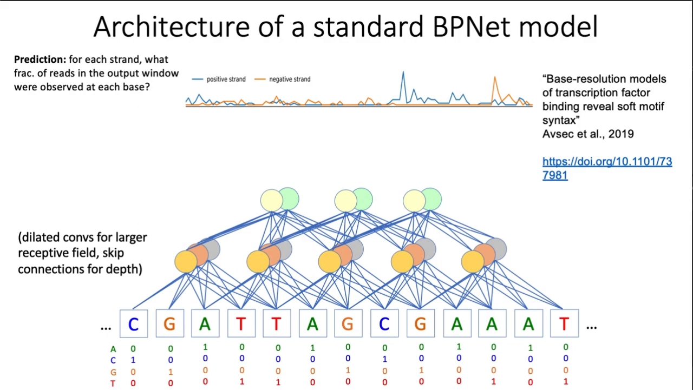

架构上它还是 CNN，只是有几处特别：

- 用**空洞卷积**（dilated convolution）扩大感受野；
- 用**跳连**（skip connection）加深网络；
- 输出层是一个卷积层，**两个通道，每个通道对应一条链**，长度等于要预测的窗口长度；
- 对每条链的输出做 **softmax**，得到"读段落在每个碱基上的概率分布"，再用**多项分布损失**（multinomial loss）评估；
- 为了扣除实验本身的序列偏好，会把一条**对照信号轨道**（control signal track）作为额外通道，拼接到中间某一层。

注意最后一点：**输出是"每条链一个分布"，这意味着标签本身是分链的**。这正是本节主题的关键——链方向不是可以随便抹掉的。

### 3.2 conjoined BPNet 的两个坑

把 conjoined 套到 BPNet 上，坑立刻出现两个。

**坑一：对照轨道必须跟着一起反向互补。** 主序列反向互补了，拼接进去的对照轨道如果还是原方向，两条链的输入就对不齐了。视频里特别说明：在他们的模型里对照轨道本身**不分链**，所以对它做反向互补就等于**单纯反转** [【跳转到 08:40】](https://www.youtube.com/watch?v=ROPhxdKHBE8&t=520)。

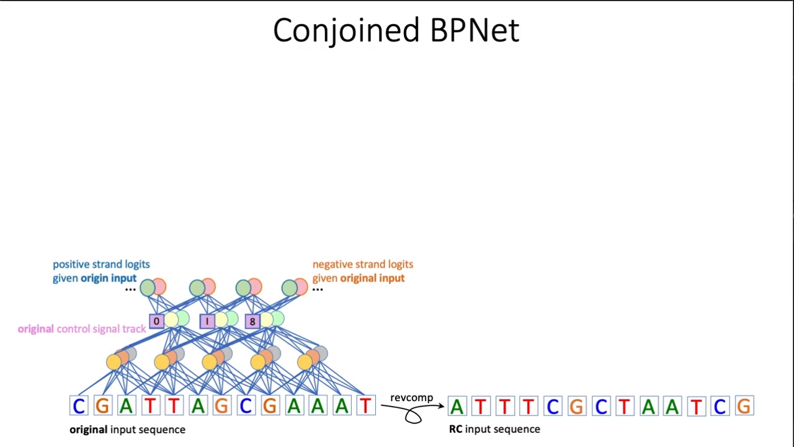

**坑二：正负链的 logits 会互换。** 这是最容易写错的一处。对反向互补输入跑出来的"正链 logits"，在生物学上对应的是**原序列的负链 logits**；反之亦然。所以合并之前，必须**先对预测再做一次反向互补**（沿长度轴和通道轴各翻一次），把两条链的标签对齐，然后才能相加、过 softmax [【跳转到 09:05】](https://www.youtube.com/watch?v=ROPhxdKHBE8&t=545)。

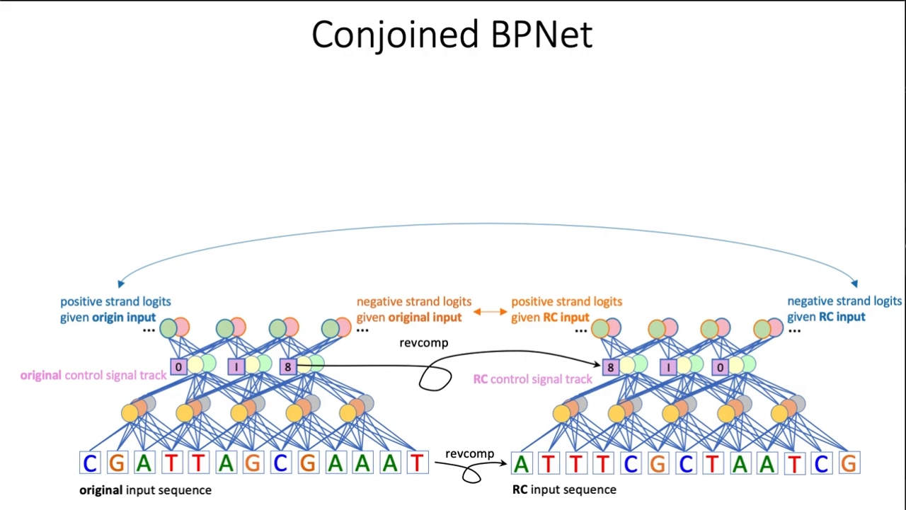

这一步如果漏掉，模型就在**用错的标签训练**——不是"增强没效果"，而是"增强把标签搞坏了"。这是本篇最值得记住的工程教训。

### 3.3 RCPS BPNet：对照轨道也要配对

RCPS 版本的处理更彻底：每个卷积核配一个 RC 伙伴；对照轨道作为额外通道，也**和它的反向互补配对**，拼到卷积核堆栈的另一端；输出层原本两条链各一个通道，现在这两个通道的权重也**用反向互补绑定**，最后各自过 softmax 得到形状预测 [【跳转到 10:00】](https://www.youtube.com/watch?v=ROPhxdKHBE8&t=600)。

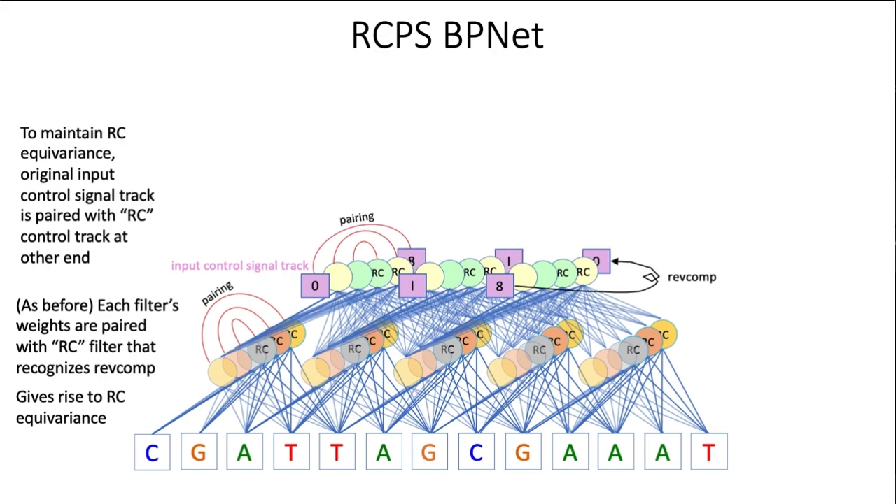

这样整张网络的等变性从头保持到尾。

## 四、基准结果：更强的约束不等于更好的结果

### 4.1 实验设置

九套数据 [【跳转到 11:19】](https://www.youtube.com/watch?v=ROPhxdKHBE8&t=679)：

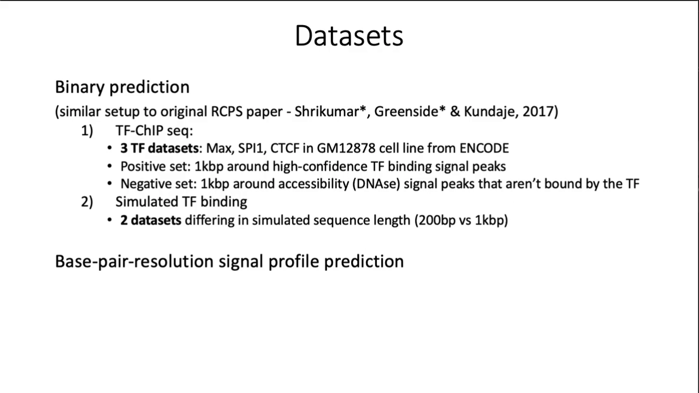

- **二分类（5 套）**：3 套 ENCODE 的转录因子 ChIP-seq（正样本是置信峰周围 1 kb，负样本是不与显著 ChIP-seq 信号重叠的可及区域），2 套模拟的转录因子结合数据（序列长度 200 bp 与 1 kb，motif 从 3 个 PWM 采样）。
- **信号形状（4 套）**：BPNet 论文里的 ChIP-nexus 数据，四个转录因子，预测峰周围 1 kb 的逐碱基信号。

每种架构 × 每套数据，用 **10 个随机种子 + 早停**训练，看平均表现。

### 4.2 结论一：事后合并 ≥ 训练时合并

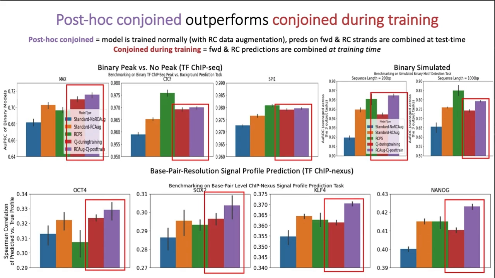

紫色柱（照常训练 + RC 增强 + 测试时合并）在**全部九套数据**上都不低于红色柱（训练时合并）[【跳转到 11:54】](https://www.youtube.com/watch?v=ROPhxdKHBE8&t=714)。

### 4.3 为什么：平均会把"错"抵消掉

视频给了一个非常直观的梯度论证 [【跳转到 12:30】](https://www.youtube.com/watch?v=ROPhxdKHBE8&t=750)。设模型 $M$ 正在训练，它在序列 $S$ 上**高估**，在 $S$ 的反向互补上**低估**。

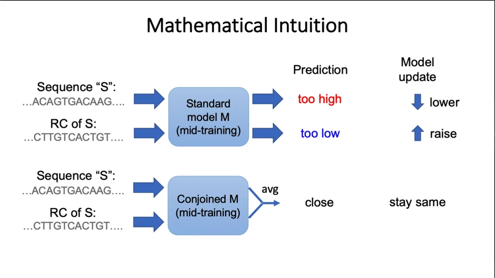

- **只做增强**：$S$ 和 $RC(S)$ 是训练集里两个独立样本，梯度会**压低** $S$ 上的预测、**抬高** $RC(S)$ 上的预测。两个错误各自被纠正。
- **训练时合并**：两条链的预测先平均。高估和低估一抵消，平均值可能已经很接近真值，损失很小，**参数几乎不更新**。可模型对每条链的预测其实都是错的——比如它漏掉了反链上的 motif，同时又在正链上认出了某个伪信号，两者正好抵消。

结果就是：训练时合并的模型**更容易收敛到一个"平均值对、单链都错"的解**，泛化性更差。这条论证对任何"把对称样本的预测先平均再算损失"的做法都成立，不限于 DNA。

### 4.4 结论二：RCPS 表现不稳定

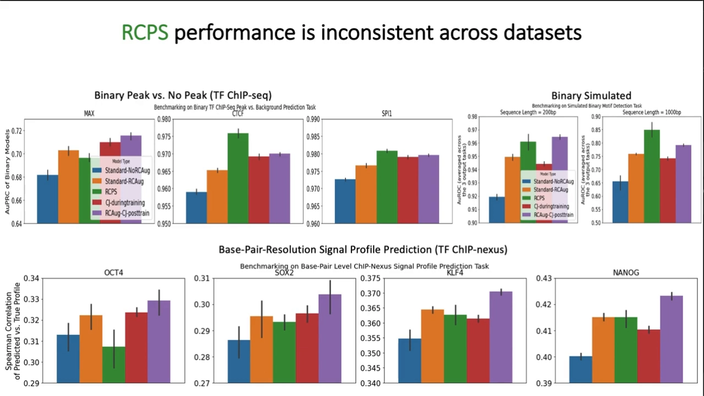

RCPS 有时拿到最好成绩，但在另一些任务上**并不比"标准模型 + RC 增强"更好**，逐碱基形状预测上尤其明显 [【跳转到 13:31】](https://www.youtube.com/watch?v=ROPhxdKHBE8&t=811)。

这个结果反直觉，因为论文**证明了 RCPS 的表达能力覆盖 conjoined 能学到的所有解**：conjoined 模型在正链上的激活，对应 RCPS 里的前向卷积核；conjoined 在反向互补链上的激活，做一次反向互补后对应 RCPS 里的 RC 卷积核；conjoined 最后"合并两条链预测"这一步，对应 RCPS 里"合并前向与 RC 通道"这一步 [【跳转到 14:15】](https://www.youtube.com/watch?v=ROPhxdKHBE8&t=855)。

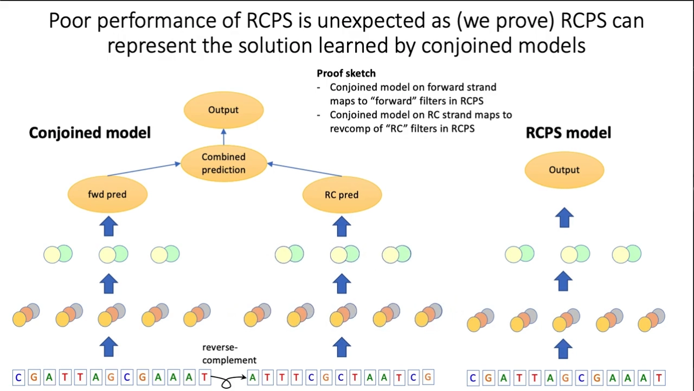

既然"能表示"，却"没学到"，那问题就出在**优化**上，而不是表达力上。视频没有展开优化困难的具体原因，只给出这个判断。

### 4.5 实践建议

作者的建议很明确 [【跳转到 15:23】](https://www.youtube.com/watch?v=ROPhxdKHBE8&t=923)：

1. 想要反向互补对称，**默认用"RC 数据增强 + 事后合并"**；
2. 想要更强约束，再考虑 RCPS，并且要做好"它可能不涨点"的心理准备；
3. 不要因为"约束更强 = 更对"就默认训练时合并更好——实测相反。

## 五、回到本节主题：增强什么时候安全

把这篇工作抽成一句可迁移的规则：

**增强的安全性取决于"变换之后标签是否真的不变"，而"标签不变"必须逐任务核对，不能凭直觉。**

在 DNA 上，这条规则具体化成三个检查点：

1. **标签是不是分链的？** 如果任务是逐碱基、分正负链的信号形状预测，那么"反向互补"这个变换会**同时交换两条链的标签**。此时不能只翻输入，必须把预测也翻回来再对齐（第三节的坑二）。二分类任务里标签是一个数、不分链，所以可以随便翻——这也是为什么早期工作只在二分类上验证过这些技巧。
2. **伴随输入的其他通道跟不跟着翻？** 对照信号轨道、可及性轨道这类额外通道，方向必须和主序列一致。不分链的轨道做"反向互补"就等于"反转"；分链的轨道则要连同链标签一起换。
3. **对称性是假设还是事实？** 反向互补对称成立的前提是"实验测的是双链 DNA 这个分子本身"。一旦任务变成链特异性的（比如要区分 reads 落在哪条链上、要预测链特异的修饰），把对称性强加进去就是在**改写标签**。这时数据增强会把两个本该不同的标签强行拉平，模型学到的是被抹平的目标。

至于**平移/裁剪**这一类增强，逻辑结构完全一样，但判断依据不同：平移是否安全，取决于标签对坐标是否敏感。分类任务里"峰在窗口内偏左还是偏右"通常不重要，裁剪一段通常安全；而坐标回归、逐碱基定位这类任务里，平移会直接改变正确答案，必须同步平移标签。本篇视频没有涉及平移，这部分留给同小节的另一篇（等变网络与群作用）展开。

## 小结

- 双链 DNA 让"反向互补"成为一个**输入变、标签不变**的变换，看起来像免费的增强；但普通 CNN 的卷积核有方向，**增强不会自动变成不变性**。
- 反向互补在 one-hot 上等于**长度轴 + 通道轴各翻一次**（旋转 180 度），这是所有架构技巧的几何基础。
- 三种力度：**仅增强**（不保证对称）、**conjoined 合并**（推理时跑两遍）、**RCPS 参数共享**（权重成对绑定，得到等变）。
- 在逐碱基形状预测上，**正负链 logits 会互换**、**对照轨道要跟着翻**——漏掉任何一步都不是"增强无效"，而是"标签被搞坏"。
- 实测：**事后合并 ≥ 训练时合并**，因为训练时平均会把单链的误差抵消成"看起来对"，梯度不再纠正。
- RCPS 表达力够但优化难，表现不稳定；实践上先用"增强 + 事后合并"。

## 关键术语速查

| 术语 | 一句话解释 |
| --- | --- |
| 反向互补（reverse complement） | 序列倒序后再把 A↔T、C↔G 互换；双链 DNA 两条链互为反向互补 |
| motif（基序） | 转录因子偏好结合的短序列模式，CNN 底层卷积核学到的就是它 |
| conjoined / Siamese 架构 | 原序列与反向互补序列各跑一遍同一模型，再把两个预测合并 |
| post-hoc conjoined（事后合并） | 训练时不做合并，只在推理时把正反链预测合并 |
| RCPS（反向互补参数共享） | 每个卷积核配一个权重由翻转得到的 RC 伙伴，把对称性焊进参数 |
| 等变（equivariance） | 输入做变换后，输出跟着做同样的变换；不变（invariance）则是输出完全不变 |
| BPNet | 逐碱基分辨率预测转录因子结合信号形状的 CNN，输出每条链一个概率分布 |
| control signal track（对照信号轨道） | 作为额外通道拼进网络的实验偏好信号，用于扣除测序偏好 |