# 把对称性写进网络：反向互补、平移与等变层的边界

> 视频来源：[#23 Equivariant Neural Nets for DNA & Group Theory | First Author, Vincent Mallet, NeurIPS 2021](https://www.youtube.com/watch?v=8O32yJ-P0V8&t=0)（YouTube · The Pear Review · 讲者 Vincent Mallet，NeurIPS 2021 论文 *Reverse Complement Equivariant Networks for DNA Sequences* 的一作）
> 本文基于视频演说图文稿整理，配图截自视频。这是一场 68 分钟的论文精读访谈，前半段用群论把"反向互补"和"平移"两种对称性统一成一个框架，后半段讨论"值不值得"。本文按初学者的路径重排：先讲数据里为什么天然有这两种对称性，再讲群论最小工具箱，最后落到"什么时候该用、什么时候会伤到标签"。

## 本讲要解决的核心问题（SCQA）

**背景**：测基因组数据时，你拿到的是一堆短读段（read）：把 DNA 打碎、测序，得到成千上万条几十到几百个碱基的片段。同一段 DNA 会被反复测到，读段之间大量重叠。

**冲突**：这些读段有两个"不讲道理"的性质。第一，它可能来自双链中的**任意一条**，方向是随机的；第二，切点是随机的，所以同一条序列会以**不同偏移**出现在不同读段里。前者意味着"序列反向互补后标签不变"，后者意味着"序列平移后标签跟着平移"。已有的做法（数据增强、手工设计的等变层）都是零散地、逐个地处理这两个对称性，没人说清楚"到底还有没有别的做法"。

**疑问**：能不能把这两个对称性放进同一个数学框架，然后**穷举**出所有满足约束的网络层？这样做出来的模型会不会更强？代价是什么？

**回答（中心思想）**：**"反向互补"是一个二阶对称（群 $\mathbb{Z}_2$），"平移"是一个整数平移对称（群 $\mathbb{Z}$），两者合起来是一个半直积群 $\mathbb{Z}_2 \ltimes \mathbb{Z}$。** 一旦把任务写成"对某个群等变"，线性层的全部可能形式就被一个定理锁死成**带约束核的卷积**，非线性层的可能形式也能被分类 [【跳转到 42:00】](https://www.youtube.com/watch?v=8O32yJ-P0V8&t=2520)。这把过去所有手工设计的等变层收编成一个家族，并且能拿到 SOTA [【跳转到 47:25】](https://www.youtube.com/watch?v=8O32yJ-P0V8&t=2845)。**但它不是免费午餐**：家族太大、需要调，而且——这是本文最想强调的一点——**这套理论只在"对称性真的成立"时才有收益；如果某个变换其实会改变标签，强行等变就是在抹掉信息** [【跳转到 63:11】](https://www.youtube.com/watch?v=8O32yJ-P0V8&t=3791)。

---

## 一、数据是怎么来的，决定了有哪些对称性

### 1.1 DNA 是双链的，A 配 T、G 配 C

DNA 是核苷酸（nucleotide）的聚合物，只有四种：A、C、G、T。它携带遗传信息，先转录成 RNA，再翻译成蛋白质，而 RNA 和蛋白质解释了细胞的大部分功能 [【跳转到 03:40】](https://www.youtube.com/watch?v=8O32yJ-P0V8&t=220)。

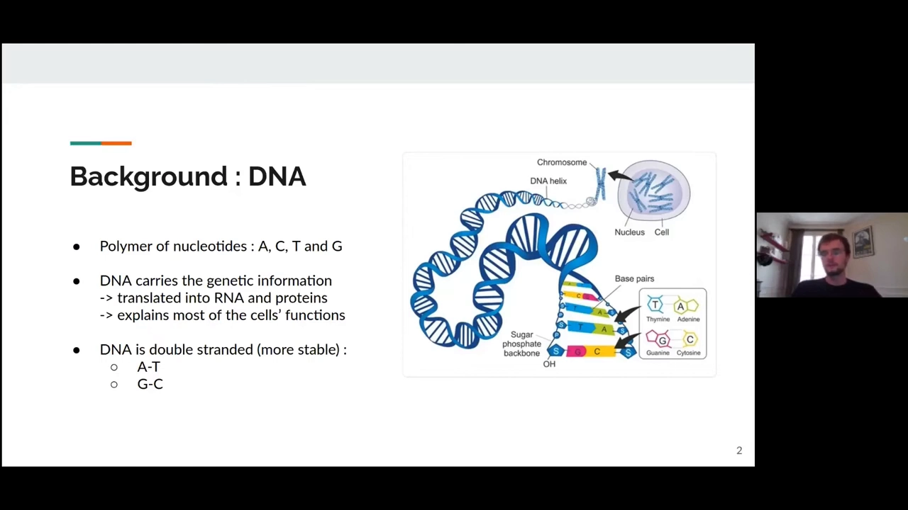

结构上，DNA 是**双链**的（双链更稳定），配对规则固定：A 总与 T 配，G 总与 C 配。这就带来一个**冗余**：只给你梯子的一半，你就能确定性地写出另一半。这个"另一半"就是**反向互补**（reverse complement）——把序列倒过来，再把每个碱基换成它的配对碱基。

### 1.2 测序读段：随机链、随机切点、固定方向

要看懂后面的对称性，得先看懂数据是怎么产生的。

**测序**给你的是读段，也就是整条 DNA 上的**子串**。读段有两个来源上的随机性：

1. **链是随机的**。测序依赖一个生化过程，方向固定为 5'→3'（五撇端到三撇端，也就是 DNA 聚合发生的方向）。但同一段 DNA 可以从任意一条链读过去，所以你既可能拿到 `ACATT...TTG`，也可能拿到它的反向互补 `C...GT`。这两条读段在生物学上是**同一个分子的同一段**。
2. **切点是随机的**。所以同一条序列会以不同偏移出现在不同读段里，而且读段之间会重叠、信息冗余。

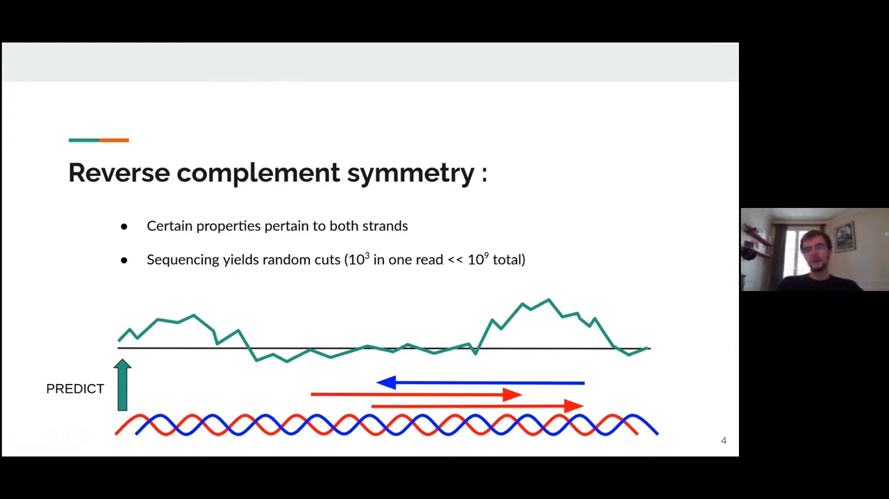

视频里还顺带讲了这类标签（转录因子结合）是怎么测出来的：把 DNA 与转录因子混在一起，让转录因子按亲和力分布结合上去；再用抗体把"结合了转录因子的 DNA"捞出来、切碎、洗掉没结合的，最后只测序留下来的部分。因为切点是随机的，重复很多次之后，你得到的是结合分布的**蒙特卡洛估计** [【跳转到 11:35】](https://www.youtube.com/watch?v=8O32yJ-P0V8&t=695)。

关键的一句：**转录因子结合是"属于两条链"的性质**——它结合的是整个双链分子，你并不知道是哪条链"负责"了这次结合 [【跳转到 10:20】](https://www.youtube.com/watch?v=8O32yJ-P0V8&t=620)。这正是"标签对反向互补不变"的物理依据。

### 1.3 于是有两个对称性，不是一个

把上面两段随机性翻译成数学语言，就得到两个对称性 [【跳转到 24:30】](https://www.youtube.com/watch?v=8O32yJ-P0V8&t=1470)：

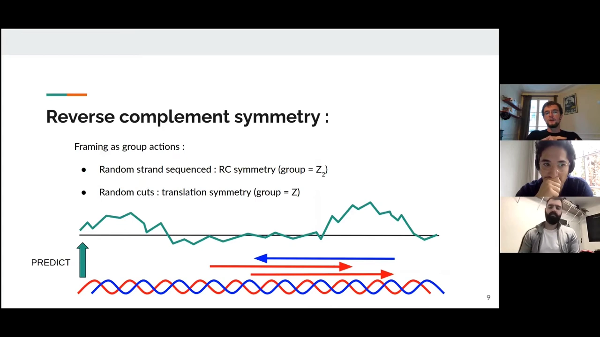

| 数据里的随机性 | 对应的变换 | 数学结构 | 对输出的要求 |
| --- | --- | --- | --- |
| 读段可能来自任意一条链 | 反向互补（翻转 + 换碱基） | $\mathbb{Z}_2$（做两次回到原样） | 输出**不变**（同一个结合强度） |
| 切点随机、读段重叠 | 平移（shift） | $\mathbb{Z}$（整数平移） | 输出**跟着平移**（等变） |

注意这两行的要求不一样：反向互补要求输出**完全不变**，平移要求输出**跟着移动**。前者是后者的特例（"输出上的群作用是恒等"），后文会讲清楚这个区别。

## 二、群论最小工具箱

要读懂这篇论文，只需要四个概念。视频里讲得很慢，这里压缩成四段。

### 2.1 群：一个集合 + 一个能"反悔"的运算

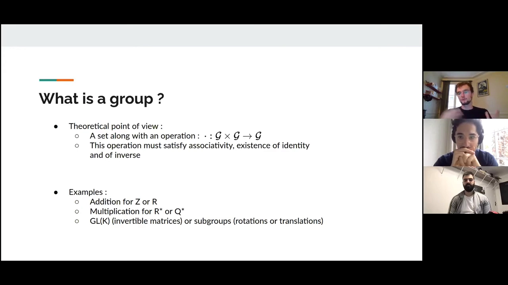

群（group）是一个集合，配上把两个元素"合成"一个新元素的运算，运算要满足三条：**结合律**、**存在单位元**（做了等于没做）、**每个元素有逆元**（能撤销）[【跳转到 14:30】](https://www.youtube.com/watch?v=8O32yJ-P0V8&t=870)。

例子：整数加法（$\mathbb{Z}$）、非零实数乘法、可逆矩阵组成的群（含旋转、平移）。本文要用的两个群都非常小：$\mathbb{Z}_2$ 只有两个元素（"不翻"和"翻"），$\mathbb{Z}$ 是整数平移。

### 2.2 群作用与表示：让抽象的群"动手"改数据

抽象的群本身不碰数据。要让它作用到数据上，就得给每个群元素指定一个**从空间到自身的双射**（bijection，可逆的一一映射）。这一指派就叫**表示**（representation）[【跳转到 15:45】](https://www.youtube.com/watch?v=8O32yJ-P0V8&t=945)。

举个最直观的例子：把"旋转"当成抽象群，让它作用在平面上，每个角度 $\theta$ 对应一个旋转矩阵。同一个抽象群也可以作用在三维空间（绕某条轴转），这叫同一个群的不同表示。还有一个"摆烂"的表示叫**平凡表示**（trivial representation）：不管哪个群元素，都对应"什么都不做"。

访谈里两位主持人还在这里花了几分钟对齐记号（表示是从群到 $\mathrm{Bij}(V)$ 的映射，$V$ 是向量空间，$\mathrm{Bij}(V)$ 是 $V$ 上所有双射）——这个细节对读论文有用，对理解结论不重要。

### 2.3 等变 vs 不变：输出"跟着动"还是"不动"

有了群作用，就能定义本文的核心概念：

$$
\pi_2^{g}\big(\phi(x)\big) = \phi\big(\pi_1^{g}(x)\big)
$$

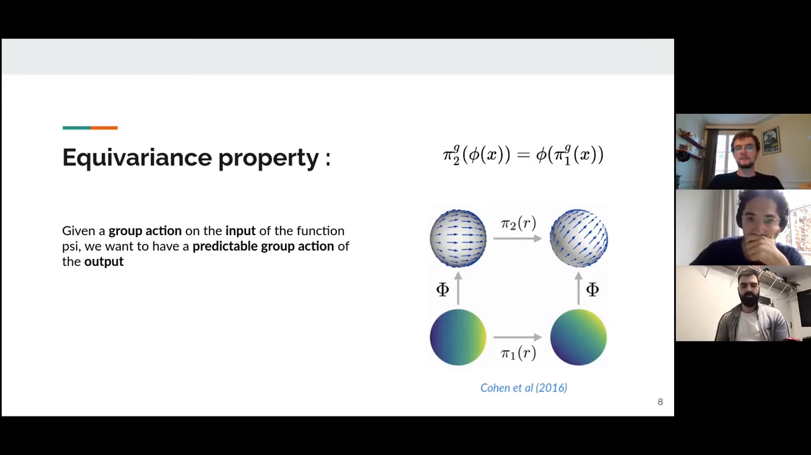

读法：$\phi$ 是网络，$\pi_1^g$ 是输入空间上群元素 $g$ 的作用，$\pi_2^g$ 是输出空间上的作用。等式成立就叫 $\phi$ **对 $g$ 等变**（equivariant）[【跳转到 21:35】](https://www.youtube.com/watch?v=8O32yJ-P0V8&t=1295)。

- **等变**：输入转 90 度，输出的分割图也转 90 度。
- **不变**（invariance）：输入怎么变，输出都不动。这是等变的特例——输出上的作用是**平凡表示**。

两个性质非常有用：

1. **可复合**。如果第一层等变、第二层也等变，复合起来还等变。所以只要每一层都等变，整个网络就等变 [【跳转到 22:25】](https://www.youtube.com/watch?v=8O32yJ-P0V8&t=1345)。
2. **中间层可以自由选**。输入和输出上的群作用是任务给定的，但**中间特征图上的群作用可以自己挑**——只要挑得让相邻层保持等变。这给了设计者很大的自由度 [【跳转到 23:40】](https://www.youtube.com/watch?v=8O32yJ-P0V8&t=1420)。

## 三、把两个对称性合成一个：半直积

### 3.1 $\mathbb{Z}_2 \ltimes \mathbb{Z}$：先翻再移

反向互补和移位不是互相独立的：**先翻后移**和**先移后翻**得到的结果不一样（翻转会把平移方向也倒过来）。这种"一个群作用在另一个群上"的结构，数学上叫**半直积**（semi-direct product）。

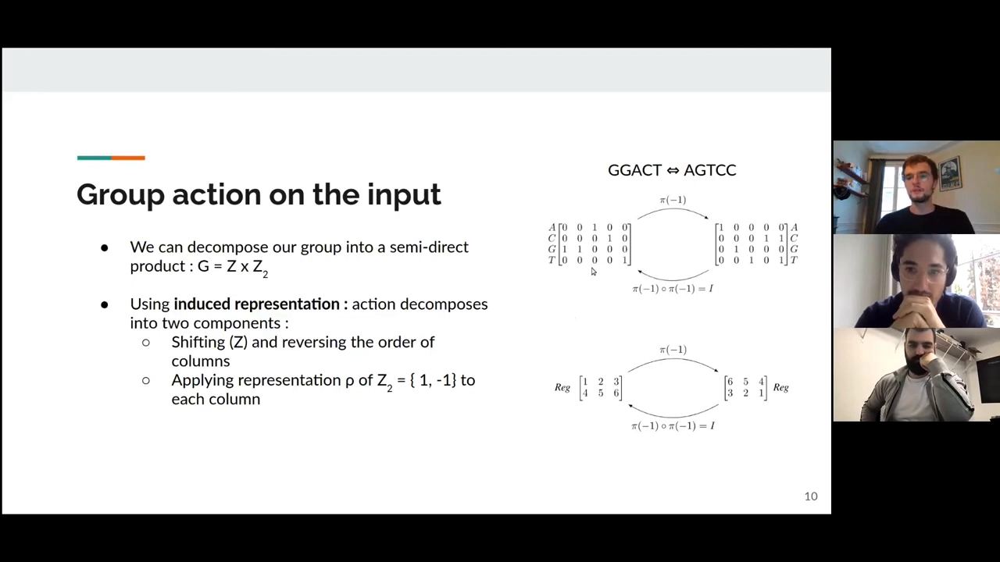

结论非常直观：**任何能发生在输入上的扰动，都可以写成"要不要翻" + "移多少"** [【跳转到 25:20】](https://www.youtube.com/watch?v=8O32yJ-P0V8&t=1520)。视频里用 `GGACT ↔ AGTCC` 做了演示：翻转会同时倒序和换碱基，而平移只是把窗口挪一下。

### 3.2 诱导表示：只需要为小群 $\mathbb{Z}_2$ 做选择

半直积的好处是可以借用一条现成的数学定理——**诱导表示**（induced representation）：你可以先给小的那个群（这里是 $\mathbb{Z}_2$）选一个表示，然后有一条通用公式把它"抬"到整个半直积群上 [【跳转到 26:35】](https://www.youtube.com/watch?v=8O32yJ-P0V8&t=1595)。

用大白话说：**你只要决定"翻转在每个位置上具体做什么"，剩下的"顺序倒过来 + 整体平移"会自动配好**。这把设计空间从"给整个群设计表示"缩小到"给一个两元素群设计表示"。

### 3.3 输入上的实际效果

落到 one-hot 矩阵上，群作用分两层 [【跳转到 31:10】](https://www.youtube.com/watch?v=8O32yJ-P0V8&t=1870)：

- **每一列内部**：把 A↔T、C↔G 的配对关系实现成一个**置换**（permutation）作用在 4 个通道上；
- **列与列之间**：把列的顺序倒过来，再整体平移。

访谈里主持人问了一个很好的问题：翻、倒序、平移，这是三件不同的事吗？讲者的回答是：**翻（换碱基）和倒序在反向互补里是同时发生的，属于同一个动作；而平移是另一个独立的动作**，两者合起来才是完整的扰动集合 [【跳转到 28:15】](https://www.youtube.com/watch?v=8O32yJ-P0V8&t=1695)。

## 四、中间层能做什么：$\mathbb{Z}_2$ 表示的完整分类

### 4.1 一个公式概括所有可能

这是全篇最"硬"的一个结果。对 $\mathbb{Z}_2$ 来说，**特征图上的任何表示都可以写成同一个形状** [【跳转到 34:30】](https://www.youtube.com/watch?v=8O32yJ-P0V8&t=2070)：

$$
\rho(s) = P^{-1}\left(I_a \oplus s\, I_b\right) P,\qquad s \in \{+1, -1\}
$$

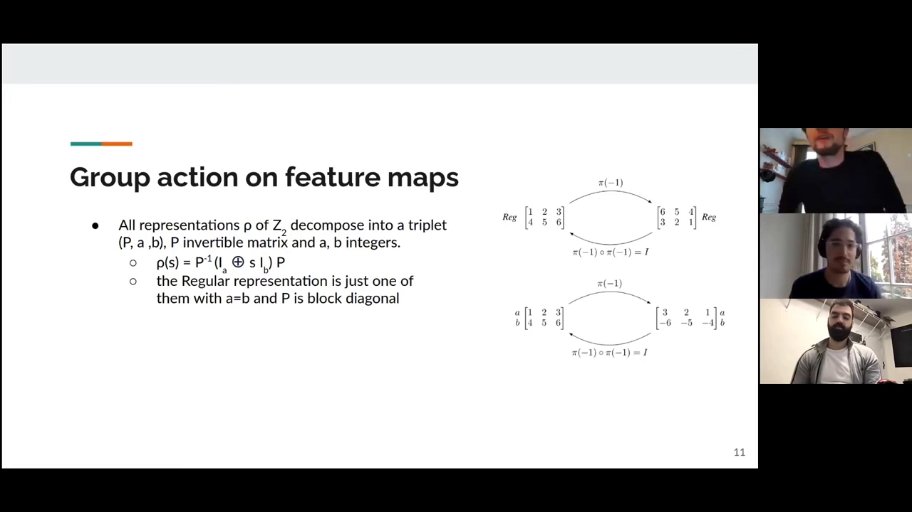

三个符号的含义：

- $P$：一个可逆矩阵，负责**换基**（换一套坐标看同一件事）；
- $a$：在这套坐标下**不受群作用影响**的维度个数；
- $b$：**翻号**（乘以 $-1$）的维度个数。

也就是说：**在合适的基底下，$\mathbb{Z}_2$ 只能做两件事——一部分维度原封不动，一部分维度整体取负**。所谓"正则表示"（regular representation，表现为通道置换）只是其中一个特例（$a = b$ 且 $P$ 是块对角）[【跳转到 38:15】](https://www.youtube.com/watch?v=8O32yJ-P0V8&t=2295)。

### 4.2 这条结论为什么重要

它把"设计等变网络"这件玄学变成了**选几个整数和一个矩阵**：每一层、每个特征图，你只需要挑 $a$、$b$、$P$ [【跳转到 39:30】](https://www.youtube.com/watch?v=8O32yJ-P0V8&t=2370)。

访谈里主持人追问："这只是在描述，还是在构造？"讲者的回答很关键：**这是一条定理，不是一种约定**——它说的是"所有可能的表示都长这样"，而不是"我们挑了长这样的一种" [【跳转到 40:20】](https://www.youtube.com/watch?v=8O32yJ-P0V8&t=2420)。所以它同时是描述和穷举。

## 五、层的完整清单：线性层与非线性层

### 5.1 线性层 = 带约束核的卷积

有了输入、输出两侧的表示，等变线性层的形状就被锁死了。视频引用了 Cohen、Geiger、Weiler 的《A General Theory of Equivariant CNNs on Homogeneous Spaces》，核心定理是：**等变线性映射一定是卷积，且卷积核必须满足一条约束** [【跳转到 42:00】](https://www.youtube.com/watch?v=8O32yJ-P0V8&t=2520)。

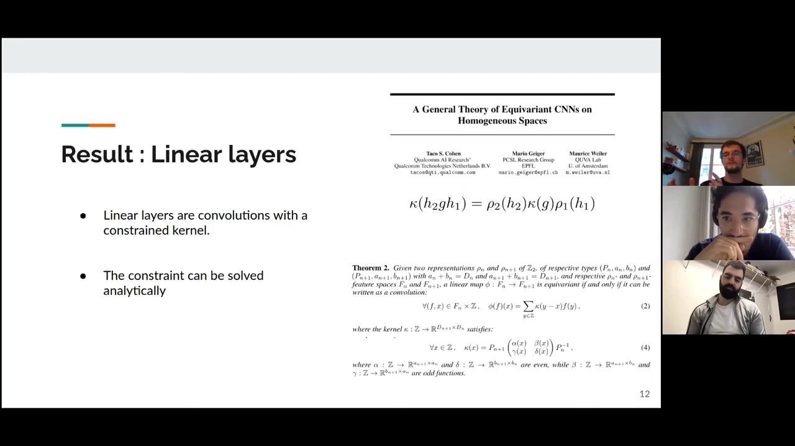

$$
\kappa(h_2 g h_1) = \rho_2(h_2)\,\kappa(g)\,\rho_1(h_1)
$$

因为本文的群很小（$\mathbb{Z}_2 \ltimes \mathbb{Z}$），这条约束**可以解析求解**：解出来的核在空间轴上可以按块分解成**偶函数**和**奇函数**两部分 [【跳转到 43:15】](https://www.youtube.com/watch?v=8O32yJ-P0V8&t=2595)。直观理解：偶的那部分对"翻转"不敏感，奇的那部分翻一次就变号——正好对应上一节"一部分维度不动、一部分维度翻号"。

### 5.2 非线性层：也有分类，但没那么干净

只有线性层不够，网络还需要非线性。视频给出了**逐点可交换非线性层**的分类：一个逐点非线性（ReLU、sigmoid、tanh 都是）如果和中间层的群作用可交换，那它只能属于少数几类 [【跳转到 44:30】](https://www.youtube.com/watch?v=8O32yJ-P0V8&t=2670)。

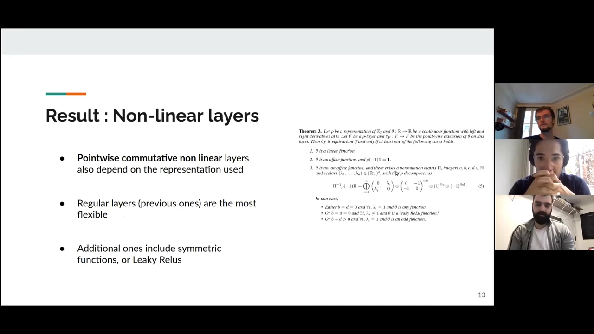

一个有意思的副作用：**正则表示最灵活**——过去那些手工设计的等变网络，恰好都落在"正则表示"这个特例上，所以它们和非线性配合得最好；一旦换成更花哨的中间表示，就得配特定的非线性函数 [【跳转到 45:20】](https://www.youtube.com/watch?v=8O32yJ-P0V8&t=2720)。

### 5.3 于是有了"全部等变层"的清单

把两边合起来，这篇论文做的事可以一句话概括：**把"反向互补对称"这个具体问题塞进一般等变框架，然后拿到所有线性等变层 + 所有逐点可交换非线性层的完整清单**，并且用 Keras 实现了这些层，可以直接搭网络 [【跳转到 46:10】](https://www.youtube.com/watch?v=8O32yJ-P0V8&t=2770)。

这也回答了"已有的等变方法是什么关系"这个问题：

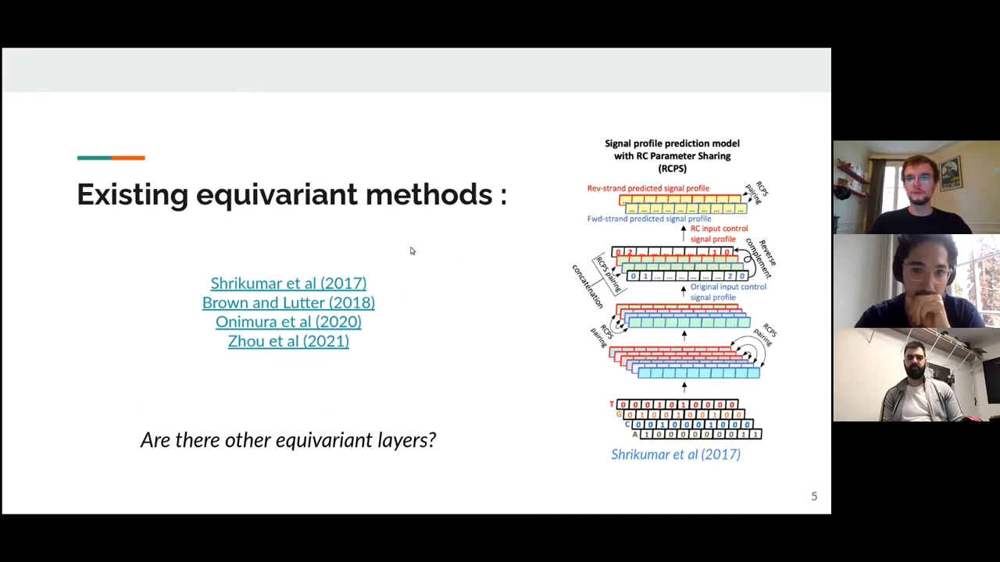

Shrikumar 等 2017 年提出的 RCPS（反向互补参数共享，见同小节另一篇）以及后续的 Brown & Lutter、Onimura、Zhou 等工作，在这个框架下都是**家族里的个别成员**，而不是全部 [【跳转到 14:05】](https://www.youtube.com/watch?v=8O32yJ-P0V8&t=845)。

## 六、值不值得：SOTA 与"不是免费午餐"

### 6.1 结果是 SOTA

在结合信号预测任务上，新框架的最好成员超过了"标准网络"和"此前的等变网络" [【跳转到 47:25】](https://www.youtube.com/watch?v=8O32yJ-P0V8&t=2845)。

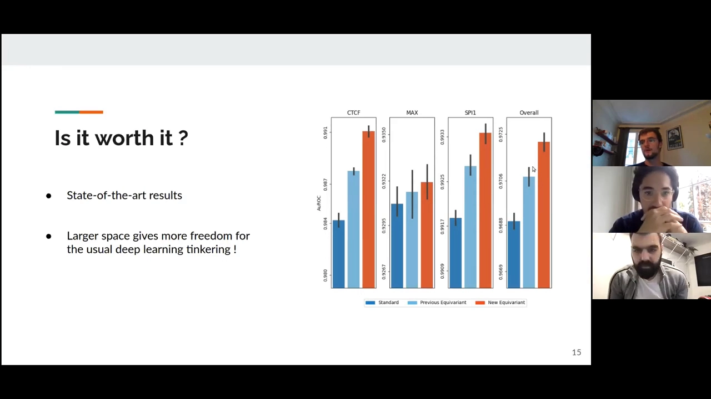

提升幅度在总体指标上大约是 0.9706 → 0.9725（AUC 类的指标），单看数字很小，但访谈里两位主持人也确认：在这个任务上，**这种量级的提升已经算显著**，因为误差棒来自不同随机种子的多次独立训练 [【跳转到 55:20】](https://www.youtube.com/watch?v=8O32yJ-P0V8&t=3320)。

### 6.2 但不是免费午餐：家族太大，要调

讲者自己强调："这不是一个 free boost。" 因为框架给出的不是一个模型，而是**一整个函数家族**。你要在验证集上搜索，才能挑到最好的成员 [【跳转到 48:15】](https://www.youtube.com/watch?v=8O32yJ-P0V8&t=2895)。

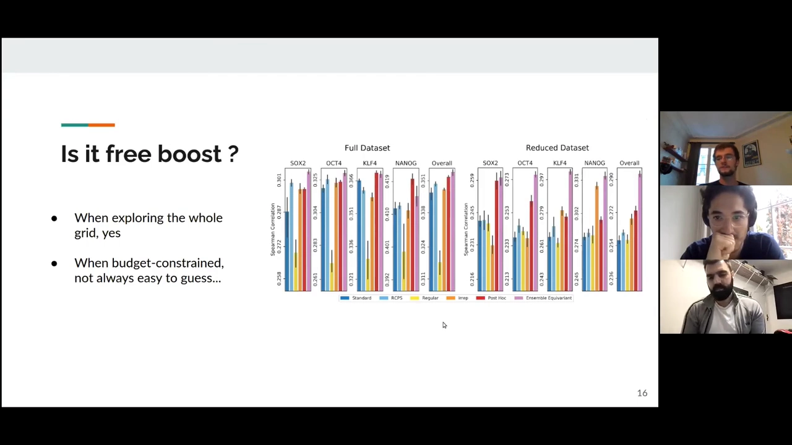

- **有预算、能搜**：可以稳定拿到最好结果；
- **预算受限、只能挑一个**：可能拿到次优解，甚至**不如之前的等变方法**。

### 6.3 三种"施加对称性"的手段，效率不同

访谈里主持人问了一个很实用的问题：作为基线的"标准网络"其实也用了数据增强（把反向互补样本加进训练集），为什么还是不如显式约束？

讲者的回答分两层 [【跳转到 50:20】](https://www.youtube.com/watch?v=8O32yJ-P0V8&t=3020)：

1. **数据增强确实有用，而且提升很大**——不做增强的话性能会明显掉下去。所以增强不是无效的。
2. **但增强不如约束高效**。最直接的解释是：**在受约束的空间里优化更容易**。增强是"多给你看几眼正确答案"，约束是"直接把错误答案排除掉"。

再叠加前面那篇 MLCB 工作的结论（事后合并 ≥ 训练时合并），三种手段的定位就清楚了：

| 手段 | 做法 | 成本 | 保证对称 | 主要风险 |
| --- | --- | --- | --- | --- |
| 数据增强 | 训练集加反向互补样本 | 最省 | 不保证 | 学到但学不牢 |
| 事后合并 / 群池化 | 两条链各推理一次再平均 | 推理 2 倍 | 能 | 训练时合并会削弱梯度 |
| 等变架构 | 约束卷积核 + 兼容非线性 | 需要搜索 | 能 | 家族大、要调，可能过约束 |

视频里还提到一个反例：在他们参照的那篇工作里，**事后合并（post-hoc，两条链各推理一次再平均）竟然超过了任何单个等变模型**；而在他们自己做了验证集搜索的任务上，最好的单个等变网络又略胜事后合并 [【跳转到 61:56】](https://www.youtube.com/watch?v=8O32yJ-P0V8&t=3716)。讲者由此得出的结论很克制：**"用了理论"不等于"一定更好"，还得看用了哪些层、编码了什么先验。**

## 七、什么时候不该用：过度归纳偏置与标签安全

这是整场访谈最值得记下来的一段，因为它直接对应"增强会不会破坏标签"。

主持人问：**有没有可能过度归纳偏置**——你以为的对称性其实并不总成立，反向互补也许该映射到**不同的标签**，那你把所有反向互补样本强行拉到同一个输出，就丢掉了这些点 [【跳转到 63:11】](https://www.youtube.com/watch?v=8O32yJ-P0V8&t=3791)。

讲者的回答分三档：

1. **反向互补在 DNA 上比较安全**。因为双链配对是物理事实，转录因子结合确实是双链分子的性质。所以在这个任务上，"强行等变"造成的损失有限。
2. **图像旋转就不安全**。他举的例子很生动：做旋转增强时，人们通常不会把图**完全翻转**，因为"汽车总是轮子朝下"。如果你把旋转群整个焊进网络，模型就必须认为"车顶朝下的车"和"车顶朝上的车"是同一件事——这是错的先验。
3. **高度对称的数据就安全**。比如医学影像里的细胞图像——细胞没有"上下"之分，旋转等变就成立。所以判断标准不是"这个变换看起来自然吗"，而是**"这个变换真的不改变标签吗"**。

他还提到一个折中方向：能不能做**软等变**（soft equivariance）——不要求整个群，只要一个小范围的旋转；或者换一种群作用（把大角度映射成小角度），让约束变弱一点。但这只是猜想，他自己也说"不一定会提升性能" [【跳转到 65:16】](https://www.youtube.com/watch?v=8O32yJ-P0V8&t=3916)。

最后主持人补了一句很妙的总结：**噪声本身是高度对称的**——正因为数据里什么方向都有，对称性才既普遍又廉价 [【跳转到 66:31】](https://www.youtube.com/watch?v=8O32yJ-P0V8&t=3991)。

### 7.1 落到工程上的三条检查

把这一节和同小节的另一篇（MLCB 的反向互补基准）合起来，可以整理成三条检查：

1. **先问"变换后标签变不变"**。反向互补在"结合强度"这种双链性质上不变；但如果任务是**链特异性**的（要区分读段来自哪条链、要预测链特异的修饰），反向互补会交换标签，此时增强就是在造错样本。
2. **再问"标签跟着怎么动"**。平移在"逐碱基定位"任务里会移动答案，必须同步平移标签；在"窗口内有没有峰"这种任务里通常无所谓。等变（输出跟着动）和不变（输出不动）必须分清楚，混了就是标签错配。
3. **最后问"预算够不够"**。等变架构的表达力更强，但家族更大、需要搜索；预算紧张时，"增强 + 事后合并"往往更划算。

## 小结

- 测序数据的两个随机性对应两个对称性：**随机选链 → 反向互补（$\mathbb{Z}_2$，要求输出不变）**；**随机切点 → 平移（$\mathbb{Z}$，要求输出跟着平移）**。
- 两者合成**半直积群 $\mathbb{Z}_2 \ltimes \mathbb{Z}$**：任何扰动都能分解成"翻不翻 + 移多少"，而且借助**诱导表示**，只需为小群 $\mathbb{Z}_2$ 选表示。
- 对 $\mathbb{Z}_2$ 而言，特征图上的**所有**表示都能写成 $\rho(s) = P^{-1}(I_a \oplus s I_b)P$：一部分维度不动、一部分维度翻号。
- 等变**线性层一定是带约束核的卷积**，约束可解析求解，核在空间轴上分解为偶/奇两部分；**逐点可交换非线性层**也能被分类，其中正则表示最灵活。
- 结果是 SOTA，但**不是免费午餐**：家族太大需要搜，预算受限时随便挑可能更差。
- 三种施加对称性的手段效率不同：**增强 < 事后合并 ≈ 等变架构**（在"能否保证对称"上），而等变架构的代价是要调。
- **最重要的边界**：这套理论只在"对称性真的成立"时有效。汽车总是轮子朝下，所以图像旋转不该全群等变；细胞没有上下，所以细胞图像旋转等变安全。**判断依据永远是"变换是否改变标签"，不是"变换看起来自然"**。

## 关键术语速查

| 术语 | 一句话解释 |
| --- | --- |
| 反向互补（reverse complement） | 序列倒序 + A↔T、C↔G 互换；双链 DNA 两条链互为反向互补 |
| 读段（read） | 测序得到的一小段 DNA 子串，链与切点都是随机的 |
| 群（group） | 集合 + 满足结合律、有单位元、有逆元的运算 |
| 群作用（group action） | 给每个群元素指定一个空间到自身的双射，让抽象的群"动手"改数据 |
| 表示（representation） | 群作用的具体实现（如每个角度对应一个旋转矩阵） |
| 等变（equivariance） | 输入做变换，输出跟着做对应的变换：$\pi_2^g(\phi(x)) = \phi(\pi_1^g(x))$ |
| 不变（invariance） | 输入怎么变输出都不动，是等变的特例（输出侧用平凡表示） |
| 半直积（semi-direct product） | 两个群"一内一外"组合的结构，这里对应"先翻再移" |
| 诱导表示（induced representation） | 由小群的表示自动构造整个半直积群表示的定理 |
| 正则表示（regular representation） | 表现为通道置换的那类表示，是等变层的特例，和非线性配合最好 |
| 过度归纳偏置（over-inductive bias） | 把并不成立的对称性强加给模型，导致标签被抹平 |