# 卷积网络：局部感受野决定"看得多远"，权重共享决定"用多少参数"

> 视频来源：[CNN Explained Visually: Padding, Stride, Pooling, Receptive Fields, Dilation & Layer Architecture](https://www.youtube.com/watch?v=jL2G8DG-qmI)（YouTube，可视化讲解）｜时长约 24 分钟
> 本文基于视频演说图文稿整理，配图截自视频。这支视频从"全连接为什么在图像上撑不住"讲起，一路把卷积核滑动、输出尺寸公式、padding/stride、多通道、池化、感受野递推和空洞卷积串成一条线，正好覆盖本节的学习目标。文中公式与数字均取自幻灯片，字幕里的口语碎片已按上下文订正。

## 本讲要解决的核心问题（SCQA）

**背景**：一张 $100\times100$ 的彩色图片有 $100\times100\times3=30000$ 个输入特征。把这三万个数字直接喂进全连接网络，第一层就会产生上百万个权重和偏置——计算昂贵到实际上做不下去 [【跳转到 00:22】](https://www.youtube.com/watch?v=jL2G8DG-qmI&t=22)。

**冲突**：可是人看图片并不是逐个像素处理的。我们一眼就能看出边缘、纹理、形状，并不需要先把每个像素和每个神经元连起来。全连接网络丢掉了这个"只看局部、到处复用同一套判断"的结构先验。

**疑问**：能不能让网络只用一个小窗口在图上滑动，反复用同一组权重去检测同一种局部模式？这样参数会少多少？输出尺寸怎么算？如果堆很多层，一个输出神经元到底"看得到"原图多大一块区域？想让感受野变大，是不是只能加深网络？

**回答（中心思想）**：**卷积层用两个约束把全连接"剪"成高效的形状：局部感受野（每个输出只看输入的一小块）和权重共享（同一组卷积核权重在所有位置上重复使用）。这两个约束把参数量从"输入维度 × 输出维度"降到"卷积核大小 × 通道数"，同时让输出尺寸、感受野都能用闭式公式精确推算；padding、stride、dilation 则是三个可调旋钮，分别控制输出长度、下采样倍率和单层覆盖范围。** [【跳转到 01:37】](https://www.youtube.com/watch?v=jL2G8DG-qmI&t=97)

---

## 一、卷积层做的事：不吞下整张图，只抽取局部模式

视频把卷积层比作"魔法层"：它不把整张图一次性吃进去，而是从中抽取边缘、形状、纹理、图案这些有意义的特征，只把这些特征送进后面的网络。于是特征数常常从几万降到几百，同时保留关键信息 [【跳转到 00:39】](https://www.youtube.com/watch?v=jL2G8DG-qmI&t=39)。

这个设计模仿的是人的视觉系统：大脑看一张图时不会逐个像素检查，而是自动提取边缘、纹理、形状和图案。CNN 用"卷积"这个操作来模拟这件事 [【跳转到 01:29】](https://www.youtube.com/watch?v=jL2G8DG-qmI&t=89)。

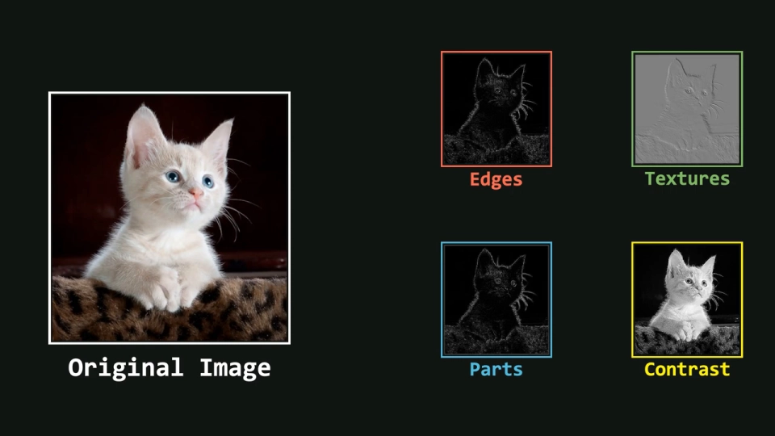

上图是这套思路的直观结果：原图经过不同的卷积核，分别得到"边缘""纹理""部件""对比度"四张特征图。**每一张特征图记录的是"某种模式出现在哪里"，而不是像素本身。**

## 二、一次卷积：加权和 + 滑动

### 2.1 三个名字：卷积核、感受野、特征图

设输入是一张 $6\times6$ 的灰度图，卷积核（也叫滤波器、feature detector）是 $3\times3$。把核盖在图像左上角，让核里的 9 个权重与它盖住的 9 个像素逐元素相乘再求和，得到一个数——这就是输出特征图左上角的那一格 [【跳转到 02:29】](https://www.youtube.com/watch?v=jL2G8DG-qmI&t=149)。

这里有两个必须记住的术语：

- **感受野（receptive field）**：卷积核当前盖住的那块输入区域。上面这个例子里，一个输出格子的感受野就是 $3\times3$ 的九个像素。
- **特征图（feature map）**：卷积核滑遍整张输入后得到的输出网格。

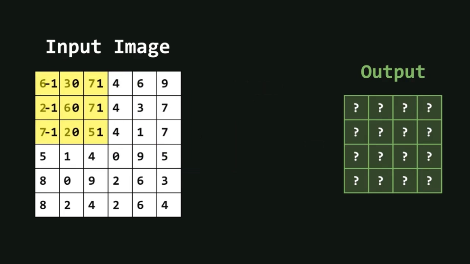

算完一格，核向右移一步再算下一格；一行走完，向下移一步。整个过程就是"同一个核、同一组权重，在所有位置上重复做同一件事"——这就是**权重共享**。

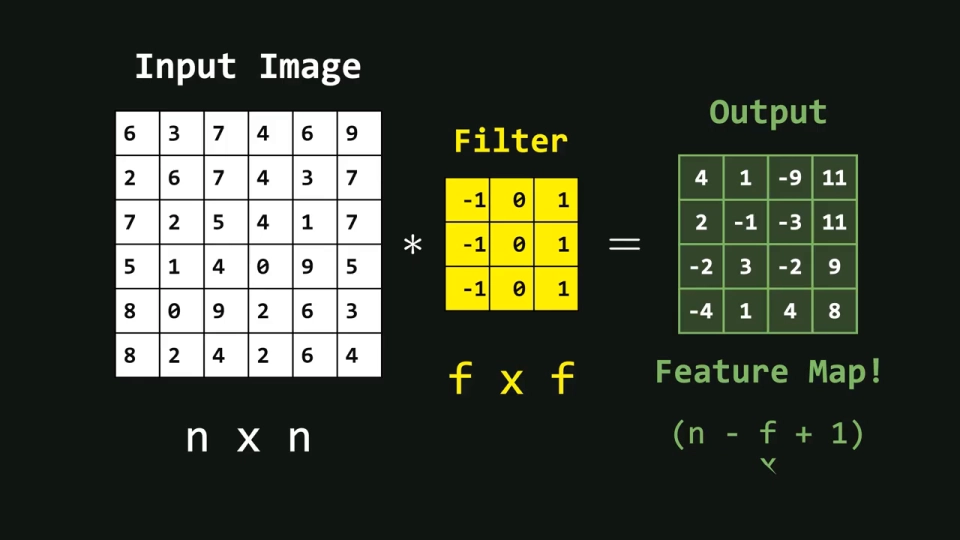

### 2.2 输出尺寸公式

上图的算术很直接：$6\times6$ 的输入配 $3\times3$ 的核，输出是 $4\times4$。一般地，输入边长 $n$、核边长 $f$、无填充、步长为 1 时：

$$
n_{\text{out}} = n - f + 1
$$

直觉是：核的左上角只能放在那些"放下去还不会越界"的位置上，横向有 $n-f+1$ 个这样的位置。

## 三、padding 与 stride：两个控制输出长度的旋钮

### 3.1 为什么需要 padding

直接卷积有两个副作用 [【跳转到 03:22】](https://www.youtube.com/watch?v=jL2G8DG-qmI&t=202)：

1. **尺寸在缩小**。每过一层就少两圈像素，堆十几层图就没了。
2. **边缘像素被"看见"的次数太少**。角落的像素只参与一次加权和，而中心像素最多参与九次不同的卷积。这种不平等的贡献导致图像边缘的信息容易丢失。

解决办法是 padding：在图像外围补一圈（通常是 0）。补一圈之后，$6\times6$ 的输入经过 $3\times3$ 卷积仍然输出 $6\times6$ [【跳转到 04:03】](https://www.youtube.com/watch?v=jL2G8DG-qmI&t=243)。

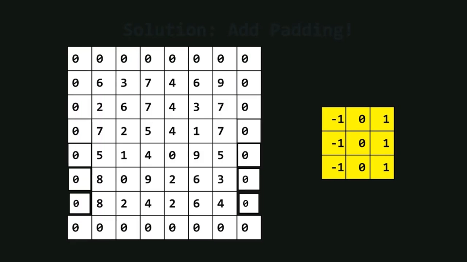

加入填充量 $p$ 后公式变成：

$$
n_{\text{out}} = n + 2p - f + 1
$$

想让输出和输入一样大，就取 $p = (f-1)/2$。这也解释了为什么卷积核几乎总是奇数尺寸（$3\times3$、$5\times5$）：**奇数核才有明确的中心像素，卷积操作才对称** [【跳转到 05:08】](https://www.youtube.com/watch?v=jL2G8DG-qmI&t=308)。

### 3.2 stride：一次走几步

前面每次只移一格，这叫步长为 1。把步长设为 2，核每次横向、纵向都跳两格，输出尺寸随之减半左右 [【跳转到 05:13】](https://www.youtube.com/watch?v=jL2G8DG-qmI&t=313)。

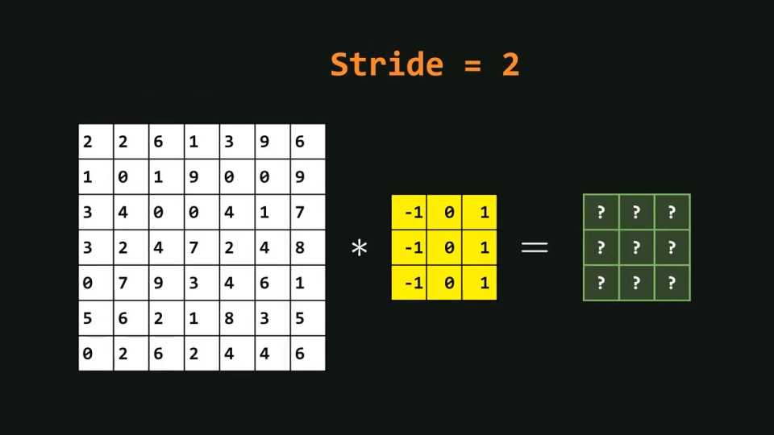

加入步长 $s$ 后的通用公式：

$$
n_{\text{out}} = \left\lfloor \frac{n + 2p - f}{s} \right\rfloor + 1
$$

视频特别提醒：步长大于 1 时，核可能"跨过"图像的最后几行或几列，卷积不一定正好铺满整张图，所以要对结果取整（向下取整）[【跳转到 06:18】](https://www.youtube.com/watch?v=jL2G8DG-qmI&t=378)。另外，真实图像几乎都不是正方形，实践中要**分别**算输出高度和输出宽度 [【跳转到 06:34】](https://www.youtube.com/watch?v=jL2G8DG-qmI&t=394)。

## 四、多通道：卷积核的深度必须等于输入的通道数

彩色图有高、宽、通道三个维度。这时卷积核也必须有三层深度，与输入的通道数一致；加权和要在整个三维体积上算。结果是：**一个三维卷积核把三维输入压成一张二维特征图** [【跳转到 06:54】](https://www.youtube.com/watch?v=jL2G8DG-qmI&t=414)。

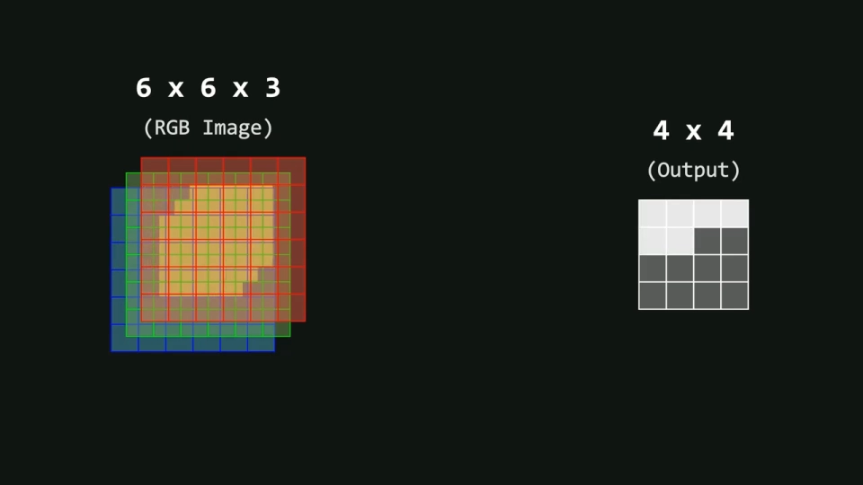

如果同时用多个核，每个核各产出一张二维特征图，把它们叠起来就得到深度等于"核的个数"的三维特征图 [【跳转到 07:30】](https://www.youtube.com/watch?v=jL2G8DG-qmI&t=450)。这一点对序列模型同样成立：**通道数（深度）= 这一层用了多少个不同的模式检测器**。

## 五、卷积核的数值从哪来：反向传播学出来

视频先演示了人工设计的核：检测竖直边缘的核在一侧放负数、中间放 0、另一侧放正数；输入左半是 60、右半是 220，卷积结果在边缘处出现强激活 [【跳转到 08:21】](https://www.youtube.com/watch?v=jL2G8DG-qmI&t=501)。

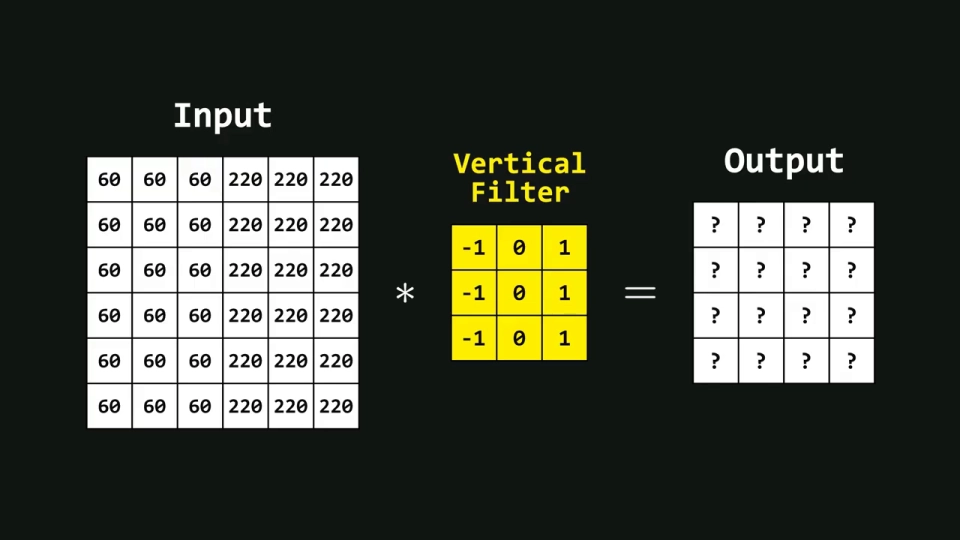

把核转置一下，就变成检测水平边缘。除了边缘检测，还有均值模糊、高斯模糊、锐化等不同用途的核 [【跳转到 09:51】](https://www.youtube.com/watch?v=jL2G8DG-qmI&t=591)。

但真正的问题是：**网络怎么知道该用哪个核？** 答案是根本不用人挑——在 CNN 里，核的数值就是网络参数的一部分，和权重、偏置一样通过反向传播自动学出来 [【跳转到 10:47】](https://www.youtube.com/watch?v=jL2G8DG-qmI&t=647)。

## 六、一个完整卷积层：卷积 → 加偏置 → 激活 → 堆叠

单个卷积层的完整流程是 [【跳转到 11:15】](https://www.youtube.com/watch?v=jL2G8DG-qmI&t=675)：

1. 用 $k$ 个卷积核分别做卷积，得到 $k$ 张二维特征图；
2. 每张特征图逐元素加一个偏置 $b_i$；
3. 逐元素过一个激活函数（如 ReLU），引入非线性；
4. 把 $k$ 张结果叠成深度为 $k$ 的三维特征图。

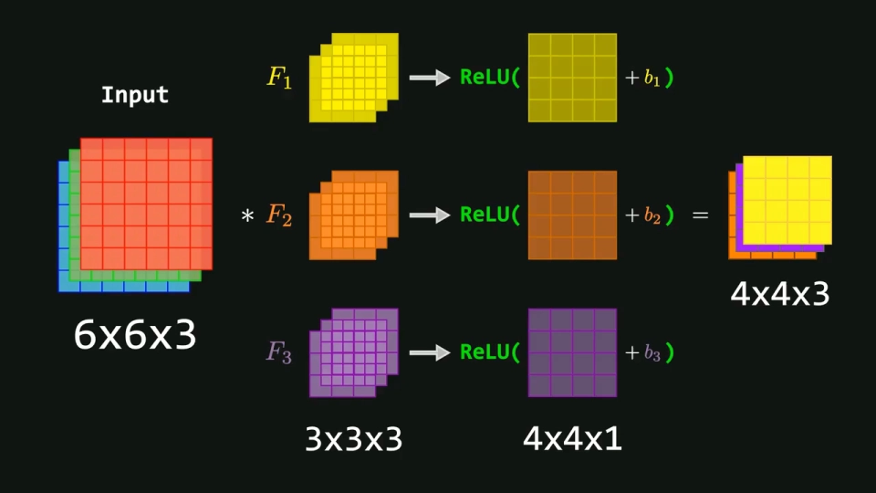

视频在这里画了一条与普通神经网络的对应关系：输入图像相当于 $X$，卷积核相当于权重 $w$，卷积相当于矩阵乘法；加偏置、过激活之后得到的，就是第 $L$ 层的激活值 [【跳转到 12:35】](https://www.youtube.com/watch?v=jL2G8DG-qmI&t=755)。形状上也能对上：$6\times6\times3$ 的输入、三个 $3\times3\times3$ 的核，输出是 $4\times4\times3$，深度 3 正是核的个数 [【跳转到 13:04】](https://www.youtube.com/watch?v=jL2G8DG-qmI&t=784)。

## 七、池化：缩小尺寸，顺带带来一点平移不变性

池化层主要有两种 [【跳转到 14:45】](https://www.youtube.com/watch?v=jL2G8DG-qmI&t=885)：

- **最大池化**：在每个池化窗口里只取最大值；
- **平均池化**：取窗口内所有值的平均。

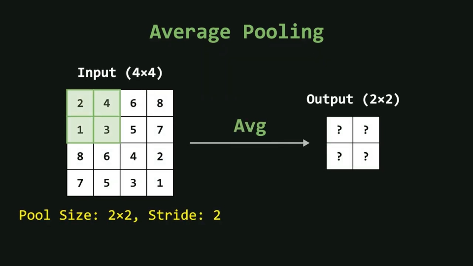

池化的作用是缩小特征图的空间尺寸，降低计算量；同时保留最重要的信息，并带来一点平移不变性——输入有小的平移时，输出变化不大 [【跳转到 15:17】](https://www.youtube.com/watch?v=jL2G8DG-qmI&t=917)。池化的输出尺寸公式与卷积类似，只是通常不用 padding，所以可以去掉 $p$ 项 [【跳转到 15:47】](https://www.youtube.com/watch?v=jL2G8DG-qmI&t=947)。

## 八、感受野：堆层数就是"越看越远"

### 8.1 从 1 到 3 到 5

感受野的定义很朴素：**影响某一个输出神经元的那块输入区域** [【跳转到 16:54】](https://www.youtube.com/watch?v=jL2G8DG-qmI&t=1014)。

- 输入层的每个像素只"看到"自己，感受野是 1。
- 经过一个 $3\times3$ 卷积，每个输出像素受 $3\times3$ 区域影响，感受野是 3。

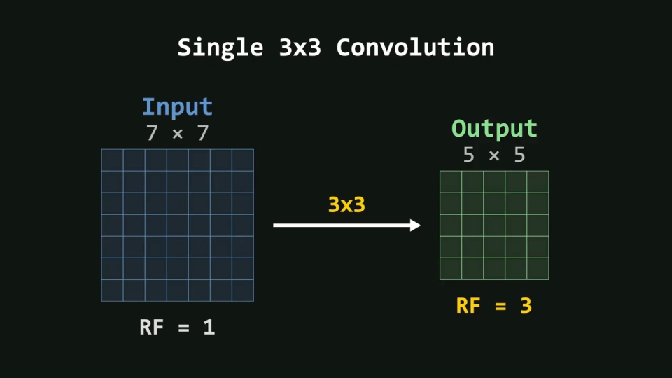

再堆一层 $3\times3$：第二层的每个输出看第一层特征图的 $3\times3$，而第一层的每个格子又对应原图的 $3\times3$，合起来就是原图的 $5\times5$ [【跳转到 17:52】](https://www.youtube.com/watch?v=jL2G8DG-qmI&t=1072)。

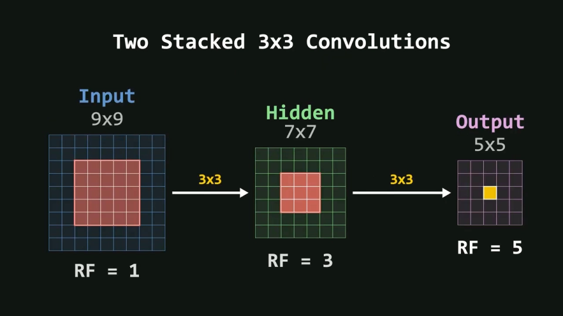

注意这里的关键：**感受野的增长不需要增加参数**。两层 $3\times3$ 一共 18 个权重，却覆盖了 $5\times5=25$ 个输入像素——这正是权重共享带来的杠杆。

### 8.2 递推公式

第 $l$ 层的理论感受野可以这样算 [【跳转到 18:22】](https://www.youtube.com/watch?v=jL2G8DG-qmI&t=1102)：

$$
RF_l = 1 + \sum_{i=1}^{l} (K_i - 1) \times \prod_{j=1}^{i-1} S_j
$$

其中 $K_i$ 是第 $i$ 层的核大小，$S_j$ 是第 $j$ 层的步长。

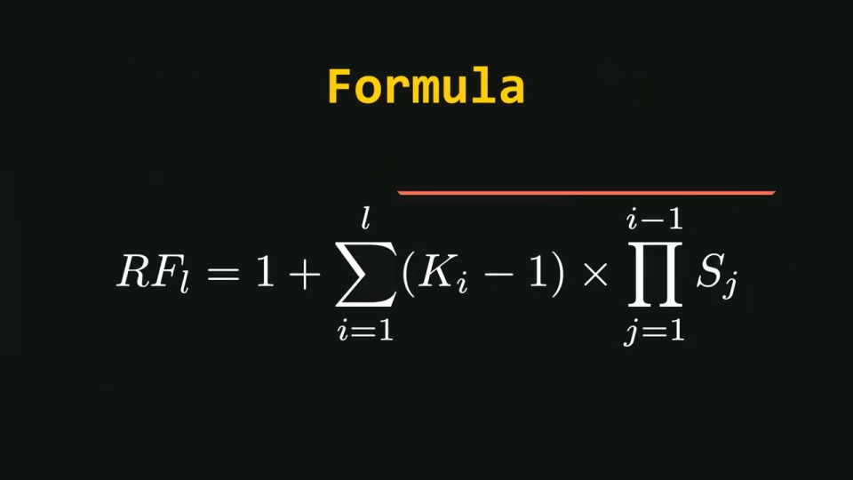

公式里那个"步长连乘"是理解的重点：**步长会下采样特征图，于是深层的一个像素本身就代表原图更大的一块区域**。所以前面各层的步长越大，后面每加一层，感受野涨得越快 [【跳转到 18:56】](https://www.youtube.com/watch?v=jL2G8DG-qmI&t=1136)。

这也解释了为什么加深网络会自然形成层级特征 [【跳转到 19:55】](https://www.youtube.com/watch?v=jL2G8DG-qmI&t=1195)：

- **浅层**：感受野小，只能检测边缘、角点这类非常局部的模式；
- **中层**：感受野明显变大，能检测更复杂的形状和图案；
- **深层**：感受野足够大，可以覆盖物体、人脸乃至整幅图的某个部分。

### 8.3 理论感受野 ≠ 有效感受野

公式算出来的是**理论**感受野。视频强调，实践中**有效感受野通常更小**：虽然一个神经元理论上能看到很大一块区域，但实际贡献主要来自中心附近的像素，靠近感受野边缘的像素影响力小得多 [【跳转到 19:25】](https://www.youtube.com/watch?v=jL2G8DG-qmI&t=1165)。

这一点对读论文很有用：看到"感受野 200bp"这类说法时，要问它是理论值还是有效值。

## 九、空洞卷积：不增加参数，只把核"摊开"

空洞卷积（dilated convolution）的 dilation 指的是**卷积核元素之间的间隔** [【跳转到 20:45】](https://www.youtube.com/watch?v=jL2G8DG-qmI&t=1245)。

- $d=1$：元素紧挨着，$3\times3$ 核覆盖 $3\times3$ 区域，9 个参数。
- $d=2$：元素之间隔一格，同样是 9 个参数，但覆盖 $5\times5$ 区域。
- $d$ 再大，覆盖面积继续变大，参数量始终不变。

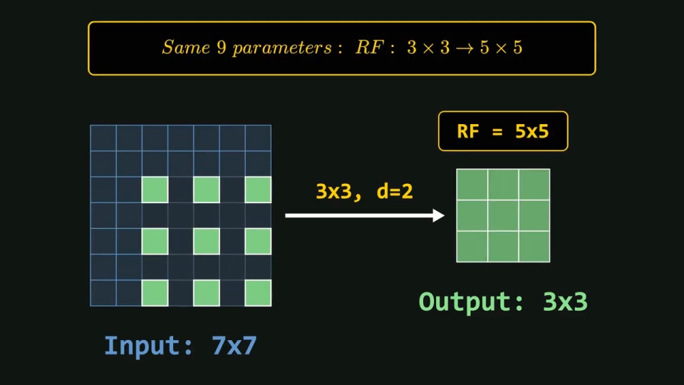

有效核尺寸的公式是：

$$
K_{\text{eff}} = K + (K-1)(d-1)
$$

$K=3$、$d=2$ 时 $K_{\text{eff}} = 3 + 2\times1 = 5$，正好对上上面的图。把感受野公式里的 $K$ 换成 $K_{\text{eff}}$，就得到带 dilation 的感受野公式 [【跳转到 22:43】](https://www.youtube.com/watch?v=jL2G8DG-qmI&t=1363)。

**这就是空洞卷积的用途：在参数预算不变的前提下，把单层感受野撑大。** 对长序列尤其有用——你想让一个卷积核同时看到相隔 100 个碱基的两个位点，又不想用 $101$ 宽的核。

## 小结

- **卷积 = 局部感受野 + 权重共享**：每个输出只看输入的一小块（局部），同一组核权重在所有位置复用（共享）。参数量因此从"输入维度 × 输出维度"降到"核大小 × 通道数"。
- **输出尺寸**：$n_{\text{out}} = \lfloor (n + 2p - f)/s \rfloor + 1$。padding 保住尺寸并让边缘像素被多次覆盖，stride 决定下采样倍率。
- **奇数核**（$3\times3$、$5\times5$）才有明确中心，配 $p=(f-1)/2$ 可以保持尺寸不变。
- **多通道**：核的深度必须等于输入通道数；一个核产出一张特征图，核的个数决定输出深度。
- **卷积核的数值是学出来的**，不是手工设计的；卷积层 = 卷积 + 偏置 + 激活 + 堆叠。
- **感受野随层数增长**：$RF_l = 1 + \sum_i (K_i-1)\prod_{j<i} S_j$，步长越大增长越快；但**有效感受野**小于理论值。
- **空洞卷积**用 $K_{\text{eff}} = K + (K-1)(d-1)$ 在不加参数的情况下扩大单层覆盖范围。

## 关键术语速查

| 术语 | 一句话解释 |
| --- | --- |
| 卷积核（filter / kernel） | 一组可学习权重，在输入上滑动做加权和，用来检测某种局部模式 |
| 感受野（receptive field） | 影响某个输出神经元的那块输入区域 |
| 特征图（feature map） | 一个卷积核滑遍输入后得到的输出网格，记录"该模式出现在哪里" |
| 权重共享（weight sharing） | 同一个核的同一组权重在所有位置上重复使用，因此参数量与输入尺寸无关 |
| padding | 在输入外围补零，用来保持输出尺寸、让边缘像素被充分覆盖 |
| stride | 卷积核每次移动的格数，决定输出下采样的倍率 |
| dilation | 卷积核元素之间的间隔，在不增加参数的情况下扩大有效核尺寸 |
| 有效感受野（effective receptive field） | 实际对输出影响显著的那部分区域，通常小于理论感受野 |
| 池化（pooling） | 在窗口内取最大值或平均值来缩小特征图，无学习参数，带来局部平移不变性 |