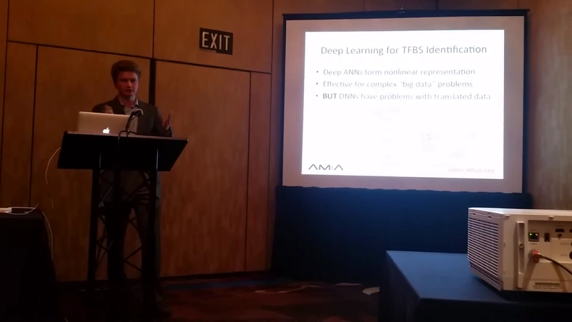
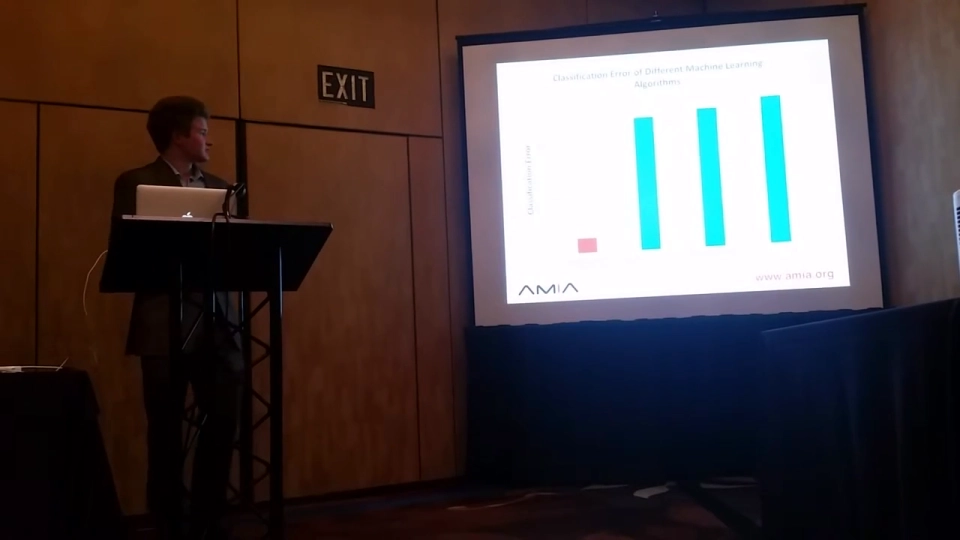
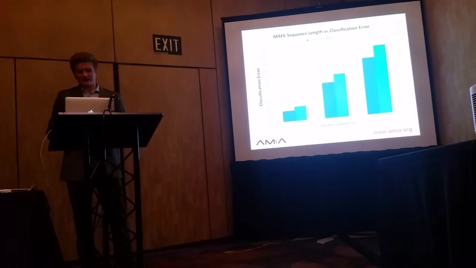
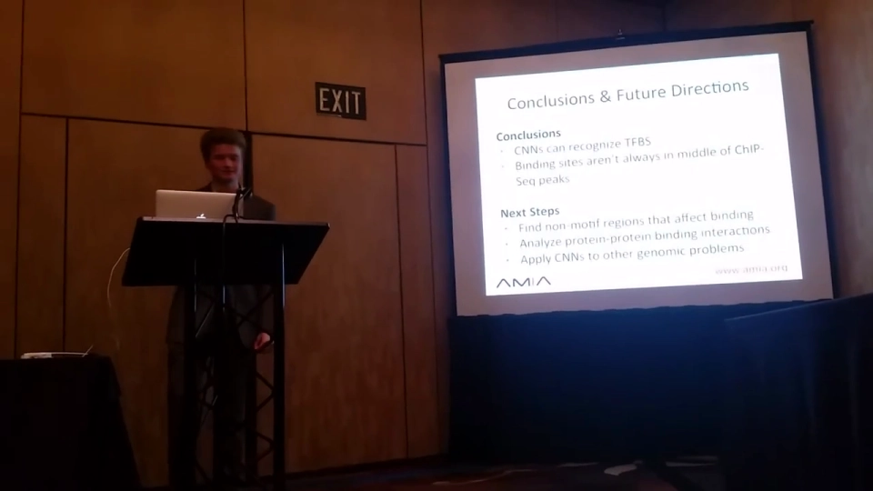

# 把 DNA 序列变成 4×300 位图：1D 卷积如何定位转录因子结合位点

> 视频来源：[Convolutional Neural Networks for Identifying Transcription Factor Binding Motifs](https://www.youtube.com/watch?v=t7JYp6Sj6Aw)（YouTube，AMIA 学生报告）｜时长约 15 分钟
> 本文基于视频演说图文稿整理，配图截自视频。这支报告把"卷积为什么适合序列"讲得很具体：先用 ChIP-seq 数据说明 motif 可能出现在序列的任何位置，再解释为什么普通全连接网络处理不了这种平移，最后给出 one-hot 编码 + CNN 的做法与实验结果。它是把 §2.1.1 里的位置权重矩阵（PWM）和本节卷积机制接起来的一个实例。

## 本讲要解决的核心问题（SCQA）

**背景**：转录因子是一类调控蛋白，它结合到 DNA 上某个特定序列（motif）旁边，从而调控基因转录。这类 motif 通常只有 5 到 20 个核苷酸长。如果能识别出 motif，就能预测蛋白与 DNA 的结合、理解结合机制，甚至设计靶向药物 [【跳转到 01:24】](https://www.youtube.com/watch?v=t7JYp6Sj6Aw&t=84)。

**冲突**：找 motif 传统上很困难。同一个转录因子可以结合好几种不同的 motif（核苷酸组成不同），长度也可以不同，相对基因的位置也会变。而 ChIP-seq 实验给出的序列动辄两三万到六万条，每条几百个碱基，motif 可能落在其中任何位置 [【跳转到 01:49】](https://www.youtube.com/watch?v=t7JYp6Sj6Aw&t=109)。

**疑问**：普通的全连接网络能不能直接吃这些序列？如果 motif 整体向右平移 10 个碱基，对生物学来说几乎没变，网络会不会把它当成完全不同的输入？有没有一种结构，天生就"不在意模式出现在哪儿"？

**回答（中心思想）**：**把每条 300 bp 的序列编码成 $4\times300$ 的 one-hot 位图，问题就变成一个"单通道图像"的二分类任务；卷积核在长度方向上滑动、权重共享，因此同一个 motif 检测器在序列的任何位置都能触发——这正是全连接网络做不到的平移处理能力。** 用这个结构识别 MatK 的结合位点，分类错误率约 3%，而用 PWM 特征的 SVM、逻辑回归和普通深度网络都在 30% 左右 [【跳转到 08:21】](https://www.youtube.com/watch?v=t7JYp6Sj6Aw&t=501)。

---

## 一、任务定义：在几百个碱基里找一段 5–20 nt 的模式

转录因子（transcription factor）是一类调控蛋白，它结合到 DNA 的特定序列上，而这个序列通常紧挨着某个基因。因为调控转录，它最终控制基因表达——这也是为什么它在癌症等大量生物学问题里都很重要 [【跳转到 01:09】](https://www.youtube.com/watch?v=t7JYp6Sj6Aw&t=69)。

结合是通过 **motif**（基序）实现的：序列中一段特定的核苷酸模式，文献里叫转录因子结合位点（TFBS）。这些 motif 通常 5 到 20 个核苷酸长 [【跳转到 01:24】](https://www.youtube.com/watch?v=t7JYp6Sj6Aw&t=84)。

难点在于 motif 不规整：

- 一个转录因子可以结合**多种不同的 motif**（实际核苷酸组成不同）；
- 长度可以不同；
- 相对基因的位置也可以不同。

这三点合起来，使得"用一条固定规则去匹配"很难做全。

## 二、数据来源：ChIP-seq 与 ENCODE

数据来自 **ChIP-seq**（immunoprecipitation sequencing，免疫共沉淀测序）。做法是用抗体把已知含有结合事件的序列沉淀、分离出来 [【跳转到 02:27】](https://www.youtube.com/watch?v=t7JYp6Sj6Aw&t=147)。

序列本身来自 **ENCODE 计划**：它和人类基因组计划配套，免费公开了大量转录因子对应的序列。作者强调这是一个"大数据"项目——不同蛋白有 2 万到 6 万条序列 [【跳转到 02:52】](https://www.youtube.com/watch?v=t7JYp6Sj6Aw&t=172)。

## 三、为什么普通全连接网络处理不了序列

### 3.1 全连接的输入假设是"每个位置一个固定变量"

经典神经网络的输入是 $x_1, x_2, x_3, \dots$，每个输入代表一个**特定的变量**：体温、病人的 pH 值等等。这个设定对表格数据很合理 [【跳转到 03:49】](https://www.youtube.com/watch?v=t7JYp6Sj6Aw&t=229)。

### 3.2 换成序列就崩了

序列数据不是这样：每个输入只对应**一个核苷酸**。当你把整条序列整体平移一格，直觉上它几乎是同一个东西，但深度网络会把它看成完全不同的输入 [【跳转到 04:22】](https://www.youtube.com/watch?v=t7JYp6Sj6Aw&t=262)。

而 motif 恰恰**可以出现在 ChIP-seq 序列的任何位置**。所以这不是一个可以忽略的小毛病，而是任务本身的性质。

## 四、卷积为什么能处理平移

卷积网络原本大量用于计算机视觉和语音识别，原因就是它**能处理输入中的平移** [【跳转到 04:44】](https://www.youtube.com/watch?v=t7JYp6Sj6Aw&t=284)。

它的工作机制是：持有一组特征检测矩阵，每个矩阵寻找输入里非常简单的模式，并**沿着整条输入扫描**。比如在人脸图像里，某个检测器专门找水平边缘，它扫过整张图，把所有"这里有一条水平边缘"的位置点亮 [【跳转到 04:56】](https://www.youtube.com/watch?v=t7JYp6Sj6Aw&t=296)。

把若干这样的特征组合起来（水平线、竖直线、斜线、点），就得到一张"哪些特征出现在哪里"的图。再堆很多层，第一层找简单边缘，下一层找曲线，再往上找"脸的某个部件"，最后接一个标准分类层，就得到完整系统 [【跳转到 05:21】](https://www.youtube.com/watch?v=t7JYp6Sj6Aw&t=321)。

**换到序列上，逻辑完全一样**：第一层检测"某几个碱基的特定排列"，往上的层检测"几个 motif 的组合"，最后判断这条序列里有没有结合位点。

## 五、关键一步：把 ACGT 变成 4×300 的位图

原始序列是 ACGT 字符串，不能直接喂给卷积。作者的做法是 [【跳转到 06:19】](https://www.youtube.com/watch?v=t7JYp6Sj6Aw&t=379)：

- 取每条序列中间的 **300 个碱基对**；
- 编码成一个 $4\times300$ 的二值矩阵（one-hot）；
- 每个位置只有一个 1，其余为 0：A → `1 0 0 0`，C → `0 1 0 0`，G → `0 0 1 0`，T → `0 0 0 1`。

于是每条序列变成一张"4 行 300 列、每列恰好一个 1"的位图。这实际上就是**单通道的 1D 图像**：高度方向是 4 种碱基，宽度方向是序列位置。卷积核在这张图上沿宽度方向滑动，就等价于"在序列上滑动一个长度固定的模式检测器"。

这一步值得停下来想一下它和 §2.1.1 的关系：位置权重矩阵（PWM）是"手工统计出来的 $4\times L$ 打分表"，而 one-hot 矩阵是"把序列本身写成 $4\times L$ 的表"。**卷积核学到的，某种意义上就是一个可学习的 PWM。**

## 六、实验设置：正负样本与基线

- **正样本**：来自 ChIP-seq，含结合事件。
- **负样本**：从人类基因组里随机取子集。理由是 motif 在基因组里足够稀疏，随机片段里出现真结合位点的概率很低，假阳性不会太多 [【跳转到 07:06】](https://www.youtube.com/watch?v=t7JYp6Sj6Aw&t=426)。
- **规模**：每个蛋白 2 万到 6 万个正样本，配等量负样本，正负各半；划分约 15% 验证、15% 测试、70% 训练 [【跳转到 14:25】](https://www.youtube.com/watch?v=t7JYp6Sj6Aw&t=865)。
- **实现**：Keras（François Chollet 开发的 Python 深度学习库）[【跳转到 06:03】](https://www.youtube.com/watch?v=t7JYp6Sj6Aw&t=363)。
- **基线**：支持向量机、逻辑回归、普通深度神经网络。其中 SVM 和逻辑回归**用 PWM 作为特征输入**，而 PWM 被认为是检测序列中结合 motif 的当前最优方法 [【跳转到 07:52】](https://www.youtube.com/watch?v=t7JYp6Sj6Aw&t=472)。

注意这个基线设置的分量：对手不是"随便一个弱模型"，而是"用领域内公认最好的手工特征 + 经典分类器"。CNN 要赢的是这个组合。

## 七、结果：3% 对 30%

先在 MatK 这个蛋白上做，因为它在 ENCODE 里数据质量很好。分类错误率（把含 motif 的序列判错的比例）对比如下 [【跳转到 08:21】](https://www.youtube.com/watch?v=t7JYp6Sj6Aw&t=501)：

- **CNN：约 3%**
- **SVM、深度网络、逻辑回归：都在 30% 左右**

差距接近一个数量级。作者随后做了一件更有信息量的事：把**为 MatK 优化的模型**直接用到其他蛋白上 [【跳转到 08:35】](https://www.youtube.com/watch?v=t7JYp6Sj6Aw&t=515)。

- 在 MatK 上表现最好（符合预期，模型就是为它调的）；
- 相当多其他蛋白表现也不错；
- 也有一部分明显变差。作者的解释是：这些蛋白的整体 motif 结构差异较大。

这说明模型学到的不是"MatK 专属的查表"，而是某种可迁移的序列模式检测能力——虽然迁移有边界。

## 八、一个反直觉的发现：结合位点不在序列正中间

ChIP-seq 领域有一个常见假设：给定一条 500 nt 的序列，结合事件大概率发生在中间，大约 250 nt 处。于是作者只把序列**中间的 350 nt** 喂给模型 [【跳转到 09:18】](https://www.youtube.com/watch?v=t7JYp6Sj6Aw&t=558)。

然后他们按序列长度分层看错误率：

- 长度 367 nt 时，只丢掉 17 nt，错误率很低；
- 长度继续增加，意味着喂进模型之前**丢掉了越来越多真实序列**，错误率近乎线性上升 [【跳转到 09:43】](https://www.youtube.com/watch?v=t7JYp6Sj6Aw&t=583)。

这个趋势支持一个结论：**结合事件并不集中在 ChIP-seq 序列的中心，而是可以散布在整条序列上**。这对数据预处理是一个直接的警告——"只取中间一段"这个看起来无害的约定，会系统性地丢掉信号。

## 九、结论与后续方向

作者总结了两条 [【跳转到 10:17】](https://www.youtube.com/watch?v=t7JYp6Sj6Aw&t=617)：

1. **CNN 很擅长识别转录因子结合 motif**；
2. **结合位点不一定在 ChIP-seq 序列中间**。

后续方向有三个 [【跳转到 10:45】](https://www.youtube.com/watch?v=t7JYp6Sj6Aw&t=645)：

- **看 motif 的上下文**：如果 motif 长 20 nt，就看它周围那些核苷酸，寻找其他可能影响结合的序列因素；
- **分析蛋白—蛋白相互作用**：ChIP-seq 的一个潜在问题是，你测的是蛋白 A 结合到某段序列，但实际可能是蛋白 A 先结合蛋白 B、蛋白 B 再结合 DNA，这会带来假阳性；
- **把 CNN 用到其他基因组问题**上。

作者也坦率提到：这个工作完成后的几个月里，已有另一篇实验设计非常相似、结果也非常相似的论文发表 [【跳转到 10:26】](https://www.youtube.com/watch?v=t7JYp6Sj6Aw&t=626)。

## 小结

- **任务**：在几百个碱基的序列里判断是否含 5–20 nt 的转录因子结合 motif。困难在于一个因子可结合多种 motif，长度与位置都不固定。
- **全连接不行**：它把每个输入当成固定变量，序列整体平移一格就被视为完全不同的输入；而 motif 可以出现在序列任何位置。
- **卷积能行**：核沿序列滑动 + 权重共享，同一个 motif 检测器在任何位置都能触发。
- **编码**：300 bp 序列 → $4\times300$ one-hot 位图，等价于单通道 1D 图像；卷积核学到的相当于一个可学习的 PWM。
- **结果**：MatK 上错误率约 3%，PWM 特征 + SVM/逻辑回归/普通 DNN 约 30%。
- **两个可迁移的教训**：为某个蛋白优化的模型能部分迁移到其他蛋白（取决于 motif 结构相似度）；"只取序列中间一段"会系统性丢信号，因为结合事件可以散布在整条序列上。

## 关键术语速查

| 术语 | 一句话解释 |
| --- | --- |
| 转录因子（transcription factor） | 结合 DNA 特定序列来调控基因转录的蛋白 |
| motif（基序） | 序列中一段有生物学意义的短模式，这里是 5–20 nt 的结合位点 |
| ChIP-seq | 用抗体沉淀含结合事件的 DNA 片段并测序的技术 |
| ENCODE | 公开人类基因组功能元件的计划，提供大量转录因子序列数据 |
| one-hot 编码 | 每个碱基用一个独热向量表示，整条序列成为 $4\times L$ 的二值矩阵 |
| PWM（位置权重矩阵） | 逐位置统计各碱基偏好得到的 $4\times L$ 打分表，是 motif 检测的经典方法 |
| 平移等变 | 模式出现在序列不同位置时，卷积仍能检测到，只是激活位置随之移动 |