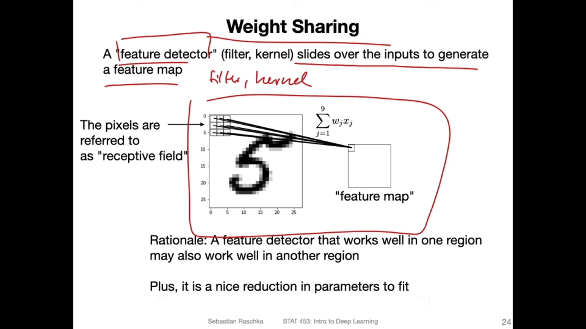
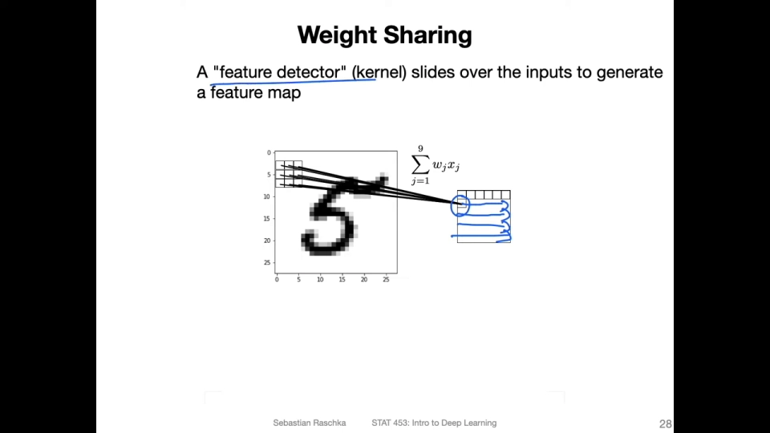
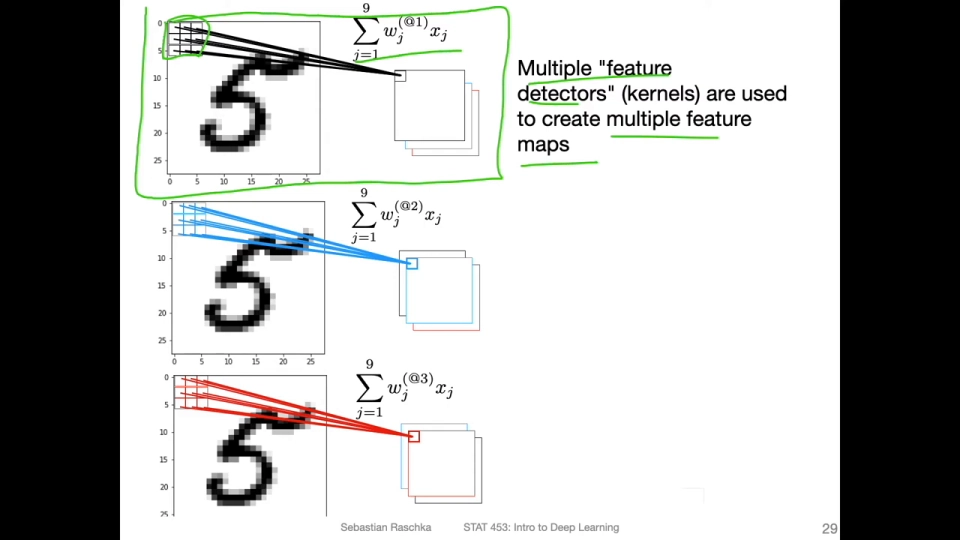
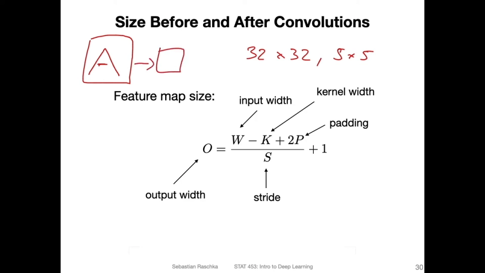
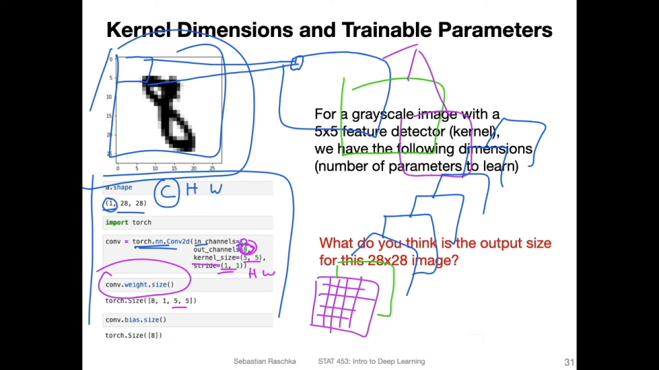
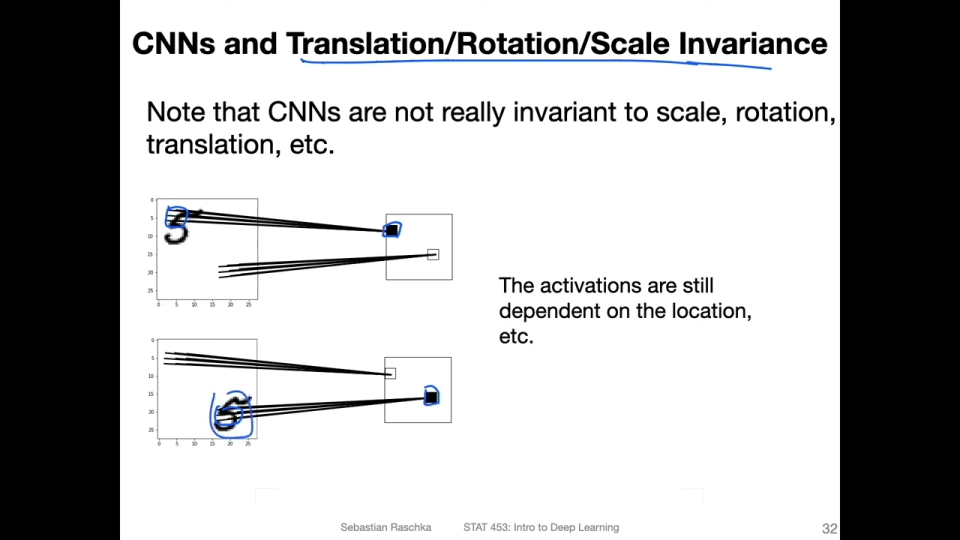
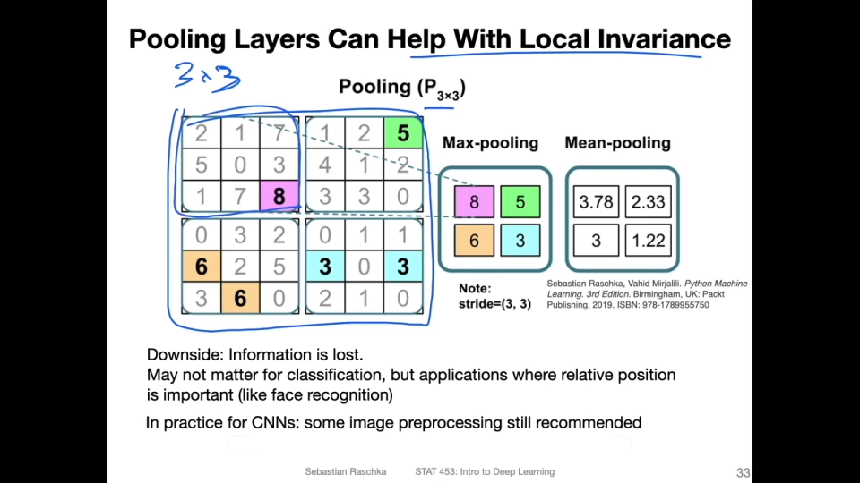

# 权重共享：一个卷积核走遍全图，参数量从七千八百降到二百零八

> 视频来源：[L13.4 Convolutional Filters and Weight-Sharing](https://www.youtube.com/watch?v=ryJ6Bna-ZNU)（YouTube，Sebastian Raschka，STAT 453: Intro to Deep Learning 第 13 讲第 4 段）｜时长约 20 分钟
> 本文基于视频演说图文稿整理，配图截自视频。这支课把"卷积核滑动"这一步慢放了一遍：先定义感受野和加权和，再解释权重共享的两条理由，然后算输出尺寸、数参数量，最后澄清"平移不变性"这个常被说错的说法。文中公式与数字均取自幻灯片与板书。

## 本讲要解决的核心问题（SCQA）

**背景**：卷积层用一个小核对输入做加权求和，然后把核滑到下一个位置重复同样的计算。这个操作本身很简单，一个 $3\times3$ 的核只有 9 个权重。

**冲突**：既然每个位置都要算一次加权和，为什么不是"每个位置配一个自己的核"？后者显然更灵活，能表达"左上角找这个模式、右下角找那个模式"。可是如果真这么做，参数量会随图像尺寸线性膨胀，网络就退化成一个昂贵的全连接网络了。

**疑问**：权重共享到底省了多少参数？省下来的代价是什么——会不会因为"到处用同一把尺子"而损失表达能力？另外，既然核在图像上滑动时对同样的输入永远给出同样的输出，那 CNN 是不是就"平移不变"了？

**回答（中心思想）**：**权重共享把"位置"这一维从参数里彻底删掉：无论输入多大，一个卷积核永远只有 $K\times K\times C_{\text{in}}$ 个权重，参数量与图像尺寸无关。它成立的前提是一个经验假设——"能在一个区域检测出边缘的检测器，在别的区域同样有用"。代价是 CNN 对平移只是"等变"（equivariant）而非"不变"（invariant）：激活值相同，但激活出现的位置随物体位置而变；要靠堆叠卷积和池化才能逐渐逼近不变性。** [【跳转到 03:20】](https://www.youtube.com/watch?v=ryJ6Bna-ZNU&t=200)

---

## 一、把"卷积核滑动"慢放一遍

视频用 MNIST 的手写数字 5 做例子。中心是一个 $3\times3$ 的特征检测器（feature detector，也叫 filter 或 kernel），它盖在图像的一块区域上；这块被盖住的区域就叫**感受野** [【跳转到 00:50】](https://www.youtube.com/watch?v=ryJ6Bna-ZNU&t=50)。

计算方式是把核看成一个权重矩阵 $w_1,\dots,w_9$，感受野看成一个像素矩阵 $x_1,\dots,x_9$，然后做加权和：

$$
\sum_{j=1}^{9} w_j x_j
$$

这个和就是特征图上的一个格子。核滑到下一个位置，重复同样的九个乘法。一行走完换下一行，直到覆盖整张图 [【跳转到 02:05】](https://www.youtube.com/watch?v=ryJ6Bna-ZNU&t=125)。

得到特征图之后有两条路：做下采样（也就是池化），或者再接一个 $3\times3$ 卷积层投影到下一张特征图。网络就是这样一层一层连续地抽特征 [【跳转到 04:10】](https://www.youtube.com/watch?v=ryJ6Bna-ZNU&t=250)。

## 二、为什么要共享权重：两条理由

### 2.1 理由一：参数量

如果每个区域配一个独立的特征检测器，权重数量会非常庞大，模型会越来越接近全连接网络，计算上非常昂贵 [【跳转到 02:30】](https://www.youtube.com/watch?v=ryJ6Bna-ZNU&t=150)。

### 2.2 理由二：同一个检测器在哪儿都有用

更本质的理由是：**一个能检测边缘的检测器，在图像的任何位置都应该有用**。如果这个核学会了"这里有一条边"，那么把它挪到别处，它检测的仍然是"这里有一条边"这件事。没有必要为每个位置重新学一个边缘检测器 [【跳转到 03:20】](https://www.youtube.com/watch?v=ryJ6Bna-ZNU&t=200)。

幻灯片把这两条理由写成两行：

> Rationale: A feature detector that works well in one region may also work well in another region.
> Plus, it is a nice reduction in parameters to fit.

第一条是**归纳偏置**（模型结构里预先注入的假设），第二条是**工程收益**。两者缺一不可：只有第一条而没有第二条，共享就只是省事；只有第二条而没有第一条，共享就没有道理。

## 三、多个检测器：共享的是"每个核内部"，不是"所有核之间"

一个核只能检测一种模式。要同时检测边缘和水平边缘，就得用两个不同的核，各自滑动、各自产出一张特征图 [【跳转到 05:26】](https://www.youtube.com/watch?v=ryJ6Bna-ZNU&t=326)。

这里要分清两件事：

- **同一个核在不同位置上**：权重完全相同——这是权重共享。
- **不同的核之间**：权重各不相同——这是"多个通道 / 多张特征图"。

所以"权重共享"并不限制网络的表达能力，它只限制了"同一个模式检测器在不同位置上的参数必须一致"。

## 四、输出尺寸：从 32×32 到 28×28

以 LeNet-5 为例：输入是 $32\times32$ 的手写字符，核是 $5\times5$，输出为什么是 28？[【跳转到 07:48】](https://www.youtube.com/watch?v=ryJ6Bna-ZNU&t=468)

$$
O = \frac{W - K + 2P}{S} + 1
$$

代入 $W=32$、$K=5$、$P=0$、$S=1$：$(32-5)/1 + 1 = 28$。

视频对 stride 的定义讲得比较细：stride 是核每次向右移动多少**列**，以及一行处理完后向下移动多少**行**。移一列是 stride 1，移两列是 stride 2 [【跳转到 09:28】](https://www.youtube.com/watch?v=ryJ6Bna-ZNU&t=568)。

至于为什么尺寸会变小，视频给了一个很物理的解释：**我们不允许核"越界"**。核向右滑到某一点就碰到了边界，再走一步就会超出图像，那一步就不算了。想允许越界，就得用 padding 在图像周围补零——那是下一讲的内容 [【跳转到 11:08】](https://www.youtube.com/watch?v=ryJ6Bna-ZNU&t=668)。

## 五、数一数参数量：208 对 7840

视频用一段 PyTorch 代码演示。输入是 $28\times28$ 的单通道 MNIST 图像，格式是 `(channel, height, width)`，即 `(1, 28, 28)`；卷积层指定 8 个输出特征图、$5\times5$ 核、stride 1 [【跳转到 11:58】](https://www.youtube.com/watch?v=ryJ6Bna-ZNU&t=718)。

于是权重矩阵的形状是 `(8, 1, 5, 5)`，参数量为：

$$
8 \times 1 \times 5 \times 5 + 8 = 208
$$

那个 $+8$ 是偏置：**每张输出特征图配一个偏置**，加在这张特征图的所有元素上 [【跳转到 14:03】](https://www.youtube.com/watch?v=ryJ6Bna-ZNU&t=843)。

对比一下全连接层：同样输入 $28\times28$，下一层哪怕只有 10 个单元，也需要 $28\times28\times10 = 7840$ 个权重。**208 对 7840，差了将近 40 倍** [【跳转到 14:28】](https://www.youtube.com/watch?v=ryJ6Bna-ZNU&t=868)。

这就是"权重共享省参数"的定量版本。注意省参数的关键不是核小，而是**参数量与输入的空间尺寸无关**：输入从 $28\times28$ 变成 $280\times280$，这个卷积层仍然是 208 个参数，只是要滑更多次（计算量变大，参数量不变）。

## 六、澄清："平移不变"其实只是"平移等变"

视频专门纠正了一个常见说法。卷积网络确实带有一定程度的平移、旋转、尺度不变性，**但不是真正的不变性** [【跳转到 15:18】](https://www.youtube.com/watch?v=ryJ6Bna-ZNU&t=918)。

推理是这样的：同一个核作用在位置 A 和位置 B，算出来的**数值**是一样的（都是输入与权重的乘积和）。但**这个数值被放到特征图的哪个格子上**，取决于物体在原图的哪个位置。所以严格说，卷积是**平移等变**（equivariant）：输入平移，输出跟着平移，而不是保持不变。

那"不变性"从哪来？两条路 [【跳转到 15:48】](https://www.youtube.com/watch?v=ryJ6Bna-ZNU&t=948)：

1. **堆很多层卷积**。深层会把信息汇总到越来越小的特征图区域里，物体无论原来在左边还是右边，最后可能落到同一个位置。
2. **最大池化**。池化层把一块区域压成一个值，物体在这块区域里稍微左右移动，输出不变。

## 七、池化：没有可学习参数，但带来局部不变性

池化的做法很直接：在特征图上用一个窗口滑动，每个窗口只保留最大值（最大池化）或平均值（平均池化）[【跳转到 17:27】](https://www.youtube.com/watch?v=ryJ6Bna-ZNU&t=1047)。

上图把两种池化的结果并排列出：同一个 $4\times4$ 输入，最大池化得到 $[8,5;6,3]$，平均池化得到 $[3.78,2.33;3,1.22]$。

视频提醒了池化的代价：**信息会丢失**。对分类任务来说这通常无所谓，但对"相对位置很重要"的任务（比如人脸识别）就有影响，所以实践中仍然建议做好图像预处理 [【跳转到 18:42】](https://www.youtube.com/watch?v=ryJ6Bna-ZNU&t=1122)。

还有一点值得记住：**池化层通常没有可学习参数**。最大池化和平均池化都只是取极值或求均值，没有权重。所以池化能降尺寸、加不变性，却不增加模型容量 [【跳转到 19:30】](https://www.youtube.com/watch?v=ryJ6Bna-ZNU&t=1170)。

## 小结

- **感受野**是核当前盖住的那块输入；**特征图**是核滑遍输入后的输出。一个格子的值就是核与感受野的加权和 $\sum_j w_j x_j$。
- **权重共享的两条理由**：同一个检测器在别处同样有用（归纳偏置）；参数量与输入尺寸解耦（工程收益）。
- **共享发生在"同一核的不同位置"之间**；不同核之间权重不同，核的个数决定输出通道数。
- **输出尺寸** $O = (W - K + 2P)/S + 1$；尺寸变小是因为不允许核越界。
- **参数量** $= K\times K\times C_{\text{in}}\times C_{\text{out}} + C_{\text{out}}$。$28\times28$ 输入、8 个 $5\times5$ 核只需 208 个参数，而接到 10 个单元的全连接层要 7840 个。
- **卷积是平移等变而非平移不变**：数值相同，位置随输入移动。不变性要靠深层堆叠与池化逐步获得。
- **池化无可学习参数**，降尺寸、加局部不变性，代价是信息丢失。

## 关键术语速查

| 术语 | 一句话解释 |
| --- | --- |
| 特征检测器（feature detector） | 卷积核的另一个名字，强调它"检测某种特征"的功能 |
| 感受野（receptive field） | 核当前覆盖的那块输入像素 |
| 特征图（feature map） | 核滑遍输入后得到的输出网格 |
| 权重共享（weight sharing） | 同一个核在所有位置上复用同一组权重，使参数量与输入尺寸无关 |
| 平移等变（equivariance） | 输入平移，输出跟着平移；与"输出不变"的不变性不同 |
| 最大池化 / 平均池化 | 窗口内取最大值 / 取平均值，用来降尺寸并带来局部不变性 |
| 偏置（bias） | 每张输出特征图一个，加在该特征图所有元素上 |