# 自回归语言模型到底在学什么：从一句训练文本到困惑度

> 视频来源：[Language Modeling & Next-Token Prediction: Objectives, Loss & Perplexity](https://www.youtube.com/watch?v=r5RbHv3CIxw&t=0)（YouTube · 64TechBits）
> 本文基于视频演说图文稿整理，配图截自视频。视频用「The animal was tired.」这一句玩具语料，把自回归目标从"文本自己当标签"一路推到交叉熵、链式法则与困惑度；本文按同一路线复述，并补上训练与生成两种模式的对照。

## 本讲要解决的核心问题（SCQA）

**背景**：前面的内容已经解决了"文本怎么变成数字"——分词、token ID、嵌入向量、位置信息；也解决了"信息怎么跨位置流动"——注意力把相关的上下文聚合到当前位置。这两件事合起来，只说明模型内部有一堆可以计算的表示。

**冲突**：可是表示本身不构成学习任务。模型该被要求学会"做什么"，才能让这些向量变得有用？自然语言文本里没有任何人工标签：没有人标注这句话是正面还是负面、讲的是动物还是天气。如果连"要向什么方向改进预测"都说不清楚，反向传播就无从谈起。

**疑问**：一句普通的训练文本，怎么变成监督信号？一个位置只预测"下一个词"，这个看似单薄的任务，凭什么能逼出语法、用法和事实？训练时的算法和真正生成文本时的算法，为什么长得完全不一样？

**回答（中心思想）**：自回归语言模型把**文本自身**当作标签：在每一个位置，把"实际观测到的下一个 token"当作该位置的正确答案，让模型输出一个覆盖整个词表的概率分布，再用**交叉熵**只惩罚它对那个正确答案给出的概率。把整句所有位置的损失平均，就等价于**最大化整段序列的似然**——这一步靠的是概率的链式法则，乘积在对数下变成求和。为了让"每个位置各算各的"这件事成立，模型必须遵守**因果访问**（只能看左边），这正是因果掩码存在的理由。训练时上下文全部来自真实数据（teacher forcing），一次前向就能并行算出所有位置；生成时没有真实续写，只能采样一个、接回输入、再算下一个。

---

## 一、监督信号来自文本自身：一句话就是好几道"下一词"填空题

### 1.1 每个位置一道题，答案是后一个 token

视频开篇给了一句极简的训练文本 [【跳转到 00:25】](https://www.youtube.com/watch?v=r5RbHv3CIxw&t=25)：

先假装每个单词就是一个 token（真实分词器可能把一个词切成几块，这里不追究）。我们要模型"看着前面的一些 token，说出下一个是什么"。于是同一句话被拆成了多道题：

- 输入 `The`，下一个 token 是 `animal`；
- 输入 `The animal`，下一个 token 是 `was`；
- 输入 `The animal was`，下一个 token 是 `tired`。

这里发生了关键的一步：**没有人手工标注这句话**。文本自己提供了训练目标——在每一个位置，实际观测到的下一个 token 就是该位置的答案 [【跳转到 01:15】](https://www.youtube.com/watch?v=r5RbHv3CIxw&t=75)。这就是自回归语言模型最基本的训练设置。

顺带解释一下"自回归"（autoregressive）这个词：**回归**指用已知量去拟合未知量，**自**指用来拟合的已知量来自这个序列自己已经出现（或已经生成）的部分。所以自回归 = 用自己前面的内容预测自己后面的内容。

### 1.2 模型输出的是分布，不是一个确定的词

初学者常有的误解是"模型在猜唯一的下一词"。视频特意澄清：给定 `The animal was`，`tired`、`hungry`、`running` 都可能是合理的续写 [【跳转到 01:40】](https://www.youtube.com/watch?v=r5RbHv3CIxw&t=100)。训练文本里只出现了一种续写，但现实世界并不只有一种合法续写。

所以模型的输出应该是一个**概率分布**，数学上写成：

$$
P_\theta(t_i \mid t_1, \dots, t_{i-1})
$$

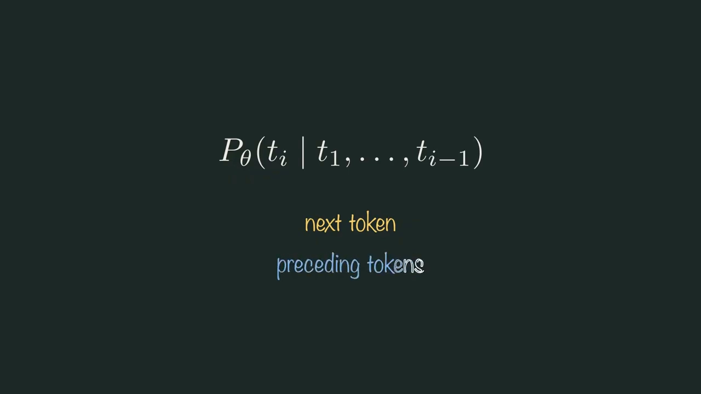

读法是：在参数 $\theta$ 下，给定前面 $t_1$ 到 $t_{i-1}$ 这些 token，模型给第 $i$ 个位置的 token $t_i$ 分配了多少概率。三个符号各司其职：

- $t_i$：第 $i$ 个位置上的 token（要预测的那个）；
- $t_1, \dots, t_{i-1}$：它前面的所有 token，叫**前缀**（prefix）或上下文；
- $\theta$：模型的可学习参数，也就是全部权重。

注意这个式子是针对 **token ID** 的，不是针对英文单词的。如果分词器把一个词拆成几块，模型就一块一块地预测。

### 1.3 从上下文到概率：logits 与 softmax

要得到一个覆盖整个词表的分布，模型走的是和分类任务一样的三步 [【跳转到 02:05】](https://www.youtube.com/watch?v=r5RbHv3CIxw&t=125)：

1. **上下文表示**：当前位置的内部表示，概括了它能用到的上下文；
2. **输出层**：把表示映射成词表里每个 token 的分数，叫 **logit**（未归一化的得分）；
3. **softmax**：把 logits 转成加起来为 1 的下一 token 概率。

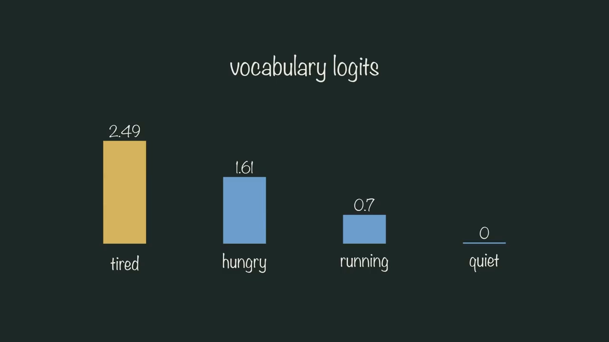

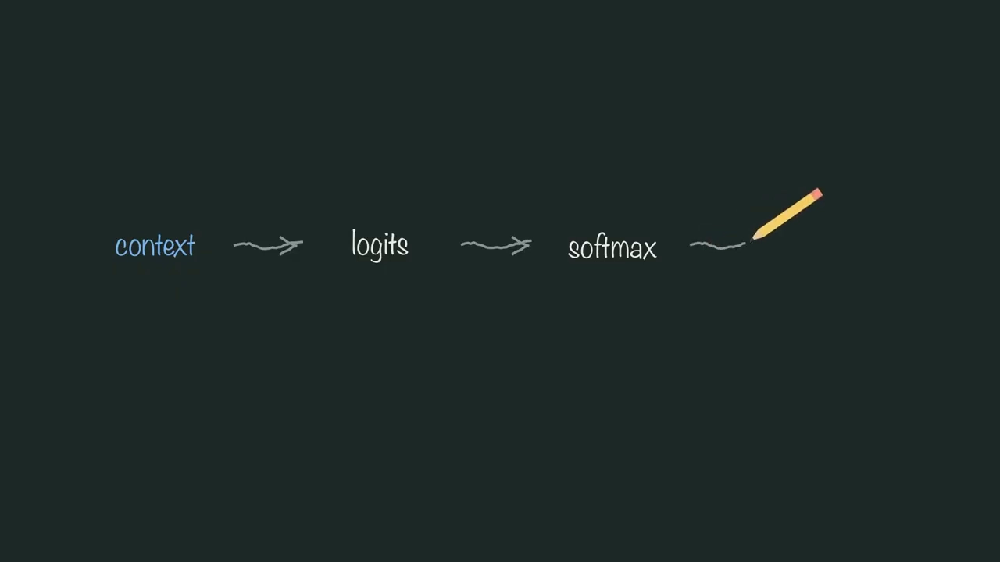

视频强调了一个容易混淆的点：softmax 在分类任务里出现过，在注意力里也出现过，但**含义完全不同**。分类任务的 softmax 是在"猫 vs 狗"这类类别上归一化；注意力的 softmax 是在"从哪些位置取多少信息"上归一化；而这里的 softmax 是在**整个词表**上归一化，得到的每个数字都读作"下一个 token 是它的概率"。

## 二、每个位置一份损失：交叉熵只惩罚正确答案

### 2.1 观测到的那个 token 决定损失

有了分布，接下来要问：怎么衡量这个分布好不好？训练集给了我们一个事实——实际出现的下一个 token 是 `tired`。于是损失就是这个位置对 `tired` 分配的**负对数概率** [【跳转到 02:55】](https://www.youtube.com/watch?v=r5RbHv3CIxw&t=175)：

$$
\ell_i = -\log P_\theta(t_i \mid t_1, \dots, t_{i-1})
$$

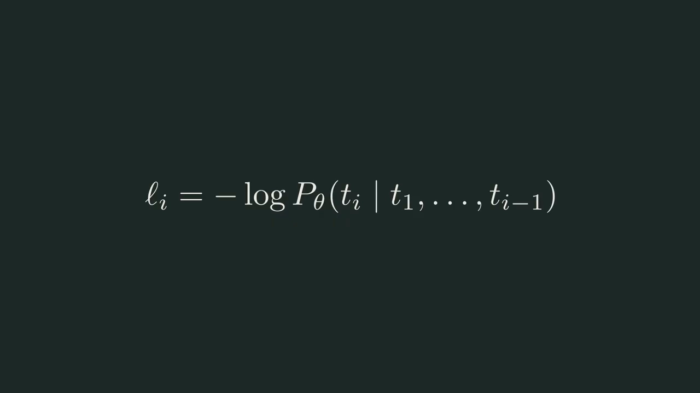

这就是**交叉熵**（cross-entropy）在这个场景下的具体形态。它的行为很直观：

- 如果模型给 `tired` 的概率很高（比如 0.9），$-\log 0.9 \approx 0.11$，损失很小；
- 如果模型给 `tired` 的概率很低（比如 0.01），$-\log 0.01 \approx 4.6$，损失很大。

其他续写仍然可以是合理的，但**这一次训练样本只把实际出现的那个续写当作目标**。这一点很重要：交叉熵不是要求模型否认其他可能性，而是要求它别把概率从真实发生的事件上挪走。

### 2.2 平均起来，就是负对数似然

一段序列有很多位置，把每个位置的损失加起来除以位置数 [【跳转到 03:20】](https://www.youtube.com/watch?v=r5RbHv3CIxw&t=200)：

$$
L(\theta) = -\frac{1}{T}\sum_{i=1}^{T} \log P_\theta(t_i \mid t_1, \dots, t_{i-1})
$$

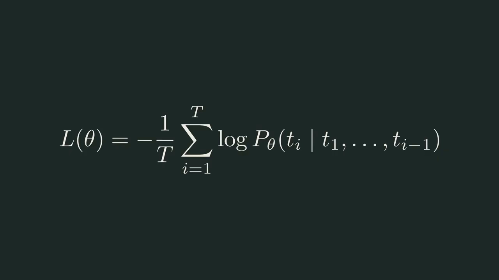

三个细节值得留意：

- $T$ 是被评估的目标 token 个数；
- 第一个位置没有前缀，通常用一个特殊符号（如 BOS，begin of sequence）或其它初始上下文顶上；
- 真实训练中还要处理序列边界，以及那些**应该被排除出损失的位置**（例如填充位）。

别让求和号掩盖了正在发生的事：我们只是在很多位置上分别问"下一个观测 token 是什么"，然后平均一下模型给正确答案分配了多少概率。

### 2.3 链式法则：把整句概率拆成一串条件概率

到目前为止只谈了单个位置。整句的概率怎么办？视频给出概率论里的恒等式 [【跳转到 06:15】](https://www.youtube.com/watch?v=r5RbHv3CIxw&t=375)：

$$
P(t_1, t_2, \dots, t_T) = \prod_{i=1}^{T} P(t_i \mid t_1, \dots, t_{i-1})
$$

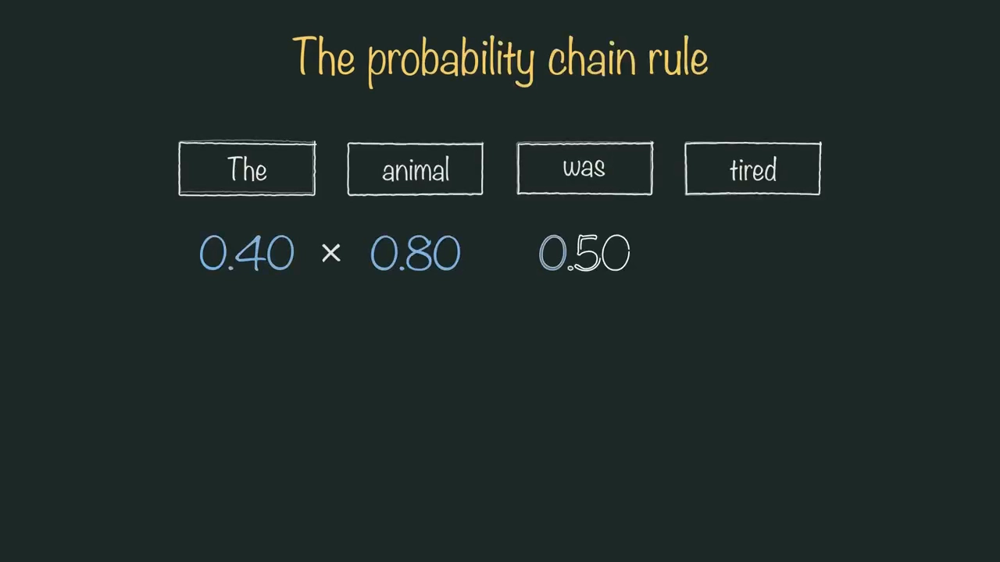

这就是**概率链式法则**（probability chain rule）。视频专门提醒：它**不是**反向传播里那个"导数的链式法则"，两者只是名字撞车。它说的是：一整段序列的概率，可以表达成"反复追问每个下一个 token 在前缀条件下有多大概率"。

有了它，负对数就变得非常自然——**对数把连乘变成连加**：

$$
-\log P(t_1,\dots,t_T) = -\sum_{i=1}^{T}\log P(t_i \mid t_1,\dots,t_{i-1})
$$

所以"最小化平均 next-token 交叉熵"和"最大化模型给观测到的训练文本分配的概率"是同一件事，只是写法不同。这也解释了为什么自回归目标能叫"最大似然训练"：它优化的就是数据在模型下的似然。

## 三、一份序列多个目标：shift-by-one 与 teacher forcing

### 3.1 错开一格，一次拿到好几个训练样本

一个自然的疑问是：难道要把 `The` 喂进去、更新权重，再喂 `The animal`、再更新一次，把每个前缀都跑一遍？视频的回答是不必 [【跳转到 04:10】](https://www.youtube.com/watch?v=r5RbHv3CIxw&t=250)。

做法是把同一条序列**整体右移一格**当作目标：

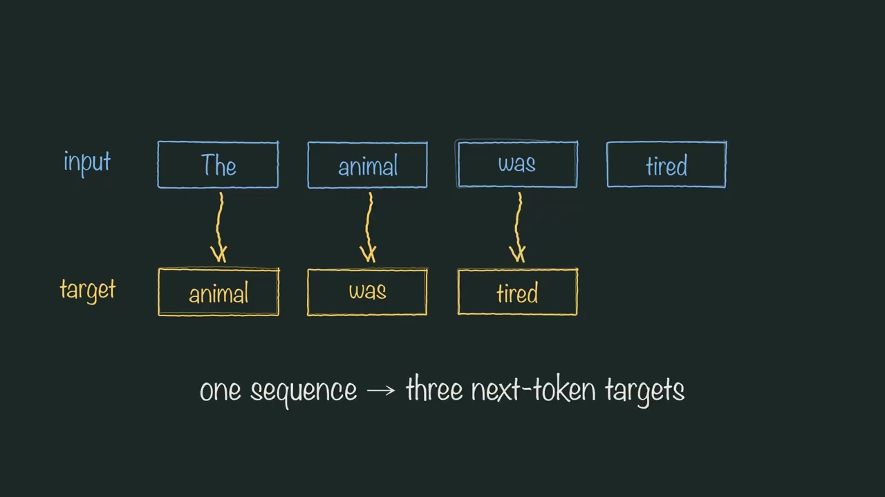

| 输入（前缀） | 目标（下一个 token） |
| :--- | :--- |
| The | animal |
| The animal | was |
| The animal was | tired |

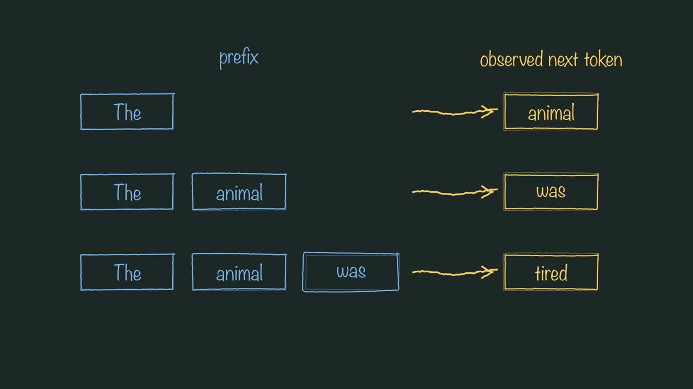

一条四 token 的句子，就产出了三个 next-token 训练目标。在 Transformer 里，这些位置**可以放在一起算**——前提是模型不被允许在预测靠前的位置时偷看后面的 token。

### 3.2 teacher forcing：上下文永远来自真实数据

这种训练方式有个专门的名字：**teacher forcing**（教师强制）。含义是：训练时喂给模型的上下文，来自数据里**实际观测到的**序列，而不是模型自己上一步生成的 token [【跳转到 05:00】](https://www.youtube.com/watch?v=r5RbHv3CIxw&t=300)。

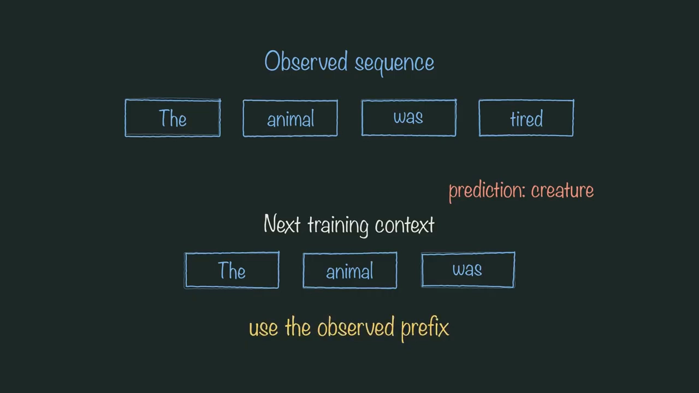

这个区别为什么重要？视频给了个具体场景：假设模型在 `The animal was` 之后猜成了 `creature`。如果把它自己的输出接回去当上下文，后面所有位置的上下文都被这一个错误污染了；而 teacher forcing 下，下一个训练上下文依旧是真实的 `The animal was`，错误不会顺着时间步传播。

### 3.3 为什么不许看未来：因果访问

再往下问一层：既然位置能并行算，会不会不小心让"预测 `tired` 的那个位置"读到了 `tired` 本身？视频把这个假设摆出来 [【跳转到 05:25】](https://www.youtube.com/watch?v=r5RbHv3CIxw&t=325)：如果真让这个位置看到答案或更后面的 token，模型完全可以用一个在生成时根本不存在的捷径，把训练损失刷得很漂亮。

所以自回归语言模型里有一条硬约束——**因果访问**（causal access）：

- 在 RNN 里，这条约束是**天然**的：状态按时间步从左往右更新，物理上不可能读到未来；
- 在 Transformer 里，所有位置一起算，就必须有一条**显式规则**阻止注意力把未来位置的信息泄露给当前位置。

这条规则的具体实现就是因果掩码（causal mask）。本节只需记住它的**目的**：保证"每个位置的预测只依赖它的合法前缀"，从而让并行计算和逐步生成在语义上等价。

## 四、训练一次前向，生成一步一个

### 4.1 训练与生成是两种模式

视频把两者的差别讲得很清楚 [【跳转到 08:20】](https://www.youtube.com/watch?v=r5RbHv3CIxw&t=500)：

- **训练时**：后续内容已经在数据里了，我们要做的是**评估**模型给它分配的概率，然后算损失、反向传播。
- **生成时**：后续内容还没写出来。模型先给出下一个 token 的分布，我们从中**选一个或采一个** token，把它接到上下文后面，再重复。

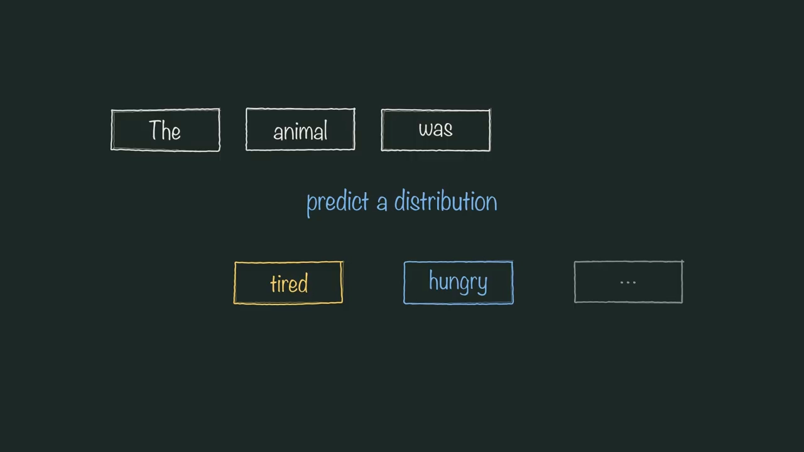

所以文本生成是**自回归**的：每一个新产出的 token 都会成为下一次预测的输入的一部分。这也意味着一个错误会影响后面的一切——如果某个生成的 token 把文本带到了没用的方向，模型的下一步预测就条件在这段新文本上，而不是条件在数据集中某个"正确答案"上。这正是 teacher forcing 与自由运行（free-running）推理之间的落差，通常称为**曝光偏差**（exposure bias）：训练时只见识过真实前缀，推理时却要面对自己造出来的前缀。

### 4.2 为什么训练能并行、生成不能

把两件事放在一起看，因果掩码的价值就出来了：训练时我们手里有完整序列，可以让所有位置同时前向一次，靠掩码保证每个位置只看左边，于是 $T$ 个位置的损失一次算完；生成时没有完整序列，第 $t+1$ 个 token 必须等第 $t$ 个 token 定下来才能算，只能串行。

（推理侧为了不重复计算前缀，通常会把已算过的键值缓存下来复用，这就是 KV cache 的动机；它属于工程优化，不改变"生成必须逐步进行"这一事实。）

## 五、怎么比较两个语言模型：交叉熵与困惑度

### 5.1 困惑度就是平均交叉熵取指数

要在留出文本上比较两个模型谁预测得更好，可以直接报告平均交叉熵；更常见的指标是**困惑度**（perplexity，PPL）[【跳转到 07:30】](https://www.youtube.com/watch?v=r5RbHv3CIxw&t=450)：

$$
\mathrm{PPL} = \exp\left(L(\theta)\right)
$$

平均交叉熵越低，困惑度越低。直观理解：困惑度低的模型，在评估数据上**平均而言更少被下一个 token 惊讶到**。若平均交叉熵是 $\ln 10 \approx 2.30$  nat，困惑度就是 10，可以粗略读作"模型每一步平均在 10 个等可能的候选之间犹豫"。

### 5.2 比较困惑度有两个前提

视频特意提醒 [【跳转到 07:55】](https://www.youtube.com/watch?v=r5RbHv3CIxw&t=475)：困惑度的比较要在**可比的数据**和**可比的分词**下进行。因为改变分词方式，就改变了"一次预测"到底预测的是什么——同样的文本，切成更少的 token，每个 token 携带的信息更多，困惑度自然会变。跨分词器直接比 PPL 是没有意义的。

### 5.3 低损失不等于"说真话"

这一节是全文最需要克制的地方。视频明确区分了两件事 [【跳转到 07:05】](https://www.youtube.com/watch?v=r5RbHv3CIxw&t=425)：

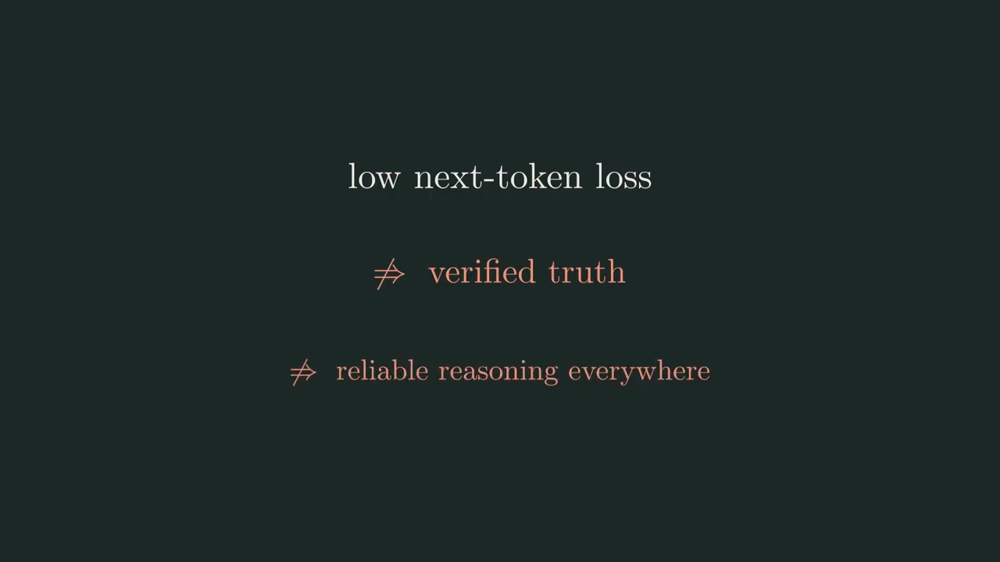

- 从目标函数看，模型被奖励的是"把文本上的预测做得更准"。为了做到这一点，它**可能**需要学会语法规律、词语用法、数据中频繁出现的事实、以及观点之间的关系——这些能力是因为"有助于预测"才涌现的。
- 但目标函数**并不独立验证**生成陈述的真假；低 next-token 损失也**不自动意味着**强推理能力或在所有真实场景下都可靠。

用一句话概括：我们定义的是一个**预测任务**，而不是给模型出了一份"人类理解力"的考卷。

## 六、语言模型是目标，不是架构

最后视频做了一个概念上的切分 [【跳转到 09:10】](https://www.youtube.com/watch?v=r5RbHv3CIxw&t=550)：语言建模是一种**训练目标**，不是某一种特定架构。

- **n-gram 模型**：用固定窗口内的前几个 token 估计下一个 token 的概率；
- **RNN**：用循环隐状态携带前缀信息；
- **基于注意力的网络**：用上下文化表示来处理前缀。

三者的差别在于**如何表示和处理前缀**，但它们都可以被训练或估计成"预测下一个是什么"。这也解释了为什么不该把"语言模型"和"Transformer"当成同义词：很多现代语言模型用 Transformer，但 Transformer 是架构，next-token prediction 只是可以用来训练它的一种目标。

视频用一张三段式收尾：**表示**说明什么进入模型，**架构**说明信息如何被处理，**目标**说明模型被训练去预测什么。三者分清，后面组装完整 Transformer 时才不会把概念搅在一起。

## 小结

- 自回归语言模型的监督信号来自文本自身：每个位置的下一个观测 token 就是该位置的标签，不需要人工标注。
- 模型输出的是覆盖整个词表的概率分布（logits 经 softmax），不是唯一确定的下一词。
- 单个位置的损失是负对数概率（交叉熵）；对整段序列取平均，就是负对数似然除以 $T$。
- 概率链式法则把整句概率拆成条件概率连乘，取对数后变成连加，于是"最小化平均交叉熵"= "最大化训练文本的似然"。
- 把序列右移一格即可从一条样本构造多个 next-token 目标；训练时上下文用真实数据（teacher forcing），一次前向并行算所有位置。
- 并行之所以成立，是因为有因果访问约束（因果掩码）挡住未来位置；RNN 靠时间步天然满足，Transformer 必须显式实现。
- 生成时没有真实续写，只能"预测分布 → 取一个 token → 接回上下文 → 重复"，错误会顺着上下文自我强化（曝光偏差）。
- 困惑度 = 平均交叉熵取指数，比较时要求数据与分词可比；低损失不等于真实性，也不等于可靠推理。

## 关键术语速查

| 术语 | 一句话解释 |
| :--- | :--- |
| 自回归（autoregressive） | 用序列自己前面已出现或已生成的内容，预测后面的内容 |
| 条件概率 $P_\theta(t_i \mid t_{<i})$ | 给定前缀时，模型给第 $i$ 个位置各候选 token 分配的概率 |
| logit | softmax 之前的未归一化得分，词表里每个 token 一个 |
| 交叉熵损失 | 只对实际观测到的那个 token 取负对数概率 |
| 概率链式法则 | 整段序列的概率等于逐个条件概率的连乘 |
| shift-by-one | 把输入与目标错开一格，一条序列产出多个 next-token 目标 |
| teacher forcing | 训练时上下文一律取自真实数据，而非模型自己的输出 |
| 因果访问（causal access） | 每个位置的预测只允许使用它的前缀，不许看未来 |
| 曝光偏差（exposure bias） | 训练只见真实前缀、推理却要用自造前缀所造成的落差 |
| 困惑度（PPL） | 平均交叉熵取指数，衡量模型平均被下一个 token 惊讶的程度 |