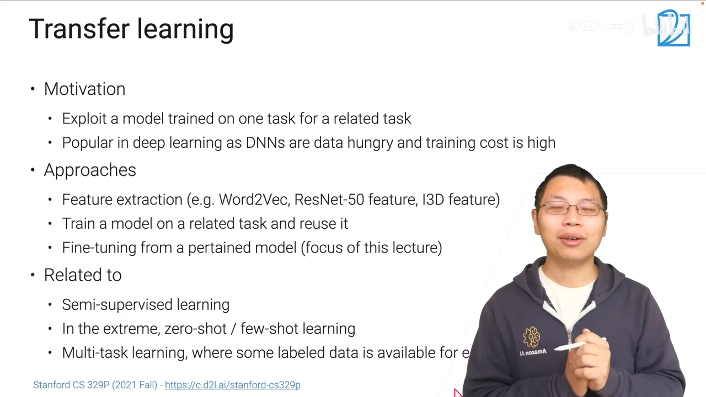
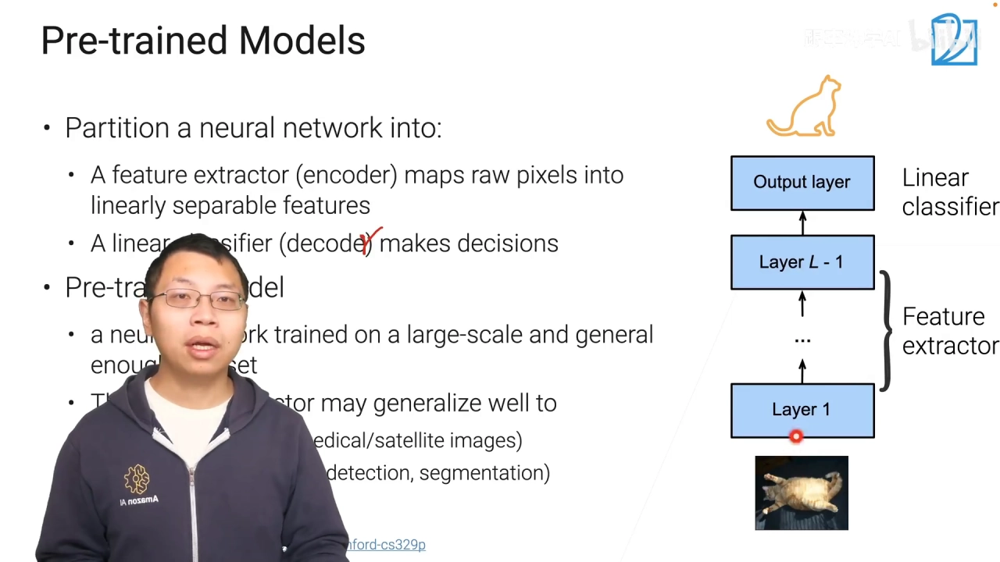
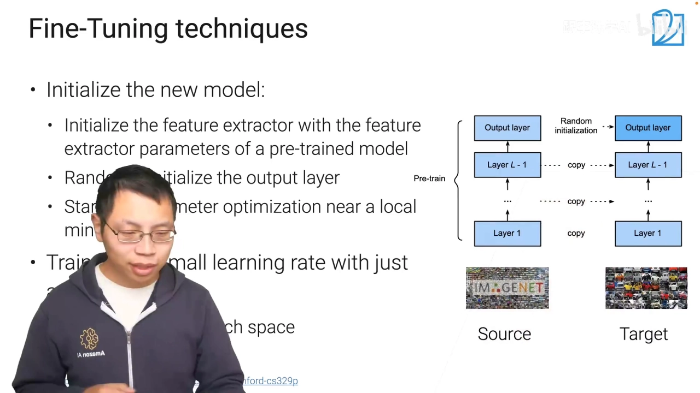
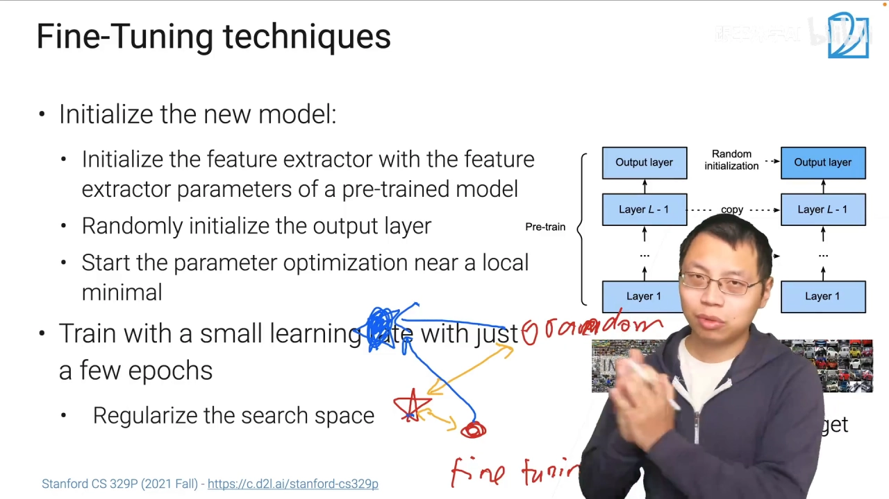
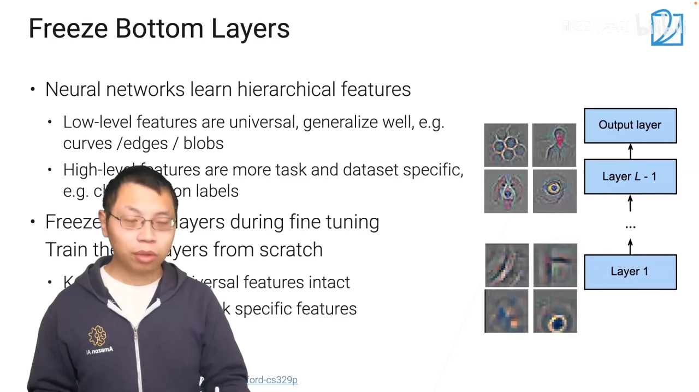
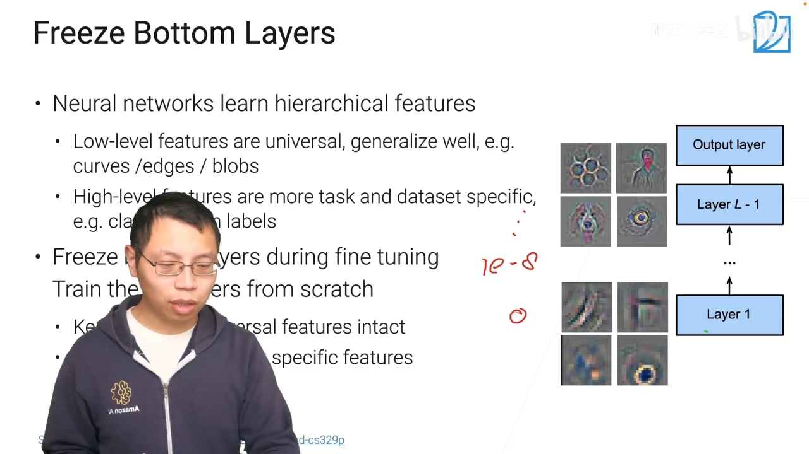
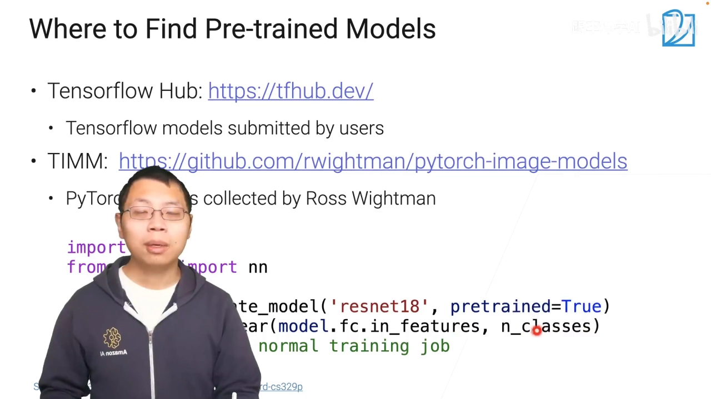
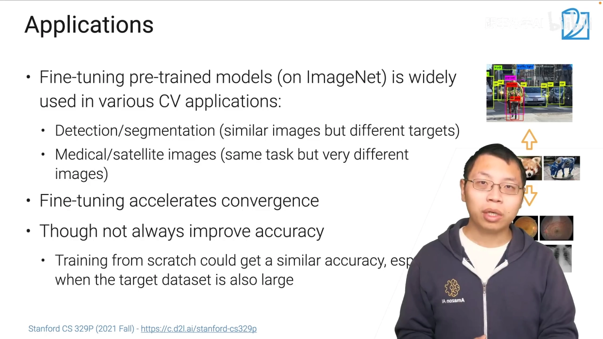

# 迁移学习：冻结底层、微调搜索半径与"迁移增益"从哪来

> 视频来源：[11.1 迁移学习【斯坦福 21 秋季：实用机器学习中文版】](https://www.bilibili.com/video/BV1SL4y1t7ZL/)（Bilibili · 跟李沐学AI）｜时长约 30 分钟
> 导读：李沐这一讲把"预训练 + 微调"拆成可判断的几件事：为什么预训练权重能迁移、微调时为什么要把搜索半径压小、冻结底层的依据是什么、以及迁移到底能不能涨点。本文按"动机 → 编码器/解码器 → 微调初始化 → 限制搜索空间 → 冻结层 → 找模型与 timm 实操 → 迁移增益的边界"整理，最后把"只调最后一层"与线性探针接上。

## 本讲要解决的核心问题（SCQA）

**背景**：深度网络又吃数据又吃算力。一个任务上想从头训一个好模型，往往要几十万到上千万张标注图，和几天到几周的 GPU 时间。

**冲突**：真实业务里的数据集通常只有几万张图、一百来个类，而且标注是一边试一边加的——你不会一开始就砸钱标一个大数据集。数据规模差着一到两个数量级，直接从头训练根本喂不饱模型。

**疑问**：能不能把别人在大数据集上学到的东西搬过来用？如果能，搬哪一部分、怎么搬、搬过来之后到底会不会让结果变好？

**回答（中心思想）**：把网络切成"编码器（特征提取器）+ 解码器（分类头）"两段，**编码器学的是处理像素的通用能力，可以搬；解码器学的是你这个任务的标号空间，必须重学**。微调就是把预训练编码器的权重复制过来当初始值，只把最后一层随机初始化，然后用**小学习率、少轮数**去微调。这样做的收益是确定的：**收敛更快**；精度上的收益则是有条件的：**可能涨点，也可能不涨，但通常不会变差**。 [【跳转到 26:15】](https://www.bilibili.com/video/BV1SL4y1t7ZL/?t=1575)

---

## 一、迁移学习的三种途径，以及它和几个"近亲"的区别

视频开篇把动机说得很直白：我们希望在一个任务上学一个模型，然后拿它去解决一个相关的别的任务，这样"在一个地方花的时间、学到的知识，以及研究出的方法，可以很容易地在另外一个地方被用到" [【跳转到 00:00】](https://www.bilibili.com/video/BV1SL4y1t7ZL/?t=0)。迁移学习真正出圈是在深度学习，因为深层网络对数据和算力的胃口太大，很难对每个任务都配一个大数据集。

具体途径有三种 [【跳转到 01:02】](https://www.bilibili.com/video/BV1SL4y1t7ZL/?t=62)：

1. **把模型做成特征抽取模块**。最经典的例子是 word2vec（2013 年的工作）：在一个文本语料上训练一个基本可视为单层的网络，用对比学习的方式学词向量；训练好之后每个词得到一个特征，这个特征可以拿去干别的事。同样的道理，训练好的 ResNet 可以对图片抽特征，抽出来的特征作为另一个模型的输入——这就替代掉了人工设计特征（如 I3D 用于视频特征）的步骤。
2. **在相关任务上训练一个模型，直接在另一个任务上用它**。这一路线最近因为 GPT 系列变得更流行。
3. **微调（fine-tuning）**：训练好一个模型，在新的任务上对它做一点点调整，让它更好地适配新任务。

本讲的主题是第三种。视频还顺带划清了几个相邻概念 [【跳转到 02:42】](https://www.bilibili.com/video/BV1SL4y1t7ZL/?t=162)：

- **半监督学习**：有一部分数据没有标号，怎么用这些无标号数据去帮助有标号数据；
- **zero-shot / few-shot**：极端情况下，新任务一个样本都不给（zero-shot），或者只给三张照片就要求你下次认出来（few-shot）；
- **多任务学习**：每个任务都有自己的数据、都不太够，但任务之间相关，就把所有数据放一起同时训多个任务，希望每个任务从别的任务那里获益。



### 1.1 为什么"数据不够"是常态

李沐用三个数据集把规模差距摆出来 [【跳转到 04:51】](https://www.bilibili.com/video/BV1SL4y1t7ZL/?t=291)：

- **ImageNet**：120 万张图片、1000 类（它还有一个更大的版本，约 1000 万张、10 万类，但一般用的是清理好的那个）；
- **MNIST**：30 年前的数据集，6 万张样本、10 类，图片很简单；
- **你自己的业务数据集**：大概 100 个类、5 万张图片，每个类几百到几千张。

为什么图片分类的数据集特别多？因为这个任务最好标：一张图看一眼、标一下主要物体是什么，几分钱一张，所以公司能标到千万甚至上亿级别 [【跳转到 04:01】](https://www.bilibili.com/video/BV1SL4y1t7ZL/?t=241)。

但业务侧不会这么干。正常的节奏是：先花一点力气弄一点数据，赶紧看模型效果，好就再投入——**标注是一个迭代过程，你希望一开始能快速迭代** [【跳转到 06:21】](https://www.bilibili.com/video/BV1SL4y1t7ZL/?t=381)。所以你的数据集天然比 ImageNet 小一到两个数量级，而你要做的事情就是：利用别人已经标好的、比你大 10 到 100 倍的数据集，把学到的东西迁移过来。

---

## 二、把网络切成两段：编码器与解码器

迁移之所以可能，前提是网络里有一部分东西是"通用的"。视频给了一个很干净的切法 [【跳转到 07:02】](https://www.bilibili.com/video/BV1SL4y1t7ZL/?t=422)：

- **编码器（encoder）= 特征提取器**：把原始像素转换成"在语义空间里可以线性可分"的特征，也叫语义特征表示。
- **解码器（decoder）**：拿到特征之后做决策。它通常很简单，很可能就是一个**线性分类器**，把编码器的表示直接映射成你要的标号。

这个切法在 ResNet 上非常具体：除了最后一层之外的所有卷积层算编码器，最后一层（输出层）算解码器——它把一个比如长 1024 的向量直接线性投影到标号空间。当然，"把后面几层都叫 decoder、前面几层叫 encoder"也完全可以，这只是一个抽象上的划分，怎么划都没关系 [【跳转到 08:38】](https://www.bilibili.com/video/BV1SL4y1t7ZL/?t=518)。



### 2.1 预训练模型为什么能迁移

**预训练模型**的定义是：在一个大规模、足够通用的数据集上训练好的神经网络。因为它见得多，所以有一定的泛化能力——放到别的任务、别的数据集上，多多少少能帮忙 [【跳转到 09:08】](https://www.bilibili.com/video/BV1SL4y1t7ZL/?t=548)。

为什么能帮忙？李沐的解释落在了"底层学的是什么"上 [【跳转到 09:29】](https://www.bilibili.com/video/BV1SL4y1t7ZL/?t=569)：

> 虽然最后你的数据可能不会对分类猫感兴趣，但是在底下那些层，多多少少学会了怎么样有效地处理这些像素的信息。

所以哪怕你的数据是医学影像、是卫星图片，跟 ImageNet 里网上搜来的猫猫狗狗长得很不一样，"我在 ImageNet 上训练的那个神经网络，它的特征提取器也能对这样子不同的图片做出还 OK 的特征提取，总比你从随机开始比较好"。

这个论证还可以再往前一步：虽然预训练做的是图片分类，但换到别的任务——比如在图片里找物体及其位置（检测），或者对每个像素给标号（分割）——模型也能帮上忙 [【跳转到 10:19】](https://www.bilibili.com/video/BV1SL4y1t7ZL/?t=619)。

顺带一个命名上的澄清：在大训练集上训练好的模型叫 **pre-train model**。pre-train 指的是"在我训练我的任务之前，先在别的任务上训练好一个模型"；而 `train` 指的是你真正关心的那个任务（医学图片、卫星图片、目标检测）。那个提前训练好的模型就放在那里，专门用来做知识转移，所以叫预训练模型 [【跳转到 10:44】](https://www.bilibili.com/video/BV1SL4y1t7ZL/?t=644)。

---

## 三、微调：复制权重，只把最后一层随机初始化

微调的第一步是"造一个和预训练模型同架构的新模型" [【跳转到 11:39】](https://www.bilibili.com/video/BV1SL4y1t7ZL/?t=699)。比如你在 ImageNet 上有预训练好的 ResNet50，新任务上也用一个 ResNet50。如果觉得数据太小、ResNet50 太大，可以用 ResNet34——但这时你得先确认这个架构上有没有人放出过好的预训练权重，这就得去模型仓库翻一翻 [【跳转到 12:04】](https://www.bilibili.com/video/BV1SL4y1t7ZL/?t=724)。

第二步是初始化，规则只有两条 [【跳转到 12:29】](https://www.bilibili.com/video/BV1SL4y1t7ZL/?t=749)：

- **特征提取器（除最后一层外的所有卷积层和全连接层）**：权重不用随机，直接把预训练模型的权重复制过来；
- **最后一层（解码器）**：随机初始化。

为什么最后一层要重学？因为**你的任务标号和预训练任务的标号空间可能不一样**，那些"告诉你怎么做决策、怎么划线"的权重对你没用 [【跳转到 12:54】](https://www.bilibili.com/video/BV1SL4y1t7ZL/?t=774)。



这样构建好之后，新模型"整个下面这一块就已经能够提取还不错的特征了"。你要学的主要是上面最后一层怎么做决策；同时根据误差，下面那一块也会被**稍微**调整，让它更符合你的图片信息。因为整个网络都允许调，所以哪怕你的图片跟 ImageNet 很不一样也没关系——"反正我可以学" [【跳转到 14:14】](https://www.bilibili.com/video/BV1SL4y1t7ZL/?t=854)。

---

## 四、微调的关键不是"调"，而是"别调太远"

初始化好之后，训练流程跟正常训练没有区别。但视频强调了一个"一点点做法" [【跳转到 14:33】](https://www.bilibili.com/video/BV1SL4y1t7ZL/?t=873)：因为初始结果已经比较好了，你已经站在**最终解的附近**，所以训练时**不要走太远**。

李沐画了一张草图来说明 [【跳转到 14:58】](https://www.bilibili.com/video/BV1SL4y1t7ZL/?t=898)：假设红点是你要到达的目标，随机初始化在很远的地方（蓝色那团），而微调的初始化已经落在目标附近。随机初始化时你怎么走都行，因为反正离得远；但当你已经在附近时，就要**限制搜索半径**，否则优化器会跑到别处去。



具体两个手段 [【跳转到 15:23】](https://www.bilibili.com/video/BV1SL4y1t7ZL/?t=923)：

- **小学习率**：正常比如用 0.1，微调时用 1e-3（0.001）或者更小；
- **少轮数**：以前 ImageNet 训练要扫 200 遍数据，微调扫 10 遍、甚至 5 遍就够了。

### 4.1 为什么必须限制：训练误差低不等于泛化好

如果不做任何限制会怎样？李沐的推演是 [【跳转到 16:13】](https://www.bilibili.com/video/BV1SL4y1t7ZL/?t=973)：对一个优化算法来说，随机初始化也好、从预训练权重复制也好，只要你给足够长的时间、优化做得足够好、完全收敛，**最后都会走到同一个地方**。而那个地方很多时候不是你想要的。

原因在于泛化误差和训练误差不是一回事 [【跳转到 17:03】](https://www.bilibili.com/video/BV1SL4y1t7ZL/?t=1023)：数据集不大、模型够复杂时，模型能记住整个训练集。不做限制，它就会跑到训练误差最低的那个点，但泛化不一定好；反而停在"还没完全拟合、但保留着在大数据集上学到的泛化性"的那个点，泛化可能更好。

所以微调的本质是**在"完全拟合你的数据"和"多多少少保留预训练模型的泛化性"之间做一个权衡** [【跳转到 17:28】](https://www.bilibili.com/video/BV1SL4y1t7ZL/?t=1048)。这也解释了"微调"这个名字：不要在最后这一块改太多，改太多 pre-train 的模型就没意义了；但最后一层还是要从头学 [【跳转到 17:53】](https://www.bilibili.com/video/BV1SL4y1t7ZL/?t=1073)。

---

## 五、冻结底层：因为底层特征更通用

限制搜索空间的第二个办法，是**把最底层的那些层固定住**。依据是神经网络的层次化特征学习 [【跳转到 18:14】](https://www.bilibili.com/video/BV1SL4y1t7ZL/?t=1094)：

- **底层**学到的是比较底层的特征表示——一个圆圈、一条颜色的边、一小块纹理。这些东西跟你上面要分什么类没太多关系，但**换一个新数据集，它们的泛化性非常好**：不管什么物体，你都得理解这些纹理是什么形状、什么颜色、什么意思 [【跳转到 18:55】](https://www.bilibili.com/video/BV1SL4y1t7ZL/?t=1135)。
- **上层**越往上越像你的标号语义空间靠近。如果你的标号里很多狗、很多人，上层就会专门学到这些东西。所以上层更跟你的语义相关 [【跳转到 19:20】](https://www.bilibili.com/video/BV1SL4y1t7ZL/?t=1160)。



### 5.1 实现方式：把学习率置 0

冻结在代码里就是"学习率等于 0"。视频给了一个**分层学习率**的例子 [【跳转到 20:10】](https://www.bilibili.com/video/BV1SL4y1t7ZL/?t=1210)：

| 层 | 学习率 | 含义 |
| --- | --- | --- |
| Layer 1 | 0 | 完全冻结 |
| Layer 2 | 1e-8 | 几乎不动 |
| … | 1e-6 | 轻微调整 |
| 最后一层 | 1e-1 | 随机初始化，正常学 |

李沐说"很多时候我们也不会那么麻烦"，最常见的做法是：下面几层学习率 0，中间几层 1e-3，最后一层 1e-1 [【跳转到 20:35】](https://www.bilibili.com/video/BV1SL4y1t7ZL/?t=1235)。



### 5.2 冻结几层，取决于你的任务离预训练有多远

这是本讲最实用的判断规则 [【跳转到 21:00】](https://www.bilibili.com/video/BV1SL4y1t7ZL/?t=1260)：

- 你的应用跟预训练模型**差得比较大** → 最好多调、多训练一些层；
- 差得不远 → 固定住更多层就可以；
- **极端情况**：把所有下面的层都固定住，只调最后一层，也是 OK 的。

而且"固定一些层"通常还能让训练更快一点 [【跳转到 21:25】](https://www.bilibili.com/video/BV1SL4y1t7ZL/?t=1285)。

> 这里正好和线性探针接上：**"冻结全部底层、只训最后一层线性分类器"就是线性探针（linear probe）**。区别只在目的——微调时这么做是为了省算力、防止过拟合；评估表征时这么做是为了把"分类器有多强"这个变量控制住，让分数只反映冻结特征的好坏。同一个操作，两种用法。

---

## 六、找到合适的预训练模型：TFHub 与 timm

微调里"最重要的一点"其实是**找到合适的预训练模型** [【跳转到 21:44】](https://www.bilibili.com/video/BV1SL4y1t7ZL/?t=1304)。找的时候要问两件事：

1. **有没有这个架构的预训练权重？** 比如你的场景要求低延迟、甚至要部署到手机上，那你想用 MobileNet，就得先确认 MobileNet 有没有人放出预训练权重。
2. **它是在什么数据集上预训练的？** ImageNet 上预训练的，还是别的数据集上的。

去哪找：各种 Model Hub、Model Zoo。视频点了两个 [【跳转到 22:09】](https://www.bilibili.com/video/BV1SL4y1t7ZL/?t=1329)：

- **TensorFlow Hub**：允许大家提交模型，上面有几百个模型；
- **timm**：Ross Wightman 维护的 PyTorch 图像模型集合，把 PyTorch 上能找到的各种实现都收进来、整理好，文档写得不错。李沐的评价是"模型的性能我觉得一般般，但因为很多人在用，未来质量会越来越高" [【跳转到 22:59】](https://www.bilibili.com/video/BV1SL4y1t7ZL/?t=1379)。

用起来就三步 [【跳转到 23:24】](https://www.bilibili.com/video/BV1SL4y1t7ZL/?t=1404)：

```python
import timm
from torch import nn

model = timm.create_model('resnet18', pretrained=True)
model.fc = nn.Linear(model.fc.in_features, n_classes)
# 之后就是一个正常的训练 job
```

- `pretrained=True`：不仅把模型结构拿下来，还下载它在 ImageNet 上预训练好的权重 [【跳转到 23:41】](https://www.bilibili.com/video/BV1SL4y1t7ZL/?t=1421)；
- 换掉 `fc`：把最后的全连接层换成一个新的线性层，`in_features` 由模型架构给出，`n_classes` 是你的类别数；
- 新 `fc` 默认是 PyTorch 的随机初始化，其余权重都来自预训练 [【跳转到 24:29】](https://www.bilibili.com/video/BV1SL4y1t7ZL/?t=1469)。

拿到之后按正常流程训练即可，最多是学习率调低一点、少 train 几个 epoch，或者把某些层的学习率改成 0 来固定权重 [【跳转到 24:54】](https://www.bilibili.com/video/BV1SL4y1t7ZL/?t=1494)。



---

## 七、迁移增益：加速收敛几乎必然，涨点不一定

最后是"到底值不值"的问题。视频给的应用场景是 [【跳转到 25:31】](https://www.bilibili.com/video/BV1SL4y1t7ZL/?t=1531)：

- **任务不同、图片相似**：预训练做猫狗分类，现在做检测/分割，图片还是相机拍的，但要识别里面的人、车和它们的位置；
- **任务相同、图片很不一样**：还是分类，但图片换成视网膜图像、X 光片——变黑白了、纹理也不一样了，但大家发现效果也不差。

结论分三层 [【跳转到 26:15】](https://www.bilibili.com/video/BV1SL4y1t7ZL/?t=1575)：

**第一层：微调加速收敛，这一点是稳的。** 因为微调让初始点不再随机，而是靠近最终目标。越靠近目标，损失曲面越平滑，训练越简单；随机初始化则可能落在很远的地方，损失抖动、梯度一会大一会小，训练更难。所以"之前要扫 100 轮才能得到好精度，现在扫几轮就行了"。

**第二层：精度可能涨，也可能不涨。** 如果预训练数据集和你的数据集比较像，把权重拿过来微调，精度会比你只用自己的数据训练更好——因为大数据上学到的模式识别能力对你有帮助。比如自己从头训练 80%，用 ImageNet 预训练模型能做到 82%、83% [【跳转到 27:05】](https://www.bilibili.com/video/BV1SL4y1t7ZL/?t=1625)。但这**不是永远能保证的**：有时候从自己的数据从头训练、权重全部随机初始化，也能得到相似的精度，特别是你的数据集也很大时，"这个地方不会帮助你太多" [【跳转到 27:55】](https://www.bilibili.com/video/BV1SL4y1t7ZL/?t=1675)。

**第三层：但通常不会变差。** 因为微调改变的只是一个初始值：初始值不好，等价于不差于随机初始化；只要走得足够远，你也能摆脱初始值的影响。而它总是比随机那个点稍微好一点点，所以收敛总是更快 [【跳转到 28:20】](https://www.bilibili.com/video/BV1SL4y1t7ZL/?t=1700)。

于是就有了那句总结：**最好的情况是收敛变快、精度更高；最坏的情况是精度不变、收敛还是变快。所以 why not** [【跳转到 28:45】](https://www.bilibili.com/video/BV1SL4y1t7ZL/?t=1725)。



### 7.1 怎么把"迁移增益"读成一个评估指标

把这一讲的内容反过来用，就得到一个评价表征的框架：

- **固定协议**：同一套下游数据、同一个微调配方（学习率、轮数、冻结几层），只换预训练权重；
- **看两个量**：收敛到目标精度所需的 epoch 数（省了多少），和最终精度（涨了多少点）；
- **必须报"不涨"的情况**：如果目标数据集本身很大，从头训练也能到相似精度，那这次迁移的增益就主要体现在省时间上，而不是精度上。

这也解释了为什么"迁移增益"不能只看一个百分数：它同时是**表征质量**和**目标数据集规模**的函数。数据集越大，预训练能提供的边际收益越小。

---

## 小结

- 迁移学习有三种途径：把模型当特征抽取器、复用相关任务的模型、微调。本讲讲的是微调。
- 网络可以切成**编码器（特征提取器）+ 解码器（分类头）**：编码器学通用像素处理能力，可迁移；解码器贴着标号空间，必须重学。
- 微调的初始化规则：除最后一层外全部复制预训练权重，最后一层随机初始化。
- 微调的核心不是"调"，而是**限制搜索半径**：小学习率（0.1 → 1e-3）、少轮数（200 → 5~10 轮），避免跑到训练误差最低但泛化差的点。
- **冻结底层**的依据是层次化特征：底层边缘/纹理通用，上层语义贴近任务。实现上就是把学习率置 0，也可以做分层学习率。
- 冻结几层看任务差距：差得远就多调几层；差得近就多冻几层；极端情况只调最后一层——这就是线性探针。
- 迁移增益的边界：**加速收敛是稳的，涨点是有条件的，变差通常不会**。

## 关键术语速查

| 术语 | 一句话解释 |
| --- | --- |
| 迁移学习（transfer learning） | 把一个任务上学到的知识用到另一个相关任务上 |
| 预训练模型（pre-trained model） | 在大规模通用数据集上训练好、留作初始化或特征提取器用的模型 |
| 编码器 / 特征提取器 | 把原始像素映射成语义特征的网络部分；迁移时主要复用的就是它 |
| 解码器 / 分类头 | 把特征映射成标号的网络部分；换任务时必须重学 |
| 微调（fine-tuning） | 用预训练权重复制初始化，再以小学习率、少轮数在新任务上继续训练 |
| 搜索空间 / 搜索半径 | 优化过程中参数能走多远；微调用小学习率和少轮数把它压小 |
| 冻结（freeze） | 把某些层的学习率设为 0，训练中不更新它们 |
| 分层学习率 | 对不同层设不同学习率，底层小（甚至为 0）、顶层大 |
| 线性探针（linear probe） | 冻结全部底层、只训练最后一层线性分类器的极端情形；评估表征时用它来固定分类器容量 |
| 迁移增益 | 相比从头训练，使用预训练权重带来的收敛加速与精度提升 |