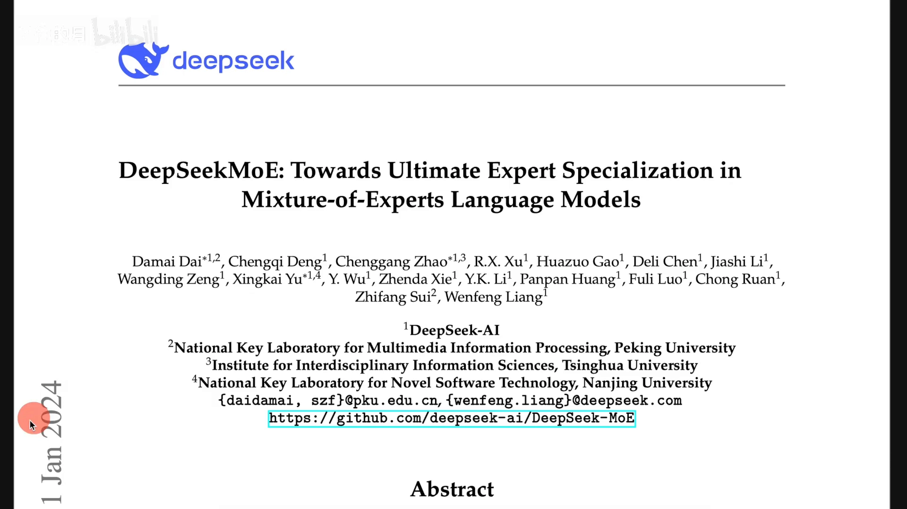
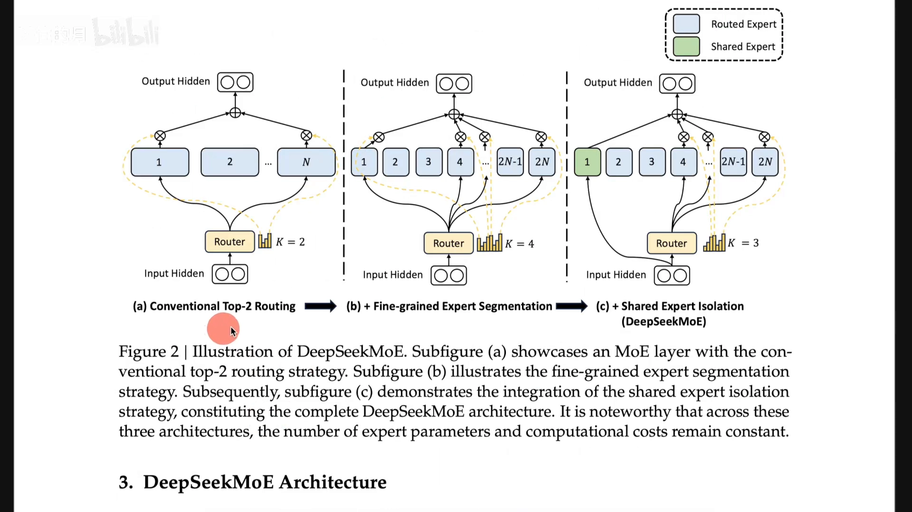
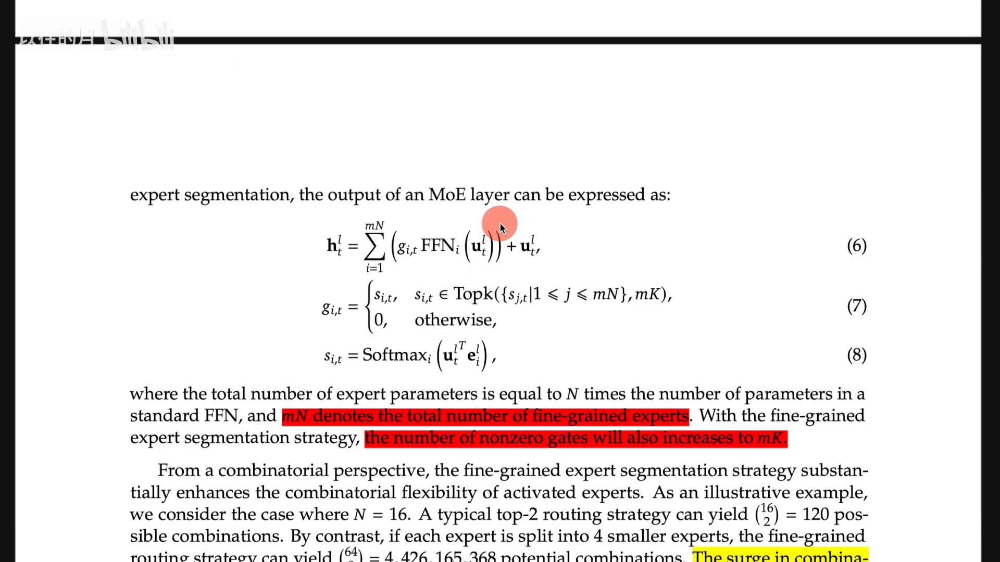
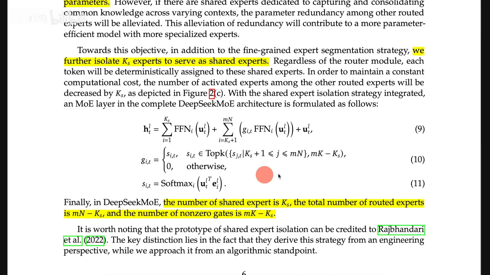
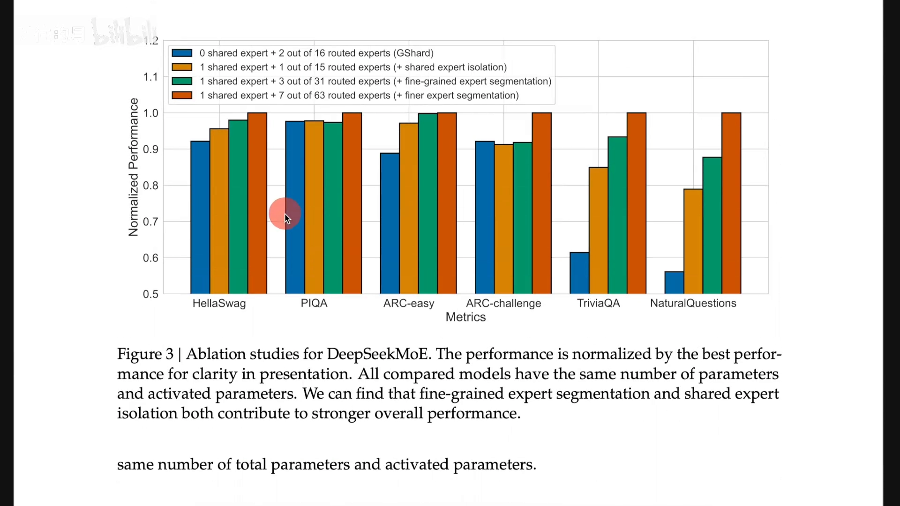
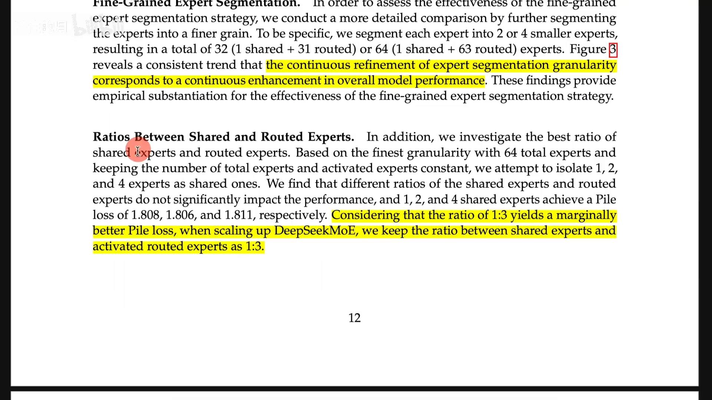
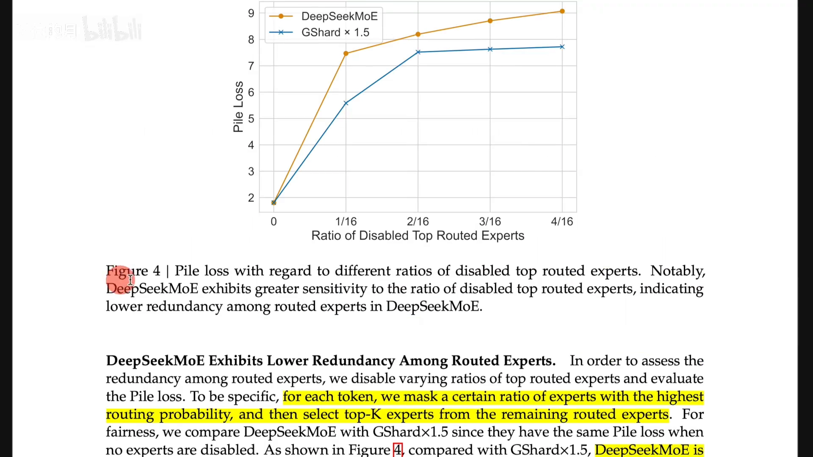
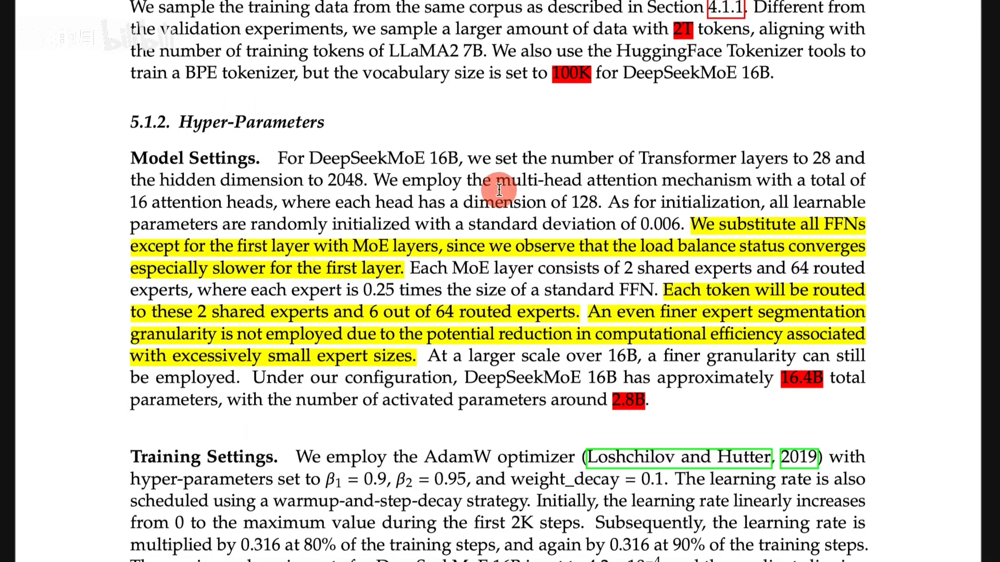
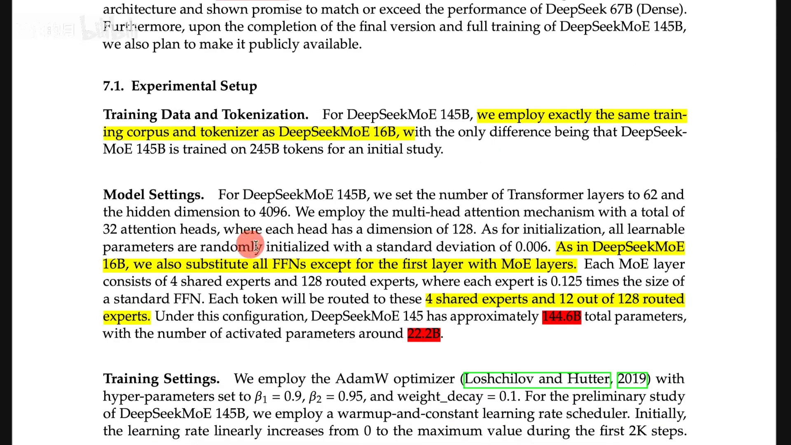

# DeepSeekMoE：细粒度专家切分与共享专家如何消除专家冗余

> 视频来源：[DeepSeek-MoE：细粒度与共享专家的MoE模型](https://www.bilibili.com/video/BV1KtykBgEdm/)（Bilibili · UP 主 以往的月）｜时长约 15 分钟
> 导读：这是一篇按论文顺序逐节精读的分享，覆盖 DeepSeekMoE（arXiv:2401.06066）的动机、两个架构改动、负载均衡、2B 消融实验与 16B/145B 放大结果。字幕里 `deepsik`、`shader expert`、`犀利度`、`奔驰 Mark`、`光量/专项` 等错拼已订正；UP 主把「第一层用 dense」讲在了 2B 上，按幻灯片，这条其实属于 16B/145B 的配置，本文已按原文改正。

## 本讲要解决的核心问题（SCQA）

**背景**：MoE 的最大好处是「在相同算力下使用更多参数」。做法是把一层 FFN 换成 $N$ 个专家，每个 token 只挑其中 $k$ 个。Mixtral 8x7B 就是典型：8 个大专家、每个 token 走 2 个，总参数 47B、激活参数 13B。

**冲突**：专家数量有限时，一个 token 往往要被好几个专家共同处理，于是**同一个专家被迫学习好几种互不相关的知识**；反过来，不同专家为了应付各自的混合输入，又会**重复学习同一批公共知识**。前者让专家不够专精，后者让参数白白浪费。

**疑问**：能不能在**总参数量和激活参数量都不变**的前提下，让每个专家真正只干一件事？

**回答（中心思想）**：DeepSeekMoE 做了两台手术。第一台是**细粒度专家切分**：把每个专家的 FFN 中间维度缩到 $1/m$、专家数扩到 $mN$、激活数扩到 $mK$——参数和算力一点没变，但可组合的专家搭配从 120 种暴涨到 4.4 亿种。第二台是**共享专家隔离**：固定 $K_s$ 个专家对每个 token 始终激活，专门吸收公共知识，剩下的路由专家才能专心做特化。2B 规模上它超过 GShard 2.9B；16B 只用约 40% 算力就超过 LLaMA2 7B；145B 只用 28.5% 算力就超过 DeepSeek 67B。[【跳转到 01:32】](https://www.bilibili.com/video/BV1KtykBgEdm/?t=92)

---

## 一、先看清病根：知识混杂与知识冗余

### 1.1 MoE 的收益与前提

视频开篇先复述论文对 MoE 的定位：**最大的优势是可以在相同算力下使用更多模型参数，从而取得更好的表现**[【跳转到 00:53】](https://www.bilibili.com/video/BV1KtykBgEdm/?t=53)。这句话里藏着一个前提——「相同算力」是靠稀疏激活换来的：参数变多，但每个 token 只算其中一小部分。

### 1.2 两个病：hybridity 与 redundancy

论文指出已有 MoE 架构存在两个问题[【跳转到 01:03】](https://www.bilibili.com/video/BV1KtykBgEdm/?t=63)：

- **Knowledge Hybridity（知识混杂）**：不同专家学到的知识可能重复，导致**每一个专家都得去学好几种不同的知识**。专家数量越少，这个问题越严重——因为知识种类远多于专家个数。
- **Knowledge Redundancy（知识冗余）**：多个专家学到的内容可能一样，于是**专家层面出现冗余**，参数被重复花掉。

这两个病其实是同一个病因的两面：**专家粒度太粗**。一个专家就是一整个标准 FFN，它没有能力「只学一件事」；而在它被迫什么都会的同时，又必然和别的专家在公共知识上撞车。

用 Mixtral 的数字感受一下：8 个专家选 2 个，只有 $\binom{8}{2}=28$ 种组合。模型能表达的「专家搭配」就这么几种，想让每个专家只负责一类知识，几乎不可能。

---

## 二、手术一：细粒度专家切分

### 2.1 思路：让一个 token 走更多、更小的专家

论文的核心判断是：**如果每个 token 能被路由到更多专家，混杂的知识就有机会被拆开、分别由不同专家学习**，而每个专家仍然保持很高的特化程度[【跳转到 04:37】](https://www.bilibili.com/video/BV1KtykBgEdm/?t=277)。

具体做法只有一句话：**把每个专家 FFN 的中间维度缩到原来的 $1/m$，同时把激活的专家个数提高到 $m$ 倍**。这样：

| 量 | 原来 | 切分后 |
| --- | --- | --- |
| 专家总数 | $N$ | $mN$ |
| 激活专家数 | $K$ | $mK$ |
| 单专家 FFN 中间维度 | $d_{ff}$ | $d_{ff}/m$ |
| 总参数量 | — | 不变 |
| 激活参数量 | — | 不变 |

视频把这三条变化讲得很清楚[【跳转到 05:30】](https://www.bilibili.com/video/BV1KtykBgEdm/?t=330)。关键在于最后两行：**总参数和激活参数都没变**，变的只是「这些参数怎么被组合起来」。

### 2.2 公式：从 6 到 8

细粒度切分后的 MoE 层写成：

$$
\mathbf{h}_t^l = \sum_{i=1}^{mN} \left( g_{i,t}\, \operatorname{FFN}_i(\mathbf{u}_t^l) \right) + \mathbf{u}_t^l
$$

$$
g_{i,t} =
\begin{cases}
s_{i,t}, & s_{i,t} \in \operatorname{Topk}\left(\{s_{j,t} \mid 1 \le j \le mN\},\ mK\right) \\
0, & \text{otherwise}
\end{cases}
$$

$$
s_{i,t} = \operatorname{Softmax}_i\left( {\mathbf{u}_t^l}^T \mathbf{e}_i^l \right)
$$

逐项读：

- $\mathbf{u}_t^l$ 是第 $l$ 层第 $t$ 个 token 的输入隐状态；
- $\mathbf{e}_i^l$ 是第 $i$ 个专家的「中心向量」，$\mathbf{u}_t^{lT}\mathbf{e}_i^l$ 就是 router 给这个专家打的分；
- softmax 把打分变成概率 $s_{i,t}$，再取 top-$mK$，其余置零，得到门控 $g_{i,t}$；
- 最后把被选中专家的输出加权求和，再加回残差 $\mathbf{u}_t^l$。

和传统 MoE 相比，公式形状完全一样，只是 $N \to mN$、$K \to mK$。**这就是「零额外 FLOPs」的来源**：切分不改变任何一次矩阵乘法的总规模。

### 2.3 组合空间：从 120 到 4.4 亿

视频专门讲了论文的这个组合学论证[【跳转到 06:00】](https://www.bilibili.com/video/BV1KtykBgEdm/?t=360)：

- 16 个专家选 2 个：$\binom{16}{2}=120$ 种组合；
- 把每个专家切成 4 个更小的专家，变成 64 个专家选 8 个：$\binom{64}{8}=4{,}426{,}165{,}368$ 种组合。

组合数涨了七个数量级，而参数与算力不变。这就是「更灵活、更可适配的专家组合」的定量含义——模型有了足够多的搭配方式，才可能让不同搭配对应不同的知识类型。

---

## 三、手术二：共享专家隔离

### 3.1 动机：公共知识不该被每个专家各学一遍

即使切细了，还有一个问题没解决：**不同专家学到的知识仍然可能重合**，这部分重合就是专家层面的冗余[【跳转到 06:20】](https://www.bilibili.com/video/BV1KtykBgEdm/?t=380)。

论文的思路很直接：既然有一批知识（语法、常识、高频搭配）是**所有上下文都用得上**的公共知识，那就别让路由专家去学它，而是单独划出几个专家**永远激活**，专门负责「捕获并整合跨上下文的公共知识」。公共知识被压缩进这几个共享专家后，路由专家之间的冗余就被缓解了，每个路由专家可以专心做特化。

### 3.2 做法：$K_s$ 个专家永远在线

具体操作：原来一共有 $mN$ 个专家，现在**保留其中 $K_s$ 个，每次路由时都让它们始终激活**；为了保持计算开销不变，路由专家里激活的个数相应减少 $K_s$ 个[【跳转到 06:36】](https://www.bilibili.com/video/BV1KtykBgEdm/?t=396)。

公式从 (6)(7)(8) 变成 (9)(10)(11)：

$$
\mathbf{h}_t^l = \sum_{i=1}^{K_s} \operatorname{FFN}_i(\mathbf{u}_t^l) + \sum_{i=K_s+1}^{mN} \left( g_{i,t}\, \operatorname{FFN}_i(\mathbf{u}_t^l) \right) + \mathbf{u}_t^l
$$

$$
g_{i,t} =
\begin{cases}
s_{i,t}, & s_{i,t} \in \operatorname{Topk}\left(\{s_{j,t} \mid K_s+1 \le j \le mN\},\ mK - K_s\right) \\
0, & \text{otherwise}
\end{cases}
$$

$$
s_{i,t} = \operatorname{Softmax}_i\left( {\mathbf{u}_t^l}^T \mathbf{e}_i^l \right)
$$

对比 (6) 与 (9)，区别只有两处，但这两处就是整个改动的全部：

1. **第一项没有门控**：前 $K_s$ 个专家直接求和，不乘 $g_{i,t}$，因为它们对每个 token 都激活；
2. **第二项的求和从 $K_s+1$ 开始**，且 top-k 的 $k$ 从 $mK$ 变成 $mK-K_s$——路由专家少激活了 $K_s$ 个，总激活量不变。

于是三个计数关系可以背下来[【跳转到 07:16】](https://www.bilibili.com/video/BV1KtykBgEdm/?t=436)：

- 共享专家：$K_s$ 个；
- 路由专家：$mN - K_s$ 个；
- 非零门控（被选中的激活专家）：$mK - K_s$ 个。

### 3.3 一个容易忽略的工程细节：共享专家也是「算力预算」的一部分

很多人第一次看这张图会以为共享专家是「白送」的。不是。共享专家占用了 $K_s$ 个激活名额，所以路由专家必须少激活 $K_s$ 个——**总激活参数不变**。这也是论文反复强调「constant computational cost」的原因：所有对比实验都在同一算力预算下进行，性能提升不能归因于「多算了」。

---

## 四、训练还得管住路由：两层负载均衡

架构改完，训练还有一个坑：router 很容易把 token 都塞给少数几个专家，其余专家饿死。视频讲了论文的两层负载均衡[【跳转到 07:38】](https://www.bilibili.com/video/BV1KtykBgEdm/?t=458)。

### 4.1 专家层面：让每个专家分到的 token 数相等

损失函数和 Switch Transformer 里的 load balancing loss 是同一个思路：对一个 batch，希望每个专家处理的 token 个数相等，即每个专家分到 $B/(mN-K_s)$ 个 token[【跳转到 07:48】](https://www.bilibili.com/video/BV1KtykBgEdm/?t=468)。直观理解：给「扎堆」行为加一点惩罚，把路由分布往均匀方向推。

### 4.2 设备层面：让每张卡上的专家负载相等

模型变大后，专家会被切到不同设备上，这时**通信开销**成了新问题。论文的目标是尽量减少设备之间的通信，做法是让每台设备上承载的专家工作量尽量均衡[【跳转到 08:07】](https://www.bilibili.com/video/BV1KtykBgEdm/?t=487)。

公式和专家层面「基本一样」，区别只在统计口径：这里算的是**设备上承载的专家**的负载，而不是单个专家[【跳转到 08:32】](https://www.bilibili.com/video/BV1KtykBgEdm/?t=512)。

---

## 五、2B 上的证据：消融、特化程度、激活个数

### 5.1 实验设置

2B 验证模型的配置是：9 层 Transformer、隐藏维度 1280、10 个注意力头（每头 128 维）；**专家总参数 = 标准 FFN 的 16 倍，激活参数（含共享专家）= 标准 FFN 的 2 倍**；总参数约 2B，激活参数约 0.3B。具体到专家：1 个共享专家 + 63 个路由专家，每个 token 路由到 7 个路由专家。这个规模的验证实验里**所有 FFN 都换成了 MoE 层**。[【跳转到 08:59】](https://www.bilibili.com/video/BV1KtykBgEdm/?t=539)

训练框架和 DeepSeek LLM 一致，并行策略用 TP、ZeRO、DP 和 PP；因为 2B 模型能放进单卡，这一组实验没有启用设备层面的负载均衡损失[【跳转到 09:32】](https://www.bilibili.com/video/BV1KtykBgEdm/?t=572)。

### 5.2 消融：两个改动各自都有效

论文图 3 是四组配置的对比[【跳转到 09:48】](https://www.bilibili.com/video/BV1KtykBgEdm/?t=588)：

| 配置 | 共享专家 | 路由专家 | 激活 |
| --- | --- | --- | --- |
| GShard（baseline） | 0 | 16 | 2 |
| + 共享专家隔离 | 1 | 15 | 1 |
| + 细粒度切分（2 份） | 1 | 31 | 3 |
| + 更细粒度切分（4 份） | 1 | 63 | 7 |

四组的总参数与激活参数都相同。读图顺序就是论文的论证顺序：

1. **共享专家有效**：总专家数都是 16 个，把其中一个改成共享专家后，模型表现在多个基准上提升[【跳转到 10:13】](https://www.bilibili.com/video/BV1KtykBgEdm/?t=613)；
2. **细粒度有效**：15 个路由专家 → 31 个路由专家，大部分 benchmark 上更好；
3. **越细越好，但有边界**：再细到 63 个路由专家还有提升，可「提升非常有限」，而且专家个数变多之后，计算优化和通信优化都会更难[【跳转到 10:56】](https://www.bilibili.com/video/BV1KtykBgEdm/?t=656)。

论文还专门找了共享专家与路由专家的最佳比例：在 64 个专家、激活量不变的前提下，隔离 1、2、4 个共享专家，Pile loss 分别是 1.808、1.806、1.811，差别不大，但 **1:3 的比例略好**，所以放大模型时沿用这个比例[【跳转到 11:04】](https://www.bilibili.com/video/BV1KtykBgEdm/?t=664)。

### 5.3 特化程度怎么证明：把专家「关掉」看损失

这是全文最巧妙的一个实验设计。要证明「专家真的特化了」，不能只看准确率，要看**去掉专家之后模型有多疼**。

做法是：对每个 token，先屏蔽掉路由概率最高的那部分专家，再从剩下的专家里重新选 top-k 参与计算[【跳转到 11:18】](https://www.bilibili.com/video/BV1KtykBgEdm/?t=678)。

- 如果专家高度特化，那么「关掉它」应该造成**大幅损失**——因为它的活没人能干；
- 如果专家彼此冗余，那么「关掉它」损失应该**不大**——反正别人也学了同样的东西。

结果正如预期：DeepSeekMoE 去掉一个路由专家后损失迅速大幅上升，而 GShard 去掉一个专家后表现上升没那么明显，说明 GShard 里每个专家学到的知识有重合[【跳转到 11:31】](https://www.bilibili.com/video/BV1KtykBgEdm/?t=691)。

用同样的方法还能测共享专家的价值：**直接把共享专家丢掉，模型损失大幅提升**，说明它承担了非常关键的功能[【跳转到 12:01】](https://www.bilibili.com/video/BV1KtykBgEdm/?t=721)。

### 5.4 激活更多专家 = 更好，但一半也能打

第三个实验看激活专家个数的影响：横轴是激活专家个数，纵轴是表现，**随着激活专家个数增加，模型表现越来越好**，说明每个专家对模型都有贡献[【跳转到 12:18】](https://www.bilibili.com/video/BV1KtykBgEdm/?t=738)。

进一步的验证更有意思：把 DeepSeekMoE 激活的专家个数**减为原来的一半**，表现仍然超过 baseline[【跳转到 12:32】](https://www.bilibili.com/video/BV1KtykBgEdm/?t=752)。这说明它的「参数效率」确实更高——同样算力下，能打的专家更多。

---

## 六、放大：16B 与 145B 的配置账

### 6.1 16B：40% 算力超过 LLaMA2 7B

核心发现是：**DeepSeekMoE 16B 只用了约 40% 的算力就超过了 LLaMA2 7B**[【跳转到 12:50】](https://www.bilibili.com/video/BV1KtykBgEdm/?t=770)。

配置为：28 层、隐藏维度 2048、16 个注意力头（每头 128 维）、词表 100K；每个 MoE 层 **2 个共享专家 + 64 个路由专家**，每个专家是标准 FFN 的 0.25 倍，每个 token 路由到 2 个共享专家和 64 个路由专家中的 6 个；总参数 16.4B，激活参数约 2.8B[【跳转到 13:09】](https://www.bilibili.com/video/BV1KtykBgEdm/?t=789)。

这里有一个重要的工程取舍：**除第一层外，所有 FFN 都换成 MoE 层**。原因是第一层的负载均衡状态收敛特别慢，把第一层留成 dense 更稳。论文还说明，16B 这个规模没有用更细的粒度，因为专家太小会拖累计算效率；更大的规模才继续加细[【跳转到 13:14】](https://www.bilibili.com/video/BV1KtykBgEdm/?t=794)。

### 6.2 145B：28.5% 算力超过 DeepSeek 67B

145B 版本用 245B token 训练，表现超过 DeepSeek 67B[【跳转到 13:29】](https://www.bilibili.com/video/BV1KtykBgEdm/?t=809)，最终**只用了 28.5% 的算力**就达到这个结果[【跳转到 13:57】](https://www.bilibili.com/video/BV1KtykBgEdm/?t=837)。

配置为：62 层、隐藏维度 4096、32 个注意力头（每头 128 维）；每个 MoE 层 **4 个共享专家 + 128 个路由专家**，每个专家是标准 FFN 的 0.125 倍，每个 token 路由到 4 个共享专家和 128 个路由专家中的 12 个；总参数 144.6B，激活参数 22.2B。这个阶段专家分布在 4 台设备上，用上了 PP 并行[【跳转到 13:47】](https://www.bilibili.com/video/BV1KtykBgEdm/?t=827)。

### 6.3 三个规模放在一起看

| 规模 | 层数 / 隐藏维 | 共享专家 | 路由专家 | 激活路由专家 | 单专家相对标准 FFN | 总参数 | 激活参数 |
| --- | --- | --- | --- | --- | --- | --- | --- |
| 2B | 9 / 1280 | 1 | 63 | 7 | 1/4 | 2B | 0.3B |
| 16B | 28 / 2048 | 2 | 64 | 6 | 1/4 | 16.4B | 2.8B |
| 145B | 62 / 4096 | 4 | 128 | 12 | 1/8 | 144.6B | 22.2B |

注意 145B 的单专家比 16B 更小（1/8 vs 1/4）——这正是论文说的「更大的规模才继续加细细粒度」：模型越大，越有资本把专家切得更碎，因为每个专家仍能分到足够的训练信号。

---

## 七、和 Mixtral 的粗粒度方案比一比

把两个模型放在同一张表里，两种设计哲学的差别一目了然：

| 维度 | Mixtral 8x7B（粗粒度） | DeepSeekMoE 16B（细粒度 + 共享） |
| --- | --- | --- |
| 专家粒度 | 一整个标准 FFN | 标准 FFN 的 1/4 |
| 专家数量 | 8 | 2 共享 + 64 路由 |
| 每 token 激活 | 2 个路由专家 | 2 个共享 + 6 个路由专家 |
| 总参数 / 激活参数 | 47B / 13B | 16.4B / 2.8B |
| 组合空间 | $\binom{8}{2}=28$ | $\binom{64}{6}$ 量级 |
| 公共知识处理 | 隐含在 8 个专家内部，重复学习 | 显式隔离到 2 个共享专家 |

粗粒度方案胜在简单：8 个专家、top-2，工程实现和并行切分都容易，13B 激活就能打到 LLaMA2 70B。细粒度 + 共享专家方案胜在参数效率：同样算力下，专家组合空间大得多，公共知识只学一遍，所以 2.8B 激活就能超过 LLaMA2 7B、22.2B 激活就能超过 DeepSeek 67B。

两者的共同点是**都遵守「总激活量不变」的纪律**：DeepSeekMoE 加共享专家时，路由专家少激活 $K_s$ 个；Mixtral 用 top-2 而不是 top-8。所有架构改动都在同一算力预算内比较，这是读这类论文时最该盯住的一条线。

---

## 小结

- **两个病**：knowledge hybridity（一个专家被迫学多种知识）与 knowledge redundancy（多个专家重复学公共知识），病根是专家粒度太粗。
- **手术一 · 细粒度切分**：单专家 FFN 中间维度缩到 $1/m$，专家数 $N\to mN$，激活数 $K\to mK$；总参数、激活参数都不变，组合数从 120 涨到 4.4 亿。
- **手术二 · 共享专家隔离**：固定 $K_s$ 个专家对每个 token 始终激活、不参与路由，专门吸收公共知识；路由专家变成 $mN-K_s$ 个、激活 $mK-K_s$ 个。
- **负载均衡有两层**：专家层面让每个专家分到的 token 数相等（同 Switch Transformer 的 loss），设备层面让每台设备上的专家负载相等以减少通信。
- **特化程度要用「关掉专家」来测**：DeepSeekMoE 去掉一个路由专家损失飙升，GShard 掉得慢，说明前者冗余更低、特化更高。
- **三个规模的结果**：2B 超过 GShard 2.9B；16B 用约 40% 算力超过 LLaMA2 7B；145B 用 28.5% 算力超过 DeepSeek 67B。
- **工程细节**：16B/145B 除第一层外才用 MoE（第一层负载均衡收敛慢）；专家不是越细越好，太细会拖累计算与通信效率。

## 关键术语速查

| 术语 | 一句话解释 |
| --- | --- |
| 细粒度专家切分（fine-grained expert segmentation） | 把每个专家的 FFN 中间维度缩到 $1/m$、专家数扩到 $mN$、激活数扩到 $mK$，参数与算力不变 |
| 共享专家隔离（shared expert isolation） | 划出 $K_s$ 个专家对每个 token 始终激活，专门学公共知识，不参与路由 |
| 路由专家（routed expert） | 需要通过 router 竞争才能被激活的专家，数量为 $mN-K_s$ |
| 知识混杂（knowledge hybridity） | 一个专家被迫同时学习多种互不相关的知识，导致不够专精 |
| 知识冗余（knowledge redundancy） | 多个专家重复学习同一批公共知识，浪费参数 |
| 非零门控数 | 一个 token 实际被激活的专家个数，细粒度切分后为 $mK$，加共享专家后为 $mK-K_s$ |
| 负载均衡损失 | 惩罚路由扎堆、鼓励各专家分到相同数量 token 的辅助损失 |
| 激活参数 | 单个 token 真正参与计算的参数量，与总参数一起决定「省不省算力」 |