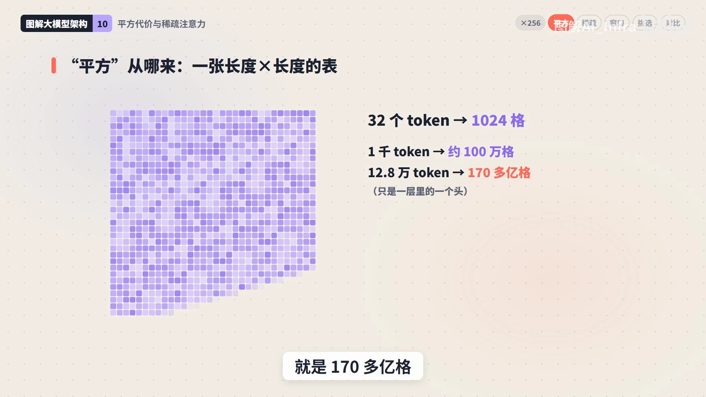
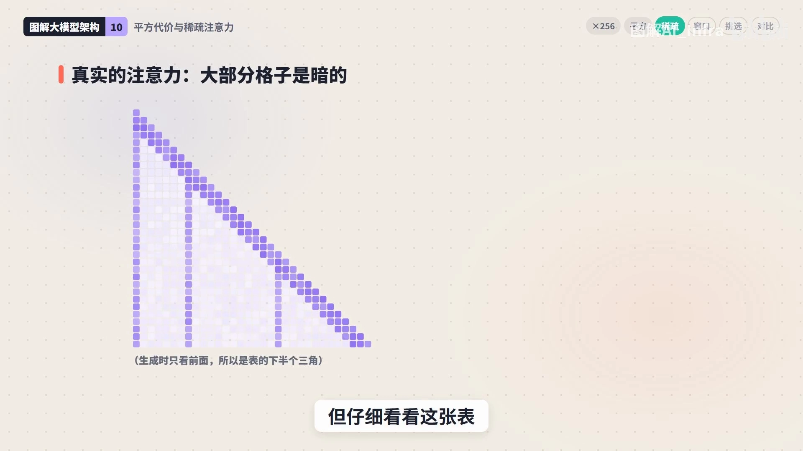
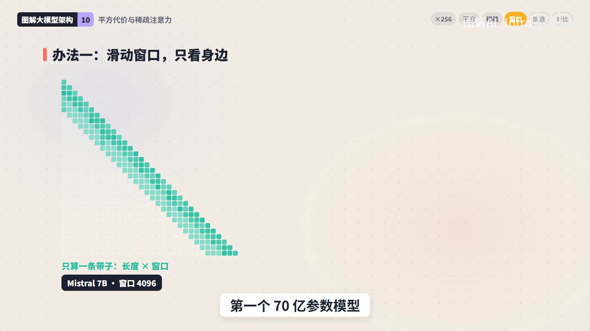
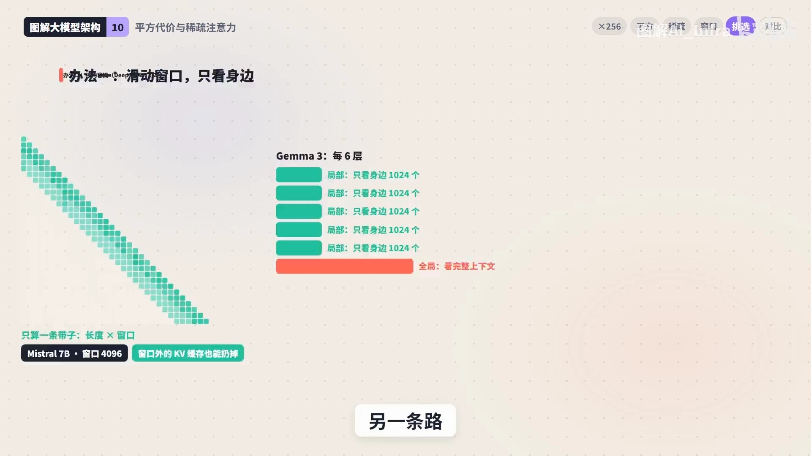

# 从局部窗口到局部全局混合：Mistral 7B 与 Gemma 3 的窗口配置

> 视频来源：[上下文长10倍，计算多100倍：注意力的平方代价与稀疏注意力｜图解大模型架构10](https://www.bilibili.com/video/BV11dsb69ELf/)（Bilibili · 图解AI_Infra）｜时长约 4 分钟
> 导读：这支视频先算清「平方」到底有多贵——12.8 万 token 的注意力表有 170 多亿格、按两字节存要 30 多 GB；再指出真实注意力矩阵里大部分格子是暗的，于是有了「按距离只看身边」的滑动窗口。本文重点整理视频里两个真实模型的配置：Mistral 7B 的窗口 4096，以及 Gemma 3 的「5 层局部 1024 + 1 层全局」折中，并对照「按内容挑选」的另一条路。字幕中的「misstrial」「JI3」「deepse」已订正为 Mistral、Gemma 3、DeepSeek。

## 本讲要解决的核心问题（SCQA）

**背景**：注意力的计算可以写成一张「长度 × 长度」的打分表：每个 token 拿自己的 Q 和每一个 token 的 K 比一次，格子总数是 $n^2$。

**冲突**：把上下文从 8000 个 token 拉长到 128000 个，长度只涨了 16 倍，计算量却涨了 256 倍 [【跳转到 00:00】](https://www.bilibili.com/video/BV11dsb69ELf/?t=0)。上下文越长，这张表越成为整个模型最贵的部分。

**疑问**：这张表里的格子都必须算吗？如果只算一部分，怎么保证远处的信息还接得上？

**回答（中心思想）**：真实注意力矩阵里绝大多数格子是暗的，只算重要的格子就是**稀疏注意力**。最简单的一招是**按距离**：每个 token 只看自己前面最近一段，也就是滑动窗口——Mistral 7B 用窗口 4096 这么做过，代价是远处信息只能靠层层接力；Gemma 3 则折中成「每 6 层里 5 层只看身边 1024 个、剩下 1 层看完整上下文」。另一条路是**按内容**挑选，先用便宜的打分器筛出少数关键 token，再做完整注意力。

---

## 一、「平方」从哪来：一张长度 × 长度的表

每个 token 都要拿自己的 Q 去和每一个 token 的 K 比一比、打一个分，把这些分数排成一张表：一行是一个 token，一列是一个 token，被看的有多少个 token，这张表就有多少行、多少列 [【跳转到 00:23】](https://www.bilibili.com/video/BV11dsb69ELf/?t=23)。

$$
\text{格子数} = n \times n
$$

于是：4 个 token 是 16 格，8 个 token 是 64 格，长度翻倍、格子翻四倍；1000 个 token 大约 100 万格，12.8 万个 token 就是 **170 多亿格**——而且这还只是一层里的一个头。如果每个格子用两个字节存，光这一张表就要 30 多 GB [【跳转到 00:48】](https://www.bilibili.com/video/BV11dsb69ELf/?t=48)。

视频还做了一个很有用的对照：**前馈网络是每个 token 各算各的**，长度翻倍、计算也只翻倍。所以上下文短的时候大头在前馈网络，一旦上下文拉长，注意力那张表就成了最贵的部分。这也解释了为什么长上下文优化的主战场几乎都在注意力上。

---

## 二、真实注意力矩阵：大部分格子是暗的

好在今天的算法不会把整张表真的存下来，可该算的格子一格也少不了。但仔细看看这张表，会发现一件事：绝大多数格子里的分数都小得可以忽略 [【跳转到 01:13】](https://www.bilibili.com/video/BV11dsb69ELf/?t=73)。

一个 token 真正在意的通常只有两类：

1. **身边的几个词**——前后搭配、局部语法；
2. **远处的少数关键 token**——比如前文提到的人名、问题里的关键词。

画出来，就是一条靠近对角线的亮带，加上零零星星几条竖线，剩下的大片区域几乎是暗的。

既然大部分格子没用，能不能干脆不算、只算那些重要的格子？这就叫稀疏注意力。难点只有一个：**事先怎么知道哪些格子重要**。视频给了两条思路——按距离、按内容。

---

## 三、按距离：滑动窗口把表削成一条带子

### 3.1 规则与代价

最简单的办法是只看身边：每个 token 只看自己前面最近的一段，比如 4096 个，更早的一概不看 [【跳转到 01:38】](https://www.bilibili.com/video/BV11dsb69ELf/?t=98)。表里只剩下沿着对角线的一条带子，计算量从长度的平方变成「长度 × 窗口」：

$$
O(n^2) \;\longrightarrow\; O(n \cdot w)
$$

窗口 $w$ 是常数，所以总计算量只随长度**线性**增长。

### 3.2 真实配置：Mistral 7B 用窗口 4096

视频点名了第一个这么做的模型：**Mistral 的第一个 70 亿参数模型**，窗口取 4096。幻灯片上写得更直接——「Mistral 7B · 窗口 4096」，并标注「只算一条带子：长度 × 窗口」。

### 3.3 附带的好处：窗口外的 KV 可以扔掉

滑动窗口还有一个顺带的收益：窗口外的 K 和 V 再也用不到了，那份 KV 缓存也不用一直存着 [【跳转到 02:03】](https://www.bilibili.com/video/BV11dsb69ELf/?t=123)。于是缓存可以被固定成「只装一个窗口」的环形结构，显存不再随文本长度膨胀——这正是 rolling buffer 能成立的前提。

### 3.4 代价：远处信息只能靠层层接力

可远处的信息怎么办？靠层层接力：第一层每个 token 看到身边 4096 个，第二层它看到的那些 token 又各自看过更早的 4096 个，层数一多，视野就一层层传了出去。

但视频紧接着给了一句关键提醒：**「接力传话难免失真」**。这正是一层窗口注意力的真实代价——远处信息不是直接看到的，而是经过多次压缩转述的，层数越多、传递链越长，保真度越差。这也是为什么单纯把窗口调小、靠层数硬撑，并不是免费的午餐。

---

## 四、折中：Gemma 3 的「5 层局部 + 1 层全局」

为了缓解接力失真，谷歌的 **Gemma 3** 做了一种混合配置：每 6 层里，5 层只看身边 1024 个 token，剩下 1 层看完整的上下文 [【跳转到 02:28】](https://www.bilibili.com/video/BV11dsb69ELf/?t=148)。

这个设计把两种能力分开安置：

| 层类型 | 可见范围 | 作用 |
| --- | --- | --- |
| 局部层（5/6） | 最近 1024 个 token | 承担绝大部分计算，便宜、够用 |
| 全局层（1/6） | 完整上下文 | 让远处信息有一条「直达通道」，不必全靠接力 |

从代价上看，这也解释了两者的差别：Mistral 7B 是「所有层都局部、远处全靠接力」，Gemma 3 是「大部分层局部、少数层兜底」。窗口从 4096 缩到 1024 让局部层更便宜，而每 6 层一次的全局层负责把接力失真的风险压下去。

---

## 五、另一条路：按内容挑选

除了按距离，还可以按内容挑。DeepSeek 在 V3.2 里用的就是这种思路 [【跳转到 02:35】](https://www.bilibili.com/video/BV11dsb69ELf/?t=155)：就像读一本很厚的书，先翻一翻索引、找到相关的那几页，再仔细读。

具体做法是先放一个很小、很便宜的打分器，叫**闪电索引器**（lightning indexer）：对每个新 token，快速给前面所有 token 打一个粗略的分，然后只挑选分数最高的 2048 个，真正的注意力只在这 2048 个 token 上做。

打分器虽然还是要扫过所有 token，但它用的头很少、数字精度很低，比完整的注意力便宜得多，上下文越长省下的越多。视频提到，这个模型发布时 DeepSeek 把调用价格下调了一半以上 [【跳转到 03:00】](https://www.bilibili.com/video/BV11dsb69ELf/?t=180)。

---

## 六、三种做法放在一起看

视频最后把三条路线并排比较 [【跳转到 03:25】](https://www.bilibili.com/video/BV11dsb69ELf/?t=205)：

| 做法 | 算什么 | 复杂度 | 长处与短板 |
| --- | --- | --- | --- |
| 完整注意力 | 整张 $n \times n$ 表都算 | 随长度平方增长 | 看得最全，也最贵 |
| 滑动窗口（按距离） | 对角线附近一条带子 | 随长度线性增长 | 简单高效；远处只能层层接力，会失真 |
| 按内容挑选 | 先粗打分，再只对少数 token 做注意力 | 远低于完整注意力 | 远近都能看到，也省得多；多一个打分器 |

今天的长上下文模型，大多是把这几种办法**组合**起来用：局部层负责便宜的大头，全局层或内容挑选负责兜住远处依赖。

---

## 小结

- 注意力要算一张「长度 × 长度」的表，上下文长十倍、计算多 100 倍；12.8 万 token 就是 170 多亿格，按两字节存要 30 多 GB。
- 真实注意力矩阵里大部分格子是暗的：一条贴近对角线的亮带 + 少数几条竖直亮线，其余可忽略。
- 按距离的稀疏就是滑动窗口：每个 token 只看前面最近 $w$ 个，复杂度从 $O(n^2)$ 降到 $O(n \cdot w)$；Mistral 7B 的配置是窗口 4096。
- 滑动窗口的附带好处是窗口外的 KV 可以丢弃，缓存只需保留一个窗口；代价是远处信息只能靠层层接力，而「接力传话难免失真」。
- Gemma 3 用「每 6 层 5 层局部 1024 + 1 层全局」做折中，给远处信息留一条直达通道。
- 另一条路是按内容挑选：DeepSeek V3.2 用便宜的打分器粗筛出 2048 个 token，再对它们做完整注意力。

## 关键术语速查

| 术语 | 一句话解释 |
| --- | --- |
| 稀疏注意力 | 只计算注意力矩阵中真正重要的少数格子，其余不算 |
| 滑动窗口（按距离） | 每个 token 只看前面最近 $w$ 个，复杂度 $O(n \cdot w)$；Mistral 7B 取 $w=4096$ |
| 局部层与全局层 | Gemma 3 每 6 层中 5 层只看身边 1024 个（局部），1 层看完整上下文（全局） |
| 接力失真 | 远处信息靠多层间接传递，传递链越长保真度越差 |
| 闪电索引器 | DeepSeek V3.2 里低成本粗打分的筛选器，只保留分数最高的 2048 个 token |
| 窗口外的 KV 丢弃 | 滑动窗口下更老的 K/V 不再被用到，缓存只需保留一个窗口 |