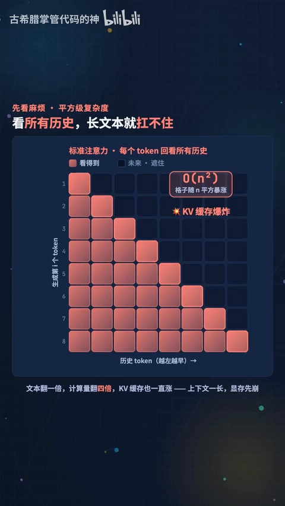
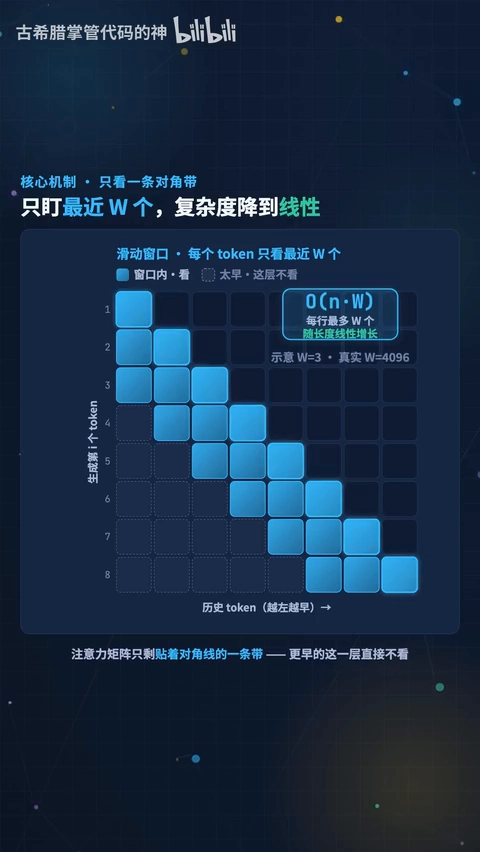
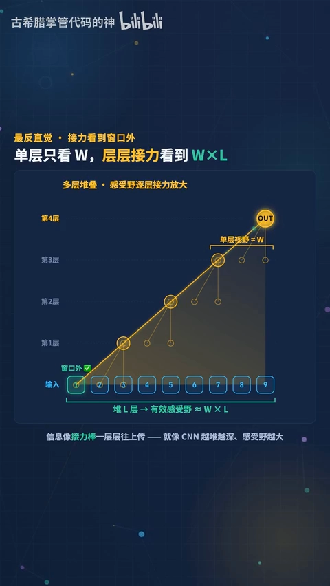
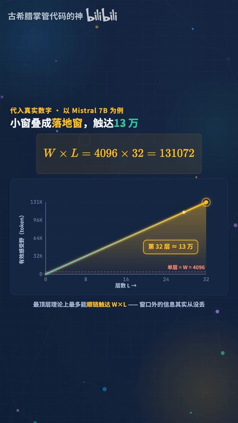
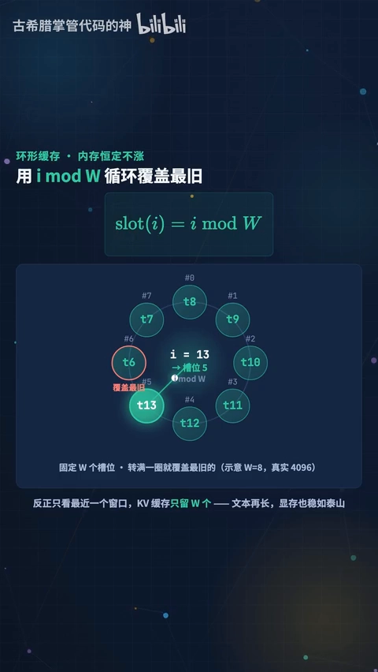
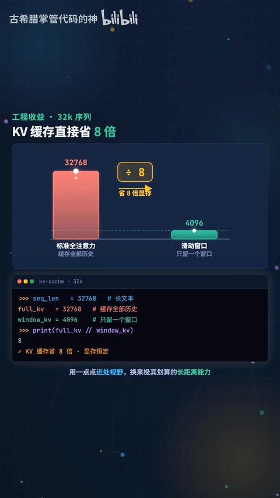

# 滑动窗口注意力：只开一扇小窗，如何看到十三万 token 之外

> 视频来源：[【面试高频】滑动窗口注意力一次讲透：平方级降到线性，小窗口为何能看穿13万token](https://www.bilibili.com/video/BV1D1ua6PErD/)（Bilibili · 古希腊掌管代码的神）｜时长约 3 分半
> 导读：一支把 SWA 讲成「三段账」的短视频——先算标准注意力的平方代价与 KV 缓存账，再讲「每层只看最近 $w$ 个」如何把复杂度压成线性，最后用「$w \times L$」和「环形缓存」回答两个追问：窗口外的信息去哪了、显存为什么不再涨。字幕里的「感受也」「鞋带子」「构到」等识别错误已按上下文订正。

## 本讲要解决的核心问题（SCQA）

**背景**：在 decoder-only 大模型里，每生成一个新 token，都要拿它的 query 回头和前面所有 token 的 key 打分 [【跳转到 00:00】](https://www.bilibili.com/video/BV1D1ua6PErD/?t=0)。为了不重复计算，前面每个 token 的 key 和 value 还要一直留在显存里，这就是 KV 缓存。

**冲突**：这套做法有两个代价同时增长。注意力矩阵是「长度 × 长度」的表，文本长度翻一倍，计算量翻四倍；KV 缓存则随文本变长一路膨胀。上下文一拉到几万 token，显存先扛不住了 [【跳转到 00:30】](https://www.bilibili.com/video/BV1D1ua6PErD/?t=30)。

**疑问**：能不能让每个 token 别回头看那么远——只看最近的一小段？这样会不会把远处的信息彻底丢掉？

**回答（中心思想）**：滑动窗口注意力（Sliding Window Attention, SWA）让每一层的每个 token 只和它前面最近 $w$ 个 token 计算注意力，把计算量从 $O(n^2)$ 压到 $O(w \cdot n)$；远处信息并没有丢，而是靠**多层接力**间接传过来，$L$ 层堆叠后的理论感受野是 $w \times L$；既然每层只用一个窗口，KV 缓存也只需要保留最近 $w$ 个位置，用**环形缓存**（rolling buffer）循环覆盖，显存占用从此恒定。

---

## 一、先看麻烦：平方级计算与一路膨胀的 KV 缓存

### 1.1 注意力矩阵是一张「长度 × 长度」的表

标准注意力的规矩很朴素：每冒出一个新 token，都得回头跟前面所有 token 挨个算一遍 [【跳转到 00:25】](https://www.bilibili.com/video/BV1D1ua6PErD/?t=25)。把「谁在看谁」画成一张方格表，行是正在生成的 token，列是被看的历史 token，格子总数就是 $n \times n$：

$$
\text{注意力矩阵大小} = n \times n, \qquad \text{计算量} \propto n^2
$$

于是「文本长度翻一倍，计算量翻四倍」——这就是平方级复杂度。

### 1.2 比算力更先撑不住的是缓存

算力之外还有一笔账：为了不重复计算，前面每个 token 的 key 和 value 都得存进显存，这块缓存会随着文本变长一直涨 [【跳转到 00:30】](https://www.bilibili.com/video/BV1D1ua6PErD/?t=30)。所以长上下文模型面对的是「计算量平方增长 + 缓存线性增长」的双重压力，而显存往往是先撞墙的那一个。

---

## 二、滑动窗口：把注意力矩阵削成一条斜带

### 2.1 规则只有一句话

既然看所有历史太贵，那就干脆别看那么远：**让每个 token 只盯着自己前面最近的一个固定窗口**，比如最近的 4096 个，更早的这一层一律不看 [【跳转到 00:51】](https://www.bilibili.com/video/BV1D1ua6PErD/?t=51)。

用公式写出来，就是给注意力加一个「距离掩码」：位置 $i$ 的 token 只允许看位置 $j$ 落在 $[i-w+1,\ i]$ 区间内的 token（同时还要满足因果性 $j \le i$）：

$$
\text{allow}(i,j) = \begin{cases} 1, & i-w+1 \le j \le i \\ 0, & \text{其他} \end{cases}
$$

### 2.2 削掉之后，复杂度变成线性

在注意力矩阵上，这条规则只留下一条贴着对角线的斜带子，只有落在带子里的位置才互相计算 [【跳转到 00:56】](https://www.bilibili.com/video/BV1D1ua6PErD/?t=56)。每个 token 要算的格子数从 $n$ 个变成最多 $w$ 个，总量就是：

$$
O(n \cdot w)
$$

窗口大小 $w$ 是常数（比如 4096），所以计算量只随序列长度**线性**增长，长文本再也不会让它爆掉。

---

## 三、窗口外的信息去哪了：多层接力把感受野撑到 $w \times L$

### 3.1 每一层只挪一个窗口，但邻居已经「装着」更早的信息

只看最近几千个，更早的信息不就彻底丢了吗？这是 SWA 最容易被误解的地方。视频给的答案是：注意力是一层一层摞起来的 [【跳转到 01:17】](https://www.bilibili.com/video/BV1D1ua6PErD/?t=77)。

- 第 1 层：每个位置吸收它左边一个窗口的信息；
- 第 2 层：它再往左看一个窗口，可这些邻居本身已经装着更左边的信息；
- 第 3 层、第 4 层……信息像接力棒一样一层层往右传。

堆叠的层数越多，能**间接**够到的距离就越远。这跟卷积网络堆得越深、感受野越大是同一个道理。

### 3.2 代入真实数字：4096 × 32 = 131072

视频用一款经典开源模型（Mistral 7B）举例：窗口设成 4096，一共堆了 32 层注意力 [【跳转到 01:42】](https://www.bilibili.com/video/BV1D1ua6PErD/?t=102)。

$$
w \times L = 4096 \times 32 = 131072
$$

也就是说，最顶层的那个 token 理论上最多能顺着这条接力链够到大约 13 万个 token 以外的信息。每一层都只是一扇小窗，叠起来却是一整面落地窗。

### 3.3 「13 万」是理论上限，不是保证

需要留意措辞：视频说的是「理论上**最多**能顺着接力链够到」。这意味着 $w \times L$ 是可达距离的上界，而不是「每个 13 万 token 之前的细节都能被完整取回」——信息每经过一层都要被压缩进隐状态，传得越远越间接。所以 SWA 换来的是「够得着」，而不是「看得清」。

---

## 四、KV 缓存只留一个窗口：环形缓存让显存恒定

### 4.1 既然只看最近 $w$ 个，就没必要存全部历史

既然每个 token 反正只看最近一个窗口，那存历史的这块显存也就没必要无限膨胀了 [【跳转到 02:07】](https://www.bilibili.com/video/BV1D1ua6PErD/?t=127)。工程上的做法叫**环形缓存**（ring buffer / rolling buffer）：

1. 先划出一块固定大小的空间，正好装得下一个窗口的 KV；
2. 新 token 要存进来时，拿它的位置 $i$ 对窗口大小 $w$ 取余，算出该落在哪个槽位：

$$
\text{slot}(i) = i \bmod w
$$

3. 这一圈转满了，新的就直接覆盖掉最旧的那一个，就像一个转圈的时钟。

### 4.2 省了多少：32k 序列省 8 倍

视频给了一个具体例子：处理 32768 个 token 的长文本，标准做法得把 32768 个位置的历史全缓存下来，而滑动窗口只留最近的 4096 个 [【跳转到 02:32】](https://www.bilibili.com/video/BV1D1ua6PErD/?t=152)。

$$
\frac{32768}{4096} = 8
$$

前者正好是后者的八倍。同样一张显卡，你能塞进去的上下文一下涨了好几倍，推理也更快更省。

---

## 五、一句话的取舍

视频最后用三句话收口 [【跳转到 02:57】](https://www.bilibili.com/video/BV1D1ua6PErD/?t=177)：

1. **标准注意力**：每个 token 看所有历史，复杂度平方级，长文本显存直接爆；
2. **滑动窗口**：每个 token 只看最近一个窗口，复杂度降到线性；别担心丢信息，多层堆叠会像接力一样把感受野撑到「窗口 × 层数」那么远；
3. **环形缓存**：用位置对窗口取余、循环覆盖，显存恒定不长。

说到底，这是用一点点近处的视野，换来极其划算的长距离能力。只盯着一小扇窗，却能看穿窗口之外 [【跳转到 03:22】](https://www.bilibili.com/video/BV1D1ua6PErD/?t=202)。

---

## 小结

- 标准注意力的代价有两份：$O(n^2)$ 的计算量和随长度线性增长的 KV 缓存，长上下文时显存先撞墙。
- 滑动窗口注意力把每个 token 的可见范围限制在最近 $w$ 个位置，注意力矩阵只剩对角线附近的一条带，复杂度降为 $O(n \cdot w)$。
- 远处信息靠多层接力间接传递，$L$ 层堆叠后的理论感受野是 $w \times L$（如 $4096 \times 32 = 131072$），这是上限而非保证。
- 因为只用得着最近 $w$ 个 KV，缓存可以做成环形：第 $i$ 个 token 写入 $i \bmod w$ 号槽位，转满一圈覆盖最旧的一格，显存占用恒定。
- 收益可以量化：32k 序列下 KV 缓存只需 4096 个位置，省 8 倍，同一张卡能放更长的上下文。

## 关键术语速查

| 术语 | 一句话解释 |
| --- | --- |
| 滑动窗口注意力（SWA） | 每个 token 只与前面最近 $w$ 个 token 计算注意力，把 $O(n^2)$ 降到 $O(n \cdot w)$ |
| 窗口大小 $w$ | 单层可见的历史长度，Mistral 7B 取 4096；$w$ 越大越贵、越小越依赖层数 |
| 感受野 $w \times L$ | $L$ 层堆叠后理论上能间接触及的最远距离，类比卷积网络的深层感受野 |
| 环形缓存（rolling buffer） | 固定 $w$ 个槽位的 KV 缓存，用 $i \bmod w$ 定位并循环覆盖最旧项，显存恒定 |
| KV 缓存 | 解码时为避免重复计算而保存的历史 key/value，标准注意力下随序列长度增长 |