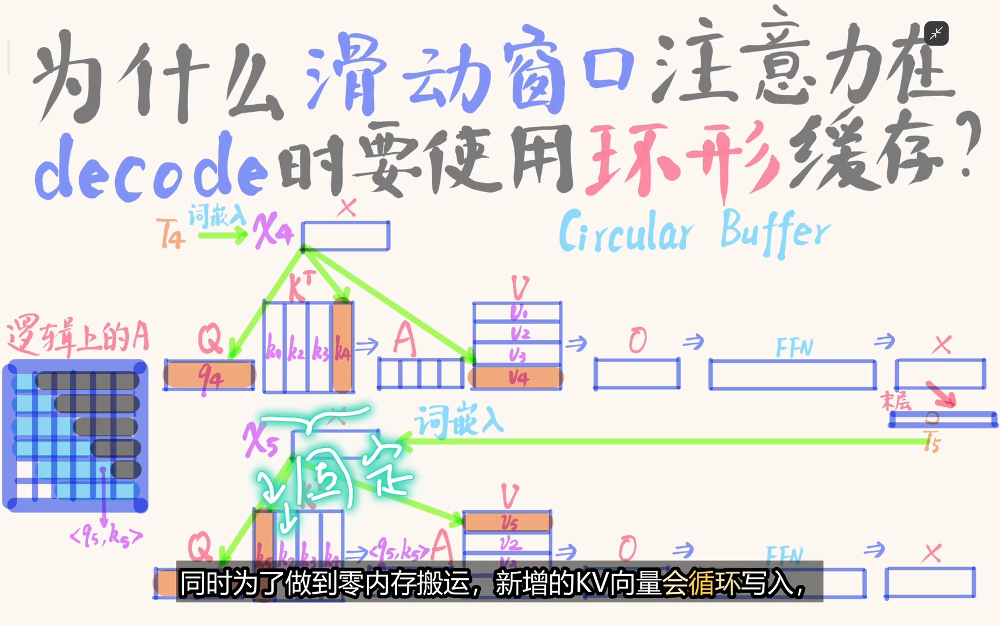
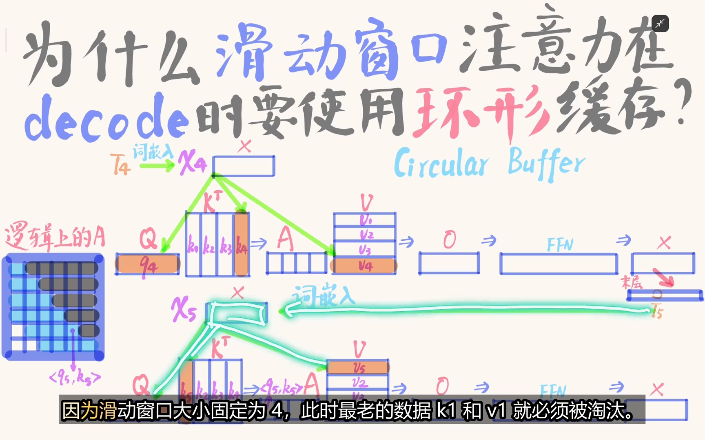
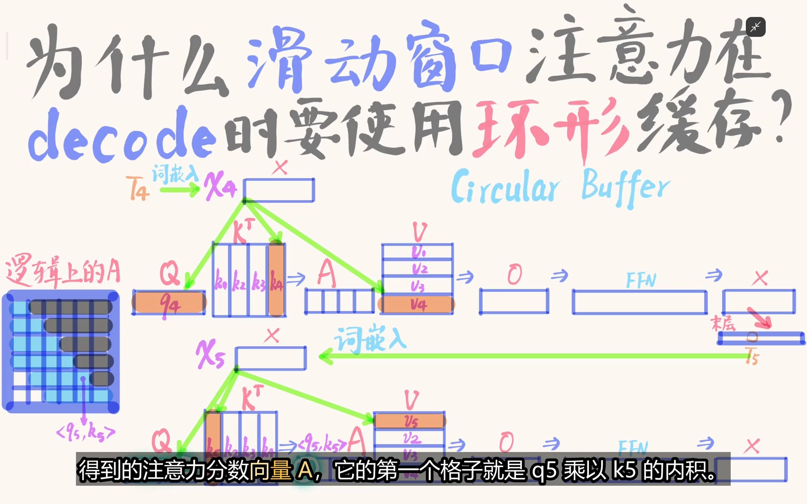
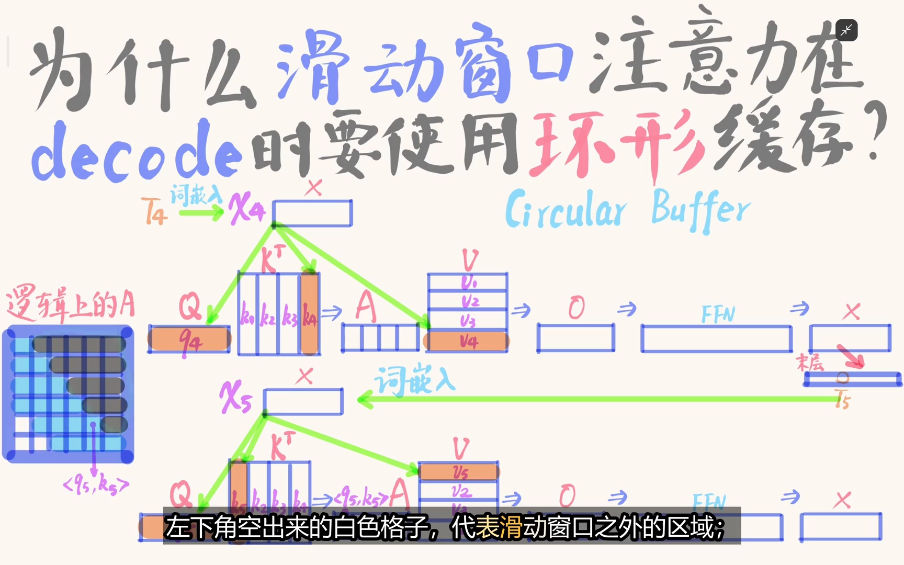

# 环形缓存：滑动窗口注意力在 decode 时如何零搬运地滚动 KV

> 视频来源：[194. 为什么滑动窗口注意力在 decode 时要使用环形缓存？【每天一个宝藏问题】](https://www.bilibili.com/video/BV1WP3B65Eh5/)（Bilibili · 海安雨）｜时长约 3 分半
> 导读：这支视频只回答一个问题——滑动窗口注意力的 KV 缓存为什么做成「环形」。它把窗口大小压到 4，用 t4、t5 两个生成步把「新 KV 写哪个槽、谁被覆盖、顺序会不会乱」逐格推了一遍，最后把物理上的循环覆写和逻辑上的带状注意力矩阵对上。字幕中的「tensrtllm」「kv cash」「内机」「磁嵌入」等识别错误已订正为 TensorRT-LLM、KV cache、内积、词嵌入。

## 本讲要解决的核心问题（SCQA）

**背景**：在 TensorRT-LLM、vLLM 这类推理引擎里，decode 阶段每生成一个 token，就要把它的 key 和 value 追加进 KV 缓存，供后续 token 使用 [【跳转到 00:10】](https://www.bilibili.com/video/BV1WP3B65Eh5/?t=10)。

**冲突**：滑动窗口注意力只用得着最近 $w$ 个 token 的 KV，更老的必须被淘汰。最直觉的做法是「整体左移一格、把新的放到最右边」，但每生成一个 token 就搬动整块缓存，代价太高。

**疑问**：能不能既不搬动数据、又让最老的 KV 自动失效？新 KV 写在最前面，注意力的计算顺序会不会乱？

**回答（中心思想）**：把 KV 缓存做成**环形缓存**（circular buffer，也叫 rolling buffer）——分配固定 $w$ 个槽位，第 $i$ 个 token 的 KV 写入 $i \bmod w$ 号槽位，转满一圈就覆盖最旧的那一个。这样显存固定在窗口大小、写入是零内存搬运，而且只要 K 和 V 在物理内存里保持同一顺序，加权平均的结果与逻辑顺序完全一致，不需要任何重排 [【跳转到 00:00】](https://www.bilibili.com/video/BV1WP3B65Eh5/?t=0)。

---

## 一、把窗口缩到 4，走一遍 decode

视频把滑动窗口大小设为 4 来讲，因为机制与真实窗口无关，只是格子少一点好画。假设之前已经生成了 3 个 token 的 KV 缓存，现在看第 4 个 token $t_4$ 的处理过程 [【跳转到 00:25】](https://www.bilibili.com/video/BV1WP3B65Eh5/?t=25)：

1. **词嵌入**：$t_4$ 先变成向量 $x_4$；
2. **投影**：由 $x_4$ 投影出 $Q_4$、$K_4$、$V_4$ 三个向量；
3. **入缓存**：$K_4$ 和 $V_4$ 并入 KV 缓存的末尾（此时缓存里是 $k_1,k_2,k_3,k_4$）；
4. **打分**：$Q_4$ 与 $K$ 的转置做内积，得到一个长度为 4 的注意力分数向量 $A$；
5. **加权**：$A$ 与包含 $V_1$ 到 $V_4$ 四个行向量的 $V$ 矩阵相乘做加权平均，得到输出向量 $O$；
6. **出下一个 token**：$O$ 再经过 FFN 层和末层投影，采样出下一个 token，也就是 $t_5$ [【跳转到 00:50】](https://www.bilibili.com/video/BV1WP3B65Eh5/?t=50)。

用公式写，第 4 步和第 5 步就是标准注意力：

$$
A = Q_4 K^\top, \qquad O = A V
$$

此时窗口还没满，4 个位置刚好装下 $t_1 \sim t_4$ 的 KV，一切都很平常。真正的问题出现在下一步。

---

## 二、$t_5$ 到来：最老的 KV 必须被淘汰

$t_5$ 经过词嵌入变成 $x_5$，同样投影出 $Q_5$ 以及新的 $K_5$、$V_5$。但窗口大小固定为 4，此时最老的数据 $K_1$ 和 $V_1$ 就必须被淘汰 [【跳转到 01:15】](https://www.bilibili.com/video/BV1WP3B65Eh5/?t=75)。

关键在物理存储上：**$K_5$ 和 $V_5$ 并没有放在最右边，而是直接复写了最左边原来 $K_1$ 和 $V_1$ 的槽位**。缓存里的内容于是变成 $k_5,k_2,k_3,k_4$——物理顺序被打乱了，但逻辑上它代表的是「最近 4 个 token」。

---

## 三、三个追问：为什么不左移、这是不是循环队列、顺序会不会乱

视频在这里连问三个问题，正好覆盖了环形缓存的全部设计理由。

### 3.1 为什么不采用「KV 左移一个 token」

因为**内存拷贝开销极大**。每生成一个 token 就把整块缓存挪一格，序列越长搬得越多，而这份搬运完全不产生任何计算价值。环形缓存的写入则是原地覆盖一个槽位，代价与序列长度无关。

### 3.2 这不就是数据结构里的循环队列吗

没错，可以理解为**用静态数组实现了循环队列**：如果再来一个 token $t_6$，它的 KV 会复写在原来 $t_2$ 的位置 [【跳转到 01:40】](https://www.bilibili.com/video/BV1WP3B65Eh5/?t=100)。下标用取余就能算出来：

$$
\text{slot}(i) = i \bmod w
$$

$w=4$ 时，$t_5$ 落在 1 号槽（覆盖 $t_1$），$t_6$ 落在 2 号槽（覆盖 $t_2$），依此类推。

### 3.3 把 $K_5$ 放在最前面，计算顺序会错乱吗

**完全不会**。看计算过程：$Q_5$ 乘以 $K$ 的转置后得到的注意力分数向量 $A$，它的第一个格子就是 $Q_5$ 与 $K_5$ 的内积；当向量 $A$ 去乘以 $V$ 矩阵做加权平均时，第一个格子上的分数正好对应 $V$ 矩阵的第一行，也就是 $V_5$ [【跳转到 02:05】](https://www.bilibili.com/video/BV1WP3B65Eh5/?t=125)。

也就是说，**只要 K 和 V 在物理内存里保持 5、2、3、4 这个相同的顺序，加权平均的结果就和逻辑顺序完全一致**，不需要额外的内存重排。环形缓存能成立的全部秘密就在这里：打分与加权是「按位置一一对应」的，K 和 V 同序错位，结果不受影响。

---

## 四、把物理存储和逻辑矩阵对上

最后视频把视线移到左边的「逻辑上的注意力矩阵 $A$」[【跳转到 02:30】](https://www.bilibili.com/video/BV1WP3B65Eh5/?t=150)。需要强调：这只是**逻辑上**的完整矩阵，在物理显存里根本不需要存储这个庞大的矩阵。

在这个矩阵里，三种颜色对应三种状态：

| 区域 | 含义 |
| --- | --- |
| 右上角灰色方块 | 因果掩码：不能看未来 |
| 左下角白色格子 | 滑动窗口之外：这一层不看 |
| 浅蓝色格子 | 窗口内合法的注意力计算 |

仔细看左上角前三行的浅蓝色格子，依次是 1 格、2 格、3 格——这是因为序列刚开始时历史 token 还没填满窗口，窗口呈现**梯形展开**；直到第 4 行之后，才稳定为宽度为 4 的带状结构 [【跳转到 02:55】](https://www.bilibili.com/video/BV1WP3B65Eh5/?t=175)。

弄懂了「逻辑上的滑动窗口」和「物理上的环形复写」这两件事，什么是环形缓存也就一目了然了 [【跳转到 03:20】](https://www.bilibili.com/video/BV1WP3B65Eh5/?t=200)。

---

## 五、为什么这件事专门属于 decode

视频标题强调的是 decode 阶段，原因在于两种阶段的写入模式不同：

- **decode**：每一步只进来一个 token，它的槽位由 $i \bmod w$ 唯一确定，写一次、覆盖一格，天然适合环形结构；
- **prefill / 训练**：一次要处理整段序列，注意力在窗口内是成块的带状计算，缓存的组织方式与逐 token 追加不是一回事。

所以环形缓存是「逐 token 追加 + 固定窗口」这两个条件同时成立时的自然选择：它把显存占用钉死在 $w$ 个槽位，把写入成本压到一次原地覆盖，代价只是逻辑顺序与物理顺序不再一致——而这一点，靠 K/V 同序就自动解决了。

---

## 小结

- 滑动窗口注意力只需要最近 $w$ 个 token 的 KV，更老的必须淘汰，但「整体左移」的内存拷贝开销极大。
- 环形缓存用固定 $w$ 个槽位的静态数组实现循环队列：第 $i$ 个 token 写入 $i \bmod w$ 号槽，转满一圈覆盖最旧项。
- $w=4$ 的例子：$t_5$ 的 $K_5,V_5$ 直接复写 $K_1,V_1$ 的槽位，缓存内容变成 5、2、3、4，没有任何数据搬移。
- 物理顺序错位不影响结果：$A$ 的第一格是 $q_5 \cdot k_5$，正好对应 $V$ 的第一行 $v_5$，只要 K 与 V 同序，加权平均与逻辑顺序一致。
- 逻辑矩阵上，因果掩码在右上、窗口外在左下、窗口内是浅蓝带；序列开头窗口未填满时呈梯形，第 $w$ 行之后稳定为宽度 $w$ 的带。

## 关键术语速查

| 术语 | 一句话解释 |
| --- | --- |
| 环形缓存（circular / rolling buffer） | 用固定 $w$ 个槽位循环覆写的 KV 缓存，显存占用恒定、写入零搬运 |
| $i \bmod w$ | 第 $i$ 个 token 的 KV 应落到的槽位编号，转满一圈即覆盖最旧项 |
| 零内存搬运 | 新 KV 原地覆盖旧槽位，不做整块缓存的左移拷贝 |
| 逻辑注意力矩阵 | 概念上「谁看谁」的完整 $n \times n$ 表，实际不存储；右上为因果掩码、左下为窗口外 |
| 梯形展开 | 序列开头历史不足 $w$ 个时，窗口宽度逐行从 1 增到 $w$ 的形态 |