# 图表示是一次建模选择：节点、边、方向与三层属性决定模型能问什么

> 视频来源：[Choice of Graph Representation](https://www.youtube.com/watch?v=P-m1Qv6-8cI)（YouTube · Stanford CS224W: Machine Learning with Graphs 2021 Lecture 1.3，讲者 Jure Leskovec）｜时长约 20 分钟
> 一支把"图是什么"讲成"图该怎么建"的课。本文按视频顺序覆盖：节点与边的定义、建图选择为什么重要、有向与无向、度与入度出度、二部图与投影、邻接矩阵与稀疏性、边列表与邻接表、三层属性、加权图/自环/多重图、连通性与强连通分量。字幕为英文自动生成，本文已按上下文订正断句与术语拼写（例如 in-degree、bipartite、strongly connected component）。

## 本讲要解决的核心问题（SCQA）

**背景**：图神经网络（GNN）的基本操作是在图上做消息传递，而图由节点和边组成，写作 $G=(N,E)$。这是读任何一篇图模型论文都会看到的第一句话。

**冲突**：但这句话几乎没告诉你任何可操作的信息。同一批人，按同事关系连是一张图，按另一类关系连是另一张图；同一批论文，按引用关系连是一张图，按标题用词连又是另一张图——节点集合没变，图变了，能回答的问题也变了。更麻烦的是，真实数据里除了"谁连谁"，还有大量挂在节点上、挂在边上、挂在整张图上的信息；只画拓扑，这些信息就全丢了。

**疑问**：那么一个"图"到底由哪些部分构成？哪些信息必须显式写进数据结构，哪些可以省？方向这一项为什么不能随便丢？

**回答（中心思想）**：图数据表示由两部分组成——**拓扑**（节点集合、边集合、以及边有没有方向）和**三层属性**（节点属性、边属性、整图属性）。把图交给模型之前，必须先决定这三件事：什么是节点、什么是边、每一层挂什么属性。这个决定不是数据自带的，而是一次建模选择，它直接决定了模型能问什么问题、能做出什么预测。[【跳转到 01:59】](https://www.youtube.com/watch?v=P-m1Qv6-8cI&t=119)

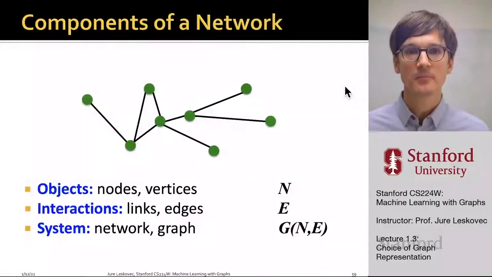

## 一、图只有两个成分，其余都是这两者的属性

视频开篇把定义压到最短：一个网络由两类对象组成。第一类是对象或实体本身，称为**节点（node）**，也叫**顶点（vertex）**；第二类是它们之间的相互作用，称为**边（edge）**，也叫**链接（link）**。整个系统称为网络或图。[【跳转到 00:17】](https://www.youtube.com/watch?v=P-m1Qv6-8cI&t=17)

记号上，节点集合写作大写 $N$ 或 $V$，边集合写作大写 $E$，于是

$$
G = (N, E)
$$

这个式子看起来只是套话，但它划出了一条边界：**图里只有节点和边两种东西**。后面要讲的属性、权重、类型、方向，全都不是第三种成分，而是挂在这两者（或它们的整体）上的附加信息。记住这条边界，就不会把"图"和"图的特征表"混为一谈。

图之所以值得单独做一套算法，讲者给的理由是"**通用语言**"：可以把演员按出演过哪些电影连起来，可以把人按彼此的关系连起来，也可以取蛋白质这样的分子、按哪些蛋白质彼此相互作用来建网络。[【跳转到 00:42】](https://www.youtube.com/watch?v=P-m1Qv6-8cI&t=42) 这三种场景的节点含义完全不同——演员、人、蛋白质——但底层的数学表示是同一个，所以同一个机器学习算法就能在它们上面做预测。[【跳转到 01:07】](https://www.youtube.com/watch?v=P-m1Qv6-8cI&t=67)

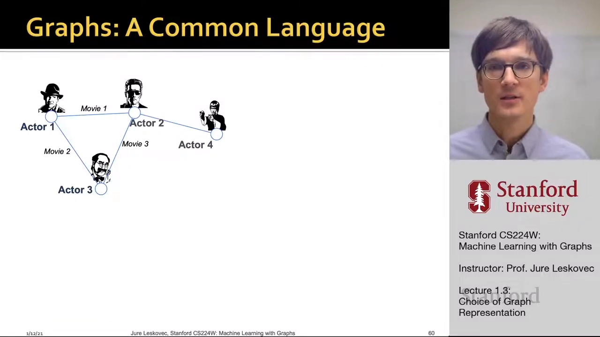

这里要提醒一句：**"同一个算法能用"不等于"同一张图就够"**。演员图里的边是"合作出演"，蛋白质图里的边是"物理相互作用"，两者都被抽象成"一条边"，但这条边背后的物理含义、可用的属性、能问的问题都不一样。通用性来自抽象，代价也来自抽象。

## 二、同一批数据可以连成不同的图，连边方式决定能问什么

这是全片最重要的一节，也是本节学习目标的核心：**图不是数据的属性，而是建模者的选择**。

讲者给了三组对照。第一组：如果手上是一批人，把在一起工作的人连起来，得到的是**职业网络**；同一批人，按性关系连起来，得到的是另一种网络。第二组：一批科学论文，按引用关系连——哪篇引用了哪篇——得到的是**引用网络**；但如果按"标题里是否用了同一个词"去连，得到的东西虽然形式上仍是网络，底层表示的质量会差得多。[【跳转到 01:49】](https://www.youtube.com/watch?v=P-m1Qv6-8cI&t=109)

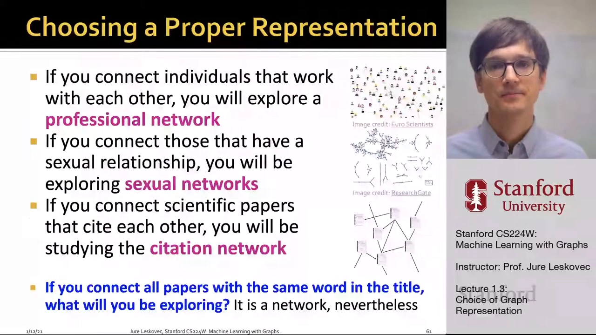

第三点是关键：后者**仍然是一张合法的图**，它没有违反任何图论定义，只是它刻画的不是你想研究的那个机制。所以"图建得对不对"不能靠检查语法来判断，只能靠问：这张图的边，是否对应了数据生成过程里真实存在的相互作用？

由此得到两条操作性的结论：

- 每拿到一个数据集，先决定两件事：**哪些是感兴趣的对象（节点），它们之间的关系是什么（边）**。[【跳转到 02:39】](https://www.youtube.com/watch?v=P-m1Qv6-8cI&t=159)
- 有些问题的图表示是唯一无歧义的，有些则绝不唯一；而怎样建立链接，会决定**能研究什么问题、能做出什么预测**。[【跳转到 03:04】](https://www.youtube.com/watch?v=P-m1Qv6-8cI&t=184)

这条结论对分子任务同样成立。一个分子可以按化学键建图（原子是节点、键是边），也可以按空间距离建图（原子是节点、截断半径内的邻近关系是边）。两种图都合法，但它们描述的机制不同：前者是成键关系，后者是空间接触。构图选择不同，消息传递的路径就不同，模型能学到的规律自然也不同。

## 三、方向：无向图刻画互惠，有向图区分源与终点

定义完节点和边，第一个必须做的设计选择是**边有没有方向**。

**无向图（undirected graph）**的链接没有方向，适合刻画**对称或互惠**的关系：合作、友谊、蛋白质之间的相互作用都属于这一类。[【跳转到 03:37】](https://www.youtube.com/watch?v=P-m1Qv6-8cI&t=217) 这里的"对称"是关系本身的对称：如果 A 和 B 合作过，那么 B 也和 A 合作过；不存在"单向合作"。

**有向图（directed graph）**的每条链接都有方向，有**源点（source）**和**终点（destination）**，画成箭头。现实中的例子包括电话呼叫、金融转账、Twitter 上的关注——都存在一个源和一个终点。[【跳转到 04:02】](https://www.youtube.com/watch?v=P-m1Qv6-8cI&t=242)

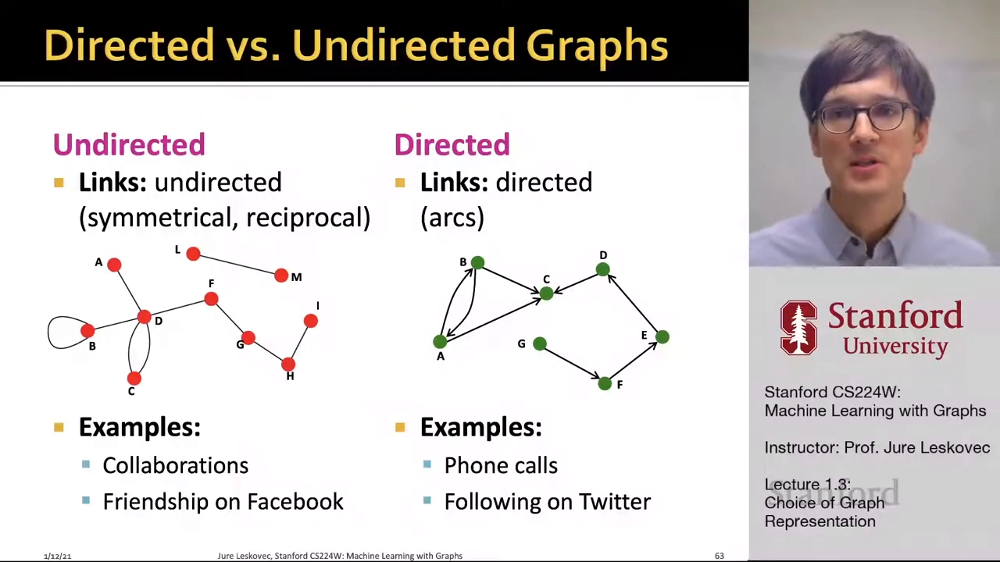

判断该用哪种，有一个简单的检验：**把边反过来，这句话还成立吗？**

- "A 给 B 打了一通电话"——反过来不成立，用有向边。
- "A 和 B 是 Facebook 好友"——反过来成立，用无向边。
- "A 关注了 B"——反过来不一定成立，用有向边。

这个检验之所以重要，是因为方向一旦丢掉，信息就永久丢失，后面再怎么加层也补不回来。把关注关系当成无向好友关系，模型就再也分不清"粉丝多的人"和"关注多的人"。

## 四、方向一旦确定，度就必须分成入度和出度

有了无向图，才能谈**节点的度（degree）**：与某个节点相邻的边的数目，记作 $k_i$。视频里节点 $a$ 的度是 4。**平均节点度**是所有节点度的平均值，算出来等于边数的两倍除以节点数：

$$
\bar{k} = \langle k \rangle = \frac{1}{N}\sum_{i=1}^{N} k_i = \frac{2E}{N}
$$

那个 2 不是笔误：算度的时候每条边被数了两次，因为一条边有两个端点，每个端点各算一次。[【跳转到 04:52】](https://www.youtube.com/watch?v=P-m1Qv6-8cI&t=292) 这个"每条边被数两次"的记账习惯还有一个直接推论：**自环（self-loop，自己连自己）给节点增加的是 2 度而不是 1 度**，因为边的两个端点都接在同一个节点上。[【跳转到 05:17】](https://www.youtube.com/watch?v=P-m1Qv6-8cI&t=317)

在有向图里，一个度不够用了，要拆成两个：

- **入度（in-degree）** $k^{in}$：指向该节点的边的数目；
- **出度（out-degree）** $k^{out}$：从该节点指出去的边的数目。

视频里的例子是节点 $C$：$k_C^{in}=2$，$k_C^{out}=1$，所以总度数是 3。两个特殊节点也被命名了：入度为 0 的节点叫**源点（source）**，出度为 0 的节点叫**汇点（sink）**。平均意义上，$\bar{k}^{in}=\bar{k}^{out}$，因为每条有向边恰好贡献一个入度和一个出度。[【跳转到 05:42】](https://www.youtube.com/watch?v=P-m1Qv6-8cI&t=342)

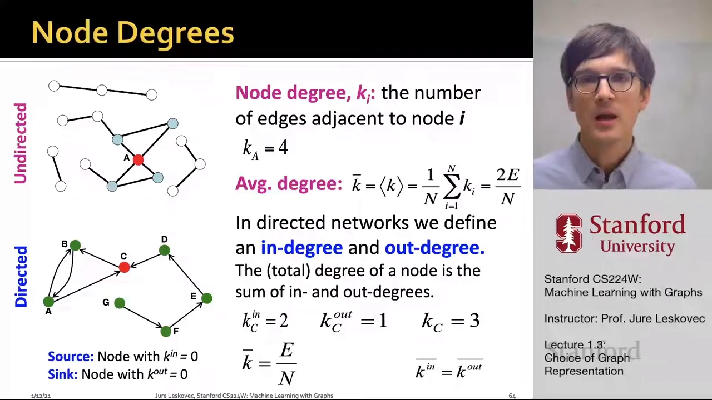

注意这里的因果顺序：不是"因为有向图更复杂所以度要拆开"，而是**方向本身携带了信息，度作为方向的统计量必须跟着拆**。这也预告了后面几节的内容：方向会一路影响到邻接矩阵的形状、消息传递的方向、以及连通性的定义。

## 五、二部图：节点分两类时，边只跨类不跨内

第三类设计选择是**节点是否分类型**。**二部图（bipartite graph）**的节点可以分成两个不相交的集合 $U$ 和 $V$，每条边都只连接 $U$ 中的一个节点和 $V$ 中的一个节点；也就是说 $U$ 和 $V$ 各自是**独立集**，同类之间不相连。[【跳转到 05:58】](https://www.youtube.com/watch?v=P-m1Qv6-8cI&t=358)

自然出现的二部图例子很多：作者与他们写的论文、演员与他们出演的电影、用户与他们评分过的电影、食谱与它包含的配料，还有顾客与他们买过的商品。[【跳转到 06:23】](https://www.youtube.com/watch?v=P-m1Qv6-8cI&t=383)

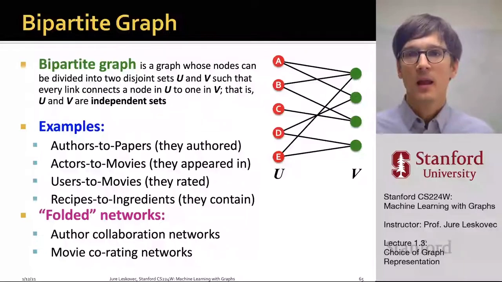

二部图之后还有一个常用操作：**折叠图或投影图（folded / projected network）**。做法是只保留一侧的节点，连边规则是"如果两个节点至少有一个共同邻居，就在它们之间连一条边"。[【跳转到 07:18】](https://www.youtube.com/watch?v=P-m1Qv6-8cI&t=438) 如果左边是作者、右边是论文，投影就等于说：两位作者只要合作过至少一篇论文就连一条边，于是得到**合作者网络**。视频里 1、2、3 合著了同一篇论文，所以两两相连；3 和 4 没有合作过，所以之间没有链接；5 和 2 合作过，所以有链接。同样的方式也可以把二部图投影到右侧，得到论文之间的图。[【跳转到 08:08】](https://www.youtube.com/watch?v=P-m1Qv6-8cI&t=488)

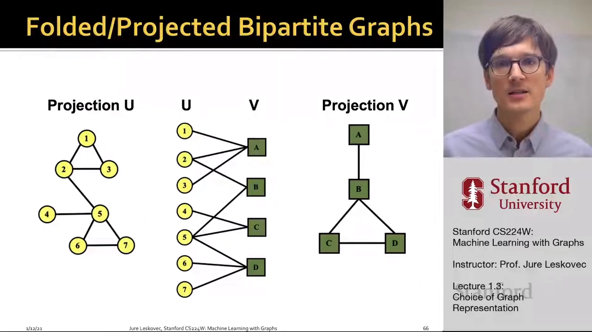

投影这一步值得单独记住，因为它是一次**有损压缩**：投影之后，"两位作者是通过哪几篇论文合作的""合作了几次"这些信息在拓扑里已经看不出来了。如果这些信息对任务重要，就必须把它们转成边权重或边属性写回去——这正好接上后面第八、九章讲的属性层。

## 六、邻接矩阵把拓扑写成数组，对称性就是方向的痕迹

拓扑可以用多种数据结构承载，最标准的是**邻接矩阵（adjacency matrix）**。对一个有 $n$ 个节点的图，构造一个 $n\times n$ 的方阵 $A$，规则是：

$$
A_{ij} = \begin{cases} 1 & \text{若存在从节点 } i \text{ 到节点 } j \text{ 的链接} \\ 0 & \text{否则} \end{cases}
$$

无向图的邻接矩阵是**二值**的，只取 0 和 1。因为 1 和 2 相连时，第 1 行第 2 列是 1，同时第 2 行第 1 列也是 1，所以**无向图的邻接矩阵天然对称**：$A_{ij}=A_{ji}$。[【跳转到 09:23】](https://www.youtube.com/watch?v=P-m1Qv6-8cI&t=563)

如果图是有向的，矩阵就不再对称：2 指向 1 时那个位置是 1，但 1 并不指回 2，所以对称位置是 0。**矩阵的对称性，就是"边有没有方向"这件事在数组上的痕迹**。

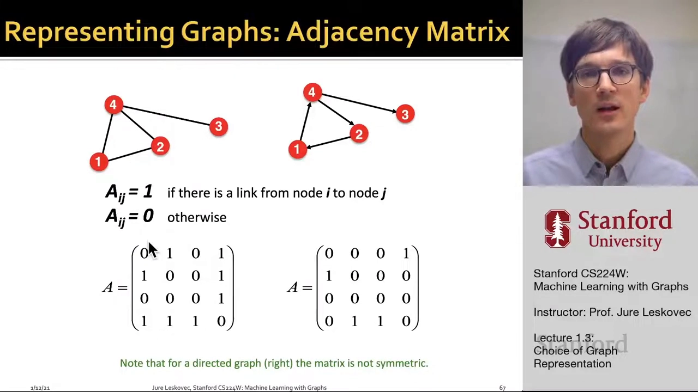

度也可以直接从矩阵读出来，不必回头数边：

- 无向图：$k_i = \sum_{j=1}^{N} A_{ij}$，即对某一行求和（等价于对列求和）；
- 有向图：$k_i^{out} = \sum_{j=1}^{N} A_{ij}$ 是行和，$k_j^{in} = \sum_{i=1}^{N} A_{ij}$ 是列和。

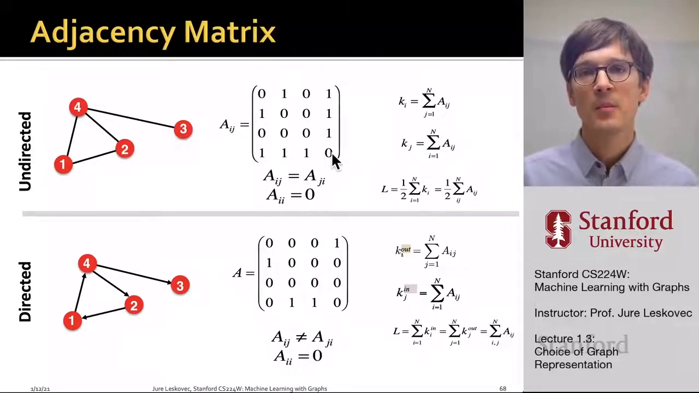

真实网络的邻接矩阵还有一个必须知道的特征：**极度稀疏**。把矩阵画成点图——有边的位置点一个点，没边的位置留空——得到的是大片空白的图。[【跳转到 10:38】](https://www.youtube.com/watch?v=P-m1Qv6-8cI&t=638) 原因不难推：$n$ 个节点的网络里，一个节点的最大度是 $n-1$，因为原则上它可以连到其他每一个节点；但人类社交网络里没有人有七十亿个朋友，实际的朋友数要小得多。[【跳转到 11:17】](https://www.youtube.com/watch?v=P-m1Qv6-8cI&t=677) 电网、互联网连接、科学合作、邮件图也都如此，平均度大概在 10 左右，最多到 100。[【跳转到 12:07】](https://www.youtube.com/watch?v=P-m1Qv6-8cI&t=727)

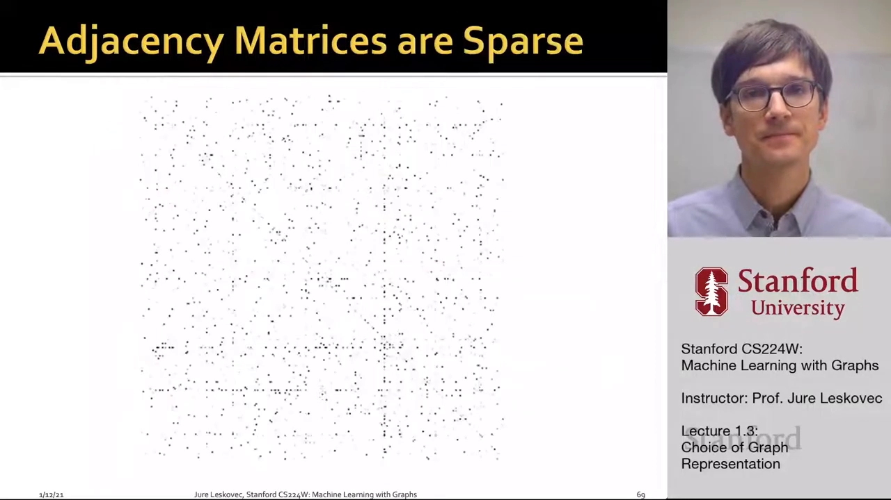

后果是工程性的：**邻接矩阵永远存成稀疏矩阵**，不会存成稠密数组。这一点在写图网络代码时会直接体现为稀疏矩阵乘法，而不是普通的二维数组运算。

## 七、边列表与邻接表：同一张图的另外两种存法

邻接矩阵不是唯一选择。第二种是**边列表（edge list）**，也就是一串边的清单，写成 $(2,3)$、$(2,4)$、$(3,2)$ 这样的一对对节点编号。[【跳转到 12:32】](https://www.youtube.com/watch?v=P-m1Qv6-8cI&t=752)

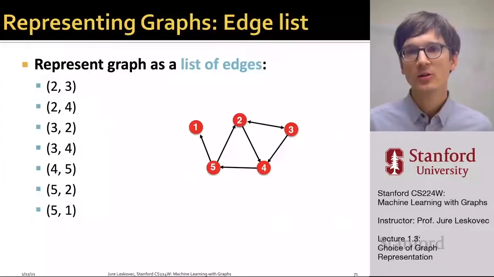

边列表在深度学习框架里很流行，因为它天然就是一个二维矩阵，喂给框架很方便。它的问题是**很难做图的分析和操作**：连算一个节点的度都不简单，得把整个列表扫一遍数出现次数。

第三种是**邻接表（adjacency list）**：对每个节点，只存一份它的邻居列表。邻接表对大型稀疏网络更友好，因为它能快速取出某个节点的全部邻居。如果图是无向的，存邻居就够了；如果图是有向的，就要按方向分别存**出邻居**和**入邻居**。[【跳转到 12:57】](https://www.youtube.com/watch?v=P-m1Qv6-8cI&t=777)

三种存法的分工可以这样记：

| 存法 | 适合什么 | 主要代价 |
| --- | --- | --- |
| 邻接矩阵 | 需要矩阵运算、看谱性质 | 稀疏时浪费空间 |
| 边列表 | 喂给深度学习框架、批量处理 | 难以做邻域查询 |
| 邻接表 | 快速取邻居、遍历 | 不便做整体矩阵运算 |

这张表本身也说明一件事：**"图"是一个抽象对象，邻接矩阵、边列表、邻接表只是它的三种编码**。选哪种编码，取决于接下来要做矩阵运算还是邻域遍历，而不是取决于图本身。

## 八、三层属性：节点、边、整图各挂各的信息

到这里讲的都还是拓扑。视频最后一部分补上了另一半：**图可以带属性**，而且属性分三层。

**第一层，边属性。** 一条边可以有：

- **权重（weight）**：关系有多强，例如通信频率；
- **排名（ranking）**：最好的朋友、第二好的朋友；
- **类型（type）**：朋友、亲戚、同事；
- **符号（sign）**：友好还是敌对，信任还是不信任；
- **依赖其余图结构的性质**：例如共同好友的数量。

[【跳转到 13:47】](https://www.youtube.com/watch?v=P-m1Qv6-8cI&t=827) 边属性还可以更具体：一通电话可以有通话时长。

**第二层，节点属性。** 如果节点是人，可以是年龄、性别、兴趣、位置；如果节点是一种化学物质，可能是化学质量、化学式，以及这种化学物质的其他性质。[【跳转到 14:12】](https://www.youtube.com/watch?v=P-m1Qv6-8cI&t=852) 这里讲者给的正是分子图的方向：**如果节点是一种化学物质，化学质量、化学式就是节点的属性**。把这句话落回分子图，就是每个原子节点上挂一组描述该原子的量（元素种类、电荷、质量等）——视频只举到"化学质量、化学式"，具体字段取决于所建的那张图。

**第三层，整图属性。** 整张图也可以有特征或属性，来自这张图所建模的那个对象本身的性质。[【跳转到 14:37】](https://www.youtube.com/watch?v=P-m1Qv6-8cI&t=877) 对分子来说，这就是"整个分子一个值"的那些性质（分子量、logP、毒性等，本节按分子场景举例）；对社交图来说，可能是这个社群的规模或活跃度。

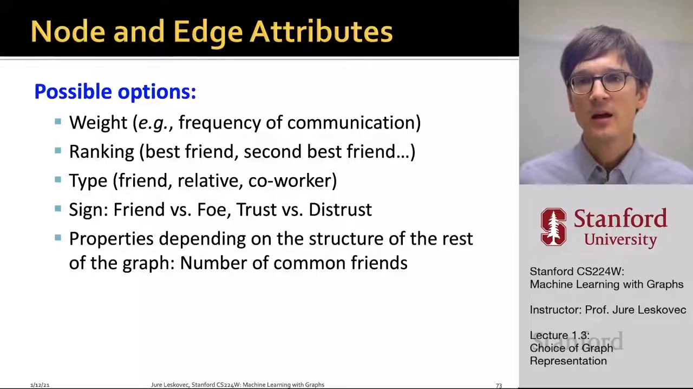

三层属性合起来，讲者给出了一句总结：我们要考虑的图**不只是拓扑（节点和边），还包括挂在它们上面的属性**。[【跳转到 15:02】](https://www.youtube.com/watch?v=P-m1Qv6-8cI&t=902)

这句话为什么重要？因为它解释了图网络和普通神经网络的分工。拓扑决定"信息沿哪条路走"，属性决定"路上传的是什么"。同一张分子图，只给元素种类和只给元素种类加电荷，是两种不同的输入；同一张社交图，边上有权重和没权重，聚合时能不能加权也不一样。**属性不是装饰，它决定了模型实际能利用多少信息。**

## 九、属性可以写进矩阵，也可以留在矩阵外

属性有了，下一个问题是：它们放在哪？视频给了一个很实用的判据——**能塞进邻接矩阵的，就塞进去；塞不进去的，才单独存一张表**。

最典型的例子是边权重。邻接矩阵不必是二值的，可以取实数值，连接的强度就对应那个位置上的数值。视频里的对照是：无权图的矩阵只有 0 和 1；加权图的矩阵里，2 和 4 之间是 4（强连接），1 和 3 之间是 0.5（弱连接）。[【跳转到 15:14】](https://www.youtube.com/watch?v=P-m1Qv6-8cI&t=914)

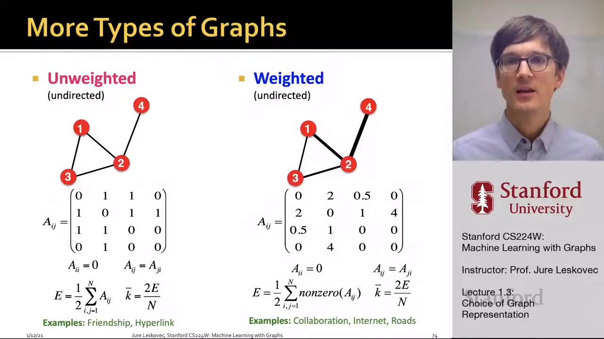

两个细节跟着变。第一，**自环对应邻接矩阵对角线上的元素**：节点 4 有一个自环，它的度就等于 3。[【跳转到 15:39】](https://www.youtube.com/watch?v=P-m1Qv6-8cI&t=939) 第二，**多重图（multi-graph）**允许一对节点之间有多条边。有时可以把多重图看成加权图，矩阵里的元素就是边的条数；但有时你想把每条边单独表示出来，因为这些边可能有不同的性质、不同的属性。[【跳转到 16:04】](https://www.youtube.com/watch?v=P-m1Qv6-8cI&t=964)

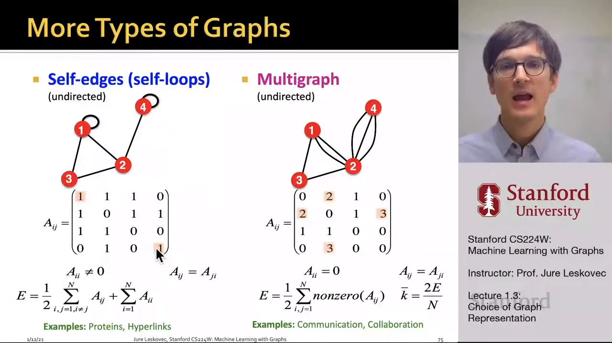

注意视频在这张幻灯片上标注的例子：自环的典型场景是**蛋白质**和超链接。也就是说，自环不是数学玩具，真实数据里就会出现"某个实体与自己相互作用"的记录；建图时必须决定是保留它，还是把它合并进节点特征里。

自环和多重图在现实中都很常见。电话、转账这类场景里，一对节点之间可以发生多次交易，用多重图就能准确表示。[【跳转到 16:29】](https://www.youtube.com/watch?v=P-m1Qv6-8cI&t=989)

反过来，节点属性和整图属性**没法**塞进 $n\times n$ 的邻接矩阵——它们不是"两个节点之间的关系"。所以它们必须单独存成特征矩阵：节点属性是一个 $n\times d$ 的矩阵（每行一个节点），整图属性是一个长度为 $d'$ 的向量（每张图一个）。这一句是本节按 15:02 的表述补的落地写法——视频只说了"属性挂在图上"，没有给出矩阵形状，但形状决定了后面模型里张量的维度约定。这就把第八、九两章合起来了：**属性分三层，其中只有边属性有可能被吸收进邻接矩阵，另外两层必须另找地方放。**

## 十、连通性：图能不能走通，决定消息能不能传到

最后一个设计维度是**连通性（connectivity）**：这张图是连通的还是不连通的。

**无向图**里，如果任意一对节点都能沿着边走到彼此，图就是**连通的**。不连通的图由两个或更多**连通分量（connected component）**组成。视频里的例子有三个分量：一个主分量、一个小分量，以及一个孤立节点 $h$。最大的那个分量有个专门名字，叫**巨分量（giant component）**。[【跳转到 16:54】](https://www.youtube.com/watch?v=P-m1Qv6-8cI&t=1014)

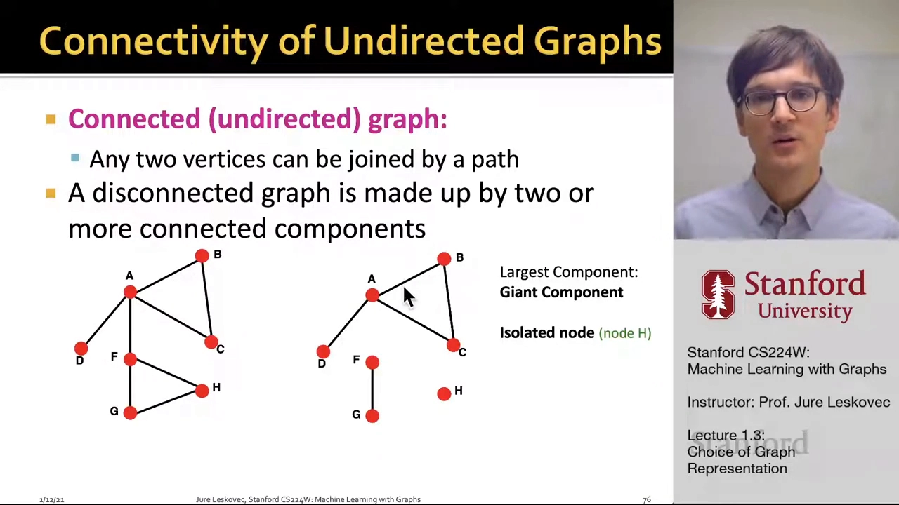

连通性在邻接矩阵上会留下很直观的痕迹：**分块对角结构（block diagonal）**。如果图由两个分量组成，边只出现在同一个分量内部的节点之间，非对角的部分全是 0，也就是两个分量之间没有边。[【跳转到 17:19】](https://www.youtube.com/watch?v=P-m1Qv6-8cI&t=1039)

**有向图**要区分两种连通性：

- **弱连通（weakly connected）**：忽略边的方向之后是连通的；
- **强连通（strongly connected）**：对任意一对节点都存在有向路径，即既有从 $A$ 到 $B$ 的路径，也有从 $B$ 回到 $A$ 的路径。

[【跳转到 18:09】](https://www.youtube.com/watch?v=P-m1Qv6-8cI&t=1089)

顺着强连通可以定义**强连通分量（strongly connected component, SCC）**：图里这样一组节点，组内每个节点都能通过有向路径到达其他任何节点。视频里的 $A$、$B$、$C$ 构成一个强连通分量，因为它们在一个环上。[【跳转到 18:59】](https://www.youtube.com/watch?v=P-m1Qv6-8cI&t=1139) 视频还补了两个配套概念：能到达该 SCC 的节点叫**入分量（in-component）**，能从该 SCC 到达的节点叫**出分量（out-component）**。

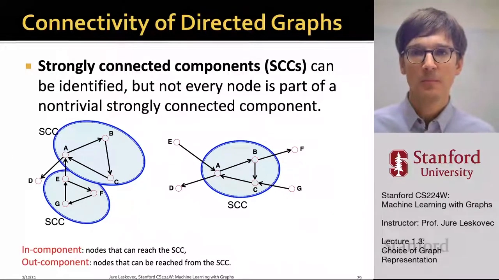

连通性为什么值得放在"数据表示"这一节而不是"图论"里？因为它直接决定消息传递能不能发生。消息传递沿着边走，两个节点如果在不同的连通分量里，无论堆多少层，消息也传不过去。所以在建图阶段就要检查：**任务需要的信息，是否落在同一个连通分量里？** 如果不是，加层是无效的，得先改图。

## 小结

- 图只有两个成分：**节点集合 $N$ 和边集合 $E$**，写作 $G=(N,E)$。属性、权重、类型、方向都不是第三种成分，而是挂在这两者或它们的整体上的信息。
- **图表示是一次建模选择，不是数据的固有属性**。同一批人可以连成职业网络，同一批论文可以按引用连也可以按标题用词连；后者仍是合法的图，只是刻画的不是你想研究的机制。构图方式决定能问什么问题。
- **方向**要按"把边反过来这句话还成立吗"来判断：合作、友谊、蛋白质相互作用是无向的；电话、转账、关注是有向的。方向丢了，信息就永久丢失。
- 方向一旦确定，**度必须拆成入度和出度**；无向图里 $\bar{k}=2E/N$，自环贡献 2 度。
- **二部图**的两个分区各自独立，投影成折叠图是一次有损压缩，被压掉的信息要转成权重或属性写回去。
- **邻接矩阵**把拓扑写成数组：无向图对称，有向图不对称；度就是行和或列和。真实网络极度稀疏，所以永远存稀疏矩阵。
- 同一张图有**邻接矩阵、边列表、邻接表**三种编码，选哪种取决于接下来要做矩阵运算还是邻域遍历。
- **属性分三层**：节点属性、边属性、整图属性。只有边属性可能被吸收进邻接矩阵，另外两层必须单独存成特征矩阵。
- **连通性**决定消息能不能传到：不同连通分量之间，堆多少层都没用。

## 关键术语速查

| 术语 | 一句话解释 |
| --- | --- |
| 节点（node / vertex） | 图里的实体，如一个人、一个原子、一篇论文 |
| 边（edge / link） | 两个节点之间的相互作用，如友谊、化学键、引用 |
| 有向图（directed graph） | 每条边有源点和终点的图，如电话呼叫、Twitter 关注 |
| 无向图（undirected graph） | 边没有方向的图，刻画对称或互惠关系，如合作、友谊 |
| 度（degree）$k_i$ | 与节点 $i$ 相邻的边的数目；无向图里 $\bar{k}=2E/N$ |
| 入度 / 出度 | 有向图里指向该节点 / 从该节点指出去的边的数目 |
| 源点 / 汇点 | 入度为 0 / 出度为 0 的节点 |
| 自环（self-loop） | 节点连向自己的边，写在对角线上，给度贡献 2 |
| 二部图（bipartite graph） | 节点分两个分区、边只跨分区的图，如作者—论文、用户—电影 |
| 投影图（projected graph） | 只保留二部图一侧节点、按"有共同邻居就连边"得到的图，有损 |
| 邻接矩阵（adjacency matrix） | $n\times n$ 矩阵，$A_{ij}=1$ 表示 $i$ 到 $j$ 有边；无向图对称 |
| 边列表（edge list） | 把图存成一串节点对，便于喂给深度学习框架，不便做邻域查询 |
| 邻接表（adjacency list） | 每个节点存一份邻居列表，便于快速取邻居 |
| 多重图（multi-graph） | 允许一对节点之间有多条边的图，如多次转账 |
| 连通分量（connected component） | 不连通图里各自连通的一块；最大的一块叫巨分量 |
| 强连通分量（SCC） | 有向图里组内任意两节点互相可达的节点集合 |
| 节点 / 边 / 整图属性 | 分别挂在节点上、边上、整张图上的特征；只有边属性可能进邻接矩阵 |