# 边的来源决定消息能传什么：化学键图、空间邻接图与相互作用图

> 视频来源：[Modeling molecules with geometric ML methods](https://www.youtube.com/watch?v=aHdYC2NIAlA)（YouTube · Jousef Murad LITE，讲者 Hannes Stärk）｜时长约 60 分钟
> 视频来源：[Protein-protein interaction network analysis through consensus prediction and virtual reality visualization](https://www.youtube.com/watch?v=haGOr7Uvd5I)（YouTube · ISMB 2022 SysMod，讲者 Eric Bell）｜时长约 20 分钟
> 导读：前一支讲清"分子怎么变成图、消息怎么在图上走"，后一支讲清"蛋白之间的相互作用边是怎么攒出来的"。本文只取两支视频中与构图有关的部分：三类图的节点、边与来源，以及换一种边之后消息传递多传了什么、少传了什么。字幕为英文自动生成，本文已按上下文订正断句与术语拼写（例如 coarse-grained、radius graph、co-immunoprecipitation、likelihood ratio）。

## 本讲要解决的核心问题（SCQA）

**背景**：图神经网络（graph neural network, GNN）的基本动作是**消息传递**：每个节点收集邻居发来的消息，更新自己的表示。只要图建好，后面几层网络几乎是同一套模板。

**冲突**：但"分子是一张图"这句话并不唯一。同一个分子，按化学键连是一张图，按三维坐标里的距离连是另一张图；同一批蛋白，按物理接触连是一张图，按功能关联连是另一张图。节点集合甚至可以不变，图却完全不同。更麻烦的是，边的来路差别很大：化学键来自成键规则，空间邻接来自几何坐标，相互作用边则往往来自实验、数据库和预测模型的拼接。

**疑问**：这三类图的节点到底是什么？边从哪里来？换一种边，消息传递因此能传到什么、又传不到什么？

**回答（中心思想）**：**消息传递的能力上限由边决定**。化学键图让消息沿共价骨架流动，能看到化学环境却看不到空间邻近；空间邻接图让消息沿距离流动，能看到非键接触却丢掉了键级语义；相互作用图让消息在分子之间流动，能传播功能关联却传不了原子级细节。构图不是数据预处理的小事，而是决定模型能问什么问题的建模选择。[【跳转到 07:01】](https://www.youtube.com/watch?v=aHdYC2NIAlA&t=421)

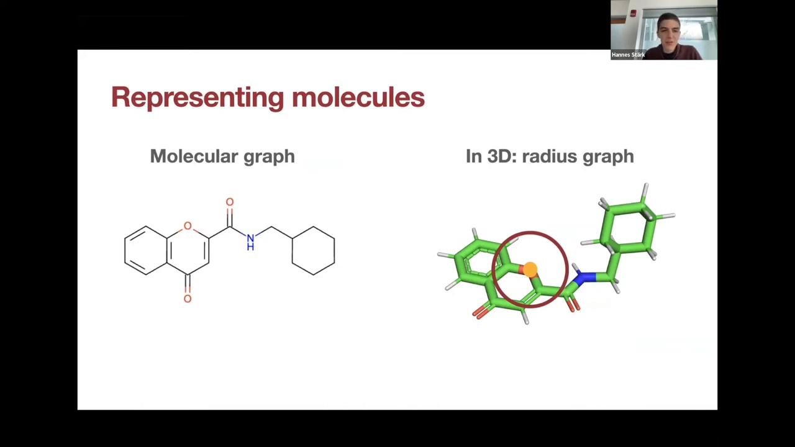

## 一、先看消息传递：边决定谁能给谁发消息

要把三类图放在一起比较，先得有一个共同的参照系，这个参照系就是消息传递的更新规则。

讲者给的最小版本只有两步。第一步造消息：取节点 $i$ 的特征向量 $x_i$ 和节点 $j$ 的特征向量 $x_j$，把它们拼起来，再拼上这条边的边特征 $e_{ij}$，送进一个小神经网络，得到一个向量 $m_{ij}$。[【跳转到 17:39】](https://www.youtube.com/watch?v=aHdYC2NIAlA&t=1059)

$$
m_{ij} = \phi\big(x_i,\ x_j,\ e_{ij}\big)
$$

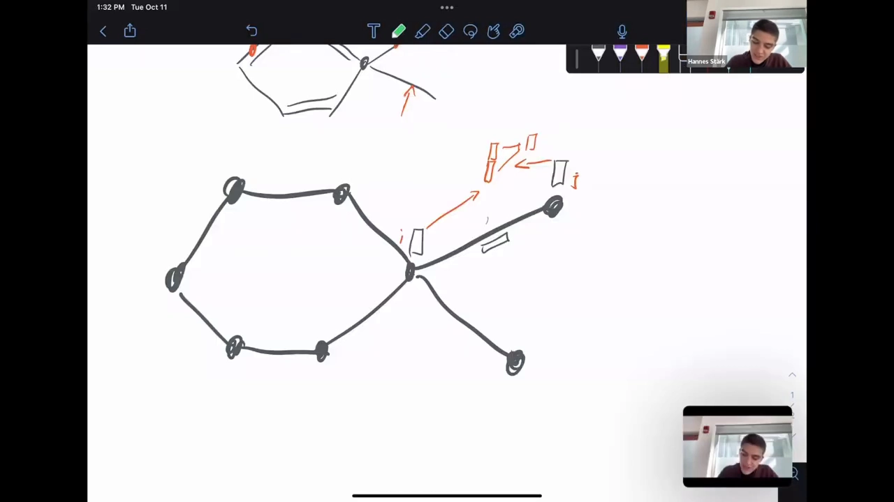

第二步更新节点：把节点 $i$ 与所有邻居之间的消息加起来，再过一个神经网络，得到新的节点特征。[【跳转到 18:29】](https://www.youtube.com/watch?v=aHdYC2NIAlA&t=1109)

$$
x_i' = h\Big(\sum_{v \in N(i)} m_{iv}\Big)
$$

这里 $N(i)$ 是节点 $i$ 的**邻居集合**，也就是所有与它有一条边的节点。这两步对所有节点同时做一遍，就叫一层消息传递；重复若干层，最后把全图节点特征做求和、均值或最大**池化（pooling）**，得到一个整图向量，再接分类或回归头。[【跳转到 21:08】](https://www.youtube.com/watch?v=aHdYC2NIAlA&t=1268)

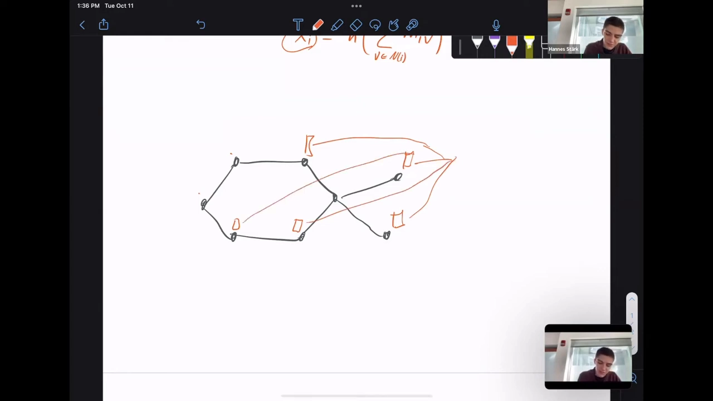

这套规则里有两处位置被"图"占住了，而网络结构本身管不着：

- **邻居集合 $N(i)$** 完全由图决定。谁在集合里，谁就能给 $i$ 发消息；不在集合里的节点，哪怕空间上贴着、功能上强相关，也一个字都传不过来。
- **边特征 $e_{ij}$** 完全由图决定。边上有距离，消息里就有距离；边上只有键级，消息里就只有键级。

所以"构图选择如何改变消息传递"这个问题，可以拆成两句更具体的问话：这条边让谁成为谁的邻居？这条边随身带了什么信息？下面三类图，就是对这两问的三种回答。

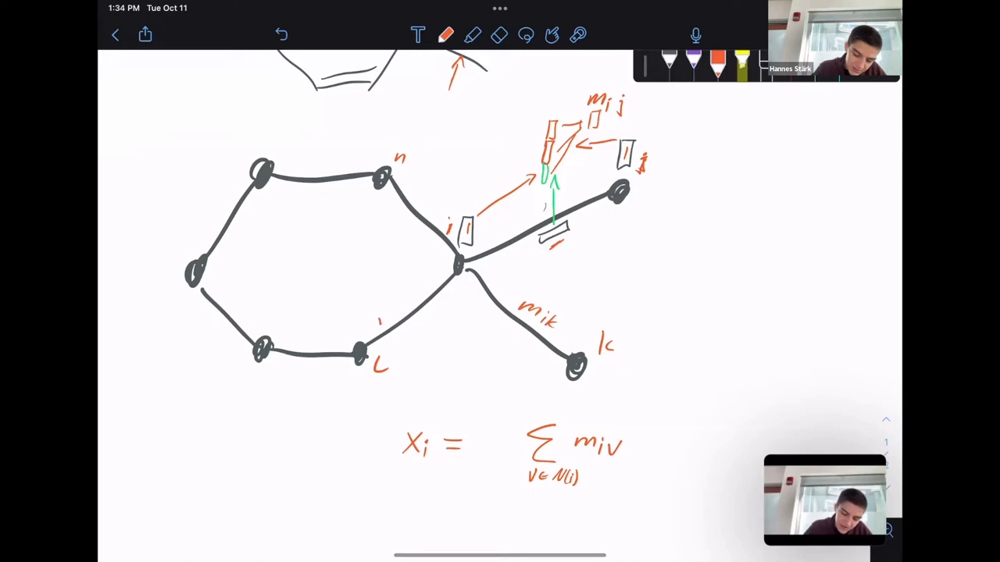

## 二、化学键图：原子是节点，键是边，消息沿共价骨架流动

最自然的一版构图，讲者一句话说完：**分子本质上就是图，原子是节点，原子之间有成键就连一条边**。[【跳转到 07:01】](https://www.youtube.com/watch?v=aHdYC2NIAlA&t=421)

这条边的来源是化学：两个原子之间是否存在共价键，由价键规则和分子结构决定，不依赖任何坐标。即使只拿到一张二维结构式，也能把这张图完整画出来。这也是它最实用的地方——很多分子数据只有连接关系，没有实验测定的三维结构。

节点和边都可以挂特征，讲者列了一串：[【跳转到 14:23】](https://www.youtube.com/watch?v=aHdYC2NIAlA&t=863)

- **节点特征**：原子类型（碳、氧、氢、氮等）、电负性、所在环的个数。
- **边特征**：单键还是双键、这条键是否在环内。

于是这张图上的消息传递在做什么，就非常清楚了：一层之后，每个原子知道的是"我直接成键的邻居是谁、通过什么键连的"；两层之后，知道"邻居的邻居"；层数越多，感受野沿着共价骨架一圈圈往外扩。

**它传得到什么**：沿键路径的化学环境。官能团、环系、取代基的影响，都是沿着键一步步传过去的，这正是化学家描述分子性质时用的语言。

**它传不到什么**：任何不经过化学键的关系。两个原子在空间上贴得很近但没有成键（比如分子内氢键、芳环堆叠、蛋白里两个残基的侧链接触），在这张图上彼此根本不是邻居，消息一步也走不过去。换句话说，**化学键图看不见"通过空间"的相互作用，只看得见"通过键"的相互作用**。

## 三、空间邻接图：有三维坐标，边就改由距离生成

现实里的分子不只有连接关系，还常常有三维坐标：每个原子除了原子类型，还带一个空间位置。[【跳转到 08:41】](https://www.youtube.com/watch?v=aHdYC2NIAlA&t=521) 这时候讲者说，常用的做法是换一张图——**半径图（radius graph）**：以每个原子为圆心画一个给定半径的球，球内的其他原子都连一条边。[【跳转到 09:06】](https://www.youtube.com/watch?v=aHdYC2NIAlA&t=546)

这张图的边不再来自化学，而来自几何：**边是否存在，取决于两个原子的距离是否小于半径**；边特征自然就是这两个原子之间的距离。[【跳转到 09:31】](https://www.youtube.com/watch?v=aHdYC2NIAlA&t=571)

两类图的差别，一望即知：

- 化学键图的边数大致等于键数，稀疏且由化学决定；半径图的边数由半径和局部密度决定，同一个分子换个半径就是另一张图。
- 化学键图里，一对邻居必然成键；半径图里，邻居可能成键，也可能只是靠得近。反过来，成键的两个原子如果被拉得足够远（这在真实构象里很少见，但在建模里并非不可能），半径图反而会漏掉这条键。
- 化学键图天然带键级；半径图天然带距离。前者是化学语义，后者是几何量。

消息传递的后果随之改变。半径图上，一个原子第一层就能收到"空间上挨着我的所有原子"的消息，包括没有成键的那些；这正是描述非键相互作用、位阻、堆积所需要的邻居。代价是，**键级这类化学语义不会自动出现**——除非你把键级也作为边特征补进去，否则模型只知道"这两个原子离得近"，不知道"这两个原子之间是双键"。

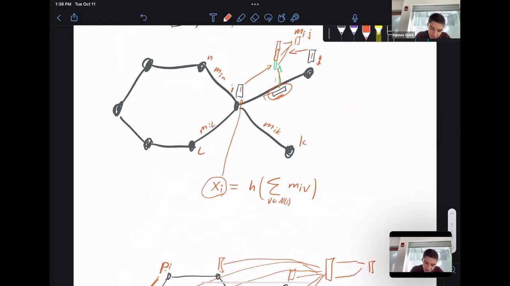

## 四、节点粒度也是构图选择：原子图与残基图

换到蛋白这种大分子，构图还多出一个自由度：**节点可以取多大**。

蛋白也是分子，由 20 种氨基酸按序列连成链，序列决定它折叠成什么三维结构。[【跳转到 10:21】](https://www.youtube.com/watch?v=aHdYC2NIAlA&t=621) 最直接的做法，是照搬小分子的套路：把蛋白里每一个原子都当节点，按半径连边。[【跳转到 10:46】](https://www.youtube.com/watch?v=aHdYC2NIAlA&t=646)

但讲者说，实际更常见的是**粗粒化（coarse-grained）**：只把氨基酸（残基）当节点，一个残基一个点，节点数一下少了一两个数量级。[【跳转到 11:11】](https://www.youtube.com/watch?v=aHdYC2NIAlA&t=671) 好处很直接：计算更省，而且很多任务本来也不需要原子级分辨率。[【跳转到 11:48】](https://www.youtube.com/watch?v=aHdYC2NIAlA&t=708)

这里的**残基（residue）**指蛋白链上的一个氨基酸单元。把残基当节点，等于承认"这个位置上的氨基酸是什么"比"这个位置上的每个原子在哪"更重要。

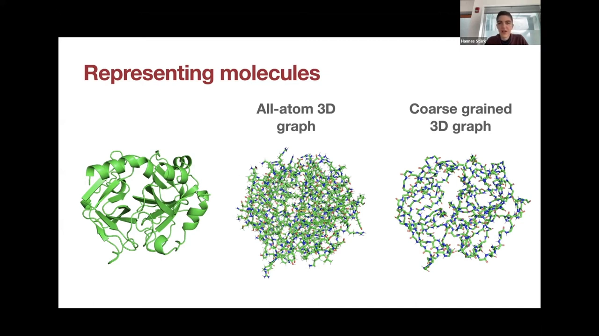

粒度一换，消息传递能传的东西也换了。原子图上，消息能分辨到具体是哪个原子在接触，能描述氢键、盐桥这种级别的细节；残基图上，消息只到"这两个残基挨着"这一层，原子级细节被平均掉了。这不是精度损失那么简单，而是**问题层级被换掉了**：残基图适合问"这个蛋白催化什么反应""它和哪个分子结合得紧"，原子图才适合问"这个接触的具体几何是什么"。

讲者还给了一个折中方案：**多尺度图**。粗粒度的残基图负责整体结构，细粒度的表面原子图负责结合界面，两张图之间用边连起来，消息可以在两个尺度之间来回传。[【跳转到 27:31】](https://www.youtube.com/watch?v=aHdYC2NIAlA&t=1651)

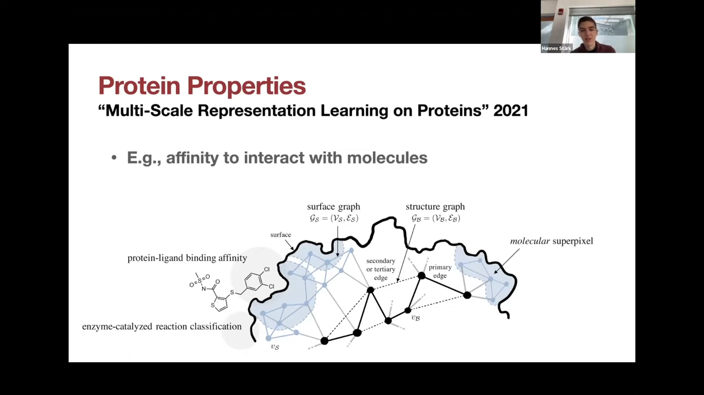

这张图说明的是同一件事的另一面：**粒度不是非此即彼的选择，也可以在同一张图里并存**。但每加一层尺度，就多一类边、多一套邻居集合，消息传递的路径也随之变复杂。

## 五、三维信息进入消息的两条路：边特征与坐标

有了三维坐标之后，还有第二种用法：坐标不一定用来改拓扑，也可以只用来改边特征。

讲者说，常见的做法是把节点之间的距离算出来，编码一下，作为额外的边特征拼进消息构造里。[【跳转到 22:23】](https://www.youtube.com/watch?v=aHdYC2NIAlA&t=1343) 这样一来，拓扑仍然是化学键图，但每条边随身带了一个几何量，消息里就同时含有"我们成什么键"和"我们隔多远"。

这条路线在分子动力学里被推到极致。讲者举了 NequIP 的例子：把一个小分子和一块材料放进同一张图，分子与材料之间按距离连边；整张图输出一个数——当前状态的能量。[【跳转到 42:07】](https://www.youtube.com/watch?v=aHdYC2NIAlA&t=2527) 训练好之后，对这个能量关于坐标求梯度，沿梯度方向挪动坐标，就得到一步动力学演化。[【跳转到 43:47】](https://www.youtube.com/watch?v=aHdYC2NIAlA&t=2627)

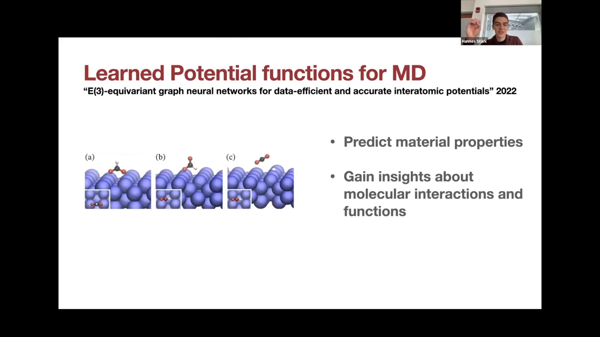

这个例子值得停一下：这里的图**不是**化学键图，而是"化学键 + 距离"的混合图。它同时需要两种边——分子内部需要键来决定哪些原子是一个整体，分子与表面之间需要距离来决定哪些接触在物理上重要。换句话说，真实任务经常不选边，而是把几类边拼进同一张图；一旦拼进去，消息传递就同时获得了两类邻居。

## 六、相互作用图：节点是蛋白，边是实验、数据库与预测拼出来的

前面三类图的对象都是"一个分子内部"。再往上走一层，节点换成整个分子，边换成分子之间的相互作用，就得到**相互作用图**。讲者开场给的理由很直接：细胞里很多蛋白只有在与其他蛋白相互作用时才发挥功能，所以要看懂细胞里发生了什么，就需要一张完整的蛋白—蛋白相互作用网络。[【跳转到 00:14】](https://www.youtube.com/watch?v=haGOr7Uvd5I&t=14)

这张图的边从哪来？讲者列了三条来路。

**第一条是实验**：酵母双杂交（yeast two-hybrid）、串联亲和纯化（tandem affinity purification）、免疫共沉淀（co-immunoprecipitation）——都是通过实验手段判断两个蛋白是否结合或是否处在同一个复合物里。[【跳转到 01:04】](https://www.youtube.com/watch?v=haGOr7Uvd5I&t=64) 但这几种方法单独用都不可靠，它们彼此之间更多是**互补**关系，而不是各自覆盖了真实存在的全部相互作用。于是有了第二条。

**第二条是数据库的证据通道**：以 STRING 为例，一条边可以由共表达（co-expression）、基因邻域（gene neighborhood）、基因融合（gene fusion）、基因共现（gene co-occurrence）等通道拼出来。[【跳转到 05:40】](https://www.youtube.com/watch?v=haGOr7Uvd5I&t=340)

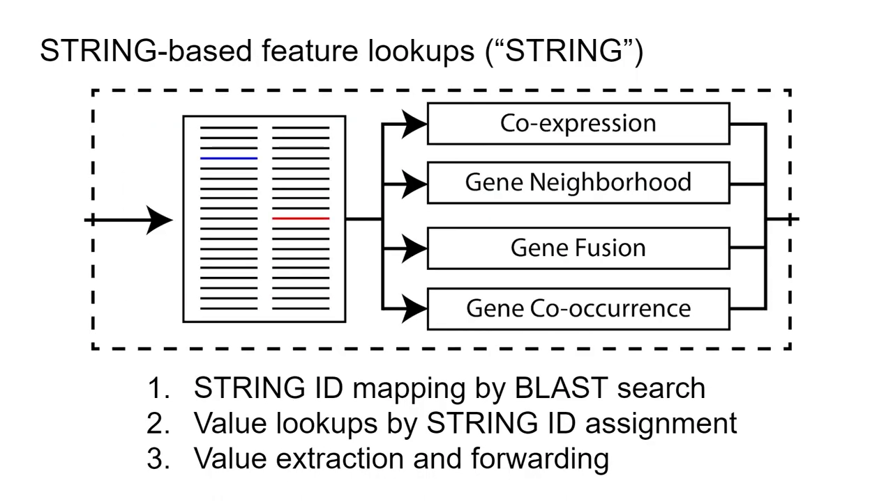

**第三条是计算预测**：讲者自己的 Peppy 流程把若干个独立模块的打分合成一个贝叶斯共识，输出一个相互作用似然比。[【跳转到 03:45】](https://www.youtube.com/watch?v=haGOr7Uvd5I&t=225) 模块里既有基于同源序列搜索的，也有基于结构穿线（threading）的，还有直接查 STRING 拿功能关联分数的。[【跳转到 05:07】](https://www.youtube.com/watch?v=haGOr7Uvd5I&t=307) 这里**同源（homologous）**指两条序列来自共同的演化祖先，序列越相似越可能是同源；**穿线**则是把查询序列套到已知结构模板上，看能不能摆出一个合理的结构。

这里出现了一个关键区分，也是相互作用图最容易被误解的地方：**物理相互作用与功能相互作用不是一回事**。物理相互作用要求两条链之间真的形成界面、发生接触；功能相互作用只要求两者在功能上有关联，并不必然意味着它们贴在一起。[【跳转到 02:31】](https://www.youtube.com/watch?v=haGOr7Uvd5I&t=151)

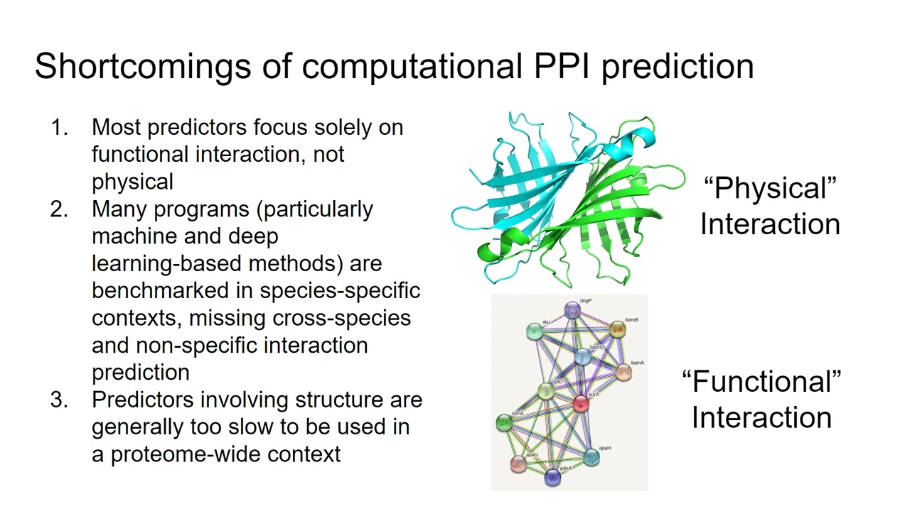

这条区分直接决定了消息传递的语义。如果边是物理相互作用，那么一条边意味着"这两个蛋白有界面"，消息传播的是接触关系；如果边是功能相互作用，一条边只意味着"这两个蛋白在同一个过程里"，消息传播的是功能关联。同样的拓扑，同样的消息传递公式，**读出来的意思完全不同**。

## 七、相互作用图的边带不确定性：打分、共识与网络结构

化学键图的边是确定的：成键就是成键。相互作用图的边不是。它通常是若干证据打分之后的产物。

讲者的做法是：用 800 条来自 IntAct 的实验确认相互作用、800 条来自 Negatome 的实验确认非相互作用做训练集，为每个模块分别拟合正负两类分数分布，预测时算同一个分数在两个分布下的密度之比，取对数后把各模块的对数似然比相加。[【跳转到 06:47】](https://www.youtube.com/watch?v=haGOr7Uvd5I&t=407)

$$
\log LR=\sum_{i}\Big(\log p(\text{score}_i \mid I)-\log p(\text{score}_i \mid NI)\Big)
$$

其中 $I$ 表示相互作用、$NI$ 表示非相互作用，求和遍历所有给出分数的模块。[【跳转到 08:27】](https://www.youtube.com/watch?v=haGOr7Uvd5I&t=507)

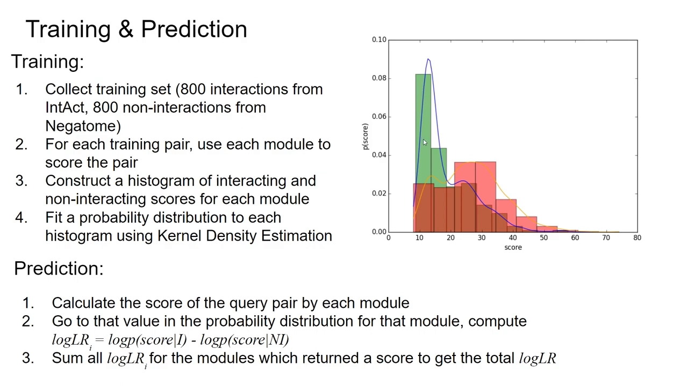

这意味着：**相互作用图里的一条边，本身可能是一个模型的输出**。把这样一张图喂给 GNN 做消息传递，等于让下游模型在"上游模型的判断"上继续推理。上游漏掉的边，下游永远看不到；上游编出来的边，下游会当真。

把流程用到真实数据上，这个特点更明显。讲者拿 SARS-CoV-2 的 31 个蛋白与人类约 2 万个蛋白做全对全预测，得到 403 条相互作用，其中打分最高的是 Spike–ACE2，还包含新冠病毒特有的 Spike–furin；人类蛋白 Serpin G 连到了多个病毒蛋白，成为图里的一个枢纽。[【跳转到 11:06】](https://www.youtube.com/watch?v=haGOr7Uvd5I&t=666)

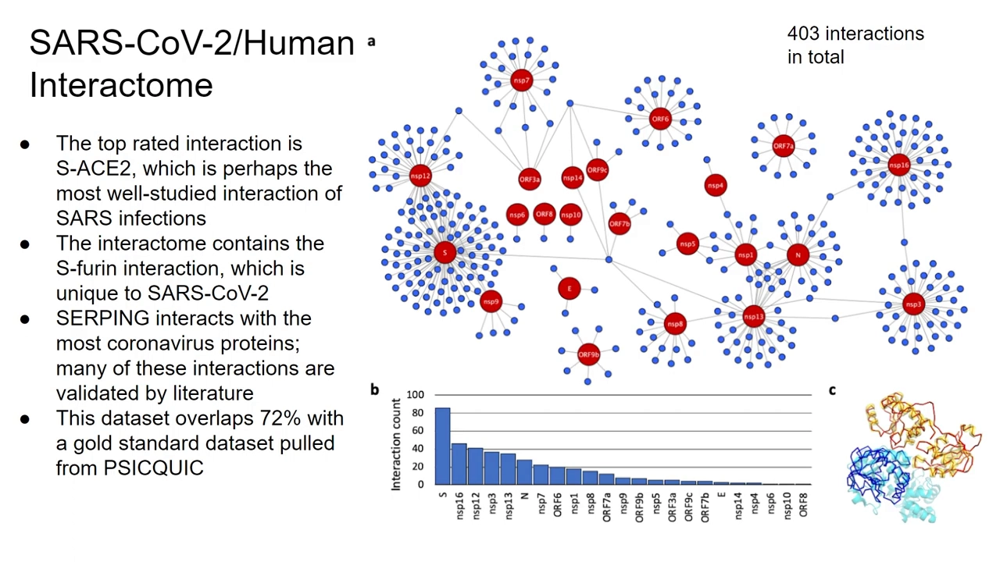

这张图也暴露了相互作用图的另一个特点：**度分布极不均匀**。少数节点连接大量邻居，多数节点只有一两条边。讲者展示二维网络可视化时提到，这种图会挤成一团"毛球"，枢纽节点反而被淹没在里面。[【跳转到 12:52】](https://www.youtube.com/watch?v=haGOr7Uvd5I&t=772)

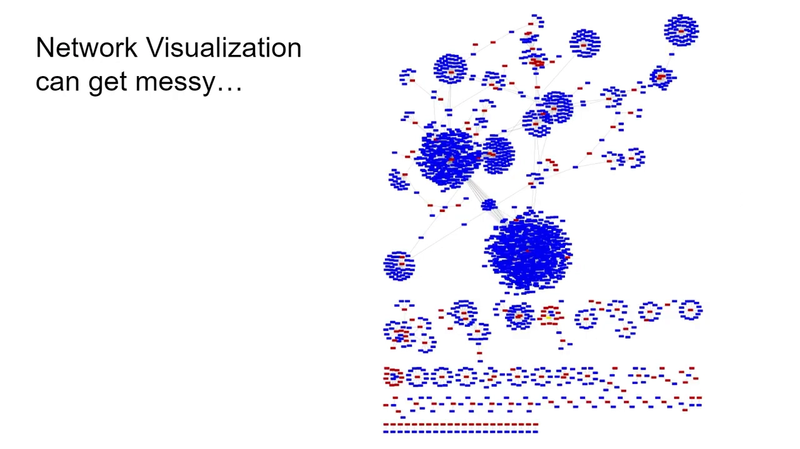

对消息传递来说，这意味着不同节点收到的消息量差别巨大：枢纽节点一轮就聚合了几十个邻居的信息，边缘节点只有一两条。这跟化学键图里"每个碳原子最多四个邻居"的均匀结构完全不同。

## 八、三类图对照：换一种边，就换一套能传的信息

把三类图放在同一张表里，差别集中在四行：节点是什么、边从哪来、边随身带什么、消息因此能传什么。

| 对照项 | 化学键图 | 空间邻接图 | 相互作用图 |
| --- | --- | --- | --- |
| 节点 | 原子（或残基） | 原子（或残基） | 蛋白质、基因等分子实体 |
| 边的来源 | 化学成键关系 | 三维坐标与半径、近邻规则 | 实验、数据库证据通道、计算预测 |
| 边随身带什么 | 键级、是否在环内 | 原子间距离 | 置信度、证据类型 |
| 消息能传到 | 沿共价骨架的化学环境 | 空间邻近，含非键接触 | 分子之间的功能或物理关联 |
| 消息传不到 | 不经过键的空间邻近 | 键级等化学语义（除非另加） | 原子级与界面残基级细节 |

这张表可以读成三句话：

1. **化学键图回答"化学上它是什么"**。消息沿键走，看到的是官能团、环系、取代基，看不到空间上贴着但没成键的邻居。
2. **空间邻接图回答"空间上它挨着谁"**。消息沿距离走，看到的是位阻、堆积、非键接触，但"这条边是双键"这种信息不会自动出现。
3. **相互作用图回答"它在系统里跟谁有关"**。消息在分子之间走，看到的是功能关联或物理接触，但看不到任何原子级细节，而且边本身可能是预测出来的。

还有一点容易被忽略：这三类图**可以叠在同一批对象上**。讲者的 NequIP 例子就是化学键与距离混合；多尺度蛋白图是残基图与表面原子图用边相连。构图不是三选一，而是"要给消息传递开哪几条路"。

## 九、构图选择的后果：下游任务只回答图允许它回答的问题

讲者后半段过了一串应用，正好可以当作构图选择的证据。

**分子性质预测**：2017 年那篇把消息传递框架带进化学的工作，预测的是小分子的量子性质，比如某个构象的能量；这些能量本来就对应一个三维结构，所以他们的图里也把距离当作额外的边特征。[【跳转到 25:01】](https://www.youtube.com/watch?v=aHdYC2NIAlA&t=1501)

**定向消息传递**：Chemprop 把消息传递改成有方向的，每次都要考虑消息往哪个方向走、从哪个方向来。[【跳转到 29:41】](https://www.youtube.com/watch?v=aHdYC2NIAlA&t=1781) 这套框架后来被用来在几百万分子的库里筛抗生素候选，最终帮助发现了 halicin——但讲者特意强调，GNN 在这项发现里只占很小一部分，大部分工作仍然是人做的。[【跳转到 31:21】](https://www.youtube.com/watch?v=aHdYC2NIAlA&t=1881)

**分子生成**：按片段逐步拼出分子，每一步预测下一个片段是什么、接在哪里，用的仍是图神经网络。[【跳转到 33:09】](https://www.youtube.com/watch?v=aHdYC2NIAlA&t=1989)

**构象生成**：只生成扭转角，因为键长和键角在小分子里本来就相当固定，预测它们不是难点。[【跳转到 41:04】](https://www.youtube.com/watch?v=aHdYC2NIAlA&t=2464) 这句话反过来印证了化学键图与空间邻接图的分工：键长键角这类量由化学与几何强约束，真正自由的是绕键旋转。

**分子动力学**：整张系统图输出一个能量，能量对坐标求梯度得到下一步怎么走。[【跳转到 42:57】](https://www.youtube.com/watch?v=aHdYC2NIAlA&t=2577) 这里图必须包含距离边，否则"两个原子靠得太近导致能量升高"这件事根本无从表达。

把这些放在一起看，结论是一致的：**任务需要什么信息，图就必须先有那条边**。想让模型感知空间接触，就得有距离边；想让模型区分单双键，就得有键级特征；想让模型在蛋白之间推理，就得有一张相互作用图——而那张图的边好不好，直接决定下游推理可不可信。

## 小结

- 消息传递的更新规则是固定的，变的是两件事：谁进邻居集合、边随身带什么。这两件事都由构图决定。
- 化学键图以原子为节点、键为边，边来自化学成键关系，消息沿共价骨架传播；它能表达化学环境，表达不了不经过键的空间邻近。
- 空间邻接图以三维坐标加半径（或近邻规则）生成边，边特征是距离；它能表达非键接触与位阻，但键级等化学语义需要另行补入。
- 节点粒度同样是构图选择：原子图保留细节，残基图换取规模，多尺度图让两者用边连起来。
- 相互作用图的节点是蛋白等分子实体，边来自实验、数据库证据通道与计算预测；物理相互作用与功能相互作用必须分开理解。
- 相互作用图的边常常是打分产物，图本身带不确定性；度分布极不均匀，枢纽节点与边缘节点收到的消息量差别巨大。
- 判断一张图合不合适，只问一句：这张图的边，是否对应了你想让模型学会的那个机制。

## 关键术语速查

| 术语 | 一句话解释 |
| --- | --- |
| 消息传递（message passing） | 每个节点用自己与邻居的特征、以及边特征算出消息，再把邻居消息聚合起来更新自己 |
| 邻居集合 $N(i)$ | 与节点 $i$ 直接有一条边的所有节点；由构图决定，网络结构改不了 |
| 化学键图 | 原子为节点、化学键为边的图，边来自成键关系，边特征常为键级 |
| 半径图（radius graph） | 以每个原子为球心、给定半径内的其他原子连边得到的图，边特征是距离 |
| 粗粒化（coarse-grained） | 把若干原子合并成一个节点（如一个残基一个节点），以更少节点换计算效率 |
| 残基（residue） | 蛋白链上的一个氨基酸单元，常被当作蛋白图的节点 |
| 池化（pooling） | 把所有节点特征求和、取均值或取最大值，得到整图表示 |
| 物理相互作用 | 两条蛋白链之间真的形成界面、发生接触 |
| 功能相互作用 | 两条蛋白链在功能上关联，但不必然有物理接触 |
| 似然比（likelihood ratio） | 同一个打分在"相互作用"与"非相互作用"两个分布下的密度之比，用来把打分变成证据 |
| 枢纽节点（hub） | 度数远高于平均的节点，一轮就能聚合大量邻居的信息 |