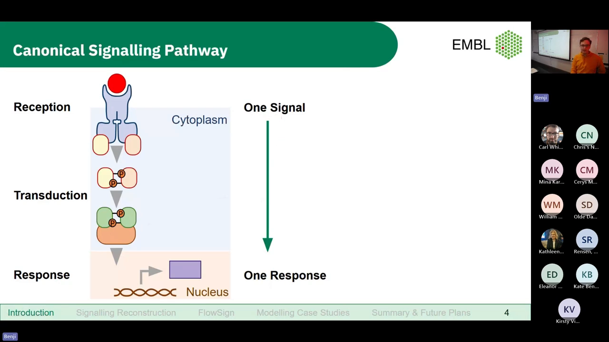
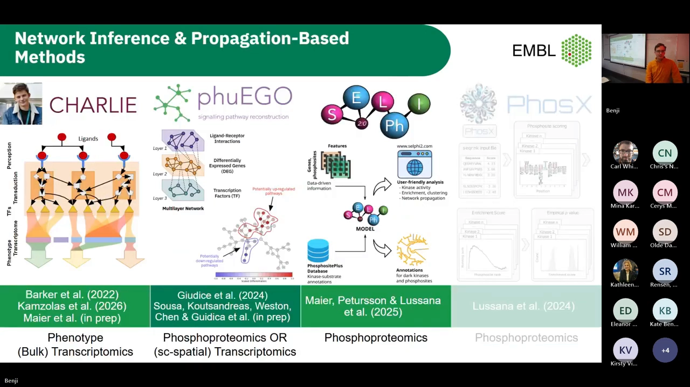
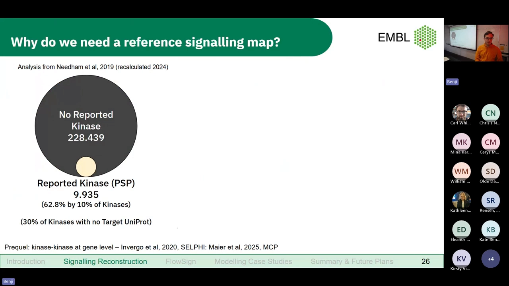
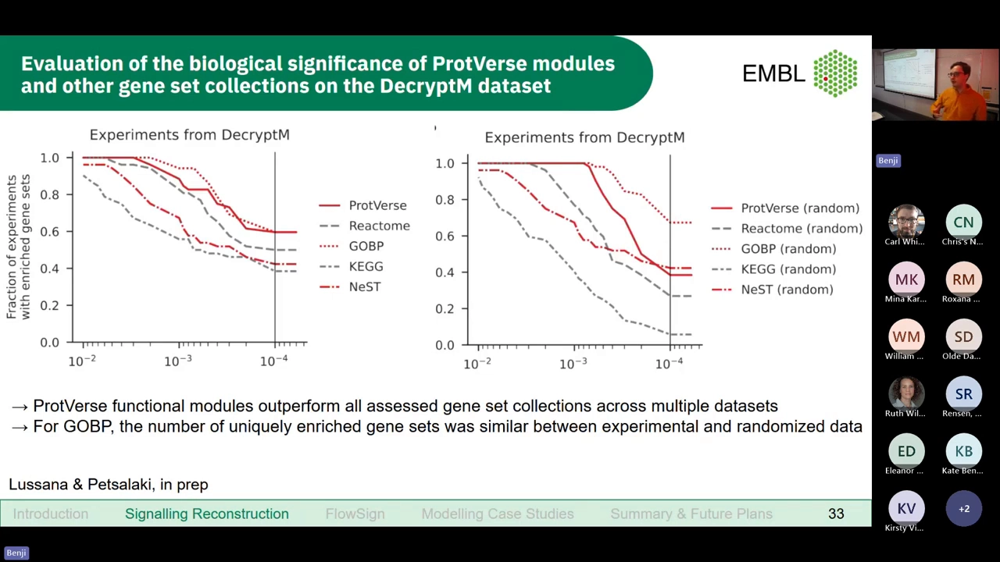
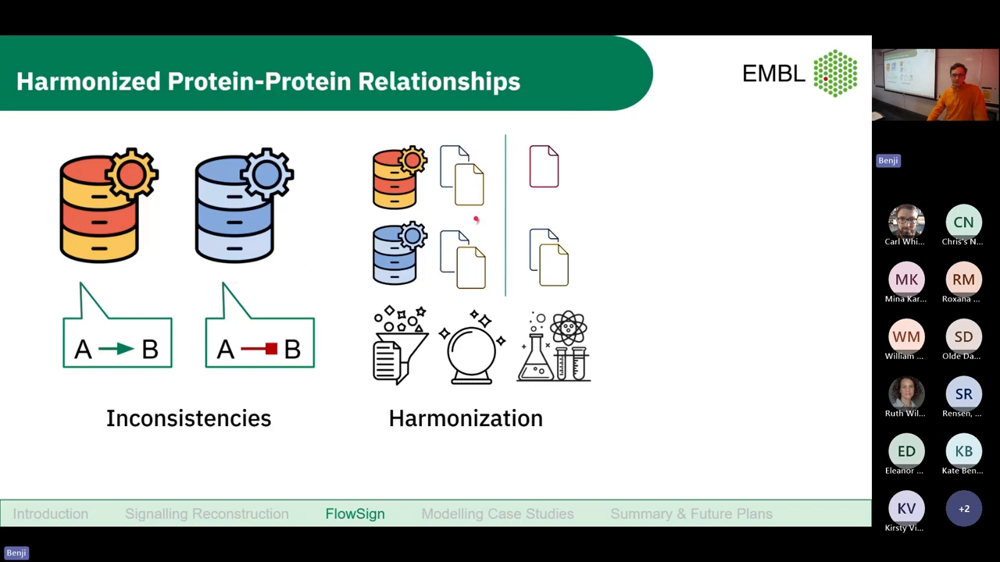
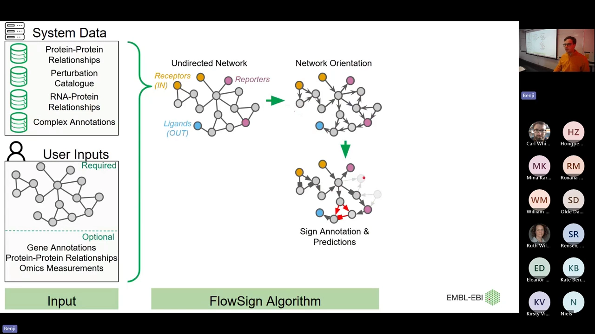
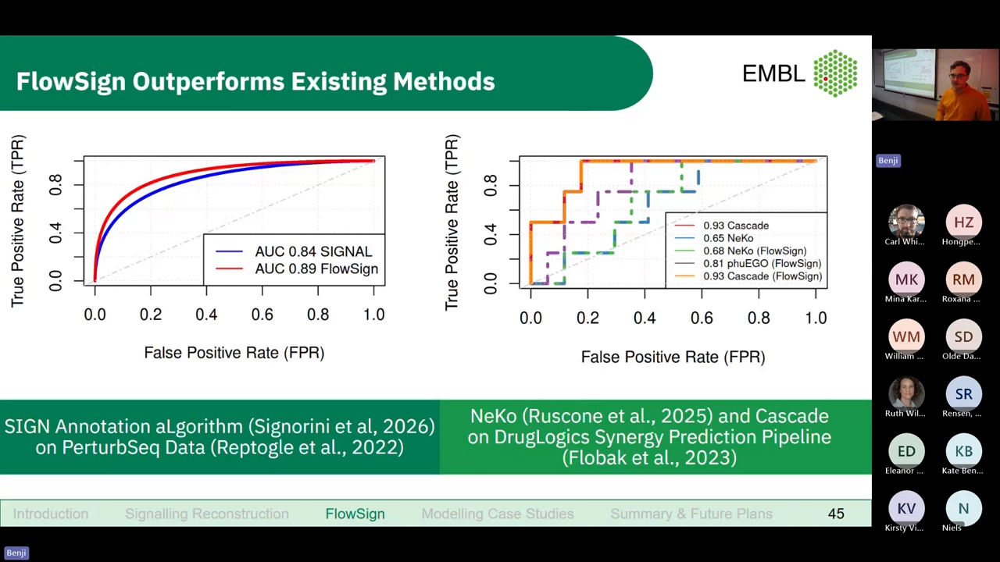
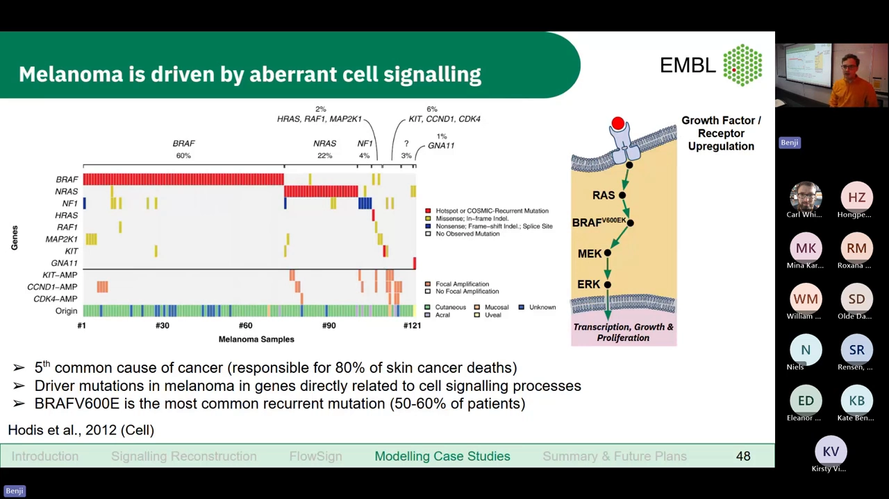
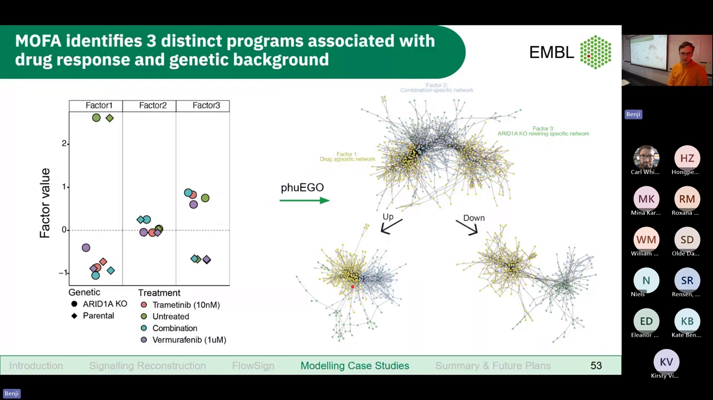
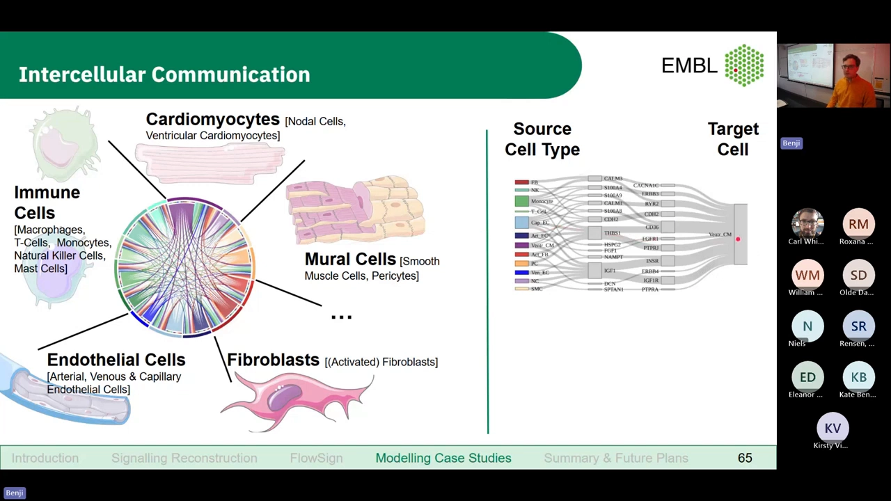

# 先验知识网络偏向热门蛋白：细胞信号网络重建中的两种图

> 视频来源：[From Multi-Omics Data to Executable Mechanistic Models of Cell Signalling](https://www.youtube.com/watch?v=3DuuF8Yo3Io)（YouTube · Benjamin Maier，EMBL-EBI / Petsalaki lab）｜时长约 55 分钟
> 这支报告讲的是"从数据到网络、从网络到模型"的整条链路，正好提供了上一讲缺的那一半视角：如果先验图是从文献和数据库里编出来的，它到底偏在哪、错在哪、缺在哪。文中所有数字与判断均出自报告本身。

## 本讲要解决的核心问题（SCQA）

**背景**：细胞信号研究长期依赖"经典通路图"：配体结合受体，经过级联放大，到达细胞核产生响应。这些图来自几十年的实验与文献整理，是标准的先验知识。

**冲突**：同一条通路被当成在肺、在发育中的心脏、在肿瘤患者里都一样，但细胞上下文不同，接线也不同。更麻烦的是，这张先验图本身并不完整：24 万个磷酸化位点里，只有约 1 万个知道上游激酶；不同数据库对同一对蛋白的标注还会互相矛盾。

**疑问**：既然先验图既有偏又残缺，从数据里重建出来的网络能否替代它？两者各自缺什么？

**回答（中心思想）**：先验图提供骨架但偏向被研究得多的蛋白，数据驱动图提供上下文但缺少方向与符号；两者都不能单独支撑机制模型。可行的做法是把先验图当作**需要显式修补和评估的对象**：先量化它的覆盖与偏差，再补方向、补符号、补缺口，最后用人工精修的网络作为天花板来校准。

## 一、经典通路图是一张先验图，它假设所有细胞都一样

报告开篇把"经典信号通路"拆成三步（[跳转 01:27](https://www.youtube.com/watch?v=3DuuF8Yo3Io&t=87)）：受体接收信号、胞内转导级联放大、细胞核产生响应。这套"一个信号触发一个响应"的叙事，是历史上数据量与分辨率不足时的必然简化。

讲者随即指出它的问题（[跳转 02:17](https://www.youtube.com/watch?v=3DuuF8Yo3Io&t=137)）：这套视角忽略了细胞上下文与疾病状态，把同一条通路当成在所有组织里都一样。真实的信号系统是非线性的网络：有大量非经典转录因子负责基础表达，有反馈环，有通路之间的串扰（细胞被病毒感染时不只启动防御，还会触发细胞周期停滞），还有一大片"尚未被表征"的未知空间（[跳转 03:32](https://www.youtube.com/watch?v=3DuuF8Yo3Io&t=212)）。

这段话定义了本节的第一组区分：**经典通路图是先验图**——它先于当前数据存在，由历史实验与人工整理固化下来；它的结构反映的是"哪些通路被研究过"，而不是"这个细胞里正在发生什么"。

## 二、观测图：从数据里估计出来的网络

如果先验图不够，就要从数据里估计图。报告介绍了三类工具，共同点是：**先验网络仍然在场，只是退居为参照系**。

### 2.1 CHARLIE：先找共表达模块，再映射回参考网络

CHARLIE 用来生成"表型特异的网络"（[跳转 06:01](https://www.youtube.com/watch?v=3DuuF8Yo3Io&t=361)）。输入是两部分：表型数据（影像、组织学标志物、临床表型或扰动变量）和组学数据（主要是 bulk RNA-seq）。流程是：在表达矩阵里找共表达基因模块，用相关或线性模型把模块与表型关联，筛出与目标表型相关的模块，再做上游转录因子富集，最后映射到参考网络上做通路富集与网络重建。

这里有一个值得注意的分工：**模块是从观测数据里估出来的，参考网络是先验的**。观测数据决定"哪些基因一起变化"，先验网络决定"这些基因在已知通路里处于什么位置"。两者缺一不可，而两者都会带来偏差。

报告给的案例是 MASLD（代谢功能障碍相关脂肪性肝病）：患者跨阶段转变，多数阶段可逆，但机制不清楚，且缺乏非侵入性标志物（[跳转 09:07](https://www.youtube.com/watch?v=3DuuF8Yo3Io&t=547)）。他们用患者转录组与肝活检组织学分别生成纤维化、脂肪变性等表型的网络，合并后检查是否富集已知 MASLD 基因，再把患者按伪时间排序、切成滑动窗口，观察不同窗口间的动态（[跳转 10:10](https://www.youtube.com/watch?v=3DuuF8Yo3Io&t=610)）。

### 2.2 FGO：把差异磷酸化位点当作种子，在参考网络上做传播

FGO 处理的是另一类观测（[跳转 14:32](https://www.youtube.com/watch?v=3DuuF8Yo3Io&t=872)）：从磷酸化蛋白组里取出差异表达的磷酸化位点作为种子节点，映射到一张大的参考网络上做随机游走传播，把彼此靠近的种子聚成簇，从而提取"活跃信号模块"。

讲者在这里给了一句很关键的方法论评论（[跳转 17:07](https://www.youtube.com/watch?v=3DuuF8Yo3Io&t=1027)）：现在很多人直接在整个数据上跑基础模型，完全无视网络结构与拓扑，等于**丢弃了大量先验知识**，得到的系统初看漂亮，但机制上不可信。

这句话和上一讲形成一个对照：上一讲担心"先验图错了会污染预测"，这一讲担心"完全不用先验图会丢掉可解释性"。两种担心都成立，说明问题不是"用不用先验"，而是"如何把先验的可靠性纳入建模"。

## 三、先验缺失有多严重：24 万个磷酸化位点，只有约 1 万个知道上游激酶

### 3.1 一张覆盖率饼图

报告给出了一个非常具体的缺失度量（[跳转 17:51](https://www.youtube.com/watch?v=3DuuF8Yo3Io&t=1071)）：人类磷酸化位点约 24 万个，其中在已有知识里能查到上游激酶的只有 9,935 个；而这 9,935 个里，62.8% 由 10% 的激酶贡献。

这张图把"先验缺失"从定性说法变成了可报告的数字。它也解释了为什么激酶活性推断工具常常只在少数"明星激酶"上表现好：不是这些激酶更重要，而是只有它们有足够的标注。

### 3.2 补缺的代价：预测出来的边是"估计"，不是"观测"

他们的应对是训练一个随机森林分类器，用现有先验数据（包括测量了每个激酶底物特异性的 PSSM）对 421 个激酶、24 万个位点做预测，得到 7300 万条预测，其中 72 万条被视为高置信（[跳转 18:54](https://www.youtube.com/watch?v=3DuuF8Yo3Io&t=1134)）。高置信上游激酶覆盖的位点数从 9,935 提升到 123,000（[跳转 20:39](https://www.youtube.com/watch?v=3DuuF8Yo3Io&t=1239)）。

这里必须保持一个区分：**补出来的边是模型预测，不是实验观测**。它们进入下游构图时，和文献整理的边混在一起，可靠性却不同。这正是"先验缺失"如何转化为"先验错误风险"的机制——补缺本身会引入新的、系统性的偏差（例如模型倾向于给研究充分的激酶更多边）。

## 四、先验偏差：热门蛋白与一次随机化检验

### 4.1 讲者的原话

报告在总结三个重建工具时给出一句判断（[跳转 25:30](https://www.youtube.com/watch?v=3DuuF8Yo3Io&t=1530)）：**先验知识网络有价值，但必须承认它们偏向被充分研究的蛋白**；如果只按这些网络解释数据，就会丢掉数据里仍然存在、但没被先验覆盖的部分。

这句话是本节的核心结论。它把"先验图"从"客观背景知识"降格为"有偏采样"：知识库记录的是研究投入的分布，而不是生物关系的分布。

### 4.2 随机化检验：当 GO 条目被打乱后，富集仍然"显著"

报告里有一个很漂亮的评估案例（[跳转 24:40](https://www.youtube.com/watch?v=3DuuF8Yo3Io&t=1480)）。他们把一个从数据推断出的功能模块集合与 Gene Ontology 生物过程、KEGG、Reactome 等标准集合比较，在真实数据上两者表现相当——对一个由数据直接推断、没有几十年人工整理的集合来说，这已经是不错的结果。

但关键在右图：把 GO 的条目随机打乱后再做同样的富集，GO 的表现几乎没变。这说明 GO 生物过程这个集合太大、信息太多，**即使随机化也总能找到"显著富集"的条目**。

这个检验的意义超出了 GO：任何以大型先验知识库为参照的"富集""一致性""覆盖度"指标，都需要一个随机化基线，否则无法区分"结构真的匹配"与"集合足够大所以总能匹配"。

## 五、先验错误：数据库之间的矛盾、缺口与缺失的元数据

### 5.1 同一对蛋白，一个库说激活，另一个库说抑制

FlowSign 的第一步是"系统状态"：把所有来源的蛋白—蛋白关系汇总并做协调（[跳转 27:31](https://www.youtube.com/watch?v=3DuuF8Yo3Io&t=1651)）。讲者描述了三种典型问题。

第一是矛盾：同一对蛋白在一个数据库里被标注为激活，在另一个里被标注为抑制。这很常见，因为数据来自不同资源，很多并非人工整理；"同一个东西测三次，很可能得到两个不同结果"。

第二是元数据缺失：某一对蛋白在一个库里证据数为 4，在另一个库里为 3，但追溯下去发现引用的是同两篇论文——真实证据其实更多，只是无法回溯。跨库合并时如果不做协调，证据强度会被系统性低估或高估。

### 5.2 缺口：平行同源蛋白给出的"合理猜测"

第三是缺口（[跳转 28:21](https://www.youtube.com/watch?v=3DuuF8Yo3Io&t=1701)）：如果 A1、A2、A3 都激活 B，那么 A4 很可能也激活 B，但知识库里没有这条边。

他们的做法是整合多模态数据训练随机森林，给出方向性得分与符号得分，再加上全文文献挖掘的得分，作为补缺的先验。需要注意：**这是在用统计规律填补知识空白**，补出来的边带有模型假设，而不是实验事实。把它和人工整理的边同等对待，就是把假设当成了观测。

## 六、把先验变成构图规则：FlowSign 的输入、取向与一致性检查

### 6.1 输入与输出定义了"信号该往哪流"

FlowSign 要解决的问题很具体（[跳转 26:36](https://www.youtube.com/watch?v=3DuuF8Yo3Io&t=1596)）：重建出来的网络是无向的，也没有调控信息——缺方向（谁 upstream）、缺符号（激活还是抑制）、缺规则（两个基因是否需要协同，例如受体必须二聚化才有下游活性）、缺参数。

它的输入设计值得单独看（[跳转 31:40](https://www.youtube.com/watch?v=3DuuF8Yo3Io&t=1900)）：用户给一张网络（可以有部分方向），再标注三类基因——输入（配体，信号从这里进）、输出（受体，信号从这里出）、报告基因（实验测到的读出，必须保留在最终解里）。输入与输出给出了全局拓扑约束：信号必须从输入流向输出。

这一步实际上是在**用生物学约束给先验图定向**：先验图只说了"这两个蛋白有关系"，输入/输出标注补充了"关系应该朝哪个方向"。约束越强，能解的边越多，但也越依赖标注是否正确。

### 6.2 修剪、冲突与一致性检查

接下来是几步基于先验的操作：应用协调后的蛋白关系与调控符号；剪掉不参与该级联的节点（例如只接收信号、却从不向下游输出的节点）；处理不一致——某处信号既被放大又被抑制，这可能是噪声，也可能是真实的调控环，需要根据先验权重和信号传播做判断（[跳转 32:05](https://www.youtube.com/watch?v=3DuuF8Yo3Io&t=1925)）；最后做一致性检查、模块化与线性化，得到有向带符号网络、模块表示与简化最短路网络。

### 6.3 多条件联合：同一条边在不同条件下应当同向

在心肌类器官项目里，他们发现一个有意思的事实（[跳转 49:08](https://www.youtube.com/watch?v=3DuuF8Yo3Io&t=2948)）：比较正常心脏与多种疾病条件下的网络，250 个节点里只有 16 个、上千条边里只有 85 条是正常心脏独有的，其余都是共享的。于是他们把多个条件放进同一个 FlowSign 实例，强制同一条边在不同条件下标注一致——因为"激酶与底物的关系不该随条件改变"，改变的只是这段网络是否活跃。

这个设计把"先验一致性"变成了一条构图约束：**结构共享、活跃度可变**。联合求解还提高了置信度，因为一个条件下的歧义可以由另一个条件解开（[跳转 49:58](https://www.youtube.com/watch?v=3DuuF8Yo3Io&t=2998)）。

## 七、先验修补的天花板：与人工精修模型的差距

FlowSign 的基准测试给出了一个诚实的结论（[跳转 32:52](https://www.youtube.com/watch?v=3DuuF8Yo3Io&t=1972)）。在扰动测序数据上，它的 AUC 为 0.89，优于对比工具 SIGN 的 0.84；但换成另一个基准——一个由制药公司大量测量、并经过人工实验验证的 CASCADE 模型——情况不同：把 CASCADE 的标注全部抹掉再用 FlowSign 重新标注，能恢复出同样的结果；可是如果从零开始（先用 FGO 建网络再跑 FlowSign），表现仍然不如人工精修的 CASCADE。

这个对比是本节最重要的量化边界：**自动化的先验修补可以逼近高质量人工整理，但替代不了它**。差距的来源不是算法，而是先验本身的质量——人工精修模型背后是大量针对性实验。

## 八、两个案例：先验图在真实问题里如何起作用

### 8.1 黑色素瘤耐药：转录组与蛋白组看不出差别，激酶活性看得出

黑色素瘤的驱动突变大多直接落在信号通路上，最常见的是 BRAF V600E，导致通路组成性激活（[跳转 34:38](https://www.youtube.com/watch?v=3DuuF8Yo3Io&t=2078)）。BRAF 与 MEK 的双抑制起初有效，但耐药很快出现。

他们研究一个耐药基因 ARIAD1A 的敲除。用 MOFA 做降维后得到三个因子，分别对应药物响应、联合处理与基因背景（[跳转 37:16](https://www.youtube.com/watch?v=3DuuF8Yo3Io&t=2236)），再对每个因子用 FGO 建网络。

最关键的观察是：在转录组和蛋白组上，野生型与敲除株的直接响应几乎看不出差别；但在激酶活性数据上，两者差异巨大（[跳转 37:41](https://www.youtube.com/watch?v=3DuuF8Yo3Io&t=2261)）。这说明**观测层的选择本身决定了能看到什么**：同一批样本，换一个观测层，图的边就完全不同。

### 8.2 心肌类器官：用细胞通讯图决定要共培养哪些细胞

类器官项目的起点是一张细胞通讯图（[跳转 43:35](https://www.youtube.com/watch?v=3DuuF8Yo3Io&t=2615)）：用 CellChat 根据配体—受体表达、细胞类型与空间共定位，推断哪些细胞类型之间在通讯。

从这张图里他们提取出三种关键细胞类型（心室心肌细胞、毛细血管内皮细胞、成纤维细胞），共培养后成熟度标志物与收缩性上升，但钙处理仍然缺失（[跳转 44:36](https://www.youtube.com/watch?v=3DuuF8Yo3Io&t=2676)）。后续再用 FGO 建网络、FlowSign 定方向、遗传算法找协同规则，最后在模型上做计算机扰动，筛出能提升钙处理与成熟的候选基因。

这条链路里，每一步的图都来自不同的"先验 + 观测"配比：细胞通讯图的边来自表达数据与先验的配体—受体库，信号网络的边来自先验数据库加方向推断，扰动预测则完全发生在模型里。**读者需要能分辨当前讨论的是哪一张图**，否则很容易把模型预测当成实验结论。

## 小结

- 经典通路图是先验图：它先于当前数据存在，反映的是"哪些通路被研究过"，而不是"这个细胞里正在发生什么"；它的最大问题是忽略细胞上下文。
- 数据驱动网络是观测图：CHARLIE 从共表达模块出发、FGO 从差异磷酸化位点出发，但两者都要映射回一张先验参考网络，先验并未退场。
- 先验缺失可以被量化：24 万个磷酸化位点中只有 9,935 个知道上游激酶，且 62.8% 集中在 10% 的激酶上。补缺得到的边是模型预测，不是实验观测。
- 先验偏差可以被检验：先验网络偏向被充分研究的蛋白；把 GO 条目随机化后富集仍然"显著"，说明大型知识库的显著性可能来自集合规模而非结构匹配。
- 先验错误有三种典型形态：跨库标注矛盾（激活 vs 抑制）、元数据缺失导致证据数失真、平行同源造成的缺口。
- 修补先验有天花板：FlowSign 能恢复被抹掉标注的人工模型，但从零重建仍不如人工精修模型，差距来自先验质量而非算法。

## 关键术语速查

| 术语 | 一句话解释 |
| --- | --- |
| 先验图 | 来自文献、数据库与人工整理、先于当前观测存在的图；本文的经典通路图与协调后的蛋白关系库都属于此类 |
| 观测图 | 从当前数据估计出的图，如共表达模块网络、差异磷酸化位点传播出的模块 |
| 参考网络 | 数据驱动方法的映射底图，本身是先验图；决定"估出来的模块落在哪条已知通路上" |
| 网络传播 | 从种子节点出发在参考网络上做随机游走，把邻近种子聚成模块 |
| 覆盖率 | 先验知识覆盖了多少待预测对象；本文指有已知上游激酶的磷酸化位点比例 |
| 协调（harmonization） | 跨数据库合并前统一标注口径、追溯证据来源、处理矛盾的过程 |
| 方向性 | 边上"谁作用于谁"的信息；无向网络缺失方向，需要额外推断 |
| 调控符号 | 边表示激活还是抑制；与方向一起决定信号能否沿路径传播 |
| 随机化基线 | 把先验集合的条目打乱后重跑评估，用于判断显著性是否来自集合规模 |
| 计算机扰动 | 在已参数化的模型上做敲除或加源模拟，用于排序实验候选 |