# 先验网络决定模型能看见什么：生物医学图神经网络中的缺失边

> 视频来源：[Graph Neural Networks for Biomedical Data](https://www.youtube.com/watch?v=9nACsKGisOI)（YouTube · Marinka Zitnik，哈佛医学院）｜时长约 64 分钟
> 这支讲座把"图"当成生物医学数据的通用语言，重点不在网络结构本身，而在**这张图是从哪里来的**：蛋白互作网络来自 15 个知识库的汇编，边带有类型，而人类蛋白互作组只测过 20%–30% 的蛋白。讲座后半段的问答把"先验缺失如何进入预测"讲得最透，本文按这条线索重组了全篇。

## 本讲要解决的核心问题（SCQA）

**背景**：图神经网络（GNN）的输入是一张图：节点是实体，边是关系。只要能把问题写成图，就可以用同一套"消息传递"机制学习节点、边或整张图的表示。

**冲突**：生物医学里的图大多不是从实验里直接"测"出来的，而是从数据库里"编"出来的——蛋白互作来自十几个知识库的汇编，药物—疾病关系来自文献与登记信息。这类图既不完整，也不均匀：热门蛋白被反复研究，冷门蛋白几乎空白。

**疑问**：当模型的消息传递只能沿着这张给定的图进行时，先验图的缺失与偏差会怎样进入最终预测？我们又该怎么发现它？

**回答（中心思想）**：先验图是模型的输入假设，不是中立的背景知识。消息传递只能沿已有的边传播，缺失的边不会自己长出来；因此评估一个图模型，必须先评估它的图：边从哪来、有没有类型、缺了多少、切分是否让先验泄漏。讲座用三个具体结果支撑这个判断——76/77 个被实验验证的药物并不直接结合病毒蛋白、PPI 只覆盖 20%–30% 的蛋白、以及论文里的高 AUC 在实践中退化为接近随机。

## 一、图是生物医学数据的通用语言，但"图从哪来"决定了后面的一切

### 1.1 多尺度网络把异质数据放进同一个结构

讲者开场先给出两个挑战（[跳转 01:02](https://www.youtube.com/watch?v=9nACsKGisOI&t=62)）。第一，绝大多数医学问题没有一个能解释全部复杂性的数据集，需要整合从分子到人群的多尺度、异质、混杂的数据；这些数据来自不同实验读出、不同测量平台、不同临床站点，天然带着混杂。第二，在生物医学里，"跑出一个高 AUC"并不等于有用，模型必须给出能指导下一次实验的可操作预测。

图的作用是把这些数据放进同一个结构（[跳转 02:55](https://www.youtube.com/watch?v=9nACsKGisOI&t=175)）：人群层面的个体与个体互动、个体内部的疾病与表型、细胞层面的分子互作，可以连成一张多尺度网络。

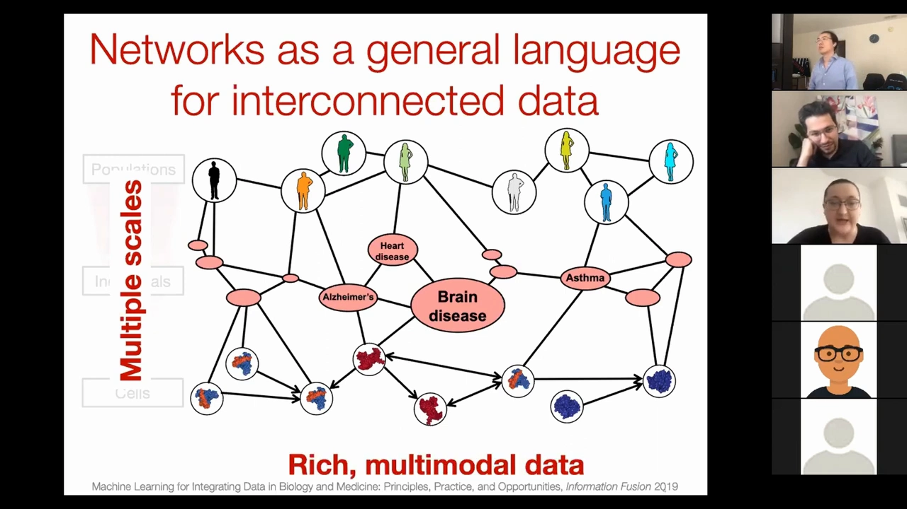

这张图值得注意的地方不是它"很大"，而是**每一层的边来自完全不同的采集方式**：人群互动来自调查，疾病关联来自临床记录，分子互作来自实验测定与文献汇编。把它们放进同一张图，等于默认这些来源可以互相比较——这正是后面所有偏差的起点。

### 1.2 消息传递的目标：让邻居相似的节点靠得近

GNN 的核心是一个映射函数 $f$，把输入图上的节点映射到低维嵌入空间（[跳转 04:59](https://www.youtube.com/watch?v=9nACsKGisOI&t=299)）。映射的约束是：如果两个节点 $u$、$v$ 在图上"相似"——有相似的邻居、相似的组合结构——它们在嵌入空间里就应该靠近。于是"相似"的定义被交给了图本身。

这就是本节要抓的关键点：**模型学到的相似性，上限由构图决定**。图上没有的边，不会在嵌入空间里制造出相似性。

## 二、先验图：从 15 个知识库汇编出来的蛋白互作网络

### 2.1 药物—疾病问题被改写为"子图叠加在蛋白网络上"

药物重定位的经典写法是一张二分图：左边药物、右边疾病，黑边表示已知适应症（[跳转 10:38](https://www.youtube.com/watch?v=9nACsKGisOI&t=638)）。讲者认为这不够：药物和疾病各自有丰富的分子背景，把它们压成一个节点会丢掉这些信息。

于是改写成"子图"（[跳转 11:12](https://www.youtube.com/watch?v=9nACsKGisOI&t=672)）：底层是一张丰富的蛋白互作网络，疾病是"疾病相关蛋白"在这张网络上诱导出的子图，药物是"药物靶点与脱靶"诱导出的子图。药理学的经验说法是"药物与疾病在药理空间里靠近"，而"靠近"被操作化为两个子图嵌入之间的距离。

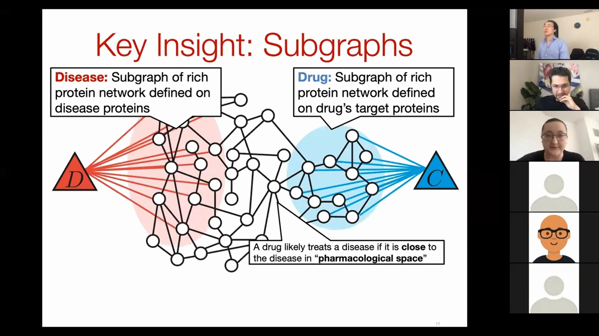

### 2.2 数据集：19K 节点、350K 条边，全部来自知识库

这张底层网络不是测出来的，是汇编出来的（[跳转 21:44](https://www.youtube.com/watch?v=9nACsKGisOI&t=1304)）：蛋白互作网络从 15 个知识库整理，19K 个节点、350K 条边；药物—蛋白与疾病—蛋白连接来自 DrugBank、OMIM、DisGeNET、STITCH 等，共 20K 条药物—蛋白、560K 条疾病—蛋白连接；适应症与禁忌症来自 DrugBank、MEDI-HPS、DailyMed、DrugCentral、RepoDB，约 6K 条药物—疾病关系。

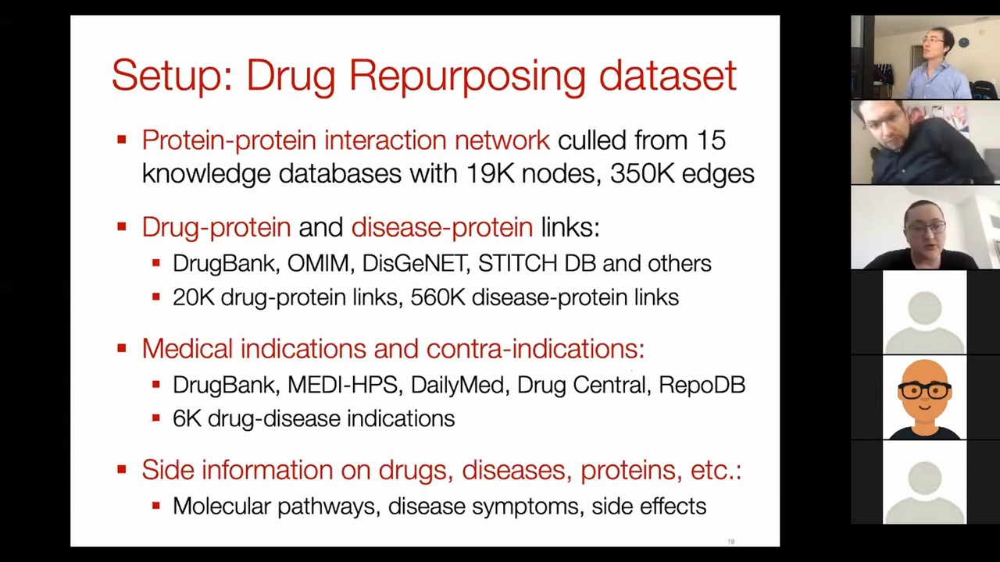

这张幻灯片本身就是本节最重要的证据：**模型输入的每一个节点和每一条边，都能追溯到某个数据库的某次汇编**。它们代表"截至汇编时刻人类已知的知识"，不代表"生物系统里真实存在的全部关系"。

### 2.3 边是有类型的，类型直接进入消息传递

问答环节有人问：蛋白互作有抑制、激活等不同类型，消息传递里考虑了吗（[跳转 53:27](https://www.youtube.com/watch?v=9nACsKGisOI&t=3207)）？讲者回答：考虑，只是示意图画不下。每条边都带有标注，说明它是生物物理接触、还是特定组织中的相互作用、还是抑制或激活；消息传递时会按类型分别取邻居——"给定这个节点，按某一种关系类型，它的邻居是谁"（[跳转 54:14](https://www.youtube.com/watch?v=9nACsKGisOI&t=3254)）。

这带来一个容易被忽略的后果：**先验图上的"边类型"错误，会以"邻居集合错误"的形式进入每一层聚合**。边存在但方向或符号标错，模型看到的邻域就是错的，而且这种错误会在多层传播中被放大。

## 三、消息传递只在给定的边上走

### 3.1 SubGNN 的两部分

SubGNN 用来给子图学嵌入（[跳转 16:31](https://www.youtube.com/watch?v=9nACsKGisOI&t=991)）。目标很直接：拓扑相似的子图，嵌入应该靠近。它把"子图拓扑"拆成三个方面——邻域（子图周围长什么样）、结构（子图内部有哪些模体，比如三角形、方形）、位置（子图在整张图的中心还是边缘）。

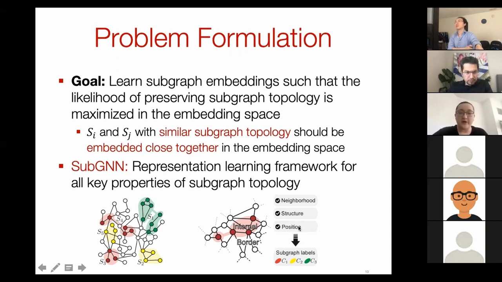

方法分两部分（[跳转 20:16](https://www.youtube.com/watch?v=9nACsKGisOI&t=1216)）：第一部分是神经消息传递函数，沿底层图的边逐层传播信息；第二部分规定如何针对位置、邻域、结构三个通道分别传播。为了让"位置"和"结构"可比较，模型在底层图上采样一批"锚补丁"（anchor patch）作为参照物，测量目标子图与这些参照物的相似度，再把消息聚合回子图。

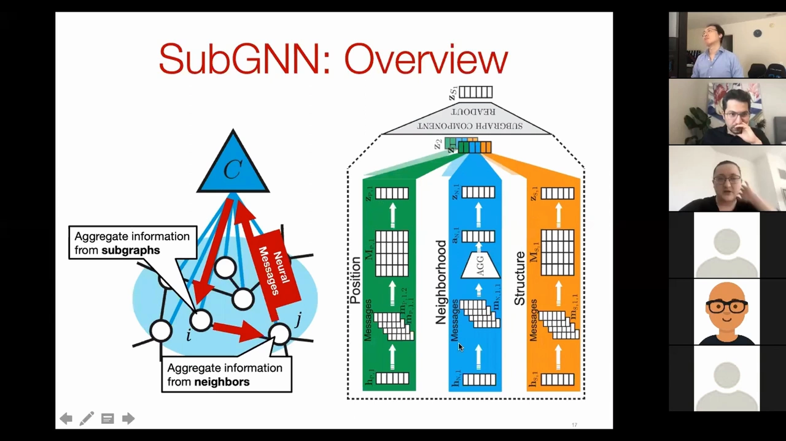

### 3.2 这套机制模拟的正是"药物效应沿网络扩散"

讲者点明了模型与生物学的对应关系（[跳转 20:41](https://www.youtube.com/watch?v=9nACsKGisOI&t=1241)）：药物效应不只作用于它直接结合的蛋白，而是沿底层网络的边传播；SubGNN 做的就是把"从子图出发、沿边传播、再聚合回子图"这件事数学化。

**这句话同时说明了先验图的分量**：如果一条真实的传播路径在底层网络里没有对应的边，消息传递就永远走不到那里。模型不会"猜"出一条缺失的边，它只会沿着已有的边做加权平均。

### 3.3 一个反证：76/77 个有效药物不直接结合病毒蛋白

讲者给了一个支持"必须用网络"的证据（[跳转 13:36](https://www.youtube.com/watch?v=9nACsKGisOI&t=816)）：在哈佛的 COVID 任务中，他们预测并被湿实验验证的 77 个药物里，有 76 个并不直接结合病毒靶向的蛋白，而是通过"网络作用"起效——只看药物与靶点的直接关系（例如分子对接）找不到它们。

这既是网络方法的胜利，也是先验图的风险提示：这些"网络药物"能被找到，前提是底层网络里恰好存在那条传播路径。路径缺失时，同类药物会被系统性地漏掉。

### 3.4 排序检验：已成功重定位的药物应排在候选表前列

药物重定位任务的评估方式很直接（[跳转 23:48](https://www.youtube.com/watch?v=9nACsKGisOI&t=1428)）：斯坦福 SPARK 转化研究项目在过去二十年里把一批上市药物扩展到了新适应症，这份清单可以当作"事后已知答案"。模型在没见过这些数据的前提下，为每种疾病给所有药物排序；如果先验图与消息传递确实抓到了机制，那些后来被证实有效的药物应当排在前面。

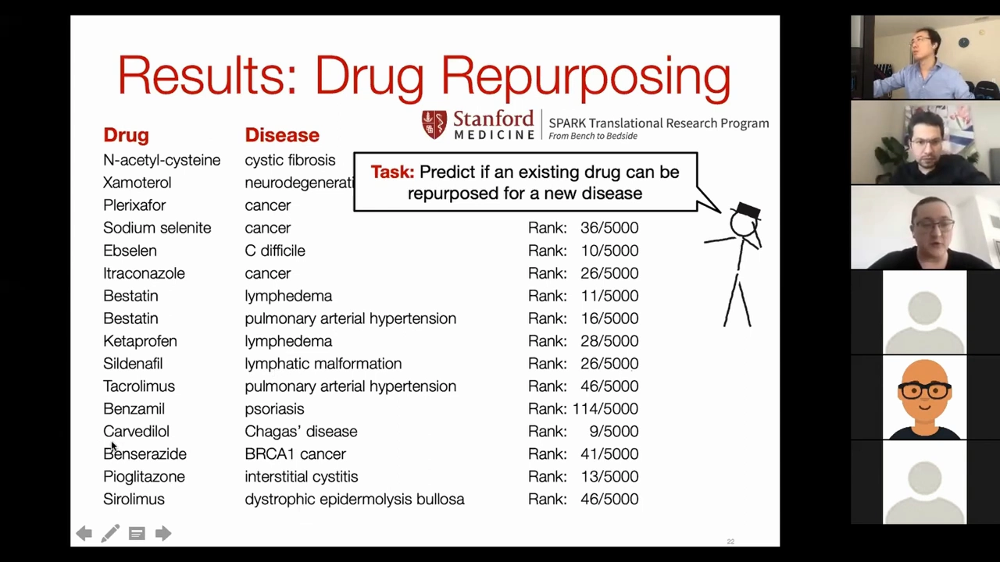

以 Carvedilol 用于恰加斯病为例，模型把它排在第 9 位（共 5000 个候选）。这张表的价值在于它是一种**外部、时间上滞后**的检验：答案不是从同一张先验图里推出来的，而是来自独立的临床实践。相比之下，用同一知识库做随机切分得到的分数，无法排除"答案本来就在图里"的可能。

## 四、先验缺失：人类蛋白互作组只测过 20%–30% 的蛋白

### 4.1 一个直接的数字

问答里有人问：如果只用一半的 PPI 知识，模型还能保持精度吗（[跳转 57:17](https://www.youtube.com/watch?v=9nACsKGisOI&t=3437)）？讲者的第一个回答是：**只考虑当前版本的人类蛋白互作网络是不够的**。发表在 Nature 上的人类参考互作组等工作表明，被测试过相互作用的蛋白大约只占 20%–30%，因此这张网络"严重不完整"（[跳转 57:38](https://www.youtube.com/watch?v=9nACsKGisOI&t=3458)）。

这是本节最具体的一个"先验缺失"例子：不是模型不够强，而是图缺了七成以上的潜在边。缺失的边在消息传递中等价于"这两个蛋白没有关系"，模型会把一个知识空白当成一个否定证据。

### 4.2 讲者的应对：多尺度、异质网络

讲者的第二个回答是往异质网络走（[跳转 58:33](https://www.youtube.com/watch?v=9nACsKGisOI&t=3513)）：单层 PPI 不足以解释生物复杂性，他们正在把蛋白互作网络与单细胞数据结合，给互作补上细胞类型与组织信息，再接上其他信号网络。换句话说，**用更多层的先验去补单层先验的缺口**，而不是假设单层图已经够用。

### 4.3 消融实验：随机删边 vs 按细胞系删边

更重要的是他们怎么检验这件事（[跳转 58:45](https://www.youtube.com/watch?v=9nACsKGisOI&t=3525)）：每次研究都做消融，横轴是"只保留 10%、20%、30% 的数据"，看性能如何变化。关键在于，删边不只随机删，还会**按生物学含义删**——例如在测试 G-Meta 时，把 PPI 网络中与某一组细胞系相关的边全部移除，再看模型受影响的程度。

这个设计直接对应本节的学习目标：随机删边测的是"模型对边数的鲁棒性"，按细胞系删边测的是"模型是否依赖某类先验知识"。前者回答"少一点数据还行吗"，后者回答"缺的正好是我关心的那部分知识时会怎样"。

## 五、先验错误与评估偏差：90% 的 AUC 为什么在实践中接近随机

### 5.1 模型可能只是在记忆训练集

讲者在同一段问答里给出了一个更尖锐的判断（[跳转 59:52](https://www.youtube.com/watch?v=9nACsKGisOI&t=3592)）：文献里报告 80%–90% AUC 的模型，真正拿去用时常常给出接近随机的预测。追查下去发现，这些模型"技术上正确但没有意义"——它们给出的分子往往是训练数据里已有分子的细微变体（[跳转 60:28](https://www.youtube.com/watch?v=9nACsKGisOI&t=3628)），也就是记住了见过的数据，而没有泛化到新问题。

对图模型来说，这种"记忆"有一条专门的通道：**先验图本身把答案泄漏进了输入**。如果训练图和测试图共享同一条知识库、同一批边，模型可以靠记住子图结构拿到高分，而不需要学到任何可迁移的机制。

### 5.2 时间切分：用 2012 年以前的数据预测 2012 年以后

他们的应对方式是把评估做成"预测未来"（[跳转 30:47](https://www.youtube.com/watch?v=9nACsKGisOI&t=1847)）：只用 2012 年之前产生的数据训练，然后问模型最有信心的预测里，有多少在此后被文献证实。这是一次时间切分，而不是随机切分。

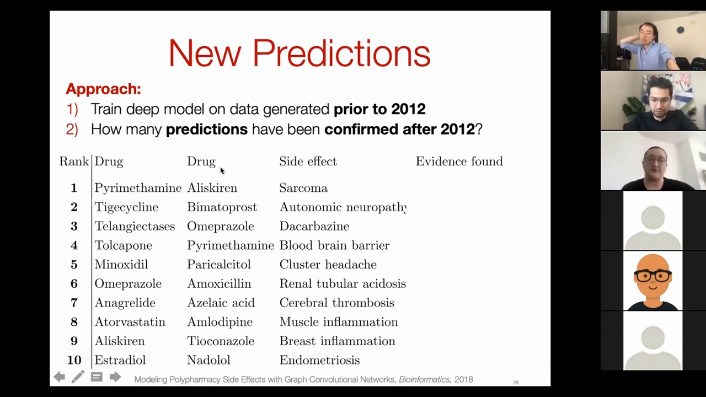

时间切分之所以关键，是因为它切断了"同一条知识在训练与测试之间重复出现"的通道。随机切分下，同一篇文献贡献的边可能同时出现在训练和测试里；时间切分下，测试集里的关系在训练时还不存在。

### 5.3 多药副作用：一张边带类型的药物网络

第二个案例把"边类型"推到前台（[跳转 28:34](https://www.youtube.com/watch?v=9nACsKGisOI&t=1714)）。他们从 FDA 约一千万份不良事件报告中重建了一张多药网络：节点是药物，边表示两种药同服时出现某种副作用，边的类型是副作用种类，权重是概率；同时接入药物如何靶向蛋白、效应如何在蛋白网络中传播的信息。

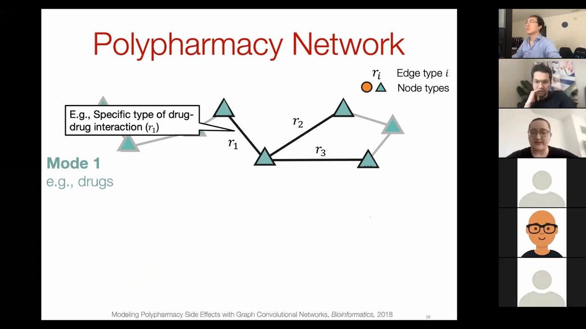

临床上要问的问题是"某两种药同服，出现某种副作用的概率多大"（[跳转 29:57](https://www.youtube.com/watch?v=9nACsKGisOI&t=1797)）。模型要预测的就是"这两个药物节点之间是否存在某类型的边"。注意这里的图结构完全由先验知识决定：药物—蛋白边来自靶点数据库，蛋白—蛋白边来自互作网络，副作用边来自报告系统。三类来源的可靠性并不相同。

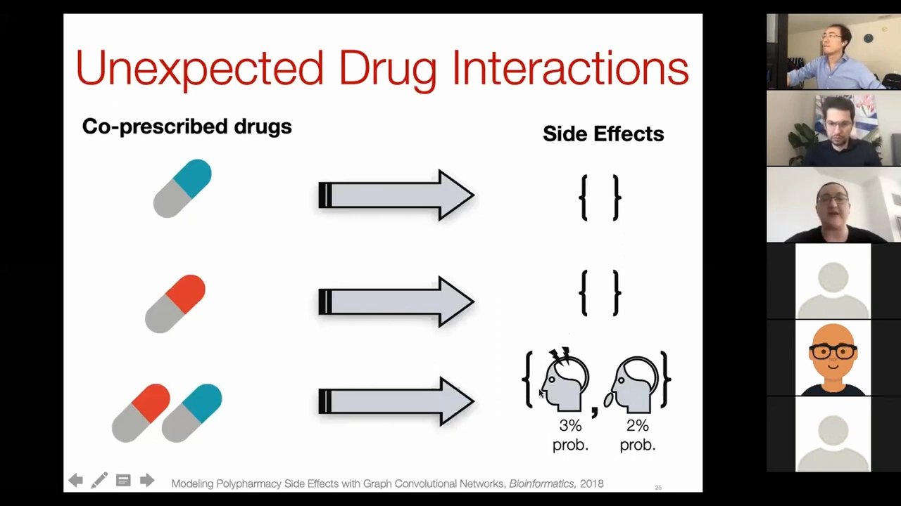

### 5.4 零样本：没有标签时，先验图就是全部信息

COVID 部分展示了先验图的另一种角色（[跳转 45:11](https://www.youtube.com/watch?v=9nACsKGisOI&t=2711)）。要表示一个全新的疾病，他们先把 SARS-CoV-2 的病毒蛋白映射到人蛋白，再映射到人类互作组，得到"COVID-19 疾病模块"——一个由病毒靶点诱导出的子图。

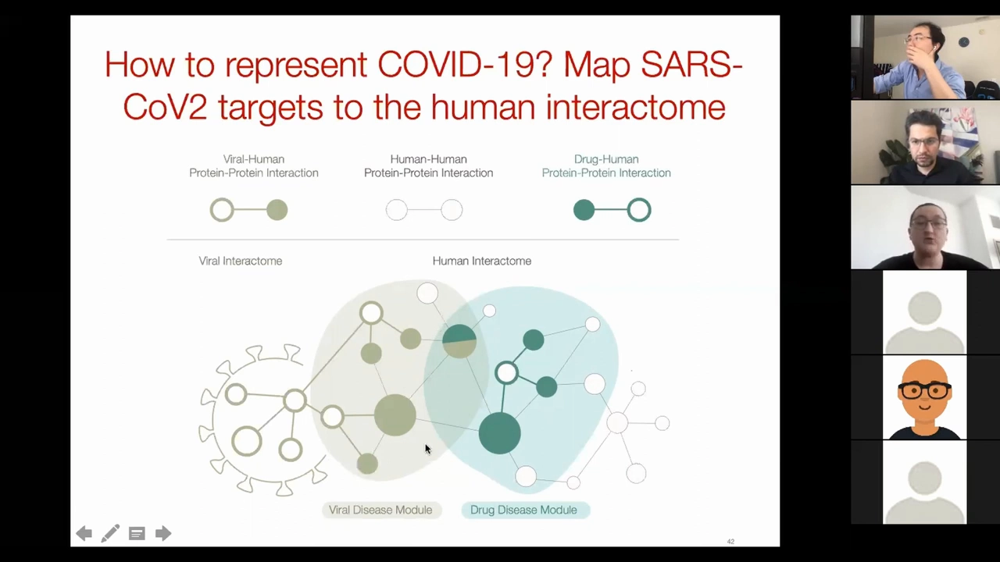

此时没有任何 COVID 标签，模型能用的只有这张先验图和它的结构。他们用 G-Meta 在局部子图上做元学习，把药物按优先级排序，再与当时临床试验中的药物比对（[跳转 47:30](https://www.youtube.com/watch?v=9nACsKGisOI&t=2850)）。讲者特意强调这是一个"弱代理"：临床试验里的药物反映的是医学界的判断，不是真实疗效。

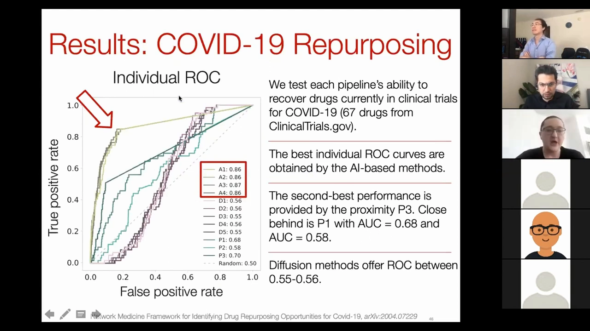

后续的湿实验给出了更强的检验：在 918 个化合物中筛出 77 个有效药物，前 100 名的命中率约 9%，而随机暴力搜索的期望约为 2%（[跳转 49:17](https://www.youtube.com/watch?v=9nACsKGisOI&t=2957)）。这个数量级的提升，是在"先验图 + 少量标签"的条件下取得的。

## 六、把先验图当成变量：一份可执行的检查清单

讲者的三个案例其实给出了同一套方法：不要问"模型准不准"，先问"图是怎么来的、缺了什么、切分有没有泄漏"。把散落在各处的做法收拢，可以得到下面这份清单。

1. **记录边的来源与时刻**。15 个知识库汇编出的 PPI 与单篇论文测出的互作，可靠性不同；时间切分要求你知道每条边"何时进入知识库"。
2. **保留边的类型**。抑制、激活、组织特异性互作在消息传递里对应不同的邻居集合，压成无权无向边等于丢掉先验。
3. **报告覆盖率**。人类互作组只测过 20%–30% 的蛋白，这个数字应当和模型精度一起报告，否则读者无法判断精度来自机制还是来自知识密度。
4. **做有生物学含义的消融**。随机删边与按细胞系删边回答的是两个不同问题。
5. **用时间切分与外部验证替代随机切分**。讲者的多药副作用预测就是用 2012 年后的文献证实来检验的（[跳转 31:34](https://www.youtube.com/watch?v=9nACsKGisOI&t=1894)）。
6. **要求模型给出证据，而不只是打分**。讲者在问答里说得很直接：领域科学家需要的不只是"这里有一个关联"，一个点估计不足以支撑下游实验，"那只是没有证据的高风险预测"（[跳转 55:01](https://www.youtube.com/watch?v=9nACsKGisOI&t=3301)）。

## 小结

- 生物医学 GNN 的输入图通常是从知识库汇编出来的**先验图**，不是从实验数据直接测出的观测图；它的节点和边都能追溯到某次汇编，因而带着汇编时刻的知识边界。
- 消息传递只能沿已有的边进行。先验缺失等价于"断言没有关系"，先验错误等价于"邻居集合错误"，两者都会在多层聚合中被放大。
- 人类蛋白互作组只覆盖 20%–30% 的蛋白，这是讲座给出的最具体的缺失证据；讲者的应对是叠加更多层先验（单细胞、组织、信号网络），而不是假设单层图足够。
- 先验图还会造成评估偏差：同一知识库同时供给训练与测试时，模型可以靠记忆子图拿高分。时间切分、按生物学含义删边的消融、外部实验验证，是三条对应的检查手段。
- 在零样本场景（如新发传染病）里，先验图几乎是模型唯一的信息来源；此时"图建得对不对"直接决定预测有没有价值。

## 关键术语速查

| 术语 | 一句话解释 |
| --- | --- |
| 先验图 | 来自知识库、文献、规则，先于当前观测数据存在的图；本文的蛋白互作网络即由 15 个知识库汇编而成 |
| 观测图 | 从当前数据中估计或测量得到的图，例如由共表达、相关性或实验读出构造的边 |
| 消息传递 | GNN 的逐层计算：每个节点收集邻居的消息、聚合、再更新自身表示 |
| 子图 | 由一组节点及其间边诱导出的局部结构；本文用"疾病相关蛋白"或"药物靶点"诱导子图 |
| 锚补丁 | SubGNN 在底层图上采样的一批参照子图，用来度量目标子图的位置与结构相似性 |
| 边类型 | 边上附带的语义标签，如抑制、激活、组织特异性互作；决定消息传递时取哪些邻居 |
| 时间切分 | 按时间划分训练与测试，使测试集关系在训练时尚未出现，用于阻断知识泄漏 |
| 消融实验 | 有控制地移除部分数据（如某类边）后重训，观察性能变化以判断模型依赖何种信息 |
| 零样本 | 目标类别在训练中完全没有标签；本文指对全新疾病做药物优先级排序 |