# 截断半径与邻居数决定图密度：同一份坐标，换参数就换一张图

> 视频来源：[3. How PointNet++ works on improving 3D point cloud backbone](https://www.youtube.com/watch?v=oE-brp2_5NQ)（YouTube · Ardian Umam）｜时长约 22 分钟
> 视频来源：[Transformers Discover Molecular Structure Without Graph Priors](https://www.youtube.com/watch?v=k9IbNCKJc-c)（YouTube · Valence Labs「Starkly Speaking」，讲者 Tobias Kreiman）｜时长约 64 分钟
> 导读：前一支讲点云网络怎么用「单位球半径 + 最多 K 个邻居」把点集切成局部块，并靠多层堆叠把覆盖范围撑大；后一支是分子机器学习报告，讲图神经网络为什么必须先在坐标上造一张图、造图的半径与 k 最近邻怎么选、以及去掉图之后注意力自己长出了什么邻域结构。本文只取两支视频中与「构图尺度」有关的部分：半径、k、邻居数、图密度、感受野与代价，不重复三类图的来源对照（那是 1.2.1 的任务）。两支视频的字幕均为英文自动生成，本文已按上下文订正断句与术语（例如 unit ball、farthest point sampling、receptive field、over-squashing）。

## 本讲要解决的核心问题（SCQA）

**背景**：几何图的基本做法是：把原子或点云里的点当作节点，把「两个点足够近」当作边，然后在边上做消息传递。节点集合由数据给定，坐标也由数据给定，看起来没什么可选的。

**冲突**：但「足够近」不是一个数，而是一个规则。分子机器学习里常见的写法是「6 埃以内连边」，或者「连 k 等于 20 的最近邻」[【跳转到 04:00】](https://www.youtube.com/watch?v=k9IbNCKJc-c&t=240)；点云网络里则是「以中心点为球心、给定半径的球内取邻居，并且最多取 K 个」[【跳转到 07:09】](https://www.youtube.com/watch?v=oE-brp2_5NQ&t=429)。半径换成 4 埃还是 8 埃，k 换成 8 还是 32，节点和坐标一个都没动，边集却整张换掉了。更麻烦的是，半径和 k 不是同一种旋钮：半径固定的是距离上限，k 固定的是邻居名额，两者对稠密区和稀疏区的影响方向相反。

**疑问**：半径和 k 最近邻各自怎么定出一条边？邻居数和图密度会随参数怎么变？这些变化如何改变感受野与消息传递的代价？拿到一个结果时，怎么判断它是不是「对构图敏感」？

**回答（中心思想）**：**半径定距离上限，kNN 定邻居名额；前者让邻居数随局部密度浮动，后者让作用距离随局部密度浮动。** 图密度（等价地看平均邻居数）同时决定两件事：一层消息传递能看多远（感受野），以及一层要算多少条消息（代价）。所以构图参数不是预处理细节，而是模型假设的一部分——同一份坐标在不同参数下就是不同的图，结论必须连同参数一起报告，并且要在稀疏区和稠密区分别检查。[【跳转到 14:31】](https://www.youtube.com/watch?v=k9IbNCKJc-c&t=871)

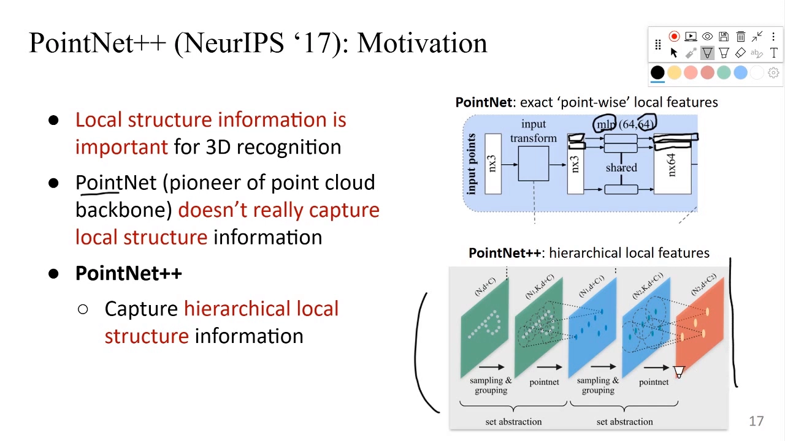

## 一、半径图：距离小于阈值就连边，邻居数不受控

半径图（radius graph）的规则只有一句：两个节点的距离小于截断半径 $r$，就连一条边。讲者在讲分子力场时举的例子是 6 埃：每个原子是图里的一个节点，两个原子在 6 埃以内就连边，超出就不连。[【跳转到 05:40】](https://www.youtube.com/watch?v=k9IbNCKJc-c&t=340)

写成集合的形式，节点 $i$ 的邻居集合是

$$
N(i) = \{\, j : \lVert \mathbf{r}_i - \mathbf{r}_j \rVert_2 \le r \,\}
$$

其中 $\mathbf{r}_i$ 是节点 $i$ 的坐标，$\lVert \cdot \rVert_2$ 是欧氏距离。这个定义里没有任何「名额」：只要落在球内，全部算邻居；球内一个点都没有，邻居集合就是空的。

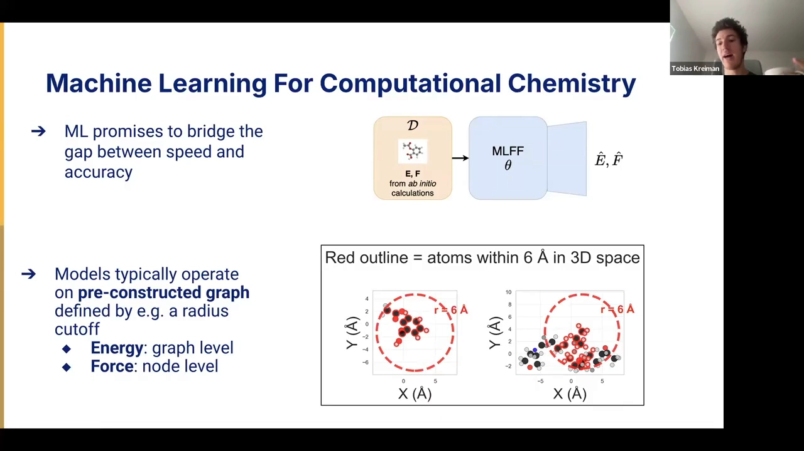

这张幻灯片是整节最直观的一幅图。红色虚线圈是「6 埃以内的原子」，两个圈半径完全相同，圈里的红点数却差很多：左边那个原子处在一个密堆积的环境里，右边那个原子周围明显更空。**半径是一个长度，不是一个数量。** 半径固定时，邻居数由局部密度决定，而不是由你设定。

这也解释了为什么半径图在分子里很自然：物理上「谁和谁有相互作用」本来就由距离决定，而不是由「取前 20 个」决定。代价是每个节点的度（degree，邻居个数）可以差出一个数量级，图的形状完全跟着数据走。

## 二、kNN 图：邻居名额固定，作用距离随密度伸缩

k 最近邻图（k-nearest neighbor graph，kNN 图）换了一个不变量：不管密度如何，每个节点固定连 $k$ 个最近的节点。讲者举的例子是 $k = 20$。[【跳转到 04:00】](https://www.youtube.com/watch?v=k9IbNCKJc-c&t=240)

规则写成集合是

$$
N(i) = \{\, j : j \text{ 是离 } i \text{ 最近的 } k \text{ 个节点} \,\}
$$

注意这里没有出现距离阈值。由定义直接可以推出两件事：

- **邻居数被钉死。** 每个节点恰好 $k$ 个邻居（除非全图节点不足 $k$ 个），平均度就是 $k$，图密度与局部密度无关。
- **作用距离变成变量。** 在稠密区，最近的 $k$ 个点可能都在 3 埃以内；在稀疏区，同样 $k$ 个点可能要伸到 8 埃以外。也就是说，kNN 图把「半径随密度伸缩」这件事自动做掉了。

这两种规则对同一份坐标给出的图不同，对同一个节点的邻居集合也不同。用一句话概括分工：**半径图问「多远以内算邻居」，kNN 图问「最近几个算邻居」。** 前者适合「物理作用有距离上限」的场合，后者适合「每个节点必须有固定信息量」的场合。

## 三、混合写法：半径先筛，K 再封顶

实际网络里更常见的是把两者叠起来。点云网络 PointNet++ 的每个集合抽象层（set abstraction）由三步组成：先用最远点采样选出若干个中心点，再在中心点周围圈邻居，最后用 PointNet 把每个局部块压成一个特征向量。[【跳转到 03:18】](https://www.youtube.com/watch?v=oE-brp2_5NQ&t=198)

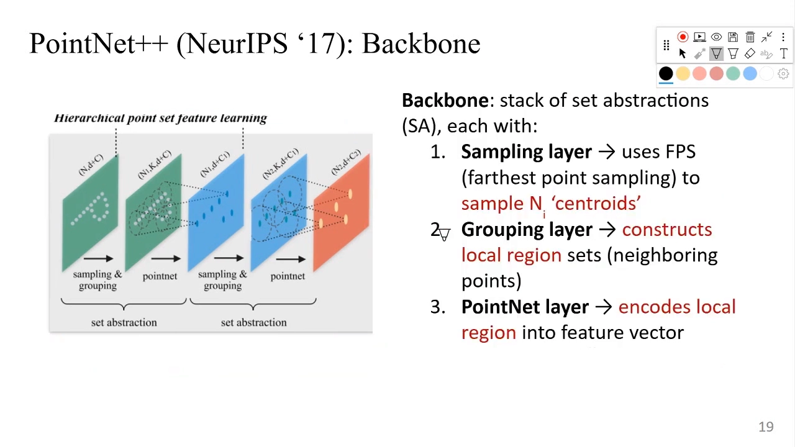

第二步的分组层（grouping layer）就是本节关心的构图动作：以每个中心点为球心画一个给定半径的球（讲者称 unit ball），球内的点算邻居，但**最多只取 K 个**。[【跳转到 07:09】](https://www.youtube.com/watch?v=oE-brp2_5NQ&t=429)

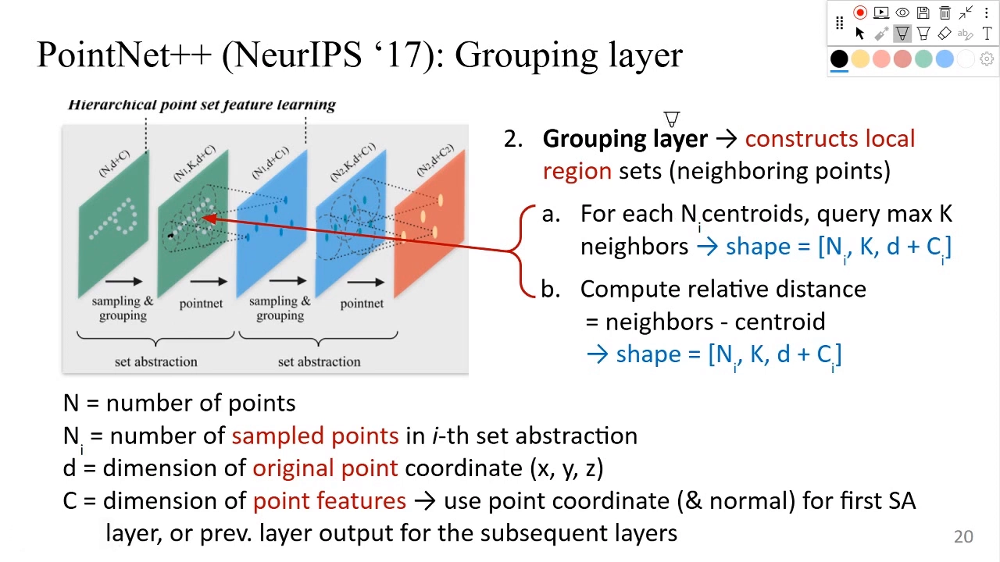

这个「最多 K 个」的封顶不是装饰。它带来一个非常实际的好处：输出张量的形状是固定的 $[N_i, K, d + C]$，$N_i$ 是中心点个数，$K$ 是邻居数，$d$ 是坐标维度，$C$ 是特征维度。**只有邻居数固定，才能把一批局部块堆成一个规整的张量送进 GPU。** 如果只按半径取邻居，每个中心点的邻居数都不一样，就得做变长拼接或掩码，实现复杂度和显存开销都会上去。

所以「半径 + 最多 K 个」是一个工程折中：半径保证邻居在物理上足够近，K 保证计算图规整。代价是当球内点数超过 K 时，多出来的邻居被截掉，截断规则本身又成了一个需要交代的选择。

## 四、图密度：从邻居数到「一层要算多少条消息」

把每个节点的邻居数取平均，就得到平均度 $\bar{d}$；图密度是边数占全部可能边数的比例：

$$
\rho = \frac{2\lvert E \rvert}{\lvert V \rvert\,(\lvert V \rvert - 1)}
$$

其中 $\lvert E \rvert$ 是边数，$\lvert V \rvert$ 是节点数。对半径图，$\lvert E \rvert$ 大致随 $r^3$ 增长（三维里球的体积正比于半径的立方），所以半径从 6 埃加到 8 埃，半径只多了三分之一，边数却会变成两倍多。对 kNN 图，$\lvert E \rvert \approx \lvert V \rvert \cdot k / 2$，与密度无关，只随 $k$ 线性增长。

这个差别直接决定消息传递的代价。一层消息传递要对每条边算一条消息、再做一次聚合，所以单层计算量大致正比于边数乘消息维度：

$$
\text{cost}_{\text{layer}} \;\propto\; \lvert E \rvert \cdot d_m
$$

$d_m$ 是消息向量的维度。半径加倍，边数按立方增长，单层代价跟着涨；$k$ 加倍，边数线性增长，代价也线性增长。讲者在讲 GNN 为什么难规模化时，把这条线索说得更直白：这些大规模图操作很难分布式部署，也很难在现代硬件上跑好；相比之下，Transformer 那边有数亿甚至数十亿美元投入换来的专用硬件和软件，开箱即用就很快。[【跳转到 15:19】](https://www.youtube.com/watch?v=k9IbNCKJc-c&t=919)

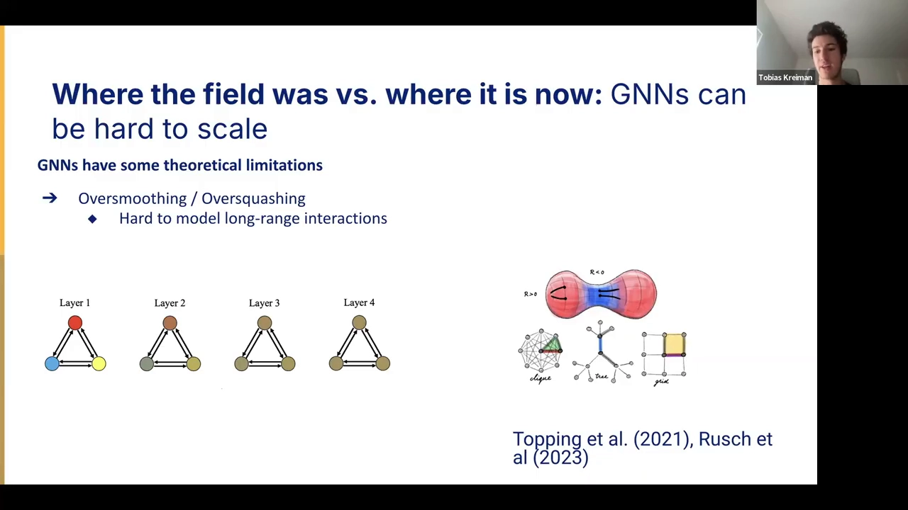

## 五、感受野：半径定一层看多远，层数定总共看多远

图密度不只影响代价，还影响「一层能看多远」。在半径图里，一层的感受野（receptive field，一个节点经过若干轮聚合后能间接看到的范围）上限就是 $r$：超过 $r$ 的节点，第一层根本收不到它的消息。

PointNet++ 把这个关系做成了显式的分层结构。每个集合抽象层（set abstraction）里同时用多个半径，例如 $[0.1, 0.2, 0.4]$，对应最大邻居数 $[32, 64, 128]$，再把不同半径提的特征拼起来，得到多个尺度。[【跳转到 10:54】](https://www.youtube.com/watch?v=oE-brp2_5NQ&t=654)

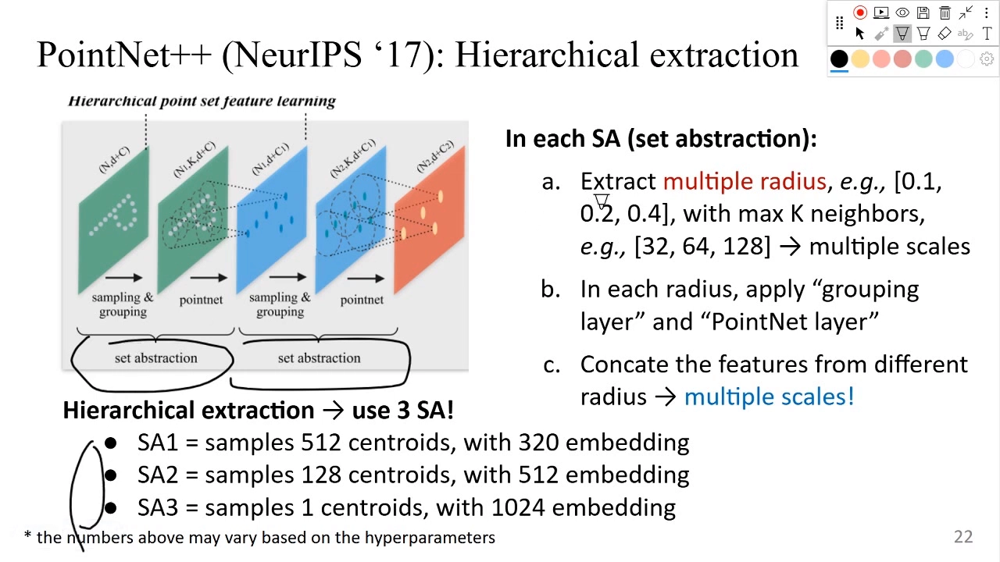

这张幻灯片右下角那三行数字是本节最值得记住的一组：第一层采样 512 个中心点、嵌入 320 维；第二层 128 个中心点、512 维；第三层只剩 1 个中心点、1024 维。**中心点数在减少，每个中心点覆盖的范围在扩大，嵌入维度在增加。** 讲者的解释是：越往深层，每个中心点的覆盖范围越大，而表示更大范围的上下文自然需要更多空间来编码。[【跳转到 14:39】](https://www.youtube.com/watch?v=oE-brp2_5NQ&t=879)

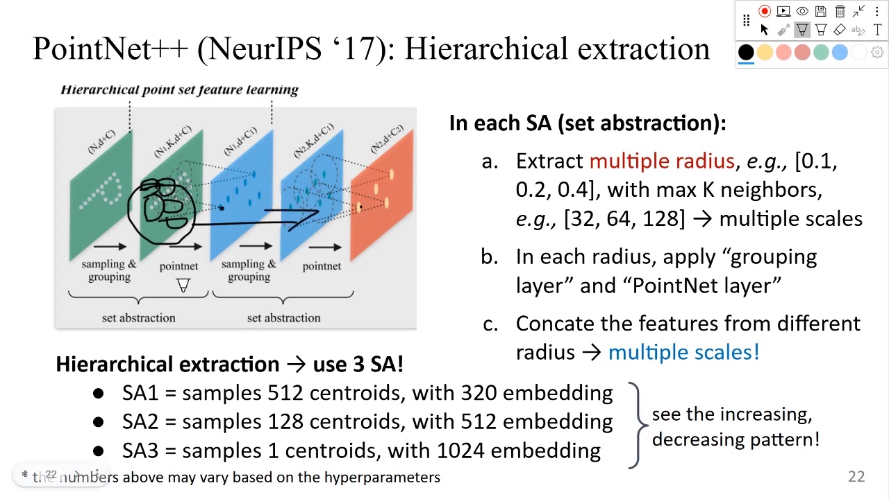

他明确把这个现象和卷积网络类比：网络越深，卷积核的感受野越大。图上的版本是：**层内的半径决定一步能跨多远，层数决定能跨几步，两者相乘才是总感受野。** 这也解释了为什么「半径太小」不总能靠「多加几层」补救：层数一多，过平滑（over-smoothing，多层聚合后节点表示趋同）和过压缩（over-squashing，远端信息被挤进固定大小的向量）就会找上门，讲者把这两个现象列为 GNN 难以建模长程相互作用的直接原因。[【跳转到 14:31】](https://www.youtube.com/watch?v=k9IbNCKJc-c&t=871)

## 六、把图拿掉：注意力自己长出了 6 到 12 埃的截断

讲者的团队做了一个反向实验：不用任何预构造的图，也不放任何物理先验，只把离散的原子序数 token 和连续的 XYZ 坐标一起喂进一个标准 Transformer，注意力机制完全不动。[【跳转到 19:09】](https://www.youtube.com/watch?v=k9IbNCKJc-c&t=1149)

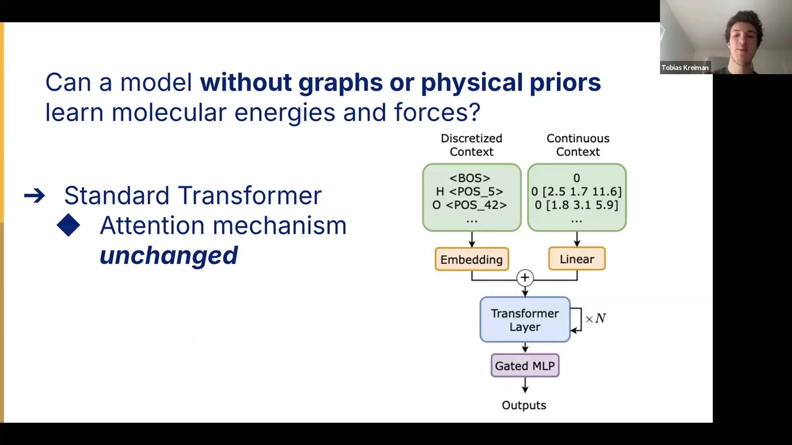

这个设置的价值在于：它把「构图参数」变成了一个可以从数据里学出来的东西，于是我们可以反过来检查——人手工设的半径，到底是不是数据本身要求的尺度。

答案是相当接近。前九层里，位置 token 之间超过 90% 的注意力给到其他位置 token；把注意力分数对原子间距离作图，注意力强度随距离增加而下降，大致成反比，与 $1/r^2$ 的相关系数是 0.63，而后面那些层只有 0.14。[【跳转到 25:44】](https://www.youtube.com/watch?v=k9IbNCKJc-c&t=1544)

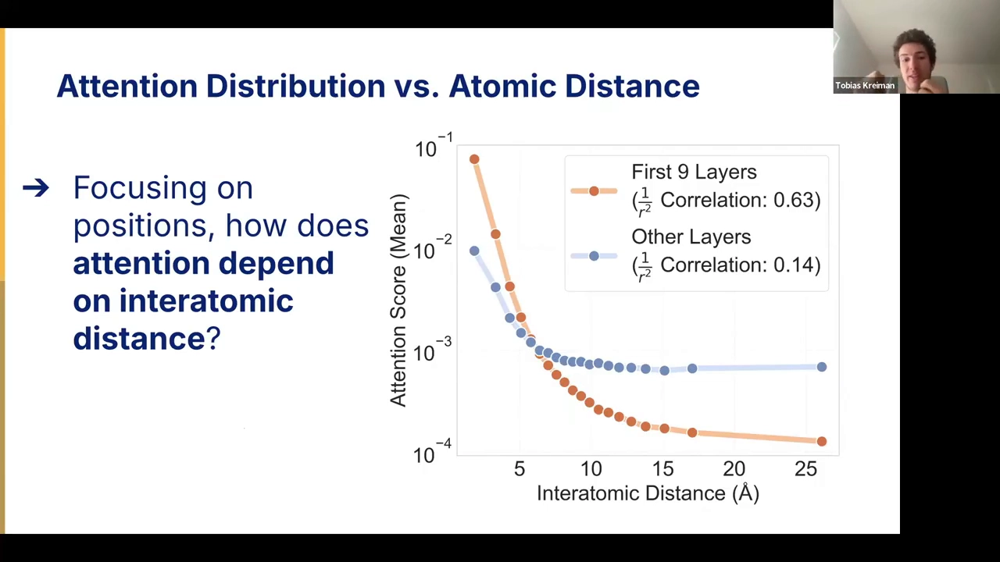

更关键的是曲线的拐点：前九层的注意力强度在 6 到 12 埃附近迅速衰减，讲者称之为「涌现出来的半径截断」，并指出这恰好和人们在这些图神经网络里手工用的半径截断吻合。[【跳转到 26:34】](https://www.youtube.com/watch?v=k9IbNCKJc-c&t=1594)

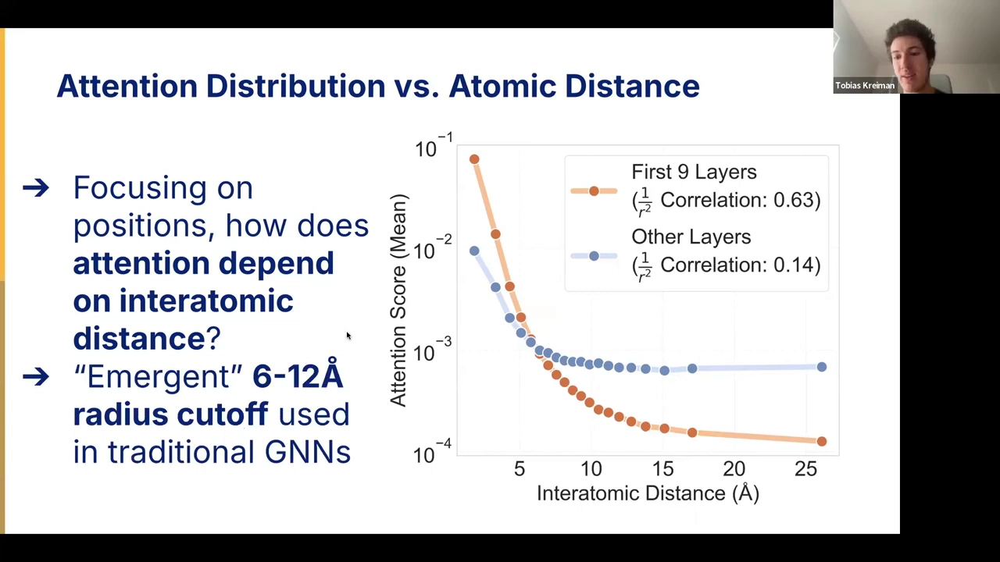

这个结果有两层含义。第一层是**验证**：人们常用的 6 到 12 埃这个量级不是拍脑袋，数据里确实存在这个尺度。第二层是**警告**：既然尺度是从数据里长出来的，那么换一种分子、换一种元素组成，这个尺度就可能变——讲者随后就说了这一点。

## 七、自适应半径：稠密处缩小感受野，稀疏处放大

讲者定义了「有效半径」（effective radius）：某个原子的注意力有 90% 落在半径 $R_i$ 以内，就把 $R_i$ 叫这个原子的有效半径。

$$
R_i = \inf\Big\{\, R \in \mathbb{R}_{\ge 0} : \sum_{j:\ \lVert \mathbf{r}_i - \mathbf{r}_j \rVert_2 \le R} a_{ij} \ge \delta \,\Big\}, \quad \delta = 90\%
$$

其中 $a_{ij}$ 是原子 $i$ 对原子 $j$ 的注意力分数，$\inf$ 表示「满足条件的最小半径」。

把这个量对「该原子到其他原子的距离中位数」作图，得到一条很干净的正相关：原子越孤立，有效半径越大；原子越处在密堆积区，有效半径越小。[【跳转到 29:29】](https://www.youtube.com/watch?v=k9IbNCKJc-c&t=1769)

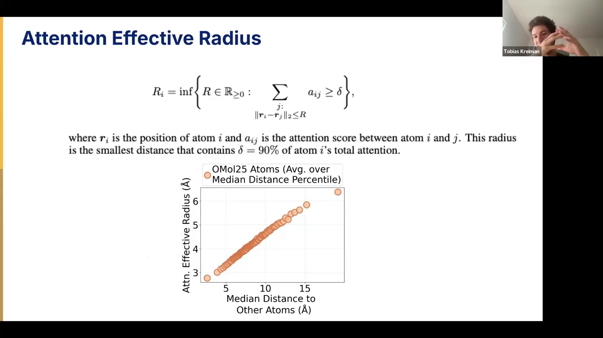

讲者给的解释是物理直觉：在密堆积区域，局部相互作用会主导远处的相互作用；而在很孤立的位置，长程相互作用才真正重要。这条曲线也正好把前面两种构图规则的毛病并排照出来：**固定半径**在稠密区会塞进过多邻居、在稀疏区可能一个邻居都没有；**固定 k** 在稠密区把作用距离压得过短、在稀疏区又拉得过长。自适应半径相当于让每个节点自己决定「看多远」。

## 八、邻居名次视角：有的头只看最近邻，有的看前十个

除了按距离看，还可以按名次看：把邻居按距离排好序，横轴是名次（1 表示最近），纵轴是注意力分数。讲者发现不同的注意力头在这个视角下差别很大：第一层的某个头几乎只注意名次 1 的最近邻，相当于 $k = 1$ 的 kNN 方案；第 8 层的某个头则在名次 5 到 10 附近出现峰值，然后才衰减。[【跳转到 29:54】](https://www.youtube.com/watch?v=k9IbNCKJc-c&t=1794)

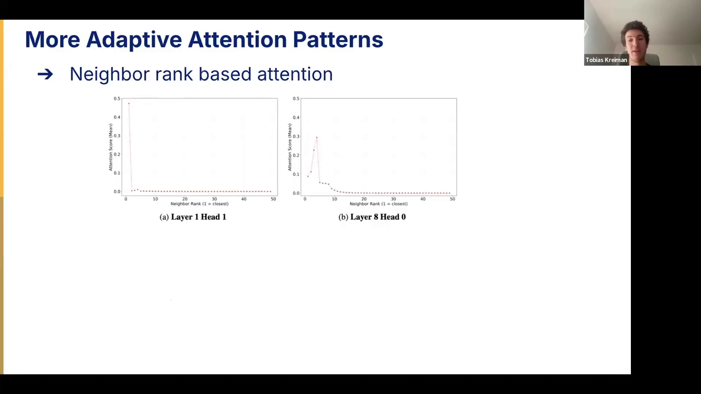

还有一些模式更难用任何一种规则描述：第 8 层的某个头注意力随距离先升后降，第 6 层的某个头注意力随距离上升然后持平。[【跳转到 30:19】](https://www.youtube.com/watch?v=k9IbNCKJc-c&t=1819)

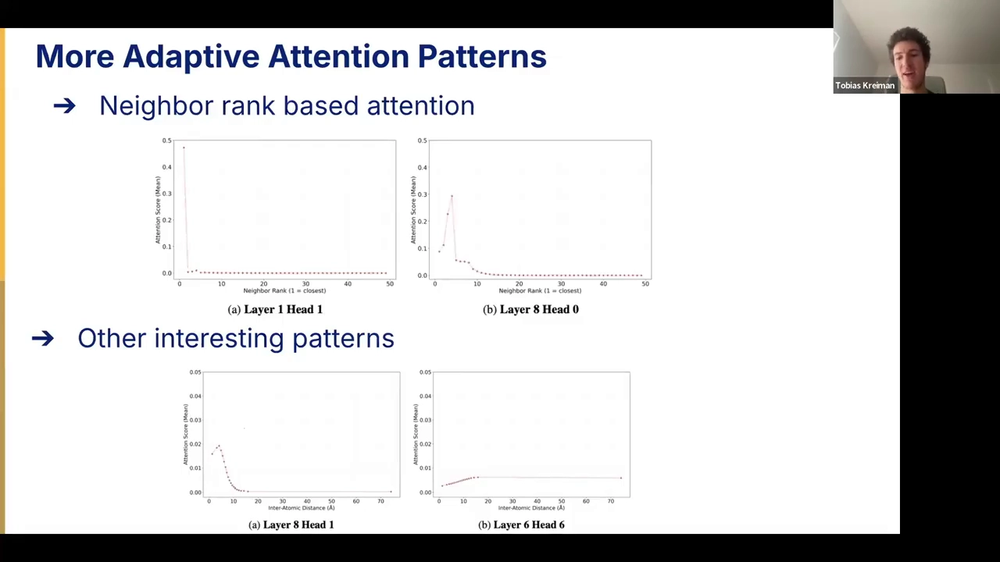

讲者的判断是：这些模式是模型在学习能量和力时发现有用的，但事先很难在某个固定的图构造算法里写出来。这句话对构图实践的启示很直接：**半径图和 kNN 图都是「一个规则管全图、管所有层」，而数据里真正有用的邻域结构可能是逐节点、逐层变化的。** 固定规则不是错，但它是一个必须被检验的近似。

## 九、构图敏感性的判断：四个要检查的地方

把两支视频的线索合起来，可以整理出一份判断清单。当你要说「这个模型的结论可信」或「这个结果对构图敏感」时，至少检查下面四件事。

**第一，参数是否被明确报告。** 「用了半径图」不算报告，必须给出 $r$ 的数值和单位；「用了 kNN」必须给出 $k$。因为半径加倍会让边数变成大约八倍（三维体积按立方增长），$k$ 加倍只会让边数翻倍，两者的代价曲线完全不同。

**第二，稀疏区和稠密区是否被分开看。** 半径图在稠密区的度可能是稀疏区的数倍，这意味着同一个模型对不同局部环境的有效容量不同。讲者提到的 6 埃圈里红点数目的差异，就是这种不均匀的最小例子。

**第三，最优参数是否随数据变化。** 讲者明确说过：对不同类型的分子，构造图的最优截断半径可能是不同的；如果标签本身不依赖某张图，训练时强加一张图会带来泛化问题。[【跳转到 14:31】](https://www.youtube.com/watch?v=k9IbNCKJc-c&t=871) 他甚至说，同一个分子里不同的原子也可能需要不同的截断半径。[【跳转到 28:14】](https://www.youtube.com/watch?v=k9IbNCKJc-c&t=1694) 这是一条很强的敏感性判据：如果换一批分子、换一个元素组成，最优 $r$ 就漂移，那么「在某个数据集上调出的 $r$」不能当作普适常数。

**第四，感受野是否够到任务需要的尺度。** 如果任务依赖长程相互作用，而半径 $r$ 只有 6 埃，那么必须靠多层堆叠把感受野撑大；层数一多，过平滑和过压缩就开始起作用。反过来，如果任务只依赖局部环境，把 $r$ 调大只会白白增加边数和代价。讲者提到的替代路线——不用预构造图、让注意力自己学关系——正是针对这条约束：它没有固定感受野，代价是模型要大得多（10 亿参数对 600 万参数），需要靠数据和算力把结构学出来。[【跳转到 22:49】](https://www.youtube.com/watch?v=k9IbNCKJc-c&t=1369)

## 小结

- **半径图与 kNN 图是两种不同的不变量。** 半径固定距离上限，邻居数随局部密度浮动；kNN 固定邻居名额，作用距离随局部密度伸缩。同一份坐标，换规则或换参数就是另一张图。
- **「半径 + 最多 K 个」是工程折中。** 半径保证邻居在物理上足够近，K 保证输出张量形状规整、能批量送进 GPU；代价是超出 K 的邻居被截掉。
- **图密度同时决定感受野和代价。** 半径图的边数随 $r^3$ 增长，kNN 图的边数随 $k$ 线性增长；单层消息传递的代价正比于边数乘消息维度。
- **感受野 = 层内半径 × 层数。** 半径太小可以靠加层补，但层数一多就撞上过平滑与过压缩，长程相互作用依然难建模。
- **常用的 6 到 12 埃量级有数据依据。** 去掉图先验后，注意力在前九层自发形成了 6 到 12 埃的截断，与手工设定的半径吻合。
- **但最优尺度不是常数。** 有效半径随局部密度变化：稠密处收缩、稀疏处放大；不同分子、甚至同一分子里不同原子，最优截断都可能不同。
- **判断构图敏感性看四件事：** 参数是否报告、稀疏与稠密区是否分开看、最优参数是否随数据漂移、感受野是否够到任务尺度。

## 关键术语速查

| 术语 | 一句话解释 |
| --- | --- |
| 截断半径（cutoff radius） | 距离小于该值就连边的长度阈值，决定半径图里谁和谁相邻 |
| 半径图（radius graph） | 按「距离不超过 $r$」连边的图，邻居数由局部密度决定 |
| k 最近邻图（kNN graph） | 每个节点固定连最近的 $k$ 个节点，邻居数固定、作用距离随密度伸缩 |
| 邻居数 / 度（degree） | 一个节点连了多少条边；全图取平均就是平均度 |
| 图密度（graph density） | 实际边数占全部可能边的比例，反映图的稠密程度 |
| 单位球（unit ball） | 以中心点为球心、给定半径的球，点云网络用它圈定邻居范围 |
| 集合抽象层（set abstraction） | PointNet++ 的基本块：采样中心点、分组邻居、再用 PointNet 融合成局部特征 |
| 最远点采样（farthest point sampling） | 每次选离已选点集最远的点，让采样点在空间上尽量铺开 |
| 感受野（receptive field） | 一个节点经过若干轮聚合后能间接看到的范围；层内由半径定，层间由层数放大 |
| 过平滑（over-smoothing） | 层数过多时节点表示趋同，局部差异被抹平 |
| 过压缩（over-squashing） | 远端大量信息被挤进固定大小的向量，长程依赖传不过来 |
| 有效半径（effective radius） | 集中了某节点 90% 注意力（或权重）的最小半径，用来度量它实际看多远 |