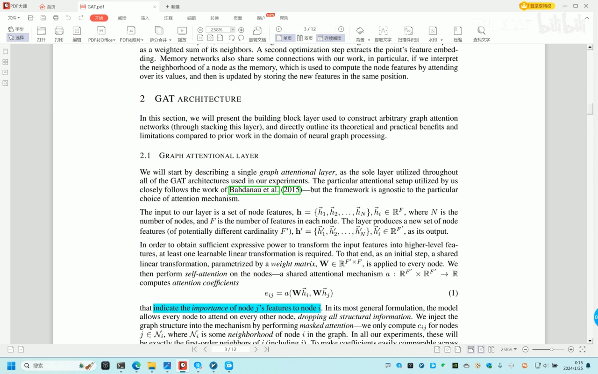
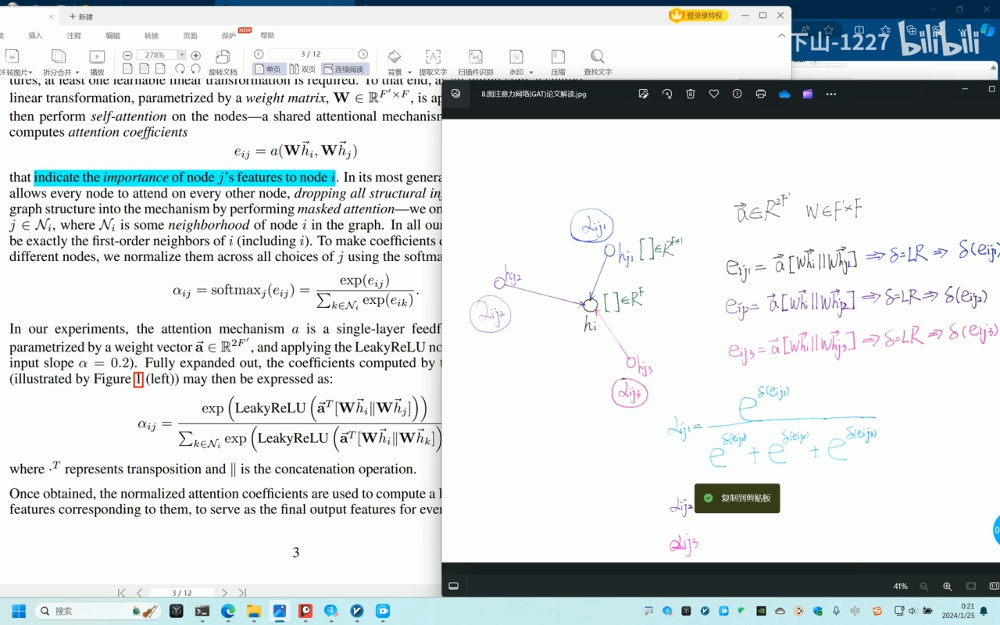
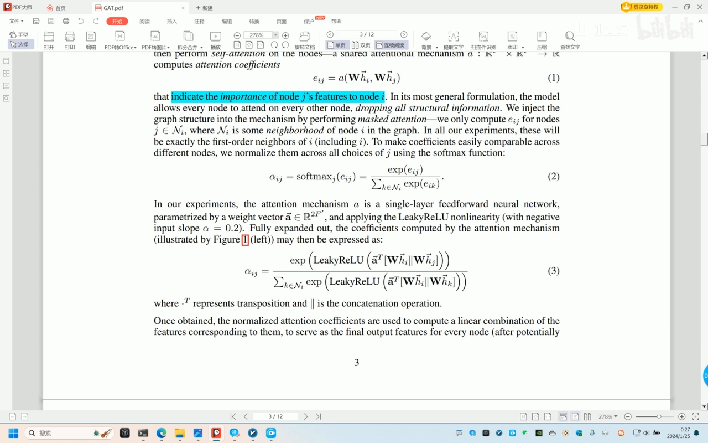
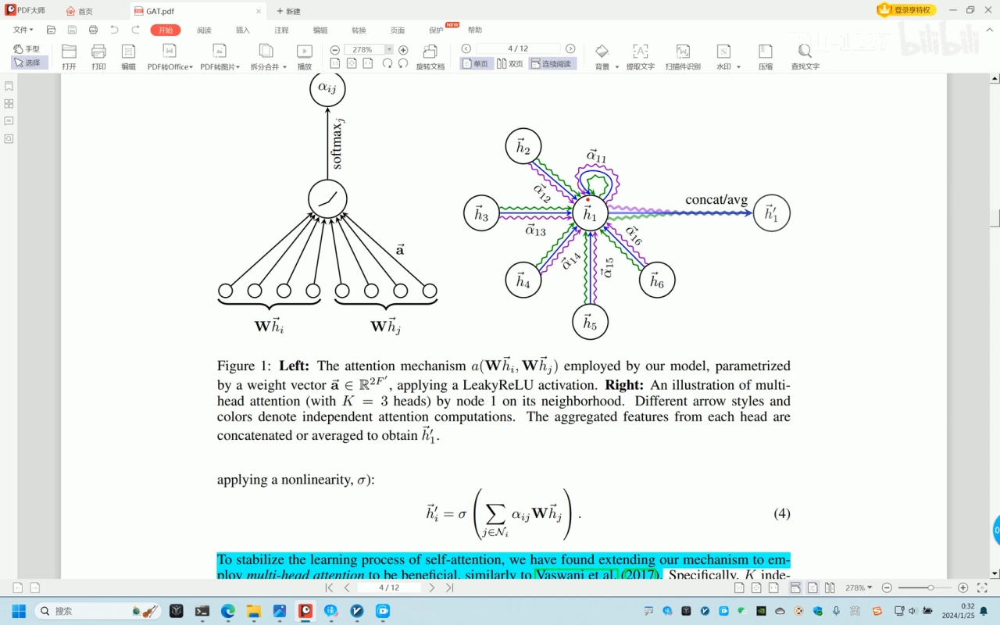
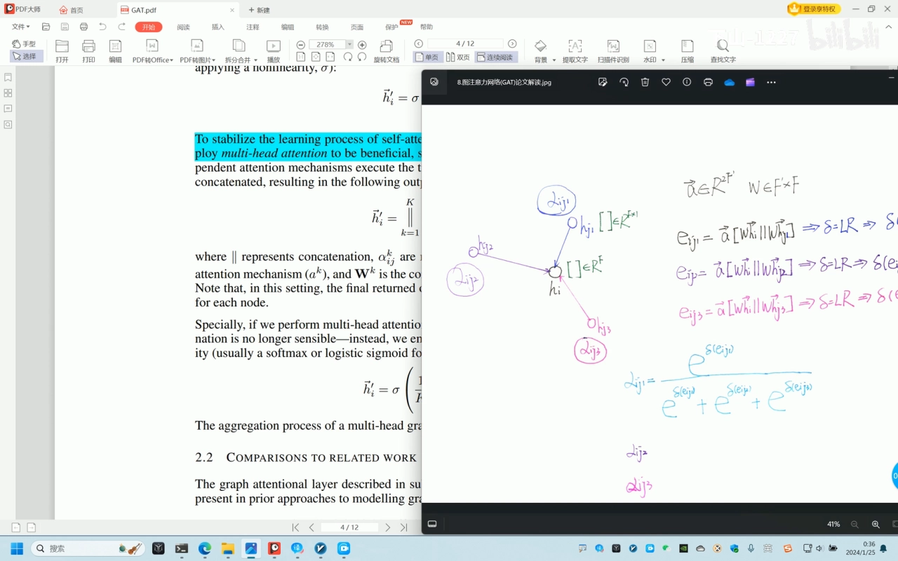
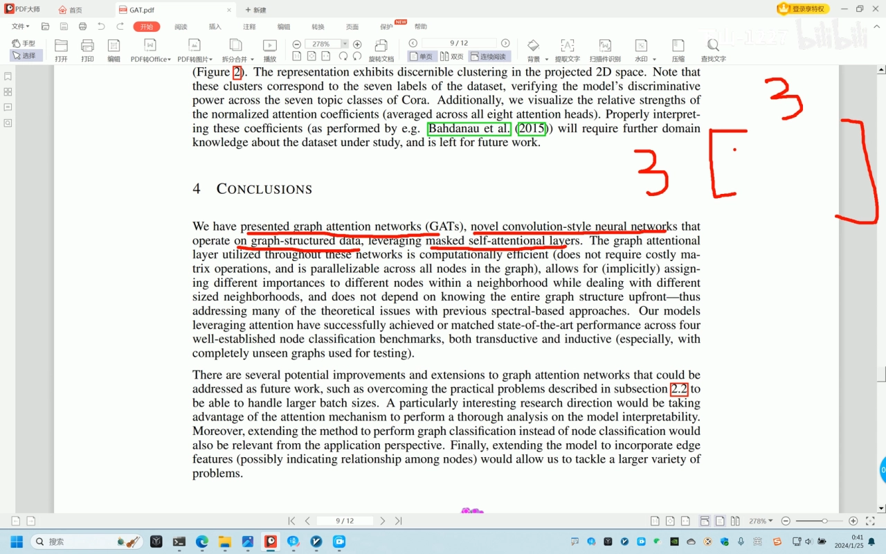
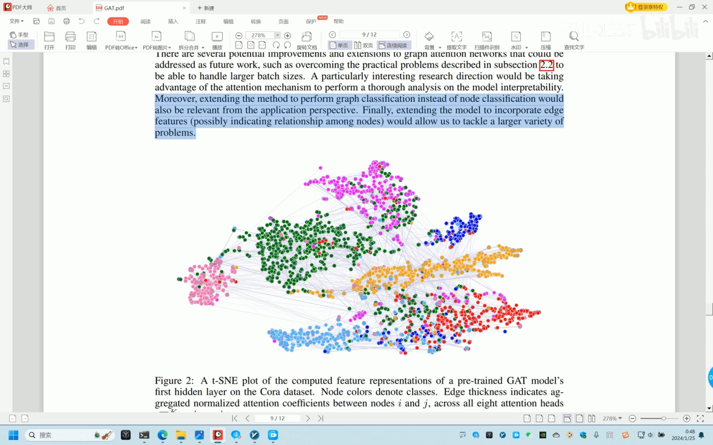

# GAT 论文精读：掩码自注意力如何把图结构注入注意力

> 视频来源：[GNN-8.图注意力网络（GAT）论文解读](https://www.bilibili.com/video/BV14Q4y1c7CN/)（Bilibili · 下山-1227）｜时长约 42 分钟
> 讲者按论文原文的顺序逐段走：摘要 → 引言里列的三条性质 → 2.1 节的四个公式 → 2.2 节与前人工作的对比 → 结论与作者自陈的局限。本篇跟着这条线走，重点放在两处：**masked attention 到底把图结构注入到了哪一步**，以及**作者用"效率"换掉了什么**。序列注意力本身的 Q/K/V 推导不在本篇范围内（见 [M02 §3.1.2 查询、键、值与自注意力](../../../../M02_序列建模与大模型架构/README.md#m02-3-1-2)）。

## 本讲要解决的核心问题（SCQA）

**背景**：GAT 之前的图卷积主流是谱方法一系——从拉普拉斯算子出发，绕不开特征分解、求逆这类高昂的矩阵运算，而且学到的滤波器绑定在某一张固定的图上。

**冲突**：绑定在固定图上意味着只能做**转导（transductive）学习**：训练时见过整张图，测试也必须在这张图上，换一张新图就得重训。可现实里很多任务是归纳（inductive）的——测试图在训练时根本不存在，比如一个没见过的蛋白质相互作用网络。此外，谱方法给每个邻居的权重由图的拓扑（度数、归一化系数）决定，与邻居的特征内容无关，模型没法表达"这个邻居比那个邻居更值得看"。

**疑问**：能不能设计一种聚合方式，让权重由**节点特征**现场算出来，既不依赖特征分解，也不依赖对整张图的预先访问？

**回答（中心思想）**：GAT 用**掩码自注意力（masked self-attention）**回答了这个疑问。它把 Transformer 那套"用注意力给邻居分配权重"的思路搬到图上，再用一个邻接矩阵的掩码把"只允许看邻居"这条结构约束注入进去。于是：权重变成特征的函数（能表达邻居间的相对重要性），计算只剩逐边的标量运算（不需要特征分解），参数与图无关（可以推广到没见过的图）。

## 一、摘要里的三个承诺

讲者先带读摘要，把作者的三句话拆成三个承诺。[【跳转到 01:06】](https://www.bilibili.com/video/BV14Q4y1c7CN/?t=66)

1. **提出一个新架构**：graph attention network（GAT），作用在图数据上，核心是一个 masked self-attention 层。
2. **不需要高昂的矩阵运算**：不依赖求逆，也不依赖图的结构去做那些谱方法必须做的运算。
3. **可以做归纳学习**：模型能推广到完全没见过的图上。

讲者在这里顺手纠了一个常见误解：注意力机制不是 Transformer 发明的。Attention is All You Need 提出了 Transformer 这个架构，但 attention 这个概念在更早的论文里就出现了。[【跳转到 04:19】](https://www.bilibili.com/video/BV14Q4y1c7CN/?t=259)

顺带他还点出了贯穿全文的一对概念：**transductive（转导）** 与 **inductive（归纳）**。前者测试数据在训练时就已存在于图中，后者测试图是全新的。GAT 的第三个承诺说的就是后者。

## 二、引言里列的三条性质

论文引言在蓝色高亮处列了注意力架构的三个"有趣性质"，讲者逐条过了一遍。[【跳转到 05:25】](https://www.bilibili.com/video/BV14Q4y1c7CN/?t=325)

**性质一：算子高效、可并行。** 这个操作可以跨节点的邻居对并行处理——论文用的词是 parallelizable。讲者补充：Transformer 里 Q、K、V 三个矩阵的运算同样可以并行。

**性质二：可以给邻居分配任意权重。** 这是注意力机制的核心：给邻域里不同节点分配不同权重，权重高的节点就会被更多地关注，从而捕获上下文信息。讲者说这就是机器翻译里注意力常用的那套逻辑——"捕获关键信息"。

**性质三：可以直接用于归纳学习。** 包括推广到完全没见过的图。为什么能？讲者的解释是：虽然 masked attention 是基于图结构做的，但它完全可以不基于图结构去聚合特征，所以能推广到没见过的图。[【跳转到 07:05】](https://www.bilibili.com/video/BV14Q4y1c7CN/?t=425)

这三条性质，其实就是后面 2.2 节对比表的提纲。

## 三、单层 GAT 的推导：四个公式一条流水线

讲者说第二部分最重要的是"把公式的含义搞清楚"，于是他把 2.1 节的公式逐个拆开。[【跳转到 07:35】](https://www.bilibili.com/video/BV14Q4y1c7CN/?t=455)

### 3.1 输入、输出与共享线性变换

输入是节点特征集合 $\mathbf{h}=\{\vec{h}_1,\dots,\vec{h}_N\}$，$\vec{h}_i\in\mathbb{R}^F$：$N$ 是节点数，$F$ 是每个节点的特征维数。输出是 $\mathbf{h}'=\{\vec{h}'_1,\dots,\vec{h}'_N\}$，$\vec{h}'_i\in\mathbb{R}^{F'}$，维数可以不同。[【跳转到 08:00】](https://www.bilibili.com/video/BV14Q4y1c7CN/?t=480)

第一步是一个**所有节点共享**的线性变换，参数是权重矩阵 $\mathbf{W}\in\mathbb{R}^{F'\times F}$。注意"共享"两个字：同一个 $\mathbf{W}$ 作用在每个节点上，这正是参数与图规模无关的根源。

### 3.2 用前馈网络算注意力系数 $e_{ij}$

$$
e_{ij} = a\left(\mathbf{W}\vec{h}_i,\ \mathbf{W}\vec{h}_j\right)
$$

讲者在这里解释了一个"为什么"：为什么用神经网络去算这个 $a$，而不是自己手写一个函数？因为**你也不知道该用什么函数**去结合两个节点特征才更好。既然不知道，那就把它拼起来交给一个前馈网络，让网络自己去学。[【跳转到 14:08】](https://www.bilibili.com/video/BV14Q4y1c7CN/?t=848)

具体做法是：先把 $\mathbf{W}\vec{h}_i$ 和 $\mathbf{W}\vec{h}_j$ 拼接，再让拼接结果过一个单层前馈网络。于是对中心节点 $i$ 和它的每个邻居 $j_1,j_2,j_3$，分别得到 $e_{ij_1},e_{ij_2},e_{ij_3}$。[【跳转到 15:23】](https://www.bilibili.com/video/BV14Q4y1c7CN/?t=923)

**维度核对**（讲者专门停下来算了一遍）：$\vec{h}_i$ 是 $F$ 维，$\mathbf{W}$ 是 $F'\times F$，所以 $\mathbf{W}\vec{h}_i$ 是 $F'$ 维；两个 $F'$ 维一拼就是 $2F'$ 维；所以这个前馈网络的输入维度是 $2F'$，$\vec{a}\in\mathbb{R}^{2F'}$。[【跳转到 16:13】](https://www.bilibili.com/video/BV14Q4y1c7CN/?t=973)

### 3.3 LeakyReLU 与 softmax：把打分变成权重

得到 $e_{ij}$ 之后要过一道 LeakyReLU 激活。讲者解释了两层理由：一是负半轴保留斜率，不让梯度等于零；二是"计算出来的注意力系数之后做了一个激活"。[【跳转到 17:03】](https://www.bilibili.com/video/BV14Q4y1c7CN/?t=1023)

然后是 softmax，把邻域内的打分归一化成和为 1 的权重：

$$
\alpha_{ij} = \operatorname{softmax}_j(e_{ij}) = \frac{\exp(e_{ij})}{\sum_{k\in\mathcal{N}_i}\exp(e_{ik})}
$$

讲者用最直白的话解释 softmax：当前图中有很多注意力系数，把邻域节点的系数都算出来之后，为了"扩大影响"做一个归一化处理，用它的 $e$ 指数除以 $e$ 指数的和。[【跳转到 10:30】](https://www.bilibili.com/video/BV14Q4y1c7CN/?t=630)

把上面几步合起来，就是论文的公式 (3)：

$$
\alpha_{ij} = \frac{\exp\!\left(\operatorname{LeakyReLU}\!\left(\vec{a}^{\top}\left[\mathbf{W}\vec{h}_i \,\Vert\, \mathbf{W}\vec{h}_j\right]\right)\right)}{\sum_{k\in\mathcal{N}_i}\exp\!\left(\operatorname{LeakyReLU}\!\left(\vec{a}^{\top}\left[\mathbf{W}\vec{h}_i \,\Vert\, \mathbf{W}\vec{h}_k\right]\right)\right)}
$$

### 3.4 加权求和得到输出

$$
\vec{h}'_i = \sigma\left(\sum_{j\in\mathcal{N}_i}\alpha_{ij}\mathbf{W}\vec{h}_j\right)
$$

讲者用一个具体数字把这一步走了一遍：假设三个邻居的注意力系数分别是 $0.5$、$0.3$、$0.2$，那么输出就是 $0.5\cdot\mathbf{W}\vec{h}_{j_1}+0.3\cdot\mathbf{W}\vec{h}_{j_2}+0.2\cdot\mathbf{W}\vec{h}_{j_3}$，再整体过一道激活函数 $\sigma$。[【跳转到 21:11】](https://www.bilibili.com/video/BV14Q4y1c7CN/?t=1271)

讲者的总结是：第一步规定怎么求系数，第二步求完系数做 softmax，第三步把系数乘以变换后的节点特征做聚合，再通过激活函数，就得到了中心节点更新后的特征。[【跳转到 23:36】](https://www.bilibili.com/video/BV14Q4y1c7CN/?t=1416)

## 四、masked self-attention：图结构到底注入在哪一步

这是全篇最值得单独拎出来的一节。讲者在结论部分回头解释了"masked"的含义。[【跳转到 33:18】](https://www.bilibili.com/video/BV14Q4y1c7CN/?t=1998)

推理链条是这样的：算完所有节点对之后，你手上有一张**注意力矩阵**——比如三个节点就是 $3\times 3$，每两个节点之间都有注意力系数。同时你还有一张**邻接矩阵**，里面全是 1 和 0。

于是做一件事：**用邻接矩阵对注意力矩阵做掩码**。有 1 的位置保留它的值，为 0 的位置填一个极小的值（比如 $-\infty$ 或一个很大的负数）。这样经过 softmax 之后，被掩掉的位置权重趋近于 0，信息就流不过去了。

这就回答了本节的核心问题：**图结构不是在打分阶段注入的，而是在归一化阶段注入的**。$e_{ij}$ 的计算本身对任意两个节点都能算（论文原话说，最一般的形式允许每个节点关注其他所有节点，这会丢掉全部结构信息）；是 softmax 里那个 $k\in\mathcal{N}_i$ 的求和范围，把"只看邻居"这条约束落实了。

讲者在这里也埋了一个伏笔：这个 mask 操作在下一讲的代码实现里会讲清楚。[【跳转到 34:08】](https://www.bilibili.com/video/BV14Q4y1c7CN/?t=2048)

## 五、自环与多头

### 5.1 自环：让 $\mathcal{N}_i$ 包含自己

上面公式里求和写的是 $j\in\mathcal{N}_i$，讲者提醒：论文里这个 $\mathcal{N}_i$ 是**包含 $i$ 自己**的。也就是说节点自己也要和自己算一个注意力系数 $\alpha_{ii}$，这就是自环。[【跳转到 24:15】](https://www.bilibili.com/video/BV14Q4y1c7CN/?t=1455)

如果不加自环，节点更新时就会完全丢掉自己的原始表示，只剩邻居信息的混合。加了自环，$\alpha_{ii}$ 就成了"保留多少自身信息"的可学习门控。

### 5.2 多头：为了稳定自注意力的学习

论文原话是：为了稳定自注意力的学习过程，把机制扩展成多头注意力是有益的。[【跳转到 25:42】](https://www.bilibili.com/video/BV14Q4y1c7CN/?t=1542)

讲者用卷积神经网络做了个类比，这个类比很到位：CNN 里每个卷积核独立学习，八个卷积核就得到八张特征图；注意力头就相当于特征图的个数——用了一种打分函数是一个头，用了两种就是两个头。换句话说，多头就是把刚才那套工作**独立地重复做几遍**。[【跳转到 26:13】](https://www.bilibili.com/video/BV14Q4y1c7CN/?t=1573)

多头的结果怎么合并？论文给了两种：

$$
\vec{h}'_i = \Big\Vert_{k=1}^{K}\sigma\left(\sum_{j\in\mathcal{N}_i}\alpha_{ij}^{k}\mathbf{W}^{k}\vec{h}_j\right)
\qquad\text{（中间层：拼接）}
$$

$$
\vec{h}'_i = \sigma\left(\frac{1}{K}\sum_{k=1}^{K}\sum_{j\in\mathcal{N}_i}\alpha_{ij}^{k}\mathbf{W}^{k}\vec{h}_j\right)
\qquad\text{（输出层：平均）}
$$

讲者解释了为什么输出层要用平均而不是拼接：到了最后一层，每个头输出的还是 $F'$ 维，如果把 $K$ 个头拼起来就是 $K F'$ 维，维度不再可控；而分类任务需要的是固定的类别数，所以最后一层取平均（论文原文的说法是：在最终预测层做多头，拼接就不再有意义了，改为平均）。[【跳转到 27:28】](https://www.bilibili.com/video/BV14Q4y1c7CN/?t=1648)

## 六、2.2 节：和前人工作比，GAT 到底省了什么、付出了什么

讲者把 2.2 节归纳成几条，讲得很实在。[【跳转到 28:33】](https://www.bilibili.com/video/BV14Q4y1c7CN/?t=1713)

**省下来的：**

1. **计算高效、可并行。** 自注意力层的操作可以在所有边上并行化，输出特征可以在所有节点上计算。
2. **不需要特征分解。** 讲者在这里点了一句：GCN 属于谱方法一系，拉普拉斯算子里涉及特征值、特征向量，GAT 不需要这些高昂的矩阵运算。
3. **不依赖全局图结构。** 注意力机制以共享的方式用在图中所有边上，因此不需要预先访问整张图的所有节点——这就是它能做归纳学习的直接原因。

**付出的：**

4. **存储和参数随头数线性增长。** 论文说多头会让存储和参数需求增加 $K$ 倍，而单个头的计算是完全独立的、可以变化的。讲者在这里插了一句自己的训练经验：GAT 的存储确实比较大，因为它要为每个节点保存很多权重信息。[【跳转到 34:58】](https://www.bilibili.com/video/BV14Q4y1c7CN/?t=2098)

**顺带澄清的：**

5. **GAT 是 MoNet 的一个特例。** 论文自己承认，GAT 可以重写成 MoNet 的一个具体实例。讲者坦白他没细看过 MoNet，建议感兴趣的自己去看。[【跳转到 32:03】](https://www.bilibili.com/video/BV14Q4y1c7CN/?t=1923)

讲者还补了一条对"不依赖全局图结构"的补充说明：到后面我们是用 masked attention，会注入图结构；用不用都可以，取决于你自己。这一点很重要——它说明"不依赖全局结构"和"使用邻域结构"并不矛盾：前者说的是不需要预先看整张图，后者说的是每次前向时用局部的邻居列表。

## 七、结论：作者自己承认的边界

讲者说实验部分（transductive 与 inductive 两组基准）现在参考价值不大了，因为这是 2018 年的论文，于是直接跳到结论。[【跳转到 32:28】](https://www.bilibili.com/video/BV14Q4y1c7CN/?t=1948)

结论里作者列了三条未来工作，讲者认为最后一条最有意思：

1. **突破 2.2 节的实践问题，支持更大的 batch size。** 讲者说这个问题现在多多少少解决了一些，但没有完全解决。
2. **用注意力做可解释性分析。** 类比机器翻译里 Transformer 的可视化——把重要的特征可视化出来。讲者特意区分了论文用的词：interpretability（可解释性）与 explainability 不是一回事。[【跳转到 38:18】](https://www.bilibili.com/video/BV14Q4y1c7CN/?t=2298)
3. **把模型扩展到边特征。** 讲者认为这句最重要：后面很多 GNN 模型不单单用节点特征，也用边特征来做预测，比如链接预测（link prediction）。所以"把边特征纳进来"这个方向能解决的问题面宽得多。[【跳转到 39:38】](https://www.bilibili.com/video/BV14Q4y1c7CN/?t=2378)

## 八、t-SNE 图：注意力权重长什么样

论文最后给了一张 t-SNE 可视化：把预训练 GAT 第一层隐藏层的特征表示投影到二维。七个颜色对应 Cora 的七个类别，聚类分得很开；边的粗细表示两个节点之间跨八个注意力头平均后的归一化注意力系数强度。[【跳转到 40:13】](https://www.bilibili.com/video/BV14Q4y1c7CN/?t=2413)

这张图能读出两件事。第一，**判别性**：七类在二维空间里能分开，说明学到的表示是有区分度的。第二，**注意力是可观测的**：边粗细直接来自 $\alpha_{ij}$，这意味着注意力权重本身就是一个可读的中间产物。不过作者也很谨慎地写了：要正确解读这些系数，还需要对数据集有更多领域知识，留作未来工作——也就是说，注意力权重高不等于"模型在做因果推理"。

## 小结

- **GAT 的动机是摆脱谱方法的绑定**：不需要特征分解、不需要预先访问整张图，因此能做归纳学习。
- **单层 GAT 是四步流水线**：共享线性变换 $\mathbf{W}$ → 用单层前馈网络算 $e_{ij}$ → 邻居上 softmax → 加权求和加激活。
- **图结构注入在 softmax 那一步**，不在打分那一步：$e_{ij}$ 对任意节点对都能算，是 $\sum_{k\in\mathcal{N}_i}$ 把范围限制在邻居上，这就是 masked self-attention。
- **$\mathcal{N}_i$ 包含节点自己**，所以有自环项 $\alpha_{ii}$，让节点保留一部分自身表示。
- **多头是为了稳定训练**：中间层拼接、输出层平均；代价是存储和参数随头数线性增长。
- **论文自陈的边界**：batch size 受限、尚未扩展到图分类与边特征、注意力权重的解读需要领域知识。

## 关键术语速查

| 术语 | 一句话解释 |
| --- | --- |
| 图注意力层 | GAT 的基本构件，一层就是一次"带注意力权重的邻居加权求和" |
| masked self-attention | 用邻接矩阵把非邻居位置的注意力打分掩掉，只让邻居参与归一化 |
| 注意力系数 $e_{ij}$ | 节点 $j$ 对 $i$ 的原始重要性打分，由单层前馈网络算出 |
| 归一化注意力 $\alpha_{ij}$ | $e_{ij}$ 在 $\mathcal{N}_i$ 上做 softmax 的结果，和为 1 |
| 共享线性变换 $\mathbf{W}$ | 所有节点共用的 $F'\times F$ 投影矩阵，是参数与图规模无关的关键 |
| 自环 | 让 $\mathcal{N}_i$ 包含 $i$ 自身，产生 $\alpha_{ii}$ |
| 多头注意力 | $K$ 套独立的 $(\vec{a},\mathbf{W})$ 并行计算，中间层拼接、输出层平均 |
| 转导（transductive） | 测试节点在训练时已存在于同一张图中 |
| 归纳（inductive） | 测试图在训练时完全没见过，要求参数与具体图无关 |
| MoNet | 一个更一般的空间域图卷积框架，论文承认 GAT 是它的一个特例 |