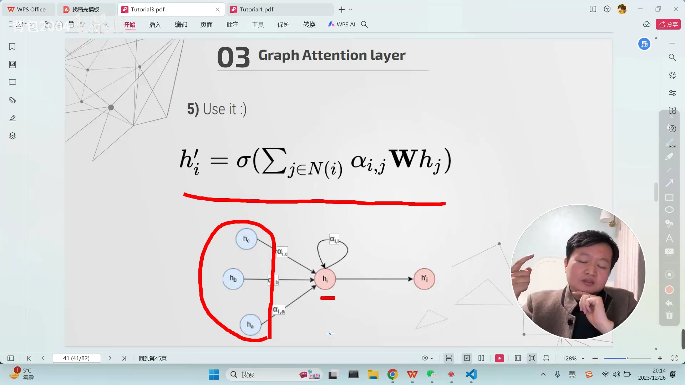
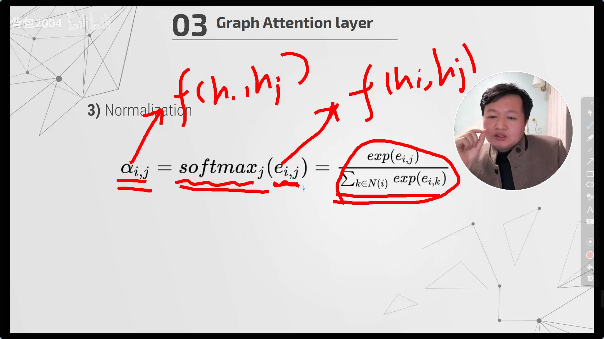
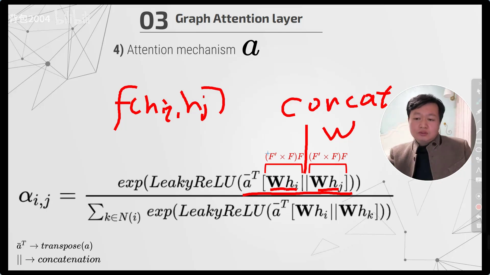
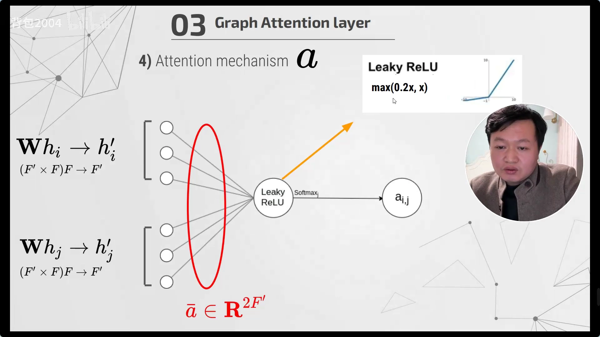
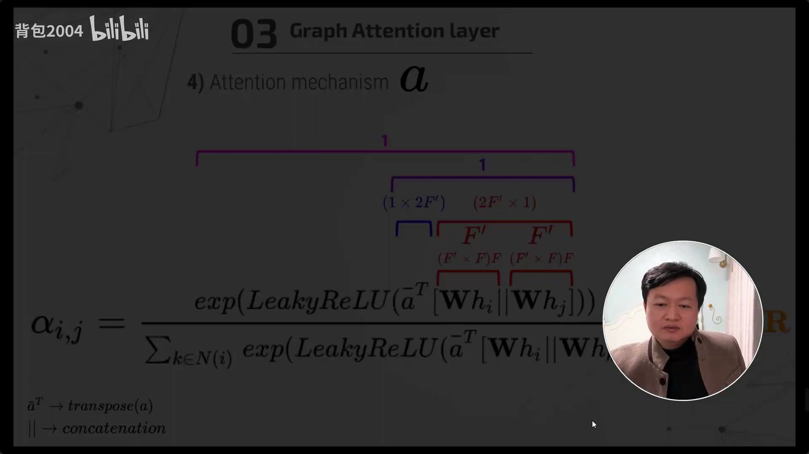
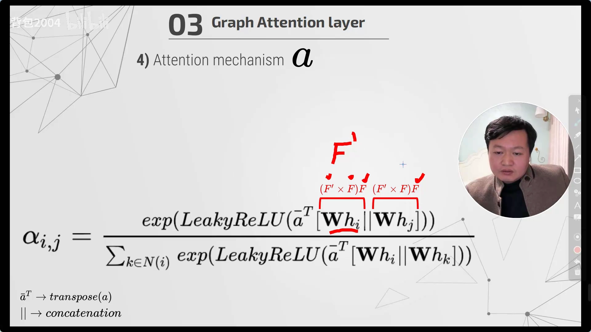
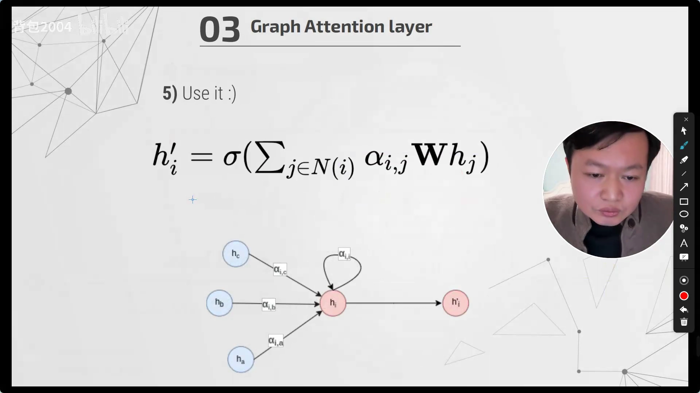
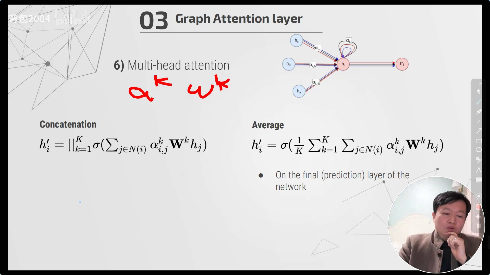

# 图注意力网络的计算骨架：把固定权重换成可学习的注意力系数

> 视频来源：[37-图注意力网络原理-GAT-全网最细解读-图神经网络-pyg学习](https://www.bilibili.com/video/BV1Nb4y1G7fq/)（Bilibili · 背包2004）｜时长约 31 分钟
> 本篇只讲一件事：GAT 那一行公式里的每个符号是怎么被一步步"逼"出来的。讲者刻意从「图本身」出发而不从 Transformer 出发，所以本文也按这个顺序走：先看固定加权求和为什么不行，再看不行的原因如何决定了 $e_{ij}$ 的形式，最后把维度账算清、把多头对上。序列注意力里 Q/K/V 的完整推导不在本篇范围内（见 [M02 §3.1.2 查询、键、值与自注意力](../../../../M02_序列建模与大模型架构/README.md#m02-3-1-2)）。

## 本讲要解决的核心问题（SCQA）

**背景**：图神经网络有一个贯穿始终的核心思想——一个节点的表示不应该只由它自己的向量决定，还要把邻居的向量考虑进来。GCN 的做法是把邻居加起来，GraphSAGE 的做法是既可以把邻居加起来、也可以把邻居拼起来。

**冲突**：最直白的实现是"邻居向量的加权求和"，把节点 $i$ 和节点 $j$ 之间的权重直接当成神经网络里要学的 $\omega$。可是这个 $\omega$ 是一张 $N\times N$ 的表，它的维度跟节点数量直接绑定：换一张图、换一个样本规模，这张表就作废了。讲者还补了一句更实际的问题——这样参数也不够，模型没有足够的容量去表达"这两个节点之间到底该有多重要"。

**疑问**：既然"权重表"这条路走不通，能不能换一种方式，让权重由**节点自己的特征**现场算出来，而不是事先存一张表？

**回答（中心思想）**：GAT 保留了"加权求和"这个骨架，只把权重的来源换掉——权重不再是一个待学的 $N\times N$ 张量，而是一个**以两个节点变换后的特征为输入的小函数** $a(\cdot,\cdot)$，它的参数与图的规模无关。于是同一套参数可以作用在任意大小、任意邻居数的图上；这也正是 GAT 能直接做归纳（inductive）学习的原因。

## 一、出发点：加权求和是对的，坏在"权重从哪来"

### 1.1 图神经网络的老思想：节点表示要包含邻居

讲者一上来就把这条主线摆出来：所有图神经网络算法共享一个思想——任意一个节点的表达，不仅仅由它自身的向量决定，还应该想办法把邻居的向量考虑进来。GCN 里是把邻居加起来，GraphSAGE 里既可以加起来也可以拼接起来。[【跳转到 00:50】](https://www.bilibili.com/video/BV1Nb4y1G7fq/?t=50)

在这个思想下，有一种"非常显而易见"的实现方式：既然节点表达要包含邻居，那就把它写成**邻居向量的加权求和**。[【跳转到 01:40】](https://www.bilibili.com/video/BV1Nb4y1G7fq/?t=100)

### 1.2 直接学一张 $N\times N$ 的权重表为什么不行

问题出在权重的定义方式上。如果直接让"点与点之间的权重"充当神经网络里的 $\omega$，那么这张权重张量是 $N\times N$ 的——它的维度和你节点的数量直接相关，这是不合适的。讲者强调还有第二个毛病：这样参数也不够。[【跳转到 02:55】](https://www.bilibili.com/video/BV1Nb4y1G7fq/?t=175)

把这两点合起来看，其实是同一个病根：**参数被绑在图的规模上**。图一大，参数跟着爆炸；图一小，参数又浪费。更致命的是，学到的表只对这张具体的图有意义，换一张图就得重学。

### 1.3 GAT 的解法：保留骨架，换掉权重的来源

GAT 沿用了"邻居向量加权求和得到新向量"的思想，但用自己的方式解决了上面的问题。它的更新公式是：

$$
h_i' = \sigma\left(\sum_{j\in\mathcal{N}(i)} \alpha_{ij}\, \mathbf{W} h_j\right)
$$

读这个公式要注意两件事。第一，求和范围是 $\mathcal{N}(i)$，也就是 $i$ 的邻居集合（讲者后面会说明这里通常把 $i$ 自己也算进去）。第二，邻居向量 $h_j$ 不是直接参与加权，而是先乘一个权重矩阵 $\mathbf{W}$ 做线性变换，变换完再加权求和。[【跳转到 04:10】](https://www.bilibili.com/video/BV1Nb4y1G7fq/?t=250)

讲者特意停下来解释这个 $\mathbf{W}$：这种"先做一次全连接线性层、再参与运算"的做法在图神经网络里非常常见。它把节点向量从原始特征空间 $F$ 维映射到另一个 $F'$ 维空间，然后再加权求和。[【跳转到 05:00】](https://www.bilibili.com/video/BV1Nb4y1G7fq/?t=300)

所以整个公式拆开看就是一句话：**本质上就是一个加权求和**，只不过这里用的权重不是网络里那个要训练的 $\mathbf{W}$，而是另一个东西 $\alpha_{ij}$。[【跳转到 05:50】](https://www.bilibili.com/video/BV1Nb4y1G7fq/?t=350)

## 二、权重的来源：把 $\alpha_{ij}$ 当成两个节点向量的函数

### 2.1 关键假设：权重是一个函数，不是一个参数

讲者的关键一步是把 $\alpha_{ij}$ 看成**两个节点向量的函数**，而不是一个独立的参数。这个假设一变，问题就从"存一张表"变成了"设计一个函数"——而在神经网络的体系里，求一个函数是很简单的事：拿参数堆出来，交给梯度下降去拟合。[【跳转到 06:40】](https://www.bilibili.com/video/BV1Nb4y1G7fq/?t=400)

### 2.2 为什么必须套一层 softmax

权重系数有一个硬性要求：它的值必须在 0 到 1 之间。但神经网络的产出通常落在整个实数域上，所以要把它压到 $[0,1]$ 区间——用 softmax 是最合理的做法。讲者的原话是"这里加一层 softmax 其实是很好理解的，就这样加就行了"。[【跳转到 10:08】](https://www.bilibili.com/video/BV1Nb4y1G7fq/?t=608)

于是得到归一化后的注意力系数：

$$
\alpha_{ij} = \operatorname{softmax}_j(e_{ij}) = \frac{\exp(e_{ij})}{\sum_{k\in\mathcal{N}(i)} \exp(e_{ik})}
$$

这里有一个容易被忽略、但对本节最关键的细节：**softmax 的下标是 $j$，求和范围是 $k\in\mathcal{N}(i)$**。也就是说，归一化只在"节点 $i$ 的邻居"这个小集合里做，不是在整个序列、整张图的所有节点上做。这正是图注意力与序列注意力的第一个分水岭——分母只统计邻居，所以邻居数不同的节点也能各自归一化到和为 1。

### 2.3 $e_{ij}$ 的具体形式：concat 而不是点乘

剩下的问题就是 $e_{ij}$ 这个"两个节点向量的函数"到底长什么样。GAT 的答案是：

$$
\alpha_{ij} = \frac{\exp\!\left(\operatorname{LeakyReLU}\!\left(\vec{a}^{\top}\left[\mathbf{W}h_i \,\Vert\, \mathbf{W}h_j\right]\right)\right)}{\sum_{k\in\mathcal{N}(i)} \exp\!\left(\operatorname{LeakyReLU}\!\left(\vec{a}^{\top}\left[\mathbf{W}h_i \,\Vert\, \mathbf{W}h_k\right]\right)\right)}
$$

讲者在这里做了一个很有价值的对照：**Transformer 里用的是点乘，这里没有用点乘**。GAT 做的是把两个**变换之后**的节点向量 $\mathbf{W}h_i$ 和 $\mathbf{W}h_j$ 先拼接（concat），再让拼接结果经过一个单层前馈网络输出一个标量。[【跳转到 12:37】](https://www.bilibili.com/video/BV1Nb4y1G7fq/?t=757)

为什么可以不用点乘？讲者给了两条理由，都值得记住：

1. **函数形式本来就很灵活。** 只要这个表达式里把两个节点的向量容纳进去了，形式都可以。想用点乘也可以试试看效果，都是可以的。[【跳转到 14:42】](https://www.bilibili.com/video/BV1Nb4y1G7fq/?t=882)
2. **参数 $\mathbf{W}$ 已经提供了足够的灵活性。** 这个函数本质上是由函数里的参数决定的，而这些参数是要靠梯度下降去拟合的，所以它自然会拟合成需要的样子。图神经网络只是选了 concat 这种表达形式。[【跳转到 15:07】](https://www.bilibili.com/video/BV1Nb4y1G7fq/?t=907)

### 2.4 为什么中间夹一个 LeakyReLU

公式里夹了一个 LeakyReLU（图中写作 $\max(0.2x, x)$）。讲者把它称为"变种的 ReLU"：普通 ReLU 在小于零时直接输出 0，LeakyReLU 在小于零时保留一个很小的斜率。这个设计的直接好处是**负半轴上的梯度不会变成 0**，不会出现"这块神经元彻底死掉"的情况。[【跳转到 20:32】](https://www.bilibili.com/video/BV1Nb4y1G7fq/?t=1232)

## 三、维度账本：为什么最后必须点乘一个 $2F'$ 维向量

这一节是整支视频最"干"的部分，也是初学者最容易卡住的地方。讲者先在公式上把每个括号的维度标了出来，然后才逐条推理。

讲者的推理链条是这样的：

**第一，输出必须是实数。** 注意力系数的产出不是一个向量，而必须是一个数、一个实数。因为它是权重，要拿去做加权求和，权重不能是向量、不能是张量。[【跳转到 15:57】](https://www.bilibili.com/video/BV1Nb4y1G7fq/?t=957)

**第二，线性层把 $F$ 变成 $F'$。** 假设节点向量维度是 $F$，那么转换用的全连接层是 $F'\times F$，也就是它的某一个维度必须和输入向量的维度一致。于是 $\mathbf{W}h_i$ 和 $\mathbf{W}h_j$ 都变成了 $F'$ 维。[【跳转到 17:12】](https://www.bilibili.com/video/BV1Nb4y1G7fq/?t=1032)

**第三，concat 之后是 $2F'$ 维。** 两个 $F'$ 维向量拼起来，就变成一个 $2F'$ 维的一维向量。

**第四，靠点乘把它压成标量。** 要让这个 $2F'$ 维向量变成一个实数，还需要乘上一个同样 $2F'$ 维的向量，点乘就行；转置一下相乘，就得到一个实数值。这就是公式里 $\vec{a}^{\top}$ 的作用，$\vec{a}\in\mathbb{R}^{2F'}$。[【跳转到 18:02】](https://www.bilibili.com/video/BV1Nb4y1G7fq/?t=1082)

把这四步连起来，就是一条完整的维度流水线：$F \xrightarrow{\mathbf{W}} F' \xrightarrow{\text{concat}} 2F' \xrightarrow{\vec{a}^{\top}} 1 \xrightarrow{\text{LeakyReLU}} 1 \xrightarrow{\text{softmax}} \alpha_{ij}$。讲者的总结是"整个这个过程是维度唯一，就代表它是一维的向量，所以它最终要形成这样一个实数"。

## 四、和 GCN 的固定聚合比，差别只在权重怎么来

把 GCN 和 GAT 并排放，会发现它们的骨架是同一套消息传递，差异集中在一个位置：

| 对比项 | GCN 的固定聚合 | GAT 的注意力聚合 |
| --- | --- | --- |
| 聚合权重 $\alpha_{ij}$ 的来源 | 由邻接矩阵与度归一化算出，是拓扑的函数 | 由两个节点的特征经 $a(\cdot,\cdot)$ 算出，是特征的函数 |
| 权重是否随输入变化 | 不变化，同一张图每次前向都一样 | 每个样本、每层都重新计算 |
| 参数量与图规模的关系 | 不随 $N$ 增长（只有 $\mathbf{W}$） | 不随 $N$ 增长（只有 $\mathbf{W}$ 与 $\vec{a}$） |
| 归一化范围 | 邻居加自环上的度归一化 | 邻居加自环上的 softmax |
| 邻居大小不同时 | 归一化系数固定 | 每个节点各自 softmax，天然适配不同邻居数 |

注意最后一行：GCN 的归一化系数 $1/\sqrt{d_i d_j}$ 只跟度数有关，跟邻居的特征内容无关；GAT 的 $\alpha_{ij}$ 则是"这两个节点配不配"的函数。讲者反复强调的那句"给不同的邻居分配不同的权重"，说的就是这一列。

## 五、自环：别把中心节点自己漏掉

讲者指出一个实践细节：上面写的公式里只有 $h_{j_1}, h_{j_2}, h_{j_3}$，**没有写 $h_i$**。所以通常情况下我们会加一个自环，也就是让节点自己连自己，自己也要算一个注意力系数 $\alpha_{ii}$。[【跳转到 24:15】](https://www.bilibili.com/video/BV1Nb4y1G7fq/?t=1455)

自环的意义不只是"别丢信息"：它让节点在更新时保留一部分自身表示，同时也让 $\mathcal{N}(i)$ 变成"邻居 $\cup$ 自己"，与 GCN 里 $\tilde{A}=A+I$ 的处理在精神上是一致的。

## 六、多头：独立的一套 $\vec{a}$ 和 $\mathbf{W}$

### 6.1 GAT 只有两组可训练参数

讲者在这里做了一个很实用的清点：整个 GAT 里需要梯度下降的系数只有两块——一个是权重矩阵 $\mathbf{W}$，另一个是权重向量 $\vec{a}$。如果 $\mathbf{W}$ 是二维矩阵，$\vec{a}$ 必然是一维向量，这是由它的功能（把 $2F'$ 维压成标量）决定的。[【跳转到 26:30】](https://www.bilibili.com/video/BV1Nb4y1G7fq/?t=1590)

### 6.2 与 Transformer 的一个关键差别：没有 Q/K/V 三套矩阵

这是讲者反复强调"非常重要"的一点。Transformer 里有 Q、K、V，对应 $\mathbf{W}_Q$、$\mathbf{W}_K$、$\mathbf{W}_V$ 三套矩阵；但 GAT 里**没有**。这里的 Q、K、V 都是 $\mathbf{W}h$，三者共享同一个 $\mathbf{W}$、同一个全连接层、同一个权重张量。[【跳转到 24:39】](https://www.bilibili.com/video/BV1Nb4y1G7fq/?t=1479)

为什么？讲者的解释很直接：图神经网络里通常不希望有那么多参数，所以不把 Q/K/V 拆开。这一点对理解 GAT 的参数量很关键——一层 GAT 的参数量是 $F'\times F$ 加 $2F'$，与 Transformer 一层自注意力的四套投影完全不是一个量级。

### 6.3 多头的两种合并方式

所谓多头，就是"多做几次"：每一头独立地设一套不同的 $\vec{a}$ 和 $\mathbf{W}$。定义三头就有三套，得到三个不同的向量表达，彼此完全独立。[【跳转到 27:53】](https://www.bilibili.com/video/BV1Nb4y1G7fq/?t=1673)

得到多个向量表达之后有两种处理方式：

$$
h_i' = \Big\Vert_{k=1}^{K} \sigma\left(\sum_{j\in\mathcal{N}(i)} \alpha_{ij}^{k} \mathbf{W}^{k} h_j\right)
\qquad\text{（拼接）}
$$

$$
h_i' = \sigma\left(\frac{1}{K}\sum_{k=1}^{K}\sum_{j\in\mathcal{N}(i)} \alpha_{ij}^{k} \mathbf{W}^{k} h_j\right)
\qquad\text{（平均）}
$$

要么把这些向量 concat 到一起，要么把它们加起来。讲者补了一句实践约定：合并完之后还要经过一个输出层，让维度满足最终任务（分类或别的）的需求。[【跳转到 30:09】](https://www.bilibili.com/video/BV1Nb4y1G7fq/?t=1809)

## 小结

- **GAT 的骨架就是加权求和**：$h_i' = \sigma(\sum_{j\in\mathcal{N}(i)} \alpha_{ij}\mathbf{W}h_j)$，和 GCN 的区别只在 $\alpha_{ij}$ 怎么来。
- **直接学 $N\times N$ 权重表不可行**：参数被绑在图规模上，换图就作废，而且参数不够。
- **解法是把权重当成函数**：$\alpha_{ij}$ 由两个节点变换后的特征经 $a(\cdot,\cdot)$ 算出，参数与 $N$ 无关。
- **softmax 只在邻居上做**：分母是 $k\in\mathcal{N}(i)$，不是全图、不是全序列，这是图注意力与序列注意力的分水岭。
- **$e_{ij}$ 用 concat 而非点乘**：$[\mathbf{W}h_i \Vert \mathbf{W}h_j]$ 是 $2F'$ 维，靠 $\vec{a}^{\top}$ 点乘压成标量，中间夹 LeakyReLU 保住负半轴梯度。
- **GAT 只有 $\mathbf{W}$ 和 $\vec{a}$ 两组参数**，没有 Transformer 的 Q/K/V 三套投影。
- **多头 = 独立的多套 $(\vec{a},\mathbf{W})$**，中间层拼接、输出层平均；自环 $\alpha_{ii}$ 让中心节点保留自身信息。

## 关键术语速查

| 术语 | 一句话解释 |
| --- | --- |
| 注意力系数 $e_{ij}$ | 节点 $j$ 对节点 $i$ 的"原始"重要性打分，是一个实数 |
| 归一化注意力 $\alpha_{ij}$ | $e_{ij}$ 在 $i$ 的邻居集合上做 softmax 的结果，满足 $\sum_j \alpha_{ij}=1$ |
| $\mathbf{W}$ | 共享线性变换，把 $F$ 维节点特征映射到 $F'$ 维 |
| $\vec{a}$ | 单层前馈网络的权重向量，维度 $2F'$，负责把拼接向量压成标量 |
| LeakyReLU | 负半轴保留小斜率的激活函数，避免梯度被完全截断 |
| 自环 | 让节点连自己，使 $\mathcal{N}(i)$ 包含 $i$，产生 $\alpha_{ii}$ |
| 多头注意力 | 并行跑 $K$ 套独立的 $(\vec{a},\mathbf{W})$，再拼接或平均 |
| 归纳学习（inductive） | 参数与具体图无关，可以迁移到训练时没见过的图上 |