# 从图拉普拉斯到 GCN：谱域滤波如何退化成邻域平均

> 视频来源：[谱域图神经网络理论基础](https://www.bilibili.com/video/BV1Me4y1c7kj/)（Bilibili · 生物信息-drugAI 转载，讲者魏哲巍，中国人民大学）｜时长约 42 分钟
> 导读：本文只讲**谱域**这条线——图拉普拉斯、图傅里叶变换、谱域滤波、多项式近似、GCN 的一阶退化，最后用讲者自己的三个工作说明"滤波器该怎么设计"。GAT 的注意力聚合不在本文范围；拉普拉斯特征向量当**位置编码**用的那条线属于 [2.3.2](../../2.3_图表示能力、位置编码与异质图/2.3.2_图上的位置编码与结构编码：拉普拉斯特征向量、随机游走与距离编码/消息传递看不见你在哪：图上的位置编码与结构编码及其代价.md)。字幕为 B 站 AI 生成，术语错拼较多（"璞玉"=谱域、"临界矩阵"=邻接矩阵、"分裂变换"=傅里叶变换、"机身"=GCN、"切片奈"=ChebNet），本文已按上下文逐句订正。

## 本讲要解决的核心问题（SCQA）

**背景**：GCN 的公式只有一行——把归一化邻接矩阵乘到特征上，再乘一个可学习权重、过一个激活函数。它和普通前馈网络的区别只有"乘一个矩阵"这一处，看起来简单得不需要解释。

**冲突**：但这一行公式是**推**出来的，不是拍脑袋设计的。它的来源是图信号处理：图上的卷积要在谱域定义，而谱域需要把拉普拉斯矩阵做特征分解；特征分解要 $O(n^2)$ 的稠密矩阵，工业图动辄千亿节点，根本算不动。于是有了多项式近似，有了 ChebNet，再砍到一阶、把系数钉死，才落到 GCN 那一行。**不把这条推导链走一遍，就不知道 GCN 到底在做什么、以及它为什么在异配图上失效。**

**疑问**：图拉普拉斯为什么是"最常用的那个矩阵"？图上的傅里叶变换凭什么叫傅里叶变换？谱域滤波具体在滤什么？ChebNet 和 GCN 之间差了什么？谱方法和空间消息传递到底是不是同一件事？

**回答（中心思想）**：谱图方法把"卷积"定义成**在拉普拉斯特征值上的一个函数** $h(\lambda)$：先做图傅里叶变换 $U^{\top}x$，乘上 $h(\Lambda)$，再变回来 $U(\cdot)$。这个定义在数学上干净，但在工程上不可行，于是用**多项式**去近似 $h$，把 $U$ 消掉，只剩稀疏矩阵乘法。ChebNet 用切比雪夫基保留 $K$ 阶，GCN 只留一阶并把系数钉成 $w_0=-w_1$，最终退化成一个**固定的低通滤波器**——这就是"谱卷积"与"空间消息传递"的对应关系：**空间那一侧的邻域加权平均，是谱域某一族滤波器的等价实现**，而且只是其中很窄的一族。

## 一、四张矩阵：图拉普拉斯是"归一化邻接"的补

讲者先把描述一张图所需的矩阵一次列全 [【跳转到 04:08】](https://www.bilibili.com/video/BV1Me4y1c7kj/?t=248)。设图 $G=(V,E)$ 有 $n$ 个节点、$m$ 条边：

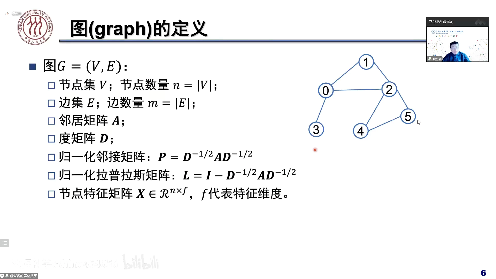

- **邻接矩阵 $A$**：只考虑无向图，所以 $A$ 是对称矩阵，$A_{ij}=1$ 表示节点 $i$ 与 $j$ 之间有边。
- **度矩阵 $D$**：把 $A$ 的每一行加起来放到对角线上，$D_{ii}$ 就是节点 $i$ 的邻居数。例子里节点 0 的度是 3。
- **归一化邻接矩阵 $P=D^{-1/2}AD^{-1/2}$**：落到每个元素上，就是"这条边的 1 除以左端点的度数开根号，再除以右端点的度数开根号"，所以它仍然对称。例子里出现了 $\frac{1}{\sqrt{3}\cdot\sqrt{2}}$ 这样的项。
- **归一化拉普拉斯矩阵 $L=I-D^{-1/2}AD^{-1/2}$**：单位阵减去上面的 $P$，所以对角线上全是 1，非对角线上是那些负的归一化项。

讲者强调 $L$ 有一个关键性质：**对角占优**（diagonally dominant），也就是每一行那些负项加起来，绝对值都没有对角线上那一项大 [【跳转到 06:13】](https://www.bilibili.com/video/BV1Me4y1c7kj/?t=373)。正是这个性质让 $L$ 半正定、特征值落在 $[0,2]$ 区间里——后面所有"滤波"的操作都建立在这个区间上。

> **记号补充**：谱图理论里另一个常见写法是组合拉普拉斯 $L=D-A$，它是上面这个归一化版本的未归一化对应物。本视频全程只用归一化版本 $L=I-D^{-1/2}AD^{-1/2}$，本文也沿用这个约定；两者的谱性质（半正定、最小特征值 0）一致，差别在特征值的上界与数值稳定性。

## 二、GCN 的公式长什么样，为什么需要谱理论来解释

在进入谱理论之前，讲者先把 GCN 摆出来：它是 Kipf 与 Welling 2017 年在 ICLR 上提出的模型 [【跳转到 06:38】](https://www.bilibili.com/video/BV1Me4y1c7kj/?t=398)。消息传递的直觉很朴素——想得到节点 $a$ 的表示，就把邻居 $b,c,d$ 的表示拿过来过一个神经网络；$b,c,d$ 的表示又从它们的邻居那里拿，一层层往上取。

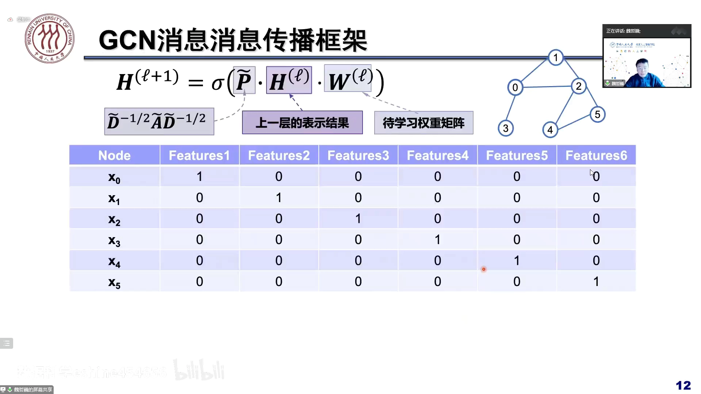

写成公式就是：

$$
H^{(\ell+1)} = \sigma\left(\tilde{P}H^{(\ell)}W^{(\ell)}\right),\qquad \tilde{P}=\tilde{D}^{-1/2}\tilde{A}\tilde{D}^{-1/2}
$$

其中 $\tilde{A}=A+I$ 是加了自环的邻接矩阵，$\tilde{D}$ 是加自环后的度矩阵，$W^{(\ell)}$ 是待学习权重，$\sigma$ 一般取 ReLU [【跳转到 07:46】](https://www.bilibili.com/video/BV1Me4y1c7kj/?t=466)。讲者用一个六维 one-hot 特征的例子走了一遍：聚合节点 0 时，先把邻居 1、2、3 的特征加起来，加上自环，再乘 $\frac{1}{\sqrt{4}\sqrt{3}}$ 这样的归一化系数——节点 0 加自环后度是 4，节点 1 加自环后度是 3，所以系数是 $\frac{1}{\sqrt{4}\sqrt{3}}$。

**除去 $\tilde{P}$ 这一项，它和普通前馈网络没有区别。** 所以问题就集中在一处：这个 $\tilde{P}$ 凭什么长这样？讲者给了两条理由 [【跳转到 10:34】](https://www.bilibili.com/video/BV1Me4y1c7kj/?t=634)：第一，GCN 原论文本身就是从图信号处理、图傅里叶变换过来的，不读谱理论就看不懂那篇论文；第二，只有知道了谱域这一层，才知道该怎么改它的底层、它到底有什么问题。

## 三、图傅里叶变换：把图信号换到特征向量这组基上

### 3.1 图信号是什么

图信号就是"每个节点上挂一个数"得到的 $n$ 维向量。讲者用了一个具体的例子：美国某地区布了一批测温传感器，把位置相近的传感器连边就得到一张图，每个节点上的温度就是信号的一个分量 [【跳转到 11:24】](https://www.bilibili.com/video/BV1Me4y1c7kj/?t=684)。

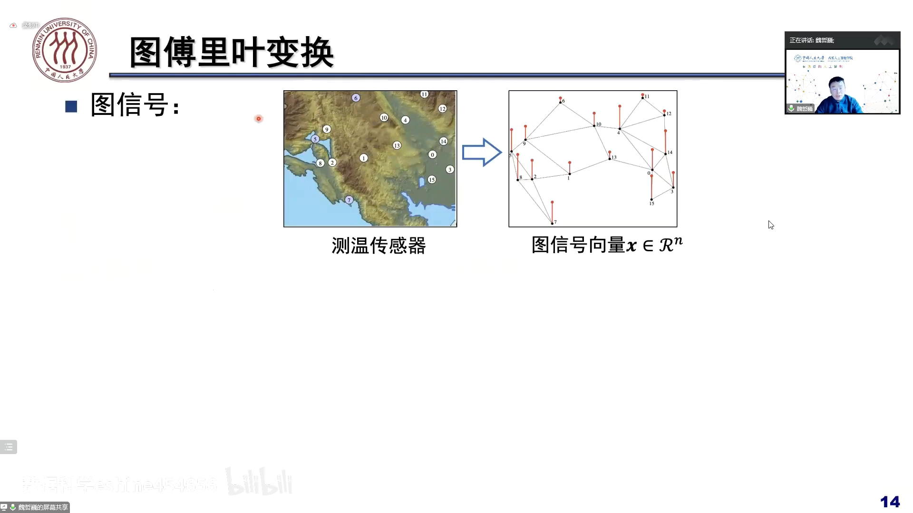

为什么要在图上做变换？动机很实际：传感器测得可能不准、有噪声，希望利用邻居的信号给自己去噪。

### 3.2 特征分解给出"频率"

做法是对拉普拉斯矩阵做特征分解 [【跳转到 12:14】](https://www.bilibili.com/video/BV1Me4y1c7kj/?t=734)：

$$
L = U\Lambda U^{\top}=U\,\mathrm{diag}(\lambda_1,\dots,\lambda_n)\,U^{\top},\qquad U=[u_1,\dots,u_n],\quad \lambda_i\in[0,2]
$$

因为 $L$ 是对称半正定矩阵，特征值都落在 $[0,2]$。$U$ 是酉矩阵，$UU^{\top}=I$——也就是说 $u_1,\dots,u_n$ 是一组**单位正交基**。

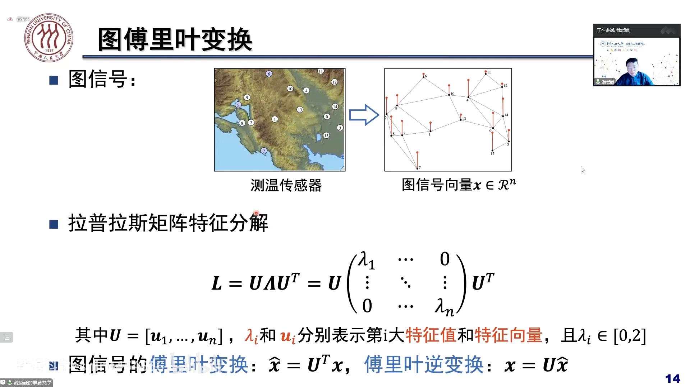

于是图傅里叶变换与逆变换就定义为：

$$
\hat{x}=U^{\top}x,\qquad x=U\hat{x}
$$

### 3.3 它凭什么叫"傅里叶变换"

第一层理由是**互逆**：$x$ 做变换乘 $U^{\top}$，做逆变换乘 $U$，而 $UU^{\top}=I$，所以能原样变回来 [【跳转到 14:19】](https://www.bilibili.com/video/BV1Me4y1c7kj/?t=859)。

第二层理由更重要：$U^{\top}x$ 的每一行是 $u_i^{\top}x$，也就是 $x$ 在这组正交基上的**坐标**。换句话说，这个变换只是把 $x$ 从笛卡尔坐标系换到 $u_1,\dots,u_n$ 这组基下——**换基，不是别的**。而时域到频域的傅里叶变换做的正是同一件事：把一个时域信号表示成不同频率信号的线性组合 [【跳转到 14:57】](https://www.bilibili.com/video/BV1Me4y1c7kj/?t=897)。

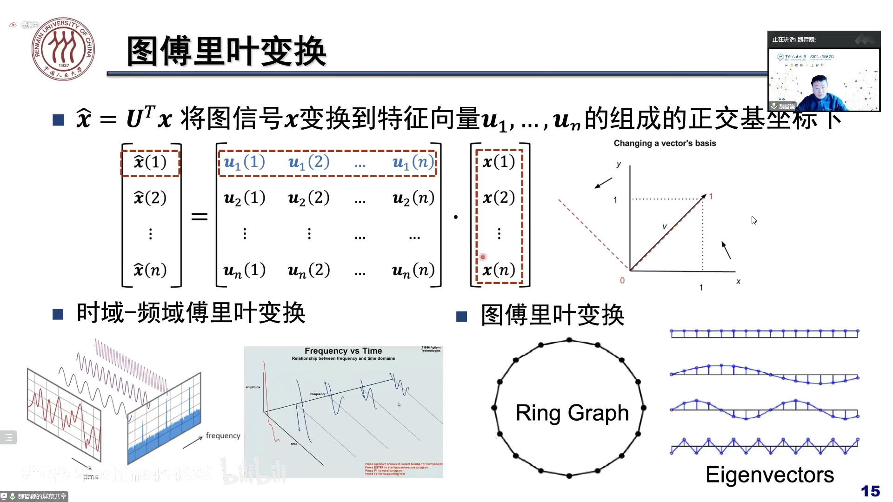

讲者用**环图（ring graph）**把"频率"这个词落到实处：在一个圆圈上放 $n$ 个点、相邻点连边，它可以用来刻画实数轴（把负无穷和正无穷接起来）[【跳转到 16:12】](https://www.bilibili.com/video/BV1Me4y1c7kj/?t=972)。看它的特征向量：

- 特征值最小的那个特征向量是**平的**（各分量相等），对应"零频率、不振动"；
- 次小的有一个波峰一个波谷，因为它要与第一个正交；
- 再往后是一正一负、两个波峰两个波谷……特征值从 0 涨到 2 的过程中，波动越来越抖。

所以图傅里叶变换的物理含义是：**把原始信号拆成一组频率从低到高的特征向量的线性组合，而组合系数就是原始信号在各频率上的强度** [【跳转到 16:47】](https://www.bilibili.com/video/BV1Me4y1c7kj/?t=1007)。这与时域—频域傅里叶变换完全等价，只是"频率"的载体从正弦波换成了图上的特征向量。

## 四、谱域滤波：在特征值上做乘法，再变回来

有了傅里叶变换，滤波就是三步操作 [【跳转到 17:52】](https://www.bilibili.com/video/BV1Me4y1c7kj/?t=1072)：

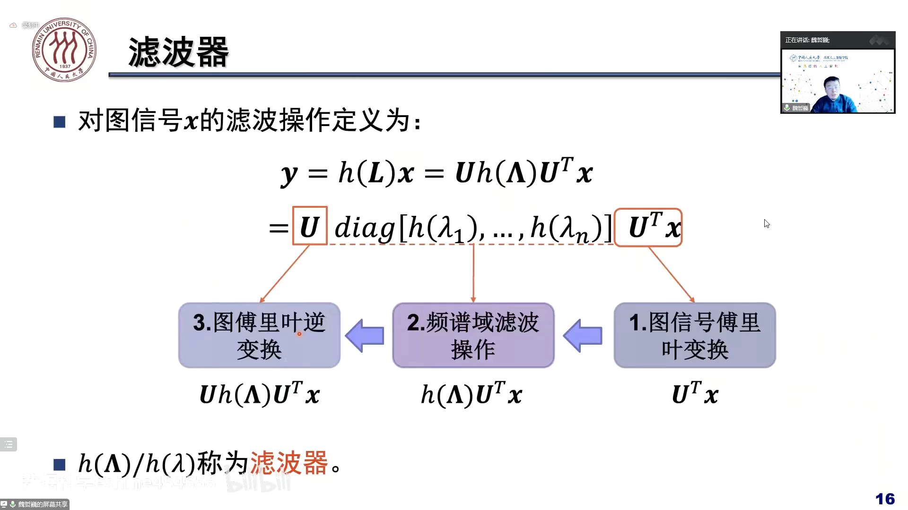

$$
y=h(L)x=U\,h(\Lambda)\,U^{\top}x=U\,\mathrm{diag}\big(h(\lambda_1),\dots,h(\lambda_n)\big)\,U^{\top}x
$$

1. **图傅里叶变换**：$U^{\top}x$，把信号搬到谱域；
2. **谱域滤波**：$h(\Lambda)U^{\top}x$，对每个特征值乘一个函数值；
3. **图傅里叶逆变换**：$U(\cdot)$，搬回空域。

$h(\Lambda)$ 或 $h(\lambda)$ 就叫**滤波器**。因为特征值从小到大对应低频到高频，所以调整 $h$ 就能强调低频、抑制高频，或者干脆把某些频率设成零。

两个极端例子说明这个框架的直观性：取 $h(\lambda)\equiv 1$，中间变成单位阵，$UU^{\top}=I$，输出就是 $x$ 本身——这是**全通滤波器**，所有频率都通过 [【跳转到 18:42】](https://www.bilibili.com/video/BV1Me4y1c7kj/?t=1122)；取 $h$ 只在最小特征值处为 1、其余为 0，就只留下第一个特征向量，输出是一个各分量相等的向量——这是**脉冲低通滤波器**。

## 五、为什么需要滤波器：同配图与异配图

讲者用节点分类任务说明滤波器的实际作用 [【跳转到 19:50】](https://www.bilibili.com/video/BV1Me4y1c7kj/?t=1190)。他构造了两张**结构完全相同**的环图，但标签不同：

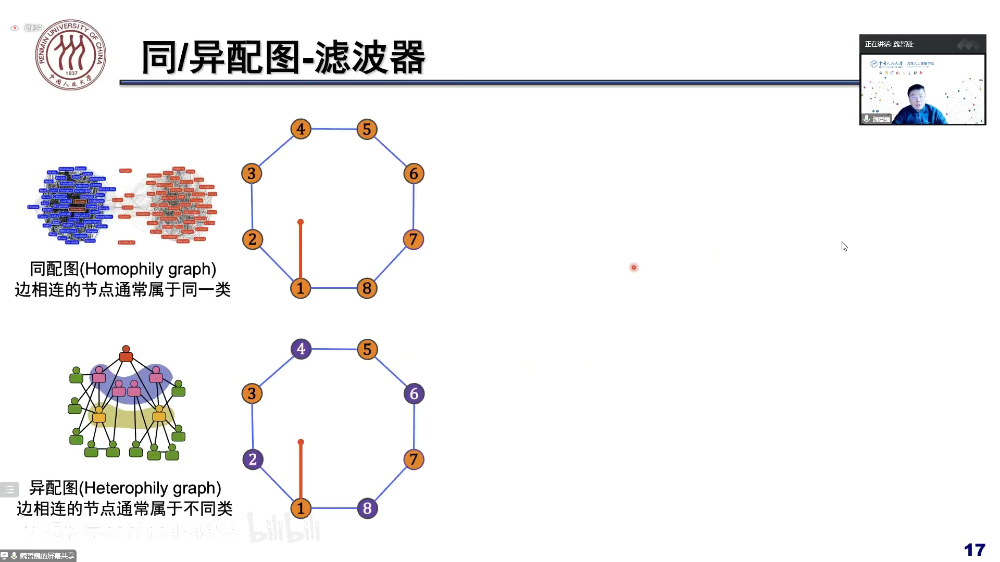

- **同配图（homophily）**：边相连的节点通常属于同一类。典型例子是"蓝营内部连接紧密、蓝营与红营之间联系稀疏"。
- **异配图（heterophily）**：相邻节点往往属于不同类。典型例子是公司层级图——我是经理，我管的人就不可能是经理，最多是副经理或更低一级，所以只要连边，必然异类。

问题来了：两张图的初始特征一样、结构一样，只有标签不同，模型凭什么区分？**答案在滤波器上** [【跳转到 21:05】](https://www.bilibili.com/video/BV1Me4y1c7kj/?t=1265)：

- 同配图需要**低通**：只留最小特征值，滤波后的信号各分量同号，正好对应"邻居同类"，预测就准；
- 异配图需要**高通**：只留最大特征值（$\lambda=2$），滤波后的信号一正一负交替，正好对应"邻居异类"。

由此讲者给出全讲的动机句：**图上机器学习很大一部分工作，就是在设计这个滤波器**——要么手工设计一个更好的，要么让它学到一个更合理的。

## 六、特征分解太贵：多项式近似把谱方法拉回稀疏矩阵乘法

谱域滤波的定义很干净，但有一个致命问题 [【跳转到 22:43】](https://www.bilibili.com/video/BV1Me4y1c7kj/?t=1363)：要对特征值做操作，就得先对 $L$ 做特征分解，而 $U$ 是 $n\times n$ 的**稠密**矩阵。公开数据集已经能到 1 亿节点，$n^2=10^{18}$，任何服务器都存不下；工业图到千亿、万亿级，更不可能。

出路是**多项式近似** [【跳转到 24:23】](https://www.bilibili.com/video/BV1Me4y1c7kj/?t=1463)：把滤波器设成特征值的多项式

$$
h(\lambda)=\sum_{k=0}^{K}w_k\lambda^k
$$

利用"特征分解与多项式可交换"，就有

$$
y\approx U\left(\sum_{k=0}^{K}w_k\Lambda^{k}\right)U^{\top}x=\sum_{k=0}^{K}w_kL^{k}x
$$

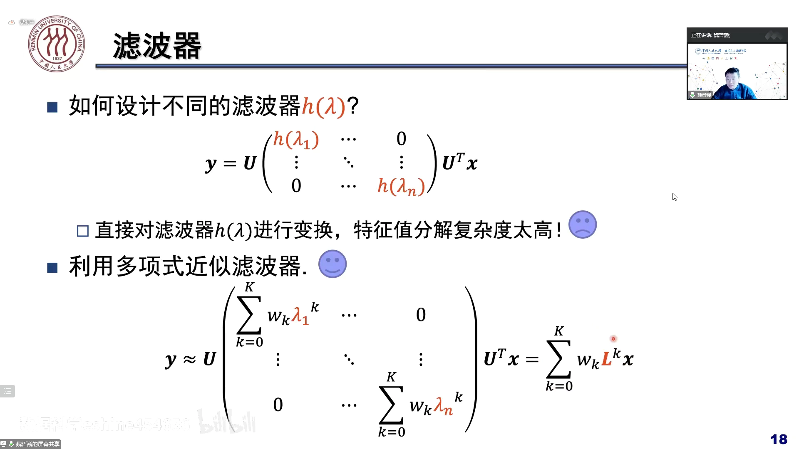

这一步是整条推导链的枢纽，好处有两层：**不用做特征分解**，也**不用把 $L^k$ 一次算出来**——可以 $L$ 乘 $x$、再 $L$ 乘 $(Lx)$，一次次迭代。因为 $L$ 是稀疏的（稀疏度由边数决定），整个代价就从稠密矩阵分解降到"稀疏矩阵乘向量"。讲者的判断很直接：**后面大部分谱域工作，本质上都是在设计这个多项式滤波器。**

## 七、ChebNet 用切比雪夫基，GCN 只留一阶就退化成邻域平均

### 7.1 ChebNet：用切比雪夫多项式做基

2016 年 ICLR 上的 ChebNet（Defferrard 等）是这条线上第一个系统方案 [【跳转到 25:13】](https://www.bilibili.com/video/BV1Me4y1c7kj/?t=1513)：

$$
H^{(\ell+1)}=\sigma\left(\sum_{k=0}^{K}T_k(L)\,H^{(\ell)}W^{(\ell,k)}\right),\qquad h(\lambda)=\sum_{k=0}^{K}w_kT_k(\lambda)
$$

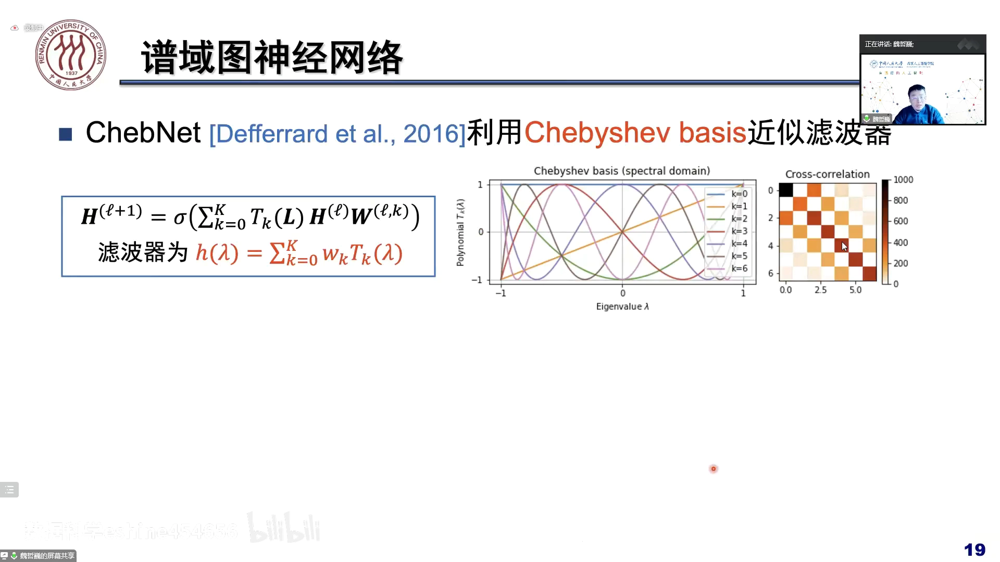

为什么选切比雪夫基？看图就明白：$T_0$ 是平的（零频率、不振动），$T_1$ 一正一负，$T_2$ 有两个波谷，$T_3$ 一个波峰一个波谷……**阶数越高，频率越密**，用这样一组基去逼近任意滤波器是很自然的选择。而且 $T_k$ 有递推式，$T_k(L)x$ 可以靠前两项迭代算出来，不需要显式构造 $L^k$。

### 7.2 GCN：砍到一阶，系数钉死，再归一化

GCN 做的事就是"简化 ChebNet" [【跳转到 27:18】](https://www.bilibili.com/video/BV1Me4y1c7kj/?t=1638)：取 $K=1$，并令 $w_0=-w_1=\theta$，于是

$$
y=\left(\theta I-\theta(L-I)\right)x=\theta(2I-L)x=\theta\left(I+D^{-1/2}AD^{-1/2}\right)x
$$

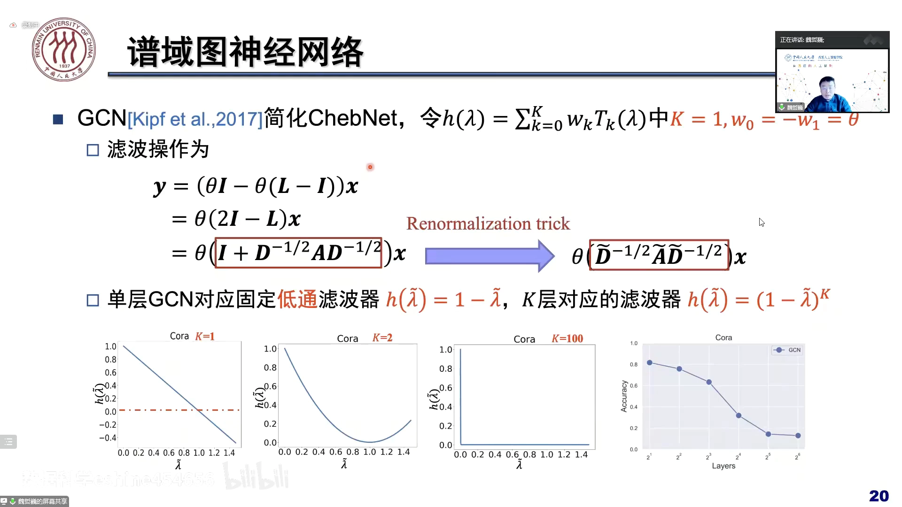

括号里的 $I+D^{-1/2}AD^{-1/2}$ 特征值范围是 $[0,2]$，会带来数值不稳定，所以再做一步 **renormalization trick**：把 $I$ 塞进 $A$ 里，给每个节点加自环，得到 $\tilde{D}^{-1/2}\tilde{A}\tilde{D}^{-1/2}$——这正是第二节那个 $\tilde{P}$。

**这一步就是"谱卷积退化成空间消息传递"的地方。** 谱域那一侧的表述是"用 $h(\lambda)=1-\lambda$ 这个一阶多项式做滤波"，空间那一侧看到的则是"对邻居特征做归一化加权求和"。两者是同一个算子的两种写法：$L^k x$ 的 $k$ 次幂恰好对应 $k$ 跳邻居，所以**多项式的阶数 = 感受野的跳数**，而 GCN 只保留了一阶，等价于只看一跳邻居。

### 7.3 代价：它被钉死成一个低通滤波器

这个简化换来的是简洁，代价是**滤波器不再可学** [【跳转到 27:43】](https://www.bilibili.com/video/BV1Me4y1c7kj/?t=1663)：

- 单层 GCN 对应的滤波器是 $h(\tilde{\lambda})=1-\tilde{\lambda}$，是一条从 1 单调降到负值的直线——**固定低通**；
- $K$ 层堆起来对应 $h(\tilde{\lambda})=(1-\tilde{\lambda})^{K}$，层数越多，高频被压得越狠。$K=100$ 时曲线几乎贴着零轴，只剩最低频能通过；
- 实验上就表现为"层数越多、精度越低"：Cora 上的精度随层数从 $2^1$ 涨到 $2^6$ 一路下滑。

讲者把问题总结成两条：**第一，层数越多效果越差；第二，它是固定低通滤波器，所以异配图用不了**。ChebNet 虽然可以学滤波器，但学出来的滤波器也有问题——不合理、学习效率不高、泛化性存疑。这正是他三个后续工作的出发点。
## 八、谱域视角的后续：滤波器该怎么设计

讲者用三个工作说明"知道谱域这一层"能带来什么 [【跳转到 28:45】](https://www.bilibili.com/video/BV1Me4y1c7kj/?t=1725)。三个工作共享同一个提问方式：**一个"合理"的多项式滤波器应该满足什么性质？**

### 8.1 BernNet：让滤波器在 $[0,2]$ 上非负

第一个要求很朴素：滤波器在特征值区间上应该**非负** [【跳转到 29:10】](https://www.bilibili.com/video/BV1Me4y1c7kj/?t=1750)。理由是：滤波不该把信号滤成负的，否则叠多层就一正一负、极不稳定。但这个条件 GCN 不满足（$1-\lambda$ 在 $\lambda>1$ 时为负），切比雪夫基也很难显式满足。

![合理的多项式滤波器应在 $[0,2]$ 上非负；$[0,2]$ 上任意非负多项式都能写成 Bernstein 多项式，只要系数 $\theta_k\ge 0$ 即可](assets/从图拉普拉斯到GCN：谱域滤波如何退化成邻域平均/01800.webp)

突破口是一个经典结论：$[0,2]$ 上的任意非负多项式都可以写成 **Bernstein 多项式**的形式

$$
h(\lambda)=\sum_{k=0}^{K}\theta_k\cdot\frac{1}{2^{K}}\binom{K}{k}(2-\lambda)^{K-k}\lambda^{k}
$$

由于 $\lambda\ge 0$ 且 $2-\lambda\ge 0$，只要令系数 $\theta_k\ge 0$（对 $\theta$ 做一次保证非负的重参数化），整个多项式就自动非负。这就是 **BernNet**（He、Wei 等，NeurIPS 2021）。

意外收获是**可解释性**：Bernstein 系数满足 $\theta_k=h\!\left(\frac{2k}{K}\right)$，也就是第 $k$ 个系数**直接就是滤波器在 $\lambda=\frac{2k}{K}$ 处的取值** [【跳转到 32:10】](https://www.bilibili.com/video/BV1Me4y1c7kj/?t=1930)。

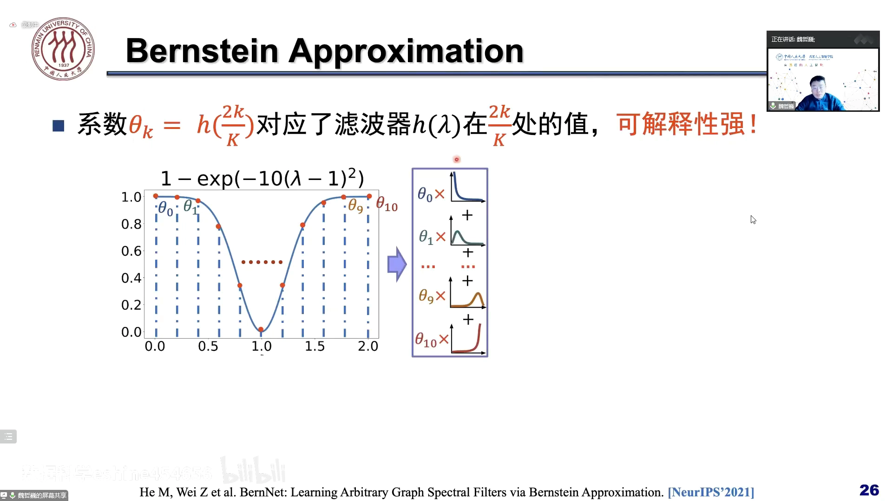

这带来两个后果：一是**好学**，参数直接对应滤波器的强度；二是**可读**，训完之后能把学到的滤波器画出来看。讲者展示了几个有意思的现象：在"用 MLP 最好、图结构反而有害"的那个数据集上，学到的滤波器基本是平的（说明模型自己学会了忽略图结构）；在另一些数据集上，学到的是一条复杂的"梳子"状滤波器——确实有些模式需要复杂滤波器才能表达 [【跳转到 32:35】](https://www.bilibili.com/video/BV1Me4y1c7kj/?t=1955)。

### 8.2 重访切比雪夫：系数必须受约束

第二个工作回答一个反直觉的问题 [【跳转到 33:25】](https://www.bilibili.com/video/BV1Me4y1c7kj/?t=2005)：**为什么表达能力更强的 ChebNet，效果反而不如表达力更弱的 GCN？** 按道理 ChebNet 能学任意滤波器，GCN 只对应一个固定低通。

讲者的解释是：切比雪夫基的**系数不能随便取**。数学上有一个结论——如果被逼近的函数在边界处弱奇异、在区间内解析，那么切比雪夫系数必须随阶数 $k$ 以 $1/k^{q}$ 的比例递减 [【跳转到 35:25】](https://www.bilibili.com/video/BV1Me4y1c7kj/?t=2125)。而 ChebNet 把 $w_k$ 当成自由参数，学出来的系数可能完全不符合这个规律，于是"表达能力强"反而变成了"拟合到不该拟合的地方"。

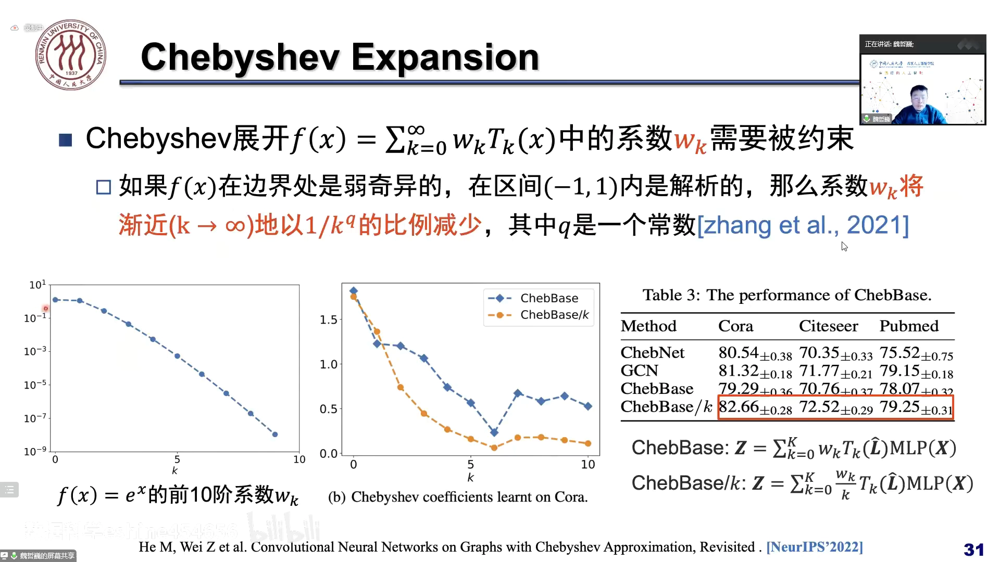

验证方式极其简单：把切比雪夫基前面的系数**除以 $k$**，看效果是否提升。结果确实显著提升，至少超过原来的 GCN 和此前的方法（论文为 He、Wei 等的 *Convolutional Neural Networks on Graphs with Chebyshev Approximation, Revisited*，NeurIPS 2022）。但讲者觉得"除以 $k$"这个做法不够优雅，于是改成对 $w$ 做一次**线性重参数化**，让参数直接代表滤波器在插值节点上的取值——和 Bernstein 一样，参数有了物理意义。结果是在几乎所有数据集上达到 SOTA，个别数据集从 51 提升到 57；他们还在异配图上做了半监督实验（讲者称是首次），同样取得 SOTA [【跳转到 36:18】](https://www.bilibili.com/video/BV1Me4y1c7kj/?t=2178)。

### 8.3 EvenNet：只留偶数阶，换来鲁棒性

第三个工作换了一个角度：**谱域 GNN 的鲁棒性** [【跳转到 36:53】](https://www.bilibili.com/video/BV1Me4y1c7kj/?t=2213)。图上常见的一种攻击是**结构攻击**——把边改一改，在同配图上学到的滤波器搬到被攻击后的异配图上就失效了。讲者把这类现象统一称为"同配—异配泛化"问题，并说明"同配图上学到的滤波器难以泛化到异配图"这件事此前已有多人证明，不是他们的贡献。

他们的观察很小：结构被改，意味着**原来的邻居（朋友）变成了敌人**，所以用一跳邻居的信息不稳定；但**二阶邻居相对稳定**——朋友的朋友还是朋友，敌人的敌人也是朋友。这就是社会心理学里的**平衡理论**（Cartwright & Harary, 1956）[【跳转到 39:38】](https://www.bilibili.com/video/BV1Me4y1c7kj/?t=2378)。

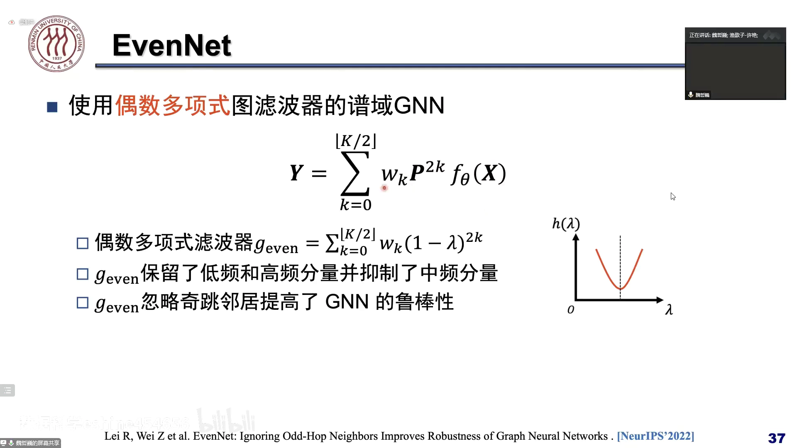

落到公式上，就是把多项式的**所有奇数次项系数设为零**，只保留偶数阶：

$$
Y=\sum_{k=0}^{\lfloor K/2\rfloor}w_kP^{2k}f_\theta(X),\qquad g_{\text{even}}(\lambda)=\sum_{k=0}^{\lfloor K/2\rfloor}w_k(1-\lambda)^{2k}
$$

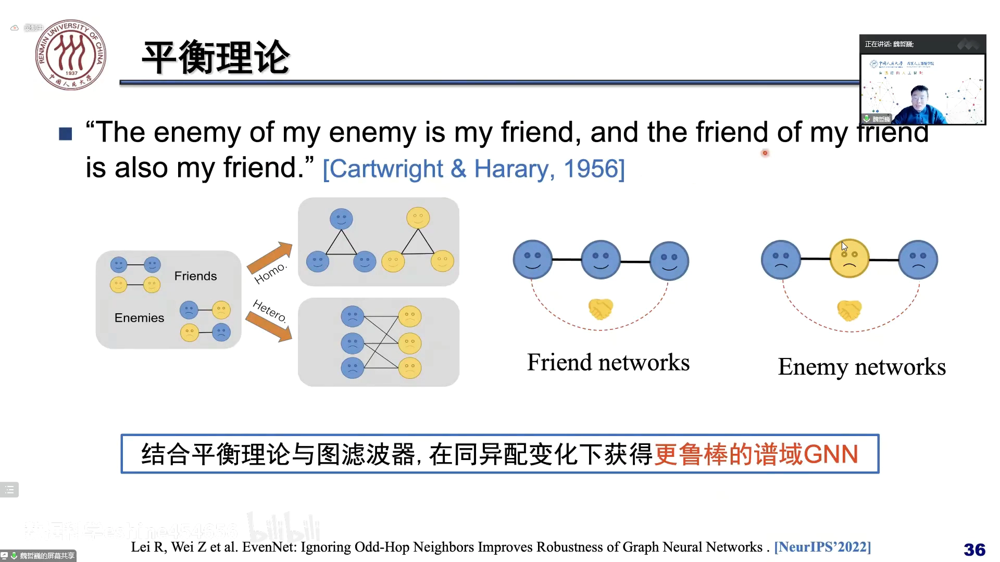

从谱域看，$g_{\text{even}}$ 是一个**两头高、中间低**的滤波器：保留低频和高频、抑制中频。讲者说这在信号处理上也可以证明是鲁棒的。实验上，在多种攻击下，EvenNet 超过了此前那些"用各种注意力机制学一个更稳定的图结构"的复杂防御方法——而它只做了一件极简的事：去掉奇数阶（论文为 Lei、Wei 等的 *EvenNet: Ignoring Odd-Hop Neighbors Improves Robustness of Graph Neural Networks*，NeurIPS 2022）。

### 8.4 讲者的总结与展望

讲者的收尾判断有三条 [【跳转到 40:24】](https://www.bilibili.com/video/BV1Me4y1c7kj/?t=2424)：谱域 GNN 用多项式近似滤波器的思路目前不算热门，但相对空域方法**可解释性强得多**，而可解释性正是"能改进它"的前提；GCN 是一个低通滤波器，要学任意滤波器应该用 Bernstein 基或切比雪夫基；EvenNet 去掉奇数阶能提升鲁棒性。展望有两条 [【跳转到 41:12】](https://www.bilibili.com/video/BV1Me4y1c7kj/?t=2472)：一是图机器学习的理论假设还不清楚——邻居可能是朋友、可能是敌人、也可能根本独立，**连边到底意味着什么**没有定论；二是谱域 GNN 的**高效计算**还没有像 GCN 这类空域模型那样受到广泛关注。

## 九、与相邻小节的分工

- **与 [2.1.3 图卷积（GCN）：邻域归一化与特征聚合](../../../README.md#m03-2-1-3) 的分工**：2.1.3 从**空间**视角讲 GCN——归一化邻接矩阵怎么加权、聚合怎么做、层数与感受野怎么对应；本节从**谱域**视角讲同一行公式是怎么被推出来的，重点是"为什么是 $\tilde{D}^{-1/2}\tilde{A}\tilde{D}^{-1/2}$ 而不是别的"。两边讲的是同一个算子，只是入口不同。
- **与 [2.3.2 图上的位置编码与结构编码](../../../README.md#m03-2-3-2) 的分工**：两节都用拉普拉斯特征分解 $L=U\Lambda U^{\top}$，但用法正交。本节把 $L$ **当算子**——用特征值上的函数 $h(\lambda)$ 定义滤波；2.3.2 把特征向量 $u_i$ **当坐标**——取前 $k$ 个特征向量拼成每个节点的位置特征，并讨论符号不定、重根、$k$ 可变这些麻烦。同一个 $L$，一个是"怎么滤"，一个是"你在哪"，不要混为一谈。
- **与 [2.1.5 图注意力（GAT）](../../../README.md#m03-2-1-5) 的分工**：GAT 改的是**聚合权重怎么来**（由注意力算出，逐边不同），属于空域路线；本节讲的是**聚合权重由谱域滤波器决定**（由 $h$ 的阶数与系数决定，结构固定）。两者可以叠加，但不是同一层抽象。

## 小结

- 谱图方法把"卷积"定义成**谱域上的一个函数**：$y=U\,h(\Lambda)\,U^{\top}x$，先变换、再在特征值上乘 $h$、最后变回来。
- 图傅里叶变换 $U^{\top}x$ 本质是**换基**：把图信号从节点坐标系换到特征向量这组正交基下；环图上特征值越大、特征向量振荡越剧烈，这就是图上的"频率"。
- 谱域滤波的动机很具体：**同配图要低通、异配图要高通**，所以"设计滤波器"就是图上机器学习的核心工作之一。
- 特征分解是 $O(n^2)$ 稠密的，工业图算不动；**多项式近似** $h(\lambda)=\sum_k w_k\lambda^k$ 把 $U$ 消掉，只剩稀疏矩阵乘向量，而多项式的阶数就是感受野的跳数。
- ChebNet 用切比雪夫基保留 $K$ 阶；**GCN 取 $K=1$、令 $w_0=-w_1=\theta$ 再加 renormalization trick**，就退化成 $\tilde{D}^{-1/2}\tilde{A}\tilde{D}^{-1/2}$ 的邻域加权平均——这就是谱方法与空间消息传递的对应关系。
- 退化的代价是滤波器被钉死成低通 $h(\lambda)=1-\lambda$，$K$ 层对应 $(1-\lambda)^K$，**层数越多高频被压得越狠、精度越低**，且无法处理异配图。
- 谱域视角的价值在于能反过来指导设计：BernNet 要求非负（用 Bernstein 基）、ChebNetII 要求系数受约束、EvenNet 只留偶数阶换鲁棒性——三者都靠"看滤波器的形状"来解释行为。

## 关键术语速查

| 术语 | 一句话解释 |
| --- | --- |
| 图拉普拉斯矩阵 | $L=I-D^{-1/2}AD^{-1/2}$，单位阵减去归一化邻接矩阵；对称半正定、对角占优，特征值落在 $[0,2]$ |
| 归一化邻接矩阵 | $P=D^{-1/2}AD^{-1/2}$，每个元素是边权除以两端度数开根号 |
| 图信号 | 每个节点挂一个数得到的 $n$ 维向量，例如各传感器测到的温度 |
| 图傅里叶变换 | $\hat{x}=U^{\top}x$，把图信号换到特征向量这组正交基下的坐标 |
| 图傅里叶逆变换 | $x=U\hat{x}$，把谱域系数还原成节点上的取值 |
| 谱域滤波器 | $h(\lambda)$，作用在特征值上的函数；$h\equiv 1$ 为全通，只留最小特征值为低通 |
| 多项式近似 | 用 $\sum_k w_k\lambda^k$ 代替 $h$，使 $U$ 被消掉，只需反复做稀疏矩阵乘向量 |
| 切比雪夫基 | $T_k(\lambda)$，阶数越高谱域振荡越密，且有递推式可迭代计算 |
| renormalization trick | 把 $I$ 并入 $A$ 得 $\tilde{A}=A+I$，使 $\tilde{D}^{-1/2}\tilde{A}\tilde{D}^{-1/2}$ 的特征值落在 $[0,2]$ 内 |
| 同配图与异配图 | 同配指相连节点多为同类，异配指相连节点多为异类；前者适合低通、后者适合高通 |
| Bernstein 基 | 在 $[0,2]$ 上非负的多项式基，系数非负即可保证整个滤波器非负，且系数就是滤波器在采样点的值 |
| EvenNet | 只保留偶数阶多项式的谱域 GNN，保留低频与高频、抑制中频，对结构攻击更鲁棒 |
