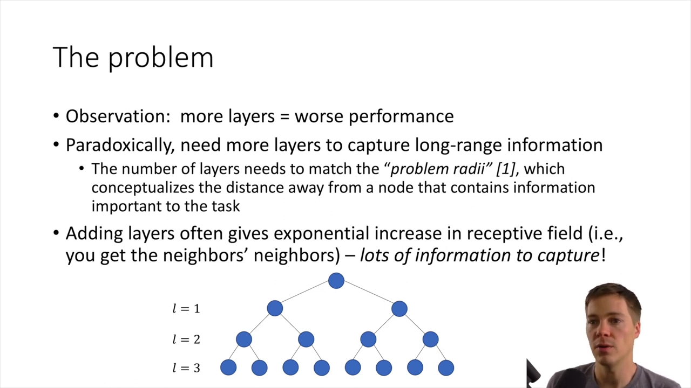
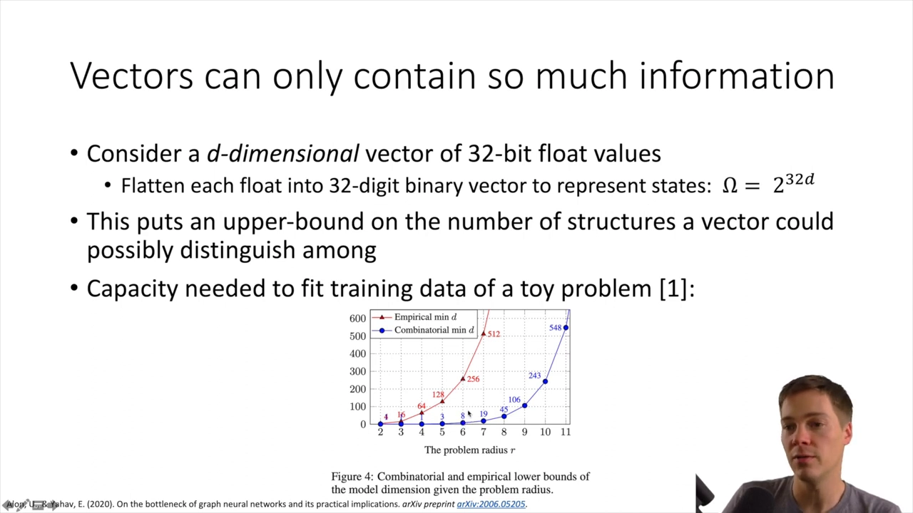
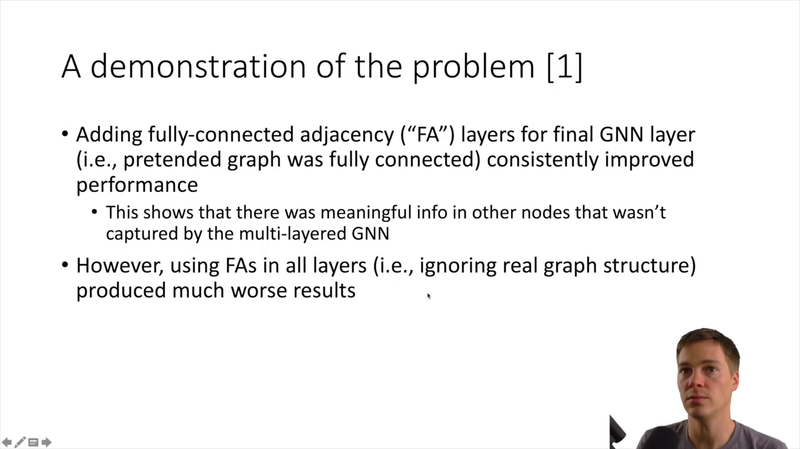
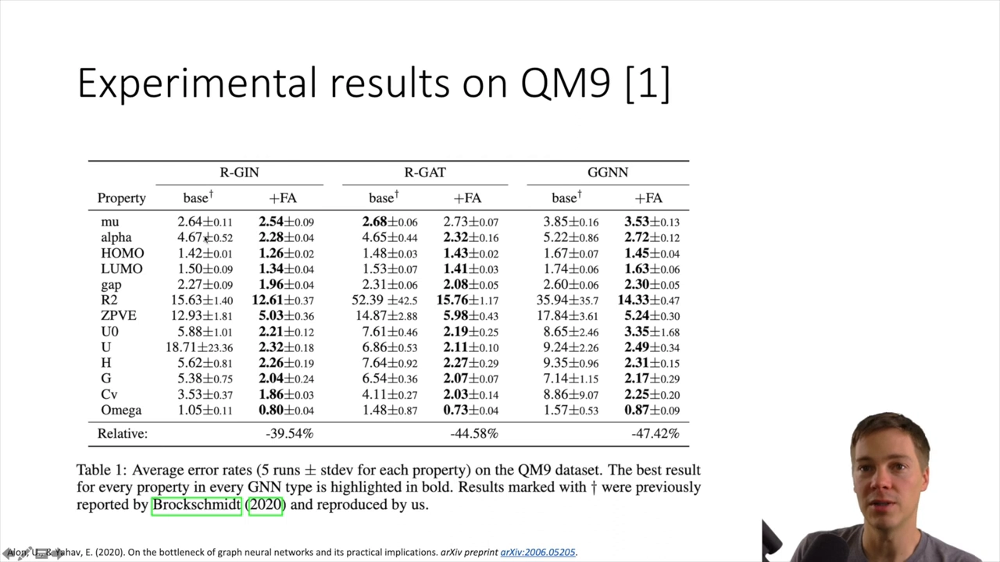
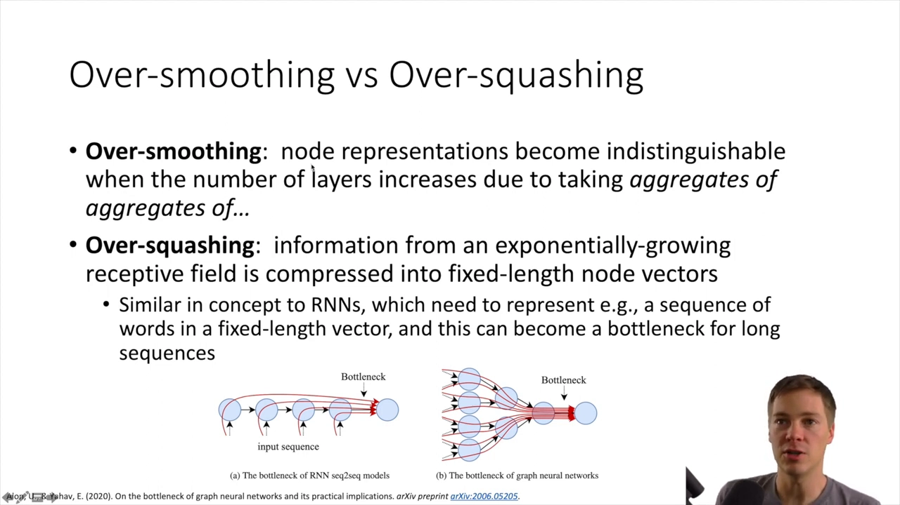
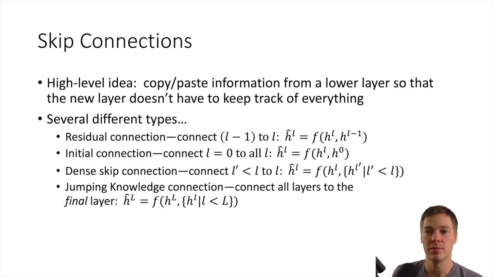
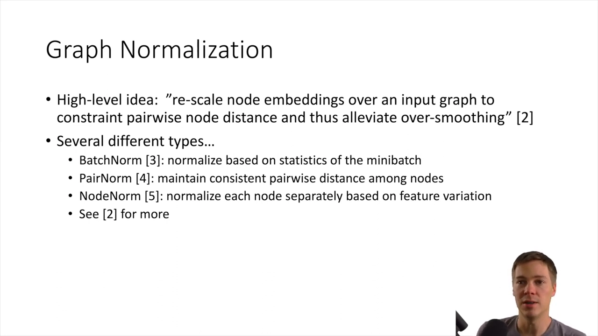
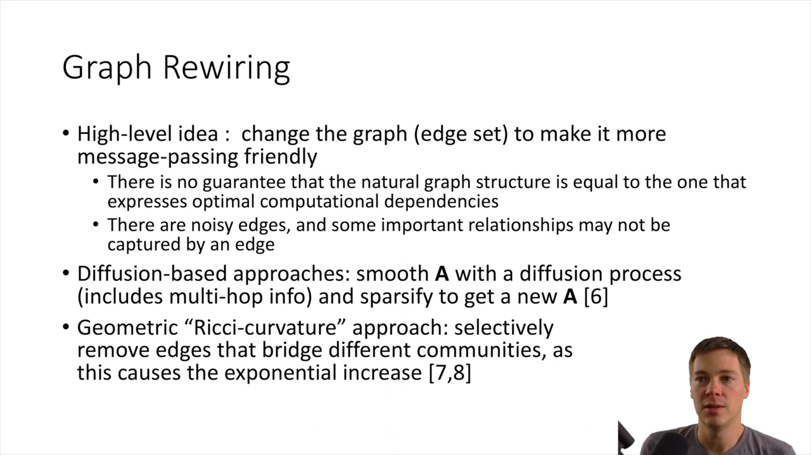
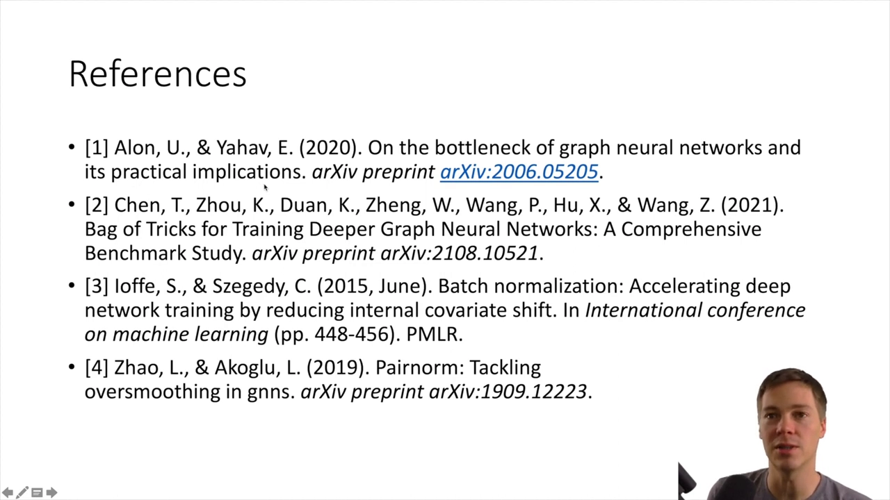

# 过压缩不是过平滑：图神经网络的远程依赖为什么被挤进固定长度向量

> 视频来源：[Over-squashing and Over-smoothing](https://www.youtube.com/watch?v=egU3zGEzYjw)（YouTube · 讲者围绕 Alon & Yahav 2020 的瓶颈论文讲解）｜时长约 10 分钟
> 一支把"加层为什么反而变差"讲成两个不同故障的短讲。本文按视频顺序覆盖：问题半径与感受野、向量容量上界、玩具实验与全连接邻接对照实验、过平滑与过压缩的分野，以及跳连、图归一化、图重连三类缓解手段。字幕为英文自动生成，本文已按上下文订正断句与术语拼写（如 problem radii、Ricci curvature）。

## 本讲要解决的核心问题（SCQA）

**背景**：图神经网络（GNN）的基本操作是消息传递——每一层让节点收集邻居的信息。因此"堆层数"看起来是扩大视野的自然手段：层数越多，一个节点能看到的邻居的邻居就越远。

**冲突**：实践中的观察恰好相反：对 GNN 来说，层加得越多，性能往往越差。可如果任务需要的信息在很远的地方，又不得不用更多层去够到它。这就形成一个悖论：加层是为了看得更远，加层又让模型变差。

**疑问**：加层到底破坏了什么？是节点表示彼此变得无法区分，还是远处信息根本传不过来？这两种解释是不是同一件事？

**回答（中心思想）**：这是两个不同的故障。**过平滑（over-smoothing）**是"聚合的聚合"把不同节点的表示压成同一团，节点之间失去区分度；**过压缩（over-squashing）**是感受野随层数指数增长，而承载这些信息的节点向量长度固定，于是远处信息被挤进一个容量有限的瓶颈里丢失。二者症状不同、成因不同，缓解手段也不同：跳连与图归一化主要对付前者，图重连主要对付后者。把它们当同一个故障，就会用错药。[【跳转到 03:50】](https://www.youtube.com/watch?v=egU3zGEzYjw&t=230)

## 一、悖论：加层是为了看得更远，加层又让模型更差

视频开篇给出的观察只有一句：**层数越多，GNN 的性能往往越差**。但紧接着是转折：如果任务需要长程信息，我们又确实需要更多层。[【跳转到 00:05】](https://www.youtube.com/watch?v=egU3zGEzYjw&t=5)

要理解这个矛盾，先要有一个衡量"信息有多远"的量。视频引用的概念叫**问题半径（problem radii）**：包含任务所需信息的那个节点，距离当前节点有多远。层数需要与问题半径匹配——信息在 6 跳之外，就得有足够的层把 6 跳之外的消息传进来。

问题出在感受野的增长方式上。每加一层，节点不只多看到一圈邻居，而是看到"邻居的邻居的邻居"：在分支结构里，这个集合按指数增长。下图把这件事画成了三层展开的树：$l=1$ 时是一个邻居，$l=2$ 时是邻居的邻居，$l=3$ 时已经是一整片叶子。

于是矛盾的具体形态出现了：如果某个叶子上有对任务有用的信息，它必须穿过这一整片节点的"人口"才能到达目标节点。而承载这一切的，只是目标节点那一个固定长度的向量。[【跳转到 00:30】](https://www.youtube.com/watch?v=egU3zGEzYjw&t=30) 视频用一句话概括了这个瓶颈：**向量只能装这么多信息**。

## 二、容量上界：一个 $d$ 维向量最多能区分多少种结构

讲者把这个直觉写成了可计算的量。设节点向量是 $d$ 维、每个分量是 32 位浮点数。一个 32 位浮点可以展开成 32 位二进制串，因此单个分量有 $2^{32}$ 种状态，整个向量能表示的状态数是

$$
\Omega = 2^{32d}
$$

这个 $\Omega$ 是向量能容纳的信息量上界，也是它能区分的不同结构数量的上界。超过这个数量，就必然出现**碰撞（collision）**：两个本质不同的输入被映射到同一个向量，模型再也分不开它们。[【跳转到 01:20】](https://www.youtube.com/watch?v=egU3zGEzYjw&t=80)

注意这个上界是"物理上限"，不是"实际可达容量"。真实网络里还有优化难度、聚合函数的平滑性等因素，实际能塞进去的信息只会更少——这正是下一个实验要展示的。

## 三、玩具实验：实际需要的维度远高于理论下界

为了测量"到底要多大向量才够"，原论文把问题简化成一个**记忆任务**：让网络记住某个距离若干跳之外的节点的状态。这里的半径是可控的——想看 6 跳外的信息，就把问题半径设成 6。

容量用两种方式确定：

- **实测**：不断加大向量维度，直到模型能拟合这批训练数据为止；
- **理论**：用上面的 $\Omega = 2^{32d}$ 反推所需维度下界。

结果两条曲线差得很远。半径 6 时，理论上 8 维就够，实测却需要 256 维。再往下一个半径，理论下界按指数（这里是翻倍）增长，从 8 变成 19，而实测从 256 一路涨到 512。[【跳转到 02:10】](https://www.youtube.com/watch?v=egU3zGEzYjw&t=130)

这组数字的意义不在于具体数值，而在于量级：**实际所需维度比理论下界高出约三十倍**。也就是说，过压缩不是"刚好卡在上界"的临界现象，而是在远未达到上界时就已经发生——固定长度向量在真实网络里比理论上更容易成为瓶颈。

## 四、真实数据上的对照实验：只把最后一层换成全连接

玩具实验之外，原论文在真实数据集上做了一个非常干净的对照。做法是：**只在最后一个 GNN 层**，不用真实的图结构（邻接矩阵），而换成一个**全连接邻接矩阵（fully-connected adjacency，"FA"）**。这样每个节点都能和图中任意其他节点直接交换消息，等于人为给模型开了一条"任意距离直达"的通路。

结果：性能**一致提升**。这说明原本只用真实图结构的多层 GNN，确实没能高效地把远处信息取过来；一旦允许直接发消息，这部分信息就被取到了。[【跳转到 02:35】](https://www.youtube.com/watch?v=egU3zGEzYjw&t=155)

但实验还有另一半，而且是更关键的一半：如果把图结构**全部**丢掉、每一层都用全连接邻接，结果会**差得多**。[【跳转到 03:25】](https://www.youtube.com/watch?v=egU3zGEzYjw&t=205)

两半合起来才能得出结论：GNN 并非没用。它做的很可能是**短程局部信息**，而这部分信息足以把性能带到离目标不远的地方；它真正吃力的是长程信息。所以"全连接更好"是错的，"在保留图结构的前提下补一条长程通路更好"才是实验支持的结论。

视频随后展示了 QM9 数据集上的完整结果表：左列是基线，右列是加上全连接邻接的版本，跨 R-GIN、R-GAT、GGNN 三种架构、多个性质回归任务，几乎全部任务都有改善，相对误差整体下降约四成到近五成（表中给出的相对值为 -39.54%、-44.58%、-47.42%）。[【跳转到 03:50】](https://www.youtube.com/watch?v=egU3zGEzYjw&t=230)

## 五、分水岭：过平滑是表示趋同，过压缩是信息挤进瓶颈

讲到这里，视频才点明那个"细微但重要"的区分。这是全片的核心，也是本节的学习目标。

**过平滑**：随着层数增加，所有节点的表示变得**彼此无法区分**。原因是"聚合的聚合"——平均值的平均值再取平均值。每聚合一次，邻居之间的差异就被抹平一点；层数够多，整张图塌缩成"一大团同质的东西"（one big homogeneous blob）。[【跳转到 04:15】](https://www.youtube.com/watch?v=egU3zGEzYjw&t=255)

**过压缩**：节点的表示并没有彼此趋同，问题在于它要装的东西太多。来自指数增长感受野的信息，被硬塞进这个**固定长度**的节点向量里。信息在瓶颈处丢失，远处的节点无法影响当前节点的表示。

两者的判别要点可以这样记：

| 维度 | 过平滑 | 过压缩 |
| --- | --- | --- |
| 出了什么问题 | 节点表示趋同，区分度消失 | 远处信息传不进来，被瓶颈挤掉 |
| 直接原因 | 反复聚合抹平差异 | 感受野指数增长 vs 向量长度固定 |
| 随层数的变化 | 层越多越同质 | 层越多，要压缩的信息越多 |
| 典型证据 | 节点两两距离趋近于零 | 只把最后一层换成全连接就涨点 |

视频用一个类比把过压缩讲得更具体：它和 **RNN** 的处境很像。RNN 处理一个词序列时，每个词通过不断更新的隐状态喂进去，到最后一步，要用**同样长度**的向量表示整个序列的信息。序列越长，这个瓶颈越紧——不过 RNN 的负担随序列长度**线性**增长，而 GNN 的感受野是**指数**增长，所以 GNN 的问题严重得多。[【跳转到 04:40】](https://www.youtube.com/watch?v=egU3zGEzYjw&t=280)

一个容易混淆的点值得单独说明：过平滑会让表示趋同，从而**间接**加剧信息丢失；但反过来，过压缩发生时表示未必趋同。第四节的实验就是例子——只加一层全连接就涨点，说明此时模型的困难是"取不到远处信息"，而不是"所有节点长得一样"。若把这类问题误判为过平滑，就会去加归一化，而真正的瓶颈还在。

## 六、缓解手段一：跳连让新层不必记住所有旧信息

视频给出的第一类解法是**跳连（skip connections）**。它的高层想法很朴素：把低层的信息**复制粘贴**过来，这样新层就不必"什么都自己记着"。

不用跳连时，每一层既要记住低层发生了什么，又要算清当前层发生了什么，再把两者一起往下传。有了跳连，当前层可以只管眼前的事，把旧信息原样带上，一起交给下一层。[【跳转到 05:05】](https://www.youtube.com/watch?v=egU3zGEzYjw&t=305)

视频列了四种接法，区别只在"连谁"：

- **残差连接（residual）**：把第 $l-1$ 层接到第 $l$ 层，$\hat{h}^l = f(h^l, h^{l-1})$，拼接或相加都行；
- **初始连接（initial）**：把输入层 $l=0$ 接到所有层，$\hat{h}^l = f(h^l, h^0)$，于是每层都能直接看到原始特征，而不只是消息传递的结果；
- **稠密跳连（dense skip）**：把之前所有层都接进来，$\hat{h}^l = f(h^l, \{h^{l'} \mid l' < l\})$；
- **跳跃知识连接（jumping knowledge）**：只在**最后一层**汇聚所有层，$\hat{h}^L = f(h^L, \{h^l \mid l < L\})$，中间层保持普通结构，不带任何跳层信息。[【跳转到 06:20】](https://www.youtube.com/watch?v=egU3zGEzYjw&t=380)

这四种接法的共同作用是缩短"信息要经过多少层变换"的路径：原始特征或中间结果可以绕过若干次聚合直接抵达深层。按视频的叙述位置，跳连是作为"瓶颈怎么解"的第一个答案给出的——它减轻的是每一层必须把全部历史都编码进定长向量的压力，因此对准的是过压缩一侧。

## 七、缓解手段二：图归一化把节点表示重新拉开距离

第二类手段是**图归一化（graph normalization）**，视频明确说它是**针对过平滑**的：把节点嵌入重新缩放，使节点之间**保持距离**，不要全都变成同一个东西。[【跳转到 06:45】](https://www.youtube.com/watch?v=egU3zGEzYjw&t=405)

视频给了三种做法：

- **BatchNorm**：按当前 mini-batch 的统计量归一化。这在普通深度学习中非常常见，但它并不是为图设计的；
- **PairNorm**：图特有的做法，目标是维持所有节点之间**一致的成对距离**；
- **NodeNorm**：对每个节点单独归一化，依据是该节点自身特征的变异程度，因此每个节点有一个单独的可学习参数。[【跳转到 07:10】](https://www.youtube.com/watch?v=egU3zGEzYjw&t=430)

三者的差别可以理解为"拿什么当参照系"：BatchNorm 参照一个批次的整体分布，PairNorm 参照节点之间的距离关系，NodeNorm 参照节点自己的特征分布。共同点是都在对抗"表示塌缩成一团"，而不是在增加信息通道的容量。

## 八、缓解手段三：图重连改造边集，让消息传递更顺畅

第三类手段是**图重连（graph rewiring）**：直接改动边集，让图更适合消息传递。视频给了两条理由。[【跳转到 07:35】](https://www.youtube.com/watch?v=egU3zGEzYjw&t=455)

第一，**没有理由认为数据的自然图结构就是求解任务的最优结构**，尤其是在只允许消息传递这一范式的条件下。第二，图里既有**噪声边**，也有**未被边捕捉的重要关系**。视频举的例子是分子：真正重要的信息可能在好几个化学键之外，这两个原子之间并没有键，但它们之间存在重要关系。[【跳转到 08:00】](https://www.youtube.com/watch?v=egU3zGEzYjw&t=480)

具体有两条路线：

**基于扩散（diffusion）**：用扩散过程平滑邻接矩阵，得到一个带权矩阵，权重表示节点之间的相似性；再把它稀疏化，得到新的邻接矩阵。这个过程会去掉被认为是噪声的边，并让关系强的节点之间**长出边**。[【跳转到 08:25】](https://www.youtube.com/watch?v=egU3zGEzYjw&t=505)

**基于 Ricci 曲率**：这是一个几何概念，做法是**选择性地删除桥接不同社区的边**。理由是这类边正是感受野指数增长的来源：想象两个内部紧密的簇，只看一个簇时，用某个长度的向量就能表示它的信息；一旦加上通往另一个簇的边，另一个簇的全部信息也得塞进同一个向量。把这类桥接边删掉，把信息限制在紧密的簇内，感受野就不会爆炸式增长。[【跳转到 09:15】](https://www.youtube.com/watch?v=egU3zGEzYjw&t=555)

注意这两条路线的目标并不完全相同：扩散路线同时在做"去噪"和"补长程边"，Ricci 曲率路线主要在"拆掉造成感受野爆炸的桥"。前者可能增加长程连接，后者减少跨社区连接——它们对应的是对瓶颈成因的不同判断。

## 九、把三类手段对回两个故障

视频没有给出一张"对症下药"的总表，但按它自己的归类可以整理成下面这张对应关系：

| 手段 | 主要针对 | 作用机制 |
| --- | --- | --- |
| 残差 / 初始 / 稠密 / 跳跃知识连接 | 过压缩（信息瓶颈） | 让深层不必把全部历史编码进定长向量，可直接拿到低层或原始特征 |
| BatchNorm / PairNorm / NodeNorm | 过平滑 | 重新缩放嵌入，维持节点间距离 |
| 图重连：扩散、Ricci 曲率 | 过压缩 | 改变边集，控制感受野增长或补上缺失的长程关系 |

这个对应关系也解释了为什么"加归一化"不总能救回深层 GNN：如果瓶颈在信息通道而不是表示塌缩，把节点拉开距离并不会让远处信息多传进来一点。反过来，只做重连而不处理表示趋同，深层依然会把节点抹平。两类手段并不互斥，但判断错了主因，调参就会打空。

## 十、原始文献与延伸

视频最后给出了这组方法的出处，并点明主线论文是 Alon 与 Yahav 2020 年那篇关于 GNN 瓶颈及其实际影响的文章，前面展示的表格与实验大多来自它。[【跳转到 10:05】](https://www.youtube.com/watch?v=egU3zGEzYjw&t=605)

- Alon, U., & Yahav, E. (2020). *On the bottleneck of graph neural networks and its practical implications.* arXiv:2006.05205
- Chen, T., Zhou, K., Duan, K., Zheng, W., Wang, P., Hu, X., & Wang, Z. (2021). *Bag of Tricks for Training Deeper Graph Neural Networks: A Comprehensive Benchmark Study.* arXiv:2108.10521
- Ioffe, S., & Szegedy, C. (2015). *Batch normalization: Accelerating deep network training by reducing internal covariate shift.* ICML
- Zhao, L., & Akoglu, L. (2019). *PairNorm: Tackling oversmoothing in GNNs.* arXiv:1909.12222

## 小结

- **加层的悖论**：GNN 层数越多往往越差，但长程任务又需要更多层；层数应与"问题半径"匹配，而每加一层感受野按指数扩张。
- **容量有上界**：$d$ 维 32 位浮点向量最多表示 $\Omega = 2^{32d}$ 种状态，超过就发生碰撞；这是理论天花板，不是实际可达容量。
- **实测远高于下界**：玩具记忆任务中，半径 6 时理论只需 8 维，实测需要 256 维；再往下一档从 8 涨到 19，实测从 256 涨到 512。
- **长程依赖的直接证据**：只在最后一层换成全连接邻接，性能一致提升；但全图都用全连接则显著变差——局部结构有用，缺的是长程通路。
- **两个故障必须分开**：过平滑是反复聚合导致节点表示趋同（一团同质的东西）；过压缩是指数增长的感受野被塞进固定长度向量。前者像"大家都变成一样"，后者像 RNN 的定长隐状态瓶颈，而且因为指数增长而更严重。
- **对症下药**：跳连（残差、初始、稠密、跳跃知识）与图重连（扩散、Ricci 曲率）对准信息瓶颈即过压缩；图归一化（BatchNorm、PairNorm、NodeNorm）明确针对过平滑。

## 关键术语速查

| 术语 | 一句话解释 |
| --- | --- |
| 问题半径（problem radii） | 包含任务所需信息的节点距当前节点有多少跳，决定需要多少层 |
| 感受野（receptive field） | 一个节点经过若干层消息传递后能看到的节点集合，随层数指数扩张 |
| 过平滑（over-smoothing） | 反复"聚合的聚合"使不同节点的表示趋同，最终塌缩成一团 |
| 过压缩（over-squashing） | 指数增长的感受野信息被压进固定长度的节点向量，远处信息在瓶颈处丢失 |
| 容量上界 $\Omega$ | $d$ 维 32 位浮点向量可表示的状态数 $2^{32d}$，超出即发生碰撞 |
| 碰撞（collision） | 两个本质不同的输入被映射到同一向量，模型无法再区分 |
| 全连接邻接（FA） | 把邻接矩阵换成全连接，使任意两节点可直接交换消息，用于检验长程信息是否被漏掉 |
| 残差连接 | 把第 $l-1$ 层输出接到第 $l$ 层，拼接或相加 |
| 初始连接 | 把输入特征接到每一层，使各层始终能访问原始特征 |
| 稠密跳连 | 每一层都能访问它之前的所有层 |
| 跳跃知识连接 | 只在最后一层汇聚所有历史层，中间层保持普通结构 |
| BatchNorm / PairNorm / NodeNorm | 分别按批统计、成对距离、单节点特征变异归一化嵌入，用于维持节点间距离 |
| 图重连（graph rewiring） | 改动边集使图更适合消息传递，如扩散平滑后稀疏化、按 Ricci 曲率删桥接边 |
| Ricci 曲率 | 几何量，用于识别桥接不同社区的边，删掉它们可抑制感受野爆炸 |