# 消息传递看不见你在哪：图上的位置编码与结构编码及其代价

> 视频来源：[Recipe for a General, Powerful, Scalable Graph Transformer](https://www.youtube.com/watch?v=DiLSCReBaTg)（YouTube · GraphGPS 作者 Ladislav Rampášek、Vijay Prakash Dwivedi 等，读论文小组报告）｜时长约 104 分钟；[Stanford CS224W Lecture 16.2 Position-Aware Graph Neural Networks](https://www.youtube.com/watch?v=6ZFvToZUjGA)（YouTube · Jure Leskovec）｜时长约 13 分钟
> 导读：本文把两支视频拼成一条线：先用 CS224W 的玩具图说明消息传递为什么分不清"对称位置"的节点，再用 GraphGPS 报告里的分类、公式与消融实验，比较拉普拉斯特征向量、随机游走、距离（锚点）三类编码各自补什么、代价在哪。字幕为英文自动生成，本文已按上下文订正断句与术语拼写（如 eigenmap、multiplicity、DeepSets、RWSE）。

## 本讲要解决的核心问题（SCQA）

**背景**：图神经网络（GNN）的基本操作是消息传递：每一层让节点收集邻居的信息，更新自己的向量。因此一个节点的表示，最终由它的**局部邻域长什么样**决定。这也是 GNN 相对 Transformer 的优势——它自带"近的更重要"的局部性先验。

**冲突**：正因为表示只由邻域决定，两个局部结构完全相同的节点，无论堆多少层，都会得到同一个向量。CS224W 用一个"两个三角形用一条边连起来"的玩具图把这件事摆到台面上：节点 $v_1$ 和 $v_2$ 的计算图一模一样，模型只能给它们同一个标签 [【跳转到 02:45】](https://www.youtube.com/watch?v=6ZFvToZUjGA&t=165)。可是社区检测这类任务恰恰要求把它们分到两边。于是人们往输入里塞"位置编码"——但位置编码本身不唯一（特征向量可以整体变号、重根可以任意旋转），还要额外算特征分解，代价并不免费。

**疑问**：位置编码和结构编码到底补的是哪一种信息？拉普拉斯特征向量、随机游走、距离编码各自怎么做？它们的代价分别落在哪里，什么条件下该用哪一种？

**回答（中心思想）**：消息传递编码的是"**你的邻域长什么样**"（结构），编码不了"**你在图的哪里**"（位置）。位置编码的做法是给图外挂一套坐标系或结构指纹：拉普拉斯特征向量把图摊平成欧氏坐标，随机游走对角线给出局部结构指纹，锚点距离用三角定位给出相对坐标。代价分三层：**不唯一性**（符号、重根、维度置换让同一张图有多种合法编码）、**预计算**（一次特征分解）、**运行时**（为消除不唯一性而增加的额外网络）。选择哪一种，取决于任务要的是全局坐标还是局部结构指纹——GraphGPS 的消融实验给出的经验是：分子数据上随机游走结构编码更划算，图像派生的超像素图上拉普拉斯位置编码更有用，而两者都严格处理的 SignNet 效果最好但最慢 [【跳转到 78:44】](https://www.youtube.com/watch?v=DiLSCReBaTg&t=4724)。

## 一、消息传递能认出邻域长什么样，认不出你在哪

CS224W 把图上的任务分成两类，这个划分是理解后面所有编码的前提 [【跳转到 00:40】](https://www.youtube.com/watch?v=6ZFvToZUjGA&t=40)。

- **结构感知任务（structure-aware）**：节点的标签由它在图中的结构角色决定。同一个玩具图里，$v_1$ 连着两个邻居、$v_2$ 连着三个邻居，标签按"角色"分配时，$v_1$ 与 $v_2$ 本来就该不同。
- **位置感知任务（position-aware）**：标签由节点所处的**位置**决定。社区检测是典型例子：一条边连接两个三角形，左边的节点属于左社区、右边的属于右社区，尽管左右对称位置的局部结构完全一样。

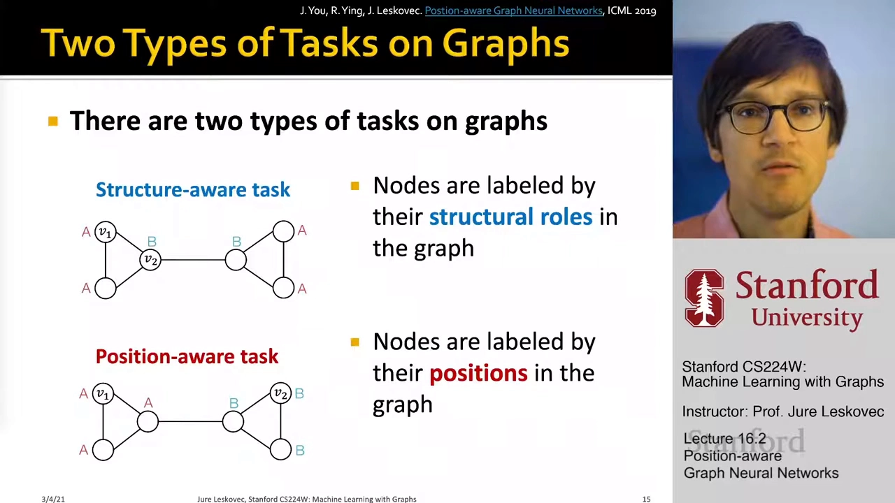

结构感知任务上 GNN 表现很好，原因很具体：$v_1$ 和 $v_2$ 的**计算图**不同——$v_2$ 在第一跳就有三个邻居，$v_1$ 只有两个，展开成树后形状不一样，聚合出来的向量自然不一样 [【跳转到 01:55】](https://www.youtube.com/watch?v=6ZFvToZUjGA&t=115)。

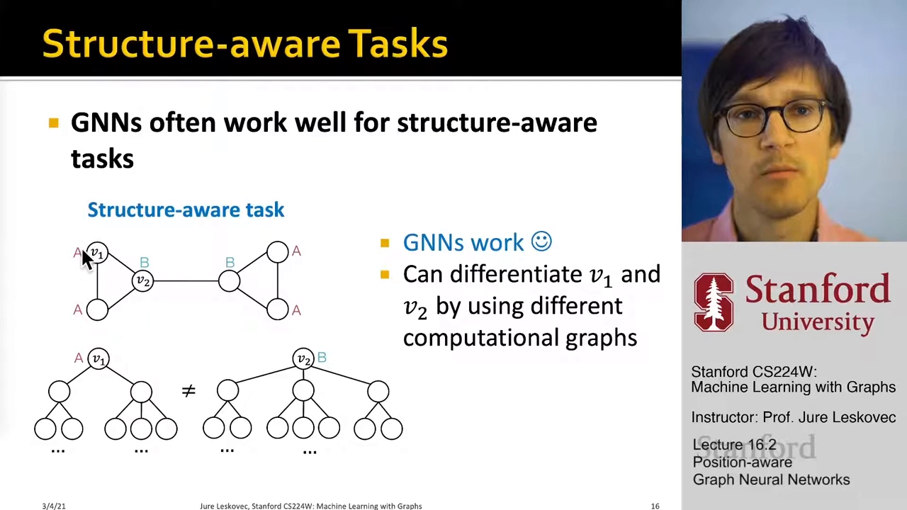

位置感知任务上 GNN 必然失败，原因同样具体：$v_1$ 和 $v_2$ 的计算图**完全相同**，因为它们在结构上互为镜像。讲者特意补了一个前提——假设没有给出有区分度的节点特征。在这个前提下，两个节点的局部邻域结构相同，计算图相同，嵌入相同，分类器只能给它们同一个标签 [【跳转到 02:45】](https://www.youtube.com/watch?v=6ZFvToZUjGA&t=165)。

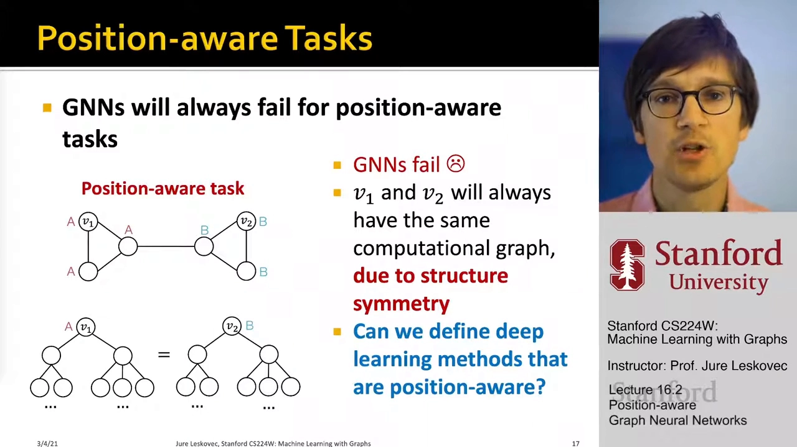

这里要分清一件事：**这不是聚合函数不够强的问题**。换更复杂的聚合、加更多层，两个节点的计算图仍然一模一样，输出仍然一样。缺的是输入里根本没有"你在左边还是右边"这条信息。所以补丁必须加在**输入**上，而不是加在聚合函数里。（局部消息传递的能力边界本身属于 [2.3.1 图表达能力](../../../README.md#m03-2-3-1) 的 WL 视角；本节关心的是"怎么把位置信息塞进去"。）

## 二、位置编码与结构编码是两类不同的信息

GraphGPS 的报告把补丁分成两大类，定义写得很清楚 [【跳转到 08:19】](https://www.youtube.com/watch?v=DiLSCReBaTg&t=499)：

- **位置编码（positional encoding, PE）**：给出节点在图中的**空间位置**。它的约束是"距离敏感"——两个节点在图上离得近，它们的 PE 也应该接近。
- **结构编码（structural encoding, SE）**：给出节点所在**子图的结构**。它的约束不同——两个节点的局部子图相似（比如都在一个环上、都是星形中心），它们的 SE 也应该接近。

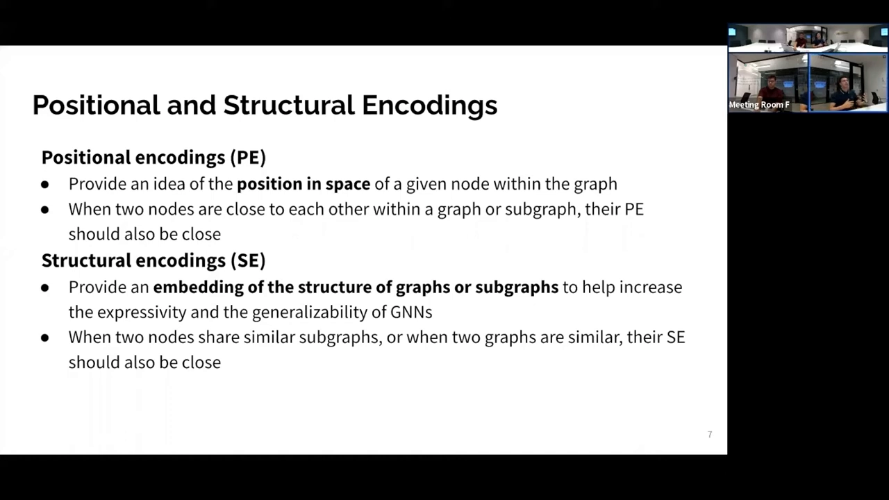

一个类比可以记住两者的分工：PE 像 GPS 坐标，告诉你"东经多少、北纬多少"；SE 像户籍描述，告诉你"住在一条环形街道上、旁边有三角形街区"。前者能区分对称的两栋楼，后者不能，但后者换个城市仍然成立。

这两类还可以再按**作用范围**切成三档：局部（local）、全局（global）、相对（relative）[【跳转到 09:34】](https://www.youtube.com/watch?v=DiLSCReBaTg&t=574)。下图把三档画在同一张分子图上：全局 PE 是整张图的坐标系，局部 PE 只在小簇内有意义，相对 PE 挂在边上（描述一对节点的关系）。

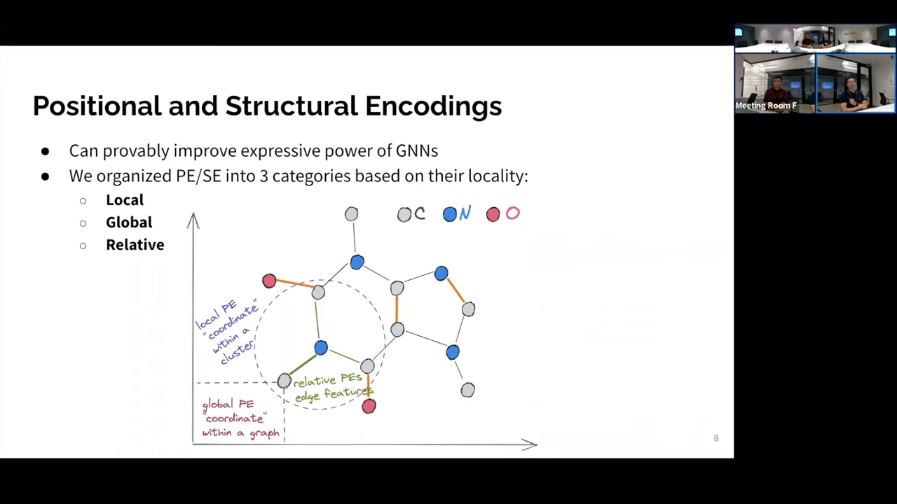

这个三档划分后面会反复用到：拉普拉斯特征向量属于**全局 PE**，随机游走对角线属于**局部 SE**，锚点距离属于**相对 PE**，而 SignNet 这类"用 GNN 处理特征向量"的做法会同时沾上位置与结构两种性质。

## 三、拉普拉斯特征向量：给图配一套坐标系

最自然的全局位置编码，来自图拉普拉斯矩阵的特征分解 [【跳转到 12:29】](https://www.youtube.com/watch?v=DiLSCReBaTg&t=749)：

$$
L = D - A = U^{\top} \Lambda U
$$

其中 $A$ 是邻接矩阵，$D$ 是度矩阵，$U$ 的列是特征向量，$\Lambda$ 的对角线是特征值。取前 $k$ 个特征值对应的特征向量，每个节点就得到 $k$ 个数值，拼成它的坐标——这套坐标叫**特征映射（eigenmap）**。

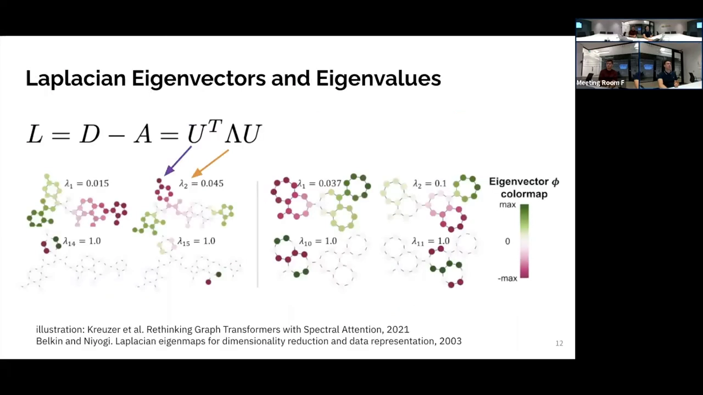

为什么这算"位置"？因为特征向量是图上的**平滑函数**：相邻节点取值接近，整张图被"摊平"到欧氏空间里。图中 $\lambda_1 = 0.015$ 的特征向量把分子分成左右两半（低频、平滑），而 $\lambda_{14} = 1.0$ 的特征向量在相邻原子之间剧烈正负跳变（高频、接近噪声）。讲者的经验是：**低频的几个最有用**，因为它们给的是"你在图的哪一侧"这种粗坐标；高频更像噪声 [【跳转到 12:54】](https://www.youtube.com/watch?v=DiLSCReBaTg&t=774)。

注意本节与 [2.1.6 谱图方法](../../../README.md#m03-2-1-6) 的分工：2.1.6 讲的是**谱域滤波与谱卷积**——把特征向量当作基底去做卷积；本节只把特征向量当作**节点特征**拼到输入上，不重推谱滤波。同一个 $L$，两种用法：一种是算子，一种是坐标。

## 四、特征向量不唯一：符号、重根与可变的 k

"生成特征映射、拼到输入上"听起来是一行代码的事。讲者说，表面上看确实简单，但问题是**它不唯一**，而且这种不唯一会直接破坏训练的稳定性 [【跳转到 13:19】](https://www.youtube.com/watch?v=DiLSCReBaTg&t=799)。报告把麻烦归成三条 [【跳转到 15:24】](https://www.youtube.com/watch?v=DiLSCReBaTg&t=924)：

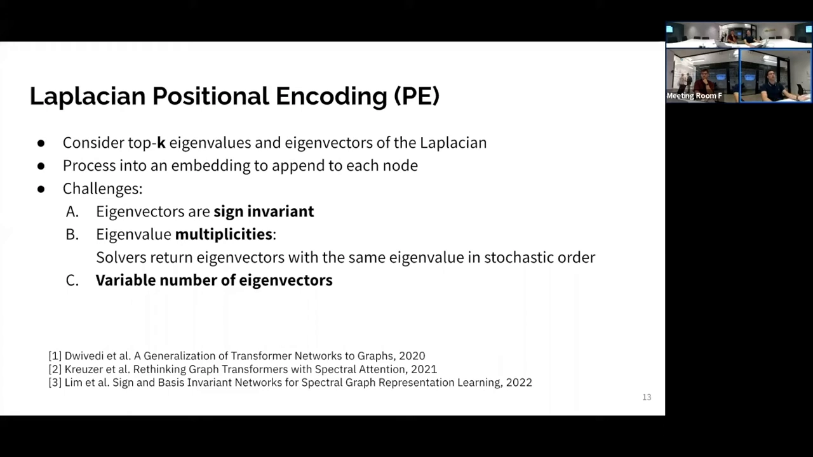

**第一，符号不定（sign invariance）。** 如果 $v$ 是特征向量，那么 $-v$ 也是。取前 $k$ 个特征向量，就有 $2^k$ 种符号组合都合法。对网络来说，这意味着同一张图的输入可以在正负之间整体翻转，而标签没变——模型被迫去学一件与任务无关的事。

**第二，重根（eigenvalue multiplicities）。** 当多个特征向量共享同一个特征值（重根），它们的**任意线性组合**仍然是特征向量。上一张图里 $\lambda_{14} = \lambda_{15} = 1.0$ 就是这种情况。数值求解器返回的是这个子空间里的一组基，但具体返回哪一组、按什么顺序返回，是随机的。于是同一张图跑两次，得到的"坐标"可能完全不同。

**第三，特征向量个数可变。** 你想取 $k$ 个特征向量，但数据集中有些图节点数少于 $k$，取不满，需要补零或另想办法。这逼着模型接受变长输入。

三条麻烦的共同点值得强调：**同一张图有多个合法的位置编码**。位置编码的目的是给节点一个稳定身份，而特征分解给出的身份带有一组对称变换的自由度。不处理这些自由度，等于往输入里注入了随机噪声；处理它们，就要付出后面几章说的代价。

顺带说清代价的量级：稠密矩阵的特征分解在一般情况下是 $O(n^3)$ 的（这是线性代数的一般结论，视频没有给这条公式）。报告给的是实测口径——特征分解是**预处理步骤**，除非图的规模到几万节点，否则不是瓶颈；在他们最大规模的数据集上，预处理也不超过一个半小时 [【跳转到 85:22】](https://www.youtube.com/watch?v=DiLSCReBaTg&t=5122)。换句话说，$O(n^3)$ 是真实存在的上界，但在常见的分子、超像素图上，它被"离线算一次、训练时直接读"这个工程安排吸收掉了。
## 五、三种处理办法：随机翻符号、DeepSets、SignNet

针对上面三条麻烦，报告梳理了三代做法，复杂度递增、代价也递增。

**第一代：把不唯一当成数据增广。** 最早的图 Transformer 对符号问题只做一件事——训练时**随机翻转**特征向量的符号，让模型见到各种符号组合，从而学会对符号不敏感 [【跳转到 15:24】](https://www.youtube.com/watch?v=DiLSCReBaTg&t=924)。重根问题没有处理；变长问题靠一个保守设定回避：把 $k$ 取成"数据集中最小图的节点数"，保证每个图都取得出 $k$ 个特征向量。代价是 $k$ 被最小的那张图卡死，表达力受限。

**第二代：把 $(\lambda, v)$ 当集合处理。** 后续工作把特征值和特征向量拼成一对，把整组对当成**集合**（或序列）送进 Transformer，再读出节点表示。集合算子天然不关心元素顺序，于是重根导致的顺序随机、以及变长问题都被吸收掉了；符号问题仍然沿用随机翻转 [【跳转到 16:39】](https://www.youtube.com/watch?v=DiLSCReBaTg&t=999)。报告作者后来发现 Transformer 在这里并非必需，换成 **DeepSets**（一种对集合做"逐元素变换 + 求和池化"的简单结构）效果一样好，于是简化成 DeepSets 版本。

**第三代：把符号不变性写进结构。** SignNet 的做法是把每个特征向量同时送进同一个函数 $\phi$ 的正、负两支，再相加：

$$
\tilde{u}_i = \rho\left(\sum_i \left[\phi(v_i) + \phi(-v_i)\right]\right)
$$

因为 $\phi(v) + \phi(-v)$ 在 $v \to -v$ 时不变，整个编码对符号翻转**严格不变**，不需要靠随机翻转去"碰"。其中 $\phi$ 用的是 8 层 GIN（图同构网络），$\rho$ 是 MLP 或 DeepSets [【跳转到 17:54】](https://www.youtube.com/watch?v=DiLSCReBaTg&t=1074)。

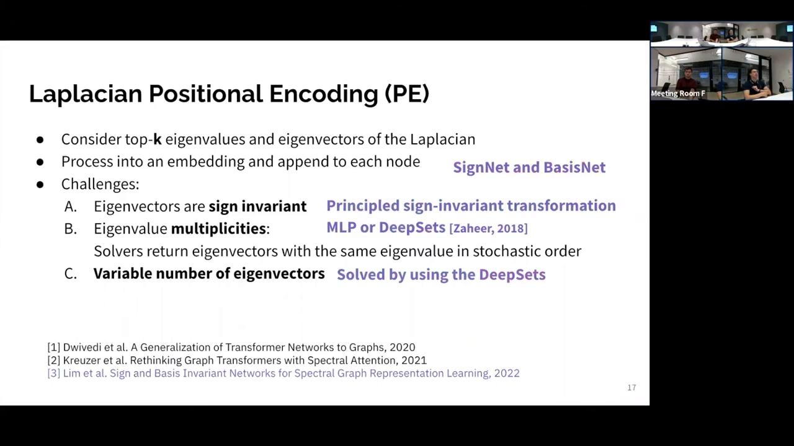

这一步有个副作用值得单独指出：因为 $\phi$ 是一个跑在图结构上的 GIN，它会看到相邻节点的特征向量差异，于是这个"位置编码"顺便吸收了**局部结构**信息。讲者的原话是，这已经不只是拉普拉斯位置编码，而是一种**混合编码**——既保留特征映射给的全局坐标，又带上了局部结构 [【跳转到 19:34】](https://www.youtube.com/watch?v=DiLSCReBaTg&t=1174)。这也解释了后面消融实验里 SignNet 为什么常常最好：它一份编码同时干了两件事。

**另一条支线：把位置编码放进聚合。** PEG 层不再把编码拼到输入上，而是用特征空间里的距离去**缩放消息聚合**，属于相对型位置编码 [【跳转到 19:59】](https://www.youtube.com/watch?v=DiLSCReBaTg&t=1199)。报告作者把它扩展到 GatedGCN 与 GIN 上做了实验，但结果并不理想（见第八章）。

代价对照很清楚：随机翻转几乎零成本但只是近似；DeepSets 版本便宜且能处理重根与变长；SignNet 严格但**每次前向和反向都要跑一遍 8 层 GIN**，讲者直说这让模型"慢很多"，是符号不变性换来的运行时开销 [【跳转到 81:57】](https://www.youtube.com/watch?v=DiLSCReBaTg&t=4917)。

## 六、随机游走结构编码：对角线上的返回概率

位置编码想回答"你在哪"，结构编码想回答"你的邻域长什么样" [【跳转到 26:14】](https://www.youtube.com/watch?v=DiLSCReBaTg&t=1574)。后者的一个漂亮做法是**随机游走对角线（random walk structural encoding, RWSE）**。

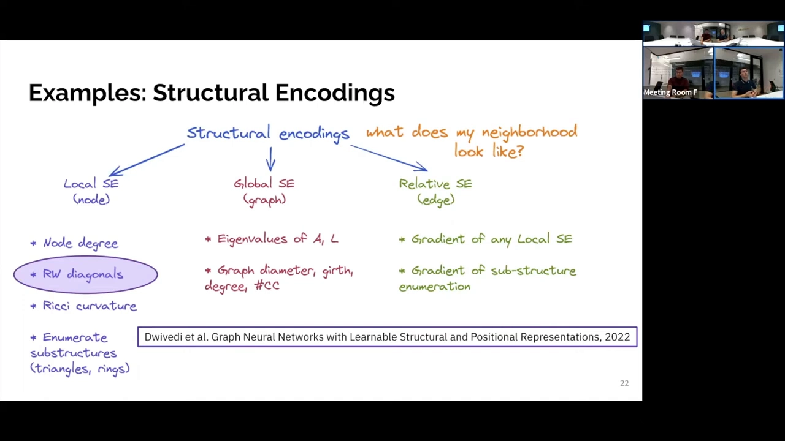

直觉先讲清楚：把邻接矩阵自乘 $k$ 次，$A^k$ 的第 $(i,i)$ 个元素就是"从节点 $i$ 出发走 $k$ 步、恰好回到 $i$ 的路径数"（归一化后是概率）。这个数只取决于节点周围的**局部结构**：如果 $i$ 在一个三角形里，走 3 步能回到自己；如果 $i$ 只在一片树上，走 3 步回不来。

讲者给了一个特别好用的判据：**奇数长度的环**。在不含自环的图里，走奇数步是回不到起点的，除非该节点本身处在一个奇数长度的环上 [【跳转到 23:19】](https://www.youtube.com/watch?v=DiLSCReBaTg&t=1399)。于是"3 步返回概率大于零"就直接编码了"我在一个奇环上"这条结构信息——这正是消息传递在局部难以稳定表达的东西。

具体做法是：把 $A$ 从 1 次幂算到某个上限（报告里取到 20），取每个幂的对角线，得到每个节点一个 20 维向量，拼到节点特征上 [【跳转到 25:24】](https://www.youtube.com/watch?v=DiLSCReBaTg&t=1524)。有一个必须做的数值处理：随着幂次升高，返回概率指数衰减，数值会越来越小，所以**要归一化**再送进网络；讲者把这个称为"重要的实用技巧" [【跳转到 25:49】](https://www.youtube.com/watch?v=DiLSCReBaTg&t=1549)。

代价方面，RWSE 是这几类里最便宜的：只需要若干次稀疏矩阵乘法（或幂迭代），不需要特征分解，也不需要额外的神经网络。它的局限同样明确——**它不给全局坐标**。两个处在结构相同但位置不同的节点，RWSE 完全一样，所以它解决不了第一章那个"两个三角形"的位置感知任务。它补的是结构那一半。

## 七、距离编码：用锚点做三角定位

要补位置那一半，另一条路线是**距离编码**：不问"我的邻域长什么样"，而问"我离某些参考点有多远"。CS224W 用了一个生活化的类比——你知道自己在哪，是因为你知道自己离几个已知参照物有多远；在图里，这几个参照物叫**锚点（anchor）** [【跳转到 03:35】](https://www.youtube.com/watch?v=6ZFvToZUjGA&t=215)。

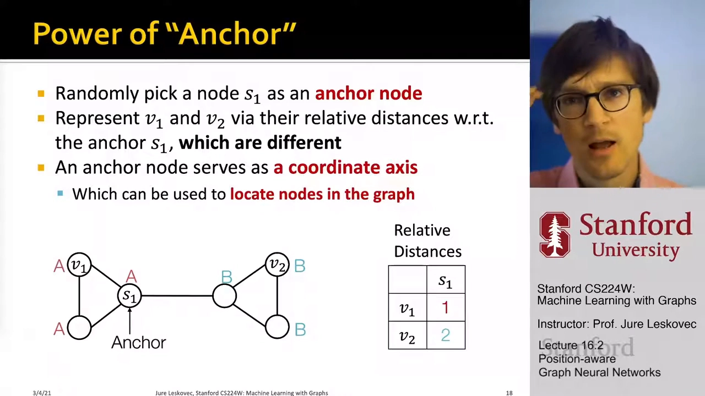

做法分三步升级：

1. **单锚点**：随机挑一个节点 $s_1$ 当锚点，用节点到它的最短路距离当坐标。$v_1$ 距 $s_1$ 一跳、$v_2$ 距 $s_1$ 两跳，两者立刻可分。
2. **多锚点**：一个锚点只能给一维坐标，多个锚点才能在不同区域上都区分得开。但锚点不能无限多，否则计算变贵——讲者提到有理论结果告诉我们取多少个够用 [【跳转到 04:50】](https://www.youtube.com/watch?v=6ZFvToZUjGA&t=290)。
3. **锚集（anchor set）**：把锚点从单个节点推广成节点集合，节点到锚集的距离定义为"到集合里任意节点的最小距离"。锚集能给出更细粒度的位置，同时把锚的总数压下来 [【跳转到 07:45】](https://www.youtube.com/watch?v=6ZFvToZUjGA&t=465)。

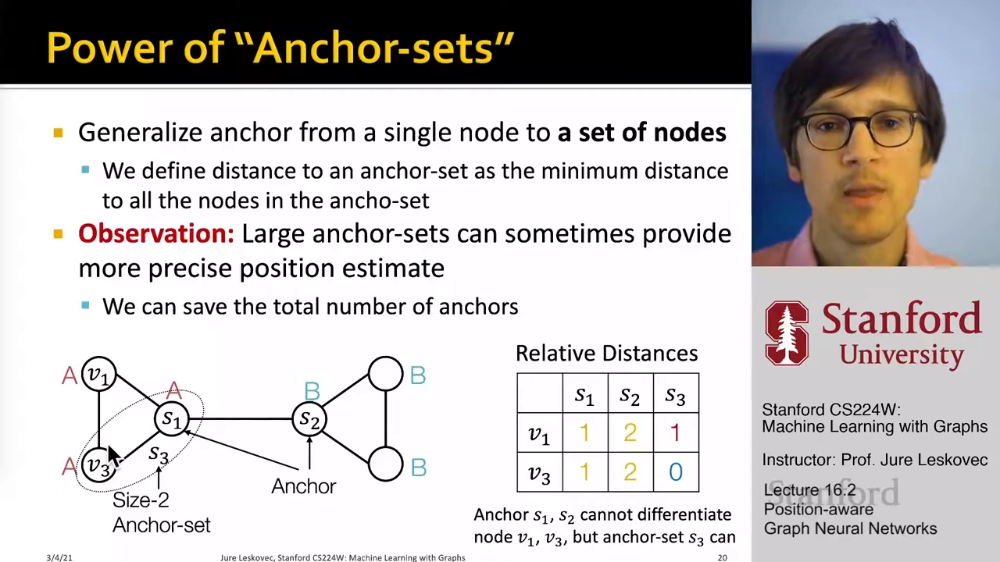

上图右侧的表格是最好的说明：只靠 $s_1$、$s_2$ 两个锚点，$v_1$ 和 $v_3$ 的距离向量都是 $(1, 2)$，区分不开；加上一个大小为 2 的锚集 $s_3$ 之后，$v_1$ 到 $s_3$ 的距离是 1、$v_3$ 是 0，两者就分开了。

锚点的规模怎么定？讲者给了一个具体方案：**锚集大小指数增长，锚集数量指数减少**——大小为 1 的锚集很多，大小为 2 的减半，大小为 4、8、16 的继续减半；集合内的节点均匀随机选取 [【跳转到 09:25】](https://www.youtube.com/watch?v=6ZFvToZUjGA&t=565)。这样总锚集数不多，但覆盖的尺度从"单个节点"一直铺到"一大片区域"。

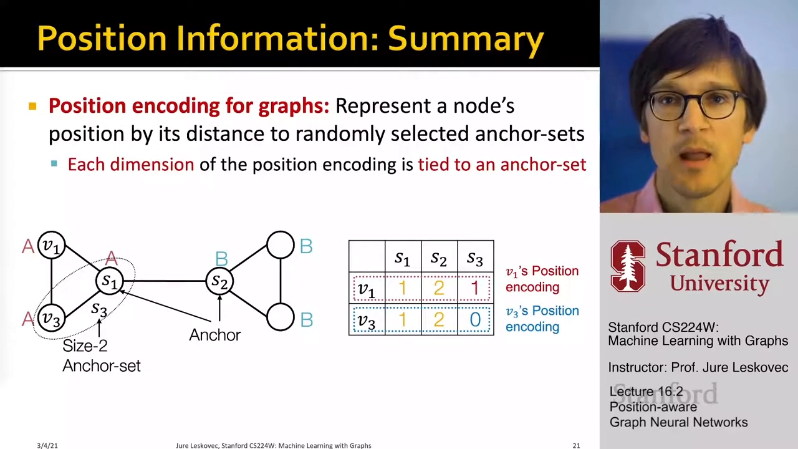

用法很直接：把距离向量拼到节点特征上，讲者说这在实践中效果很好。但它带来一个与拉普拉斯编码**同构**的麻烦——**维度可以随意置换**。因为每一维绑定的是一个随机锚集，把两维交换，语义完全不变；可普通神经网络对输入维度的顺序是敏感的，交换后输出会变 [【跳转到 10:40】](https://www.youtube.com/watch?v=6ZFvToZUjGA&t=640)。

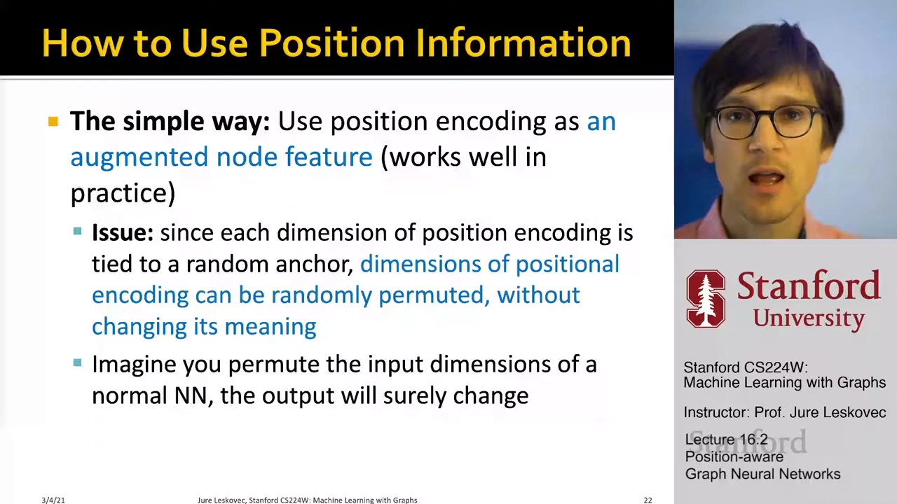

更严谨的解法是设计**对维度顺序不变的算子**（例如用顺序无关的聚合器），这也是 position-aware GNN 那篇论文做的事 [【跳转到 11:05】](https://www.youtube.com/watch?v=6ZFvToZUjGA&t=665)。注意这和第四章的符号问题、重根问题是同一类病：**同一张图对应多个合法编码，而网络对编码的具体形式敏感**。拉普拉斯编码的病在符号与基旋转上，锚点编码的病在维度置换上。

代价方面，距离编码需要算最短路（或截断的最短路），并维护一批锚集；它给的是**相对位置**而非全局坐标，所以图规模变化时行为相对稳定，但维度语义不稳定这一点必须靠算子设计来兜。

## 八、代价对照：预计算、运行时与适用条件

把三类编码放在一张表里，代价的位置就清楚了。

| 编码 | 提供什么 | 主要计算代价 | 失效条件 |
| --- | --- | --- | --- |
| 拉普拉斯特征向量（LapPE） | 全局位置坐标 | 一次特征分解，属预处理；稠密分解一般 $O(n^3)$，实测在几万节点以下不是瓶颈 | 符号不定、重根、$k$ 与图大小不匹配 |
| SignNet | 全局位置 + 局部结构（混合） | 预计算同上，另加每次前向反向的 8 层 GIN | 运行时明显变慢 |
| 随机游走对角线（RWSE） | 局部结构指纹 | $k$ 次稀疏矩阵幂，最便宜 | 不给全局坐标，解决不了位置感知任务 |
| 锚点距离编码 | 相对位置 | 最短路计算 + 锚集维护 | 维度可置换，需要顺序不变的算子 |

这张表不是凭直觉排的，报告给了两组消融实验。

**第一组：位置/结构编码到底有多重要。** 在 ZINC 上，把全局注意力整个拿掉、只留局部消息传递，性能**不变**（MAE 0.070）；反过来把消息传递拿掉、只留 Transformer，性能变差（0.113）。讲者的解读是：ZINC 上的性能主要由**位置与结构编码**贡献，而不是全局注意力 [【跳转到 77:04】](https://www.youtube.com/watch?v=DiLSCReBaTg&t=4624)。

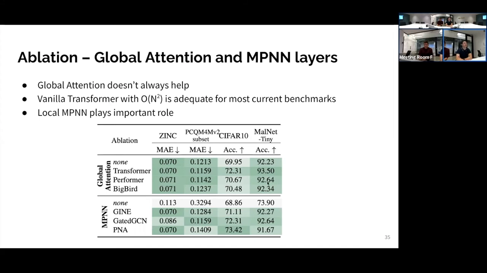

**第二组：不同编码之间的横向比较。** 同一套框架下换编码，各数据集的胜负并不一致 [【跳转到 78:44】](https://www.youtube.com/watch?v=DiLSCReBaTg&t=4724)：

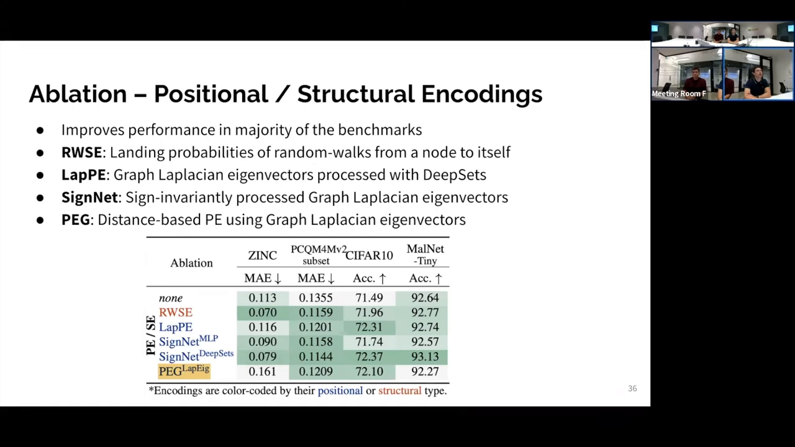

- **RWSE** 在 ZINC（分子溶解度）上最好（MAE 0.070），在 PCQM4Mv2 子集上也有竞争力。讲者的总结是：随机游走结构编码在**分子数据**上普遍好用。
- **LapPE** 在 ZINC 上反而很差（0.116，比不加编码的 0.113 还差），但在 **CIFAR10 超像素图**上明显更好（72.31 对 71.49）。原因不难理解：超像素图是从图像派生的，任务需要"这块像素在图的哪个区域"这种**全局位置**信息，正是特征映射擅长的。
- **SignNet** 综合最强（ZINC 0.079），讲者认为原因是它同时具备位置与结构两面：既从拉普拉斯分解拿到全局信息，又通过 GIN 吸收局部结构；而且它用结构化的方式消除了符号翻转问题，比随机翻转更可靠。代价是慢——每次前向反向都要跑 8 层 GIN。
- **PEG**（把编码放进聚合）效果最差（ZINC 0.161）。讲者的猜测是它只作用在局部消息传递层、没有把编码显式拼到节点特征上，因而在全局注意力里用不上。

最后是"可扩展性"这一条：预计算（特征分解）是真实成本，但报告的经验是除非图到几万节点，否则不构成瓶颈；真正让框架能跑到几千节点以上的是把全局注意力换成线性注意力，复杂度从 $O(N^2)$ 降到 $O(N+E)$ [【跳转到 85:22】](https://www.youtube.com/watch?v=DiLSCReBaTg&t=5122)。

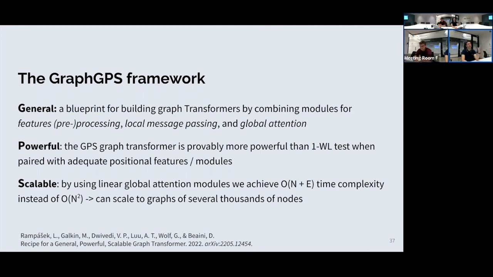

## 小结

- 消息传递的表示由局部邻域决定，因此**结构对称的两个节点必然得到同一表示**；这不是聚合函数不够强，而是输入里没有位置信息，补丁必须加在输入上。
- 位置编码（PE）回答"你在图的哪里"，要求图上近则编码近；结构编码（SE）回答"你的邻域长什么样"，要求子图相似则编码相似。两者可再分为局部、全局、相对三档。
- 拉普拉斯特征向量给出全局坐标：$L = D - A = U^{\top} \Lambda U$，取前 $k$ 个特征向量当节点坐标；低频平滑有用，高频接近噪声。
- 特征向量不唯一：符号可整体翻转（$2^k$ 种）、重根可任意线性组合、$k$ 与图大小不匹配。这三条让同一张图有多种合法编码。
- 应对手段三代递进：随机翻符号（近似、零成本）→ 把 $(\lambda, v)$ 当集合用 DeepSets 处理（顺带解决重根与变长）→ SignNet 用 $\phi(v)+\phi(-v)$ 严格消除符号依赖（但每次前反向多跑 8 层 GIN）。
- 随机游走对角线用 $A^k$ 的对角线编码局部结构（能识别奇环），最便宜，但不给全局坐标。
- 锚点距离编码用"到参考点的距离"做三角定位，锚集大小指数增长、数量指数减少；代价是维度可置换，需要顺序不变的算子。
- 选择依据是任务需要哪种信息：分子数据上 RWSE 更划算，图像派生的超像素图上 LapPE 更有用，SignNet 两者兼顾但最慢；在 ZINC 上，位置与结构编码的贡献甚至大于全局注意力。

## 关键术语速查

| 术语 | 一句话解释 |
| --- | --- |
| 结构感知任务 | 标签由节点的局部结构角色决定，如"是不是三角形的一个角" |
| 位置感知任务 | 标签由节点在图中的位置决定，如社区检测中节点属于哪一侧 |
| 计算图 | 从某节点出发按消息传递展开的邻域树；两节点计算图相同则嵌入相同 |
| 位置编码（PE） | 描述节点在图中的坐标，要求图上距离近则编码距离近 |
| 结构编码（SE） | 描述节点所在子图的结构，要求子图相似则编码相似 |
| 图拉普拉斯 | $L = D - A$，度矩阵减邻接矩阵，其谱刻画图的全局结构 |
| 特征映射（eigenmap） | 取拉普拉斯前 $k$ 个特征向量作为每个节点的 $k$ 维坐标 |
| 符号不变性 | 特征向量 $v$ 与 $-v$ 都是合法解，前 $k$ 个共 $2^k$ 种符号组合 |
| 特征值重根 | 多个特征向量共享同一特征值，其任意线性组合仍是特征向量，求解器返回顺序随机 |
| SignNet | 用 $\phi(v)+\phi(-v)$ 再聚合的构造，严格消除符号依赖 |
| DeepSets | 逐元素变换后做置换不变的池化，用于处理集合或变长输入 |
| 随机游走对角线（RWSE） | 取 $A^k$ 对角线（$k=1..K$）作为节点结构指纹，需归一化 |
| 锚点与锚集 | 随机选定的参考节点或节点集合，节点位置由到它们的最短距离描述 |
| 1-WL | 一维 Weisfeiler-Lehman 同构检验，是普通消息传递 GNN 的表达力上界 |
