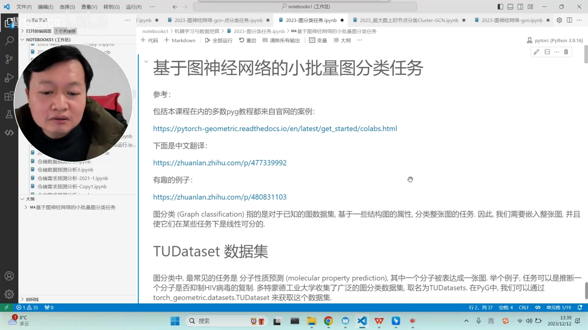
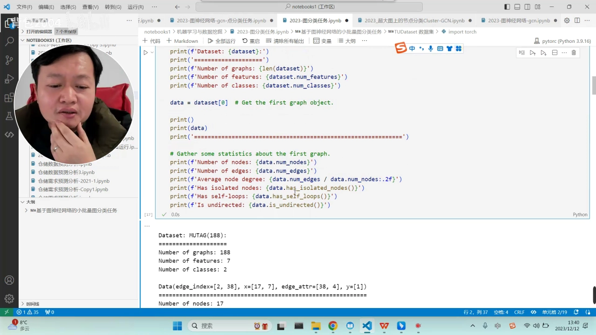
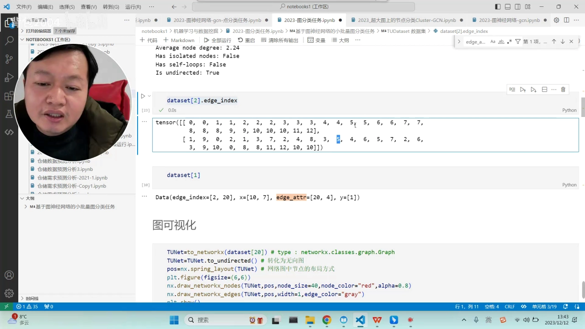
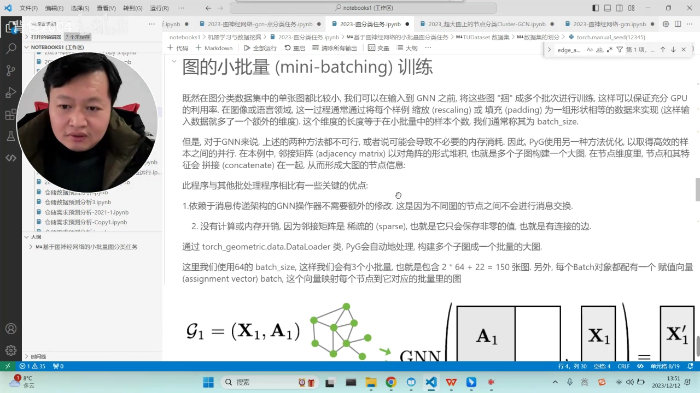
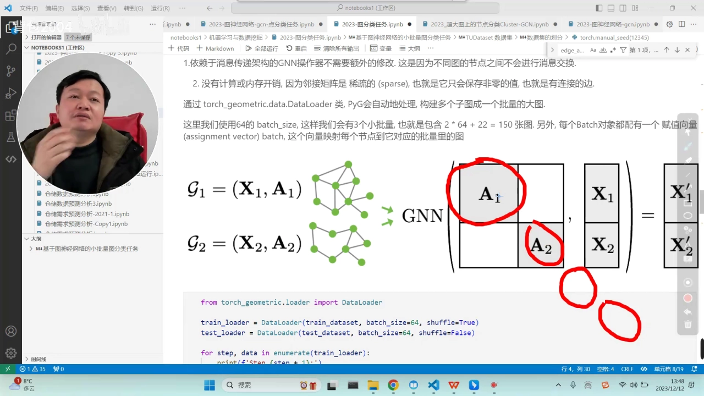
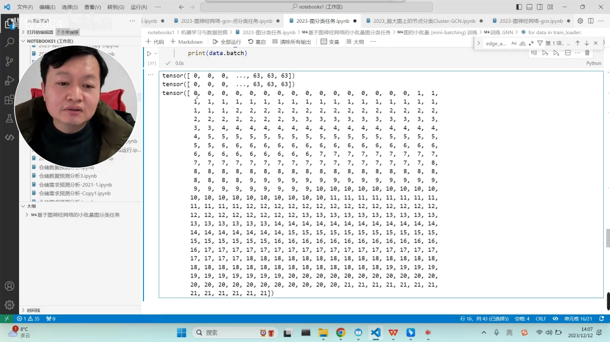
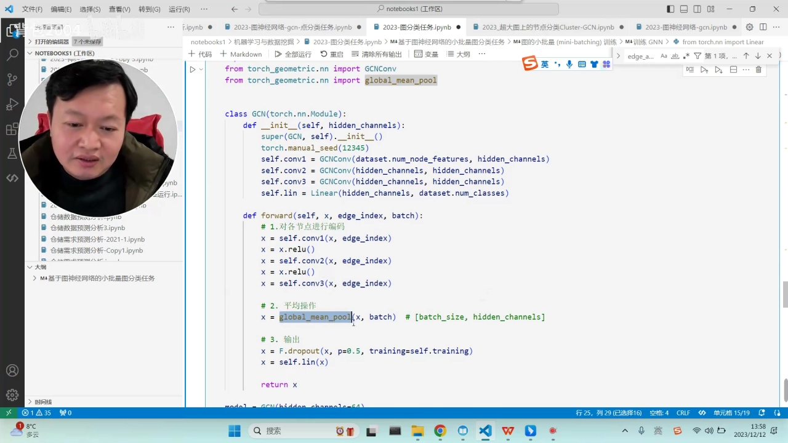
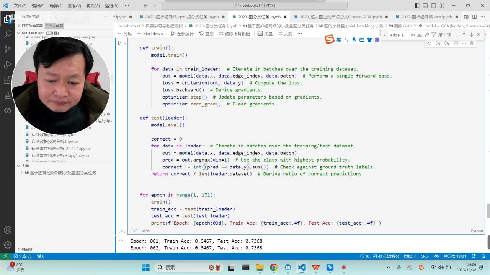

# 从节点向量到图向量：图分类的读出层与小批量训练

> 视频来源：[33-图分类任务实践-图神经网络-gcn-pyg学习](https://www.bilibili.com/video/BV1mu4y1u7Vf/)（Bilibili · 背包2004）｜时长约 30 分钟
> 本篇跟着一条 PyG 的图分类代码走：先看「一张图一个标签」的数据长什么样，再看多张小图如何拼成一个大 batch，最后落到那句最容易一掠而过的 `global_mean_pool`——它把一堆节点向量压成一个图向量，图级预测才得以发生。层级池化（SAGPool 一类）由同小节的另一篇博客展开。

## 本讲要解决的核心问题（SCQA）

**背景**：前面学的消息传递一直在改节点向量。节点分类任务很自然：每个节点有自己的标签，网络输出每个节点的类别即可。

**冲突**：图分类的标签却挂在整张图上——一个分子只有一个「有毒/无毒」，一张图只有一个类别。可网络跑完几层 GCN，手里拿到的仍然是一个 $N\times F$ 的节点特征矩阵，$N$ 还是这张图的节点数。节点数不同的两张图，输出矩阵的形状都不一样，根本没法直接接一个分类器。

**疑问**：怎么把「若干个节点向量」变成「一个图向量」，并且让同一个模型能处理节点数不同的图？

**回答（中心思想）**：在 GCN 之后加一个**读出层（readout）**，对节点维度做一次对称聚合，把 $N\times F$ 压成 $1\times F$；再接一个线性层把 $F$ 维映射到类别数。读出层与 GCN 都只依赖特征维度、不依赖节点数，所以同一套参数可以吃任意大小的图；多张小图则通过对角拼接邻接矩阵、堆叠节点特征合成一个大 batch，一次前向就处理完。

## 一、图分类任务的形状：一张图一个标签

讲者先给图分类下定义：图分类是对已知的图数据集，基于一些结构图的属性，分类整张图的任务，因此需要嵌入整张图，并且使它们在某些任务下是线性可分的。[【跳转到 00:35】](https://www.bilibili.com/video/BV1mu4y1u7Vf/?t=35)

最常见的例子是分子性质预测：一个分子表达成一张图，任务是推断这个分子是否抑制 HIV 病毒的复制。PyG 把这类数据收在 `TUDataset` 里，本讲用的是 `MUTAG`。[【跳转到 00:35】](https://www.bilibili.com/video/BV1mu4y1u7Vf/?t=35)



跑一遍数据集统计，几个数字要记住：

- 188 张图（188 个不同的分子）；
- 每个节点 7 维特征；
- 2 个类别；
- 第 0 张图有 17 个节点、38 条边，`edge_attr` 是 $38\times 4$，`y` 只有一个值。[【跳转到 01:10】](https://www.bilibili.com/video/BV1mu4y1u7Vf/?t=70)



这里有个初学者常忽略的对照：**节点分类有多少个节点就有多少个 $y$，图分类无论多少节点只有一个 $y$**。[【跳转到 02:35】](https://www.bilibili.com/video/BV1mu4y1u7Vf/?t=155) 标签的粒度决定了后面必须有一个「把节点汇总成图」的步骤，否则标签和输出对不上。

边的表示是两列节点索引，分别对应 source 和 target。无向边会被记两次（4→5 和 5→4 是同一条边），所以可视化时要先转成无向图，否则会被当成两条方向不同的边。[【跳转到 03:00】](https://www.bilibili.com/video/BV1mu4y1u7Vf/?t=180)



## 二、先把多张小图拼成一张大图：小批量训练怎么处理邻接矩阵

### 2.1 为什么不能一张一张图地训练

每次只放一张图，相当于普通神经网络每次只用一个样本训练，效率低。图分类同样希望若干张图一起进网络，也就是小批量训练，有一个 batch size。[【跳转到 04:40】](https://www.bilibili.com/video/BV1mu4y1u7Vf/?t=280)

但图像的小批量是把同样大小的图堆成一个四维张量，图却不行：每张图的节点数不同，邻接矩阵大小也不同，堆不起来。



### 2.2 对角拼接：多张小图 = 一张有多个连通块的大图

PyG 的做法是：把每张图的邻接矩阵按**对角**方式拼成一个大的块对角矩阵，节点特征按行上下堆叠。[【跳转到 05:54】](https://www.bilibili.com/video/BV1mu4y1u7Vf/?t=354)

$$
A_{\text{batch}}=
\begin{bmatrix}
A_1 & 0 & \cdots & 0\\
0 & A_2 & \cdots & 0\\
\vdots & \vdots & \ddots & \vdots\\
0 & 0 & \cdots & A_B
\end{bmatrix},
\qquad
X_{\text{batch}}=
\begin{bmatrix}
X_1\\ X_2\\ \vdots\\ X_B
\end{bmatrix}
$$



这张「大图」里其实有 $B$ 个互不相连的簇：块与块之间全是 0，不同图的节点之间不会有任何消息交换，所以原来的 GNN 算子一行都不用改。又因为邻接矩阵是稀疏存储的，只保存非零值，看起来巨大的矩阵并不会带来额外的内存开销。[【跳转到 07:49】](https://www.bilibili.com/video/BV1mu4y1u7Vf/?t=469)

### 2.3 batch 向量：每个节点属于哪张图

拼成大图之后，读出层必须知道「哪些节点属于第几张图」，否则会把不同图的节点平均到一起。PyG 为此额外给了一个赋值向量 `batch`，它把每个节点映射到它所属的图编号。[【跳转到 07:49】](https://www.bilibili.com/video/BV1mu4y1u7Vf/?t=469)



### 2.4 一个 batch 的真实形状

150 张训练图、batch size 取 64，于是分成三批：64、64、22。[【跳转到 08:54】](https://www.bilibili.com/video/BV1mu4y1u7Vf/?t=534)

![DataLoader 的输出：DataBatch(edge_index=[2,2636], x=[1188,7], y=[64], batch=[1188], ptr=[65])——1188 个节点、64 个图标签](assets/从节点向量到图向量：图分类的读出层与小批量训练/00919.webp)

注意 `x` 的第一维变成了 1188：这是 64 张图的节点总数，而不是某一张图的节点数；`y` 的第一维是 64，因为标签是图级的。同一份数据里两个维度分别对应「节点」和「图」，这正是图分类与节点分类的分水岭。

## 三、读出层：把 N 个节点向量压成一个图向量

### 3.1 为什么必须有读出

讲者把这一步称为「图分类里面最特有的东西」：消息传递自始至终都在改节点向量，但最终要判断的是整张图属于哪一类。走到输出时，任何一张图给你的仍然是若干个节点向量组成的矩阵。[【跳转到 11:54】](https://www.bilibili.com/video/BV1mu4y1u7Vf/?t=714)

所以需要一个函数，把「这张图的若干个节点向量」变成「一个向量」。这个函数就是读出层，在 PyG 里叫 `global_mean_pool` 一类。

### 3.2 平均读出：18 个向量加起来除以 18

视频里的例子很直白：一张子图有 18 个节点，就有 18 个向量；把这 18 个向量加起来求平均，本来用 18 个向量表示的图，现在由一个向量表示。[【跳转到 12:49】](https://www.bilibili.com/video/BV1mu4y1u7Vf/?t=769)

$$
h_G=\frac{1}{\lvert V\rvert}\sum_{v\in V} h_v
$$

其中 $V$ 是这张图的节点集合，$h_v$ 是 GCN 输出的节点向量，$h_G$ 是图向量。代码里就是一行：

```python
# 2. 平均操作
x = global_mean_pool(x, batch)  # [batch_size, hidden_channels]
```



注意 `batch` 参数的作用：它告诉函数按图分组，对每张图的节点各求一次平均，而不是把整个 batch 的 1188 个节点一起平均。输出形状是 batch 乘 hidden_channels，节点维度消失了。

### 3.3 求和还是平均：图大小信息留不留

读出层不止平均一种写法。把上式里的 $\frac{1}{\lvert V\rvert}$ 去掉，就是**求和读出**：

$$
h_G=\sum_{v\in V} h_v
$$

两者只差一个因子 $\lvert V\rvert$，但性质不同：

- **平均读出**把图大小归一化掉了。一张 10 个节点的图和一张 100 个节点的图，只要节点向量的分布相近，图向量就相近。它回答的是「这张图平均来看像什么」。
- **求和读出**保留了图大小：节点越多，累加项越多，图向量的量级通常越大。它回答的是「这张图总共有什么」。

所以选择哪一种，取决于**图的大小本身是不是有用的信息**。如果任务关心「有多少个这样的局部结构」，求和会把计数带进表示；如果图大小只是采集时带来的噪声、希望模型只看成分比例，平均更稳。视频里这个例子取的是平均，讲者也特意说了一句：到底怎么转换这个函数「是非常可以探讨的」。[【跳转到 13:54】](https://www.bilibili.com/video/BV1mu4y1u7Vf/?t=834)

还有第三种常见选择是**最大读出**（逐维取最大），它关注「最突出的那个节点」，同样与节点顺序无关。三种读出的取舍见下表。

| 读出方式 | 保留的信息 | 对图大小是否敏感 | 典型倾向 |
| --- | --- | --- | --- |
| 求和 | 全部节点的累加，含数量 | 敏感 | 大小/计数本身有意义 |
| 平均 | 节点的平均状态 | 不敏感 | 只看成分、图大小是噪声 |
| 最大 | 每个特征维上的极值 | 不敏感 | 关键子结构是否存在 |

### 3.4 节点顺序为什么无所谓

读出是**求和/平均/取最大**，这三种运算都不关心「先加哪一个」：把节点顺序打乱，结果不变。这就是置换不变性在读出层的体现。

这一点在小批量里被用得很彻底：对角拼接时，节点是按图依次堆叠的，哪张图排在前、图内节点按什么顺序排，都不影响读出结果。反过来说，如果读出层用了「按位置拼接」这类依赖顺序的操作，节点编号一变，图向量就变了，模型学到的就是编号而不是结构。

## 四、读出之后：线性层与图级标签

拿到 $F$ 维图向量之后，剩下的就是普通分类头。视频里的隐藏层是 64 维，所以图向量是 64 维；两类任务要把它降成 2 维，再看哪个维度的值大就判为哪一类。[【跳转到 13:44】](https://www.bilibili.com/video/BV1mu4y1u7Vf/?t=824)

$$
\hat{y}=\operatorname{softmax}\left(W\,h_G+b\right),\qquad W\in\mathbb{R}^{2\times 64}
$$

于是整条链是：节点特征 → 三层 GCN（节点级）→ 平均读出（图级）→ 线性层（类别）→ 交叉熵。前两段与节点数无关，只有读出层显式处理了「有多少个节点」这件事。

## 五、一次完整训练与两个易混点

训练循环本身是标准套路：取一个 batch，前向，算交叉熵，反向传播，更新参数，清梯度；测试时取输出最大的维度作为预测类别，统计正确数占总数的比例。[【跳转到 15:19】](https://www.bilibili.com/video/BV1mu4y1u7Vf/?t=919)



讲者最后提醒了两个容易混的点，也是本讲最值得记住的两句话：

1. **小批量是把多张小图看成一张大图**，邻接矩阵按对角拼，其他都不用改；[【跳转到 17:57】](https://www.bilibili.com/video/BV1mu4y1u7Vf/?t=1077)
2. **节点向量训练好之后，要用读出把节点特征转成图特征**，再经线性层得到分类输出。[【跳转到 17:57】](https://www.bilibili.com/video/BV1mu4y1u7Vf/?t=1077)

另外两个数字不要混淆：batch size 取 64 是每批 64 张图，隐藏层的 64 是特征维度，两者只是巧合都取了 64，改成一个别的值照样能训练。[【跳转到 14:44】](https://www.bilibili.com/video/BV1mu4y1u7Vf/?t=884)

## 小结

- 图分类的标签是图级的：一张图一个 $y$，而网络输出的是节点矩阵，两者之间必须有一个读出层。
- 读出层对节点维度做对称聚合，把 $N\times F$ 压成 $1\times F$；平均、求和、最大都是常见选择。
- 平均与求和只差一个 $\lvert V\rvert$：平均消掉图大小，求和保留图大小；选哪个取决于图大小是不是有用信息。
- 读出与 GCN 都只依赖特征维度、不依赖节点数，所以同一套参数能处理任意大小的图，这也是小批量可行的前提。
- 小批量通过对角拼接邻接矩阵、堆叠节点特征实现；不同图的节点互不连通，GNN 算子无需修改。
- `batch` 向量记录每个节点属于哪张图，读出层据此分组聚合，避免把不同图平均到一起。
- 求和/平均/最大都不依赖节点顺序，读出天然满足置换不变性。

## 关键术语速查

| 术语 | 一句话解释 |
| --- | --- |
| 图分类 | 给整张图打一个标签的任务，如分子是否有毒 |
| 读出（readout） | 把节点向量集合聚合成一个图向量的层 |
| 平均读出 | 对节点向量求平均，消掉图大小的影响 |
| 求和读出 | 对节点向量求和，保留图大小/计数信息 |
| 小批量（mini-batch） | 多张图一起前向；邻接矩阵对角拼接，节点特征堆叠 |
| batch 向量 | 每个节点所属图的编号，读出层按它分组 |
| 置换不变性 | 节点顺序改变，输出不变 |
| 图级标签 | 一张图只有一个标签，区别于每个节点一个标签 |