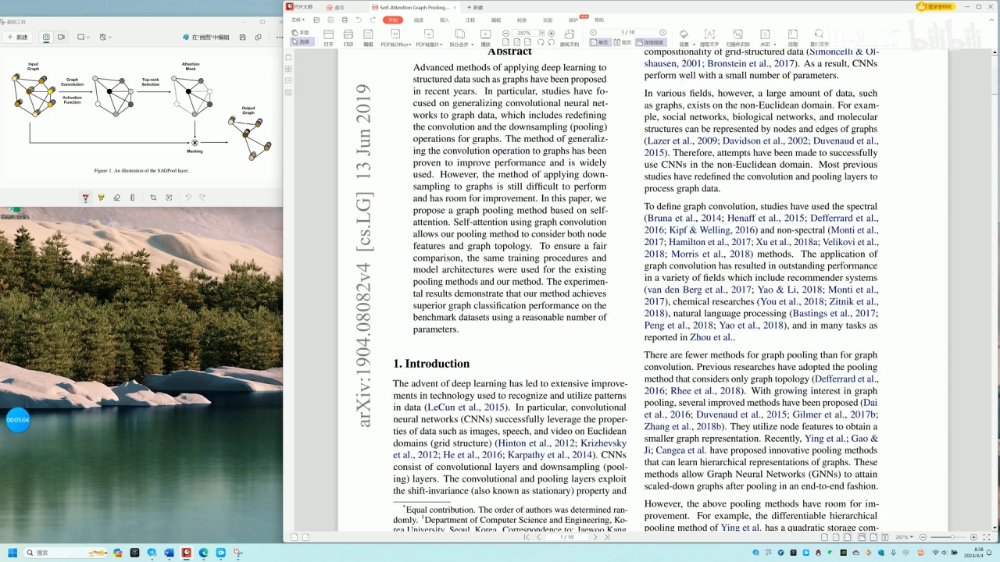
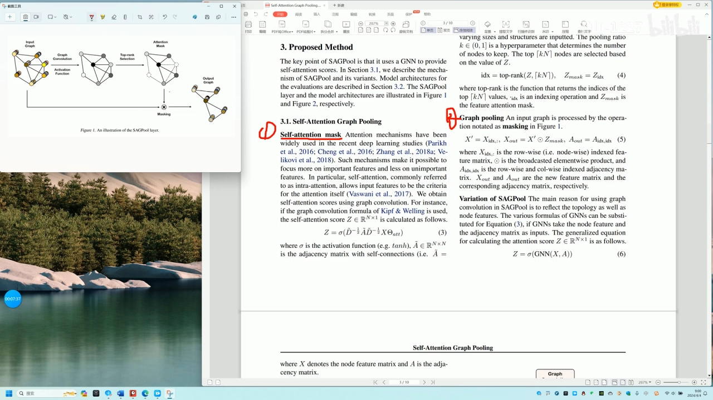
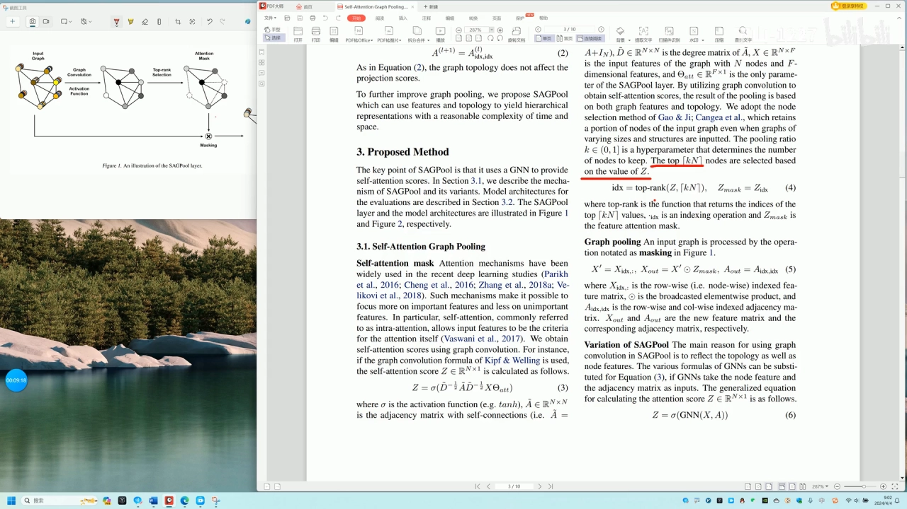
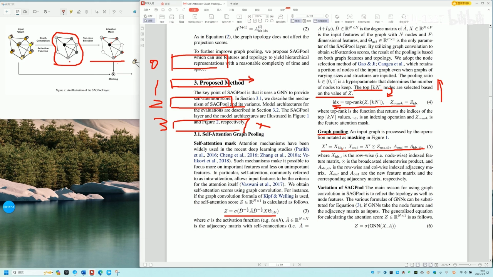
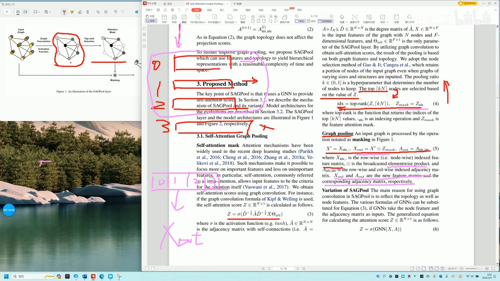
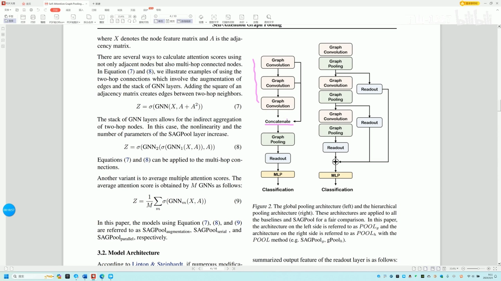
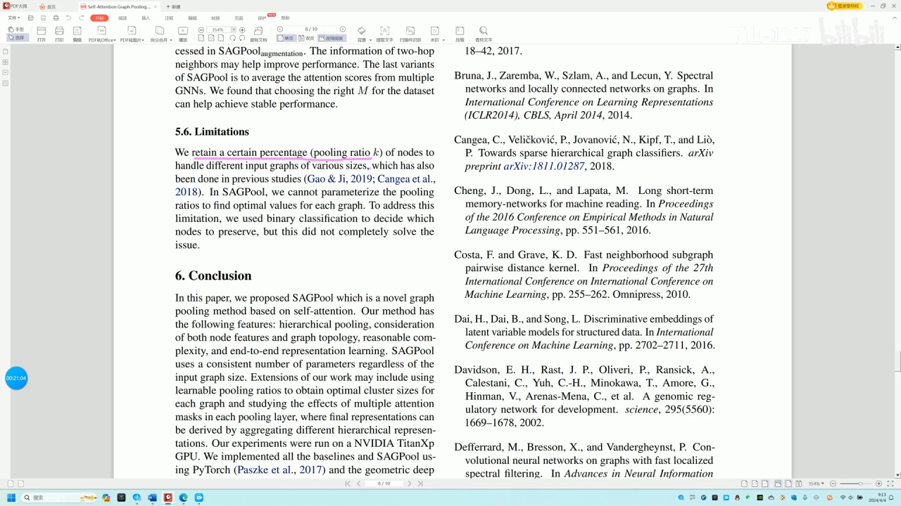

# 自注意力图池化：用节点得分做 top-k 选择与图粗化

> 视频来源：[GNN-20.自注意力图池化(Self-Attention Graph Pooling)](https://www.bilibili.com/video/BV11M4m1X7Bb/)（Bilibili · 下山-1227）｜时长约 25 分钟
> 本篇精读 SAGPool（Self-Attention Graph Pooling，ICML 2019）的方法部分：它不再把整张图一次平均成向量，而是给每个节点打一个分，保留得分最高的 $kN$ 个节点，连边一起裁掉，得到一张更小的图。这正是「层级池化」与「全局读出」的分界。求和/平均读出的基础见同小节另一篇博客。

## 本讲要解决的核心问题（SCQA）

**背景**：图分类最后要把节点表示汇总成图表示。最省事的做法是全局池化：所有节点向量做一次平均或最大，得到一个图向量，再接 MLP 分类。

**冲突**：全局池化只做一次，而且是在**特征维度**上把节点信息压扁。它把整张图当成一个扁平集合，丢掉了「哪些局部先聚成子结构、子结构再怎么聚成整图」的层次。CNN 靠逐层下采样获得多尺度感受野，图网络却只有一层池化可用。

**疑问**：能不能像 CNN 那样，在网络的每一层都做一次下采样，让图逐层变小、表示逐层变粗？图没有规则的网格，下采样到底该保留哪些节点？

**回答（中心思想）**：SAGPool 用一个小型 GNN 给每个节点算一个自注意力得分，按池化率 $k$ 保留得分最高的 $\lceil kN\rceil$ 个节点，节点特征按索引取子集，邻接矩阵同步取子块，于是图被「裁剪/粗化」成更小的图。把这一层插在每层 GCN 之间，就得到层级池化架构；只在最后做一次，则是全局池化架构。

## 一、图池化要解决的是「下采样」，不是「分类头」

讲者开篇把图池化和 CNN 的池化对齐：CNN 里卷积完之后常对一部分特征做下采样；图神经网络里也有对应的图池化方法。它可以被理解成下采样，也可以被理解成一种特征聚合，怎么理解都行。[【跳转到 00:25】](https://www.bilibili.com/video/BV11M4m1X7Bb/?t=25)

这篇论文是 2019 年发表在 ICML、收录在 PMLR 上的工作。作者在摘要里的判断很直接：图卷积已经被广泛使用并提升了任务性能，**但在图上应用下采样仍然很困难，提升空间很大**。[【跳转到 01:40】](https://www.bilibili.com/video/BV11M4m1X7Bb/?t=100)

为什么值得单独研究？讲者给的理由是：研究图神经网络表达能力时，特征聚合的突破非常重要，所以图池化是一个重要的子课题。[【跳转到 03:45】](https://www.bilibili.com/video/BV11M4m1X7Bb/?t=225)

## 二、SAGPool 一层做了什么：打分 → top-k → 掩码

### 2.1 总体流程

输入是一批图。对每张图，先用图卷积和激活得到每个节点的得分；对得分排序，选出前若干个节点，做一个 attention mask；被选中的节点和它们之间的边组成输出图。讲者把这一步概括为「对整体的图结构进行裁剪，或者叫图粗化」。[【跳转到 05:00】](https://www.bilibili.com/video/BV11M4m1X7Bb/?t=300)

作者把这一层拆成两个部分：**self-attention mask**（算得分、选节点）和**图池化操作**（按索引取子图）。[【跳转到 07:30】](https://www.bilibili.com/video/BV11M4m1X7Bb/?t=450)

### 2.2 第一步：用 GCN 给每个节点打分

设节点特征矩阵 $X\in\mathbb{R}^{N\times F}$，$N$ 是节点数，$F$ 是特征维度。注意力得分是一个 $N\times 1$ 的向量：

$$
Z=\sigma\!\left(\tilde{D}^{-\frac12}\tilde{A}\tilde{D}^{-\frac12}X\,\Theta_{\text{att}}\right)\in\mathbb{R}^{N\times1}
$$

其中 $\tilde{A}=A+I_N$ 是带自环的邻接矩阵，$\tilde{D}$ 是它的度矩阵，$\sigma$ 是激活函数（如 $\tanh$），$\Theta_{\text{att}}\in\mathbb{R}^{F\times1}$ 是这一层唯一要学的参数。[【跳转到 07:30】](https://www.bilibili.com/video/BV11M4m1X7Bb/?t=450)

注意这里的关键点：得分不是凭节点特征单独算的，而是**经过一次图卷积**算的，所以它同时看到了节点特征和邻居结构（图拓扑）。这正是「自注意力」在图上的含义——节点自己给自己打分，但打分的依据包含它的邻域。[【跳转到 02:55】](https://www.bilibili.com/video/BV11M4m1X7Bb/?t=175)

### 2.3 第二步：按池化率 k 选 top-k 个节点

池化率 $k\in(0,1]$ 是一个超参数，决定保留多少比例的节点。保留个数是 $\lceil kN\rceil$，然后取得分最高的这些节点：

$$
\text{idx}=\text{top-rank}\left(Z,\lceil kN\rceil\right),\qquad Z_{\text{mask}}=Z_{\text{idx}}
$$

`top-rank` 返回得分最高的 $\lceil kN\rceil$ 个节点的索引，`idx` 是一个索引操作，$Z_{\text{mask}}$ 就是特征掩码。[【跳转到 09:10】](https://www.bilibili.com/video/BV11M4m1X7Bb/?t=550)

讲者的例子：7 个节点就有 7 个得分，要挑前 5 个，就选出这 5 个节点；池化率 0.8 或 0.7 乘以节点数，再上取整，就得到池化后保留的节点个数。[【跳转到 09:10】](https://www.bilibili.com/video/BV11M4m1X7Bb/?t=550)

### 2.4 第三步：特征取行、邻接矩阵取子块

有了索引之后，池化就是两次索引操作：

$$
X'=X_{\text{idx},:},\qquad X_{\text{out}}=X'\odot Z_{\text{mask}},\qquad A_{\text{out}}=A_{\text{idx},\text{idx}}
$$

- $X'=X_{\text{idx},:}$：只在**节点维度**（行）上挑，特征维度（列）全部保留，所以列的索引是「冒号」；
- $X_{\text{out}}=X'\odot Z_{\text{mask}}$：把选中的特征再乘上它们自己的得分，得分高的节点保留更强的响应；
- $A_{\text{out}}=A_{\text{idx},\text{idx}}$：邻接矩阵同时取行和列的子块，只留下被选中节点之间的边。

讲者的手工例子：4 个节点里挑 0、1、2 三个，就把 3 号节点去掉；特征矩阵挑对应的三行，邻接矩阵挑对应的三行三列，连接关系自然跟着缩小。[【跳转到 11:15】](https://www.bilibili.com/video/BV11M4m1X7Bb/?t=675)

这一步是「图粗化」这个说法的来源：节点数变少，但剩下的节点仍带着原来的连接关系，相当于用更少的超节点概括原图。

## 三、得分怎么算：SAGPool 的三个变体

作者强调，得分不一定要用上面那个 GCN 算子，任何能输出 $N\times1$ 得分的 GNN 都可以。论文给了三种变体：[【跳转到 16:15】](https://www.bilibili.com/video/BV11M4m1X7Bb/?t=975)

1. **利用二跳邻居**：把邻接矩阵换成 $A+A^2$，让得分看到两跳以内的结构：

$$
Z=\sigma\!\left(\operatorname{GNN}(X,A+A^2)\right)
$$

2. **堆叠两层 GNN**：用两层消息传递间接聚合二跳邻居，但非线性和参数都会增加：

$$
Z=\sigma\!\left(\operatorname{GNN}_2\!\left(\sigma\!\left(\operatorname{GNN}_1(X,A)\right),A\right)\right)
$$

3. **多头平均**：用 $M$ 个 GNN 各算一份得分再取平均：

$$
Z=\frac1M\sum_{m=1}^{M}\sigma\!\left(\operatorname{GNN}_m(X,A)\right)
$$

讲者补了一句直觉：$A^2$ 在数学上就把二跳邻居连了起来；而堆叠两层则是让第二层卷积把二跳邻居的特征带进来。两种做法都让得分既看节点特征又看图拓扑，所以「有一定的物理含义」。[【跳转到 17:05】](https://www.bilibili.com/video/BV11M4m1X7Bb/?t=1025)

## 四、两种架构：全局池化与层级池化

这是全篇最值得记住的一张图。作者把 SAGPool 放进两个分类框架里做对比：[【跳转到 18:39】](https://www.bilibili.com/video/BV11M4m1X7Bb/?t=1119)

- **全局池化架构（左，$\text{POOL}_g$）**：堆几层图卷积，把各层特征拼接（concat），最后做一次全局池化（全局平均或全局最大），得到 result，再经 MLP 分类。
- **层级池化架构（右，$\text{POOL}_h$）**：每一层都是「图卷积 → 图池化 → 读出」，每一层都产出一个图级 result，最后把各层 result 相加（拼接也可以），再经 MLP 分类。

讲者把层级池化的好处说成「多尺度特征」：在每一个池化后的图级尺度里各做一次 result，再汇总给下游任务。[【跳转到 19:29】](https://www.bilibili.com/video/BV11M4m1X7Bb/?t=1169)

### 4.1 两种池化作用在不同的维度上

这是初学者最容易混淆的地方，讲者专门做了区分：[【跳转到 23:14】](https://www.bilibili.com/video/BV11M4m1X7Bb/?t=1394)

- **全局池化**（分类头前那一次）：更多是在**特征维度**上做，把每个节点的 $F$ 维压成一个数，节点数不变，最后把所有节点融合成一维；
- **SAGPool 的图池化**：在**节点维度**上做，把节点个数缩减，特征维度不变。

前者把图变成「一个没有图结构的向量」，后者得到的是「一张更小的图」。层级池化就是把后者重复多次，所以叫逐层下采样、逐层粗化。[【跳转到 23:39】](https://www.bilibili.com/video/BV11M4m1X7Bb/?t=1419)

讲者最后给了一个有意思的视角：图可以看成节点，节点也可以看成图。节点和节点聚成超点，超点本身又可以看作一张带子图的图——这正是层级池化在概念上做的事。[【跳转到 24:54】](https://www.bilibili.com/video/BV11M4m1X7Bb/?t=1494)

## 五、局限：池化率是固定的，而且选择不可微

论文 5.6 节自己列了局限，讲者也重点讲了：[【跳转到 20:44】](https://www.bilibili.com/video/BV11M4m1X7Bb/?t=1244)

1. **池化率 $k$ 是全局固定的**：所有图都用同一个保留比例，无法针对每张图找最优的 $k$。作者试过用二分类决定保留哪些节点，但并没有完全解决这个问题。
2. **选择操作不可微**：top-k 是一个硬索引，梯度不能穿过「选谁不选谁」这个决定，只能穿过被选中节点的特征。
3. **优化容易陷局部最优**：图特征聚合涉及的参数多，求解时经常落到局部最优点。

这三点合起来说明：SAGPool 的「选择」是一个带超参数的离散操作，它比全局池化多了层次，但也把「保留多少」这个决定交给了人。

## 六、和相邻方法的定位

讲者在实验部分列了对比方法：Set2Set、SortPool、DiffPool，以及 Graph U-Net。其中 Graph U-Net 是讲者上一次推荐过的论文里的方法。[【跳转到 20:19】](https://www.bilibili.com/video/BV11M4m1X7Bb/?t=1219)

这些方法要解决的是同一个问题：不要只在最后做一次全局池化，而是让图在网络上逐层变粗，得到多尺度的图表示。SAGPool 在其中的位置是：用自注意力得分做 top-k 选择，把「打分」和「池化」拆成两步，并且可以作为一个算子或模块直接插进现有网络（PyG 里已经集成）。[【跳转到 22:49】](https://www.bilibili.com/video/BV11M4m1X7Bb/?t=1369)

## 小结

- 图池化对应 CNN 的下采样，目的是在节点维度上把图变小，而不是把特征压成一维。
- SAGPool 一层 = 用 GCN 给每个节点打一个 $N\times1$ 的注意力得分 → 按 $k$ 选 top-$\lceil kN\rceil$ → 特征取行、邻接矩阵取子块。
- 得分经过图卷积计算，因此同时包含节点特征与图拓扑；可用 $A+A^2$、两层 GNN、多头平均等变体。
- 全局池化架构只在最后池化一次；层级池化架构在每层都「卷积 → 池化 → 读出」，得到多尺度图表示。
- 全局池化多在特征维度上压扁，SAGPool 在节点维度上缩减，两者不是同一件事。
- 主要局限：池化率 $k$ 固定、top-k 选择不可微、优化易陷局部最优。
- 实验对比里出现了 Set2Set、SortPool、DiffPool、Graph U-Net；SAGPool 的定位是用自注意力得分做 top-k 选择，并可作为一个算子插进现有网络。

## 关键术语速查

| 术语 | 一句话解释 |
| --- | --- |
| 图池化 | 在节点维度上缩小图的算子，对应 CNN 的下采样 |
| SAGPool | 用自注意力得分选 top-k 节点的图池化方法 |
| 池化率 k | 保留节点的比例，保留数为 $\lceil kN\rceil$ |
| top-rank selection | 按得分排序取前若干个节点的索引 |
| 图粗化 | 节点数变少、连接关系保留的缩小过程 |
| 全局池化 | 只在最后做一次池化，得到整图向量 |
| 层级池化 | 每层都池化并读出，汇总多尺度图表示 |
| 读出（readout） | 把当前图的节点表示汇总成图级向量的操作 |
| DiffPool | 视频实验部分列为对比方法的另一种图池化方法 |