# 旋转与平移只换参考系，反射会翻转手性

> 视频来源：[Physical Chemistry 2, Part 15: Symmetry Elements, Symmetry Operations, and Point Groups](https://www.youtube.com/watch?v=lkF3uDfcUUg)（YouTube · StrangerThanFic）｜时长约 34 分钟
> 视频来源：[Learning 3D Representations of Molecular Chirality with Invariance to Bond Rotations](https://www.youtube.com/watch?v=-CfhsOT983w)（YouTube · M2D2 系列第 17 期 · Keir Adams，MIT）｜时长约 70 分钟
> 简要导读：前一支是化学课的对称操作逐条演示，后一支是分子机器学习报告里"哪些量该对什么不变"的判断。本文只取两支视频中关于变换定义、手性判据与物理量行为的部分；点群判定流程图属于化学课内容，手性模型的具体架构留给 3.1.4。

## 本讲要解决的核心问题（SCQA）

**背景**：三维分子数据里，同一张分子可以有无穷多种坐标写法。把分子整体挪一挪、转一转，化学上还是同一个分子；这一点大多数人都能接受。

**冲突**：但还有一类操作看起来同样"只是换个角度"——把每个原子的坐标对着一个镜面翻一下。它和旋转、平移一样保持所有原子间距离，却会把分子换成它的镜像。对有些分子，镜像和原来完全重合；对另一些分子，两者永远合不上，是两种不同的物质。

**疑问**：旋转、平移、反射各自到底改变了什么、保持了什么？手性为什么偏偏是反射的产物？一个能量、一个偶极矩、一个结合亲和力，分别应该对哪些变换保持不变？

**回答（中心思想）**：三类变换的差别只有一条——**是否翻转手性**。旋转和平移是"proper"的（行列式 $+1$），只换参考系，所有内部几何量和能量都不变；反射、反演、improper rotation 是"improper"的（行列式 $-1$），距离和键角照样不变，但二面角变号、手性翻转。因此判断一个物理量或一个模型该不该对某类变换不变，等价于问：**这个量是否依赖手性**。

## 一、三类变换的分水岭：手性有没有被翻过来

先把结论摆成一张表。后面各章都是在为这张表补充理由和例子。

| 变换 | 改变什么 | 保持什么 | 翻转手性 |
| --- | --- | --- | --- |
| 平移 | 坐标原点 | 朝向、全部内部几何量、能量 | 否 |
| 旋转 | 朝向 | 距离、键角、带符号二面角、能量 | 否 |
| 反射 | 左右（手性） | 距离、键角；二面角变号 | 是 |
| 反演 $i$ | 左右（手性） | 距离、键角；二面角变号 | 是 |
| improper rotation $S_n$ | 左右（手性） | 距离、键角；二面角变号 | 是 |

这张表里最容易被忽略的是最后三行：它们都含有"翻转"成分，所以都翻转手性。而前两行不含，所以都不翻转。

## 二、先分清"对称元素"与"对称操作"：一个是参考物，一个是动作

化学课讲对称，第一步不是给变换分类，而是先把两个词分开。

**对称元素**（symmetry element）是分子里一个假想的参考物——一个点、一条线或一个面；**对称操作**（symmetry operation）是照着这个参考物做的动作。讲者用一张人脸和一朵向日葵打比方：脸的左右对称来自一个竖直镜面，这个镜面是对称元素；"把脸对着这个镜面翻一下"才是对称操作 [【跳转到 01:34】](https://www.youtube.com/watch?v=lkF3uDfcUUg&t=94)。

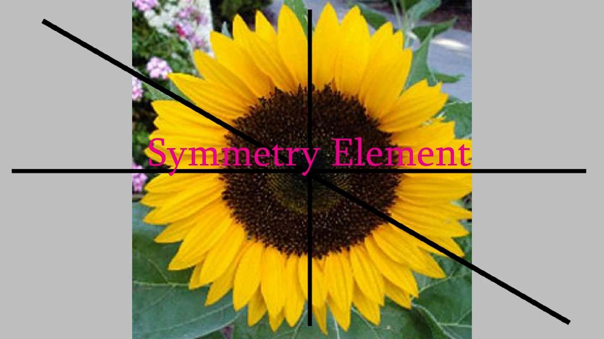

这个区分之所以重要，是因为对称元素是"让物体看起来和原来一样"的那些特殊参考物。向日葵有多条镜面，还能绕中心轴转一个花瓣的角度回到原样，所以它同时拥有镜面和旋转轴两类对称元素 [【跳转到 02:32】](https://www.youtube.com/watch?v=lkF3uDfcUUg&t=152)。

一个分子最多可以有七类对称元素，讲者把它们列成一张表，每行都配了"要做什么动作" [【跳转到 04:35】](https://www.youtube.com/watch?v=lkF3uDfcUUg&t=275)：

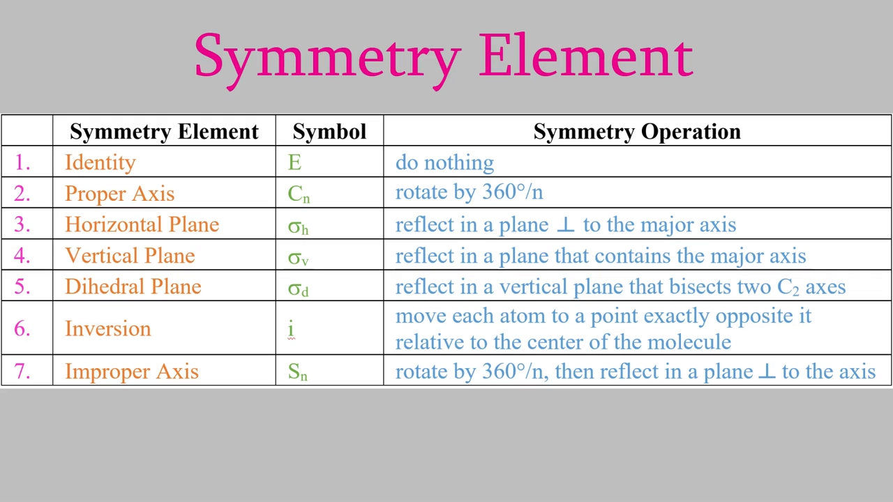

表中第 1、2 行是 proper 的：恒等 $E$（什么都不做）和主轴 $C_n$（绕轴转 $360^\circ/n$）；第 3–5 行是三种镜面 $\sigma_h$、$\sigma_v$、$\sigma_d$；第 6、7 行是反演中心 $i$ 和 improper axis $S_n$。后五行都含翻转成分，所以都翻转手性。

还要记住一个容易混淆的地方：**对称元素是"恰好不变"的特例，而变换本身可以对任何分子做**。溴氯氟甲烷没有任何对称元素（只有 $E$），但你照样可以把它旋转、平移、对着镜面翻。本章讨论的是"变换对分子做了什么"，不是"这个分子有哪些对称性"。

## 三、旋转：改变朝向，保持所有内部几何量

旋转的参考物是**主轴** $C_n$：绕这条轴转 $360^\circ/n$，分子看起来和原来一样。水分子绕主轴转 $180^\circ$ 复原，所以是 $C_2$；苯绕垂直环面的轴转 $60^\circ$ 复原，是 $C_6$；甲烷沿一条碳氢键方向转 $120^\circ$ 复原，是 $C_3$ [【跳转到 05:48】](https://www.youtube.com/watch?v=lkF3uDfcUUg&t=348)。

一个分子可以有多条旋转轴。苯除了 $C_6$ 还有六条 $C_2$ 轴，其中三条穿过相对的碳氢键，三条从相对的碳碳键之间穿过。$n$ 最大的那条叫**主轴**（major axis），苯的主轴就是 $C_6$ [【跳转到 07:58】](https://www.youtube.com/watch?v=lkF3uDfcUUg&t=478)。同一条轴还可以同时是 $C_6$、$C_3$、$C_2$：转 $60^\circ$ 复原，当然转 $120^\circ$、$180^\circ$ 也复原 [【跳转到 08:23】](https://www.youtube.com/watch?v=lkF3uDfcUUg&t=503)。

用矩阵写，二维旋转是

$$
R(\theta)=\begin{pmatrix}\cos\theta & -\sin\theta\\ \sin\theta & \cos\theta\end{pmatrix},\qquad \det R = +1
$$

三维旋转同理，是一个 $3\times 3$ 正交矩阵，满足 $R^{\top}R=I$，行列式恒为 $+1$。这个 $+1$ 就是"proper"的数学含义：它不包含任何翻转。

旋转改变的是每个原子的坐标和分子的朝向，也就是偶极矩这类向量的方向。它不改变任何**内部**几何量：两原子间距离、三原子间键角、四原子间二面角，在旋转下都不变。能量作为标量，同样不变。

## 四、平移：只挪原点，连朝向都不动

平移最简单：每个原子的坐标加上同一个向量，

$$
\mathbf{x}_i \mapsto \mathbf{x}_i + \mathbf{t}
$$

朝向不变，内部几何量全部不变，能量也不变。旋转加平移合起来叫**特殊欧氏群** $SE(3)$（special Euclidean group）："特殊"指旋转部分行列式为 $+1$，只含 proper 操作。

平移在化学课上几乎不用讲，因为化学只关心分子内部；但在机器学习里它是第一个坑。讲者指出，把每个原子的笛卡尔坐标直接喂给网络是"一个相当糟糕的建模决定"——仅仅把分子在空间里平移或旋转一下，并不影响它的任何性质，却会剧烈改变网络学到的表示 [【跳转到 09:13】](https://www.youtube.com/watch?v=-CfhsOT983w&t=553)。

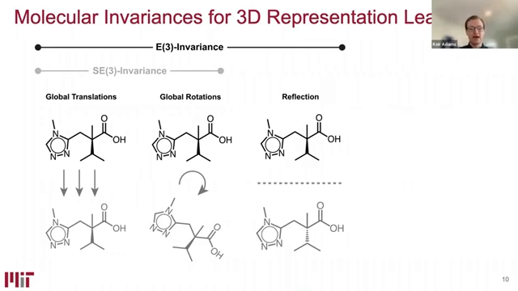

所以三维分子网络的事实标准是：至少对全局平移和全局旋转不变，因为这两类操作"只是换了你观察分子的参考系，并没有改变构象或三维几何"，"无论我们怎么看一个分子，它的性质都保持不变" [【跳转到 10:03】](https://www.youtube.com/watch?v=-CfhsOT983w&t=603)。

## 五、反射：看起来只是换个角度，却会翻转手性

镜面有三种，区别只在它和主轴的关系。**水平镜面** $\sigma_h$ 垂直于主轴，苯环所在的平面就是它的 $\sigma_h$；**垂直镜面** $\sigma_v$ 包含主轴，水分子有两个这样的镜面；**二面角镜面** $\sigma_d$ 是 $\sigma_v$ 的特例，它平分两条 $C_2$ 轴，苯的六个垂直镜面全都同时是 $\sigma_d$ [【跳转到 09:01】](https://www.youtube.com/watch?v=lkF3uDfcUUg&t=541)、[【跳转到 11:28】](https://www.youtube.com/watch?v=lkF3uDfcUUg&t=688)。

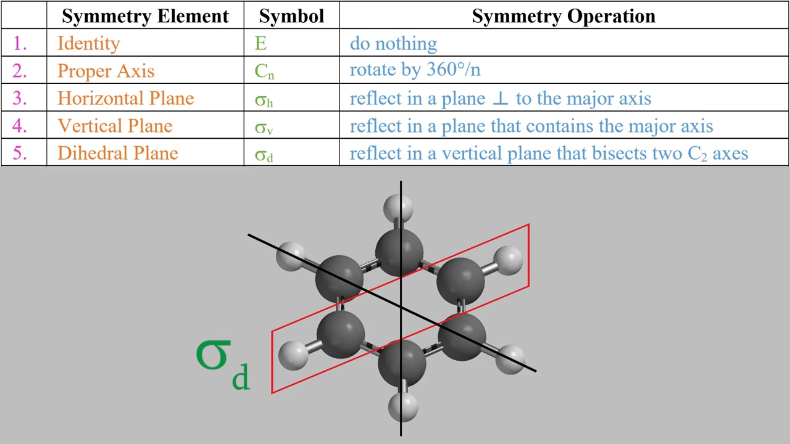

反射的矩阵是一个对角线上带 $-1$ 的正交矩阵，例如对着 $xy$ 平面反射：

$$
M=\begin{pmatrix}1 & 0 & 0\\ 0 & 1 & 0\\ 0 & 0 & -1\end{pmatrix},\qquad \det M = -1
$$

行列式为 $-1$，这就是"improper"的含义。反射保持距离和键角——把一对原子的坐标同时翻过去，它们之间的距离当然不变；三个原子构成的键角也不变。讲者在讲 SchNet 与 DimeNet 时正是用这一点：**原子间距离在反射下不变**，**键角在反射下同样不变**，所以只用这两类几何量的模型对反射是"瞎"的 [【跳转到 21:06】](https://www.youtube.com/watch?v=-CfhsOT983w&t=1266)、[【跳转到 21:31】](https://www.youtube.com/watch?v=-CfhsOT983w&t=1291)。

但**带符号的二面角会变号**。讲者用一句话说清了原因："把一个构象对着镜面反射，会把它所有的二面角取负" [【跳转到 22:18】](https://www.youtube.com/watch?v=-CfhsOT983w&t=1338)。这是反射与旋转最本质的差别：旋转让二面角原样保留，反射让它整体反号。

正因为反射"保持距离、保持键角"，它很容易被顺手和旋转、平移捆在一起。三维分子网络里常见的做法就是把三者打包成 $E(3)$ 不变性（欧氏群，包含反射），而更保守的做法只要求 $SE(3)$ 不变性 [【跳转到 10:41】](https://www.youtube.com/watch?v=-CfhsOT983w&t=641)。讲者提醒，这个打包在化学家看来相当奇怪：**反射一个手性分子，会把它的手性中心整个翻过来，等于改变了分子身份**；对反射不变的模型因此也对**手性**不变，无法区分对映体 [【跳转到 11:04】](https://www.youtube.com/watch?v=-CfhsOT983w&t=664)。

## 六、手性：镜像合不上，等价于分子里藏着"翻转"操作

### 6.1 手性的定义与手性中心

讲者用最日常的类比开头：我们的左右手就是彼此不可重合的镜像，分子也有这种"结构上的左右手性"，叫**分子手性**（molecular chirality）[【跳转到 14:39】](https://www.youtube.com/watch?v=-CfhsOT983w&t=879)。

最常见的形式是**四面体手性**：一个碳原子连着四个互不相同的基团，这四个基团在空间中的排布有两种，互为镜像。这两个分子有完全相同的 2D 图连通性（同构），差别只在三维排布 [【跳转到 15:04】](https://www.youtube.com/watch?v=-CfhsOT983w&t=904)。

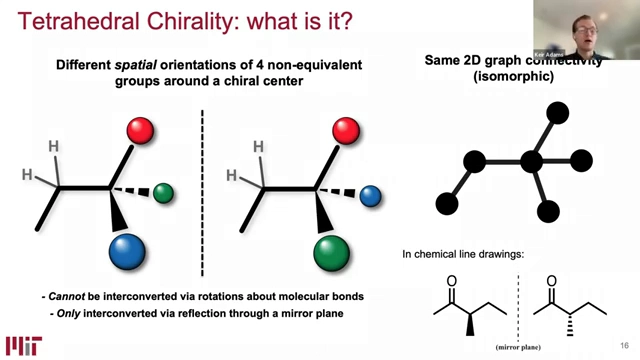

关键的一句判断是：无论怎么旋转这个分子、怎么旋转中心那条碳碳键，都**不能**把这两种排布互相转换；唯一能互换它们的方式，是把三维坐标对着一个镜面反射 [【跳转到 15:29】](https://www.youtube.com/watch?v=-CfhsOT983w&t=929)、[【跳转到 15:54】](https://www.youtube.com/watch?v=-CfhsOT983w&t=954)。这对分子叫**对映体**（enantiomers）。

### 6.2 群论判据：手性分子不能有 $i$ 或 $S_n$

化学课给出了同一件事的群论版本："一个手性分子不可能有反演中心或 improper 旋转轴" [【跳转到 18:59】](https://www.youtube.com/watch?v=lkF3uDfcUUg&t=1139)。

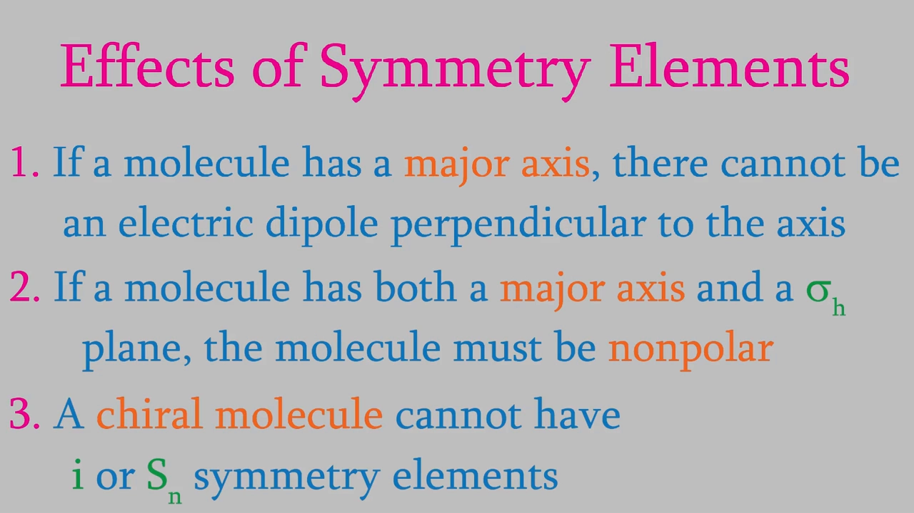

为什么？因为这两个操作都含"翻转"成分。

**反演中心** $i$ 的动作是把每个原子搬到分子中心的正对面：以中心为原点，把每个原子的 $x$、$y$、$z$ 坐标全部变号 [【跳转到 12:43】](https://www.youtube.com/watch?v=lkF3uDfcUUg&t=763)。苯有反演中心——对面的碳和氢互换位置后分子完全复原；甲烷没有——把四个氢全部搬到对面，得到的构型与原来不同 [【跳转到 13:08】](https://www.youtube.com/watch?v=lkF3uDfcUUg&t=788)。

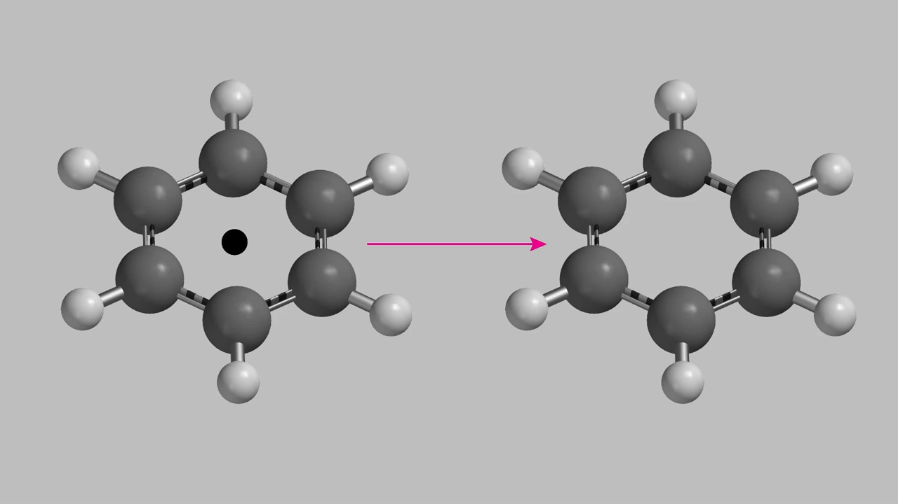

**improper axis** $S_n$ 的动作是"先绕轴转 $360^\circ/n$，再对着垂直于轴的平面反射" [【跳转到 14:35】](https://www.youtube.com/watch?v=lkF3uDfcUUg&t=875)。甲烷有一条 $S_4$ 轴：转 $90^\circ$ 再反射，分子回到原样，而且这样的轴有三条 [【跳转到 16:00】](https://www.youtube.com/watch?v=lkF3uDfcUUg&t=960)。

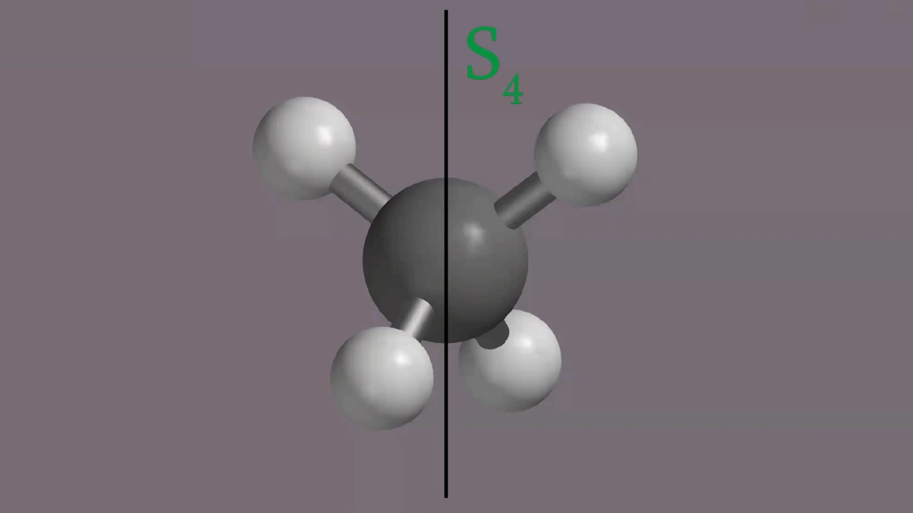

把两件事放在一起看就明白了：如果分子在 $i$ 或 $S_n$ 下能复原，说明"翻转"之后它（再经过一次 proper 旋转）和自己重合，那么它和自己的镜像就是同一个东西——这正是**非手性**的定义。反过来说，手性分子必须缺少一切含翻转的操作，只剩 proper 旋转和平移。这也解释了为什么 $S_n$ 与 $i$ 是判据，而 $\sigma$ 也是翻转操作却不在判据里：单个镜面本身就等价于 $S_1$，判据里的 $S_n$ 已经把它包含了。

### 6.3 分子例子

化学课用的手性例子是**溴氯氟甲烷**：一个碳原子分别连着氢、氟、氯、溴四个不同基团。这个分子除了恒等操作 $E$ 之外没有任何对称元素——没有旋转轴、没有镜面、没有反演中心，"没有任何操作能让它看起来和原来一样"，所以它属于 $C_1$ 点群 [【跳转到 21:17】](https://www.youtube.com/watch?v=lkF3uDfcUUg&t=1277)。

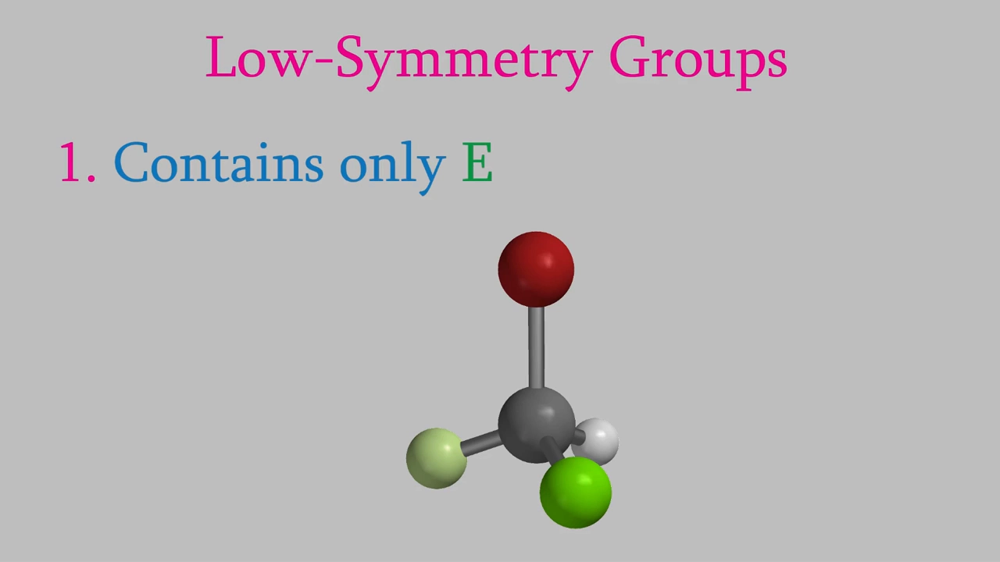

讲者顺带给了两个对照：大多数蛋白质因为极不对称也属于 $C_1$；而苯、甲烷这些有大量对称元素的分子属于高对称点群，它们都不是手性的。

机器学习报告则给了药物例子：三个 FDA 批准药物都靠四面体手性中心决定疗效，"某一个对映体可能带来想要的性质，把手性翻过来，药物可能失效、活性下降，甚至产生毒性" [【跳转到 16:11】](https://www.youtube.com/watch?v=-CfhsOT983w&t=971)。

## 七、哪些物理量该变、哪些不该变

有了上面的分类，就可以逐个检查物理量了。判断规则只有一条：**看这个量是否依赖手性，以及它是标量还是向量**。

**能量是标量，对三类变换都不变。** 把分子整体平移、旋转、甚至反射，能量都不变；两个对映体在非手性环境里的能量也是简并的。讲者在区分"构象相关性质"时顺带确认了这一点：QM9 这类数据集里的能量是特定构象的性质，它们同时也对手性不变 [【跳转到 26:55】](https://www.youtube.com/watch?v=-CfhsOT983w&t=1615)。注意这两件事是分开的：能量对**构象**敏感，对**手性**不敏感。

**偶极矩是向量，随旋转转、随反射翻。** 化学课给了两个由对称性直接推出的约束：如果分子有主轴，偶极矩不可能垂直于主轴，只能沿主轴方向——氯甲烷就是例子，正负电荷中心沿碳氯键分布 [【跳转到 17:09】](https://www.youtube.com/watch?v=lkF3uDfcUUg&t=1029)；如果分子同时有主轴和水平镜面 $\sigma_h$，它必须完全非极性——苯就是这样 [【跳转到 18:09】](https://www.youtube.com/watch?v=lkF3uDfcUUg&t=1089)。这两条约束之所以成立，正是因为偶极矩必须在这些对称操作下"保持不变"，而一个垂直于主轴的向量转 $180^\circ$ 后方向就反了，不可能不变。

**手性敏感的量对反射敏感。** 最干净的例子是光学旋转：对映体的许多实验性质相同，但它们让圆偏振光偏转的方向相反，所以可以用"旋光符号"作为二分类标签 [【跳转到 51:52】](https://www.youtube.com/watch?v=-CfhsOT983w&t=3112)。

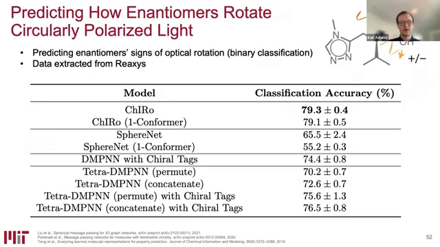

同样敏感的还有结合亲和力：手性分子与蛋白质口袋这种手性环境相互作用时，四面体手性常常决定整个体系的理化性质，对映体的对接打分因此可以差很多 [【跳转到 16:11】](https://www.youtube.com/watch?v=-CfhsOT983w&t=971)。

**几何量要分三类。** 距离和键角对反射不变，带符号二面角对反射变号，这是前面已经说过的结论。把这三类量并排看，就能理解为什么不同模型对手性的敏感度不同：

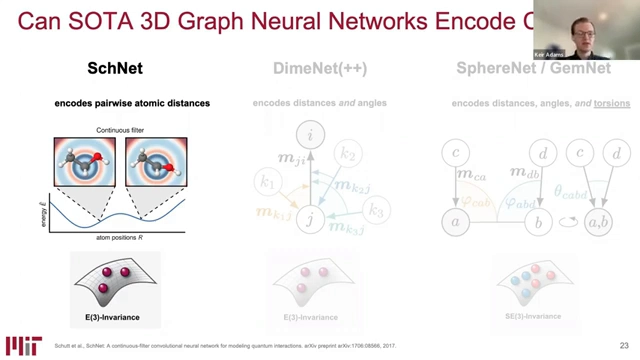

| 量 | 类型 | 旋转 | 平移 | 反射 |
| --- | --- | --- | --- | --- |
| 能量 | 标量 | 不变 | 不变 | 不变 |
| 偶极矩 | 向量 | 跟着转 | 不变 | 翻转 |
| 原子间距离 | 标量 | 不变 | 不变 | 不变 |
| 键角 | 标量 | 不变 | 不变 | 不变 |
| 带符号二面角 | 标量 | 不变 | 不变 | 变号 |
| 旋光符号 | 手性标签 | 不变 | 不变 | 翻转 |
| 对映体结合亲和力 | 手性相关标量 | 不变 | 不变 | 换到另一个对映体 |

## 八、把这张表变成建模约定

讲者把三维分子模型按"对什么不变"分成三档，正好对应上一章的表 [【跳转到 17:37】](https://www.youtube.com/watch?v=-CfhsOT983w&t=1057)、[【跳转到 18:02】](https://www.youtube.com/watch?v=-CfhsOT983w&t=1082)：

- **只用 2D 图的模型**：手性分子和对映体在 2D 图上完全同构，所以这类模型"完全对手性不变"，学不到手性效应。
- **$E(3)$ 不变的 3D 模型**：因为对反射也要求不变，它们"从根本上无法区分镜像对映体"。
- **$SE(3)$ 不变的 3D 模型**：不要求反射不变，原则上能区分对映体，但它们对构象变化同样敏感，容易把"构象不同"误判成"手性不同"。

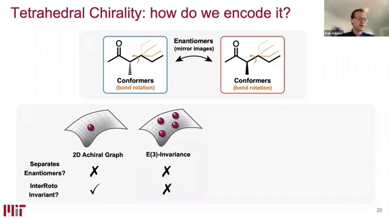

这个"容易混淆"不是猜测。讲者做了一个实验：把两个对映体各若干构象嵌入隐空间，$SE(3)$ 模型 SphereNet 一开始能把两簇分开；但把手性中心附近的键随意转一转（手性并没有变），两簇就重叠了 [【跳转到 23:08】](https://www.youtube.com/watch?v=-CfhsOT983w&t=1388)。反过来，把构象对着镜面反射（手性翻转了），$E(3)$ 不变的 SchNet 和 DimeNet 完全被这个操作骗过，仍然认为它们是同一个东西 [【跳转到 50:41】](https://www.youtube.com/watch?v=-CfhsOT983w&t=3041)。

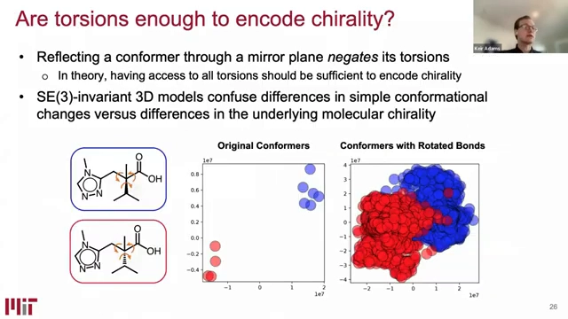

讲者由此提出的思路是：在手性中心附近，把"绕内部单键的旋转"这种与手性无关的自由度压掉，只保留随手性翻转而变号的扭转信息。这个模型（ChiRo）的编码器细节属于架构设计，本文不展开。

这里要划清与后续小节的分工：本节只讨论**变换本身**和**哪些量该保持**；把"输出随输入变换而变换"写成公式、判断一个任务该要严格等变还是只需不变，是 3.1.3 的内容；不变量特征、数据增广、等变架构三条路线的取舍是 3.1.4；$E(3)$ 与 $SE(3)$ 等变模型的系统对照是 4.1.1。

## 小结

- 旋转、平移、反射的差别只有一条：是否翻转手性。旋转和平移是 proper 的（行列式 $+1$），反射、反演、improper rotation 是 improper 的（行列式 $-1$）。
- 对称元素是假想的参考物，对称操作是照着它做的动作；"分子有哪些对称元素"和"我们能对它做哪些变换"是两个不同的问题。
- 旋转改变朝向，保持距离、键角、带符号二面角和能量；平移只挪原点，连朝向都不动。
- 反射保持距离和键角，但让所有带符号二面角变号，并把手性翻过来。这就是为什么"只打包距离和键角"的表示对手性天生是瞎的。
- 手性 = 镜像不可重合。群论判据是：手性分子不能有反演中心 $i$ 或 improper axis $S_n$，因为这两个操作都含翻转成分，能让分子与自己的镜像重合。
- 物理量的行为由类型和手性依赖决定：能量（标量）对三类变换都不变；偶极矩（向量）随旋转转、随反射翻，方向还受对称性约束；旋光符号和对映体结合亲和力对反射敏感。
- 落到建模：先列出任务里哪些量该对哪些变换不变，再决定用 2D 图、$E(3)$ 不变表示还是 $SE(3)$ 表示；把反射和旋转平移不加区分地打包，等于宣布"手性不重要"。

## 关键术语速查

| 术语 | 一句话解释 |
| --- | --- |
| 对称元素 | 分子里假想的点、线或面，是"让分子看起来不变"的参考物，如主轴、镜面、反演中心 |
| 对称操作 | 照着某个对称元素做的动作，如绕轴旋转、对镜面反射、对中心反演 |
| 主轴 $C_n$ | 绕它转 $360^\circ/n$ 分子复原的轴；$n$ 最大的那条叫主轴 |
| $\sigma_h$ / $\sigma_v$ / $\sigma_d$ | 水平镜面（垂直主轴）、垂直镜面（含主轴）、二面角镜面（含主轴且平分两条 $C_2$ 轴） |
| 反演中心 $i$ | 把每个原子的坐标 $\mathbf{x}$ 换成 $-\mathbf{x}$ 的操作 |
| improper axis $S_n$ | 先绕轴转 $360^\circ/n$，再对垂直于轴的平面反射；含翻转成分 |
| proper / improper | 变换矩阵行列式为 $+1$ 称 proper（纯旋转），为 $-1$ 称 improper（含翻转） |
| $SE(3)$ | 特殊欧氏群：旋转（行列式 $+1$）加平移，不含反射 |
| $E(3)$ | 欧氏群：$SE(3)$ 再加上反射，含全部保距变换 |
| 手性 | 分子与自己的镜像不能通过旋转、平移重合的性质 |
| 手性中心 | 连有四个互不相同基团的四面体碳原子，是四面体手性的来源 |
| 对映体 | 互为镜像、不能重合的两个分子，2D 连通性相同，只能靠反射互换 |
| 带符号二面角 | 四个原子确定的角度，反射下变号，因此是区分对映体的关键几何量 |