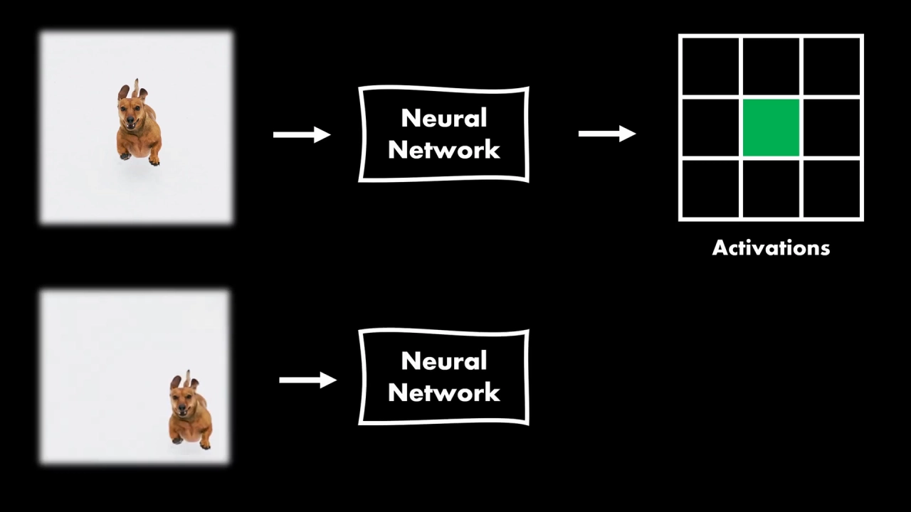
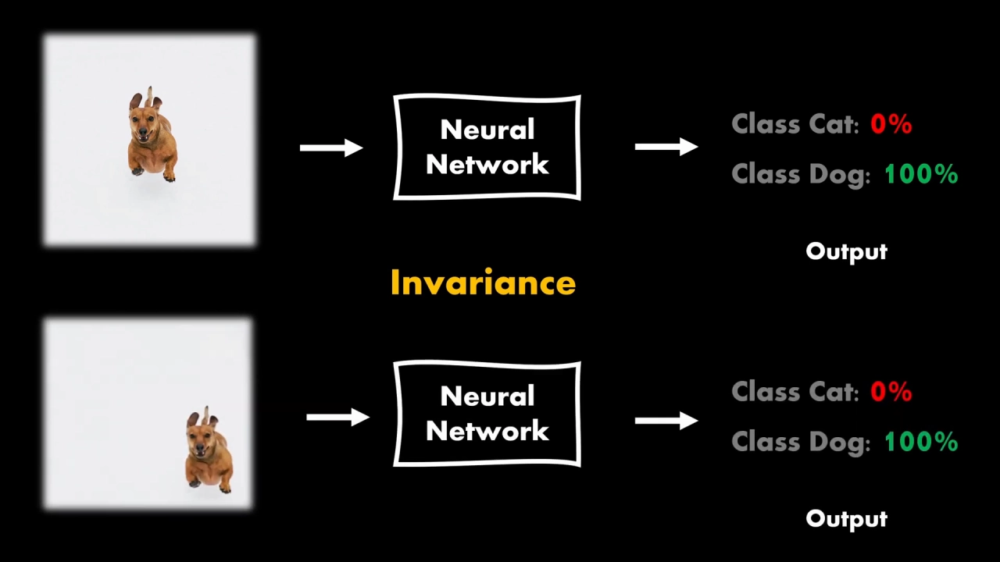
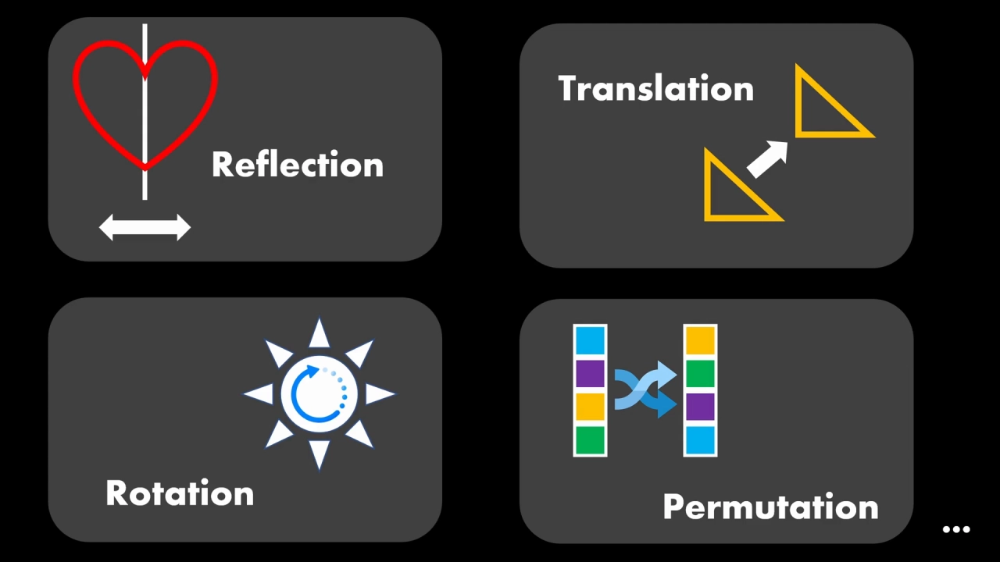
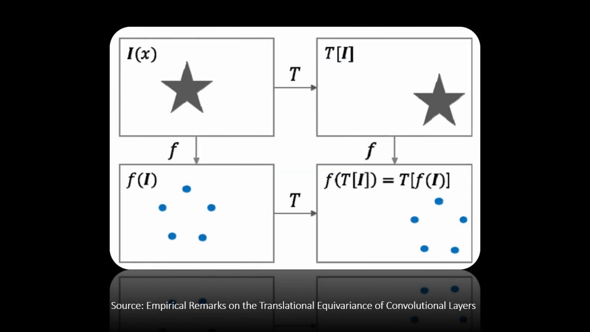
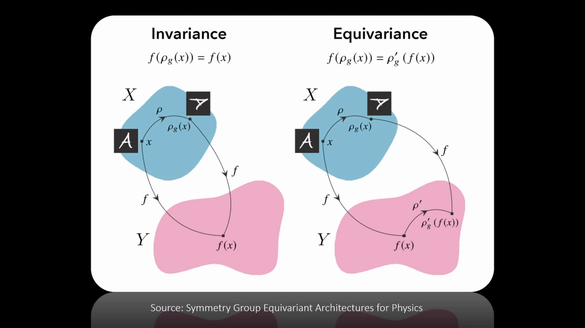
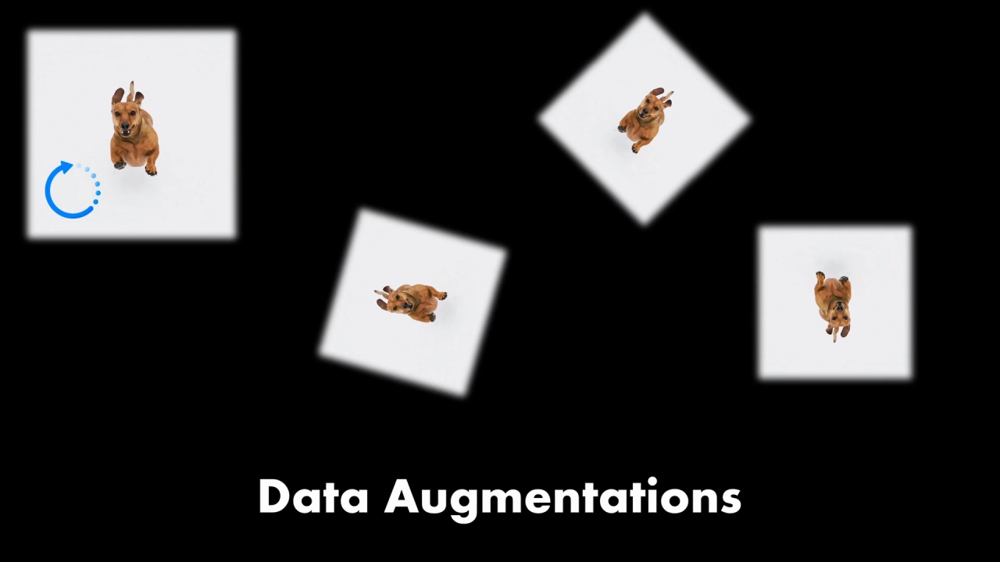
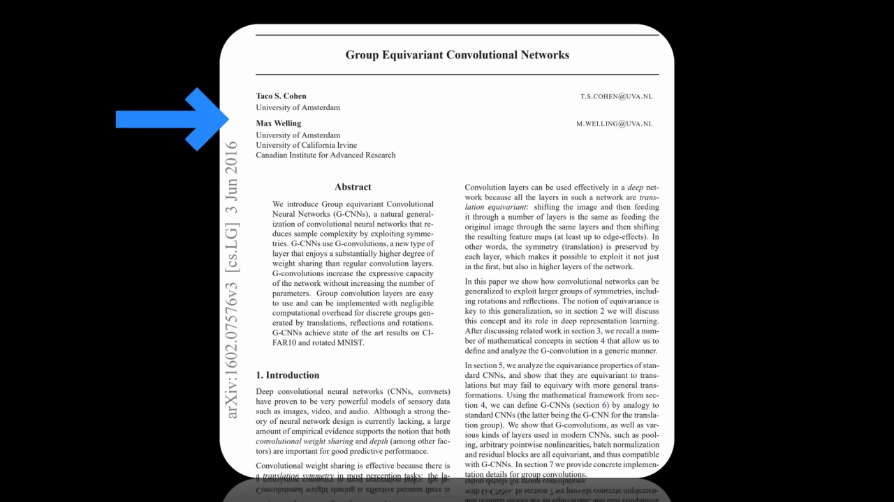
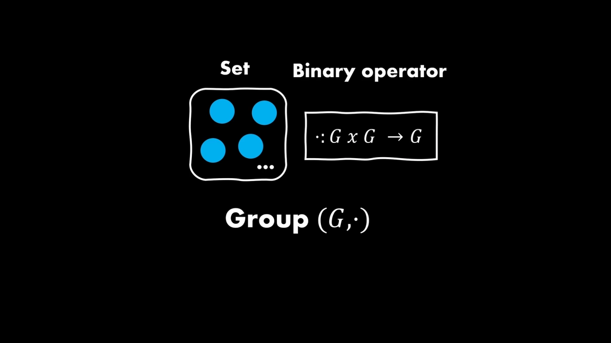
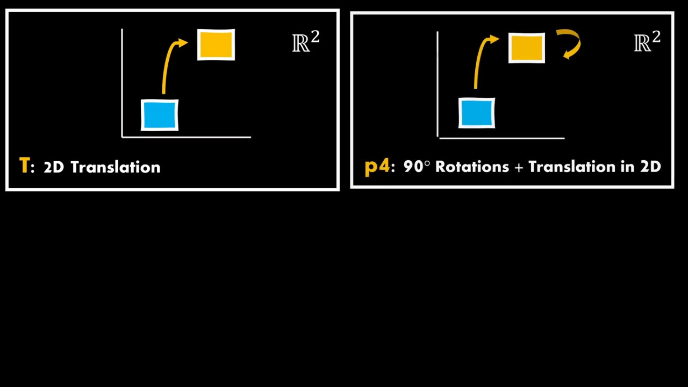
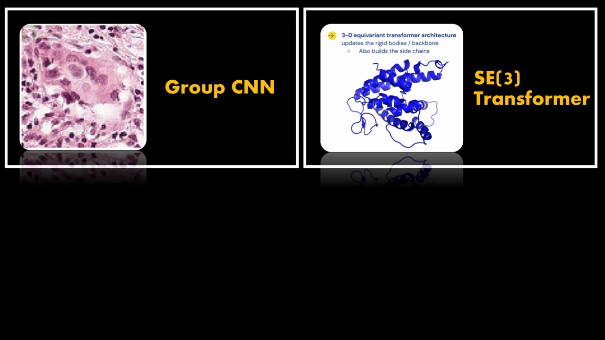

# 从狗的平移等变到SO(3)：不变与等变入门

> 视频来源：[等变神经网络 Part 1/3 - Introduction](https://www.bilibili.com/video/BV1EK6bBVE71/)（Bilibili · 晛飏）｜时长约 19 分钟
> 这是「等变神经网络」三集系列的第一集，讲者自述不是该领域专家，内容是他大量阅读后的总结，因此刻意保持高层次。本篇覆盖：等变与不变的区别、形式化定义、对称性作为归纳偏置的代价、数据增强与等变架构的对比，以及群论的最小准备。三集里的第二集讲群卷积、第三集讲 Transformer 与 GNN，不在本篇范围。

## 本讲要解决的核心问题（SCQA）

**背景**：神经网络有一个朴素的理想特性——无论感兴趣的模式出现在数据中的哪个位置，模型都能检测到它。比如把一张狗的照片输入模型，狗所在的区域应该出现高激活值；狗移到画面另一角，模型也应该有类似的响应。

**冲突**：普通的全连接网络做不到这一点，因为它对输入的顺序敏感。更麻烦的是，我们平时说的"模型对变换不敏感"其实混着两件不同的事：有时我们希望输出**完全不变**（狗在哪儿都是狗），有时我们希望输出**跟着一起变**（特征图跟着平移）。这两件事经常被互换使用，尤其在卷积网络的语境里。

**疑问**：这两种性质到底怎么区分？它们各自怎么实现？如果把它们当作先验塞进模型结构，会带来什么好处，又有什么风险？

**回答（中心思想）**：**不变**是输出完全不受变换影响，$f(\rho_g(x)) = f(x)$；**等变**是输出按可预测的方式跟着变，$f(\rho_g(x)) = \rho'_g(f(x))$。两者都只能相对于**某个变换类**（平移、旋转、反射、置换）来定义，而这个变换类在数学上就是**群**。把对称性作为归纳偏置塞进架构，能用更少的数据、在每一层都获得等变性；但代价是模型的灵活性下降——如果数据本身不满足这个假设（比如手性分子在反射下会变），模型就再也分不开它们。

## 一、等变的直觉：狗出现在哪里都要被认出来

讲者从一张狗的照片讲起。把狗放在画面中央，模型在狗所在区域给出高激活值；把狗挪到画面别处，模型也应该有类似的响应。换句话说，模型应该对对象的某些变换不敏感。[【跳转到 00:54】](https://www.bilibili.com/video/BV1EK6bBVE71/?t=54)

而**等变**的准确含义是：当输入中的模式发生变化时，输出以等比例的方式变化。例如 CNN 的特征激活图会跟着输入以类似方式平移。[【跳转到 01:13】](https://www.bilibili.com/video/BV1EK6bBVE71/?t=73)

这里要留意一个容易滑过去的细节：等变不是"输出不变"，而是"输出**怎么变**是可预测的"。狗平移 100 像素，激活峰也平移 100 像素——输入变了，输出也变了，但两者的变化方式对得上。

## 二、不变性：输出完全不变

### 2.1 什么是不变

在不变性的情况下，输出完全不变，对输入的变换没有任何变化，系统几乎产生完全相同的响应。[【跳转到 01:43】](https://www.bilibili.com/video/BV1EK6bBVE71/?t=103)

在狗的例子中，"存在一只狗"这个事实不依赖于它的位置，因此许多神经网络的预测保持不变：无论狗在中央还是右下角，输出都是 Class Dog 100%。[【跳转到 01:53】](https://www.bilibili.com/video/BV1EK6bBVE71/?t=113)

### 2.2 不变性通常来自网络末端的聚合

讲者指出，不变性来自网络末端的池化层对激活值的聚合。例如应用最大池化时，是哪个神经元输出最大值并不重要，只要存在就行。这些所谓的**集合函数**——max、均值、求和——是实现不变性的简单方法。[【跳转到 02:11】](https://www.bilibili.com/video/BV1EK6bBVE71/?t=131)

这句话给出了一个很实用的判据：**如果你的网络前面是等变的（特征图跟着平移），末端接一个池化，那么整体就变成了不变的**。等变是"过程中的性质"，不变往往来自"最后的坍缩"。也正因如此，讲者说有时等变性和不变性会被互换使用，尤其在卷积网络的语境里；但现在应该明白，等变性与神经元输出的变化方式相关，而不变性来自网络末端的池化操作。[【跳转到 03:41】](https://www.bilibili.com/video/BV1EK6bBVE71/?t=221)

## 三、两者都只能相对于某个变换类定义

讲者强调了一个非常重要的点：**等变性和不变性永远是相对于某个变换类来定义的**。在狗的例子中，这个变换类是图像的平移变换——因为我们在二维像素空间里移动了狗。这意味着无论我们如何平移目标对象，模型输出要么等比例变化（等变），要么保持恒定（不变）。[【跳转到 02:27】](https://www.bilibili.com/video/BV1EK6bBVE71/?t=147)

对照之下，常规的全连接神经网络不具备这个特性，因为它们对输入的顺序敏感；而已有的卷积神经网络具备平移等变性。事实上 CNN 的核心动机之一，除了效率之外，就在于平移等变性，这是通过卷积操作实现的：卷积本质上是把滤波器在图像上平移着应用，特征图的值是输入与滤波器的内积，并经过一定的位移。[【跳转到 03:22】](https://www.bilibili.com/video/BV1EK6bBVE71/?t=202)

### 3.1 对称性不只是"镜像"

很多人以为对称性就是沿轴镜像，也就是所谓的反射对称。但这个数学概念可以远超简单的反射：还存在平移对称、旋转对称、置换对称等等。一般来说，**对称变换就是保持物体属性不变的变换**——在狗的例子中，被保持的属性就是"图像中存在一只狗"这个事实。[【跳转到 05:43】](https://www.bilibili.com/video/BV1EK6bBVE71/?t=343)

### 3.2 CNN 的等变性有边界

讲者顺手点出一个常被忽略的事实：CNN 已知对平移具有等变性，但对旋转没有。为什么？因为学到的滤波器不响应对象的旋转版本，除非这些版本在训练数据中出现过——卷积滤波器在像素空间里平移，但始终保持相同的旋转角度。[【跳转到 06:37】](https://www.bilibili.com/video/BV1EK6bBVE71/?t=397)

这正好解释了为什么"等变性"必须和"哪个群"绑在一起说：CNN 是平移群上的等变网络，不是旋转群上的等变网络。

## 四、形式化：一张交换图说清两种性质

讲者把两种性质写成了公式。设模型是函数 $f$，输入 $x$（例如图像），当应用某种变换 $T$ 时：

**等变**：模型输出通过另一个变换 $T'$ 等效地变化，即

$$
f(Tx) = T'\,f(x)
$$

**不变**：输出保持不变，即

$$
f(Tx) = f(x)
$$

[【跳转到 03:56】](https://www.bilibili.com/video/BV1EK6bBVE71/?t=236)

图形化表达这个概念的一个常见方式是交换图：等变性的表现是"先应用某种变换，再通过神经网络"，应该得到与"先通过模型，再应用变换"相同的结果。[【跳转到 04:26】](https://www.bilibili.com/video/BV1EK6bBVE71/?t=266)

如果把两种性质画在同一张图上，差别更直观：不变性把不同的起点映射到目标空间中的**同一个点**，与变换的起点无关；而等变性在目标空间中以**可预测的方式**变换，对应原始空间经过变换后的样子。讲者还提到，有时不变性也被称为"丢弃空间信息"。[【跳转到 04:47】](https://www.bilibili.com/video/BV1EK6bBVE71/?t=287)

## 五、对称性作为归纳偏置：好处与风险

### 5.1 好处：更高效、更少数据

在神经网络中融入底层的对称性知识是一种**归纳偏置**，这意味着我们期望数据符合模型设计的假设。这使模型更高效、通常性能更好，并减少所需的数据量。[【跳转到 06:47】](https://www.bilibili.com/video/BV1EK6bBVE71/?t=407)

### 5.2 风险：假设错了就分不开

讲者紧接着说：然而我们必须谨慎。引入对称性假设会降低网络的灵活性，因为我们只能处理符合假设的数据。[【跳转到 07:17】](https://www.bilibili.com/video/BV1EK6bBVE71/?t=437)

立体化学里的**手性**是最好的反例。分子的性质通常对旋转和平移不变——无论如何在空间中排列它们，属性都保持不变。但存在所谓的手性分子，这些分子在反射后会改变性质。如果我们把反射对称性作为归纳偏置，就需要意识到：**我们无法区分这些分子**。所以必须确保模型的对称性假设与数据中的发现一致。[【跳转到 07:58】](https://www.bilibili.com/video/BV1EK6bBVE71/?t=478)

这段是整集里最实用的一条判据：**先问数据在哪个变换下真的不变，再决定模型该在哪个群上等变**。多加一个反射对称，看起来更"对称"、更省数据，实际上可能把任务本身的关键差别抹掉了。

## 六、数据增强和等变架构，差在哪里

### 6.1 数据增强是最常见的做法

数据增强是最常见的方法，用来让模型对不同变换不敏感。通过增强数据，可以让模型学到相对于某些对称类的等变性：例如不仅用狗的图像训练，还用它的多个旋转版本，这样模型很可能对同一图像的不同旋转产生相似的输出。[【跳转到 08:15】](https://www.bilibili.com/video/BV1EK6bBVE71/?t=495)

### 6.2 数据增强的三个短板

讲者列了三条：

1. **性能上不如真等变模型。** 如不同研究所示，真正等变模型的性能通常更好；讲者引用了一篇论文，其结论是等变模型具有固有优势，而这种优势无法通过数据增强弥补。[【跳转到 09:07】](https://www.bilibili.com/video/BV1EK6bBVE71/?t=547)
2. **效率低，且不能覆盖所有对称群。** 数据增强不如等变模型高效，也无法适用于所有对称群。[【跳转到 09:12】](https://www.bilibili.com/video/BV1EK6bBVE71/?t=552)
3. **只能作用在输入层。** 数据增强只能应用于输入层，而等变架构可以在每一层引入等变性。[【跳转到 09:17】](https://www.bilibili.com/video/BV1EK6bBVE71/?t=557)

### 6.3 总结：设计等变网络的三个动机

- 需要更少的数据，并摆脱数据增强；
- 可以在所有层引入等变性，而不仅仅是输入层；
- 由于权重共享，模型更易泛化、也更简单。[【跳转到 09:43】](https://www.bilibili.com/video/BV1EK6bBVE71/?t=583)

## 七、群论的最小准备

### 7.1 为什么要讲群

讲者先提了一篇关于神经网络"天然等变性"的文章（讨论网络权重中的对称性），并指出这种天然等变性有局限，因此开发等变架构是有用的——就像 CNN 里做的那样。这带出了本集的第一篇论文：Taco Cohen 和 Max Welling 2016 年的《群等变卷积神经网络》，它把 CNN 中的等变性从平移扩展到其他对称类，提出了基于群论的通用框架，这些更一般的卷积被称为**群卷积**。[【跳转到 10:59】](https://www.bilibili.com/video/BV1EK6bBVE71/?t=659)

### 7.2 群是什么

数学上，群被定义为一个配备二元运算的集合。集合里的元素就是变换，例如不同的平移或旋转；群运算作用于集合元素，比如相加或相乘；它告诉我们如何组合集合元素，而运算的输出必须仍然是群的成员。[【跳转到 11:38】](https://www.bilibili.com/video/BV1EK6bBVE71/?t=698)

我们特别关注**对称群**：集合中的每个元素都是一个对称变换，群作用于某个空间（例如像素空间）时，我们用群元素去旋转或变换像素，这称为**群作用**。讲者解释为什么要引入这些抽象概念：因为等变性通常是基于这些群来定义的。[【跳转到 12:18】](https://www.bilibili.com/video/BV1EK6bBVE71/?t=738)

### 7.3 群要满足四个性质，凯莱表可以检查

一个合适的变换群需要满足四个属性：

- **封闭性**：变换的结果不会脱离这个群，仍然是群的成员。例如你旋转某个角度，得到的仍然是某个旋转。
- **结合律**：元素的组合可以分组进行。
- **单位元素**：存在一个"什么都不做"的元素。
- **逆元素**：每个元素都有逆元素，能返回单位元素。

[【跳转到 13:55】](https://www.bilibili.com/video/BV1EK6bBVE71/?t=835)

检查方法很直观：把群元素的所有可能乘积排成一个方阵，就是**凯莱表**（Cayley table）。讲者的例子是集合 {0°, 45°, 180°, 300°} 配矩阵乘法：从第一行第一列很容易认出单位元素（0° 旋转，它保持其他元素不变）；继续看会发现封闭性不满足——两次 45° 旋转得到 90°，而 90° 不在这个集合里，所以这不是一个有效的群。[【跳转到 14:48】](https://www.bilibili.com/video/BV1EK6bBVE71/?t=888)

### 7.4 几个常见的群

- **$T$（二维平移群）**：定义在 $\mathbb{R}^2$ 的所有可能平移上，例如把某个物体在图像中移动到不同位置。
- **p4**：在上面的平移群上再加 90° 旋转，得到 90° 旋转与平移的组合。
- **SO(3)**：三维旋转群，代表特殊正交群，三维旋转可以用三阶矩阵表示。
- **SE(3)**：在 SO(3) 上再加平移，即特殊欧几里得群，是这些对称群的核心；在二维或三维中二元运算都是矩阵乘法。

[【跳转到 15:56】](https://www.bilibili.com/video/BV1EK6bBVE71/?t=956)

## 八、等变性已经在哪些地方起作用

讲者列了一组应用，说明"考虑不同对称群的架构"已经取得显著成果：

- **医学影像**：群卷积在许多医学影像数据集上表现更优，因为它们同时具备旋转和平移等变性。有一项把群 CNN 应用于肺部 CT 扫描检测癌症的研究，作者表明它不仅性能更好，而且数据效率更高。[【跳转到 16:49】](https://www.bilibili.com/video/BV1EK6bBVE71/?t=1009)
- **蛋白质结构**：AlphaFold2 改进的关键贡献之一，是它成为一个 SE(3) 等变变换器，这成为架构核心。[【跳转到 17:10】](https://www.bilibili.com/video/BV1EK6bBVE71/?t=1030)
- **蛋白质—配体结合**：等变性在许多新发布的结合模型中也很重要，这类模型主要用于判断药物能否结合蛋白质的特定口袋。[【跳转到 17:15】](https://www.bilibili.com/video/BV1EK6bBVE71/?t=1035)
- **DNA**：双螺旋序列具有特殊的反向互补对称性，可以在模型架构中加以考虑。[【跳转到 17:40】](https://www.bilibili.com/video/BV1EK6bBVE71/?t=1060)
- **图神经网络**：所有 GNN 天然具备**置换等变性**，还可以扩展到三维场景实现旋转等变性。[【跳转到 17:48】](https://www.bilibili.com/video/BV1EK6bBVE71/?t=1068)

## 小结

- **等变**：输入变换后，输出按可预测的方式一起变，$f(Tx)=T'f(x)$；**不变**：输入变换后，输出完全不变，$f(Tx)=f(x)$。
- **不变性常来自网络末端的池化/集合函数**（max、均值、求和），而等变是逐层的性质。所以在 CNN 里，前面等变、末端池化，整体就不变。
- **两者都必须指明变换类**。CNN 只是平移群上的等变，不是旋转群上的等变——滤波器在像素上平移，但始终保持同一旋转角度。
- **对称性是归纳偏置**：能减少数据、提升性能；但假设错了就出事，手性分子在反射下会改变性质，把反射当先验就再也分不开它们。
- **数据增强 vs 等变架构**：增强只能作用在输入层、效率低、不覆盖所有群，且性能优势补不回来；等变架构在每一层生效、靠权重共享更简单。
- **群是最小语言**：集合 + 二元运算，满足封闭性、结合律、单位元、逆元；凯莱表可以检查一个集合是否成群。常见的有 $T$、p4、SO(3)、SE(3)。
- **落地场景**：医学影像的群卷积、AlphaFold2 的 SE(3) 等变 Transformer、蛋白质—配体结合、DNA 的反向互补对称、GNN 的置换等变。

## 关键术语速查

| 术语 | 一句话解释 |
| --- | --- |
| 等变（equivariance） | 输入做变换，输出按同样方式变换，$f(Tx)=T'f(x)$ |
| 不变（invariance） | 输入做变换，输出完全不变，$f(Tx)=f(x)$ |
| 变换类 | 讨论等变/不变时必须指明的那一族变换，如平移、旋转、反射、置换 |
| 集合函数 | max、均值、求和这类与顺序无关的聚合，是造不变性的简单手段 |
| 归纳偏置 | 把对数据的先验假设写进模型结构，换来更少数据和更好泛化 |
| 手性（chirality） | 分子与其镜像不能重合；这类分子在反射下性质会变，因此反射对称不能乱加 |
| 群 | 一个集合加一个二元运算，满足封闭性、结合律、单位元、逆元 |
| 群作用 | 群元素作用到某个空间上，例如用旋转矩阵变换像素或坐标 |
| 凯莱表 | 把群元素所有两两乘积排成方阵，用来检查封闭性与单位元 |
| SO(3) / SE(3) | 三维旋转群 / 三维刚体变换群（旋转 + 平移） |
| 置换等变 | 节点重新编号后输出随之重排，所有 GNN 天然具备 |