# 等变还是不变：三维预测该不该跟着坐标系一起转

> 视频来源：[E3NN workshop | 等变神经网络简介](https://www.bilibili.com/video/BV1ijLMzBErB/)（Bilibili · 仙草的游戏之间，原讲者 Tess Smidt，MIT）｜时长约 46 分钟
> 本篇是这场 e3nn 教程开场演讲的整理。它把「不变模型」和「等变模型」放在同一张图上对比，并给出一个判断标准：**输出该不该跟着坐标系一起转，由任务本身决定**。文中的记号沿用讲者的写法，$D(g)$ 表示群元素 $g$ 的作用矩阵。

## 本讲要解决的核心问题（SCQA）

**背景**：描述一个分子或晶体，最自然的做法是给每个原子写一组三维坐标。可是坐标系本身是我们为了和计算机沟通而"想象"出来的东西——同一个分子，换一个坐标系，坐标数值全都不一样。

**冲突**：如果直接把坐标喂给神经网络，模型学到的其实是"这组数字"，而不是"这个分子"。同一个分子旋转 90 度，输入数字全变，模型可能给出完全不同的答案。要让它学会"这仍然是同一个分子"，最直接的办法是数据增强：把同一个分子转很多遍喂给它。但在三维空间里，这个代价大得离谱。

**疑问**：有没有办法不靠堆数据，而是让模型**在结构上**就理解"坐标系可以随便换"？如果能，那么模型的输出应该怎么随坐标系变化——完全不变，还是跟着一起转？

**回答（中心思想）**：有两条路。**不变模型**先把系统压缩成与坐标系无关的量（距离、夹角），把坐标系彻底丢掉；**等变模型**保留坐标系，要求"先变换输入再算"与"先算再变换输出"结果相同，即 $f(D(g)x, w) = D(g)f(x, w)$。等变比不变信息更多、表达更强，但实现更复杂；选哪条路取决于任务需要的是"一个不随坐标系变化的数"，还是"一个必须随坐标系一起转的对象"。

## 一、为什么三维数据绕不开对称性

### 1.1 两条新闻：对称性已经进了主流模型

讲者用两条新闻开场。第一条是 AlphaFold2 在 CASP14 上把从氨基酸序列预测三维折叠结构的准确率从 AlphaFold1 的约 60% 推到约 90%。讲者特别指出，AlphaFold2 架构的一个重要方面，是它使用了**局部和全局的参考框架**，用这种方式在建模过程中保持蛋白质结构的对称性。[【跳转到 03:48】](https://www.bilibili.com/video/BV1ijLMzBErB/?t=228)

第二条是 2020 年的戈登贝尔奖（常被称为超级计算界的诺贝尔奖）颁给了 DeePMD 团队，他们用机器学习在量子力学精度下对一千万个原子做分子动力学模拟。[【跳转到 04:55】](https://www.bilibili.com/video/BV1ijLMzBErB/?t=295)

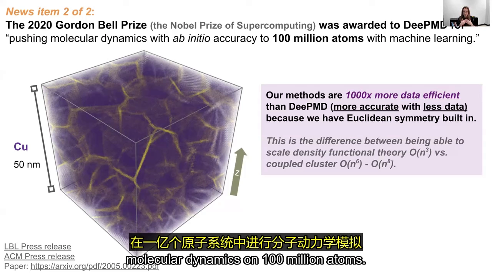

### 1.2 讲者的赌注：把对称性内建进去，数据效率高一千倍

讲者在这里给了一个很硬的对比：DeePMD 只考虑了一部分对称性因素，并不是对系统的完全等变描述；而这场演讲要讲的方法**比 DeePMD 高效一千倍**，也就是用更少的数据就能训练出更准确的模型，原因就在于等变模型把欧几里得对称性内置进了结构里。[【跳转到 05:20】](https://www.bilibili.com/video/BV1ijLMzBErB/?t=320)

这个"少数据"为什么值钱？因为训练数据本身来自昂贵的量子化学计算：密度泛函理论（DFT）的复杂度与电子数 $n$ 的三次方成正比，而更精确的耦合簇方法（coupled cluster）是 $n$ 的六次方甚至八次方。如果模型能用更少的数据达到同样精度，就等于把这类昂贵计算的开销摊薄了。[【跳转到 05:45】](https://www.bilibili.com/video/BV1ijLMzBErB/?t=345)

## 二、坐标系是任意的：三种给模型"对称意识"的路线

### 2.1 我们要描述的东西，几乎都挂在坐标系上

讲者先清点了一下我们平时怎么向计算机描述物理系统：原子位置用原子坐标；电子位置用原子轨道；原子受到的力；分子或材料中可能发生的偶极矩；还有更复杂的、以 $3\times 3$ 矩阵形式出现的量，比如极化率、磁化率（材料与电磁场相互作用时如何响应）；再往上还有弹性张量这样的四阶张量。[【跳转到 09:24】](https://www.bilibili.com/video/BV1ijLMzBErB/?t=564)

问题在于：**坐标系在现实空间中并不存在**，它只是我们想象出来的一部分，是一种方便把信息传达给计算机或写在纸上的约定。既然是约定，我们总是可以换一个；换完之后，我们应当得到一个含义仍然相同的答案。[【跳转到 10:14】](https://www.bilibili.com/video/BV1ijLMzBErB/?t=614)

在坐标系之间转换的手段就是旋转、平移和反射——它们都是三维空间的对称性。物理并不在意你在太空中的哪个位置、怎么旋转、用右手系还是左手系，物理的含义都一样。[【跳转到 10:46】](https://www.bilibili.com/video/BV1ijLMzBErB/?t=646)

### 2.2 苯分子：坐标是最通用的表示，也最脆弱

讲者拿苯分子举例：它有 12 个原子，每个原子三个坐标，一共 36 个数。这组坐标是"最通用"的描述，但它对平移、旋转和反演极其敏感——坐标系一动，数字全变。[【跳转到 11:11】](https://www.bilibili.com/video/BV1ijLMzBErB/?t=671)

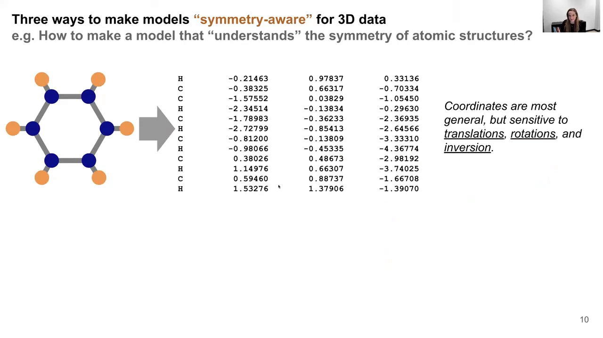

针对这个脆弱性，讲者给出三条路线，并直说了自己的偏好：[【跳转到 11:41】](https://www.bilibili.com/video/BV1ijLMzBErB/?t=701)

| 路线 | 做法 | 讲者的评价 |
| --- | --- | --- |
| 数据增强 | 把同一个对象旋转、平移、翻转很多遍喂给模型 | 暴力破解，"让我有点难过" |
| 不变模型 | 只在不变量特征上运算，丢掉坐标系 | 目前大多数模型在做，但表达能力受限 |
| 等变模型 | 保留坐标系，要求输出随坐标系相应地变换 | 本教程的重点，更忠实于系统的复杂性 |

### 2.3 为什么三维里的数据增强特别贵

没有为对称性而构建的模型不理解三维坐标的上下文。对它来说，旋转后的分子就是另一组数字，所以必须靠数据增强反复展示"这是同一个对象"。[【跳转到 12:18】](https://www.bilibili.com/video/BV1ijLMzBErB/?t=738)

在二维图像里，十倍增强（10 张不同旋转的图）大致就够用了。但三维空间里代价陡增：讲者说实际上可能需要 500 倍以上的增强，甚至更糟。如果你还需要高精度的角度——比如让网络能识别一个立方体——你得给它看立方体在很多很多种旋转下的样子。而一个"理解坐标系是任意的"模型，只需要看一个立方体，因为它就是被设计来做到这一点的。[【跳转到 12:43】](https://www.bilibili.com/video/BV1ijLMzBErB/?t=763)

## 三、不变模型：把坐标系算完就丢掉

### 3.1 什么是不变特征

讲者给的定义很干脆：**不变模型计算系统的不变特征，然后丢弃坐标系**。一个不变特征就是——无论我怎么定义坐标系，它都不变。[【跳转到 13:44】](https://www.bilibili.com/video/BV1ijLMzBErB/?t=824)

两个例子：

- **两个原子之间的距离**。它就只是一个距离，我改变坐标系它不会变。
- **三个原子之间的夹角**。算这个夹角时确实需要一个坐标系，但算完之后我可以把坐标系丢掉，剩下的那个角度与坐标系无关。

于是"不变量模型"就被定义为：一个只在不变量特征上运行的模型。注意这里的关键不是"过程中有没有出现坐标系"，而是"最终喂给模型的输入里还有没有方向信息"。[【跳转到 14:34】](https://www.bilibili.com/video/BV1ijLMzBErB/?t=874)

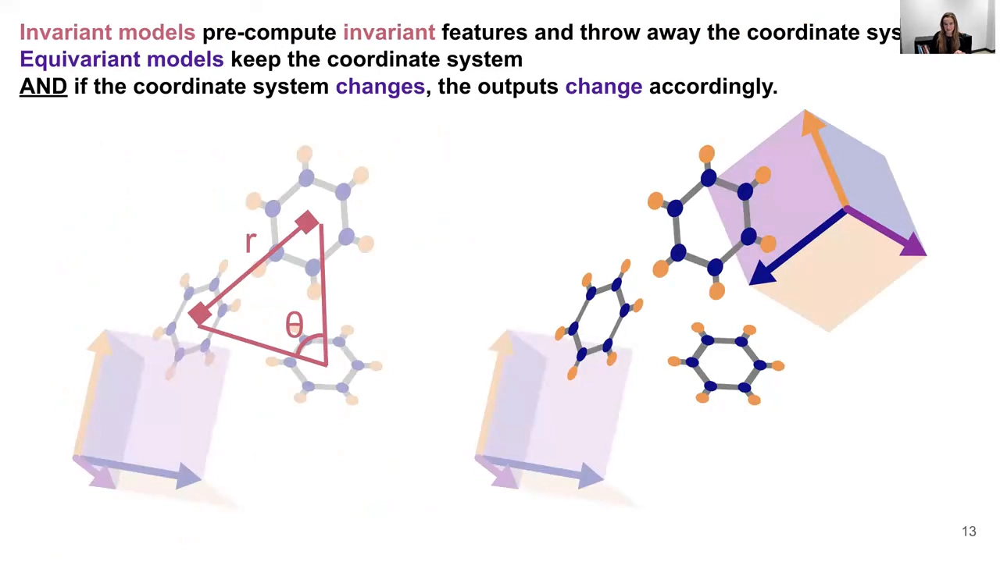

### 3.2 不变模型的运算只有"标量乘法"

讲者进一步把不变模型的特征刻画出来：在不变量模型里，我们只有标量乘法。一个数乘以一个数得到另一个数；或者一个三维向量乘以一个数，只是把同一个向量放大或缩小——它变大或变小，但**方向信息保持不变**。所以他把"任何只有这些标量交互的模型"都定义为不变量模型。[【跳转到 15:06】](https://www.bilibili.com/video/BV1ijLMzBErB/?t=906)

这句话是整场演讲的枢纽。它说明不变模型的"简单"是有代价的：一旦你只允许标量相乘，模型就再也不能自己"造出"新的方向信息，方向信息必须在输入端就已经被编码好。

## 四、等变模型：保留坐标系，让输出跟着转

### 4.1 定义：先转再算 = 先算再转

等变模型保留了坐标系：如果我们改变坐标系，输出会相应地改变。模型知道这仍然是同一个系统，只是被旋转、平移、翻转了。[【跳转到 14:59】](https://www.bilibili.com/video/BV1ijLMzBErB/?t=899)

形式化地写出来，就是讲者反复强调的那个条件：

$$
f\big(D(g)x,\; w\big) = D(g)\,f(x,\; w)
$$

其中 $g$ 是欧几里得对称群的一个元素（旋转、平移、反演），$D(g)$ 是这个元素作用在对象上的矩阵表示，$w$ 是网络参数。讲者的说法是：**所有操作都被构造成与群作用 $D(g)$ 可交换**。[【跳转到 26:48】](https://www.bilibili.com/video/BV1ijLMzBErB/?t=1608)

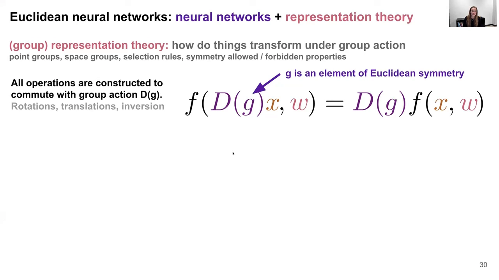

### 4.2 $D(g)$ 长什么样，取决于它作用在什么对象上

这个条件里最容易忽略的一点是：$D(g)$ 不是唯一的。如果 $x$ 是三维向量，$D(g)$ 就是一个 $3\times 3$ 的旋转矩阵；但如果我们要预测的是一个 $3\times 3$ 的矩阵，$D(g)$ 现在需要同时作用在这个矩阵的两个索引上；如果对象是 d 轨道、f 轨道，形式又不一样。[【跳转到 27:01】](https://www.bilibili.com/video/BV1ijLMzBErB/?t=1621)

所以"等变"不是一个数字上的等式，而是一族等式：**你必须先知道这个对象在旋转下该怎么变**，才能写出对应的 $D(g)$。讲者说，正因如此，这个条件在 e3nn 里成了一个非常好用的单元测试。[【跳转到 27:22】](https://www.bilibili.com/video/BV1ijLMzBErB/?t=1642)

### 4.3 等变对象的交互比标量复杂：一个外积拆出三类东西

等变模型比不变量模型复杂，难在"两个等变对象怎么相乘"。讲者从最一般的情况讲：两个向量相乘，最一般的操作是**外积**，得到一个 $3\times 3$ 矩阵。[【跳转到 15:56】](https://www.bilibili.com/video/BV1ijLMzBErB/?t=956)

有意思的是，你可能想到的其他乘积其实都藏在这个矩阵里：

- **迹**（对角线之和）等价于点积，它是**不变的**——你旋转这个矩阵，迹不变。它只占 1 个自由度。
- **反对称部分**就是叉积，它是**等变的**，需要 3 个数描述。
- **对称且无迹的部分**也是等变的，需要 5 个数描述。

$1+3+5=9$，正好是 $3\times 3$ 矩阵的 9 个自由度。[【跳转到 16:17】](https://www.bilibili.com/video/BV1ijLMzBErB/?t=977)

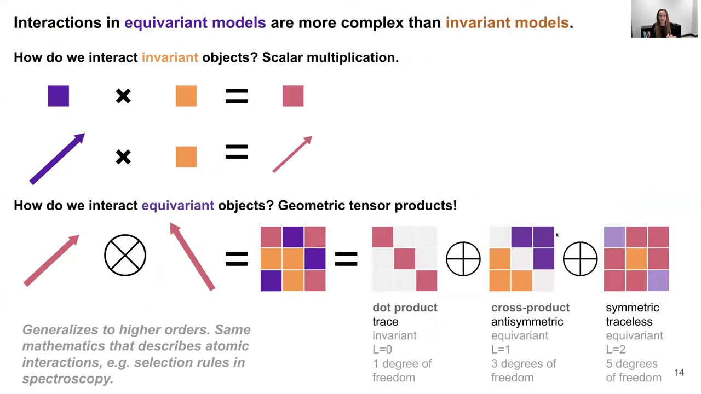

讲者强调这不是巧合：这是一个非常普遍的现象，等变神经网络正是利用了它。如果你觉得这眼熟，它和角动量相加的数学、以及光谱学里的选择定则是同一套东西。[【跳转到 17:07】](https://www.bilibili.com/video/BV1ijLMzBErB/?t=1027)

## 五、为什么等变函数更好优化：把函数空间切小

讲者给了一个很漂亮的几何解释。你可能想要等变函数的一个原因是：它们能**显著缩小你需要优化的函数空间**。如果你在训练一个机器学习模型，这意味着你需要更少的数据来约束你的函数——你的数据变得更有力量，因为你在一个更受限的空间里搜索。[【跳转到 17:32】](https://www.bilibili.com/video/BV1ijLMzBErB/?t=1052)

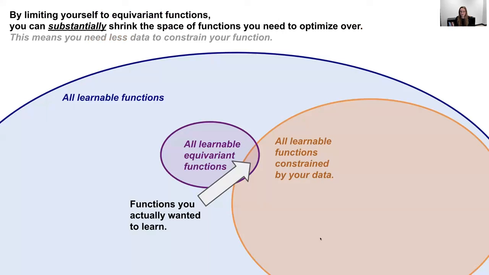

这张图值得多看一眼：真正想学的函数（一个具有欧几里得对称性的物理系统的规律）本来就落在紫圈附近。如果你把自己限制在这个更受限的函数空间里，你的数据就会更有力量。[【跳转到 17:57】](https://www.bilibili.com/video/BV1ijLMzBErB/?t=1077)

### 5.1 不变模型的代价：交互必须提前算好

反过来看不变模型。如果你只用不变模型、只用标量乘法，那你就必须保证**输入特征里已经包含了任何必要的等变交互**——比如乘积、甚至点积。这些操作必须已经发生过，你输入的不变量特征里已经编码了这些细节和复杂性，模型才能完成任务。[【跳转到 18:27】](https://www.bilibili.com/video/BV1ijLMzBErB/?t=1107)

讲者的总结是：不变模型更容易实现，但有时缺乏表达复杂系统所需的表达能力——当你要预测的是能量或力这类东西时，它可能根本不够精确。[【跳转到 19:11】](https://www.bilibili.com/video/BV1ijLMzBErB/?t=1151)

## 六、等变带来的"白送"能力

讲者列举了几个等变模型天然具备、不需要额外训练就有的性质。

**第一，模式识别自动泛化到所有位置和朝向。** 如果我们能训练模型识别某个局部或全局的模式（讲者用一只兔子举例），那么模型保证能识别出这个模式的任何平移、旋转、镜像版本。给定一个分子和一个旋转后的副本，假设我们在预测力，模型会预测旋转后的分子具有相应旋转的力。[【跳转到 19:54】](https://www.bilibili.com/video/BV1ijLMzBErB/?t=1194)

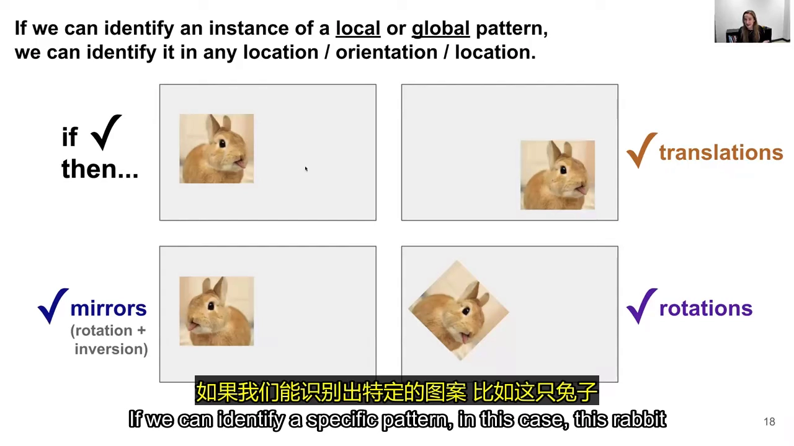

**第二，换一种晶胞表示，答案不变。** 表示晶体的方式不止一种，有很多不同的晶胞约定。如果你假设了周期性边界条件，用三种不同的晶胞来表示同一块硅，一个等变模型保证会给出相同、合适的输出：输出落在不同数量的原子上（因为你给了它不同数量的原子），但那些输出的值和意义是相同的。[【跳转到 20:19】](https://www.bilibili.com/video/BV1ijLMzBErB/?t=1219)

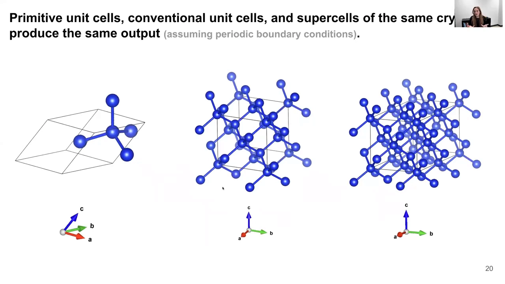

**第三，能处理"输出本身就是一个随旋转变化的张量"的任务。** 讲者举的例子是分子哈密顿量：左边是一个水分子被旋转（看起来是相当简单的旋转），右边是哈密顿矩阵，行和列是原子中心的轨道，矩阵元素表示这些轨道中电子的相互作用是正还是负地影响总能量。旋转看起来简单，但哈密顿量的旋转看起来相当复杂——所以让网络自动处理这类旋转是很有价值的，因为它们具有等变性。[【跳转到 21:34】](https://www.bilibili.com/video/BV1ijLMzBErB/?t=1294)

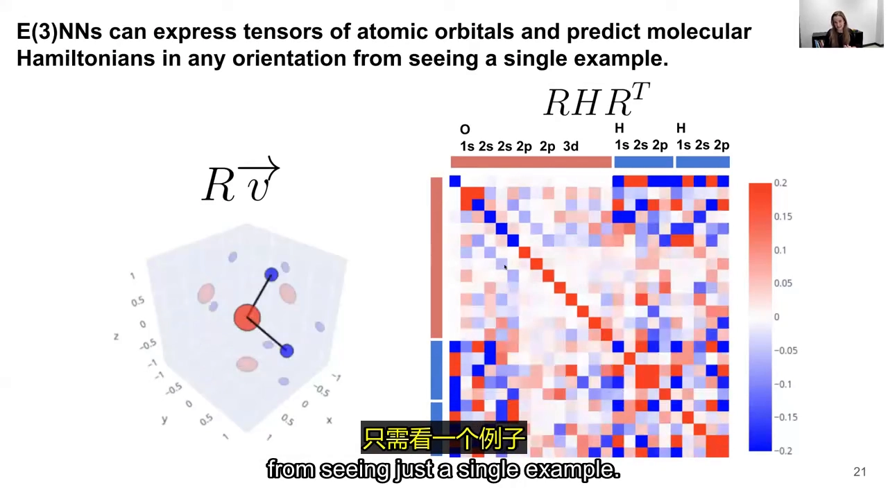

**第四，既然保留了坐标系，就可以主动操纵几何。** 因为保留了坐标系，我们可以真的在网络里操作几何，用于生成式的点几何模型；也可以把局部几何转换成等变特征，反之亦然，靠的是球谐投影。[【跳转到 21:57】](https://www.bilibili.com/video/BV1ijLMzBErB/?t=1317)

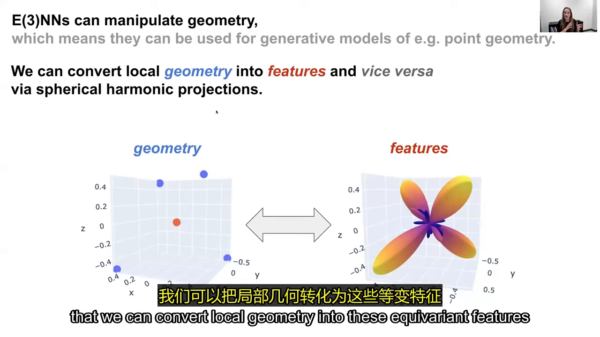

## 七、特征要"带类型"：标量、向量、伪矢量

### 7.1 网络的输入是几何 + 几何上的特征

讲者把输入拆成两部分：几何（每个点的三维坐标），以及挂在这些点上的特征。比如两个质点，各有位置，还各有标量大小、速度向量、加速度向量。[【跳转到 27:47】](https://www.bilibili.com/video/BV1ijLMzBErB/?t=1667)

关键一步是：**我们必须对特征分类**——按它们如何旋转、以及是否反对称或在反演下变号。如果我反转坐标系，值是保持不变，还是会引入一个负号？这就是分类的依据，它与所谓的三维旋转不可约表示、以及群和反演相对应。三维里就是旋转，$O(3)$ 是旋转加反演，这些表示被称为**不可约表示**（irreps）。[【跳转到 28:10】](https://www.bilibili.com/video/BV1ijLMzBErB/?t=1690)

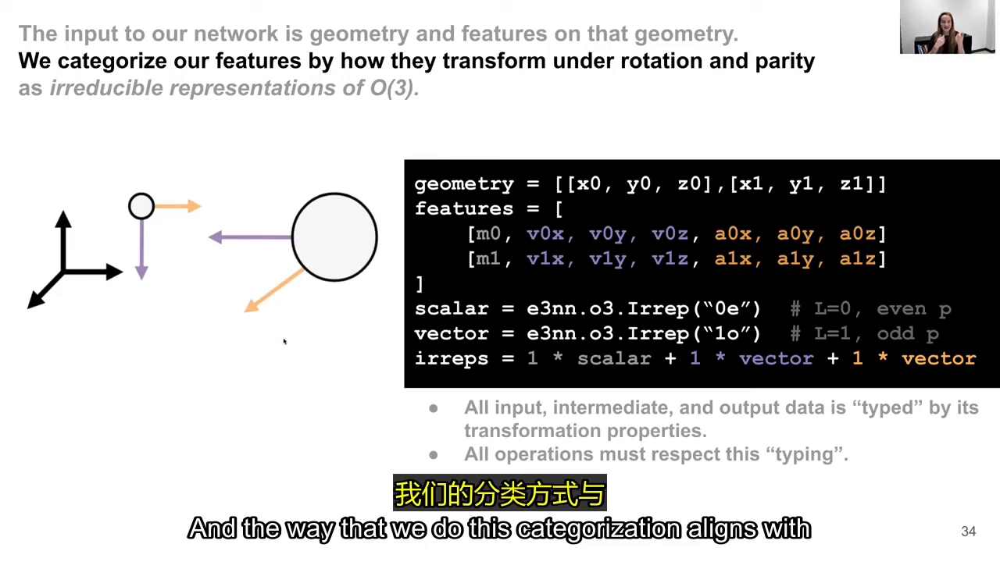

### 7.2 记号：角频率 + 宇称

讲者用「一个数字 + e/o」来标记类型。这个数字可以想成对象的**角频率**：如果我们旋转这个对象，特征变化得多快。

- **标量**：在任何旋转下都不变，所以角频率为 0；翻转坐标系时它也不变，所以是偶（even，记作 `0e`）。
- **三维向量**：在旋转时按同样的速率变化，角频率为 1；反转坐标系时它会翻转，所以是奇（odd，记作 `1o`）。[【跳转到 31:00】](https://www.bilibili.com/video/BV1ijLMzBErB/?t=1860)

所以所有输入、输出、以及网络内部的中间值都是**有类型的**，它们携带特定的数据类型，所有操作都必须遵守这种类型。[【跳转到 31:19】](https://www.bilibili.com/video/BV1ijLMzBErB/?t=1879)

### 7.3 最熟悉的例子：原子轨道

讲者说，这些不可约表示里有一种你一定很熟悉，那就是原子轨道。s、p、d、f 轨道都以不可约表示的同样方式变换：标量以和 s 轨道相同的方式变换，向量以和 p 轨道相同的方式变换；d 轨道角频率为 2、是偶对称，f 轨道角频率为 3、是奇对称，以此类推。[【跳转到 32:04】](https://www.bilibili.com/video/BV1ijLMzBErB/?t=1924)

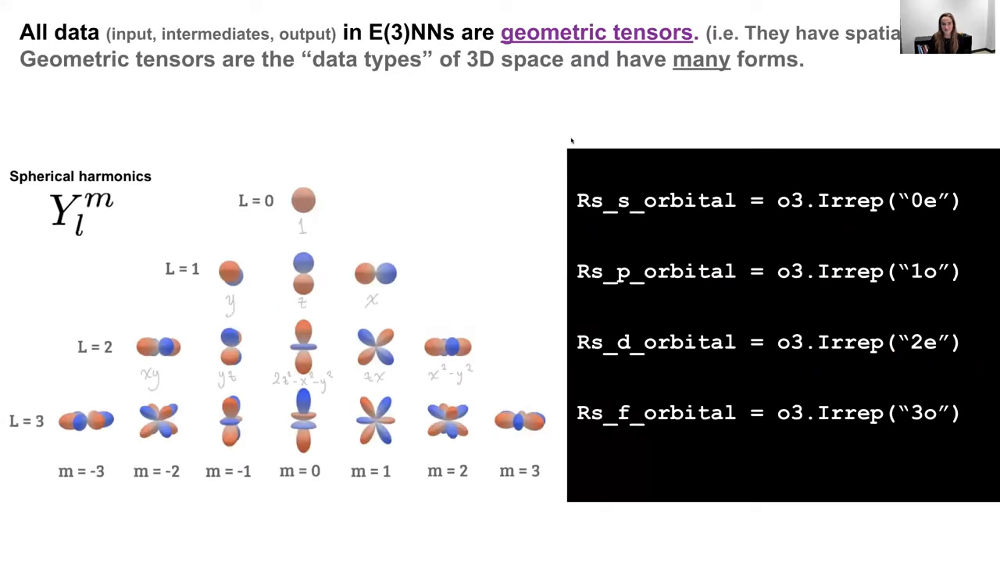

讲者还特意澄清了一个容易混淆的点：**球谐函数本身不是不可约表示**，它们只是"像不可约表示那样变换"的东西。他打了个比方：字符串可以组成很多不同的单词，但字符串本身只是一个数据类型，它定义了你在这个对象上能做什么、不能做什么。[【跳转到 32:29】](https://www.bilibili.com/video/BV1ijLMzBErB/?t=1949)

### 7.4 同样是"向量"，变换方式也可能不同

讲者提醒，有几种不同类型的向量对象。除了普通向量，还有**伪矢量**，比如磁场：它在旋转时以相同的角频率 1 变换，但在反演下不变号。还有"双头射线"——比如你只考虑振荡电场的时间平均行为，它会像 $l=2$ 的偶表示那样变换，和 d 轨道相似。再比如螺旋：旋转 180 度看起来一样，但反转之后它就从右手变成左手。[【跳转到 33:51】](https://www.bilibili.com/video/BV1ijLMzBErB/?t=2031)

这一段的意义在于：**"等变"必须指明相对于哪个变换、以及对象属于哪个类型**。同样是三个分量，变换规则不同，等变条件就不同。

## 八、等变网络是怎么搭出来的：几何张量积 + 径向×球谐滤波器

### 8.1 卷积滤波器必须等变

讲者用一个连续卷积的例子说明构造思路。图像滤波器可以看成一个函数，只不过它在非常具体的向量上求值；在三维里，我们把滤波器写成一个函数，输入是卷积中心到邻居的径向向量 $\vec r$，输出是滤波器的值。[【跳转到 22:01】](https://www.bilibili.com/video/BV1ijLMzBErB/?t=1321)

为了满足等变条件（旋转输入或旋转输出得到相同答案），这个滤波器必须拆成两部分：

$$
W(\vec r) = R(r)\, Y_l^m(\hat r)
$$

其中 $R(r)$ 是可学习的径向部分，只依赖于卷积中心与被卷积原子的径向距离；$Y_l^m(\hat r)$ 是球谐函数，负责角向部分。[【跳转到 37:49】](https://www.bilibili.com/video/BV1ijLMzBErB/?t=2269)

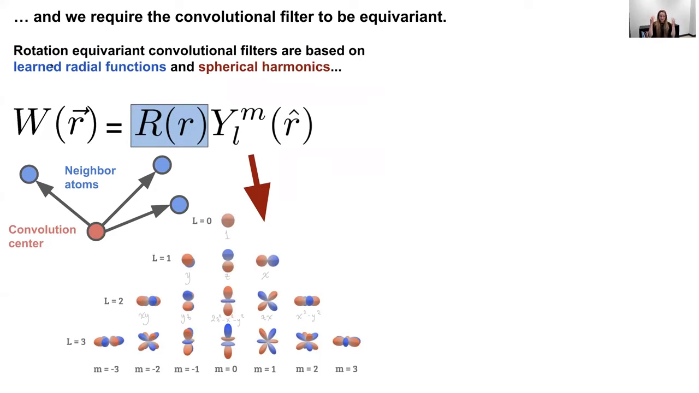

讲者强调，球谐函数出现在这里不是因为"我们处理的是原子"，而是**纯粹从"要求等变"这个条件里推出来的**：它们是一个完备的基底，在旋转下表现得非常好。[【跳转到 38:39】](https://www.bilibili.com/video/BV1ijLMzBErB/?t=2319)

径向部分则很自由：实际中通常定义一组径向基函数（比如从 0 到最大 $r$ 均匀分布的高斯函数），再在上面套一个全连接网络，这就是滤波器参数学习的地方。[【跳转到 39:04】](https://www.bilibili.com/video/BV1ijLMzBErB/?t=2344)

### 8.2 让滤波器和输入相乘，也要用几何张量积

最后一步是把滤波器应用到输入上。这一步同样不能随便乘，必须用几何张量代数（张量积）把两者结合起来。讲者说，这就是构建对欧几里得对称性等变的网络的大致考虑。[【跳转到 39:29】](https://www.bilibili.com/video/BV1ijLMzBErB/?t=2369)

## 九、推论：等变网络像一个"对称性编译器"

### 9.1 居里原理：结果的不对称性必然来自原因

讲者说，把对称性构建进网络会带来一些意想不到的推论，但这不是 bug，而是"坐标系可以随便换"这个基本假设的必然后果。其中一个推论是：**欧几里得神经网络的输出必须具有与输入相同或更高的对称性**。[【跳转到 40:17】](https://www.bilibili.com/video/BV1ijLMzBErB/?t=2417)

这就是 Pierre Curie 在 1894 年说过的：当结果显示出某种不对称性时，这种不对称性必然存在于产生它的原因中。讲者举的例子是：一个处于 222 空间群的高度对称钙钛矿，不会自发产生极化，除非结构发生畸变——因为那个高度对称的结构里不存在允许极化产生的不对称性。[【跳转到 40:42】](https://www.bilibili.com/video/BV1ijLMzBErB/?t=2442)

### 9.2 未训练的等变网络，输出已经带着输入的对称性

讲者做了一个很直观的演示：取三个随机初始化的欧几里得神经网络，输入一个四面体（四个点），把输出解释为球谐函数的系数并画出来。三个网络的输出各不相同，但有一个共同点——它们仍然具有四面体对称性，尽管它们完全没有训练过。换成八面体（六个点）也一样，输出仍然具有八面体对称性。[【跳转到 42:22】](https://www.bilibili.com/video/BV1ijLMzBErB/?t=2542)

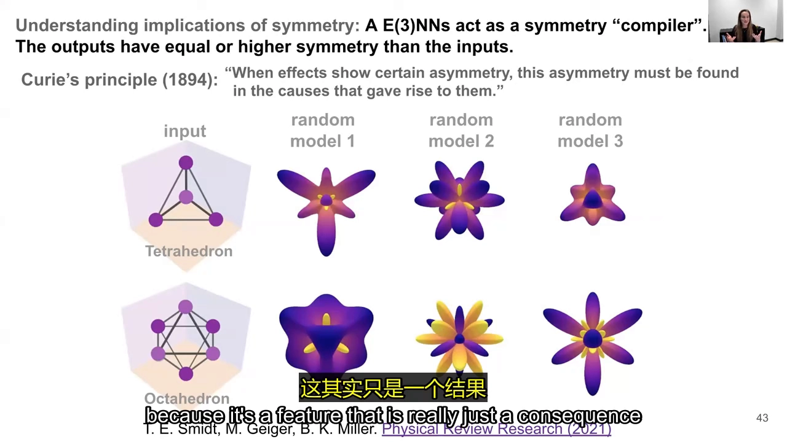

这是一个很棒的特性，因为物理系统也不能任意破坏对称性，除非通过对称性破缺机制。[【跳转到 42:47】](https://www.bilibili.com/video/BV1ijLMzBErB/?t=2567)

### 9.3 一句话总结这场演讲

讲者最后把要点收拢：欧几里得神经网络内置了欧几里得对称性；实现方式是对几何和几何张量做操作、使用几何张量代数——"我们基本上改变了模型被允许使用的数学规则"；因此它们具有许多与物理系统相似的属性：不同几何图案具有相似属性、不能任意破坏对称性、无论给哪个晶胞都给出相同答案。也正因如此，它们能高效地学习从结构到性质的模型。[【跳转到 43:23】](https://www.bilibili.com/video/BV1ijLMzBErB/?t=2603)

## 小结

- **不变**是 $f(D(g)x)=f(x)$：输出完全不受坐标系影响；**等变**是 $f(D(g)x)=D(g)f(x)$：输出跟着坐标系一起转。两者都是相对于某个变换群来定义的。
- **不变模型**把系统压成距离、夹角这类不变量，运算只有标量乘法，实现简单，但方向信息必须在输入端就编码好，表达能力有上限。
- **等变模型**保留坐标系，代价是要处理"等变对象怎么相乘"：一个外积矩阵可以拆成迹（不变，$L=0$）、反对称（叉积，$L=1$）、对称无迹（$L=2$）三部分。
- **为什么等变更省数据**：把搜索范围限制在等变函数这个更小的函数空间里，同样的数据就更有约束力。讲者给的量级是对比 DeePMD 数据效率高一千倍。
- **标签和输出有自己的类型**：标量 `0e`、向量 `1o`，还有伪矢量、双头射线、螺旋等；等变条件里的 $D(g)$ 取决于对象类型，这是 e3nn 里的单元测试。
- **等变网络是对称性编译器**：输出对称性不低于输入，未训练的网络也已经具备这个性质（居里原理）。
- **选哪条路由任务决定**：要一个不随坐标系变化的数（能量、类别），不变就够；要一个必须随坐标系一起转的对象（力、坐标、哈密顿量），就必须等变。

## 关键术语速查

| 术语 | 一句话解释 |
| --- | --- |
| 不变（invariance） | 输入做变换后输出完全不变，$f(D(g)x)=f(x)$ |
| 等变（equivariance） | 输入做变换后输出按同样方式变换，$f(D(g)x)=D(g)f(x)$ |
| 群作用 $D(g)$ | 把群元素 $g$（旋转、平移、反演）实现成作用在具体对象上的矩阵 |
| 不可约表示（irrep） | 在群作用下不再分解成更小块的基本表示，用角频率 $l$ 和宇称 e/o 标记 |
| 宇称（parity） | 反演坐标系时是否变号；不变号为偶（e），变号为奇（o） |
| 几何张量积 | 两个等变对象相乘的合法方式，结果再按 $L$ 分块 |
| 球谐函数 $Y_l^m$ | 球面上的一组完备基底，旋转下按 $l$ 变换，用来提供滤波器的角向部分 |
| 径向基函数 | 只依赖距离的一组基函数，用来提供滤波器的径向部分 |
| 居里原理 | 结果的不对称性必然存在于原因中，因此等变网络输出的对称性不低于输入 |