# 把增广平均起来会丢信息：为什么架构要「先等变、后不变」

> 视频来源：[为什么CNN，GNN，Transformer不是随便设计的？从几何先验理解深度学习](https://www.bilibili.com/video/BV1XtLJ6SEhq/)（Bilibili · Chuuuupg）｜时长约 43 分钟
> 这是一场从统计学习理论讲到架构设计的讲座：先用偏差—方差分解说明「为什么要用几何先验」，再把对称性写成「把函数在群轨道上平均」的算子（群平滑），最后推出「先等变层、后不变层」的架构蓝图。本篇聚焦三条实现路线的取舍：手工不变量特征、把增广平均成不变量、等变架构。不变与等变的定义见同目录《等变还是不变：三维预测该不该跟着坐标系一起转》，本文只用一句话回指。

## 本讲要解决的核心问题（SCQA）

**背景**：三维任务里，同一个分子换个坐标系，物理结果不该变。最直觉的两种利用对称性的办法是：把几何压成距离、夹角这类不变量特征；或者做数据增广，把样本随机旋转很多遍喂给模型。

**冲突**：这两种办法都「看起来」解决了问题，但都不彻底。增广只是让模型见过各种朝向，并不保证它对任意旋转都给出同一个答案；而把变换后的输出直接平均起来（群平滑）虽然能**严格**构造出不变函数，却会在第一层就把特征抹平——猫向左移、向右移的结果一平均，每一块格子的特征都被抵消掉了。

**疑问**：有没有一种做法，既严格保证最终输出不变，又不在一开始就把有用的方向信息丢掉？为此要付出什么代价？

**回答（中心思想）**：有，就是**先等变、后不变**。等变层让特征「有迹可循」地跟着输入变换，从而保住方向信息；末端再接一个不变层，把与任务无关的方向丢掉。可以证明复合之后整体仍然不变。群平滑（把增广平均起来）是这条路线最省事的特例，简单且可证包含最优解，但信息损失大；等变架构更复杂，却把信息保留到了最后。选哪条，取决于中间特征需不需要保留方向。

## 一、为什么需要几何先验：一场偏差与方差的两难

### 1.1 学习就是在函数空间里找一个函数

讲者给了一个视角：学习这件事，本质上就是在某一个函数空间里搜索到一个函数。[【跳转到 00:00】](https://www.bilibili.com/video/BV1XtLJ6SEhq/?t=0)

为了控制搜索难度，我们通常会限制模型复杂度：设 $\gamma(f)$ 是模型复杂度，只允许

$$
\mathcal{F}_\delta = \{\, f \in \mathcal{F} : \gamma(f) \le \delta \,\}
$$

在复杂度不超过 $\delta$ 的这个子空间里搜索，会比在原始的大空间里搜索更容易。代价是：模型最终学到的是 $\mathcal{F}_\delta$ 里最好的函数，而不是整个 $\mathcal{F}$ 里最好的函数。[【跳转到 00:25】](https://www.bilibili.com/video/BV1XtLJ6SEhq/?t=25)

### 1.2 误差被拆成三块

于是要问：这样做到底带来多少误差？讲者把误差分解写得非常明确。记 $\hat f \in \mathcal{F}_\delta$ 是实际学到的函数，$R$ 是真实分布上的损失，$\hat R$ 是经验损失，可以分解成三项：[【跳转到 01:40】](https://www.bilibili.com/video/BV1XtLJ6SEhq/?t=100)

$$
R(\hat f) - \inf_{f\in\mathcal{F}} R(f) \;\le\; \underbrace{\varepsilon_{\text{opt}}}_{\text{优化误差}} \;+\; \underbrace{\varepsilon_{\text{stat}}}_{\text{统计误差}} \;+\; \underbrace{\varepsilon_{\text{appr}}}_{\text{逼近误差}}
$$

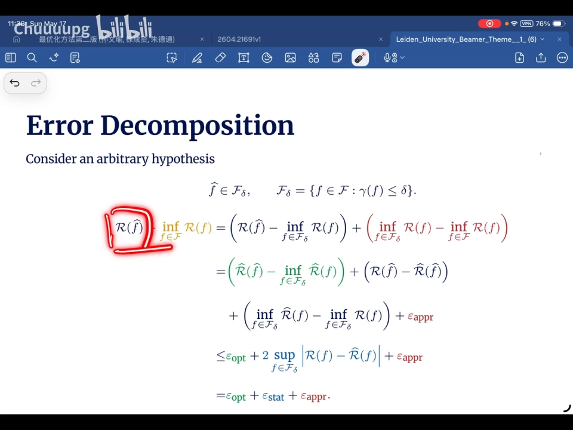

三项的含义分别是：

- **逼近误差**：在 $\mathcal{F}_\delta$ 里能找到的最优点，和在 $\mathcal{F}$ 里能找到的最优点之间的差距。空间被限制小了，最优点可能被挤出搜索范围，于是这一项变大。[【跳转到 02:30】](https://www.bilibili.com/video/BV1XtLJ6SEhq/?t=150)
- **优化误差**：即使把范围划到了 $\mathcal{F}_\delta$，也不一定真能搜到其中最好的那个。损失函数可能是非凸的，优化器不一定能跑到最小点。[【跳转到 03:45】](https://www.bilibili.com/video/BV1XtLJ6SEhq/?t=225)
- **统计误差**：总体分布上的损失 $R$ 与经验损失 $\hat R$ 之间的差距。这个差距来自数据集并不全，不能涵盖真实分布的全部情况。[【跳转到 05:25】](https://www.bilibili.com/video/BV1XtLJ6SEhq/?t=325)

### 1.3 两难：空间小了统计误差降，逼近误差升

这一节不关心优化误差，假设我们有世界上最好的优化器。剩下两项的关系很尴尬：把 $\delta$ 调小，函数复杂度变低，模型更难找到那种「很奇怪很奇怪的函数」，泛化更好，**统计误差下降**；但空间变小，最优点可能被排除在外，**逼近误差上升**。[【跳转到 07:15】](https://www.bilibili.com/video/BV1XtLJ6SEhq/?t=435)

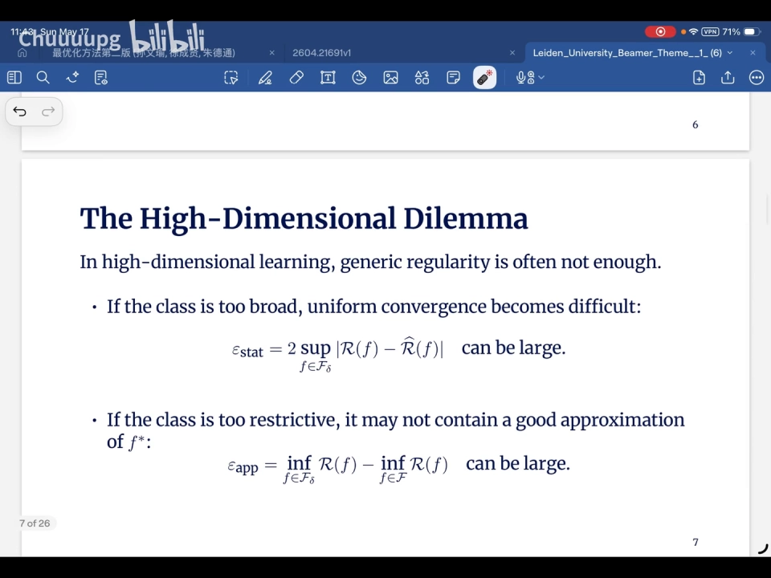

那到底把空间调大还是调小？讲者说，这个事情没有很好的解决办法。[【跳转到 08:12】](https://www.bilibili.com/video/BV1XtLJ6SEhq/?t=492)

### 1.4 几何先验：缩小空间，但把最优点留在里面

几何先验就是在这个僵局里出场的。它帮我们从整体函数空间里找出来一个**既不太大、又仍然包含最优点**的子空间：只要搜索空间仍然包含最优点，逼近误差就仍然很小；而空间变小，统计误差又降下来了。[【跳转到 08:37】](https://www.bilibili.com/video/BV1XtLJ6SEhq/?t=517)

单纯靠「限制模型复杂度」并不容易找到这样的空间，而用几何先验就很容易——因为它不是随便砍一刀，而是按照数据本身的几何结构去砍。这里的「几何」指的是**数据所在源域的几何特征**：图像的源域是网格，此外还有图、集合、流形、三维空间等等。[【跳转到 09:53】](https://www.bilibili.com/video/BV1XtLJ6SEhq/?t=593)

源域上可利用的几何特征有三类：**局部性**、**对称性**、**多尺度结构**。[【跳转到 12:20】](https://www.bilibili.com/video/BV1XtLJ6SEhq/?t=740)

## 二、对称性：把搜索空间砍到「满足不变」的那一块

### 2.1 对称性的准确含义

讲者提醒，这里的对称性不是小学说的对称轴，而是：**输入空间经过一个群变换之后，输出仍然保持不变**。比如一张猫的图片，把猫从左边移到右边，输出结果应该还是一只猫；一个图分类任务，把节点重新编号（置换），识别结果也应该不变。[【跳转到 13:17】](https://www.bilibili.com/video/BV1XtLJ6SEhq/?t=797)

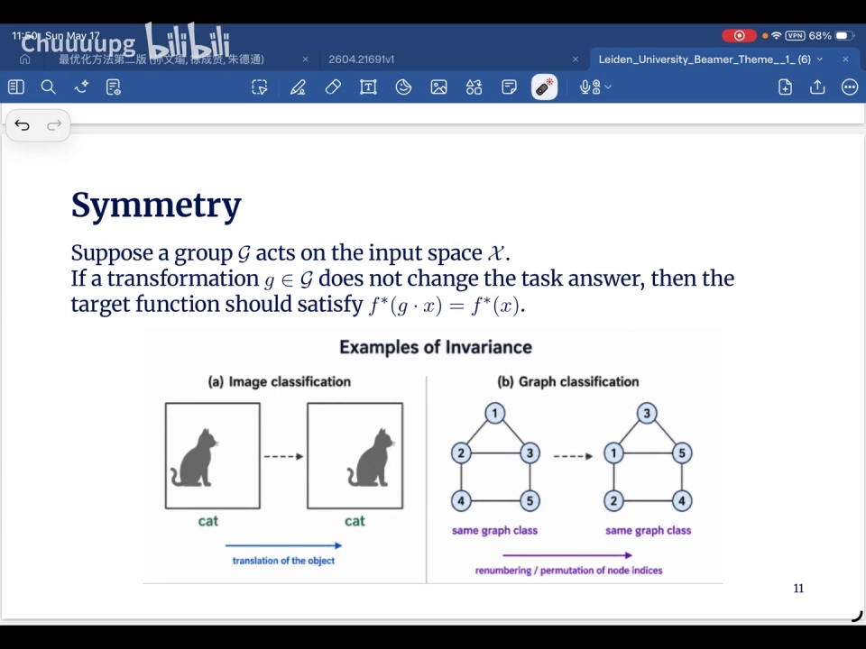

讲者顺手补了一句群的定义：平移满足单位元（不动）、逆元（左移的逆是右移）、封闭性（平移接平移还是平移），所以平移构成一个群。他强调，这里引入群只是为了方便论述和证明，用不到太多群论定理。[【跳转到 14:07】](https://www.bilibili.com/video/BV1XtLJ6SEhq/?t=847)

### 2.2 最优函数一定满足对称性

如果模型是最优的，它一定满足：猫在左边的分类结果等于猫在右边的分类结果。也就是说，最优函数 $f^\star$ 一定满足 $f^\star(g\cdot x) = f^\star(x)$。[【跳转到 15:47】](https://www.bilibili.com/video/BV1XtLJ6SEhq/?t=947)

这一步是整个讲座的枢纽：既然最优点一定落在「满足对称性的函数」这个子集里，那我们就可以**只在这个子集里搜索**。这个子集比原来的函数空间小，更容易搜到最优点；同时它一定包含最优点，所以不会引入过大的逼近误差。[【跳转到 16:37】](https://www.bilibili.com/video/BV1XtLJ6SEhq/?t=997)

### 2.3 新的问题：怎么找到这个子集

听起来很合理，但马上遇到一个操作性问题：函数那么多，我们怎么知道哪个函数满足这种不变性？要直接写出「所有满足群不变的函数」构成的集合，其实很难，它是一个很抽象的东西，没有现成的方程可以表示。[【跳转到 18:50】](https://www.bilibili.com/video/BV1XtLJ6SEhq/?t=1130)

这就是接下来两条路线的分岔口：**群平滑**（把变换后的输出平均起来）与**等变架构**（用等变层搭出来）。

## 三、路线一：群平滑——把增广平均成一个不变量

### 3.1 算子长什么样

群平滑（group smoothing / orbit averaging）做的事情很直接：把那些对输入做群变换、并让输出保持不变的群作用，**平均起来**。[【跳转到 22:42】](https://www.bilibili.com/video/BV1XtLJ6SEhq/?t=1362)

$$
(S_G f)(x) \;=\; \frac{1}{\lvert G\rvert}\sum_{g\in G} f(g\cdot x)
$$

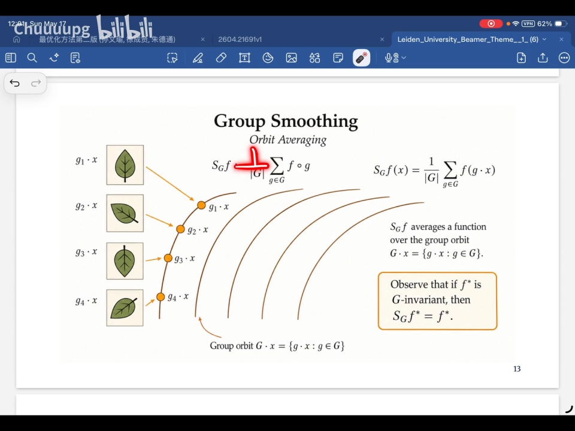

用猫的例子解释：把猫向左移、向右移、向上移、向下移，各做一遍，输出理论上都应该还是猫；群平滑就是把这些输出先平均起来，再送去原来的函数空间。如果原来的函数本身已经满足不变性，那么作用上这个算子应该和原来一样。[【跳转到 23:05】](https://www.bilibili.com/video/BV1XtLJ6SEhq/?t=1385)

### 3.2 为什么它一定不变

要证明平滑后的函数对任意群变换 $h$ 不变，只需证明 $(S_G f)(h\cdot x) = (S_G f)(x)$。拆开写：

$$
(S_G f)(h\cdot x) = \frac{1}{\lvert G\rvert}\sum_{g\in G} f(g\cdot h\cdot x)
= \frac{1}{\lvert G\rvert}\sum_{g'\in G} f(g'\cdot x) = (S_G f)(x)
$$

关键一步是换元 $g' = gh$：因为群对乘法封闭，$gh$ 仍然在 $G$ 里，所以求和只是把轨道上的元素**重新排了一遍**，平均值不变。[【跳转到 24:54】](https://www.bilibili.com/video/BV1XtLJ6SEhq/?t=1494)

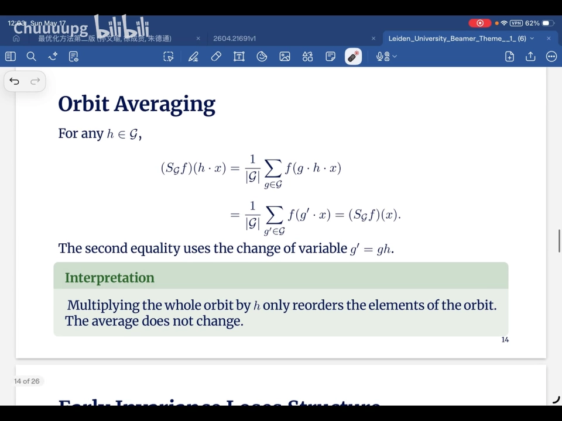

也就是说，**不管原来的函数满不满足对称性，平滑之后一定满足**。而且讲者提到，有数学定理可以证明这样得到的空间仍然把最优点包含在内，所以不用担心把最优解排除在外。[【跳转到 25:20】](https://www.bilibili.com/video/BV1XtLJ6SEhq/?t=1520)

这条路线的吸引力在于简单：不用设计任何特殊层，只要会做数据变换和求平均。

### 3.3 代价：一开始就把特征平均掉了

问题紧接着就来了。一开始只做这种平均操作，会损失非常多的信息。图像本来是每个格子对应一个数值，把它平移之后再把对应数值相加求平均，相当于每一部分的特征都被抵消掉了，最后可能得到一个很杂的东西。[【跳转到 26:00】](https://www.bilibili.com/video/BV1XtLJ6SEhq/?t=1560)

而这些特征可能是有用的，我们之后还想要用。所以一开始不能直接对数据做不变操作。[【跳转到 26:20】](https://www.bilibili.com/video/BV1XtLJ6SEhq/?t=1580)

这就是「数据增广 / 群平滑」这类路线最本质的局限：它保证的是**最终答案不变**，代价是**中间什么都不剩**。如果任务只需要一个标量输出，这没问题；如果后续还要用中间特征做定位、做生成、做力预测，平均就把路走死了。

## 四、路线二：先等变、后不变

### 4.1 等变：让特征「有迹可循」

于是需要引入另一种操作：等变。它的定义是输出按可预测的方式跟着输入变：

$$
B(g\cdot x) = g\cdot B(x)
$$

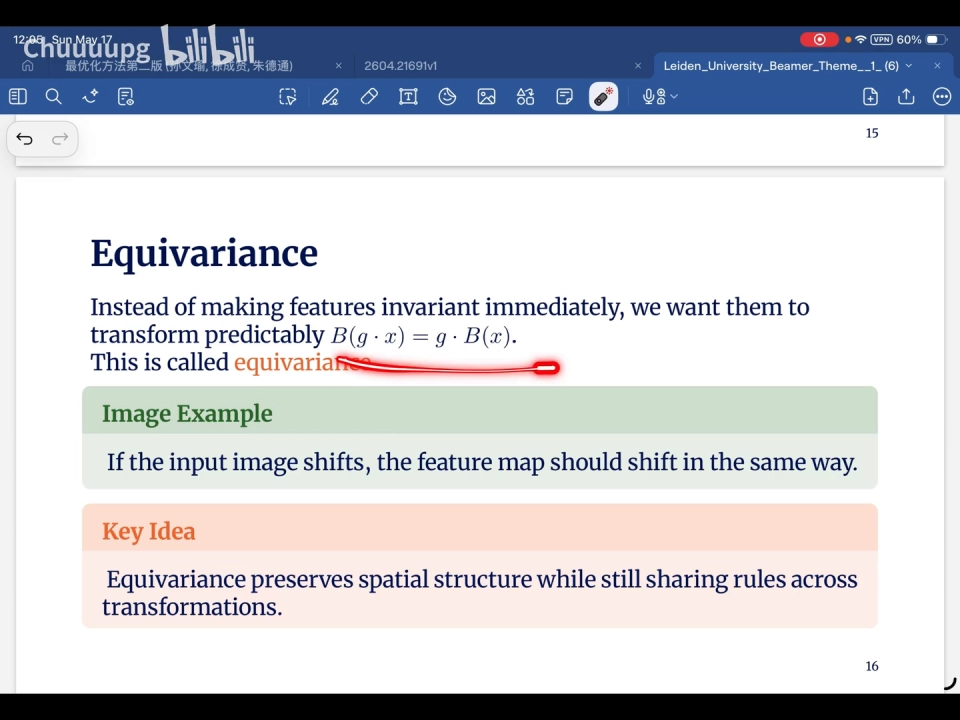

用猫耳朵的例子：我有一个函数把猫耳朵提取出来；把猫耳朵向右移，这个函数提取到的就是原来位置右边的那一块。特征之间没有做相互平均，但特征被很好地保留下来了。讲者的说法是：虽然没有满足输出不变，但可以让输出**有迹可循**——知道输入怎么变，输出就跟着变。[【跳转到 27:23】](https://www.bilibili.com/video/BV1XtLJ6SEhq/?t=1643)

### 4.2 复合之后整体不变

把等变层 $B$ 和不变层 $A$ 复合起来，整体仍然不变。证明只有四行：[【跳转到 28:14】](https://www.bilibili.com/video/BV1XtLJ6SEhq/?t=1694)

$$
\begin{aligned}
(A\circ B)(g\cdot x) &= A\big(B(g\cdot x)\big) \\
&= A\big(g\cdot B(x)\big) && \text{（}B\text{ 等变）} \\
&= A\big(B(x)\big) && \text{（}A\text{ 不变）} \\
&= (A\circ B)(x)
\end{aligned}
$$

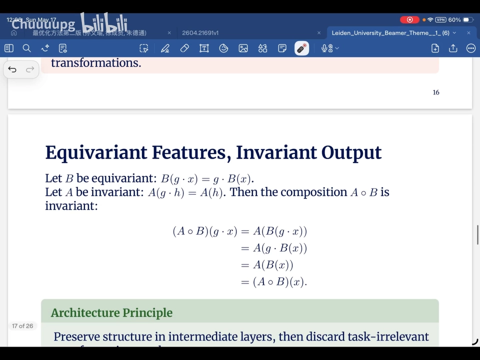

讲者把这个结论提炼成一条架构原则：**在中间层保留结构，最后再丢掉与任务无关的部分**。

### 4.3 为什么不一步到位找个不变函数

你可能会问：$A\circ B$ 本身就是一个不变函数，为什么不直接找一个 $A'$ 等于 $A\circ B$，一步到位？

讲者的回答是：并不是找不到，而是不愿意。一开始就定义一个 $A'$ 这样的复杂操作很难；而「先等变、后不变」两段都很简单，还能证明它限制出来的函数组包含我们想要的最优函数。我们要的就是这种简单性。[【跳转到 30:24】](https://www.bilibili.com/video/BV1XtLJ6SEhq/?t=1824)

这句话点出了工程上的关键：**等变架构不是把不变性写得更复杂，而是把它拆成两个各自简单、且可组合的部件**。复杂度被局部化在等变层里，而不是扩散到整个函数。

### 4.4 非线性：等变层也需要表达能力

还有一处细节：等变也可能是线性的，而线性函数表达能力本身不强。所以要加入非线性，做法是**逐点非线性**：对每一个点做同样的非线性映射。[【跳转到 31:41】](https://www.bilibili.com/video/BV1XtLJ6SEhq/?t=1901)

逐点非线性仍然保持等变，因为每个点做的变换完全一样，输入整体怎么变，输出就整体跟着怎么变。于是「等变层 + 逐点非线性」构成一个非线性的等变层，再接不变层，整体仍然不变。[【跳转到 32:20】](https://www.bilibili.com/video/BV1XtLJ6SEhq/?t=1940)

## 五、从原则到架构：几何深度学习的蓝图

### 5.1 高维与多尺度：为什么还需要池化

只有等变和不变还不够。数据是高维的，直接处理高维需要很多算力，实际上达不到。[【跳转到 32:59】](https://www.bilibili.com/video/BV1XtLJ6SEhq/?t=1979)

出路是利用数据的另外两个几何特征：

- **多尺度**：把海滩或山景做一定模糊化，人眼仍然能区分。数据本身有粗结构，不需要一开始就那么细。[【跳转到 34:35】](https://www.bilibili.com/video/BV1XtLJ6SEhq/?t=2075)
- **局部性**：要区分砖和草，不必算完整的 $128\times128$，取一个 $8\times8$ 的小 patch 就够。把局部特征加起来做整合，就避免了对高维特征直接计算。[【跳转到 34:56】](https://www.bilibili.com/video/BV1XtLJ6SEhq/?t=2096)

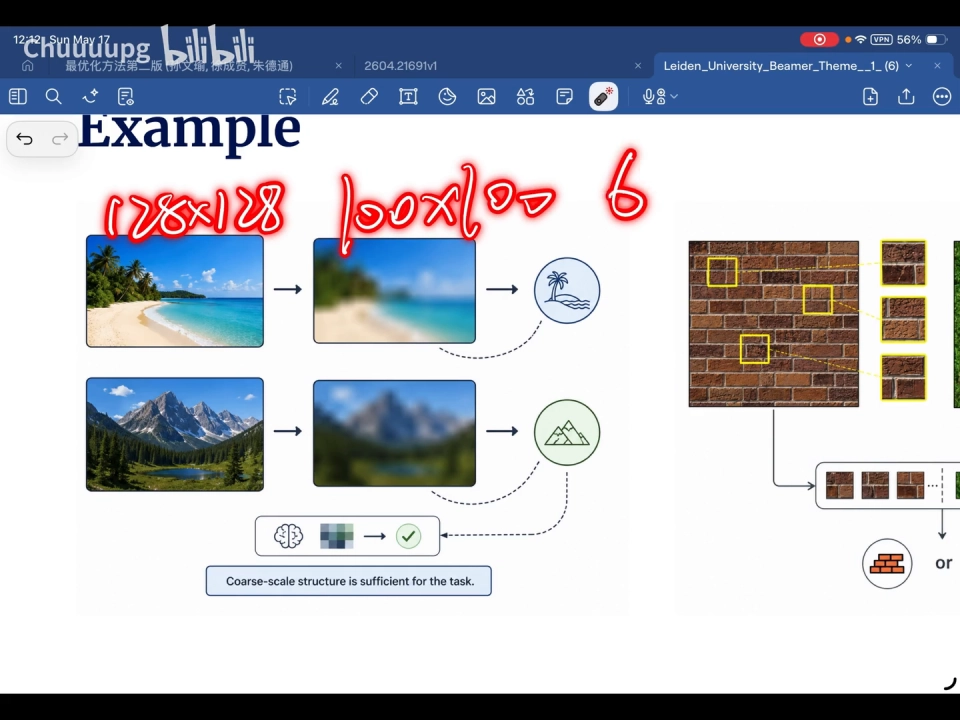

### 5.2 四个积木

把前面的推导合起来，一个好的架构应该满足：等变层在不变层之前；中间穿插池化或粗糙化来降维；最后接不变层做预测。[【跳转到 36:46】](https://www.bilibili.com/video/BV1XtLJ6SEhq/?t=2206)

讲者把它整理成四个积木：[【跳转到 38:40】](https://www.bilibili.com/video/BV1XtLJ6SEhq/?t=2320)

1. **线性等变层** $B_l$：$B_l(g\cdot h) = g\cdot B_l(h)$，在变换下保持一致；
2. **逐点非线性** $\sigma$：$(\sigma h)(u) = \sigma(h(u))$，提升表达能力且不破坏等变；
3. **局部池化 / 粗糙化** $P_l$：把分辨率降下来，$|\Omega_{l+1}| < |\Omega_l|$；
4. **不变读出** $A$：$A(g\cdot h) = A(h)$，输出最终预测。

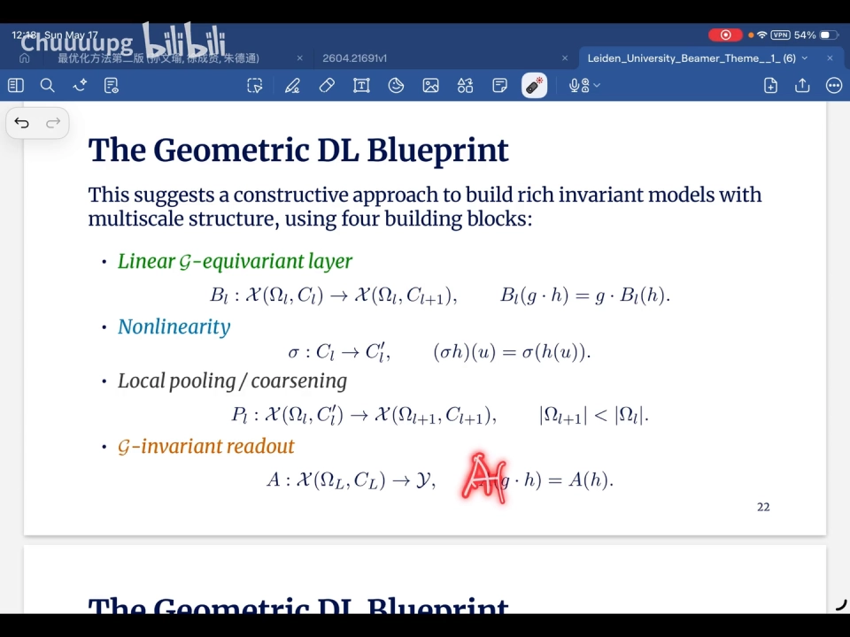

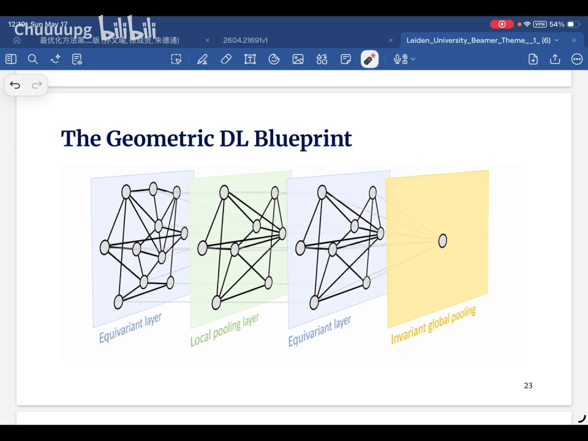

### 5.3 用这套蓝图读 VGG16 与 ResNet

讲者用 VGG16 验证这套蓝图：开头是卷积加 ReLU，后面接 max pooling，最后接全连接层。[【跳转到 39:42】](https://www.bilibili.com/video/BV1XtLJ6SEhq/?t=2382)

其中卷积本身就是一个**等变层**：图像向右移一格，卷积输出也向右移一格。讲者用一个小网格现场推了一遍，结论是「很好理解」。[【跳转到 40:10】](https://www.bilibili.com/video/BV1XtLJ6SEhq/?t=2410)

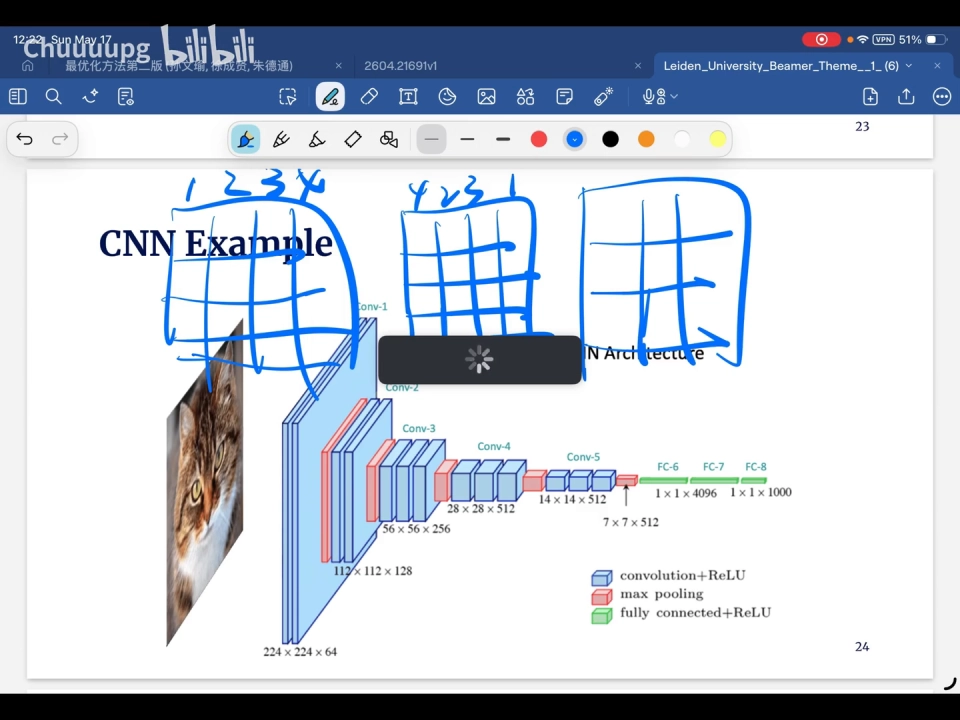

他也指出一处不完美：VGG 最后用的是全连接层，它并不是精确满足不变性的操作；如果用不变层会更好。相比之下，ResNet 在最后加了 global average pooling，也就是全局平均——它对平移不变，是一个标准的不变层。[【跳转到 42:43】](https://www.bilibili.com/video/BV1XtLJ6SEhq/?t=2563)

这套蓝图的价值在于：它不只解释了 CNN，也能解释其他数据形式上的架构为什么这样设计。[【跳转到 42:58】](https://www.bilibili.com/video/BV1XtLJ6SEhq/?t=2578)

## 六、三条路线放在一起比

| 维度 | 手工不变量特征 | 群平滑 / 增广平均 | 等变架构 |
| :--- | :--- | :--- | :--- |
| 做法 | 人先算好距离、夹角，喂普通网络 | 对变换后的输出取平均 | 层内约束变换方式，末端不变读出 |
| 是否严格保证不变 | 是（输入已不变） | 是（可证明） | 是（复合可证明） |
| 中间特征是否保留方向 | 否，输入端就丢了 | 否，第一步就平均掉 | 是，等变层保住 |
| 表达力上限 | 取决于人选了哪些不变量 | 受平均操作限制 | 受等变层设计限制，通常更高 |
| 数据效率 | 一般，丢失的信息只能靠数据补 | 一般，等价于把增广写进模型 | 较高，对称性成为结构约束 |
| 计算代价 | 低（距离、向量 $O(N)$） | 低（一次平均） | 中到高（等变层更贵） |
| 实现复杂度 | 低 | 最低 | 高（每层都要检查类型合法性） |
| 主要风险 | 漏掉关键几何量 | 特征被抹平，无法做定位类任务 | 过度约束导致表达力下降 |

这张表只回答「代价与保证」，不回答「哪个更好」。因为按讲者的框架，选择标准是**中间特征要不要保留方向**：

- 只要一个与坐标系无关的标量（分类、能量），且数据量不大 → 群平滑/增广最省事，且能严格保证不变；
- 需要中间特征参与定位、生成、力预测 → 必须走等变架构，否则信息在第一步就没了；
- 几何量种类少、任务简单 → 手工不变量特征仍然是最低成本的基线，但要接受「被压掉的那一维永远看不见」。

## 小结

- 学习的本质是在函数空间里搜索；限制复杂度会降低统计误差，却可能抬高逼近误差。
- 几何先验的价值是：按数据的几何结构缩小搜索空间，同时把最优点留在里面。
- 对称性可以写成「最优函数满足 $f^\star(g\cdot x)=f^\star(x)$」，于是只需在满足对称性的子空间里搜索。
- 群平滑 $S_G f = \frac{1}{\lvert G\rvert}\sum_g f(g\cdot x)$ 能严格构造不变函数，证明只用群封闭性做一次换元。
- 但群平滑一开始就把特征平均掉，信息损失大；这就是把增广「写进模型」的代价。
- 等变层 $B(g\cdot x)=g\cdot B(x)$ 保住方向信息，复合不变层 $A$ 后整体仍不变，证明只有四行。
- 拆成「先等变、后不变」而不是一步找不变函数，是为了每一段都简单、可组合、且可证包含最优解。
- 蓝图四积木：线性等变层、逐点非线性、局部池化/粗糙化、不变读出；VGG16 的卷积是等变层，ResNet 的全局平均是不变层。
- 三条路线的取舍最终取决于：中间特征需不需要保留方向。

## 关键术语速查

| 术语 | 一句话解释 |
| :--- | :--- |
| 假设空间 $\mathcal{F}_\delta$ | 复杂度不超过 $\delta$ 的函数集合，是实际搜索的范围 |
| 逼近误差 | 受限空间里的最优与全空间最优之间的差距 |
| 统计误差 | 总体损失与经验损失之差，来自数据不全 |
| 优化误差 | 即使范围划对了，优化器也不一定找到最小点 |
| 几何先验 | 按数据源域的几何结构（局部性、对称性、多尺度）限制搜索空间 |
| 群平滑 / 轨道平均 | 把函数在整条群轨道上取平均，得到严格不变的函数 |
| 等变 | 输入做群变换，输出按同样方式变换，$B(g\cdot x)=g\cdot B(x)$ |
| 不变读出 | 末端把特征聚合成与变换无关的标量，$A(g\cdot h)=A(h)$ |
| 逐点非线性 | 对每个位置施加同一个非线性函数，保持等变 |
| 粗糙化 / 池化 | 降低分辨率、扩大感受野，利用数据的多尺度结构 |