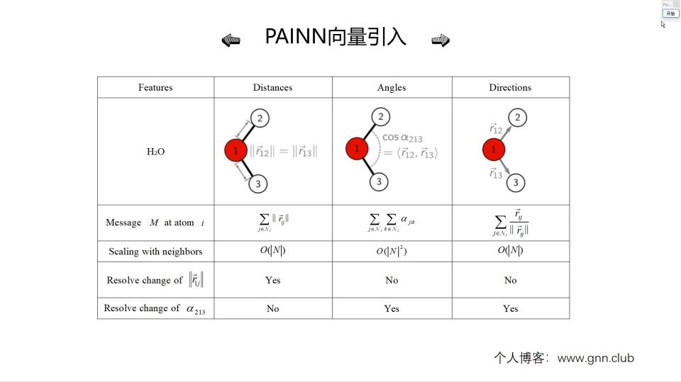
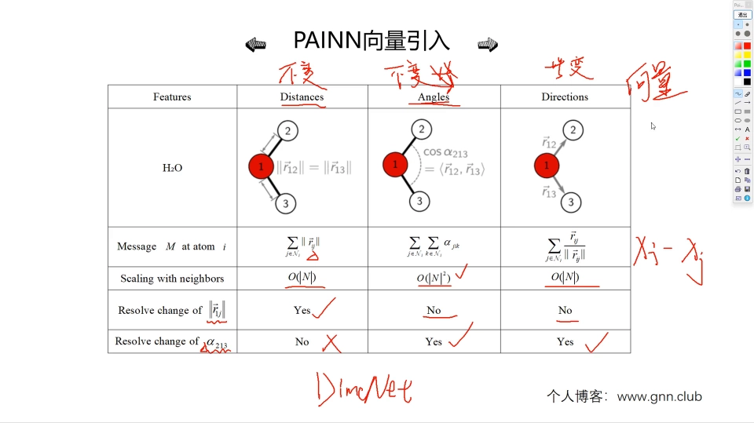
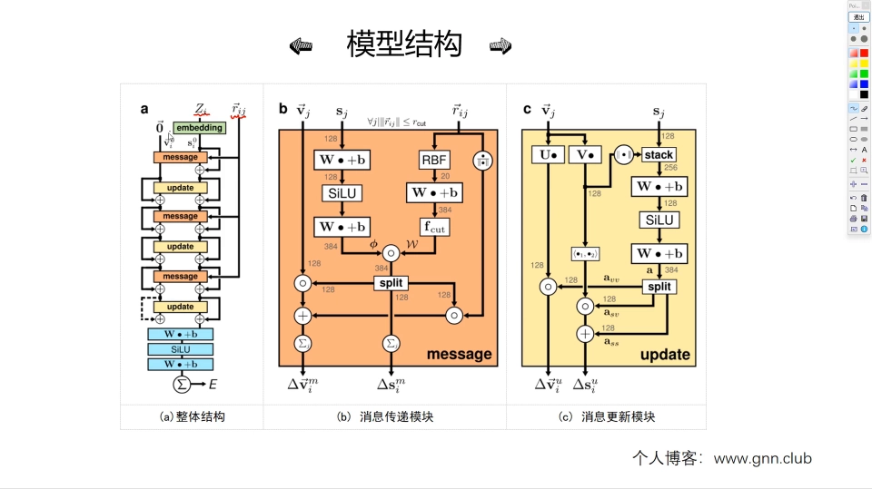
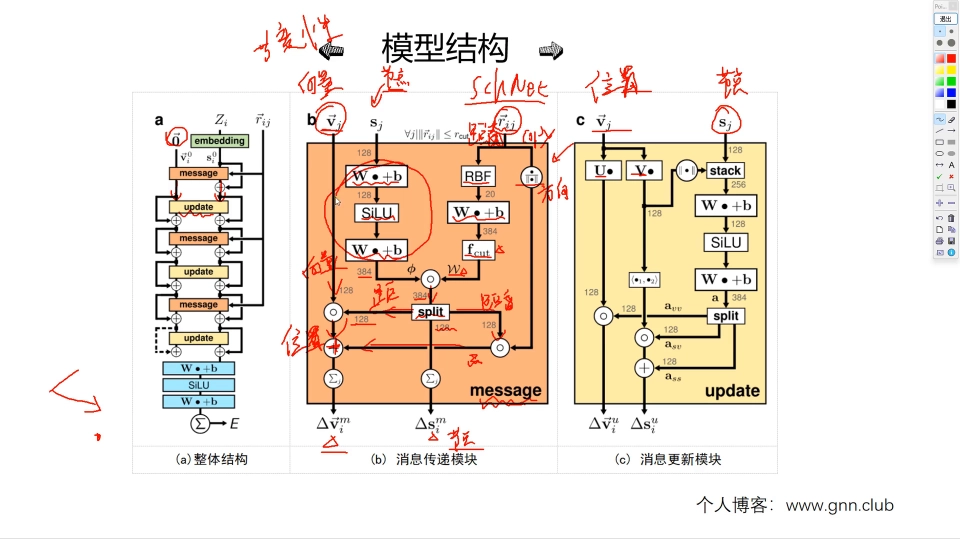
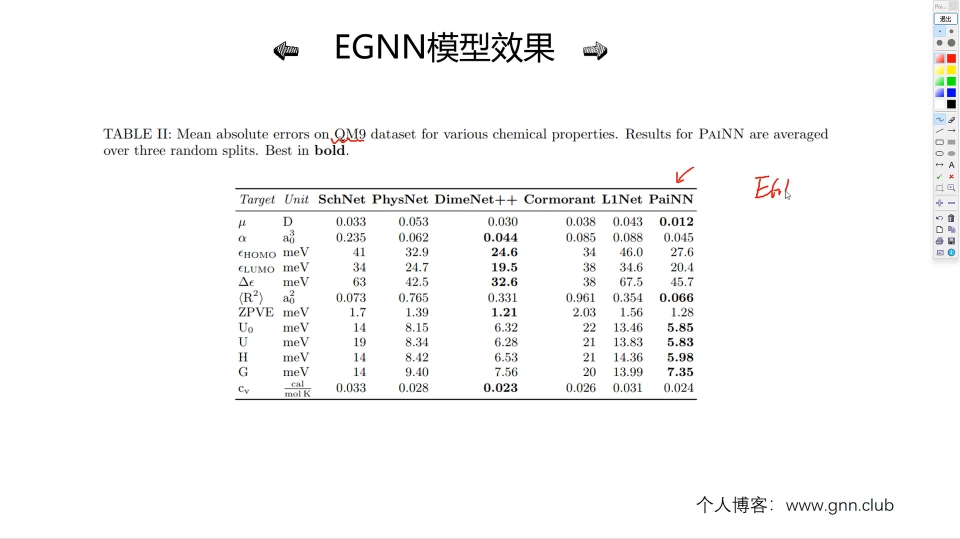
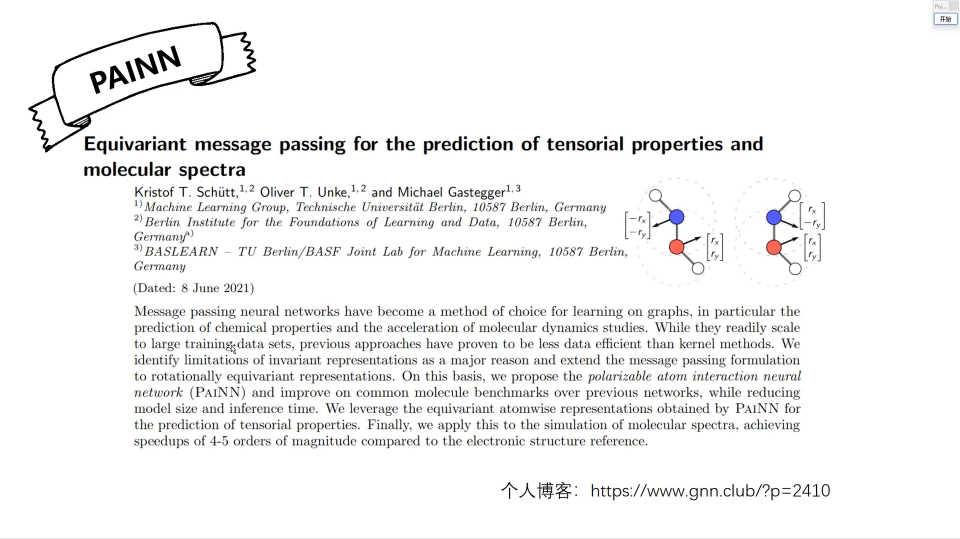
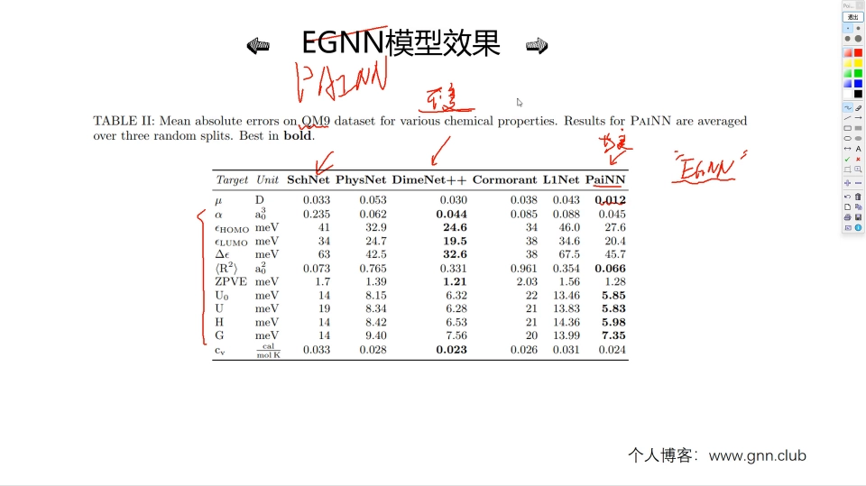

# 距离、夹角还是向量：不变量特征与等变架构的表达力和代价

> 视频来源：[几何深度学习（六）：PAINN 等变性超越不变性的里程碑](https://www.bilibili.com/video/BV1hfBKY3Esu/)（Bilibili · DeepFinder）｜时长约 22 分钟
> 本篇是 PAINN 论文精读的整理，重点不在复述网络结构，而在它开场那张对比表：**距离、夹角、向量三种几何输入，各自能看见什么、算起来多贵**。这条线索正好对应「手工不变量特征」与「等变架构」两条实现路线的取舍。不变与等变的定义见同目录《等变还是不变：三维预测该不该跟着坐标系一起转》，本文只用一句话回指，不再推导。

## 本讲要解决的核心问题（SCQA）

**背景**：做分子、材料这类三维数据的预测，最省事的做法是先把几何信息压缩成与坐标系无关的数——两个原子的距离、三个原子张成的夹角——再喂给普通网络。这样无论分子怎么转，输入都不变，模型自然不用操心旋转。

**冲突**：可压缩是有代价的。距离看不见角度，夹角看不见距离，而有些分子结构在夹角上完全一样、在几何上却明显不同。更麻烦的是，这种信息损失不会以报错的形式出现，只会表现为「模型精度上不去、需要更多数据」。

**疑问**：三种几何输入到底各自丢掉了什么？想保住丢掉的那部分信息，要付出多少计算和实现代价？等变架构值不值这个价？

**回答（中心思想）**：从距离到夹角再到向量，**能区分的结构越来越多，但计算代价并不单调上升**：距离和向量都是线性复杂度，夹角是平方复杂度。PAINN 用「不变分支 + 等变分支」把距离和向量同时用上，成为第一个在 QM9 上精度超过不变模型的等变模型。但讲者最后的结论很克制：等变并不天然优于不变，**归纳偏置要和任务匹配**——要预测随坐标系一起转的量（力、位置），等变划算；只要一个不随坐标系变的数，不变量特征往往更简单。

## 一、三种几何输入：能看见什么，算起来多贵

讲者说，PAINN 的作者「更会讲故事」：论文开头就用一张表把距离、夹角、向量放在一起对比，比较它们在特征表征能力上的强弱。[【跳转到 02:30】](https://www.bilibili.com/video/BV1hfBKY3Esu/?t=150)

这张表有四行关键信息，逐行看。

### 1.1 距离：一个模长，线性复杂度

距离的计算很简单，本质上就是取一个模长，计算复杂度是 $O(N)$，$N$ 是邻居数，算起来并不复杂。它能表征距离：只要几何上发生了变化，向量的模长都能捕捉到。[【跳转到 02:55】](https://www.bilibili.com/video/BV1hfBKY3Esu/?t=175)

但它看不见角度。比如由节点 1、2、3 张成的一个夹角 $\alpha$，距离没有办法表征，它没有这个能力。[【跳转到 03:20】](https://www.bilibili.com/video/BV1hfBKY3Esu/?t=200)

用一句话概括：距离是**旋转、平移、反射全都不变**的量，代价是它把方向信息整个丢掉了。

### 1.2 夹角：能看角度，代价是平方复杂度

夹角可以对角度建模，因为它本身就是一个角度。但反过来，夹角又不能对距离建模。[【跳转到 03:45】](https://www.bilibili.com/video/BV1hfBKY3Esu/?t=225)

所以很多基于不变性的模型会同时用夹角和距离，让模型能建模更多的几何空间信息，以此提升精度——讲者点的例子是 DimeNet。代价是夹角的计算复杂度是**平方级别**的：它涉及三个节点，计算起来更复杂。[【跳转到 04:10】](https://www.bilibili.com/video/BV1hfBKY3Esu/?t=250)

### 1.3 向量：一个减法，方向与距离都能带上

向量的计算复杂度很低，和计算距离一样，因为向量的计算本身就是一个减法：

$$
\vec{r}_{ij} = \vec{r}_i - \vec{r}_j
$$

用小 $i$ 的位置减去邻居小 $j$ 的位置就得到一个向量，计算复杂度非常低。但向量和夹角一样有一个问题：单独的向量不能表征距离。不过它都可以对角度信息建模。[【跳转到 04:35】](https://www.bilibili.com/video/BV1hfBKY3Esu/?t=275)

所以在讲者看来，向量比夹角更有优势：**最起码算起来更简单**，而且下面会看到，它还能区分夹角区分不了的结构。

| 输入特征 | 能否反映距离变化 | 能否反映夹角变化 | 邻居规模复杂度 | 随坐标系旋转 |
| :--- | :--- | :--- | :--- | :--- |
| 距离 $\lVert \vec{r}_{ij}\rVert$ | 能 | 不能 | $O(N)$ | 不变 |
| 夹角 $\alpha_{213}$ | 不能 | 能 | $O(N^2)$ | 不变 |
| 方向向量 $\vec{r}_{ij}$ | 不能 | 能 | $O(N)$ | 等变 |

这张表就是「手工不变量特征」这条路线的全部家底：**能算、便宜、但每加一种不变量，都要人来决定加什么**。距离不够就加夹角，夹角不够再加二面角，特征越堆越多，计算越来越贵，而漏掉哪种几何量仍然要靠人判断。

## 二、向量比夹角强在哪：一个夹角分不开的例子

讲者给了一个具体反例：有这样两个分子结构，它们的夹角 $\alpha$ 都是一样的，但这两个结构明显不同。用夹角没办法区分它们，而向量可以——通过向量的方向性指示，就能区分这两种不同的分子结构。[【跳转到 05:25】](https://www.bilibili.com/video/BV1hfBKY3Esu/?t=325)

这个反例的意义不在「向量一定更好」，而在于说明一件更普遍的事：**把几何压成标量的那一刻，就决定了模型永远看不见被压掉的那一维**。夹角只保留了三个点张成的角度，至于这两条边在空间中如何摆放、指向哪个方向，全都没有进入输入。只要任务需要区分这类差异，纯不变量特征就会撞到天花板——不是训练不够，是信息从输入端就没了。

向量之所以能补上这一块，是因为它把「方向」作为数据的一部分保留下来，并且规定：坐标系旋转时，这个向量也要跟着以同样的方式旋转。这正是等变的含义（定义见 3.1.3，本文不重复）。于是模型不必再从标量里「猜」方向，方向一直在场。

## 三、等变架构怎么把向量用起来：PAINN 的双分支

PAINN 的模型结构比上一个视频讲的 EGNN 要复杂精巧得多，这也是它效果更好的原因之一。[【跳转到 06:05】](https://www.bilibili.com/video/BV1hfBKY3Esu/?t=365)

### 3.1 输入与两条分支

模型的输入有三部分：向量、节点自身的信息 $z_i$（可以理解成节点属性），以及一个初始化为零的向量，它表征初始化的位置信息。[【跳转到 06:55】](https://www.bilibili.com/video/BV1hfBKY3Esu/?t=415)

整个模型可以一分为二：

- **右边是不变分支**。虽然送进来的是向量，但后续会把它变成距离，取消方向性，所以这一支主要对不变性特征建模。
- **左边是等变分支**。这一支处理位置信息 $x$，也就是向量本身。

关键在于，这两条分支**不是各玩各的**。在 message 和 update 模块里，不变信息和等变信息会做交互、做特征融合。[【跳转到 07:20】](https://www.bilibili.com/video/BV1hfBKY3Esu/?t=440)

### 3.2 和 EGNN 的差别：只用 $h_i$ 就退化成不变模型

讲者在这里做了一个很锋利的对比。EGNN 很简单很暴力：单独搞两个分支，一个分支对节点信息 $h_i$ 做传递更新，一个分支对位置信息 $x_i$ 做基于向量的特征更新，各自玩各自的。[【跳转到 08:10】](https://www.bilibili.com/video/BV1hfBKY3Esu/?t=490)

于是有一个容易被忽略的后果：EGNN 最后会输出两个东西，位置信息 $x_i$ 和节点信息 $h_i$。**如果你在下游任务里只用到 $h_i$、没有用到 $x_i$，那你的 EGNN 其实还是一个基于不变性的模型**——因为等变性蕴含在 $x_i$ 里，不用它，模型就退化回不变模型了。[【跳转到 08:35】](https://www.bilibili.com/video/BV1hfBKY3Esu/?t=515)

这句话值得单独记下来。它说明「用了等变架构」和「真的用上了等变性」是两件事：等变分支存在，但输出头只读不变的那一路，等变性就被绕过了。这是判断一个模型是否真的走等变路线时最实际的检查点。

### 3.3 message：把方向与距离乘在一起

message 模块里，节点信息走一条常规通路：线性层、激活函数、线性层，输出一个 384 维特征。向量 $\vec{r}_{ij}$ 则被复制成两份，其中一份经过 RBF（径向基函数）对距离建模，再经过线性层，并配合一个截断半径：距离超过阈值的邻居不参与融合，以此降低复杂度。这个技巧来自 SchNet 的连续型卷积。[【跳转到 09:50】](https://www.bilibili.com/video/BV1hfBKY3Esu/?t=590)

另一条更值得看的是等变分支怎么构造新特征：把向量除以它的模长，得到一个**单位向量**——它只能表示方向；再让这个方向去乘距离信息。乘出来的量同时建模了等变的方向和不变的距离。[【跳转到 13:10】](https://www.bilibili.com/video/BV1hfBKY3Esu/?t=790)

讲者用了一个很好懂的类比：在一个空间里，你知道了距离，又知道了方向，就可以很好地对一个点做定位——就像去一个目的地，你知道往哪个方向走、走多远，就一定能到。所以把「方向 × 距离」加到原本的位置更新上非常合理。[【跳转到 14:25】](https://www.bilibili.com/video/BV1hfBKY3Esu/?t=865)

### 3.4 update：位置分支只能用线性层

update 模块里，位置信息这个向量会经过一些线性层。讲者特别强调：这里的线性层和普通神经网络层最大的区别是**只有权重矩阵 $W$、没有偏置 $b$、也没有激活函数**。[【跳转到 15:15】](https://www.bilibili.com/video/BV1hfBKY3Esu/?t=915)

原因很实在：位置变换在空间里可以是任意的，换句话说它应该是连续的；在连续的事情里就不能用激活函数，因为激活函数一般是非线性的，会打破这种连续性。所以位置分支上不能纳入非线性的归纳偏置，只能用线性处理。[【跳转到 15:40】](https://www.bilibili.com/video/BV1hfBKY3Esu/?t=940)

这就是等变架构的**实现复杂度**所在：不是把向量丢进 MLP 就完事，而是要对每一层做类型检查——哪些操作作用在向量上仍然合法、哪些会破坏等变。这类约束在代码里表现为一堆「只能这样乘、不能那样加」的规矩，调试成本远高于普通网络。

### 3.5 最后的信息汇总

update 模块里，位置信息经过线性层后求模长得到距离，再与节点信息拼接，送进一个带激活函数的普通网络；结果分成三份：一份与位置分支的结果做点积、输出更新后的位置；一份与 $v$ 做点积，实现等变信息与不变信息的交互；还有一份类似残差连接，帮助梯度传播，最后输出节点信息。[【跳转到 16:30】](https://www.bilibili.com/video/BV1hfBKY3Esu/?t=990)

所以在这个模块里，节点特征和位置特征并不是自己玩自己的，而是有很多点积和网络处理在做信息融合。讲者反复强调，这正是 PAINN 比 EGNN 复杂精巧的地方。[【跳转到 18:35】](https://www.bilibili.com/video/BV1hfBKY3Esu/?t=1115)

## 四、效果：等变模型第一次超过不变模型

实验结果以 QM9 数据集为例。这篇工作没有和 EGNN 对比，因为两者是同期工作、发表时间非常接近；它对比的是 DimeNet、SchNet 这些典型的不变性模型。结果是：**基于等变性的模型，精度已经可以超越基于不变性的模型**。[【跳转到 19:49】](https://www.bilibili.com/video/BV1hfBKY3Esu/?t=1189)

论文摘要里把动机写得很直接：以往的消息传递方法在训练数据上被证明**不如核方法数据高效**，作者认为「不变表示的限制」是主要原因之一，于是把消息传递扩展到旋转等变表示。[【跳转到 00:00】](https://www.bilibili.com/video/BV1hfBKY3Esu/?t=0)

这句话把「表达力」和「数据效率」两件事连起来了：不变表示丢掉的信息，模型没法从结构里补回来，只能指望从数据里多学一点；数据不够，精度就上不去。等变表示相当于把这部分信息**在架构里保住**，于是同样的数据更有约束力。

讲者还提到，PAINN 在另外一些任务里效果更好，比如蛋白质结构预测，或者分子动力学模拟里力的预测——这类任务的特点是：随着空间变换，我们想预测的目标属性也会随之变换。[【跳转到 20:19】](https://www.bilibili.com/video/BV1hfBKY3Esu/?t=1219)

## 五、讲者的克制结论：等变不天然优于不变

视频最后，讲者给了一个比「等变更强」更重要的判断标准：我们的 GNN 到底纳入不变性的归纳偏置，还是纳入等变性的归纳偏置，**要根据任务属性去定义**。你要分析自己的任务纳入不变性更好，还是纳入等变性更好。[【跳转到 20:39】](https://www.bilibili.com/video/BV1hfBKY3Esu/?t=1239)

至于这两个性质之间有没有好坏之分，讲者的回答是没有：并不是等变一定比不变强，或者不变一定比等变好，**只是说你的归纳偏置与当前问题是否匹配**。[【跳转到 21:04】](https://www.bilibili.com/video/BV1hfBKY3Esu/?t=1264)

把这句话翻译成可操作的判断：

- **输出是随坐标系变化的量**（力、位移、张量属性）→ 需要等变，否则模型连「往哪个方向」都表达不了；
- **输出是一个与坐标系无关的数**（能量、类别、结合亲和力）→ 不变就够了，此时上等变架构主要是为了在中间层保住方向信息、提升数据效率，而不是因为输出需要方向；
- **数据充足、几何差异本来就不大** → 手工不变量特征或更简单的模型可能更划算，因为实现和调试成本低得多。

## 小结

- 三种几何输入的信息量递增：距离（只看模长）< 夹角（只看角度）< 向量（方向，且能区分夹角分不开的结构）。
- 代价并不随信息量单调上升：距离和向量是 $O(N)$，夹角是 $O(N^2)$；向量的额外成本主要落在**实现复杂度**上，而不是计算量上。
- 纯不变量特征的天花板在输入端就决定了：被压成标量的那一维，模型永远看不见，只能靠更多数据去补。
- PAINN 的做法是双分支：不变分支处理距离（RBF + 截断半径），等变分支处理向量，两支在 message 和 update 里反复交互。
- 等变分支有硬约束：位置分支只能用线性层，不能加激活函数，否则破坏连续性与等变性。
- 判断模型是否真走等变路线，看输出头：EGNN 若只读 $h_i$ 不读 $x_i$，就退化成了不变模型。
- 等变不是无条件更优。任务要随坐标系转的量就用等变，只要一个不随坐标系变的数就不变够用；归纳偏置与任务匹配比「更高级的架构」重要。

## 关键术语速查

| 术语 | 一句话解释 |
| :--- | :--- |
| 不变量特征 | 在旋转、平移下数值不变的输入，如距离、夹角、二面角 |
| 等变特征 | 随坐标系一起变换的输入，如方向向量、力 |
| 归纳偏置 | 模型结构里预先写死的假设，如「输出应与旋转无关」 |
| RBF（径向基函数） | 只依赖距离的一组基函数，用来把连续的距离值展开成特征 |
| 截断半径 | 距离超过阈值就不参与消息传递，用来控制邻居规模与复杂度 |
| 消息传递 | 图网络里聚合邻居信息、更新节点表示的机制 |
| QM9 | 常用的分子属性预测数据集，含多种量子化学标签 |
| 数据效率 | 达到同样精度所需训练数据的多少，等变架构通常更省数据 |