# 二面角转一圈回到原处：内部坐标定得住形状，定不住镜像

> 视频来源：[The Z-matrix in Computational Chemistry 5381 2019 L07](https://www.youtube.com/watch?v=_4Px1tPy8GY)（YouTube · Physical Chemistry at Sam）｜时长约 46 分钟
> 本文沿着视频里“用 Z-matrix 手搭分子”的过程，把距离、键角、二面角的定义、$3N-6$ 计数、二面角的周期性和内部坐标重建的歧义串成一条线。配图依据视频板书重绘，时间戳指向原片对应段落；定义与刚体不变性的完整对照见本节导读，本文不重复。

## 本讲要解决的核心问题（SCQA）

**背景**：同一个分子，既可以写成 $3N$ 个笛卡尔坐标，也可以写成一串键长、键角和二面角。后者数量更少，而且每一项都能单独改动、单独扫描，所以在计算化学里被当作“内部坐标”使用。

**冲突**：内部坐标看起来像一张普通的数表，但二面角不是普通数字：它绕着一根键转，转满一圈就回到原处；同一个几何位置还可以写成 $+120^\circ$ 或 $-120^\circ$。更麻烦的是，给定一组键长、键角、二面角，结构似乎被唯一确定了，可只要少给一个二面角，原子就还能在圆周上任意落点，镜像结构也混在其中。

**疑问**：二面角的周期性到底该怎么处理？给定内部几何量，能重建出什么、不能重建出什么？手性/镜像的歧义究竟出在哪一步？

**回答（中心思想）**：内部坐标把分子结构确定到“刚体变换 + 二面角符号约定”为止。距离、键角、二面角分别由 2、3、4 个原子定义；二面角是以 $2\pi$ 为周期的转角，必须按圆周而不是直线来对待；重建时距离把原子放到球面、键角把它收到圆周、二面角才把它落到圆周上的一点，而 $+\phi$ 与 $-\phi$ 落在基准平面两侧，正好是镜像关系。只给距离和键角，镜像无法区分；补上带符号的二面角，才能把“哪一侧”定下来。

## 一、同一张分子，三把尺子：2、3、4 个原子

视频从过氧化氢 $\mathrm{H_2O_2}$ 开始，用四个原子把三种内部量一次摆齐。[【跳转到 01:37】](https://www.youtube.com/watch?v=_4Px1tPy8GY&t=97)

四个原子按视频里的顺序编号为 H1、O2、O3、H4。它们给出的内部量是：

- **键长** $r$：两个原子之间的距离，例如 H1–O2 的 $1.00\ \text{\AA}$、O2–O3 的 $1.20\ \text{\AA}$。它只需要 2 个原子。
- **键角** $\theta$：三个原子形成的夹角，例如 H1–O2–O3 的 $109.5^\circ$。它需要 3 个原子，因为角的两条边要各有一个端点。
- **二面角** $\phi$：四个原子形成的转角，例如 H4–O3–O2–H1 的 $180^\circ$。它需要 4 个原子，因为要先由前三个原子定一个平面，再由后三个原子定另一个平面。

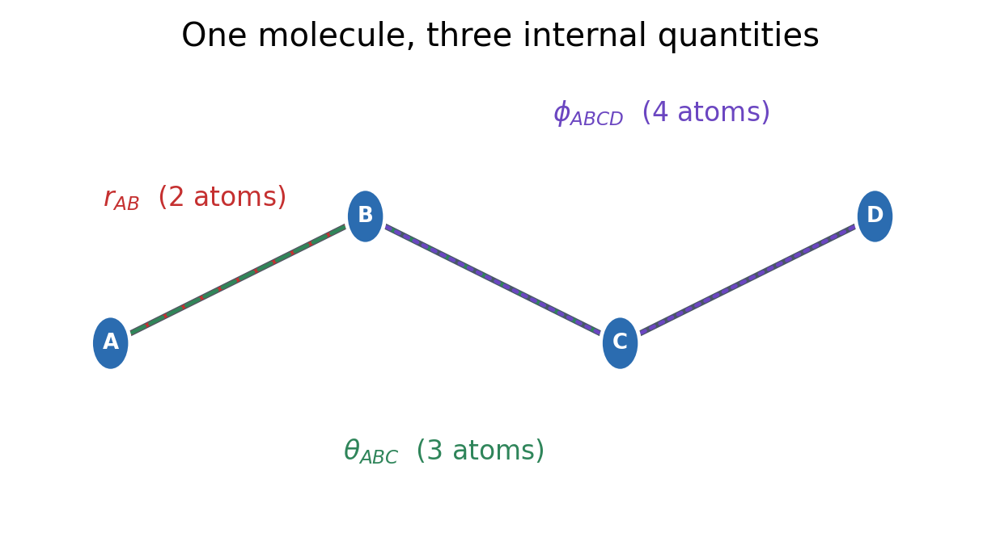

把这张表写成 Z-matrix，就是视频里反复使用的形式：每个原子一行，后面跟着“和谁成键、键长多少、和谁构成键角、角度多少、和谁构成二面角、角度多少”。[【跳转到 08:00】](https://www.youtube.com/watch?v=_4Px1tPy8GY&t=480)

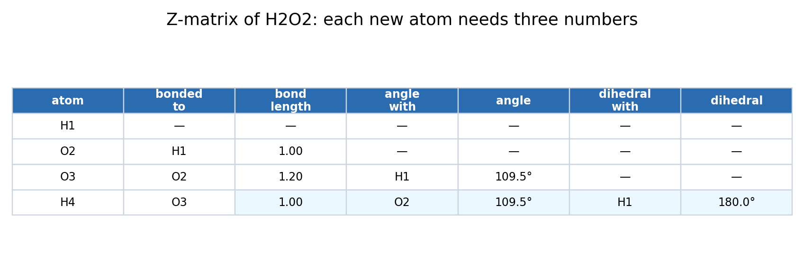

这张表之所以能替代 $3N$ 个笛卡尔坐标，是因为自由度可以这样数：每个原子本来有 3 个自由度，$N$ 个原子一共 $3N$ 个；但整体平移 3 个、整体转动 3 个，一共 6 个自由度不改变分子内部的形状。视频里的说法是“先记住 $3N$ 个运动，减掉 3 个平移和 3 个转动”，把剩下的记成内部自由度。[【跳转到 14:58】](https://www.youtube.com/watch?v=_4Px1tPy8GY&t=898)

对 $N=4$ 的过氧化氢，$3N=12$，减去刚体的 6 个，剩下 $3N-6=6$ 个内部自由度。Z-matrix 里真正可改的数也正好是 6 个：两个 O–H 键长、一个 O–O 键长、两个 O–O–H 键角、一个 H–O–O–H 二面角。

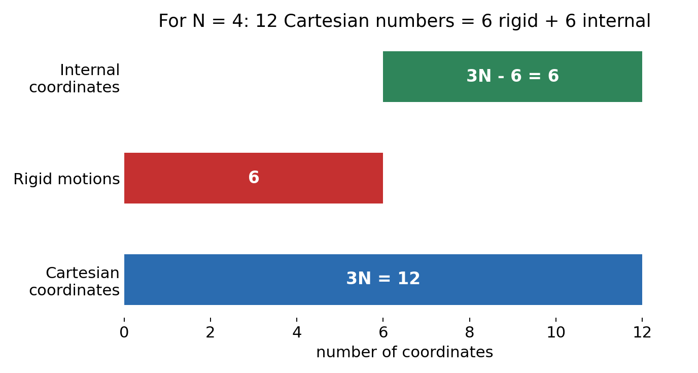

这里要区分两件事：$3N-6$ 是**内部自由度的个数**，不是“随便挑 $3N-6$ 个距离就能当坐标”。距离、键角、二面角只是最常用的一组内部坐标；它们之间还可能存在冗余关系，视频后面用“同一分子可以写出不同 Z-matrix”说明了这一点。

## 二、二面角不是键角：它是两个平面的夹角

视频里最容易让人卡住的一步，是把二面角说成“两个平面的夹角”。[【跳转到 10:20】](https://www.youtube.com/watch?v=_4Px1tPy8GY&t=620)

三个不共线的点确定一个平面。四个原子 A–B–C–D 可以拆成两个平面：A、B、C 确定一个平面，B、C、D 确定另一个平面；两个平面共享 B–C 这条轴，二面角就是绕这条轴从第一个平面转到第二个平面的角度。

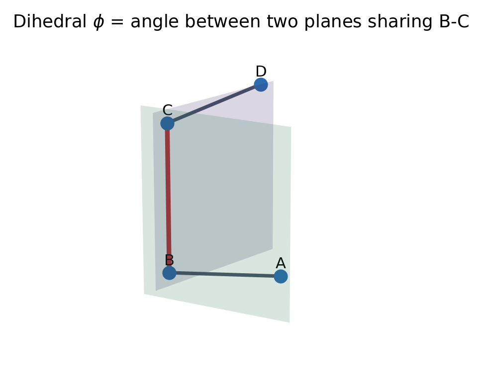

这解释了一个常见困惑：视频里说“二面角可以是 $90^\circ$，但分子里没有任何一个键角是 $90^\circ$”。[【跳转到 18:48】](https://www.youtube.com/watch?v=_4Px1tPy8GY&t=1128) 二面角量的是两个平面之间的“垂直夹角”，它不必等于任何一个原子—原子—原子之间的夹角。换句话说，键角是三条边在一个顶点处张开的角，二面角是两块“板”绕一条合页转开的角。

沿着 B–C 轴看过去，四个原子会投影成一个 Newman 投影：前原子在中心，后原子在圆周上。视频用这个视角说明，二面角就是后原子相对前原子的转角。[【跳转到 13:23】](https://www.youtube.com/watch?v=_4Px1tPy8GY&t=803)

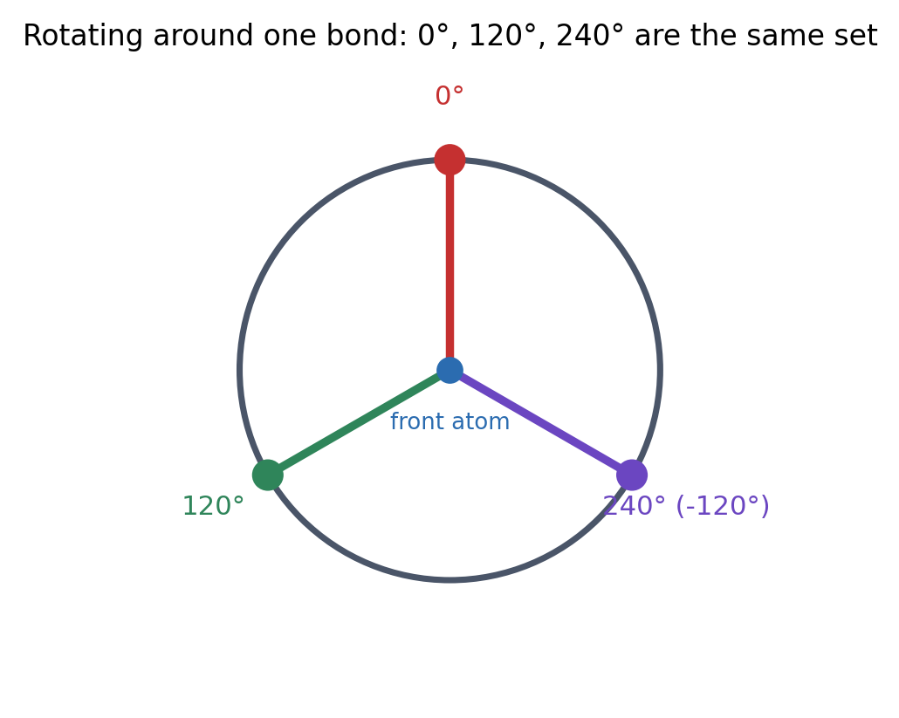

也正因为它是“转角”，二面角才有正负：从轴的一端看，顺时针和逆时针是两回事。视频在搭甲基时同时用了 $+120^\circ$ 和 $-120^\circ$。[【跳转到 28:54】](https://www.youtube.com/watch?v=_4Px1tPy8GY&t=1734) 在搭二氯乙烷时也用 $+120^\circ$ 与 $-120^\circ$ 来区分三个方向。[【跳转到 34:54】](https://www.youtube.com/watch?v=_4Px1tPy8GY&t=2094) 这里的符号不是装饰，它记录的是“往哪一侧转”。

## 三、转一圈回到原处：二面角的 $2\pi$ 周期

二面角最特殊的性质是周期性。视频在讲二面角取值时说：它可以是 $120^\circ$，可以是 $180^\circ$，可以是 $0^\circ$，“可以是其中任何一个角度”，因为你做的只是把第三个氢绕着 O–O 轴转。[【跳转到 19:18】](https://www.youtube.com/watch?v=_4Px1tPy8GY&t=1158)

这句话的直接推论是：转满一圈，几何回到原处。$0^\circ$ 与 $360^\circ$ 描述同一个位置，$120^\circ$ 与 $480^\circ$ 描述同一个位置，$-120^\circ$ 与 $240^\circ$ 也描述同一个位置。视频在搭甲基时把这件事说得很直白：“$120^\circ$ 是绕一个圆，三重对称，往这边 $120^\circ$，往那边 $-120^\circ$。”[【跳转到 20:25】](https://www.youtube.com/watch?v=_4Px1tPy8GY&t=1225)

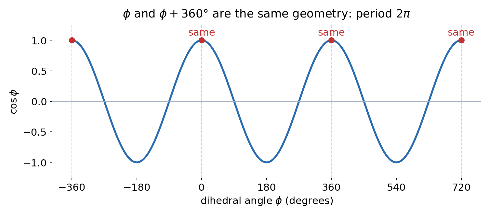

因此二面角的取值区间可以有两种写法：

- $[0^\circ,360^\circ)$：把一整圈从 $0$ 开始铺开，$360^\circ$ 不单独出现，因为它就是 $0^\circ$。
- $(-180^\circ,180^\circ]$：把一整圈从中间剪开，向左为负、向右为正；$180^\circ$ 与 $-180^\circ$ 是同一个位置，只保留一个。

两种写法只差一个“从哪里剪开”的约定。视频里先后出现 $180^\circ$、$0^\circ$、$30^\circ$、$60^\circ$、$+120^\circ$、$-120^\circ$：前四个出现在二面角取值的讨论里，后两个出现在搭甲基的段落里，用的都是“带正负”的读法。[【跳转到 09:31】](https://www.youtube.com/watch?v=_4Px1tPy8GY&t=571) 实际写代码或读输出时，最重要的是**在同一个任务里固定一种约定**，并且在比较两个二面角时先把它归一到同一区间；否则 $+120^\circ$ 和 $-120^\circ$ 会被误判成相差 $240^\circ$，而它们其实只差一个转向。

如果分子里有 $m$ 个独立的二面角，每个都以 $2\pi$ 为周期，那么这 $m$ 个角合起来构成的空间就是一个 $m$ 维环面 $\mathbb{T}^m$：每个方向都首尾相接，$0$ 和 $2\pi$ 是同一点。视频没有写出“环面”这个词，但它反复用“绕一圈”“绕一个圆”来描述二面角，正是这个意思。把二面角当成普通实数轴上的坐标，就会在 $0/360^\circ$ 的接缝处制造出虚假的“跳变”。

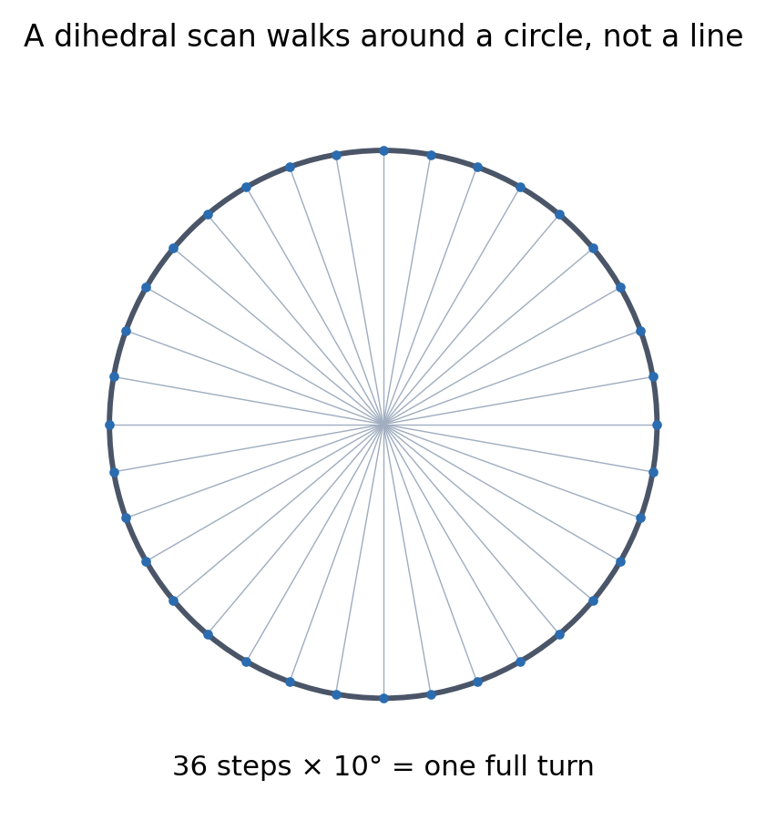

视频里真的做了一次这样的扫描：把要扫描的二面角设成 36 步、每步 $10^\circ$，让它“一路转过去”。[【跳转到 41:42】](https://www.youtube.com/watch?v=_4Px1tPy8GY&t=2502) 36 × 10° = 360°，这不是巧合，而是扫描一个周期量时最自然的走法。

## 四、键角为什么不是周期量

二面角是周期量，键角不是。原因在定义里：

- 键角 $\theta$ 是两条从同一顶点出发的射线之间的夹角，取值范围是 $[0,\pi]$（也就是 $[0^\circ,180^\circ]$）。它量的是“张开多少”，张到 $180^\circ$ 就到头了，再转过去只是把两条边的角色互换，不会产生新的角。
- 距离 $r$ 是两个点之间的长度，取值 $r\ge 0$，也没有“转一圈回到原处”的说法。
- 二面角 $\phi$ 是绕一根轴的转角，轴有方向，转可以一直转下去，所以它天然以 $2\pi$ 为周期。

视频里把这三者放在同一张 Z-matrix 里，但它们的取值范围并不一样：键长用正数，键角用 $0$ 到 $180^\circ$，二面角用带正负的 $360^\circ$ 周期量。[【跳转到 08:00】](https://www.youtube.com/watch?v=_4Px1tPy8GY&t=480) 这也是为什么在几何学习里，二面角常被编码成 $\sin\phi$、$\cos\phi$ 或周期基函数，而键角不需要这样做：把 $0^\circ$ 和 $360^\circ$ 当成两个不同的输入，对二面角是错的；把 $0^\circ$ 和 $180^\circ$ 当成两个不同的键角，则是对的。

## 五、Z-matrix：把分子写成一列“三件套”

Z-matrix 的构造规则可以概括成“前三个原子定框架，后面每个原子报三个数”。[【跳转到 14:58】](https://www.youtube.com/watch?v=_4Px1tPy8GY&t=898)

1. **第一个原子**放在原点。它本来有 3 个坐标，现在被约定成 $(0,0,0)$，3 个数被“吸收”掉了。
2. **第二个原子**和第一个原子成键，只需要一个键长；方向被约定成沿着某根坐标轴（视频里说“第二个原子被放在某根轴上”），另外 2 个数被吸收掉了。
3. **第三个原子**和第二个原子成键，需要一个键长和一个键角；它被约定在由前两个原子确定的平面里，最后 1 个数被吸收掉了。
4. **从第四个原子开始**，每个原子都需要三个数：和谁成键、键长多少；和谁构成键角、角度多少；和谁构成二面角、角度多少。

前三步一共吸收 $3+2+1=6$ 个数，正好是刚体的 6 个自由度；后面 $N-3$ 个原子每个贡献 3 个内部坐标，所以总数是

$$
3(N-3)+3 = 3N-6.
$$

这就是 $3N-6$ 的来源。视频没有把这个公式单独写出来，但它数的正是这件事：第一个原子在原点，第二个原子在轴上，第三个原子在平面里，从第四个开始才需要“键长、键角、二面角”三件套。[【跳转到 15:58】](https://www.youtube.com/watch?v=_4Px1tPy8GY&t=958)

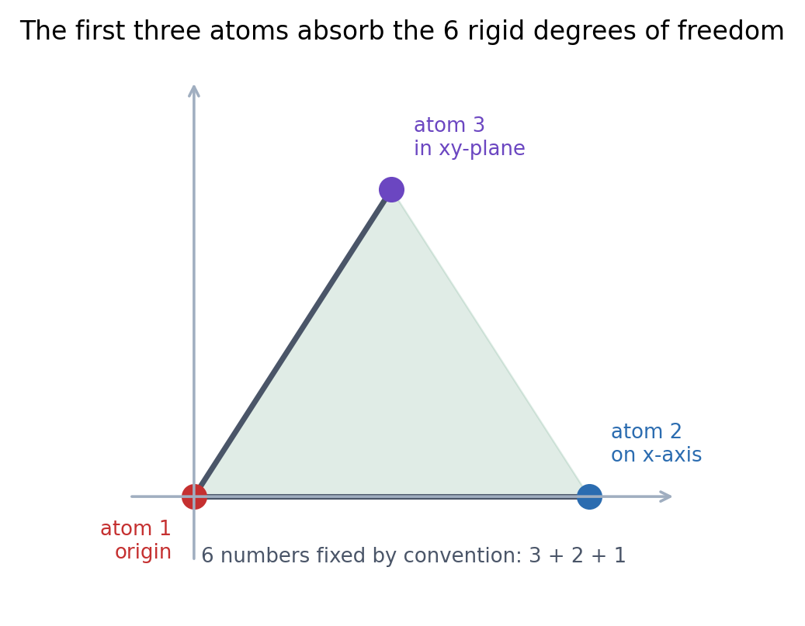

这样写出来的 Z-matrix 有一个很大的好处：**每一项可以单独改**。视频现场演示了把某个 O–H 键长拉长，而键角和二面角不动；也演示了把 O–O 键长单独拿出来扫描，其他内部量保持不变。[【跳转到 16:36】](https://www.youtube.com/watch?v=_4Px1tPy8GY&t=996) 如果换成笛卡尔坐标，想扫描一个键长，至少要同时改两个原子的多个坐标，还要重新算三角函数；这就是视频反复说“笛卡尔坐标很麻烦”的原因。

## 六、重建：距离给球面，键角给圆，二面角给点

现在把 Z-matrix 反过来读：如果我已经有了一组键长、键角、二面角，怎么把原子一个一个放回三维空间？

视频在搭过氧化氢时把每一步的“剩余可能性”讲得很清楚：

- 给第一个原子定好原点后，第二个原子只给键长 $r$：它可以在以第一个原子为球心、半径为 $r$ 的球面上任意位置。[【跳转到 02:43】](https://www.youtube.com/watch?v=_4Px1tPy8GY&t=163)
- 给第三个原子一个键长：它落在以第二个原子为球心的球面上；视频在二维板书上把这一步说成“$1.2\ \text{\AA}$ 可以是这个圆上的任何地方”。[【跳转到 05:32】](https://www.youtube.com/watch?v=_4Px1tPy8GY&t=332)
- 再给第三个原子与第一个原子的键角 $\theta$：球面被一个圆锥截出一个圆周，原子被收到圆周上。[【跳转到 05:32】](https://www.youtube.com/watch?v=_4Px1tPy8GY&t=332)
- 最后给第四个原子的二面角 $\phi$：它才从圆周上的无数个点落到一个点。视频说，$109.5^\circ$ 的角度“会把它放在这里，但它其实在这根柱子的某个地方”，$180^\circ$ 放一边、$0^\circ$ 放另一边，$30^\circ$、$60^\circ$ 也都可以，“最后一个二面角决定它落在这根柱子的哪里”。[【跳转到 07:44】](https://www.youtube.com/watch?v=_4Px1tPy8GY&t=464)

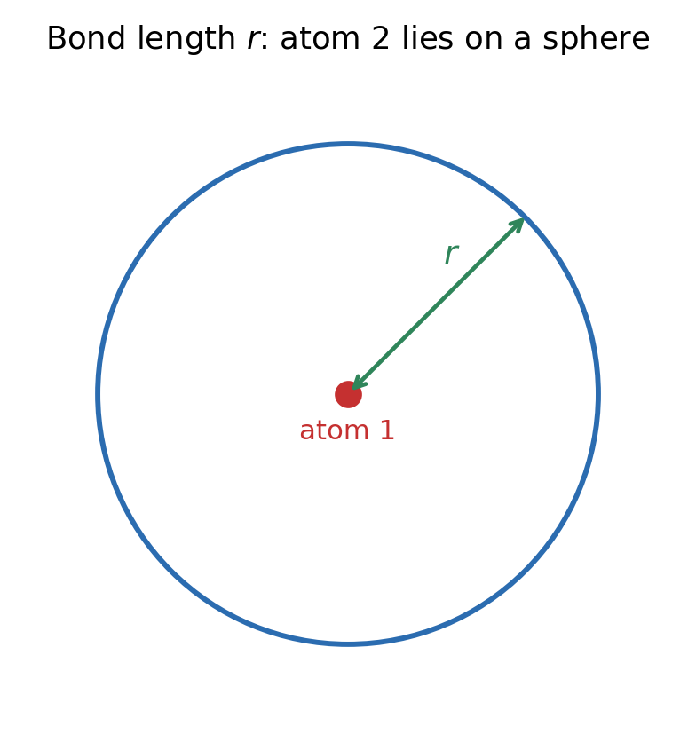

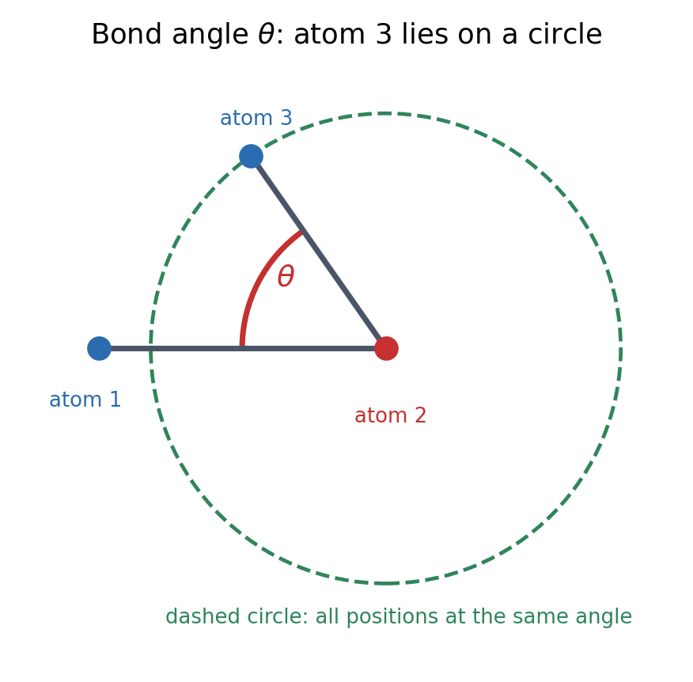

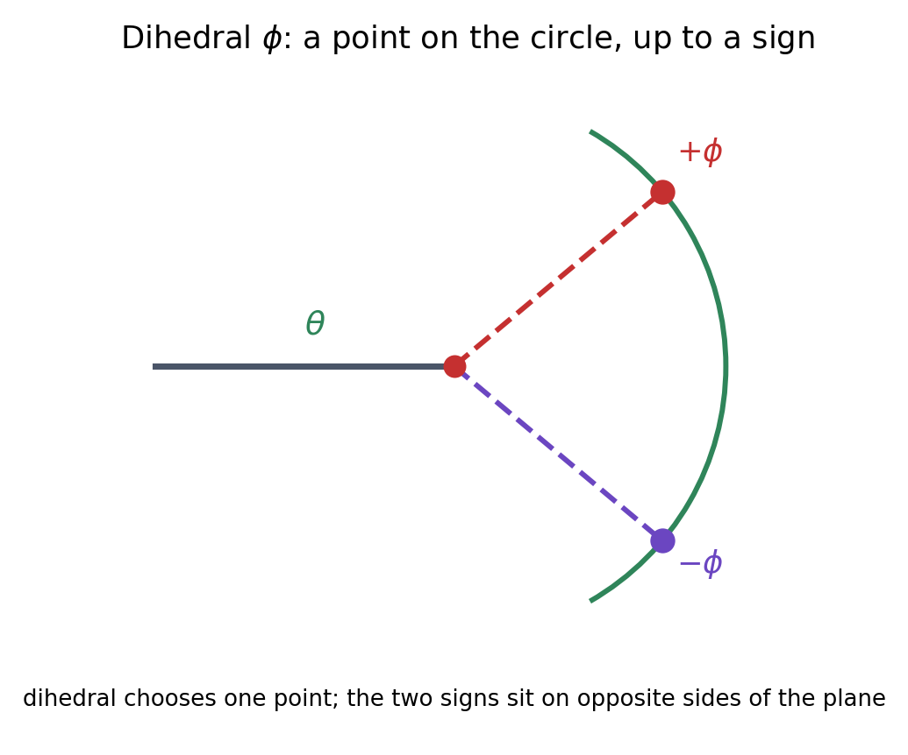

把这三步合起来，就得到重建的算法：

1. 放第一个原子在原点，第二个原子沿轴放，第三个原子放进平面；
2. 对每个后续原子，先按“和谁成键、键长多少”把它放到球面上；
3. 再按“和谁构成键角、角度多少”把它收到圆周上；
4. 最后按“和谁构成二面角、角度多少”把它落到圆周上的一点。

只要每个原子的三个数都给全，结构就被唯一确定了——但“唯一”是相对于前三个原子所定的那个框架而言的。换一个原点、换一根轴、换一个平面，得到的是一组整体旋转/平移后的坐标，内部几何量完全不变。这就是“重建唯一到刚体变换”的含义。

## 七、唯一性到哪里为止：刚体 6 个自由度与镜像二选一

上面的重建过程里，有一个容易被忽略的细节：第四步的“落到圆周上的一点”其实有**两个方向**。

视频在讲最后一个氢时说得很具体：二面角取 $180^\circ$，氢会放在这一侧；取 $0^\circ$，氢会放在另一侧；取 $30^\circ$、$60^\circ$，就落在中间的不同位置。[【跳转到 09:31】](https://www.youtube.com/watch?v=_4Px1tPy8GY&t=571) 也就是说，键长和键角把原子收在一个圆周上，二面角决定它落在圆周的哪个角度；而 $+\phi$ 与 $-\phi$ 对应圆周上关于基准平面对称的两个点。

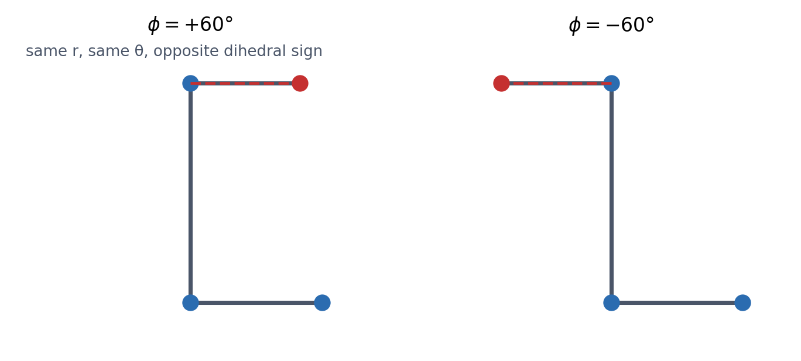

把这两个位置对着前三个原子确定的平面做一次镜面反射，它们正好互换。距离不变、键角不变，只有带符号的二面角变号。这正是手性/镜像歧义的几何来源：

- 如果你只给距离和键角，第四个原子可以在圆周上任意位置，镜像位置也在其中，无法区分；
- 如果你给的是**无符号**的二面角（只给 $|\phi|$），你仍然分不清 $+\phi$ 和 $-\phi$；
- 只有给**带符号**的二面角，才能把“哪一侧”定下来。

所以，内部坐标并不是“无条件唯一重建”。更准确的说法是：

> 给定完整的、带符号的内部坐标（每个原子的 $r,\theta,\phi$），结构唯一到刚体变换；如果只给距离和键角，结构唯一到“圆周上的任意转角”，镜像也包含在这个任意性里。

对有手性中心的分子，这两个位置就是一对对映体；对没有手性中心的分子，它们可能通过分子自身的对称操作重合，看起来“不是两个结构”。但无论哪种情况，**带符号二面角都是区分两侧的那把尺子**。视频没有使用“手性”这个词，但它把原子放在平面两侧的两个位置、并强调二面角的正负，做的正是这件事。

## 八、同一分子可以有不止一张 Z-matrix

视频在搭二氯乙烷时有一个很有说服力的演示：讲到一半，讲者说“如果我换一个顺序”，然后把两个碳先定成骨架、再把甲基相对另一个碳来定义。[【跳转到 30:05】](https://www.youtube.com/watch?v=_4Px1tPy8GY&t=1805) 同一张分子，换一个原子顺序，Z-matrix 的每一行都会变，但几何不变。

这件事说明：**Z-matrix 不是分子图的唯一标签，而是一种参数化选择**。同一张分子可以写出很多张不同的 Z-matrix：

- 可以选不同的原子当“第一个、第二个、第三个”；
- 可以选不同的键作为骨架；
- 可以让某些原子“跨过”一根键去引用另一端的原子，也可以让两端各自内部引用，只留一个二面角跨键。

视频还把两个甲基分别做成“内部引用”，只留一个跨过 C–C 键的二面角，这样扫描这个二面角时，两端的甲基会整体跟着转。[【跳转到 25:21】](https://www.youtube.com/watch?v=_4Px1tPy8GY&t=1521) 这不是唯一写法，而是为了让“想扫的那个自由度”变得独立、干净。视频在 39:02 处也提醒，输出文件里每个二面角都带自己的原子序号定义；换一组原子，数值就会变。[【跳转到 39:02】](https://www.youtube.com/watch?v=_4Px1tPy8GY&t=2342)

对使用内部坐标的模型来说，这一点很重要：比较两个结构的二面角时，必须先确认它们用的是同一组四个原子；否则数值不同可能只是因为“选点”不同，而不是结构真的不同。视频里“同一条键可以选不同邻居来定义二面角”的现象，在 5.1.7 的博客里也有对应讨论。

## 九、对几何学习的含义：周期量用周期表示，手性用带符号量

把视频里的操作翻译成几何学习的语言，可以得到三条直接的结论。

**第一，二面角要按周期量编码。** 既然 $0^\circ$ 和 $360^\circ$ 是同一个几何，直接把 $\phi$ 当成普通标量喂给网络，会在接缝处产生虚假的大距离。更自然的做法是用 $(\sin\phi,\cos\phi)$ 或周期基函数表示，让网络知道“转一圈回到原处”。视频里“36 步 × 10° 转一圈”的扫描，就是这种周期性的最直观演示。[【跳转到 41:42】](https://www.youtube.com/watch?v=_4Px1tPy8GY&t=2502)

**第二，距离和键角不要跟着周期化。** $r\ge 0$、$\theta\in[0,\pi]$，它们没有“转一圈”的结构；把键角也做周期编码，反而会把 $0^\circ$ 和 $360^\circ$ 这种不存在的等价关系引进来。

**第三，内部坐标本身不保证手性。** 距离、键角、无符号二面角在镜面反射下都不变；只有带符号二面角（或等价的定向体积、赝标量）会变号。视频用“平面两侧的两个位置”展示了这一点：重建算法到了最后一步，必须在 $+\phi$ 和 $-\phi$ 之间选一个；这个选择就是手性信息的入口。对需要区分对映体的任务，不能只给距离和键角，也不能把二面角取绝对值。

这三条也解释了本节与 3.2.4 的分工：3.2.4 讲的是“怎样把方向编码成高阶特征”（球谐、阶、张量积），本文讲的是“内部几何量本身是什么、能定住什么”。前者是表示层，后者是几何层；把二面角送进球谐之前，先要弄清楚它是周期量、带符号量，以及它和镜像的关系。

## 小结

- 距离由 2 个原子定义，键角由 3 个原子定义，二面角由 4 个原子定义；同一张 $\mathrm{H_2O_2}$ 上可以同时读出 $1.00\ \text{\AA}$、$109.5^\circ$、$180^\circ$ 这三个量。
- $3N$ 个笛卡尔坐标减去 6 个刚体自由度，剩下 $3N-6$ 个内部自由度；Z-matrix 的“前三个原子定框架、后面每个原子报三个数”正是这个计数的构造性版本。
- 二面角是绕一根键的转角，以 $2\pi$ 为周期；$[0,360^\circ)$ 与 $(-180^\circ,180^\circ]$ 只是剪开圆周的位置不同，$+120^\circ$ 与 $-120^\circ$ 可以是同一个几何位置。
- 键角取值 $[0,\pi]$，不是周期量；把二面角的周期编码套到键角上是错的。
- 重建时，键长把原子放到球面，键角把它收到圆周，二面角把它落到圆周上的一点；给全带符号的 $r,\theta,\phi$，结构唯一到刚体变换。
- 只给距离和键角时，原子还能在圆周上任意转，镜像位置也在其中；只有带符号二面角能区分 $+\phi$ 与 $-\phi$，这就是手性/镜像歧义的入口。
- 同一分子可以写出不同的 Z-matrix；比较二面角前要先固定“用哪四个原子定义它”。

## 关键术语速查

| 术语 | 一句话解释 |
| --- | --- |
| 内部坐标 | 只由分子内部原子相对位置决定的量，常用键长、键角、二面角；不随整体平移/旋转改变。 |
| 键长 $r$ | 两个原子之间的距离，由 2 个原子定义，取值非负。 |
| 键角 $\theta$ | 三个原子形成的夹角，由 3 个原子定义，取值 $[0,\pi]$，不是周期量。 |
| 二面角 $\phi$ | 四个原子形成的转角，等于两个共享一根轴的平面之间的夹角，以 $2\pi$ 为周期。 |
| 带符号二面角 | 保留正负的二面角；$+\phi$ 与 $-\phi$ 分居基准平面两侧，是区分镜像的关键。 |
| Z-matrix | 用“和谁成键、键长、和谁成角、角度、和谁成二面角、角度”逐行描述分子的内部坐标表。 |
| $3N-6$ | $N$ 个原子的 $3N$ 个笛卡尔坐标减去 3 个平移和 3 个转动后剩下的内部自由度个数（非线性分子）。 |
| 刚体变换 | 整体平移与旋转；不改变任何内部几何量，因此重建只能唯一到刚体变换为止。 |
| 环面 $\mathbb{T}^m$ | $m$ 个各自以 $2\pi$ 为周期的角构成的空间；每个方向首尾相接，$0$ 与 $2\pi$ 是同一点。 |
| 手性/对映体 | 互为镜像但不能通过旋转平移重合的结构；距离和键角相同，带符号二面角相反。 |
| 重建 | 从内部坐标（$r,\theta,\phi$）反推笛卡尔坐标的过程；需要先约定前三个原子的框架。 |