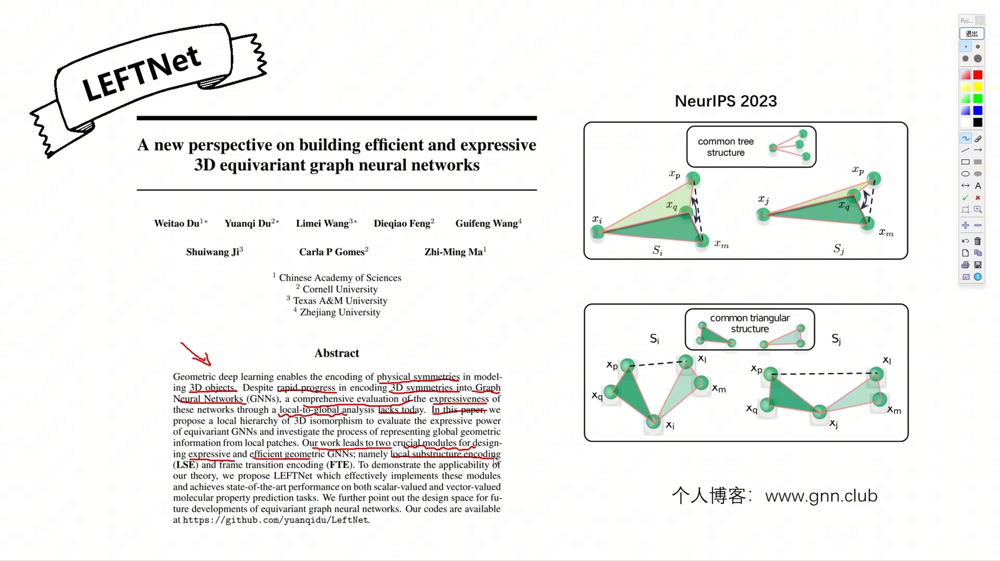
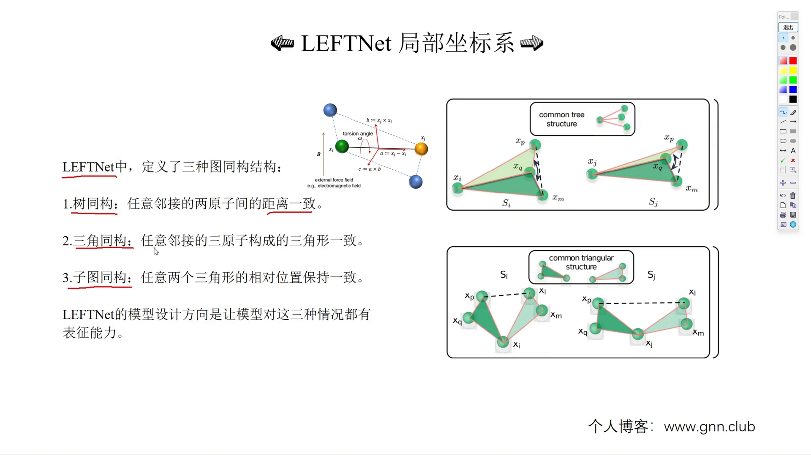
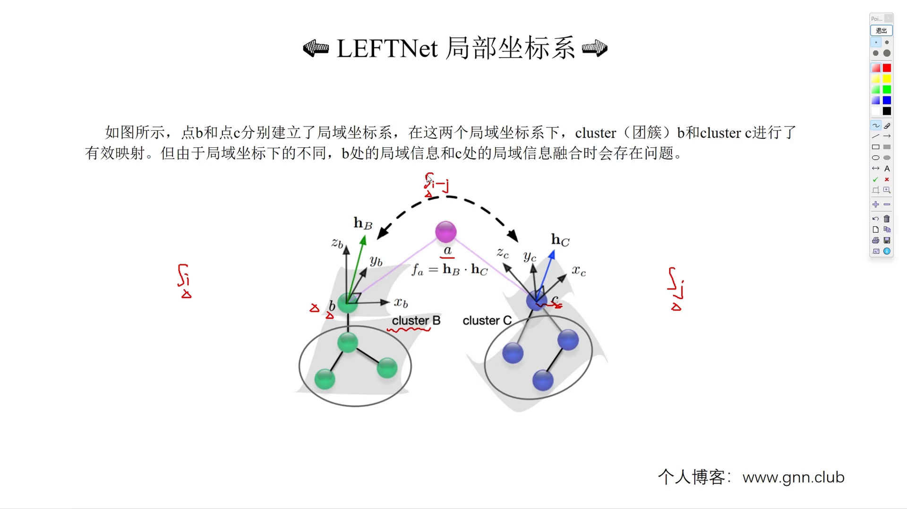
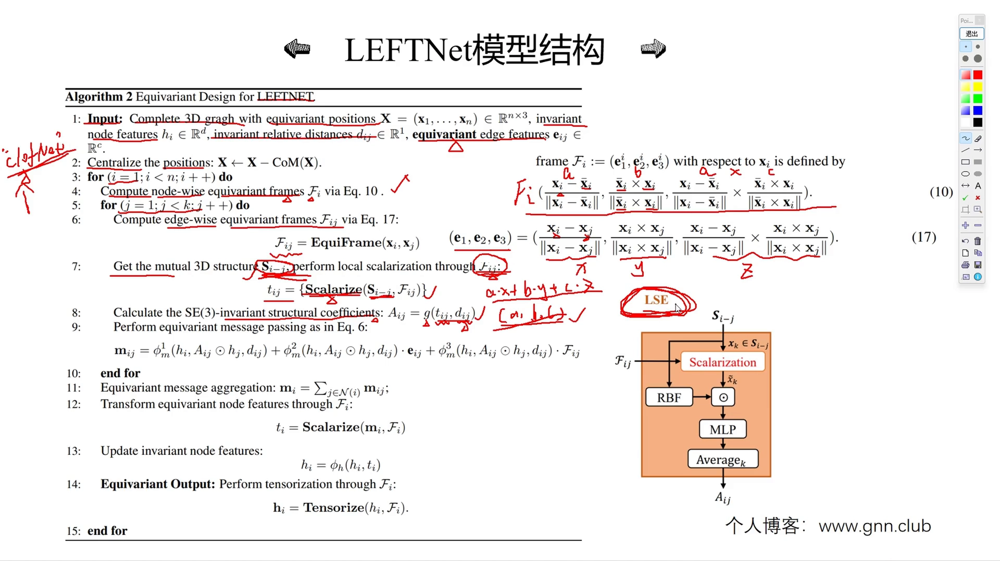
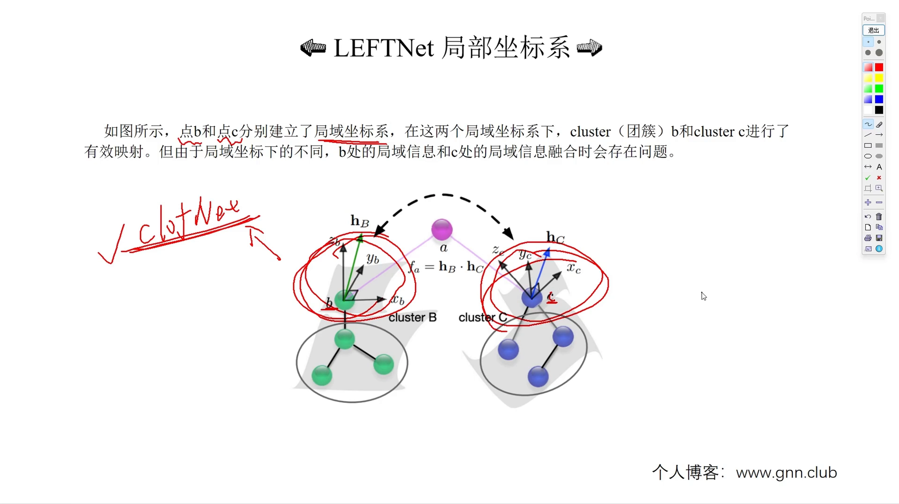
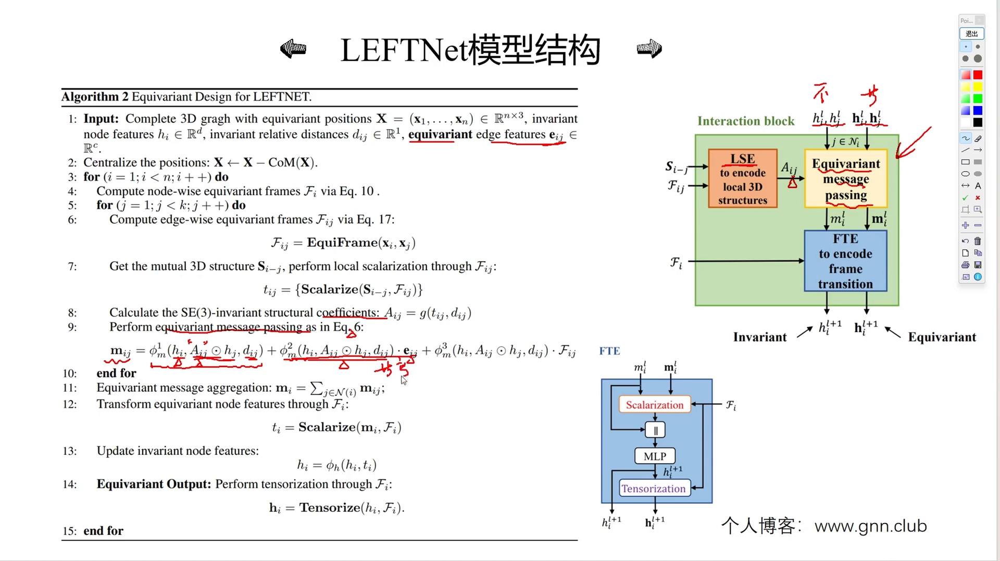
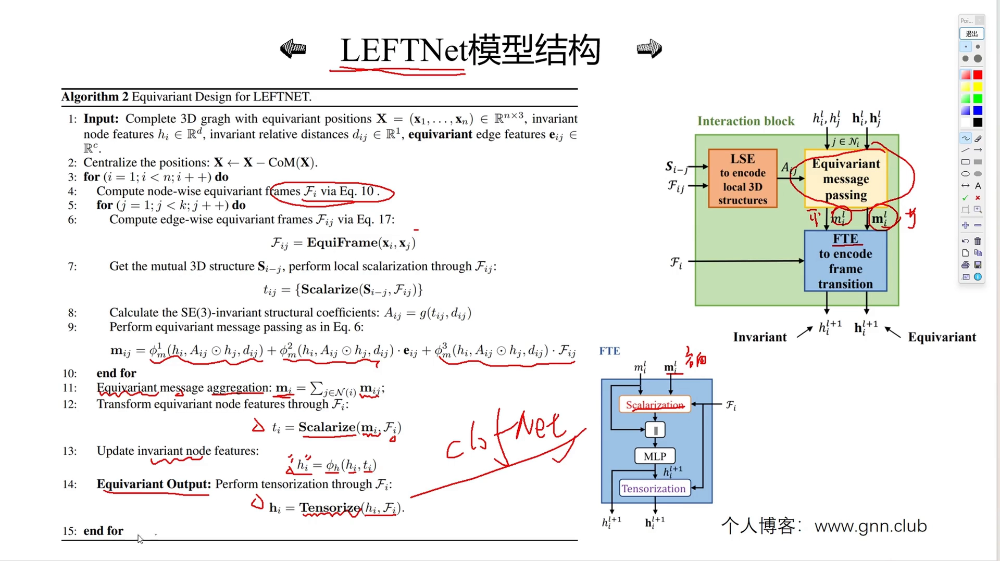
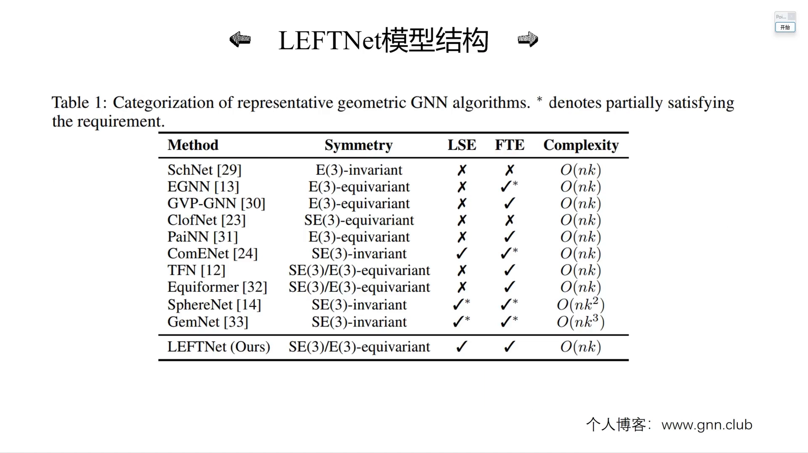
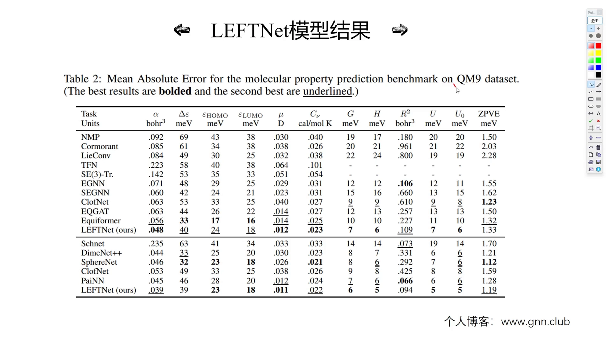

# 局部坐标框架：三个点定一组正交基，相对变换把邻居搬进当前框架

> 视频来源：[几何深度学习（九）：LEFTNet 局部坐标系到全局框架的进阶（NeurIPS 2023）](https://www.bilibili.com/video/BV1NsCGYtEHM/)（B 站 · DeepFinder）｜时长约 38 分钟
> 简要导读：这是一支论文精读视频，主线是"局部坐标系怎么建、邻居坐标怎么搬进去、两个坐标系之间的偏移怎么编码"。本文只取与框架构造、相对变换有关的部分；残基框架在 AlphaFold2 里的用法归 4.1.3 的博客，本文不重复 IPA 推导。

## 本讲要解决的核心问题（SCQA）

**背景**：几何图神经网络把原子坐标当输入。最省事的做法是只喂距离、键角、二面角这类标量，它们对整块分子的旋转、平移都不变。

**冲突**：标量不变，但丢掉了方向。另一条路是直接喂相对向量 $r_{ij}=x_i-x_j$，可这个向量仍然挂在全局坐标系上，分子一转，它跟着转。两种做法都缺同一样东西：一个"以当前原子为中心、跟着它一起转"的坐标系。

**疑问**：这个局部坐标系具体怎么从几个点造出来？造好之后，邻居的绝对坐标怎么变成"相对于我"的坐标？两个不同原子的局部坐标系之间又怎么对齐？

**回答（中心思想）**：三步。第一，用两条向量加一次叉乘造一组右手正交基，原点放在参考点上；第二，把邻居坐标减去原点、再投影到这组基上，得到三个系数——这就是 $R^{\top}(x-t)$，系数与全局旋转无关；第三，两个框架之间的相对旋转本身也要编码，否则局部信息拼不回全局。LEFTNet 的两个核心模块，局部结构编码（LSE）与框架变换编码（FTE），正好对应第二、第三步。

---

## 一、只喂距离不够：局部几何需要一个自己的坐标系

[【跳转到 01:40】](https://www.bilibili.com/video/BV1NsCGYtEHM/?p=1&t=100)

讲者一上来就把论文的两个关键组件点名：一个是**局部结构编码**（local structure embedding，LSE），把节点周边的局部结构压成特征；另一个是**框架偏移编码**，讲者直接把它解释成"框架变换的嵌入"（frame transition embedding，FTE）。作者的整篇故事都围绕这两件事展开。

论文的立论是：几何深度学习已经能很好地编码物理对称性，但"网络到底有多强的表征能力"缺少系统评估，尤其是**从局部到全局**这一段。作者的判断是，一个够用的几何图神经网络，应该同时能把局部结构表达清楚、又能把局部结构之间的关系表达清楚。

## 二、三种图同构：距离、夹角、二面角换了个说法

[【跳转到 02:29】](https://www.bilibili.com/video/BV1NsCGYtEHM/?p=1&t=149)

作者先定义了三级"图同构"，用来衡量模型能区分到什么程度：

- **树同构**：任意相邻两原子间的距离一致；
- **三角同构**：任意相邻三原子构成的三角形一致；
- **子图同构**：任意两个三角形的相对位置保持一致。

[【跳转到 03:44】](https://www.bilibili.com/video/BV1NsCGYtEHM/?p=1&t=224)

讲者当场把这三个名词翻译回基础几何量：树同构对应**距离**（两个节点），三角同构对应**夹角**（三个节点），子图同构对应**二面角**（两个面）。[【跳转到 05:24】](https://www.bilibili.com/video/BV1NsCGYtEHM/?p=1&t=324) 换句话说，这套"高级"术语讲的就是 3.2.1 里那三个内部几何量，只是换了个讲故事的角度。作者由此提出要求：好的模型应该能同时表征这三种结构。

这里值得停一下，因为这张幻灯片左上角的小图已经预告了本文的主角：图上画着 $a=x_j-x_i$、$b=x_i\times x_j$、$c=a\times b$ 三条向量，还有一个二面角。**两条点差加一次叉乘**，就是后面框架构造的全部零件。

## 三、从三个点长出一组正交基

### 3.1 先中心化，再谈"相对"

[【跳转到 11:47】](https://www.bilibili.com/video/BV1NsCGYtEHM/?p=1&t=707)

模型的第一步是把所有坐标减去质心（CoM），也就是**中心化**。讲者的解释是：这样模型不会把空间里任何一个特定位置当成参考点，整个系统怎么平移，输出都不变。这一步是后面所有"相对量"的前提——只有先把整体平移消掉，"用绝对位置做叉乘"才不会被平移污染。

### 3.2 节点框架：第一条轴、第二条轴、叉乘补第三条

[【跳转到 12:12】](https://www.bilibili.com/video/BV1NsCGYtEHM/?p=1&t=732)

节点 $i$ 的框架记作 $\mathcal{F}_i=(\mathbf{e}_i^1,\mathbf{e}_i^2,\mathbf{e}_i^3)$。讲者的口述是：让目标节点的坐标减去中心化之后的参考点坐标，再除以它的模长，作为第一个分量；"同理，让这两个东西的乘积作为第二个分量"；最后把两个分量叉乘，得到第三个分量。

幻灯片上的式 (10) 写得比口述清楚（口述里的"乘积"按幻灯片应为叉乘）：

$$
\mathcal{F}_i=\left(\frac{\mathbf{x}_i-\bar{\mathbf{x}}_i}{\lVert \mathbf{x}_i-\bar{\mathbf{x}}_i\rVert},\ \frac{\bar{\mathbf{x}}_i\times\mathbf{x}_i}{\lVert \bar{\mathbf{x}}_i\times\mathbf{x}_i\rVert},\ \frac{\mathbf{x}_i-\bar{\mathbf{x}}_i}{\lVert \mathbf{x}_i-\bar{\mathbf{x}}_i\rVert}\times\frac{\bar{\mathbf{x}}_i\times\mathbf{x}_i}{\lVert \bar{\mathbf{x}}_i\times\mathbf{x}_i\rVert}\right)
$$

### 3.3 边框架：把"三个点"凑齐

[【跳转到 13:52】](https://www.bilibili.com/video/BV1NsCGYtEHM/?p=1&t=832)

边 $(i,j)$ 的框架用两个节点就够，式 (17) 是：

$$
(\mathbf{e}_1,\mathbf{e}_2,\mathbf{e}_3)=\left(\frac{\mathbf{x}_i-\mathbf{x}_j}{\lVert \mathbf{x}_i-\mathbf{x}_j\rVert},\ \frac{\mathbf{x}_i\times\mathbf{x}_j}{\lVert \mathbf{x}_i\times\mathbf{x}_j\rVert},\ \frac{\mathbf{x}_i-\mathbf{x}_j}{\lVert \mathbf{x}_i-\mathbf{x}_j\rVert}\times\frac{\mathbf{x}_i\times\mathbf{x}_j}{\lVert \mathbf{x}_i\times\mathbf{x}_j\rVert}\right)
$$

这里其实仍然是"三个点"：中心化之后原点本身就是一个有意义的点，$\mathbf{x}_i$ 与 $\mathbf{x}_j$ 是另外两个点。三个点不共线，$\mathbf{x}_i\times\mathbf{x}_j$ 就不为零，框架才唯一——这也是为什么模型要先做中心化：不中心化，原点只是个任意的坐标零点，"三点定框架"这句话就站不住。

把两式对照着看，构造步骤其实是同一个模板，可以写成三步：

1. **定原点**：取一个参考点 $t$（节点框架用 $\bar{\mathbf{x}}_i$，边框架用 $\mathbf{x}_j$）。框架是"一组基 + 一个原点"，原点这一步不能省。
2. **定第一条轴**：取一条点差并归一化，$\mathbf{e}_1=(\mathbf{x}_a-\mathbf{x}_b)/\lVert\mathbf{x}_a-\mathbf{x}_b\rVert$。这条轴就是"从一个点指向另一个点"的方向。
3. **定第二条轴、第三条轴**：第二条轴取两条向量的叉乘再归一化，第三条轴取前两条轴的叉乘，$\mathbf{e}_3=\mathbf{e}_1\times\mathbf{e}_2$。

### 3.4 正交化：叉乘一步就做完了

[【跳转到 13:27】](https://www.bilibili.com/video/BV1NsCGYtEHM/?p=1&t=807)

讲者对正交性的解释只有一句："因为叉乘的性质，这三个分量所构成的坐标系是相互正交的。"把这句话展开就是：叉乘结果垂直于两个乘数，所以 $\mathbf{e}_2\perp\mathbf{e}_1$；$\mathbf{e}_3$ 又垂直于 $\mathbf{e}_1$ 和 $\mathbf{e}_2$；三个向量都归一化之后，$\lVert\mathbf{e}_1\times\mathbf{e}_2\rVert=1$，于是 $\mathbf{e}_3$ 自动是单位向量。三轴两两正交、长度为一，就是一组标准正交基。

和线性代数课上讲的 Gram–Schmidt 相比，这里的做法是"叉积版"的：Gram–Schmidt 拿第二条向量减去它在第一条上的投影，得到正交分量；这里直接取叉乘，一步同时完成正交化和补全第三轴。代价是叉乘只适用于三维，而且对输入更挑剔——两条向量一旦共线，叉乘直接归零。

### 3.5 手性：第三个轴取哪个方向是建模选择

第三个轴写成 $\mathbf{e}_3=\mathbf{e}_1\times\mathbf{e}_2$，而不是反过来，就把框架钉成了**右手系**。这不是数学上唯一的选择：交换 $\mathbf{e}_1$ 与 $\mathbf{e}_2$ 的顺序，或者把 $\mathbf{e}_3$ 取反，得到的是镜像的框架，同一个分子在两种框架下的局部坐标会差一个符号。对分子来说这不是小事——手性分子和对映体就是靠这种符号差异区分的，3.1.2 里"反射会翻转手性"讲的就是同一件事。

### 3.6 退化情形：分母为零时框架不存在

式 (10) 与式 (17) 里每个分量都在除以一个模长。以边框架为例，$\lVert\mathbf{x}_i\times\mathbf{x}_j\rVert=0$ 时（中心化之后两条位置向量共线），第二、第三个分量都没有定义；$\lVert\mathbf{x}_i-\mathbf{x}_j\rVert=0$ 时（两个节点重合），第一条轴也没有定义。

这就是"三个非共线点"这个前提的实际含义：两点定一条线，第三点只要不落在这条线上，叉乘就不为零，平面和法向才唯一；三点共线时平面不唯一，框架退化。视频没有讨论这一情形，这里按公式分母直接读出，作为使用时的边界条件记下：真实结构里键长不会为零，但对称排布的原子（比如某些共线三元组）会让叉乘接近零，数值上需要留意。

## 四、相对变换：把邻居搬进当前框架

### 4.1 标量化：三个系数就是局部坐标

[【跳转到 15:32】](https://www.bilibili.com/video/BV1NsCGYtEHM/?p=1&t=932)

框架造好之后，讲者马上用它做一件事：把 I、J 的共同邻居 $S_{i-j}$ 里的每个点，**映射到** $\mathcal{F}_{ij}$ 这个局部坐标系下。他的说法是：任何一个向量都可以表示成"一个系数乘 X 加另一个系数乘 Y 加一个系数乘 Z"，把这三个系数拿出来当特征，这一步叫**标量化**（scalarization）。

### 4.2 把"投影取系数"写成式子

口述里的"投影后取系数"，写成矩阵就是本节要补的那一行。设框架的三个轴按列排成矩阵 $R=[\mathbf{e}_1,\mathbf{e}_2,\mathbf{e}_3]\in\mathbb{R}^{3\times3}$，原点为 $t$，那么点 $x$ 在这个框架里的局部坐标是：

$$
x^{\text{local}}=R^{\top}(x-t)=\begin{pmatrix}\mathbf{e}_1^{\top}(x-t)\\ \mathbf{e}_2^{\top}(x-t)\\ \mathbf{e}_3^{\top}(x-t)\end{pmatrix}
$$

反向也成立，因为 $R$ 是正交矩阵（$R^{\top}R=I$）：

$$
x=R\,x^{\text{local}}+t
$$

这两行就是"相对变换"的全部内容。第一行做两件事：先减原点（平移），再左乘 $R^{\top}$（旋转到框架的基底下）。第二行把它变回去。

### 4.3 几何含义：三个系数是三条轴上的投影长度

$x^{\text{local}}$ 的三个分量，分别是 $x-t$ 在三条基向量上的投影长度。它们描述的是"这个邻居在我前面多远、左边多远、上面多远"，而不是"它在世界的哪个绝对位置"。

关键性质在这里：如果整块分子被旋转 $Q$、平移 $b$，那么每个框架的基向量也跟着转，$R'=QR$，$t'=Qt+b$，代进去

$$
R'^{\top}(x'-t')=(QR)^{\top}(Q(x-t))=R^{\top}Q^{\top}Q(x-t)=R^{\top}(x-t)
$$

局部坐标**一个数都不变**。这正是讲者反复强调的"不变性特征"的来源：系数本身没有方向，空间怎么转它都不动。

### 4.4 与"不用框架的相对向量"对照

同样是描述邻居，$r_{ij}=x_i-x_j$ 只是做减法，得到的仍是全局坐标系下的向量，分子一转它就转，因此必须靠坐标分支的等变性把旋转吸收掉（这条路线见 [《几何深度学习（五）：EGNN 等变性几何图神经网络》](../../../4_分子几何表示与等变网络/4.1_等变网络/4.1.2_等变消息传递：特征更新与坐标更新/几何深度学习（五）：EGNN%20等变性几何图神经网络.md)）。框架路线则把旋转吸收进框架本身：$R^{\top}$ 一乘，旋转被抵消，剩下的是纯标量系数。两条路线的差别不在"用不用向量"，而在**旋转在哪一步被消掉**。

## 五、局部结构编码：系数和距离一起进网络

[【跳转到 17:12】](https://www.bilibili.com/video/BV1NsCGYtEHM/?p=1&t=1032)

拿到系数之后，模型并没有直接把它们喂进网络，而是先做一次交互。LSE 模块的流程是：共同邻居 $S_{i-j}$ 的每个点先用 $\mathcal{F}_{ij}$ 标量化，得到不变的系数特征；这组系数再与距离 $d_{ij}$ 的径向基函数（RBF）编码相乘；乘完的结果送进 MLP，最后对共同邻居做平均池化，输出 $A_{ij}$。

[【跳转到 17:37】](https://www.bilibili.com/video/BV1NsCGYtEHM/?p=1&t=1057)

讲者的解释是"不变性的局部信息跟距离信息做一次交互"。从信息角度看，这一步把两件事捏在一起：**方向**（系数，来自框架）和**尺度**（距离，来自 RBF）。单看距离，只知道邻居多远；单看系数，只知道邻居在框架的哪个方位；两者相乘，才是一个完整的局部几何描述。

## 六、等变消息传递：不变项、等变项、框架项三路合成

[【跳转到 18:27】](https://www.bilibili.com/video/BV1NsCGYtEHM/?p=1&t=1107)

消息 $m_{ij}$ 由三项相加，讲者逐项拆解：

$$
\mathbf{m}_{ij}=\phi^1_m(h_i,A_{ij}\odot h_j,d_{ij})+\phi^2_m(h_i,A_{ij}\odot h_j,d_{ij})\cdot\mathbf{e}_{ij}+\phi^3_m(h_i,A_{ij}\odot h_j,d_{ij})\cdot\mathcal{F}_{ij}
$$

- **第一项**：输入是节点特征 $h_i$、局部结构系数 $A_{ij}$ 与距离 $d_{ij}$，全是标量，输出也是标量，负责**不变信息**。
- **第二项**：同样的输入过网络，再乘上边特征 $\mathbf{e}_{ij}$。边特征是向量、带方向，所以这一项是**等变信息**。
- **第三项**：同样输入，乘上框架 $\mathcal{F}_{ij}$。讲者在这里说了一句关键的话：这个框架"可以理解成从局部框架到全局框架的迁移"。

[【跳转到 20:32】](https://www.bilibili.com/video/BV1NsCGYtEHM/?p=1&t=1232)

为什么需要第三项？因为前两项再完整，也只描述了"在某个局部框架里长什么样"。两个相邻节点各有各的框架，如果只把各自的局部描述拼起来，模型并不知道这两个框架在全局里是怎么相互摆放的。乘上 $\mathcal{F}_{ij}$ 相当于把局部建模"延展到全局建模"，表征能力才补全。

## 七、框架变换：两个局部框架之间的偏移

[【跳转到 09:09】](https://www.bilibili.com/video/BV1NsCGYtEHM/?p=1&t=549)

讲者用一个类比解释这件事为什么重要：点 B 和点 C 各自的局部坐标系像两个原生家庭，B 和 C 是一对夫妻；两个家庭生活环境不同，小两口刚在一起难免有矛盾，需要找一个双方都认识的中间人调解。这个"中间人"就是 B 和 C 的**共同邻居** A。以 A 为参考点去建模 B、C 的局部信息，比各说各话更公平。

落到计算上，就是 FTE 模块：

[【跳转到 22:15】](https://www.bilibili.com/video/BV1NsCGYtEHM/?p=1&t=1335)

1. **聚合**：把所有邻居发来的消息 $m_{ij}$ 求和，得到节点级消息 $m_i$；
2. **标量化**：把 $m_i$ 放进**节点自己的框架** $\mathcal{F}_i$ 里，变成不变的标量特征 $t_i$；
3. **更新**：$t_i$ 与节点自身特征 $h_i$ 拼接，过 MLP，得到更新后的不变特征 $h_i^{l+1}$；
4. **张量化**：把更新后的特征在同一个框架里重新展开成向量，得到等变输出 $\mathbf{h}_i^{l+1}$。

[【跳转到 24:20】](https://www.bilibili.com/video/BV1NsCGYtEHM/?p=1&t=1460)

讲者把整个流程对照伪代码又走了一遍：中心化与建框架（第 2–6 行）→ LSE（第 7–8 行）→ 等变消息传递（第 9–11 行）→ FTE（第 12–14 行）。他强调，"先标量化、后向量化"这一对操作同时作用在不变消息与等变消息上，最后才得到更新后的节点特征与方向特征。

这里可以看清"框架"在整条链路里的三重身份：它是**表示工具**（把坐标变成系数）、是**消息的载体**（第三项乘上它）、也是**更新的通道**（FTE 在它里面标量化与张量化）。少了任何一重，局部信息都出不去或回不来。

## 八、在方法谱系里的位置：LSE 与 FTE 是两把尺子

[【跳转到 26:12】](https://www.bilibili.com/video/BV1NsCGYtEHM/?p=1&t=1572)

作者用一张表把代表性几何 GNN 按"有没有 LSE、有没有 FTE、复杂度多少"排了一遍，讲者逐个点评：

- **SchNet**：只用距离给不同边分配权重，只有树同构级的表征能力，LSE 与 FTE 都没有；
- **EGNN / GVP-GNN / PaiNN**：引入向量来携带方向，具备全局框架偏移的表达能力，但对距离、夹角、二面角这些不变特征没有显式建模，距离只是拼在边特征上；
- **ClofNet**：提出了局部坐标系，讲者认为它其实已经具备一定的 LSE，但全局框架偏移确实没有——这正是 LEFTNet 相对它的最大改进；
- **ComENet / SphereNet / GemNet**：同时建模距离、夹角、二面角，因此局部与全局都具备，代价是复杂度更高（SphereNet 为 $O(nk^2)$，GemNet 为 $O(nk^3)$）；
- **LEFTNet**：自称两者都具备，复杂度仍是 $O(nk)$。

[【跳转到 29:32】](https://www.bilibili.com/video/BV1NsCGYtEHM/?p=1&t=1772)

讲者在这里插了一段个人意见，值得记下来：他认为 ClofNet 的坐标系"确实能够很好地表征局部的几何关系"，作者给 ClofNet 打叉可能是因为它的特征提取方式太简单——只是把投影系数单独拎出来，没有用球谐函数、径向基函数这类数学语言去描述关键信息。这是讲者的猜测，他也说明论文里没有详细讲这一点。

## 九、这套构造在残基几何网络里对应什么

视频讲的是小分子，没有出现蛋白质。但同一套构造在残基几何网络里逐项对得上，这里只做对应，不重复推导：

| 视频里的对象 | 残基几何网络里的对应物 |
| --- | --- |
| 节点框架 $\mathcal{F}_i$，原点取参考点 | 每个残基一个框架，原点取 $\mathrm{C}_\alpha$ |
| 第一、二条轴由点差与叉乘给出 | 轴由 $\mathrm{N}$、$\mathrm{C}_\alpha$、$\mathrm{C}$ 三个骨架原子给出，叉乘定出平面法向 |
| 标量化 $R^{\top}(x-t)$ | 把邻居原子坐标写进当前残基框架，得到三个系数 |
| FTE：两个框架之间的偏移 | 两个残基框架之间的相对旋转，是框架对齐与框架间比较的对象 |

三点定框架这一步，在残基上的实例就是 N–Cα–C 这三个共面原子：三点定一个平面，平面给出法向，法向与平面内两个方向凑成一组正交基。至于这套框架在 AlphaFold2 里怎么被 IPA 用作几何注意力的输入、FAPE 又怎么以框架为单位对齐后算误差，见 [《第04讲：用 AlphaFold2 / OpenFold 做结构预测》](<../../../../../../生命科学/生命科学基础/B03_蛋白质结构与功能基础/5_结构比较、几何质量与预测置信度/5.2_预测置信度与功能结论/5.2.1_结构预测置信度：pLDDT、PAE、pTM 与 ipTM/第04讲_Structure Prediction with AlphaFold2 and OpenFold.md>)，本文不重复。正交矩阵 $R^{\top}R=I$ 与"平移只挪原点"这两条性质，3.1.2 有完整说明，是本文两行式子的直接依据。

## 十、实验结果与讲者的保留意见

[【跳转到 35:26】](https://www.bilibili.com/video/BV1NsCGYtEHM/?p=1&t=2126)

实验在 QM9 上做分子属性预测，LEFTNet 在 $\alpha$、$\mu$、$C_v$、$G$、$H$、$U_0$ 等指标上取得最好或次好的结果，整体与 Equiformer、ClofNet、PaiNN 处于同一档。

[【跳转到 36:40】](https://www.bilibili.com/video/BV1NsCGYtEHM/?p=1&t=2200)

讲者对这类对比实验的态度很直接：每个工作都会大量调参，"之前的工作如果你好好调参，说不定可能比 LEFTNet 还高一点"，所以不要把一张表当成模型优劣的定论；实验要做，是因为它体现工作量，也向审稿人证明你确实比较过经典模型。真正值得学的是它**看问题的角度**——用"局部结构 + 框架偏移"两把尺子去衡量一个几何网络缺什么。

## 小结

- 几何 GNN 只喂距离、夹角、二面角，等于只做到"树同构 / 三角同构 / 子图同构"这三级里的前几级；要表达局部结构，需要一个跟着局部一起转的坐标系。
- 框架的构造有固定模板：**定原点 → 一条点差归一化作第一轴 → 叉乘归一化作第二轴 → 两轴叉乘作第三轴**。节点框架与边框架只是取点不同。
- 叉乘一步完成正交化与补全，等价于三维版的 Gram–Schmidt；第三个轴写成 $\mathbf{e}_3=\mathbf{e}_1\times\mathbf{e}_2$ 就把手性钉成右手系，取反则得到镜像框架。
- 三点共线时叉乘为零，框架退化——"三个非共线点"不是修辞，是分母不为零的条件。
- 相对变换就是 $x^{\text{local}}=R^{\top}(x-t)$：先减原点再投影到三条轴上，得到三个投影长度；全局旋转被 $R^{\top}$ 抵消，系数不变。
- 只做局部表示还不够，两个框架之间的偏移必须单独编码（FTE），否则局部信息拼不回全局。

## 关键术语速查

| 术语 | 一句话解释 |
| --- | --- |
| 局部坐标框架 | 一组正交基加一个原点；有了它，绝对坐标才能写成"相对于我"的坐标 |
| 标量化（scalarization） | 把一个向量投影到框架的三条轴上，取出三个系数当特征；系数不带方向，所以是不变量 |
| 张量化（tensorization） | 标量化的逆操作，把三个系数按三条基向量重新组合成向量 |
| LSE（局部结构编码） | 把共同邻居用边框架标量化，再与距离的 RBF 编码交互，压成结构系数 $A_{ij}$ |
| FTE（框架变换编码） | 把聚合后的消息放进节点自己的框架里标量化，更新特征后再张量化回向量 |
| 树同构 / 三角同构 / 子图同构 | 分别对应距离、夹角、二面角三级几何约束，用来衡量模型能区分到哪一级 |
| 中心化（CoM） | 所有坐标减去质心，消掉整体平移，使"用绝对位置做叉乘"仍然平移不变 |
| 右手系 | 第三个基向量取 $\mathbf{e}_1\times\mathbf{e}_2$ 的框架；取反会得到镜像框架，手性随之翻转 |
