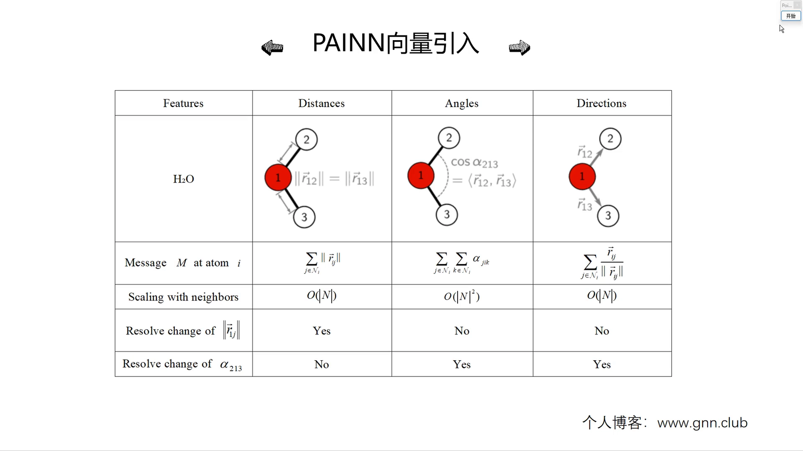
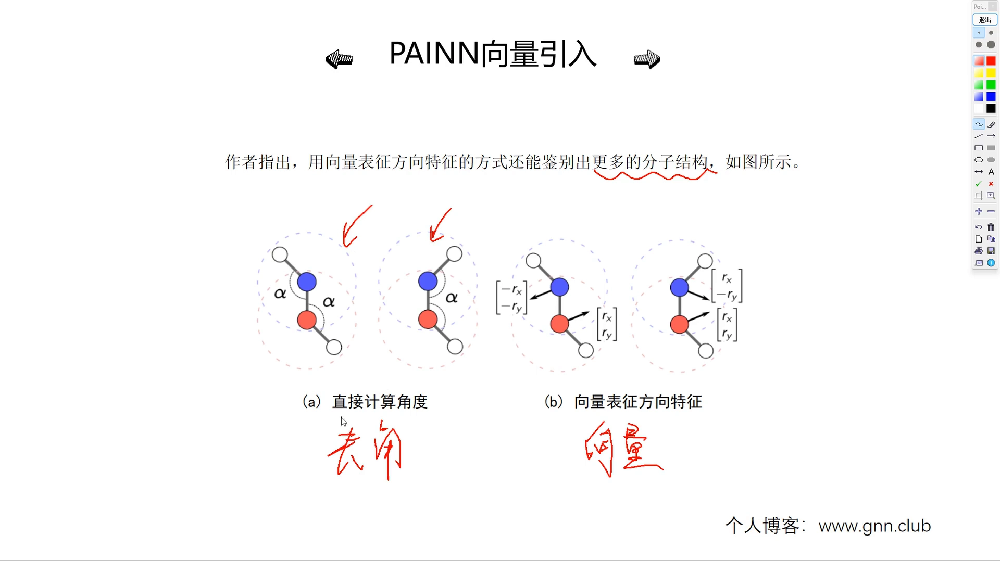
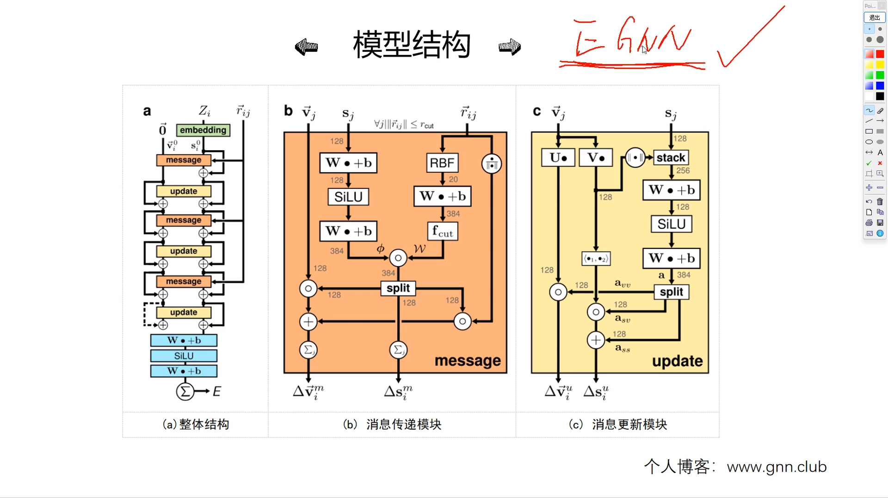
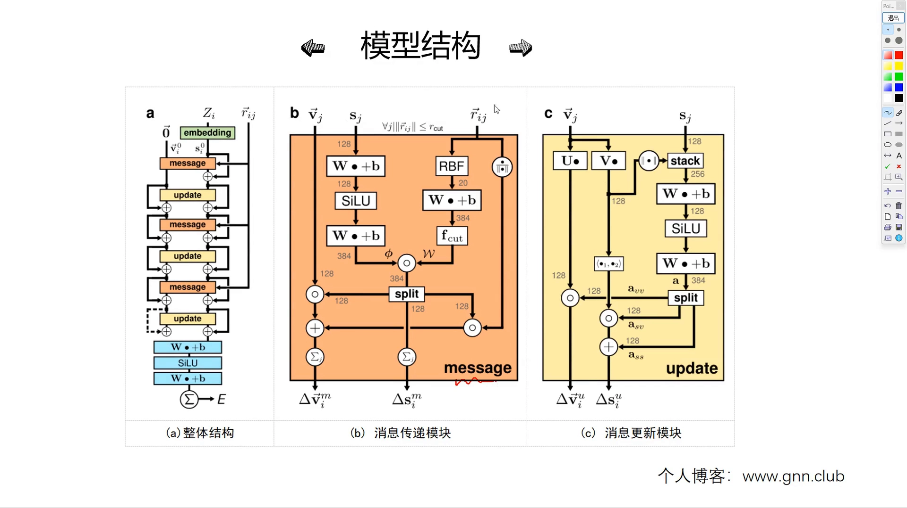
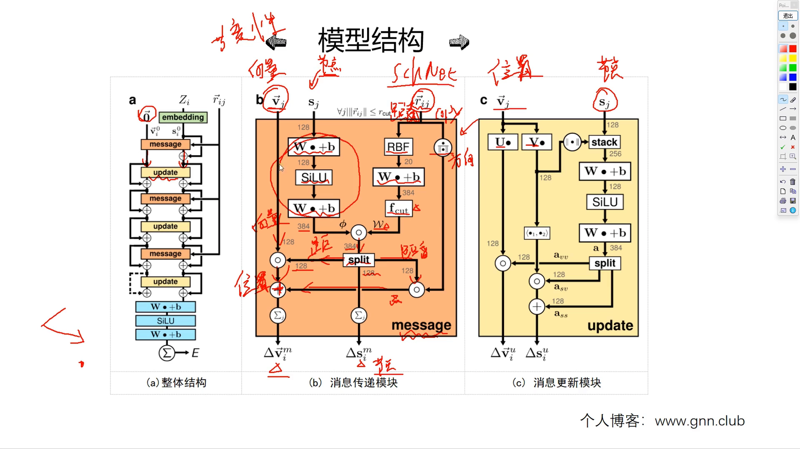
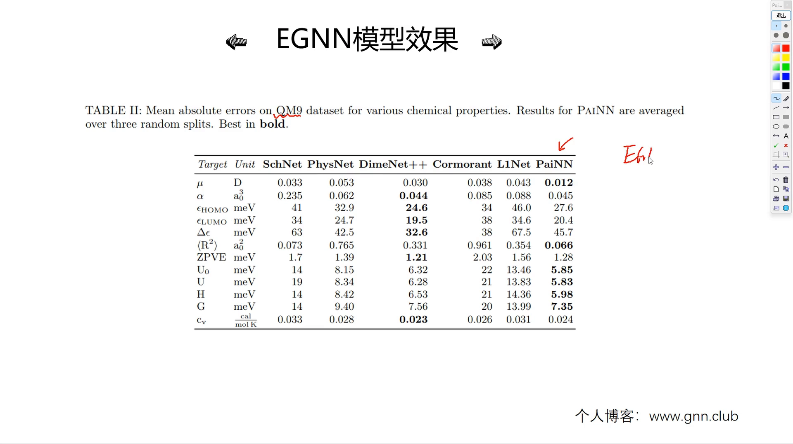

# PaiNN：标量流与向量流在同一层里交互

> 视频来源：[几何深度学习（六）：PAINN 等变性超越不变性的里程碑](https://www.bilibili.com/video/BV1hfBKY3Esu/)（Bilibili · DeepFinder，前沿论文精讲系列）｜时长约 22 分钟
> 本篇整理这期论文精讲。它顺着「距离 → 夹角 → 向量」这条线，说明为什么要把向量引进来，再逐块拆开 PaiNN 的消息模块与更新模块，看标量特征和向量特征是怎么互相作用的。字幕里的「PAINN / PAIN」统一订正为 **PaiNN**，「EJN / JENN / EGN」订正为 **EGNN**，「ishnight / shnet」订正为 **SchNet**，「dimenight」订正为 **DimeNet**。特征类型的完整定义与合法运算见同目录 [标量、向量与不可约表示](标量、向量与不可约表示：几何网络的特征是有类型的.md)；EGNN 的等变消息传递见 4.1.2，GVP 见 4.1.4。

## 本讲要解决的核心问题（SCQA）

**背景**：分子图网络早期的主流做法是只用**不变量**——原子间距离、三原子夹角。这类模型（SchNet、DimeNet）把几何信息压缩成不随旋转变化的标量，等变性问题自然消失。

**冲突**：只用标量会丢信息。距离只知道「多远」，不知道「往哪个方向」；夹角能补一点方向信息，但计算代价是邻居数的平方，而且仍然区分不了某些结构。PaiNN 的作者用一张图说明：**两个不同的分子结构可以有完全相同的夹角，只有向量能靠方向把它们分开**。

**疑问**：既然向量信息更丰富，那怎么把它放进网络？直接对向量的三个分量做全连接会破坏等变，那向量分支到底允许做哪些运算，又怎么和标量分支交换信息？

**回答（中心思想）**：PaiNN 同时维护**标量流** $s$（不变）和**向量流** $\vec{v}$（等变），并让两者在每一层里**互相门控**：标量用距离和节点特征算出，用来缩放向量；向量只做**线性**变换（乘权重矩阵、乘标量系数），绝不加偏置和激活函数；两条流通过点乘与标量门控 $a_{vv}, a_{sv}, a_{ss}$ 融合。PaiNN 是第一个把等变模型的精度调到超越不变模型的模型，但它也提醒：**等变不是一定比不变好，归纳偏置要和任务匹配**。

## 一、为什么要把向量引进来

### 1.1 三种几何特征的表格式对比

讲者说 PaiNN 的作者「更会讲故事」，因为论文用一张表把三种特征放在一起比：距离、夹角、方向（向量）。[【跳转到 02:30】](https://www.bilibili.com/video/BV1hfBKY3Esu/?t=150)

这张表有四行值得逐个读：

| 对比项 | 距离 | 夹角 | 方向（向量） |
| :--- | :--- | :--- | :--- |
| 消息形式 | 距离的求和 | 夹角的加权求和 | 单位方向向量的求和 |
| 随邻居数的复杂度 | $O(N)$ | $O(N^2)$ | $O(N)$ |
| 能否分辨距离变化 | 能 | 不能 | 不能 |
| 能否分辨角度变化 | 不能 | 能 | 能 |

讲者的解读很直接：

- **距离**计算最简单，就是一个模长，复杂度 $O(N)$。只要几何结构变了，模长就能捕捉到，所以它能表征距离。[【跳转到 02:55】](https://www.bilibili.com/video/BV1hfBKY3Esu/?t=175)
- **夹角**能对角度建模（它本身就是角度），但反过来不能对距离建模，而且因为它涉及三个节点，复杂度是平方级的 $O(N^2)$。[【跳转到 03:20】](https://www.bilibili.com/video/BV1hfBKY3Esu/?t=200)
- **向量**的复杂度很低，和算距离一样是 $O(N)$——因为算一个向量就是一次减法：用节点 $i$ 的位置减去邻居 $j$ 的位置。它和夹角一样不能直接表明距离，但能对方向建模。[【跳转到 04:10】](https://www.bilibili.com/video/BV1hfBKY3Esu/?t=250)

所以 DimeNet 这类不变性模型会同时用距离和夹角，把两种信息都吃进来；而 PaiNN 选择用**向量**来替代夹角——算起来更便宜，信息还更全。

### 1.2 向量比夹角强在哪：一个反例

讲者给了一个很直观的例子：两个分子结构，三原子夹角 $\alpha$ 完全一样，但结构明显不同。**夹角没办法区分它们，向量可以**——因为向量的方向性指示了「这个邻居在这一侧还是那一侧」。[【跳转到 05:00】](https://www.bilibili.com/video/BV1hfBKY3Esu/?t=300)

这就是 PaiNN 和 EGNN 都选择引入向量的原因。讲者顺带澄清：两者都是 2021 年的工作，思路不谋而合，但**不存在谁抄谁**。[【跳转到 01:40】](https://www.bilibili.com/video/BV1hfBKY3Esu/?t=100)

## 二、模型结构：两条流加一个交互

### 2.1 输入与整体骨架

PaiNN 的输入有三部分：节点自身的属性 $z_i$（经过 embedding 得到标量特征 $s_i^0$）、初始化的零向量 $\vec{v}_i^0=\vec{0}$（表示初始的位置/方向信息），以及相对位置 $\vec{r}_{ij}$。[【跳转到 06:30】](https://www.bilibili.com/video/BV1hfBKY3Esu/?t=390)

可以把整个模型一分为二来看：

- **右边这条逻辑**针对**不变性信息**做建模。虽然送进来的是向量 $\vec{r}_{ij}$，但后续会把它变成距离（取模长），取消方向性。
- **左边这条逻辑**针对**等变性信息**做建模，处理的是向量流 $\vec{v}$，可以理解成位置信息。

关键在于：这两条流**不是各自独立**的。消息传递模块和消息更新模块都会让不变性信息和等变信息做交互、做特征融合。这和 EGNN 有很大区别——讲者形容 EGNN「很简单很暴力」：单独搞两个分支，一个分支更新节点信息 $h_i$，一个分支更新位置信息 $x_i$，各自玩各自的。[【跳转到 07:45】](https://www.bilibili.com/video/BV1hfBKY3Esu/?t=465)

讲者还点出一个容易忽略的事实：EGNN 最后输出两个东西（位置 $x_i$ 和节点特征 $h_i$）。如果下游任务只用到 $h_i$、不用 $x_i$，那这个 EGNN 实际上退化成了基于不变性的模型——**因为等变性全蕴含在 $x_i$ 里**。[【跳转到 08:35】](https://www.bilibili.com/video/BV1hfBKY3Esu/?t=515)

### 2.2 消息模块：标量出三份，两份去更新向量

先看标量这一侧。邻居节点 $j$ 的标量特征经过「线性层 → 激活函数 → 线性层」，输出一个 384 维的特征向量，这是对节点信息的建模。[【跳转到 09:25】](https://www.bilibili.com/video/BV1hfBKY3Esu/?t=565)

再看向量这一侧。相对向量 $\vec{r}_{ij}$ 被复制成两份：

- 一份经过 **RBF**（径向基函数）把距离展开，再过一个线性层，得到 384 维；
- 同时设置了**截断距离**：如果邻居 $j$ 的距离超过阈值，做消息传递时就不考虑它，以降低复杂度。讲者指出这个技巧最早出现在 SchNet 里，而这个分支本身就可以看作 SchNet 的连续型卷积——$W$ 是连续卷积核的生成函数。[【跳转到 10:15】](https://www.bilibili.com/video/BV1hfBKY3Esu/?t=615)

两份特征做**点乘**，相当于让节点属性在做特征更新时「看到」距离信息；点乘结果再过一个 $\phi$（非线性），得到 384 维的消息，然后被 **split 成三份 128 维**：

- 一份直接输出，作为更新后的标量特征 $\Delta s_i^m$；
- 另外两份都去参与向量流的更新。

向量流这一侧，初始的 $\vec{v}_j$（零向量）先与从标量分支过来的特征做点乘——这就是**不变信息与等变信息的第一次交互**。然后再加上另一条支路：

$$
\frac{\vec{r}_{ij}}{\lVert \vec{r}_{ij}\rVert}\ \times\ \text{(距离特征)}
$$

也就是把相对向量**除以它的模长**得到单位方向向量，再乘上距离特征。讲者的解释是：单位向量只能表征方向，距离特征只能表征远近，两者相乘得到的量**同时建模了方向和距离**。把它加到位置更新上非常合理——在一个空间里，你既知道往哪个方向走、又知道走多远，就能确定一个点。[【跳转到 13:10】](https://www.bilibili.com/video/BV1hfBKY3Esu/?t=790)

### 2.3 更新模块：三个标量门控

消息模块输出两份特征（$\Delta s_i^m$ 和 $\Delta \vec{v}_i^m$），分别送进更新模块。

标量侧：$\vec{v}$ 先经过两个线性层 $U$ 和 $V$；同时把 $V\vec{v}$ 的**模长**（一个标量）与节点标量特征 $s$ 拼接（stack），再经过「线性层 → SiLU → 线性层」，输出 384 维，split 成三份 128 维的门控系数 $a_{vv}, a_{sv}, a_{ss}$。

向量侧：$\vec{v}$ 先经过两个线性层 $U$ 和 $V$，得到两份线性投影。其中一份被标量门控 $a_{vv}$ 缩放后，加回到 $\vec{v}$ 上，作为更新后的向量流。

标量侧：另一份投影与第一份做**点乘**（内积），把两个向量变成一个标量；这个标量被门控 $a_{sv}$ 缩放后，与 $a_{ss}$ 缩放的标量消息一起加回到 $s$ 上。讲者的说法是：一份去跟 $U$ 的结果做点乘然后输出、更新位置；另一份去跟 $V$ 做点乘，最后加上类似残差的连接输出节点信息。

讲者对这一步的解读是：更新节点特征时同时考虑了基于不变性和基于等变性的信息；最后的加法类似残差连接，帮助梯度传播。[【跳转到 18:10】](https://www.bilibili.com/video/BV1hfBKY3Esu/?t=1090)

## 三、为什么向量分支只能线性

这是全篇最值得记住的一条工程约束。

讲者指出，$U$ 和 $V$ 是**线性层**，和普通神经网络层最大的区别是：里面只有一个权重矩阵 $W$，只有一次乘法，**没有偏置 $b$，也没有激活函数**。[【跳转到 15:15】](https://www.bilibili.com/video/BV1hfBKY3Esu/?t=915)

原因正是特征类型：位置/向量在空间里可以是任意的，换句话说它应该是**连续**的。激活函数一般是非线性的，会打破这种连续性；而一旦对向量的三个分量各自施加非线性，旋转一下再算和算完再旋转就对不上了，等变性被破坏。

所以规则可以概括成一句话：

> **非线性只能加在标量上；向量和高阶张量只能被线性组合、被标量缩放。**

PaiNN 里的门控 $a_{vv}, a_{sv}, a_{ss}$ 全都是标量，正是这条规则的体现——用不随旋转变化的系数去缩放向量，缩放完仍然等变。e3nn 里把这个做法抽象成 $\phi(P(x))Q(x)$，其中 $P$ 的输出必须是标量（见同目录另一篇的第四节）。

## 四、结果与取舍

PaiNN 在 QM9 分子属性预测上对比了 SchNet、PhysNet、DimeNet++、Cormorant、LiNet 等模型，多个指标上取得最好结果。讲者指出，它当时**没有和 EGNN 对比**，因为两者是同期工作、发表时间接近。[【跳转到 19:24】](https://www.bilibili.com/video/BV1hfBKY3Esu/?t=1164)

除了分子属性，讲者还提到 PaiNN 在蛋白质结构预测、分子动力学模拟中的**力预测**这类「随空间变换、目标属性也随之变换」的任务上效果更好——这正是等变归纳偏置最该发挥作用的地方。[【跳转到 20:14】](https://www.bilibili.com/video/BV1hfBKY3Esu/?t=1214)

但讲者特意补了一段平衡的话：**纳入不变性还是等变性的归纳偏置，要根据任务属性来定义**。并不是等变一定比不变强，也不是不变比等变好；关键是这个归纳偏置与你当前的问题是否匹配。[【跳转到 20:39】](https://www.bilibili.com/video/BV1hfBKY3Esu/?t=1239)

## 五、把 PaiNN 的特征按类型清点一遍

用「类型」的眼光重看 PaiNN，每个张量的类型和允许的操作都很清楚：

| 量 | 类型 | 允许的操作 |
| :--- | :--- | :--- |
| 节点标量特征 $s$ | 标量（$l=0$） | 任意线性层、激活、门控 |
| 相对位置 $\vec{r}_{ij}$ | 向量（$l=1$） | 取模长得距离、除以模长得单位向量 |
| 距离 $\lVert\vec{r}_{ij}\rVert$ | 标量 | 进 RBF、做门控、参与拼接 |
| 向量流 $\vec{v}$ | 向量（$l=1$） | 乘权重矩阵、乘标量系数、相加 |
| 门控 $a_{vv}, a_{sv}, a_{ss}$ | 标量 | 任意非线性 |
| 点乘 $\langle U\vec{v},V\vec{v}\rangle$ | 标量 | 把向量信息送回标量通道 |

对照这张表就能看出 PaiNN 的设计其实很「守规矩」：**每一次跨越类型的操作，都走在合法的路上**——向量取模长变标量、标量乘向量还是向量、两个向量点乘变标量。反过来，凡是没出现在表里的操作（对向量分量做激活、把标量和向量拼起来过同一个线性层），PaiNN 都没有做。

## 小结

- **只用标量会丢方向信息**：距离不知道方向，夹角贵且区分不了某些结构，向量又便宜又更有表达力。
- **PaiNN 维护两条流**：标量流 $s$（不变）和向量流 $\vec{v}$（等变），并在每一层里互相门控。
- **消息模块**：标量分支输出 384 维后 split 成三份，一份留给标量流，两份去更新向量流；向量侧用「单位方向向量乘距离特征」同时建模方向与远近。
- **更新模块**：$U$、$V$ 是纯线性层（无偏置、无激活），三个标量门控 $a_{vv}, a_{sv}, a_{ss}$ 完成两条流的交互，点乘是把向量信息送回标量通道的合法通道。
- **向量分支只能线性**：非线性只能加在标量上，否则等变被破坏。
- **等变不是万能**：归纳偏置要和任务匹配，这也是 PaiNN 作者和讲者共同强调的一点。

## 关键术语速查

| 术语 | 一句话解释 |
| :--- | :--- |
| 标量流 $s$ | PaiNN 里不随旋转变化的特征通道 |
| 向量流 $\vec{v}$ | PaiNN 里随旋转一起转的三维特征通道 |
| RBF | 径向基函数，把标量距离展开成高维特征 |
| 截断距离 | 超过阈值的邻居不参与消息传递，降低复杂度 |
| 单位方向向量 | $\vec{r}_{ij}$ 除以模长，只保留方向 |
| 门控 | 用标量（不变量）去缩放向量，缩放后仍等变 |
| 点乘 | 两个向量变一个标量，是把等变信息送回不变通道的合法操作 |
| 归纳偏置 | 模型结构里预先写死的假设，等变/不变都是一种归纳偏置 |