# 标量、向量与不可约表示：几何网络里的特征是有类型的

> 视频来源：[E3NN workshop | 如何理解等变表示，不可约，群论](https://www.bilibili.com/video/BV1hodVYqEXa/)（Bilibili · 仙草的游戏之间，原讲者 Mario Geiger，MIT / e3nn 团队）｜时长约 49 分钟
> 本篇整理这场 e3nn 教程的第二讲。它把「特征」当成有类型的数据：标量、向量、更高阶张量各有各的变换规则，层里能做的运算也被类型限制。文中记号沿用讲者写法，$D(g)$ 表示群元素 $g$ 的作用矩阵；字幕里的「同变」统一订正为「等变」，「erreps」订正为「irreps」。不变与等变本身为什么重要、三条实现路线怎么取舍，见 [3.1.3](../../3.1_坐标变换/3.1.3_几何变换下的不变预测与等变预测/等变还是不变：三维预测该不该跟着坐标系一起转.md) 与 3.1.4；高阶表示与球谐的细节见 3.2.4。

## 本讲要解决的核心问题（SCQA）

**背景**：在分子、晶体、点云上搭网络，喂进去和吐出来的都是一串串实数。一个原子节点上可能挂着几十个数字，一层网络就是对这些数字做乘法、加法、激活。

**冲突**：这些数字并不是同一种东西。有的数字（比如两个原子之间的距离）在整套系统旋转后必须保持不变；有的数字（比如从原子 $i$ 指向原子 $j$ 的那个箭头）在系统旋转后必须跟着一起转。如果把两者都当成「一列特征通道」一视同仁地做全连接，那么旋转之后输出就对不上了——等变性被这一层悄悄破坏。

**疑问**：能不能给特征打上「类型标签」，让每一层只做类型允许的运算？如果可以，一共有哪几种类型，每种类型允许哪些操作？

**回答（中心思想）**：可以。旋转群下的特征按**不可约表示**分型：$l=0$ 是标量（1 个数）、$l=1$ 是向量（3 个数）、$l=2$ 是 5 个数，一般维数是 $2l+1$；每一型的变换规则由一个块对角矩阵 $D(g)$ 给出。层里合法的操作只有三类——**复合、加法、张量积**，再加一个**门控**做非线性。而「$3\times 0e$」里的 3 只是说「有 3 个标量通道」，它和几何维度 3 没有关系：**通道数是特征有几路，几何维度是每一路随旋转怎么变**，这两件事必须分开看。

## 一、表示就是特征的「数据类型」

### 1.1 群和表示，各管一件事

讲者在进入正题前先补了两个定义，都只用一句话：

- **群**：一个变换集合，包含恒等变换，对复合封闭（两个群元素复合仍在群里），每个元素有逆元且逆元也在群里。本篇讨论的是旋转群（后面还会加上反射，变成 $O(3)$），不讲平移。
- **表示**：告诉你群元素 $g$ 如何作用在某个向量空间的元素上。这个作用对输入必须是**线性**的，并且要保持群的结构：把 $gh$ 作用在 $x$ 上，等于先作用 $h$ 再作用 $g$。

把作用写成矩阵，第二条就变成一句熟悉的话：

$$
D(gh) = D(g)\,D(h)
$$

后面代码和幻灯片都用矩阵写法 $D(g)x$。[【跳转到 01:57】](https://www.bilibili.com/video/BV1hodVYqEXa/?t=117)

### 1.2 九个数字的例子：一串数里混着两种类型

讲者给了一个具体例子：假设某个节点上有九个实数 $a^1,\dots,a^9$。规定前三个是**标量**，接下来三个是**一个向量**，最后三个是**另一个向量**。[【跳转到 05:18】](https://www.bilibili.com/video/BV1hodVYqEXa/?t=318)

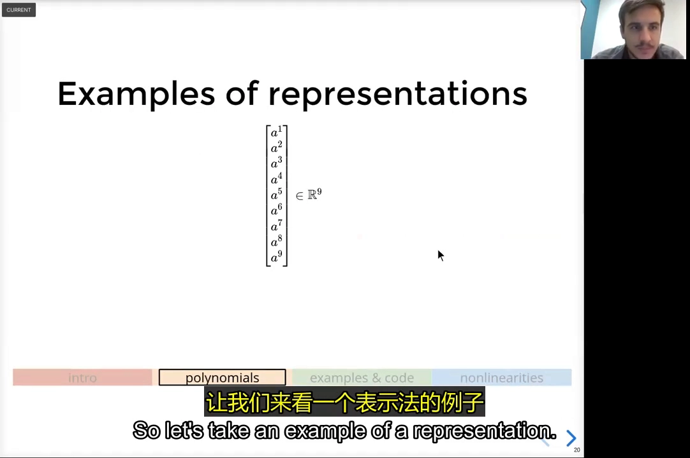

这个规定的意义是：**表示就像一个数据类型**。它不告诉你这些数字代表什么物理量，但它告诉你——当整个系统被旋转时，这些数字各自该怎么变。前三个是标量，所以旋转后它们**一个都不变**；中间三个是向量，旋转后它们**一起变**，被同一个三维旋转矩阵 $R$ 作用；最后三个也是向量，同样被 $R$ 作用，但用的是**自己那一份**分量，不需要知道另一个向量的分量。[【跳转到 05:43】](https://www.bilibili.com/video/BV1hodVYqEXa/?t=343)

于是整个 $D(g)$ 长成一块一块的样子：

$$
D(g)=
\begin{pmatrix}
1 & & & \\
 & 1 & & \\
 & & 1 & \\
 & & & \boxed{R} \\
 & & & & \boxed{R}
\end{pmatrix}
$$

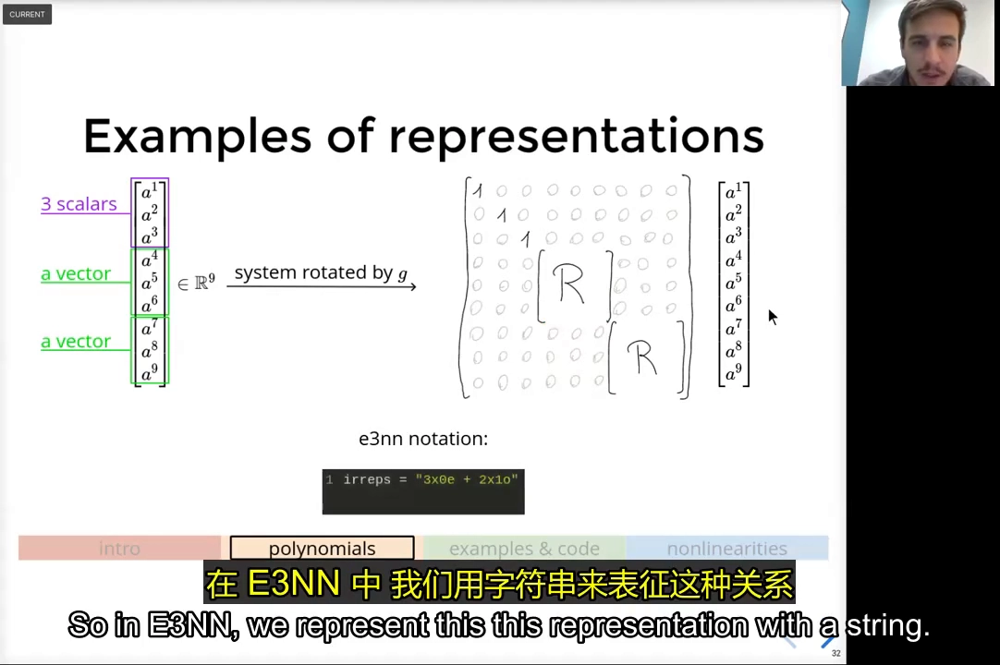

这张图值得盯住看两件事：

1. **块对角**：标量块就是数字 1（旋转后不变），向量块是三维旋转矩阵 $R$。块外的位置全是零。
2. **零的含义**：这些零意味着标量 $a^2$ 不会影响 $a^3$ 的新值，也意味着最后一个向量不会影响第一个向量。**不同块之间不互相混合**，这正是「类型」在数学上的样子。

### 1.3 一个字符串记下整个类型

e3nn 把这种块结构记成一个字符串：

```python
irreps = "3x0e + 2x1o"
```

读法是「$3$ 个 $0e$ 加上 $2$ 个 $1o$」。其中数字 $0$ 和 $1$ 是**阶**（也就是 $l$），字母 `e`/`o` 是**宇称**（偶/奇，后面第四节讲），前面的 $3$ 和 $2$ 是**这个类型的通道数**（multiplicity）。所以这句话的意思是：**3 个标量通道 + 2 个向量通道**，总共 $3\times 1 + 2\times 3 = 9$ 个数，正好对上刚才那九个实数。[【跳转到 07:51】](https://www.bilibili.com/video/BV1hodVYqEXa/?t=471)

代码里这个字符串可以直接交给 `Irreps` 类解析，再用 `D_from_angles` 按给定的三个欧拉角算出 $D(g)$：

```python
from e3nn import o3
irreps = o3.Irreps("3x0e + 2x1o")
alpha, beta, gamma = torch.randn(3)
irreps.D_from_angles(alpha, beta, gamma)
```

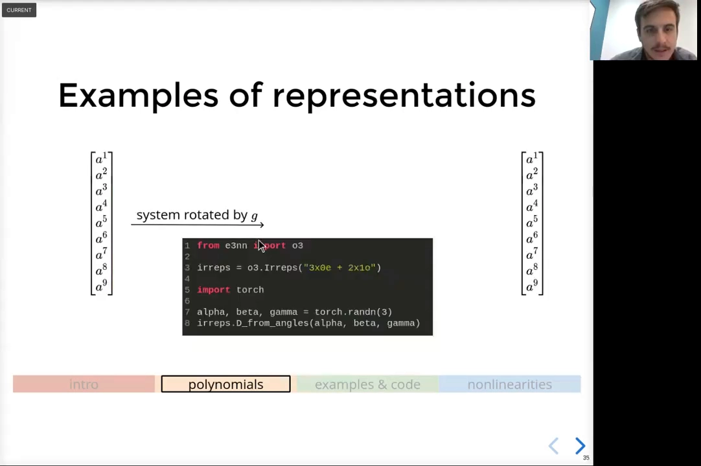

跑出来的矩阵正是预期的块对角形式，而且两个向量的旋转矩阵**完全相同**——因为它们属于同一个表示 $1o$。[【跳转到 09:05】](https://www.bilibili.com/video/BV1hodVYqEXa/?t=545)

### 1.4 最容易混淆的一点：通道数不是几何维度

这是本节最需要记住的一条，因为它是初学者读等变网络代码时最常见的误读。

看到 `2x1o`，很容易把它读成「2 维向量」。**错。** 正确的读法是「**2 路向量**，每一路是一个 3 维几何向量」。也就是说：

- `2` 是**通道数**（有几路这样的量），它和网络宽度、特征数是一类东西，可以随便设成 32、128；
- `1o` 里的 `1` 是**几何阶**，它决定这一路有几个分量（$2l+1=3$）、以及旋转时怎么变（被 $R$ 作用）；
- 一路向量的三个分量**不是三个独立通道**，它们是同一个几何对象在三个坐标轴上的投影，必须一起转。

反过来看 `3x0e`：3 个标量通道，每一路只有 1 个数，旋转后不变。所以 `3x0e` 和 `1x1o` 的总维数都是 3，但它们是**完全不同的类型**：前者是三个不随旋转变化的数，后者是一个必须跟着旋转的箭头。把这两者当成同一种「3 维特征」，等变性就没了。

讲者用「数据类型」这个比喻正是为了强调这一点：`int` 和 `float` 都可能占 4 个字节，但你不能混着算。同理，**通道数相同不代表类型相同**。

## 二、等变：先转再算，等于先算再转

类型定好之后，等变的定义就只是一张交换图。假设输入空间 $V$ 上有表示 $D$，输出空间 $V'$ 上有表示 $D'$，函数 $f:V\to V'$：

$$
f\big(D(g)x\big) = D'(g)\,f(x)
$$

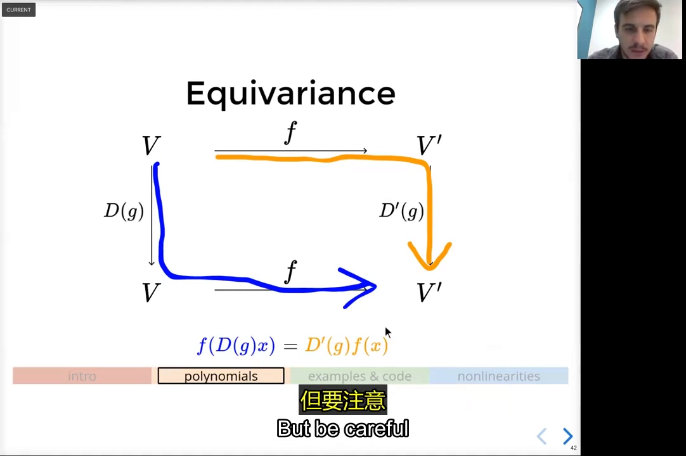

图里蓝色箭头是输入侧的 $D(g)$，橙色箭头是输出侧的 $D'(g)$，两条路径必须落在同一个点上。[【跳转到 10:38】](https://www.bilibili.com/video/BV1hodVYqEXa/?t=638)

讲者特意提醒一个细节：**输入和输出可以用不同的表示**。$f$ 把标量映射成向量、把向量映射成 5 维的 $l=2$ 张量，都是允许的，只要两边各用各的 $D$。这条提醒在后面搭网络时非常实用——「这一层把什么类型变成什么类型」是设计网络时首先要回答的问题。

（不变与等变的区别、以及为什么任务本身决定要不要等变，见 3.1.3；三条实现路线的取舍见 3.1.4，这里不再重复。）

## 三、哪些操作是合法的：三个工具

### 3.1 为什么从多项式入手

讲者的切入点是**多项式**。理由有两条：多项式是数学上最简单的函数；而多项式又能逼近任意函数，所以只要搞清楚「怎样造出等变的多项式」，就等于搞清楚了「怎样造出等变的层」。[【跳转到 11:28】](https://www.bilibili.com/video/BV1hodVYqEXa/?t=688)

他先把多项式推广成「接受多个参数、可能返回多个分量的函数」。于是等变多项式就是：输入按 $D$ 变换，输出就按 $D'$ 变换。

反例很好记：假设 $x,y,z$ 是一个向量的三个分量，那么

$$
f(x,y,z) = x^2 + 2x - 4
$$

**不是**等变的——旋转输入向量后，这个输出不会按任何表示跟着变。而

$$
f(x,y,z) = x^2+y^2+z^2 = \lVert \vec{x}\rVert^2
$$

是等变的，更准确说是**不变的**：旋转输入，范数平方不动，输出是一个标量（$l=0$，旋转矩阵是 1）。[【跳转到 13:17】](https://www.bilibili.com/video/BV1hodVYqEXa/?t=797)

### 3.2 三个工具：复合、加法、张量积

讲者给出三个工具，并声称用它们可以造出**任意**等变多项式：

| 工具 | 做什么 | 为什么合法 |
| :--- | :--- | :--- |
| 复合 | $h\circ f$ | 两个等变函数接起来仍等变，中间表示可以不同 |
| 加法 | $f+h$ | 等变函数之和仍等变，因为表示是线性的 |
| 张量积 | 分量两两相乘 | 两个表示的张量积本身也是一个表示 |

**复合**的证明就是「把中间那步消掉」：因为 $f$ 等变，可以把 $D_1(g)$ 换成 $D_2(g)$ 作用在 $f(x)$ 上；又因为 $h$ 等变，同样可以把 $D_2(g)$ 提出来，最后得到 $D_3(g)$。只看第一步和最后一步，正好是 $h\circ f$ 的等变条件。[【跳转到 14:26】](https://www.bilibili.com/video/BV1hodVYqEXa/?t=866)

**加法**同理：旋转两个函数的输入，因为两个函数都等变，可以把旋转提出来，再用表示的线性性合并。

**张量积**是新东西。假设 $\vec{x}$ 按 $D(g)$ 变、$\vec{y}$ 按 $D'(g)$ 变，把两个向量的所有分量两两相乘（$x_1y_1,\ x_1y_2,\ x_1y_3,\dots$）排成一个矩阵，这个操作是等变的，而这个矩阵的变换方式就叫两个表示的张量积，可以证明它本身也是一个表示。它的维数是两个表示维数的**乘积**。[【跳转到 16:06】](https://www.bilibili.com/video/BV1hodVYqEXa/?t=966)

### 3.3 维度爆炸：为什么不能一路乘下去

只用这三个工具，确实能造出所有**笛卡尔张量**——也就是向量乘向量乘向量这样堆出来的对象，三阶就是 $3\times3\times3$ 的形状。

但做神经网络时这不行：**每乘一次向量，维度就乘 3**。一层层乘下去，特征数会指数增长。[【跳转到 17:18】](https://www.bilibili.com/video/BV1hodVYqEXa/?t=1038)

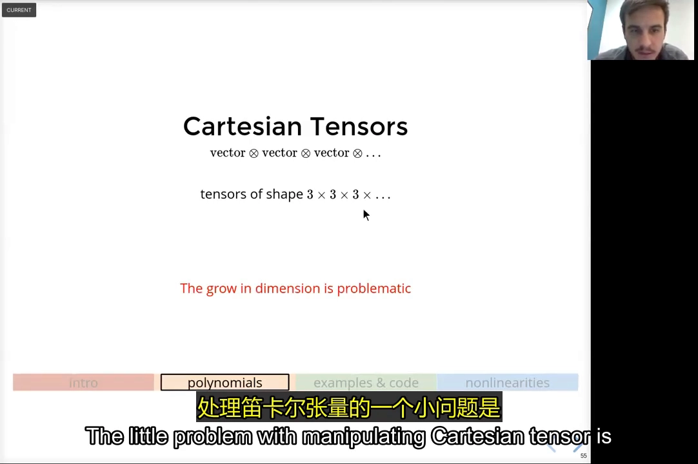

### 3.4 可约与分解：$3\otimes3 = 1\oplus 3\oplus 5$

幸运的是，这些张量积是**可约**的。定义是：如果存在一个子向量空间 $W\subset V$，把表示限制在 $W$ 上仍然是一个表示，就说 $D$ 可约。

看最著名的例子：两个向量的张量积，也就是一个 $3\times3$ 矩阵的九个元素。这九个自由度可以拆成三块：

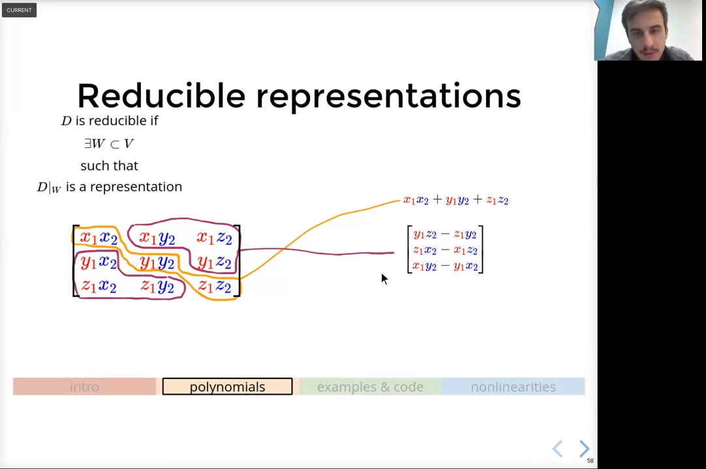

1. **迹** $x_1x_2+y_1y_2+z_1z_2$：这就是两个向量的**点积**，旋转后不变，是一个标量（1 个自由度）。
2. **反对称部分**：写出来就是两个向量的**叉积**，旋转后跟着转，是一个向量（3 个自由度）。
3. **对称无迹部分**：剩下的 5 个自由度，也是一个表示，不能再拆。

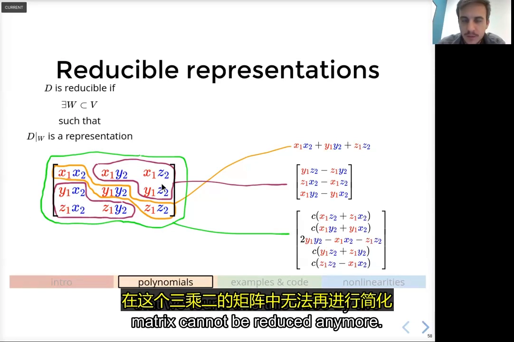

写成式子就是 $3\otimes 3 = 1\oplus 3\oplus 5$：九个自由度拆成 1 个（迹）、3 个（反对称）和 5 个（对称无迹）。

这一步的意义在于：它同时给了我们**三个等变多项式**（输入是两个向量、共六个参数的多项式），而且它们分别对应三种类型。**点积把向量变成标量、叉积把两个向量变成向量、对称无迹部分把两个向量变成 5 维张量**——这正是「哪些操作合法」的完整答案。[【跳转到 20:19】](https://www.bilibili.com/video/BV1hodVYqEXa/?t=1219)

### 3.5 不可约表示：用 $l$ 编号，维数 $2l+1$

不能再分解的表示叫**不可约表示**。旋转群的所有不可约表示可以用一个整数 $l=0,1,2,\dots$ 编号，维数是 $2l+1$：

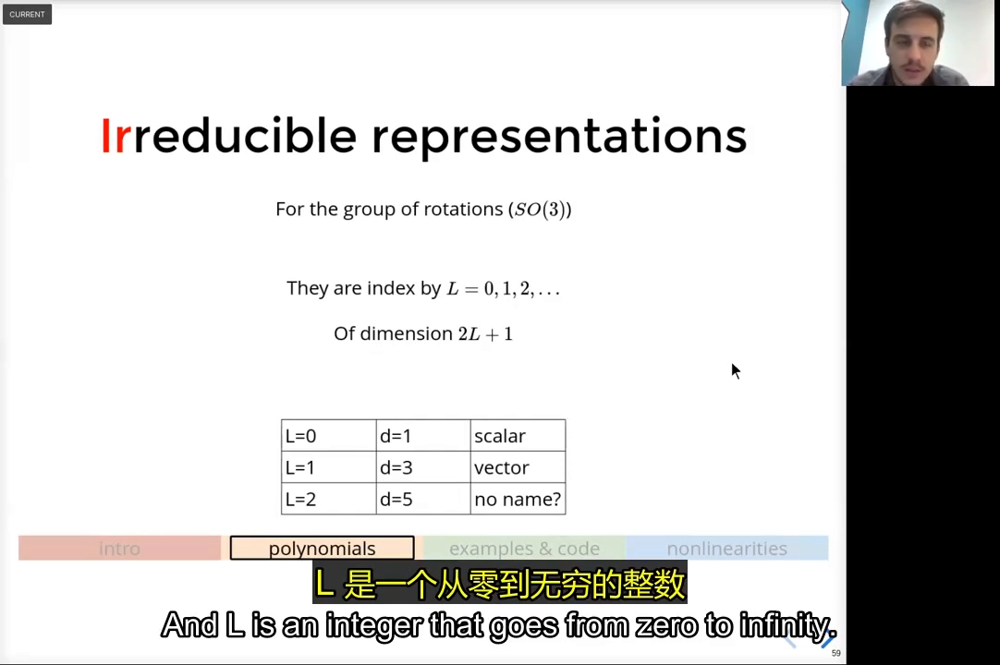

| $l$ | 维数 $2l+1$ | 名字 |
| :--- | :--- | :--- |
| 0 | 1 | 标量 |
| 1 | 3 | 向量 |
| 2 | 5 | 没有专门名字 |

所以「标量」和「向量」不是什么约定俗成的叫法，而是 $l=0$ 和 $l=1$ 这两个不可约表示的名字。$l\ge2$ 的类型在几何网络里也会用到，但通常直接叫「$l=2$ 特征」。[【跳转到 21:59】](https://www.bilibili.com/video/BV1hodVYqEXa/?t=1319)

### 3.6 宇称：为什么还有 `e` 和 `o`

如果允许反射（不只是旋转），群就从 $SO(3)$ 变成 $O(3)$，不可约表示的个数翻倍：每个 $l$ 都有**偶**（even，`e`）和**奇**（odd，`o`）两个版本。

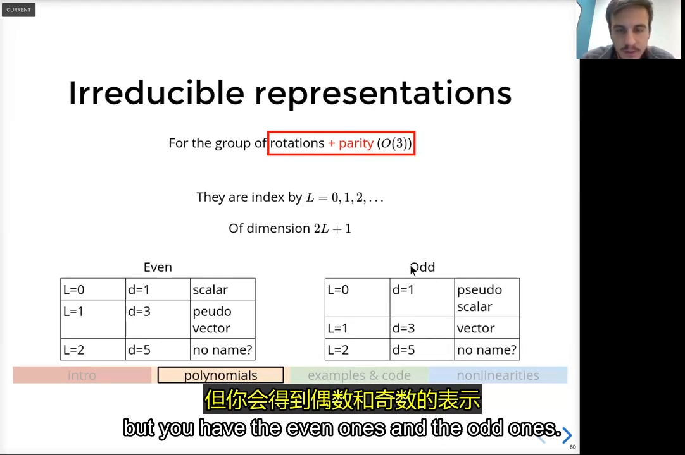

- $l=0$ 偶：**标量**，反射后不变号；
- $l=0$ 奇：**伪标量**，反射后变号；
- $l=1$ 偶：**伪向量**，反射后不变号（比如轴向量）；
- $l=1$ 奇：**向量**，反射后变号（比如位移、速度）。

这就是 `3x0e + 2x1o` 里 `e`/`o` 的来历：它记录的是「反射时这一路要不要多乘一个负号」。如果任务只关心旋转、不关心手性，这个字母可以先忽略；一旦涉及手性分子或镜像，它就不能省。[【跳转到 22:49】](https://www.bilibili.com/video/BV1hodVYqEXa/?t=1369)

### 3.7 张量积分解定理

两个不可约表示相乘，结果可以分解成一串不可约表示，规则很干净：

$$
L_1\otimes L_2 = \lvert L_1-L_2\rvert \oplus \cdots \oplus (L_1+L_2)
$$

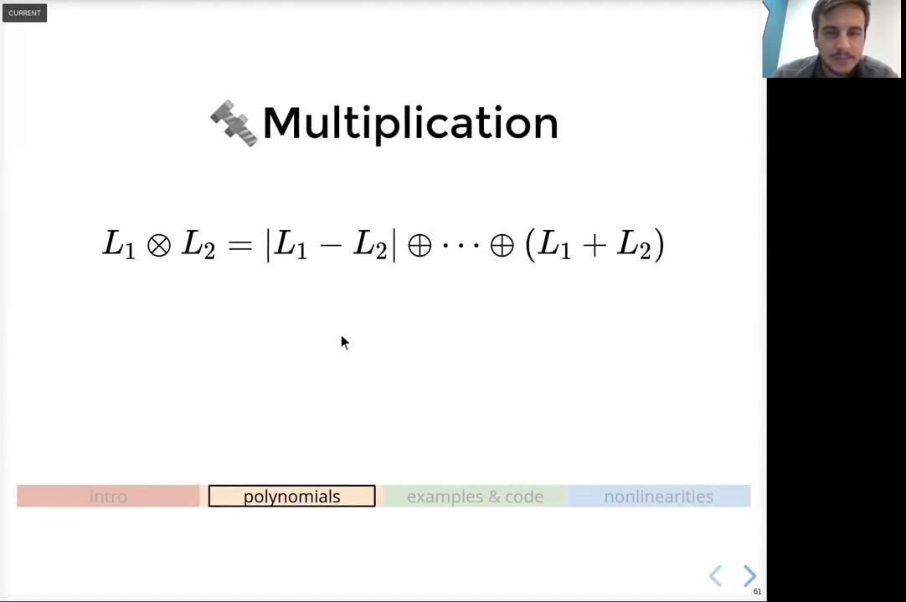

也就是从 $\lvert L_1-L_2\rvert$ 开始，每次加 1，一直到 $L_1+L_2$。例如 $2\otimes1 = 1\oplus2\oplus3$，$2\otimes2 = 0\oplus1\oplus2\oplus3\oplus4$。前面那个 $3\otimes3=1\oplus3\oplus5$ 只是它在 $L_1=L_2=1$ 时的特例。[【跳转到 23:39】](https://www.bilibili.com/video/BV1hodVYqEXa/?t=1419)

这条定理是等变网络设计里最常用的工具：它告诉你「两个类型相乘能得到哪些类型」，于是你可以**只保留需要的那几项**，把维度控制在手里，而不是让它一路乘 3 爆炸。具体到球谐函数怎么由它生成、张量积怎么在代码里调用，见 3.2.4。

## 四、带权重的张量积与门控：把合法操作变成可训练的层

### 4.1 权重：只保留想要的项，并给每一项一个可学的系数

原始的完全张量积会把所有组合都算一遍。实际搭网络时，我们通常只想要其中某几项，并且希望每一项的贡献可以学习。做法是给每条「输入类型 → 输出类型」的路径配一个权重。

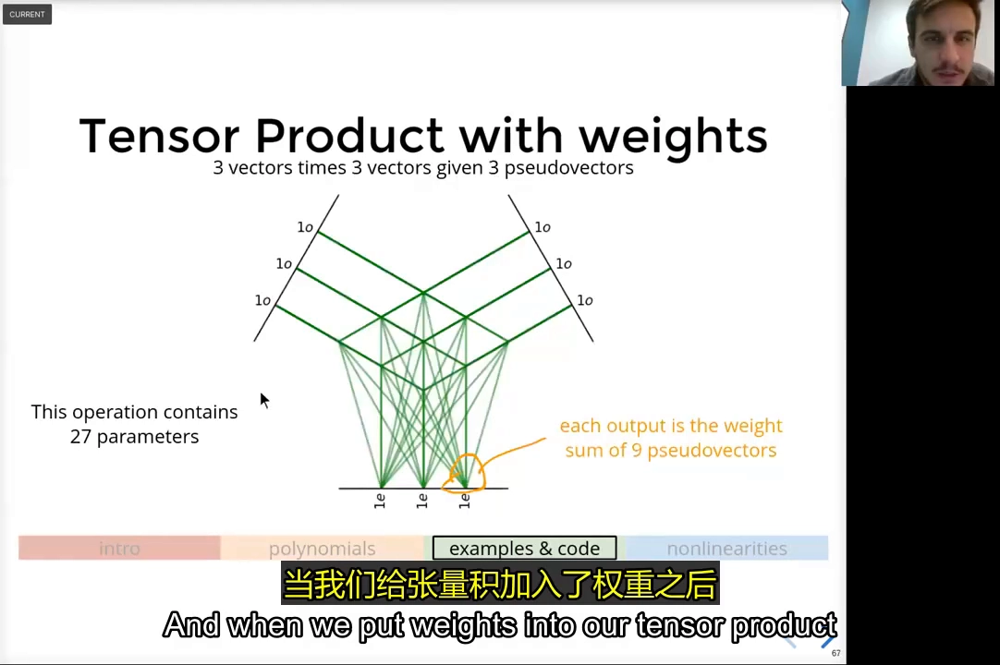

讲者用 3 路向量乘 3 路向量得到 3 路伪向量举例：每个输出都是 9 条可能路径的加权和，三个输出各 9 个权重，共 27 个参数。这就是 e3nn 里 `FullyConnectedTensorProduct` 做的事——它把「哪些类型可以连到哪些类型」固定住（这部分由群论决定，不可学），只让**权重**可学。[【跳转到 37:02】](https://www.bilibili.com/video/BV1hodVYqEXa/?t=2222)

这个设计的关键在于：**等变性是结构保证的，不是靠训练学出来的**。权重怎么调，输出都会按正确的表示变换。

### 4.2 门控：非线性的合法做法

如果一层里全是多项式，网络是线性的，训练不起来。但直接对向量分量做 `ReLU` 会破坏等变——因为 `ReLU` 对三个分量各自独立作用，转一下再 ReLU 和 ReLU 再转，结果不同。

讲者给的解法叫**门控**（gate）：

$$
\phi\big(P(x)\big)\,Q(x)
$$

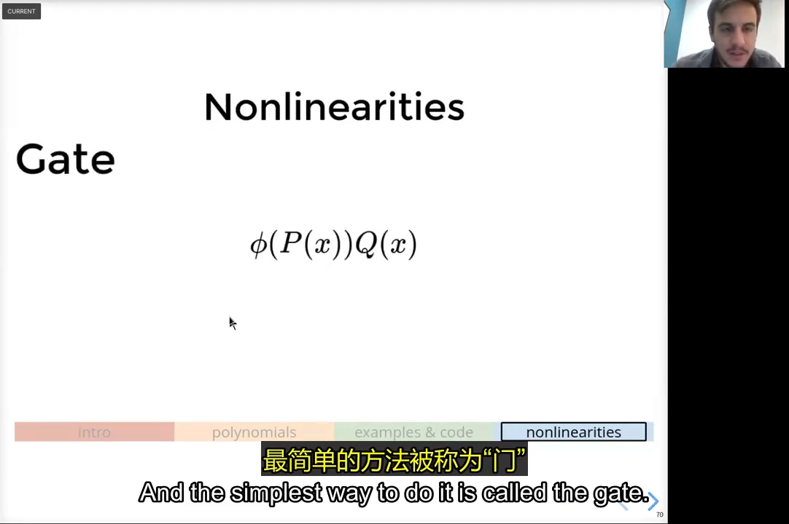

其中 $P$ 的输出必须是**标量**（$l=0$），$\phi$ 是任意函数（讲者说 sigmoid 效果就很好），$Q$ 是任意等变多项式。因为 $\phi(P(x))$ 是一个标量、在旋转下不变，用它去乘 $Q(x)$ 只是给 $Q$ 的输出**缩放**了一个不随旋转变化的系数，所以整体仍然等变。[【跳转到 47:14】](https://www.bilibili.com/video/BV1hodVYqEXa/?t=2834)

这就是「**非线性只能作用在标量上**」这条规则的由来：标量可以被任意非线性函数处理，向量和高阶张量只能被线性组合、被标量缩放。PaiNN、GVP 里的门控都是这个形式（GVP 见 4.1.4，PaiNN 见同目录另一篇）。

## 五、回到具体网络：类型约束长什么样

把上面的规则落到两个具体模型上，就能看清「类型」不是抽象概念，而是代码里真实存在的约束。

**EGNN 的做法**：只用两种类型——**距离**（标量，$l=0$）和**相对向量** $\vec{r}_{ij}=\vec{x}_i-\vec{x}_j$（向量，$l=1$）。消息 $m_{ij}$ 由距离和节点标量特征算出，是标量；坐标更新则是「标量系数乘相对向量」再累加。**标量乘向量还是向量**，所以坐标更新后仍然跟着系统一起转，等变性成立。讲者在 PaiNN 那一讲里也点出：EGNN 输出两个东西（节点特征 $h_i$ 和坐标 $x_i$），如果下游只用 $h_i$、不用 $x_i$，那这个 EGNN 实际上退化成了一个基于不变性的模型——因为等变性全蕴含在 $x_i$ 里。等变消息传递的完整推导见 4.1.2。

**PaiNN 的做法**：显式维护两条流——标量流 $s$（不变）和向量流 $\vec{v}$（等变）。消息模块里用距离（标量）去门控节点特征，用单位方向向量乘距离去更新向量流；更新模块里用标量门控 $a_{vv}, a_{sv}, a_{ss}$ 让两条流互相作用。所有作用在向量上的运算都是**线性**的（只有权重矩阵 $W$，没有偏置、没有激活函数），非线性只出现在标量上。详见同目录的 PaiNN 一篇。

**反例（会破坏等变的写法）**：

- 把向量的三个分量当成三个普通通道，送进全连接层做**任意线性混合**。这样得到的三个数不再是一个几何向量，旋转后对不上。
- 把**通道数**当成坐标轴。比如把 128 维特征当成 128 维空间里的向量去算「夹角」或「旋转」——那 128 维里没有几何意义。
- 对向量分量逐个做 `ReLU`/`BatchNorm`（按通道统计的归一化）。前者破坏方向，后者把不同方向的统计混在一起。
- 把标量和向量拼成一列直接做矩阵乘法。类型不同，不能进同一个线性层。

## 六、常见误解对照表

| 误解 | 为什么错 | 正确做法 |
| :--- | :--- | :--- |
| 特征就是一列数，通道越多表示能力越强 | 数字的**变换规则**才决定它是什么；类型错了，通道再多也不等变 | 先声明 irreps，再决定每层的输入输出类型 |
| `2x1o` 是 2 维向量 | 2 是通道数，`1o` 才是几何阶；每一路有 3 个分量 | 读成「2 路向量，共 6 个数」 |
| `3x0e` 和 `1x1o` 都是 3 维，可以互换 | 前者是 3 个不变量，后者是 1 个必须跟着转的箭头 | 按类型区分，不能只看总维数 |
| 任意两个特征都能相乘 | 相乘结果的类型由张量积分解定理决定，只有特定项合法 | 用带权重的张量积，只连需要的类型对 |
| 激活函数可以随便加 | 对向量分量逐元素做非线性会破坏等变 | 用门控：标量过非线性，再去缩放等变的量 |
| 等变是训练出来的 | 等变由结构保证，权重怎么学都不破坏 | 把类型约束写进层里 |

## 小结

- **表示就是特征的数据类型**：它不告诉你数字代表什么，但告诉你旋转时这些数字怎么变。
- **标量 $l=0$、向量 $l=1$、一般 $l$ 的维数是 $2l+1$**；加上反射后每个 $l$ 还有偶/奇两个版本，于是有伪标量和伪向量。
- **块对角矩阵**是类型的数学形态：标量块是 1，向量块是旋转矩阵，块与块之间不混合。
- **通道数不是几何维度**：`3x0e` 是 3 路标量，`2x1o` 是 2 路向量；前者 3 个数互不相关，后者每 3 个数必须一起转。
- **合法操作只有三类**：复合、加法、张量积；张量积按 $L_1\otimes L_2=\lvert L_1-L_2\rvert\oplus\cdots\oplus(L_1+L_2)$ 分解，$3\otimes3=1\oplus3\oplus5$ 就是点积、叉积和对称无迹部分。
- **非线性只能加在标量上**：门控 $\phi(P(x))Q(x)$ 用标量缩放等变的量，既非线性又保等变。
- **具体网络里**：EGNN 用距离加相对向量，PaiNN 用标量流加向量流；把向量分量当普通通道混合、把通道当坐标轴，都会破坏等变。

## 关键术语速查

| 术语 | 一句话解释 |
| :--- | :--- |
| 群 | 一个对复合封闭、含恒等与逆元的变换集合 |
| 表示 | 群元素作用在某个向量空间上的线性映射，写成矩阵 $D(g)$ |
| 等变 | $f(D(g)x)=D'(g)f(x)$：先转再算等于先算再转 |
| 不变 | 输出的表示是标量，旋转后输出完全不变 |
| 不可约表示 | 不能再分解成更小子表示的表示，用 $l$ 编号，维数 $2l+1$ |
| irreps | e3nn 里描述特征类型的字符串，如 `3x0e + 2x1o` |
| 通道数（multiplicity） | 某一类型有几路，和几何维度无关 |
| 张量积 | 两个表示的分量两两相乘，结果仍是一个表示 |
| 可约 | 表示能拆成若干不可约表示的直和 |
| 宇称 | 反射下是否变号，记作 `e`（偶）/`o`（奇） |
| 伪向量 | $l=1$ 的偶表示，反射下不变号的「向量」 |
| 门控 | 用标量过非线性得到的系数去缩放等变的量 |