# 高阶几何特征：球谐把方向编码成张量，张量积决定阶与阶如何耦合

> 视频来源：[e3nn Tutorial MRS 2021 Fall Meeting — Tutorial 1/6](https://www.youtube.com/watch?v=q9EwZsHY1sk)（YouTube · Tess Smidt，MIT）｜时长约 46 分钟；[The spherical harmonics](https://www.youtube.com/watch?v=5PMqf3Hj-Aw)（YouTube · Erin Dasscience）｜时长约 23 分钟
> 导读：前一支讲等变网络为什么要把特征按阶分类、不同阶又怎么用张量积耦合；后一支逐阶写出球谐函数并画在球面上。本文按“为什么不够 → 球谐是什么 → 怎么编码方向 → 为什么等变 → 怎么耦合 → 代价”重排，只保留阅读等变网络所需的表示论基础，不推导不可约表示的完备性。

## 本讲要解决的核心问题（SCQA）

**背景**：上一节（3.2.3）把几何网络里的特征分成两类：标量在旋转下不变，向量跟着旋转矩阵一起转。用这两类特征已经能写出等变的更新规则。

**冲突**：一个向量只有 3 个数，它描述的是“一个方向”。但分子里真正要描述的是“从这个原子看出去，每个方向上有多少邻居、多少电子密度”。四面体的四个顶点和八面体的六个顶点，区别不在某一个方向上，而在整张球面上的角向分布。3 个数装不下。

**疑问**：方向上的分布要怎么写成特征？写出来以后，不同“粗细”的角向成分又怎么相互作用？

**回答（中心思想）**：用球谐函数 $Y_l^m$ 把球面上的函数展开成一组系数，按阶 $l$ 分块存放——第 $l$ 阶恰好有 $2l+1$ 个分量，$l=0$ 是标量、$l=1$ 是向量、$l\ge 2$ 才是真正的高阶特征；不同阶之间用张量积耦合，分解规则与角动量相加相同；代价是分量数随阶数增长、可选耦合路径随阶数组合增长，所以实践中必须截断阶数并挑选路径。

## 一、标量和向量只覆盖了球面展开的最前面两项

### 1.1 角频率：标量是 0 阶，向量是 1 阶

Tess Smidt 给特征分类时用了一个很好用的说法：把“阶”想成角频率——对这个对象施加旋转，它变化得有多快 [【跳转到 18:42】](https://www.youtube.com/watch?v=q9EwZsHY1sk&t=1122)。

- 标量特征在任何旋转下都不变，角频率为 0；坐标系反演时也不变号，记为偶（even）。
- 三维向量随旋转以固定速率变化，角频率为 1；反演时变号，记为奇（odd）。

于是“标量”和“向量”不是两种随便的叫法，而是同一把刻度尺上的第 0 格和第 1 格。这把尺子后面还有第 2 格、第 3 格。

### 1.2 一个方向只有 3 个数，一张球面分布却要在每个方向都有值

如果任务只是“给出一个方向”，3 个数够了。但几何网络里更常见的情形是：以某个原子为中心，往四周看，邻居出现在哪些方向、电子密度怎么铺开。这是定义在单位球面上的函数 $f(\theta,\phi)$，它在每个方向都有一个值。

球谐函数的作用，就是把这样的函数拆成一层层角向成分：第 0 层是一个常数，第 1 层是线性的三支，第 2 层是更细的五支，如此继续。只保留到第 1 层，就等于把一个向量当成了整张球面分布的全部信息。

### 1.3 四面体和八面体的区别，藏在 $l\ge 2$ 里

Tess 用一个具体例子说明这一步的必要性：把四面体的四个顶点（或八面体的六个顶点）作为局部几何输入，网络输出一组球谐系数，再把这组系数画回球面 [【跳转到 22:40】](https://www.youtube.com/watch?v=q9EwZsHY1sk&t=1360)。

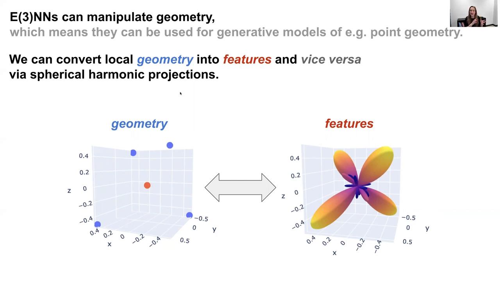

四面体有 4 个顶点、6 条棱、4 个面，整体上没有指向某个方向的分量——这正是视频后面提到的“非极性材料里不能有向量极化”那条论证的几何版本；它的角向图案要到 $l=2$、$l=3$ 才显出四面体的对称性。也就是说：**只用标量和向量，四面体环境会被压成一个“没有方向”的对象**。这不是精度问题，而是表示能力问题。

## 二、球谐是球面上的分阶基：$l$ 定角向粗细，$m$ 给 $2l+1$ 个分量

### 2.1 定义：两个角动量本征方程的共同本征函数

Erin Dasscience 的讲法从本征方程入手。球谐函数 $Y_l^m(\theta,\phi)$ 同时是角动量平方 $\hat{L}^2$ 和它的 $z$ 分量 $\hat{L}_z$ 的本征函数 [【跳转到 00:49】](https://www.youtube.com/watch?v=5PMqf3Hj-Aw&t=49)：

$$
\hat{L}^2 Y_l^m = l(l+1)\hbar^2 Y_l^m, \qquad \hat{L}_z Y_l^m = m\hbar\, Y_l^m
$$

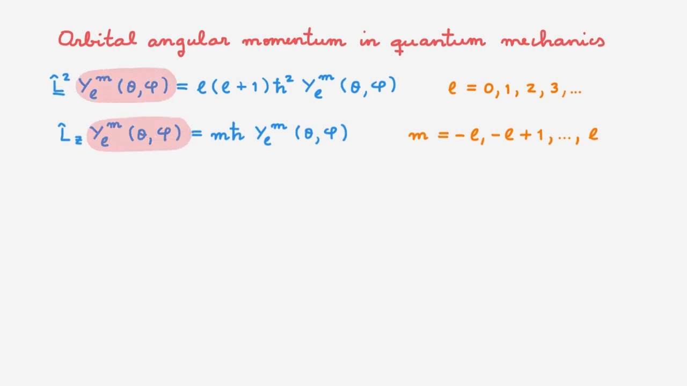

关键在取值：$l$ 只能取 $0,1,2,3,\dots$，而对给定的 $l$，$m$ 只能取 $-l,-l+1,\dots,l$ 共 $2l+1$ 个值。**这条“$2l+1$”就是高阶特征的通道数来源**。

显式表达式并不需要背下来，它的结构是“归一化常数 × 相位因子 $e^{im\phi}$ × 一个只依赖 $\cos\theta$ 的导数项” [【跳转到 01:49】](https://www.youtube.com/watch?v=5PMqf3Hj-Aw&t=109)：

$$
Y_l^m(\theta,\phi) = \frac{(-1)^l}{2^l l!}\sqrt{\frac{(2l+1)(l+m)!}{4\pi(l-m)!}}\; e^{im\phi}\,(\sin\theta)^{-m}\frac{d^{\,l-m}}{d(\cos\theta)^{l-m}}(\sin\theta)^{2l}
$$

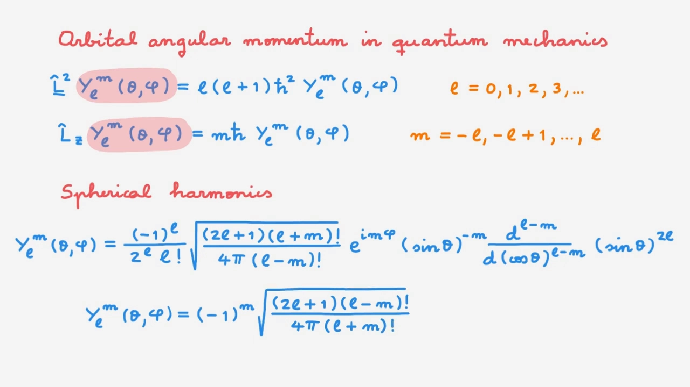

读这个式子只需要抓住三件事：$l$ 决定角向的复杂程度，$m$ 决定绕竖直轴转一圈变化几次，整体幅度由归一化常数固定。

### 2.2 从 $l=0$ 到 $l=3$：1、3、5、7 个分量

**$l=0$**：此时只能 $m=0$。代入上式，归一化常数化为 $1/\sqrt{4\pi}$，相位因子为 1，微分项也为 1，于是

$$
Y_0^0(\theta,\phi) = \frac{1}{\sqrt{4\pi}}
$$

它是一个常数，在球面上处处相同，画出来是一个均匀的红色球 [【跳转到 07:04】](https://www.youtube.com/watch?v=5PMqf3Hj-Aw&t=424)。这就是“标量”的球谐版本。

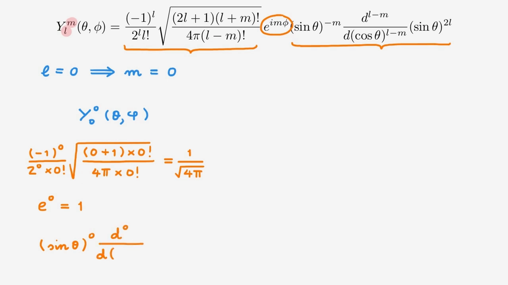

**$l=1$**：$m=-1,0,1$ 三支。其中 $m=0$ 的那支是纯实函数

$$
Y_1^0(\theta,\phi) = \sqrt{\frac{3}{4\pi}}\cos\theta
$$

它不依赖 $\phi$，绕竖直轴转不变；从北极到南极，值由正变负，中间有一条零值带 [【跳转到 08:49】](https://www.youtube.com/watch?v=5PMqf3Hj-Aw&t=529)。另外两支 $Y_1^{\pm 1}$ 带因子 $\sin\theta\, e^{\pm i\phi}$，可以拆成实部和虚部，实部形如 $\sin\theta\cos\phi$、虚部形如 $\sin\theta\sin\phi$ [【跳转到 09:24】](https://www.youtube.com/watch?v=5PMqf3Hj-Aw&t=564)。

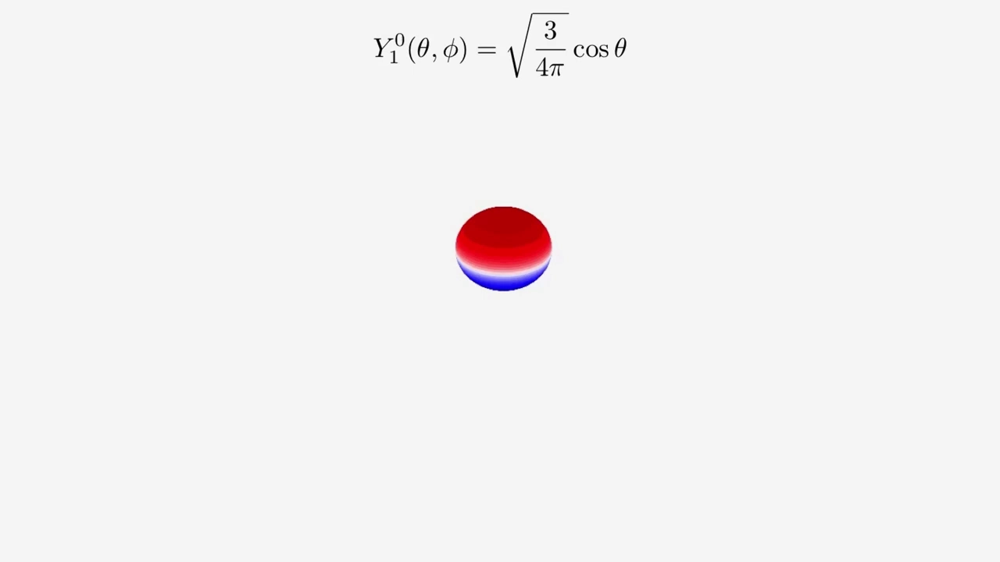

把三支放在一起看：它们分别正比于 $z$、$x$、$y$ 方向的线性函数。**$l=1$ 的三个分量，本质上就是向量的三个分量换了一组基**。

**$l=2$**：$m=-2,-1,0,1,2$ 五支，形状是四瓣的“四极”图案，含 $\sin^2\theta$、$\sin\theta\cos\theta$ 这类二次项 [【跳转到 10:24】](https://www.youtube.com/watch?v=5PMqf3Hj-Aw&t=624)。

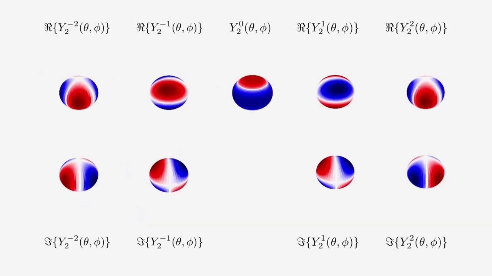

**$l=3$**：七支，角向节点更多，图案更细 [【跳转到 11:35】](https://www.youtube.com/watch?v=5PMqf3Hj-Aw&t=695)。

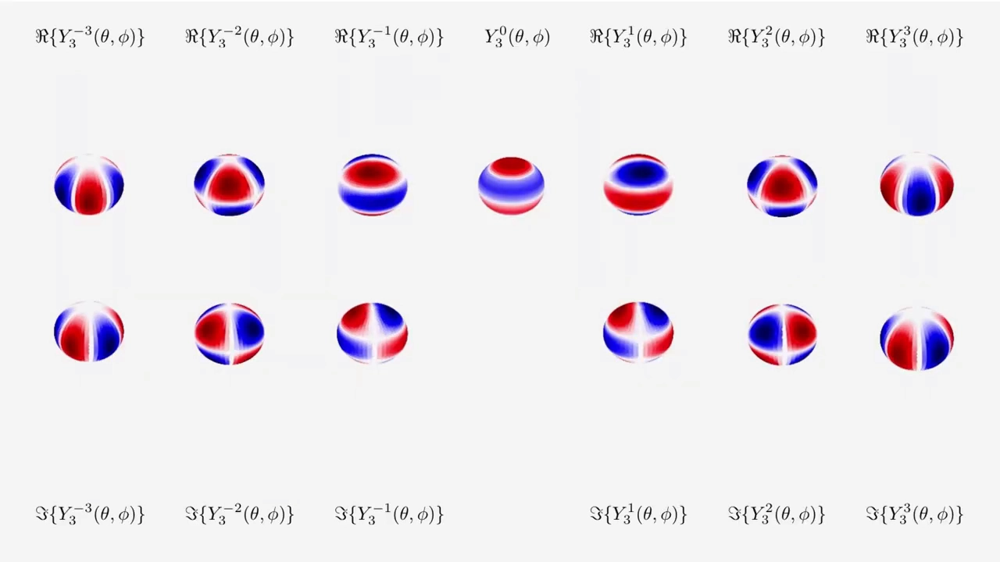

到这里可以数出规律：$l=0,1,2,3$ 分别有 $1,3,5,7$ 个分量。若把 $l=0$ 到 $L$ 全部保留，总分量数是

$$
\sum_{l=0}^{L}(2l+1) = (L+1)^2
$$

这就是后面要算的“通道代价”的来源。

### 2.3 怎么读球谐图：颜色是值，不是形状

这支视频的图有一套固定读法：把函数画在单位球面上，**颜色表示该方向上的函数值**，红色为正、蓝色为负、白色为零 [【跳转到 04:34】](https://www.youtube.com/watch?v=5PMqf3Hj-Aw&t=274)。

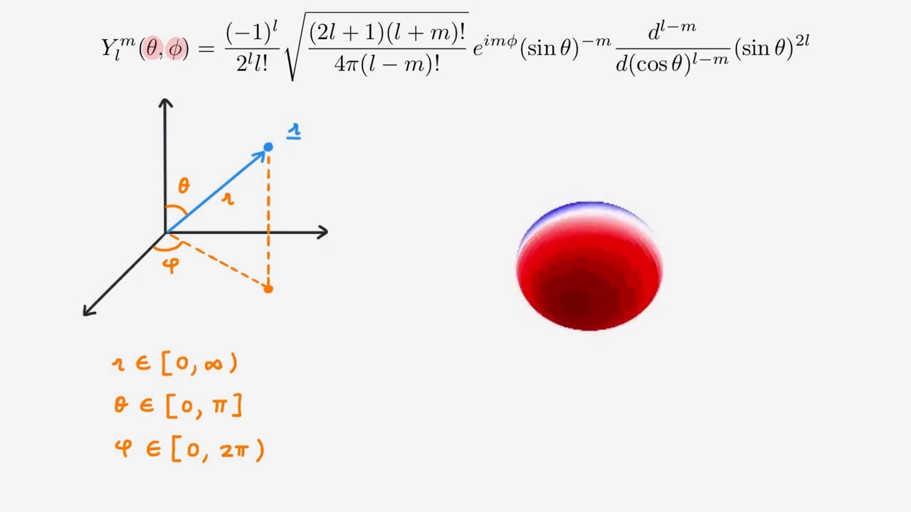

另有一种常见画法：用函数值的大小当作半径，把值画在那个半径处，于是“形状”本身携带信息 [【跳转到 12:16】](https://www.youtube.com/watch?v=5PMqf3Hj-Aw&t=736)。

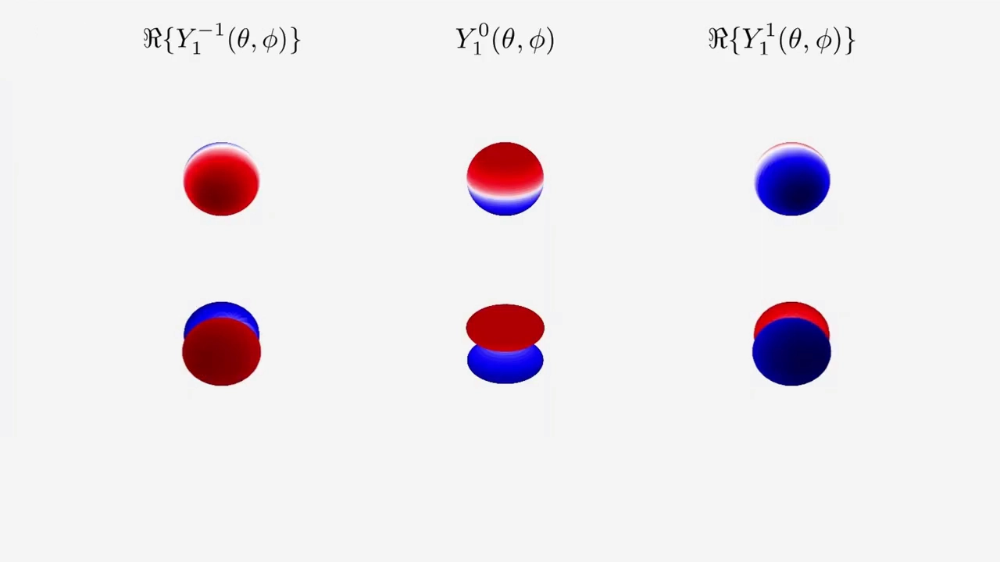

读论文里的球谐图时先确认用的是哪一种画法，否则很容易把“颜色深浅”和“半径大小”混为一谈。

## 三、把方向写成特征：系数按 $l$ 分块

### 3.1 展开式：系数就是特征

球谐是一组完备基，任何球面函数都可以写成它们的线性组合：

$$
f(\theta,\phi) = \sum_{l=0}^{L}\sum_{m=-l}^{l} f_l^m\, Y_l^m(\theta,\phi)
$$

这里的系数 $f_l^m$ 就是网络要存、要学的东西。**按 $l$ 分组，第 $l$ 组有 $2l+1$ 个数，这一组就是一个“$l$ 阶特征块”**。$l=0$ 的块是标量，$l=1$ 的块是向量，$l\ge 2$ 的块就是高阶特征。

这个视角把“方向”和“特征”接上了：给定一个方向 $\hat{r}$，把它当成球面上的一个尖峰，展开系数正比于 $Y_l^m(\hat{r})$。也就是说，**一个方向会被写成所有阶上的一串数**，而不只是 3 个数。Tess 把这个操作叫球谐投影（spherical harmonic projection），并强调它可以在几何与特征之间双向转换 [【跳转到 22:35】](https://www.youtube.com/watch?v=q9EwZsHY1sk&t=1355)。

### 3.2 系数不是坐标

一个容易犯的错：把 $f_l^m$ 当成“坐标的另一种写法”。它不是。坐标是三维空间里的位置，球谐系数是“这个函数在第 $l$ 阶第 $m$ 个基函数上投影出多少”。同一组系数换一个坐标系就会变，但变的方式是确定的——这正是下一章要讲的。

## 四、按 $l$ 分块为什么就等变

### 4.1 类型系统：0e、1o、2e、3o

Tess 的做法是给每个特征标上类型：一个数字加一个字母，数字是角频率（阶），字母表示宇称（偶 even 或奇 odd）[【跳转到 30:01】](https://www.youtube.com/watch?v=q9EwZsHY1sk&t=1801)。

- `0e`：标量，旋转不变，反演不变。
- `1o`：向量，旋转时按旋转矩阵变，反演时变号。
- `2e`：二阶张量式的对象，反演不变。
- `3o`：三阶对象，反演变号。

网络里所有输入、中间量、输出都带这个类型标签，所有操作都必须遵守类型规则 [【跳转到 30:42】](https://www.youtube.com/watch?v=q9EwZsHY1sk&t=1842)。

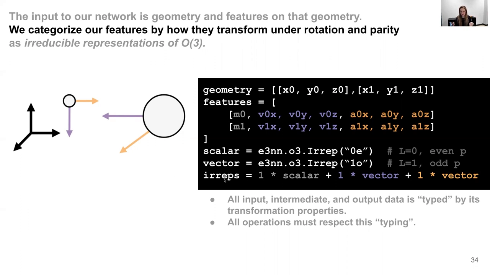

为什么按 $l$ 分块就能保证等变？因为第 $l$ 阶的 $2l+1$ 个分量整体构成旋转群的一个**不可约表示**（irreducible representation，简称 irrep）。不可约的意思是：旋转矩阵作用在这个块上，只会把块内的分量重新线性组合，不会把 $l=1$ 的分量混进 $l=2$。所以“按阶分块 + 块内线性混合”天然满足“先转输入再算”和“先算再转输出”结果相同。Tess 也提醒：$D(g)$ 的具体形式取决于它作用在什么对象上，作用在向量上和作用在 $3\times3$ 矩阵上不一样 [【跳转到 17:01】](https://www.youtube.com/watch?v=q9EwZsHY1sk&t=1021)。

### 4.2 球谐不是不可约表示本身

这里有一个措辞上的坑，Tess 专门澄清过：球谐函数**不是**不可约表示，它们只是“按照不可约表示的方式变换”的东西 [【跳转到 19:49】](https://www.youtube.com/watch?v=q9EwZsHY1sk&t=1189)。她打了个比方：字符串是一种数据类型，同一个类型可以组成很多不同的词；不可约表示也是类型，规定了这个对象能做什么、不能做什么，而球谐只是恰好属于这个类型的一个具体实例。

最直观的对照表是原子轨道：$s$ 轨道对应 $l=0$，$p$ 轨道对应 $l=1$，$d$ 轨道对应 $l=2$，$f$ 轨道对应 $l=3$，每一行从左到右正好是 $m=-l,\dots,l$ [【跳转到 31:39】](https://www.youtube.com/watch?v=q9EwZsHY1sk&t=1899)。

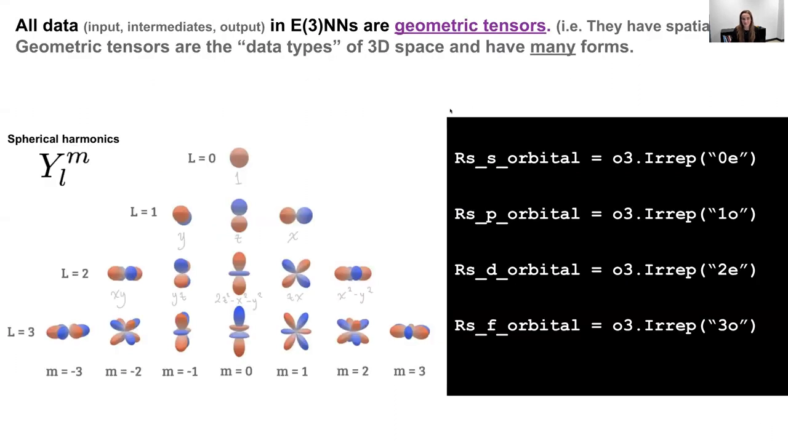

这张表把前面几章串起来了：**行是阶（类型），列是阶内的分量（通道）**。看到“$l=2$ 有 5 个通道”时，脑子里应该浮现的是这一行的五张小图。

## 五、不同阶怎么耦合：张量积与 Clebsch-Gordan 分解

### 5.1 两个向量相乘，9 个数分成 1+3+5

有了分阶的特征，下一个问题是：两个特征怎么相乘？标量乘标量还是标量，标量乘向量只是缩放；但向量乘向量该怎么定义？

Tess 的答案是：最一般的做法是外积，得到一个 $3\times3$ 矩阵，共 9 个数。妙处在于，你可能想到的另外两种乘法都藏在这个矩阵里 [【跳转到 16:36】](https://www.youtube.com/watch?v=q9EwZsHY1sk&t=996)：

- **迹**（对角线之和）等于点积，是旋转不变量，1 个数，类型 `0e`。
- **反对称部分**对应叉积，3 个数，类型 `1e`——它是赝矢量：旋转时像向量一样转，但反演时不变号。
- **无迹对称部分**是剩下的，5 个数，类型 `2e`。

$$
3\times3 \;\longrightarrow\; \underbrace{1}_{0e} \oplus \underbrace{3}_{1e} \oplus \underbrace{5}_{2e}
$$

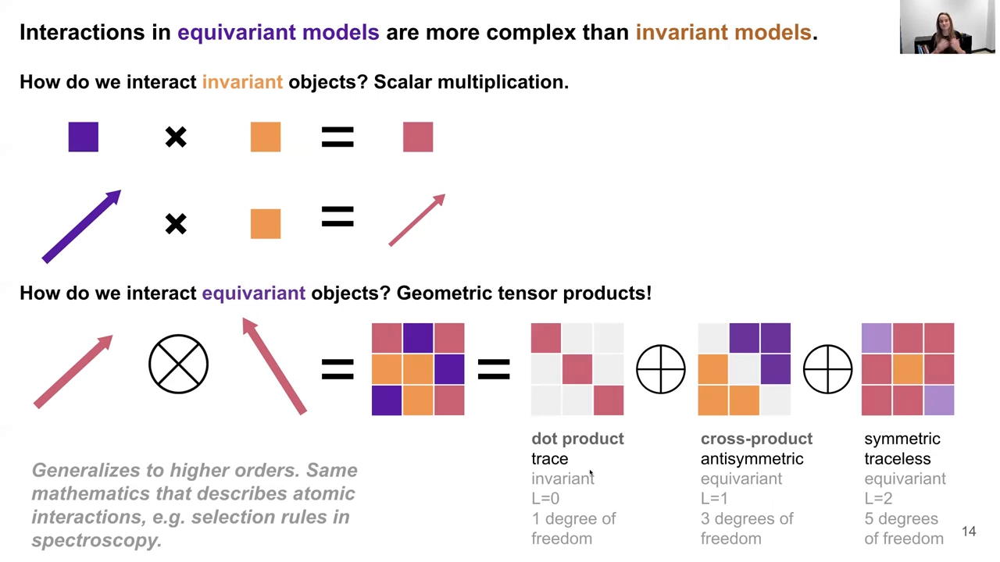

$1+3+5=9$，一个数都没丢。这个分解说明：**两个 $l=1$ 的特征相乘，结果不是一个东西，而是三个不同阶的东西的并排**。这就是“耦合”的含义——不是简单相乘，而是按阶重新分配。

### 5.2 一般规则与 Clebsch-Gordan 系数

把上面的例子推广：$l_1$ 阶和 $l_2$ 阶耦合，会分解成从 $|l_1-l_2|$ 到 $l_1+l_2$ 的每一阶各一份。$1\otimes1$ 给出 $0,1,2$，正好对上迹、反对称、无迹对称三块。做这个投影时用的那组系数，就是 **Clebsch-Gordan 系数**。

视频没有把一般公式写出来，但幻灯片明确说这套数学会推广到更高阶，并且和原子相互作用、光谱选择定则是同一套数学 [【跳转到 16:21】](https://www.youtube.com/watch?v=q9EwZsHY1sk&t=981)。对读等变网络来说，记住三条用途就够了：

1. **造更高阶**：两个 $l=1$ 的特征可以耦合出 $l=2$ 的特征，不必直接去算二阶导数。
2. **造不变量**：把任意阶耦合到 $l=0$，就得到不变量，可以喂给任意标量预测头——Tess 提到这正是把等变特征转成不变表示、再接入其他模型的路径。
3. **注入方向**：把邻居方向 $\hat{r}$ 的球谐与邻居特征耦合，消息就带上了方向信息。

### 5.3 在等变卷积里：方向乘特征

这第三条正是等变卷积的核心。Tess 把卷积核拆成两部分 [【跳转到 37:44】](https://www.youtube.com/watch?v=q9EwZsHY1sk&t=2264)：

$$
W(\vec{r}) = R(r)\, Y_l^m(\hat{r})
$$

其中 $R(r)$ 是只依赖距离的可学习径向函数（实践中常用一组高斯基函数加一个全连接网络），$Y_l^m(\hat{r})$ 是只依赖方向的球谐。前者管“多远”，后者管“哪个方向”，两者相乘再与邻居特征做张量积，就得到一条既看距离又看方向、并且整体等变的消息。

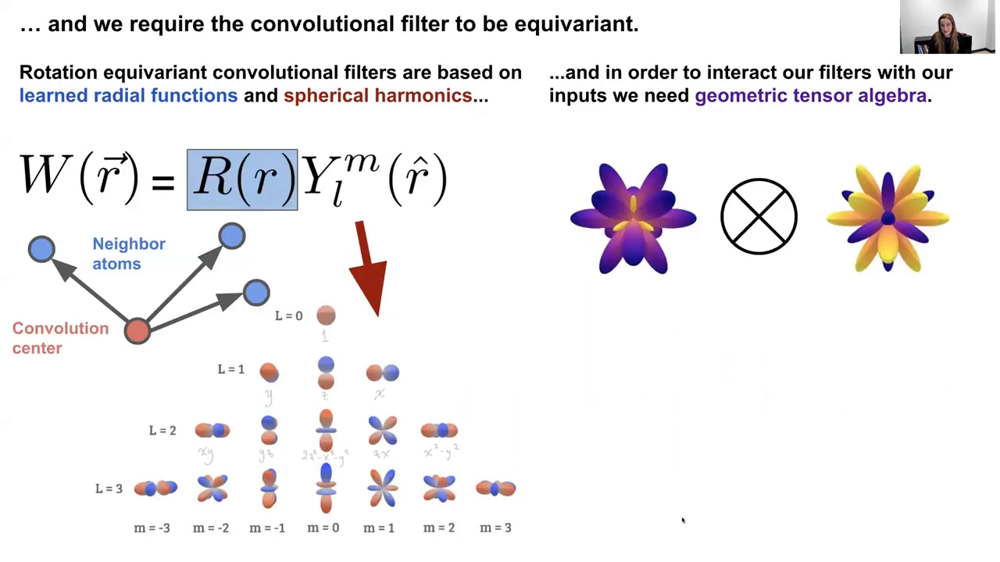

### 5.4 哪些路径保留，是可学习的

两个特征耦合出的每一条“输入阶 → 输出阶”的通路，都可以单独给一个权重。Tess 展示了两种写法 [【跳转到 35:02】](https://www.youtube.com/watch?v=q9EwZsHY1sk&t=2102)：

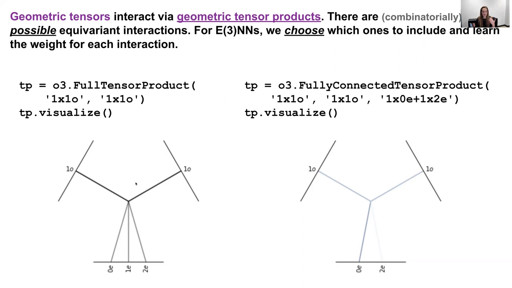

左边是完整张量积，两个 $l=1$ 输入通向 $0e$、$1e$、$2e$ 三条输出；右边只保留 $0e$ 和 $2e$，把不需要的 $1e$ 通路直接砍掉。也就是说，**“保留哪些阶的耦合”本身是模型设计的一部分**，不是数学强制的。

## 六、代价：分量线性增长，路径组合增长

### 6.1 分量数：$(L+1)^2$

第 $l$ 阶固定有 $2l+1$ 个分量，保留到 $L$ 阶就是 $(L+1)^2$ 个。$L=1$ 时是 4 个（1 个标量 + 3 个向量），$L=2$ 时是 9 个，$L=3$ 时是 16 个。升到第 $L$ 阶时，新增的正好是这一阶的 $2L+1$ 个分量。

### 6.2 路径数：组合增长

更贵的部分在耦合。Tess 的原话是：随着对象越来越复杂，可以相互作用的方式会“组合地”变多（combinatorially many ways）[【跳转到 34:26】](https://www.youtube.com/watch?v=q9EwZsHY1sk&t=2066)。原因很直接：每一对输入阶都会产生一族输出阶，层数一深，可选路径就像树枝一样分叉。

所以 e3nn 这类库的做法不是把所有路径都算一遍，而是让使用者显式声明保留哪些路径、每条路径一个可学习权重 [【跳转到 35:23】](https://www.youtube.com/watch?v=q9EwZsHY1sk&t=2123)。**高阶表示的表达力和计算成本，主要就是在这张“路径表”上做取舍**。

### 6.3 读模型时的三个检查点

- **输出要什么**：只要能量这类标量，最终都要耦合到 $l=0$；中间保留到几阶，是模型设计的选择。
- **局部对称性要多细**：四面体、八面体环境在 $l=1$ 上没有信号，至少要保留到 $l=2$ 或 $l=3$。
- **路径砍了多少**：完整张量积最贵；看到模型只保留少数几条通路时，要意识到这是刻意的容量取舍，而不是实现缺失。

## 七、附带性质：网络成了“对称性编译器”

把对称性写进网络结构，会带来一个不是刻意设计、但很有用的性质。Tess 用随机初始化的网络做了演示：输入一个四面体的四个点（每个点只带一个常数标量），输出一组球谐系数，再画回球面。三个随机网络画出来的图案各不相同，但都保持着四面体对称性；换成八面体输入，输出就都保持八面体对称性 [【跳转到 42:24】](https://www.youtube.com/watch?v=q9EwZsHY1sk&t=2544)。

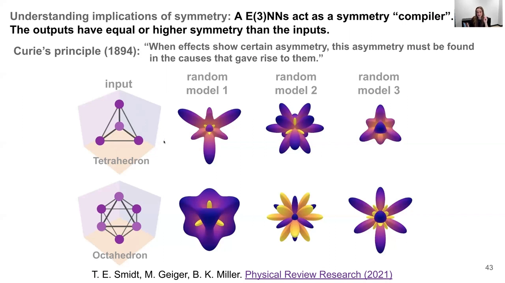

她引用皮埃尔·居里 1894 年的说法解释这件事：如果结果表现出某种不对称，这种不对称必定来自原因。网络还没训练就已经满足这条约束，所以它不会凭空产生输入里没有的不对称。这既是正确性的保证，也是一个很好用的调试手段：**如果输出破坏了输入的对称性，那一定是实现里某处类型用错了**。

## 小结

- 标量和向量只是球面展开的第 0 阶和第 1 阶；四面体、八面体这类角向结构在第 1 阶上没有信号，必须往 $l\ge 2$ 走。
- 球谐 $Y_l^m$ 由两个角动量本征方程定出：$l$ 为非负整数，$m$ 取 $-l$ 到 $l$，因此第 $l$ 阶恰好 $2l+1$ 个分量。
- 把球面函数展开成球谐系数，系数按 $l$ 分块存放，就是“高阶特征”；一个方向经球谐投影会变成所有阶上的一串数。
- 按 $l$ 分块之所以等变，是因为每块整体构成旋转群的不可约表示，旋转只在块内重新组合分量。
- 不同阶用张量积耦合：$1\otimes1 = 0\oplus1\oplus2$，对应 $3\times3$ 矩阵的迹、反对称、无迹对称三块；一般地 $l_1\otimes l_2$ 分解为 $|l_1-l_2|$ 到 $l_1+l_2$ 的各阶，投影系数即 Clebsch-Gordan 系数。
- 耦合的用途有三个：造更高阶、耦合到 $l=0$ 造不变量、把方向注入消息。
- 代价有两层：分量数按 $(L+1)^2$ 增长，耦合路径按阶数组合增长；实践靠截断阶数和挑选路径控制成本。

## 关键术语速查

| 术语 | 一句话解释 |
| --- | --- |
| 阶（degree）$l$ | 球谐的角频率编号，$l=0$ 是常数、$l=1$ 是线性、$l=2$ 是二次，依此类推 |
| 阶内指标 $m$ | 给定 $l$ 时的第几个分量，取 $-l,\dots,l$ 共 $2l+1$ 个 |
| 不可约表示（irrep） | 旋转作用下不会拆成更小独立块的一组分量；第 $l$ 阶的 $2l+1$ 个分量就是一块 |
| 类型标签 `0e` / `1o` / `1e` / `2e` | 数字是阶，字母是宇称：e 表示反演不变号，o 表示反演变号；叉积得到的是 `1e` 赝矢量 |
| 球谐投影 | 把方向或局部几何写成球谐系数的操作，可在几何与特征之间双向转换 |
| 张量积（geometric tensor product） | 两个等变对象相乘并按阶重新分配结果的运算 |
| Clebsch-Gordan 系数 | 把 $l_1\otimes l_2$ 投影到某个输出阶 $l$ 时用的那组系数 |
| 径向函数 $R(r)$ | 只依赖距离的可学习部分，与球谐相乘构成等变卷积核 |
| 对称性编译器 | 等变网络的输出对称性不低于输入对称性这一性质的俗称 |