# E(3) 与 SE(3) 差一个反射：手性信息是被哪一步抹掉的

> 视频来源：[从物理系统中学习的欧几里得神经网络 E(3)NN](https://www.bilibili.com/video/BV1Y8DwYfEmw/)（Bilibili · 竹言见智搬运，原讲者 Tess Smidt，MIT）｜时长约 75 分钟
> 导读：这场报告从「坐标系是任意的」讲起，把 E(3) 等变网络拆成三件事——定义数据怎么变、约束数据怎么相乘、用球谐函数描述几何。本文只抓与本小节相关的那一条线：群里的「反射」这一项，以及它在特征上留下的**宇称**（parity）印记。字幕里的「假对称」统一订正为「宇称」，「耳 rep / erreps」订正为「irreps（不可约表示）」，「同变」订正为「等变」。不可约表示的完整推导见 [3.2.3](../../3_三维数据的对称性/3.2_几何特征/3.2.3_几何网络中的标量与向量特征/标量、向量与不可约表示：几何网络的特征是有类型的.md) 与 3.2.4，本文只用到「标量/伪标量、向量/伪向量」这一层。

## 本讲要解决的核心问题（SCQA）

**背景**：在分子、材料、点云上训练网络时，大家已经习惯说一句「这个模型是 E(3) 等变的」或者「这个模型是 SE(3) 等变的」。两种说法听起来差不多，都能保证「把整个体系转一下、挪一下，预测跟着一起转、一起挪」。

**冲突**：这两个群并不一样，它们差的正是「反射」这一项。多数任务里这一项无关紧要——能量、力、键长都不在乎你用的是右手系还是左手系。但有一类任务恰恰只在乎这一项：手性。左旋和右旋的对映体，在只含旋转的变换下永远无法重合，只有反射才能把它们互相变过去。于是一个对反射不敏感的网络，会把两个真正不同的分子看成同一个输入。

**疑问**：E(3) 和 SE(3) 到底差在哪一步？这个差别在网络的张量里表现成什么？如果任务关心手性，应该怎么改？

**回答（中心思想）**：$E(3)=O(3)\rtimes\mathbb{R}^3$ 允许行列式为 $-1$ 的反射与反演，$SE(3)=SO(3)\rtimes\mathbb{R}^3$ 只允许行列式为 $+1$ 的旋转；这一项差别在特征上表现为**宇称**——反演下变号的是奇宇称（伪标量、向量），不变号的是偶宇称（标量、伪向量）。**只用距离、点积这类偶不变量搭起来的网络天然 E(3) 不变，也天然手性盲**；要分辨手性，要么保留奇宇称通道让网络能构造出对反射敏感的伪标量，要么干脆把群缩到 SE(3)，不要求网络对反射等变。

## 一、坐标系是任意的，所以网络必须知道这件事

### 1.1 同一个物理系统，两套坐标写出两串完全不同的数字

讲者开场先立一个几乎不会有人反对的前提：坐标系对描述物理系统很有用，但**坐标系本身是任意的**。同一个机械臂加泰迪熊的系统，用两套不同的坐标系去写位置和朝向，得到的是两串截然不同的数字。[【跳转到 07:28】](https://www.bilibili.com/video/BV1Y8DwYfEmw/?t=448)

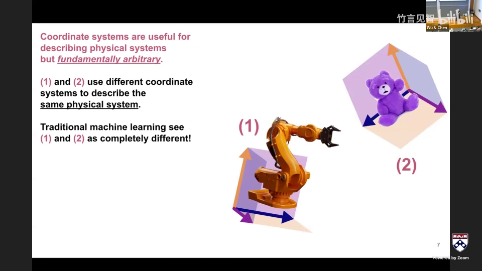

幻灯片上写得很直白：**传统机器学习把 (1) 和 (2) 看成完全不同的东西**。它不知道这两串数字说的是同一件事，只能靠数据去学这层关系——而讲者的判断是，没有理由相信它真能学会。更糟的是代价：模型容量被花在「学会旋转」上，而不是花在真正想学的物理上（她举的例子是量子力学）。[【跳转到 07:53】](https://www.bilibili.com/video/BV1Y8DwYfEmw/?t=473)

于是有了 E(3) 等变网络的目标：把「换坐标系结果怎么变」这件事**直接写进网络结构**，不需要训练就成立。

### 1.2 等变的写法：换坐标系前后，函数图能对上

形式化只用一个交换图。设网络是函数 $f$，输入空间上的群作用记为 $D_X(g)$，输出空间上的群作用记为 $D_Y(g)$，则等变就是

$$
f\bigl(D_X(g)\,x\bigr) = D_Y(g)\,f(x)
$$

读法是：**先在输入上做变换再跑网络**，和**先跑网络再在输出上做同样的变换**，结果必须一样。[【跳转到 09:50】](https://www.bilibili.com/video/BV1Y8DwYfEmw/?t=590)

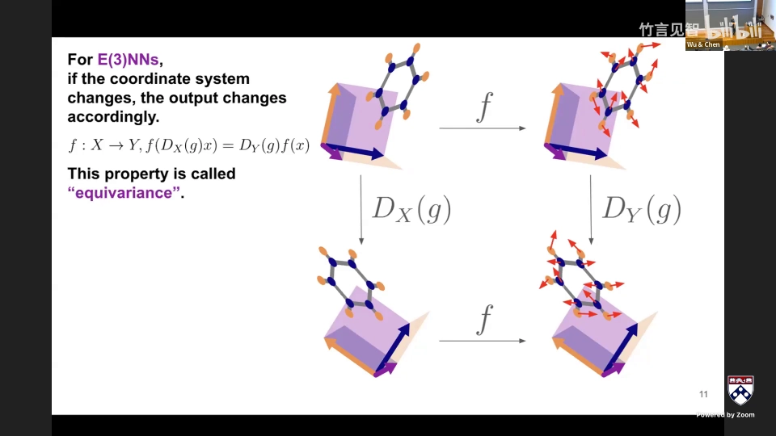

这里有两个容易混的点，讲者都点到了：

1. **同一个群，作用在不同空间上可以长得不一样**。输入是坐标（向量），输出是力（也是向量），两边的 $D(g)$ 碰巧都是同一个旋转矩阵；但如果输出是张量场或者别的类型，$D_Y(g)$ 就换了一副面孔。群是同一个群，表示可以不同。
2. **等变不是不变**。不变只要求 $f(D_X(g)x)=f(x)$，是等变的特例（输出空间上的作用是恒等）。这一点在 3.1.3 已经展开，此处不重复。

### 1.3 这个群到底包含哪些变换

讲者在同一页幻灯片上把群写清楚了：**欧几里得旋转群、平移、反演**。[【跳转到 09:50】](https://www.bilibili.com/video/BV1Y8DwYfEmw/?t=590)

更早一页她说得更口语化：我们总是可以自由地**平移**、**旋转**，甚至**从右手坐标系换到左手坐标系**；通常选右手只是个约定。[【跳转到 07:28】](https://www.bilibili.com/video/BV1Y8DwYfEmw/?t=448)

「从右手换到左手」这句话就是本文的题眼——它不是旋转能做到的事。

## 二、E(3) 与 SE(3) 只差一个 det = -1

### 2.1 O(3) 与 SO(3)：行列式的符号

把「旋转 + 反演」这部分单独拿出来，就是三维正交群

$$
O(3)=\{Q\in\mathbb{R}^{3\times 3} : Q^{\top}Q=I\}
$$

正交矩阵的行列式只能是 $\pm 1$，于是 $O(3)$ 天然裂成两半：

- $\det Q=+1$：**SO(3)**，真正的旋转，保持手性（右手系还是右手系）。
- $\det Q=-1$：**非正常变换**，包含反射与反演，会把右手系翻成左手系。

再把平移接上去（平移是 $\mathbb{R}^3$ 上的加法群，与旋转构成半直积）：

$$
E(3)=O(3)\rtimes\mathbb{R}^3,\qquad SE(3)=SO(3)\rtimes\mathbb{R}^3
$$

所以两个名字的差别只有一句话：**SE(3) 把 $\det=-1$ 的那一半扔掉了**。说「模型是 E(3) 等变的」，等于承诺「把分子镜像一下，输出也按镜像规则变」；说「模型是 SE(3) 等变的」，只承诺「转一下、挪一下，输出跟着转、跟着挪」，对镜像**不作任何承诺**。

### 2.2 反演是所有反射的代表

反射有很多种（对平面镜、对原点、对一条轴），但它们在宇称这件事上可以只用一个代表来研究：**反演** $x\mapsto -x$，也就是乘上 $-I_3$。原因是 $\det(-I_3)=(-1)^3=-1$，而任何 $\det=-1$ 的正交变换都可以写成「反演 × 某个旋转」。既然旋转已经被单独处理过，剩下的新信息就全在反演里。

这也解释了讲者为什么在幻灯片上直接把群写成 $O(3)$，并注明作用方式是 $(x,y,z)\to(-x,-y,-z)$。[【跳转到 20:44】](https://www.bilibili.com/video/BV1Y8DwYfEmw/?t=1244)

### 2.3 平移不参与宇称

讲者有一句话值得单独拎出来：讨论数据类型时「我们将消除平移，因为我们通常以不同的方式处理它」。[【跳转到 18:39】](https://www.bilibili.com/video/BV1Y8DwYfEmw/?t=1119)

这句话的意思是：平移对「特征怎么变」没有贡献——标量平移后还是标量，向量平移后还是同一个向量（平移不改变方向）。真正决定一个特征「是什么类型」的，是旋转和反演。所以后面所有关于宇称的讨论都只看 $O(3)$，把 $\mathbb{R}^3$ 那一半放在一边。

**小结这一节**：E(3) 与 SE(3) 的差别不在平移、不在旋转，只在「要不要承认镜像」。承认镜像，就是 E(3)；不承认，就是 SE(3)。

## 三、宇称：反射约束落在特征上就是正负号

### 3.1 判定规则只有一条

讲者给出的规则短到可以背下来：**如果反演会引入一个负号，这个量就是奇的；不引入负号，就是偶的**。[【跳转到 20:19】](https://www.bilibili.com/video/BV1Y8DwYfEmw/?t=1219)

这就是宇称（parity）。它和角频率 $l$ 是两个独立的标签：$l$ 管「旋转时变多快」，宇称管「镜像时翻不翻号」。任何一个被 $O(3)$ 作用的量，都可以按 $(l,\text{parity})$ 拆成若干块。[【跳转到 19:54】](https://www.bilibili.com/video/BV1Y8DwYfEmw/?t=1194)

### 3.2 $l=0$：标量与伪标量

$l=0$ 意味着旋转下完全不变，只剩宇称这一个自由度，于是有两种：

- **偶宇称 → 标量**。讲者的例子是分类标签：一张图上检测到兔子，把兔子旋转或者镜像，它还是兔子。分类标签不该因为镜像而改号。[【跳转到 20:44】](https://www.bilibili.com/video/BV1Y8DwYfEmw/?t=1244)
- **奇宇称 → 伪标量**。幻灯片上的例子正是手性：「带手性或左右手性的分类标签」。左手镜像一下变成右手，两者相关但**不是同一个东西**。[【跳转到 21:09】](https://www.bilibili.com/video/BV1Y8DwYfEmw/?t=1269)

这张图是本小节的核心。它说明：**「手性」在表示论里不是一句形容词，而是一个具体的类型——$l=0$、奇宇称的伪标量**。想让网络输出一个能区分左右手的数，它必须是伪标量；想让网络输出一个对左右手一视同仁的数（比如能量），它就该是标量。

### 3.3 $l=1$：向量与伪向量

$l=1$ 是三个分量一起按旋转矩阵变的那一类，同样分两种：

- **奇宇称 → 向量**。坐标、力都属于这一类：反演下 $x\mapsto -x$，坐标跟着翻号。[【跳转到 21:59】](https://www.bilibili.com/video/BV1Y8DwYfEmw/?t=1319)
- **偶宇称 → 伪向量**。讲者给的例子是旋转轴，而最好用的构造方式是叉乘：取 $\vec{x}\times\vec{y}=\vec{z}$，再把两个因子同时反演，$(-\vec{x})\times(-\vec{y})=\vec{x}\times\vec{y}=\vec{z}$，结果**没有翻号**。[【跳转到 22:24】](https://www.bilibili.com/video/BV1Y8DwYfEmw/?t=1344)

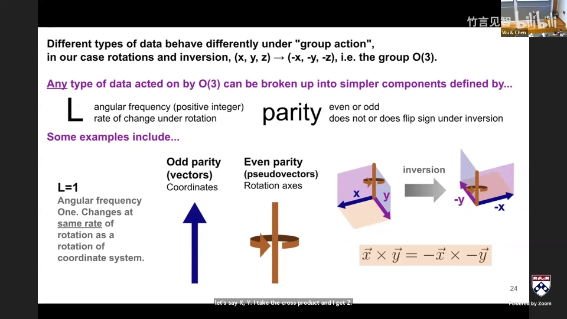

讲者的原话是：这个对象「仍然很像向量，但它在反演下的性质不同，所以它是一个独立的数据类型」。[【跳转到 22:49】](https://www.bilibili.com/video/BV1Y8DwYfEmw/?t=1369)

### 3.4 类型之间不混合

把这些 $(l,\text{parity})$ 块摆在一起，群作用矩阵是**块对角**的：标量块、伪标量块、向量块、伪向量块各占一块，块外全是零。[【跳转到 23:48】](https://www.bilibili.com/video/BV1Y8DwYfEmw/?t=1428)

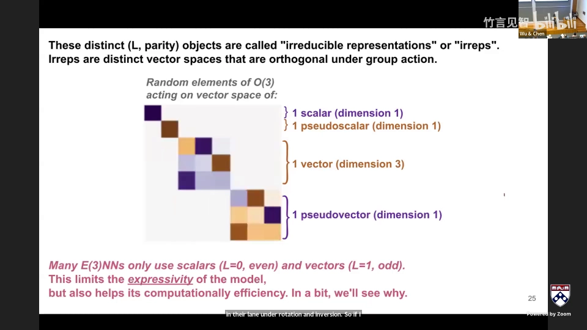

「互不混合」有两层含义，第二层常被忽略：

- 旋转不会把标量变成向量；
- **反演也不会把偶宇称变成奇宇称**。

换句话说，宇称是一个**守恒标签**：一个只由偶宇称特征构成的网络，无论叠多少层、做多少次乘法，都造不出奇宇称的输出。这条性质后面会直接决定「手性信息能不能被表达出来」。

## 四、手性：E(3) 等变网络为什么分不清对映体

### 4.1 手性分子与对映体

先把这个化学概念说清楚，因为它决定了任务的对称性要求。

**手性分子**指不能与自己的镜像重合的分子，最典型的是四个取代基各不相同的碳原子（手性中心）。一对互为镜像、又不能重合的分子叫**对映体**。乳酸、氨基酸、沙利度胺都有这一对。

关键事实：**用旋转永远无法把一个对映体变成另一个**。$\det=+1$ 的变换保持手性；只有 $\det=-1$ 的反射/反演才会把左手性翻成右手性。所以「区分对映体」这件事，在数学上等于「要求函数对反射敏感」。

### 4.2 能量不在乎，旋光度在乎

这里必须分清两类物理量，否则会得出错误结论。

**能量是标量（偶宇称）**。一对对映体在非手性环境里的能量完全相同——这不是网络的缺陷，这是物理事实。所以一个 E(3) 不变的能量模型给出 $f(\text{左})=f(\text{右})$，是**正确**的。

**旋光度、圆二色谱、手性催化剂的选择性、手性药物与靶点的结合，都是伪标量式的量（奇宇称）**。它们在一对对映体上符号相反。这类任务如果用一个只输出偶宇称标量的 E(3) 不变网络，就必然把两个对映体压成同一个预测——**不是精度不够，而是结构上不可能**。

用等变的语言写出来更清楚。设 $f$ 是 E(3) 等变的，取反演 $g:x\mapsto -x$：

- 若输出是偶宇称标量，$D_Y(g)=1$，于是 $f(-x)=f(x)$：镜像构象得到**同一个**预测。
- 若输出是奇宇称伪标量，$D_Y(g)=-1$，于是 $f(-x)=-f(x)$：镜像构象得到**反号**的预测。

第二种才是手性任务需要的。第一种在能量任务上完全正确，在手性任务上则直接把答案抹平。

### 4.3 视频里的左右手例子：是优点，也是陷阱

讲者用左右手讲伪标量时，说了一句很关键的话：对于这类网络，「我只需要训练右手就能识别左手，所以你会自动获得这种模式的识别」。[【跳转到 21:09】](https://www.bilibili.com/video/BV1Y8DwYfEmw/?t=1269)

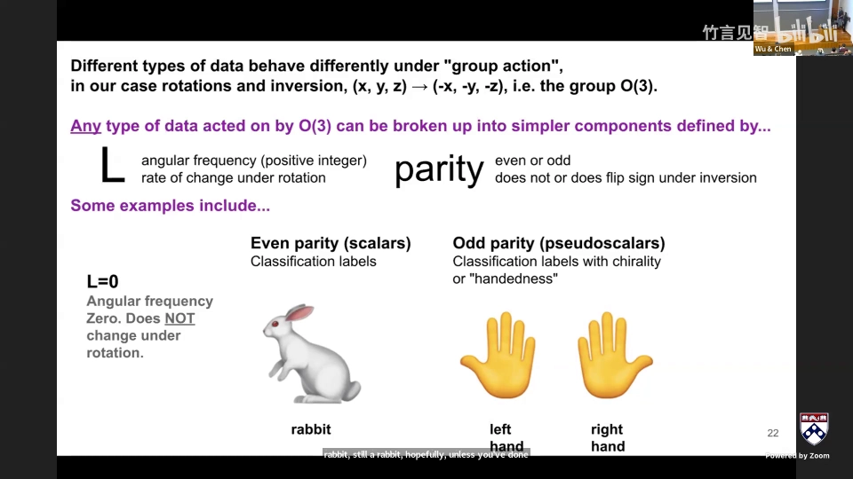

在**分类**任务里这是巨大的优点：数据效率翻倍，见过一只手就等于见过两只手。

但在**手性**任务里，同一句话就是灾难：如果网络把左右手当成同一个模式的两个副本，它就永远学不会「左手和右手要输出不同的值」。同一套结构性质，在两种任务上一个加分、一个致命——区别只在于**标签是标量还是伪标量**。

## 五、网络里怎么处理：三条可走的路

讲者把 E(3)NN 与传统网络的差别归成三件事：**定义数据怎么变（irreps）、约束数据怎么相乘（张量积）、用球谐函数描述几何**。[【跳转到 18:39】](https://www.bilibili.com/video/BV1Y8DwYfEmw/?t=1119)

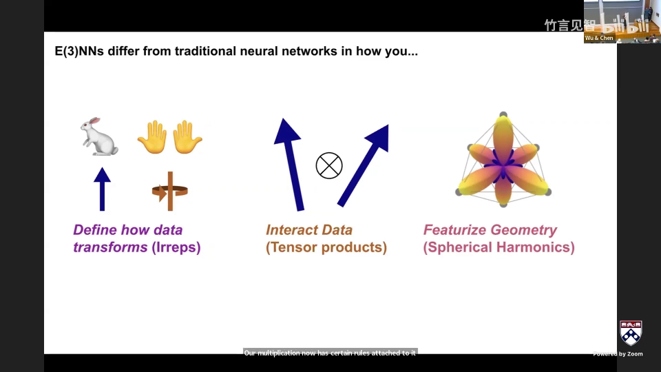

手性问题就落在这三件事的第一件和第三件上。具体有三种处理方式。

### 5.1 路线一：只用距离和点积——天然 E(3) 不变，也天然手性盲

最省事的做法是把坐标换成内部几何量：原子间距离、键角、点积。讲者把这类做法称为「用不变量描述系统」，并指出它「在某些数据集上非常有效」。[【跳转到 33:19】](https://www.bilibili.com/video/BV1Y8DwYfEmw/?t=1999)

为什么它天然不变？因为距离和点积都是**偶宇称标量**：反演下 $x_i-x_j\mapsto -(x_i-x_j)$，但模长不变；点积 $\vec{a}\cdot\vec{b}$ 里两个负号相乘也抵消。

代价也随之而来：**所有输入都是偶宇称，网络的输出也只能是偶宇称**（回到 3.4 的守恒标签）。这样的网络对反射完全不敏感，也就完全看不见手性。这不是实现 bug，是构造决定的。

### 5.2 路线二：保留奇宇称通道，让网络自己造出伪标量

要看见手性，输入里必须留奇宇称的东西。讲者给的乘法规则正好够用：

- 标量 × 标量 = 标量；
- 标量 × 向量 = 向量（只缩放，不转向，这就是「标量」这个名字的来历）；
- 向量 × 向量 = 外积，一个 $3\times3$ 矩阵，它「既不是标量也不是向量，也没有单一的角频率」，需要再拆成 irreps。[【跳转到 25:58】](https://www.bilibili.com/video/BV1Y8DwYfEmw/?t=1558)

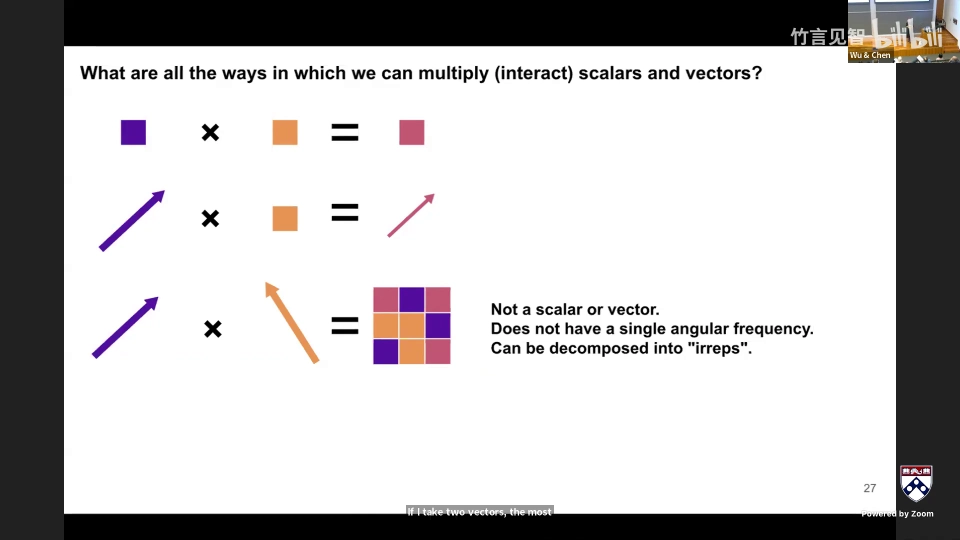

外积拆开正好是三块，讲者把每一块的 $(l,\text{parity})$ 都标了出来：

- **迹 → 点积**：$l=0$、偶宇称、1 个自由度、不变量；
- **反对称部分 → 叉积**：$l=1$、偶宇称、3 个自由度（伪向量）；
- **对称无迹部分**：$l=2$、偶宇称、5 个自由度。[【跳转到 26:23】](https://www.bilibili.com/video/BV1Y8DwYfEmw/?t=1583)

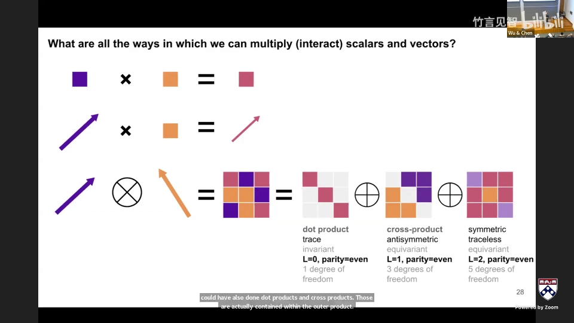

顺着这张表再走一步就能看到手性从哪来：宇称是符号，乘法时相乘。**向量（奇）× 伪向量（偶）= 伪标量（奇）**。所以只要网络里同时留着向量和伪向量通道，它就能通过一次点积造出一个在反演下翻号的标量——这正是旋光度这类量需要的类型。反过来，如果只留标量和向量，这个乘积就不存在。

这也解释了讲者那句容易被忽略的补充：**「即使是偶宇称的伪标量，仍然被算作等变对称的，因为它们对镜子敏感」**。[【跳转到 36:28】](https://www.bilibili.com/video/BV1Y8DwYfEmw/?t=2188) 字幕这里把「奇/偶」说混了，意思不变：伪标量之所以值得单独留一类，就是因为它对镜像敏感。

### 5.3 路线三：把群缩到 SE(3)

第三条路最直接：**不要求对反射等变**。模型只承诺 $SE(3)$ 等变，对镜像不作承诺，于是它在镜像下可以自由地不对称，手性信息就不会被结构强行抹平。

代价是放弃了 E(3) 带来的那部分数据效率（见第七节），也需要更多数据才能学会「镜像后该变成什么」。但对一个只关心手性的任务，这笔交易通常是划算的：与其让结构保证一个错误的对称性，不如把这条对称性从假设里去掉。

一句话对照：

| 做法 | 对反射的态度 | 手性能否表达 | 典型任务 |
| :--- | :--- | :--- | :--- |
| 只用距离/点积的不变量模型 | 完全不变 | 不能 | 能量、力、键长预测 |
| E(3) 等变 + 奇宇称通道 | 等变（翻号） | 能 | 旋光度、手性识别 |
| SE(3) 等变 | 不作要求 | 能 | 手性构象生成、对映体区分 |

### 5.4 宇称只能整块丢

讲者讲张量积剪枝时给了一条硬约束：**为了保持等变，只能整块整块地丢掉 irreps，不能只丢一个 irrep 的一部分**——「留下某个 irrep 的一部分会破坏等变」。[【跳转到 29:18】](https://www.bilibili.com/video/BV1Y8DwYfEmw/?t=1758)

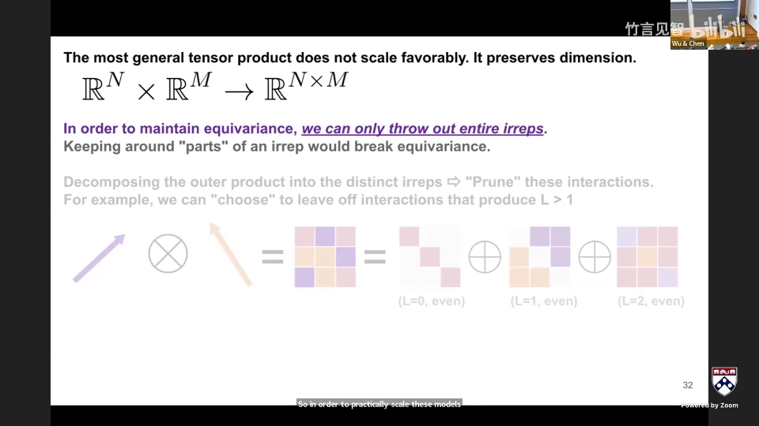

这条约束对手性任务特别重要：**你不能「半个宇称」**。要么保留整个奇宇称通道，要么整块删掉。想靠「留一点点伪标量」来兼顾表达力和效率，在数学上不成立。

## 六、球谐函数自带宇称：$(-1)^l$

讲者讲几何特征化时，把球谐函数和 irreps 直接对上了：$L$ 阶球谐函数吃一个单位向量，吐出 $2L+1$ 个系数，这 $2L+1$ 个系数按 $(L,\ \text{parity}=(-1)^L)$ 变换。[【跳转到 39:41】](https://www.bilibili.com/video/BV1Y8DwYfEmw/?t=2381)

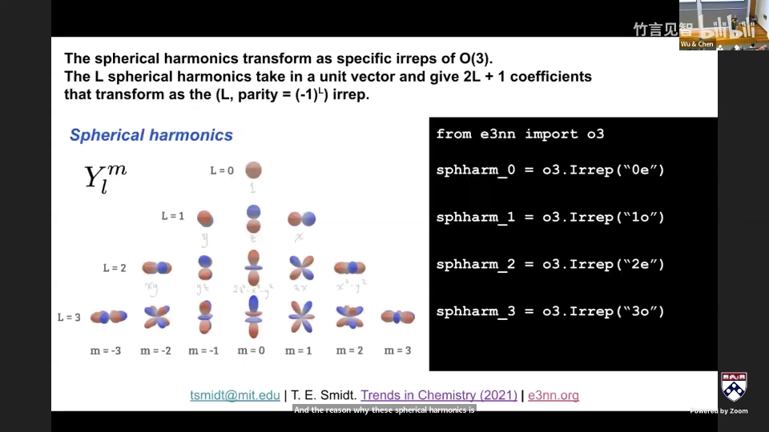

于是 e3nn 里那串看起来像密码的写法就有了解释：

- `0e`：$l=0$，偶宇称，标量；
- `1o`：$l=1$，奇宇称，向量；
- `2e`：$l=2$，偶宇称；
- `3o`：$l=3$，奇宇称。

**宇称就是 $(-1)^l$**，所以它不是一个可以自由选择的开关，而是跟着阶数走的。这条规则在工程上非常实用：看到 `1o` 就知道它是坐标那样的向量，看到 `1e` 就知道它是旋转轴那样的伪向量。

讲者还强调球谐函数是「三维旋转的基函数」：$l=0$ 按标量变，$l=1$ 按向量变，$l=2$ 按二重态变，$l=3$ 按三重态变，各有自己的宇称，旋转后仍留在自己的轨道里。[【跳转到 39:41】](https://www.bilibili.com/video/BV1Y8DwYfEmw/?t=2381) 这就是为什么几何特征化可以做到「滤波器角度部分不用学，交给球谐函数」。

## 七、等变比不变更省数据（顺带说清代价）

讲者给了一张很干净的对照图：横轴是训练样本数的对数，纵轴是误差的对数，两条线都是幂律，但**等变模型的斜率更陡**——也就是说，加同样的数据，等变模型降得更快。[【跳转到 33:58】](https://www.bilibili.com/video/BV1Y8DwYfEmw/?t=2038)

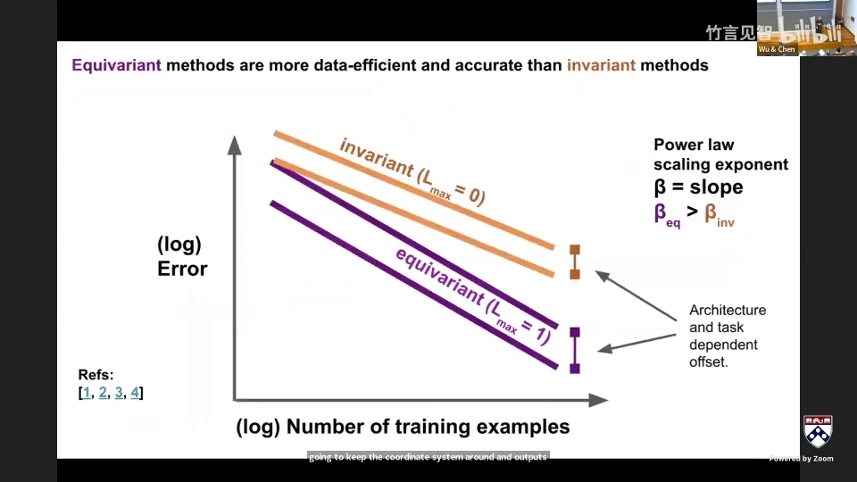

她同时给了三条限定，避免读者过度外推：

1. 斜率依架构和任务而变，具体收益要看数据集；
2. 这是「不变 vs 等变」的比较，不是「等变 vs 完全不管对称」的比较——后者在数据足够、增广足够、对比学习足够时也能追上来；
3. 即使最终输出是不变量，**中间层保留等变性也有帮助**，相当于给网络更多时间构造有用的不变量。[【跳转到 36:03】](https://www.bilibili.com/video/BV1Y8DwYfEmw/?t=2163)

对手性任务来说，第 2 条尤其值得记住：**「等变更省数据」不等于「等变一定更好」**。如果任务要求的对称性本来就不是 E(3)（比如手性），硬套 E(3) 等变等于把正确答案从假设空间里删掉了。

## 八、对称性破缺：输出不会比输入更不对称

讲者最后讲了一个乍看反直觉的现象：**如果模型严格保持对称性，输出的对称性只能等于或高于输入**。[【跳转到 60:19】](https://www.bilibili.com/video/BV1Y8DwYfEmw/?t=3619)

她的例子很直观：输入是一个正方形（四个点），目标输出是一个矩形（两个点）。但矩形有两种摆法，彼此对称等价。等变模型给出的预测是**四个点的平均**——它把两个合法答案平均掉了，而不是挑一个。[【跳转到 61:12】](https://www.bilibili.com/video/BV1Y8DwYfEmw/?t=3672)

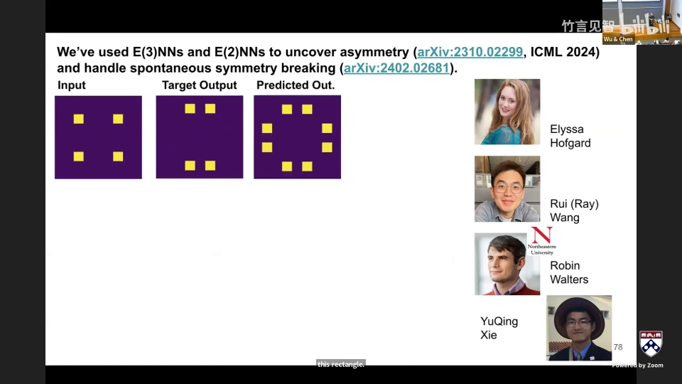

讲者的评价是：**这是特性，不是 bug**——模型在说「你想要哪一个？它们是对称等价的」。要拿到具体的某一个，得给模型更多信息，或者在采样过程里打破对称。

这与手性的关系很近：如果训练数据本身手性偏向一侧（生命体只用 L-氨基酸就是典型例子），一个严格 E(3) 等变的模型会倾向于把两侧平均掉，输出的手性信号被削弱。讲者和合作者用「松弛卷积」让模型从数据里学出对称性破缺的参数，再按尺度分离去观察不对称性出现在哪个长度尺度上。[【跳转到 61:57】](https://www.bilibili.com/video/BV1Y8DwYfEmw/?t=3717)

生成任务里也有同一件事的另一个版本：自回归模型逐个原子生成时，**每一步采样都可能局部破坏对称性**，但所有可能路径的集合仍然保持对称——讲者的说法是「单条生成路径可以违反对称，但路径的集合按构造保持对称」。[【跳转到 53:25】](https://www.bilibili.com/video/BV1Y8DwYfEmw/?t=3205)

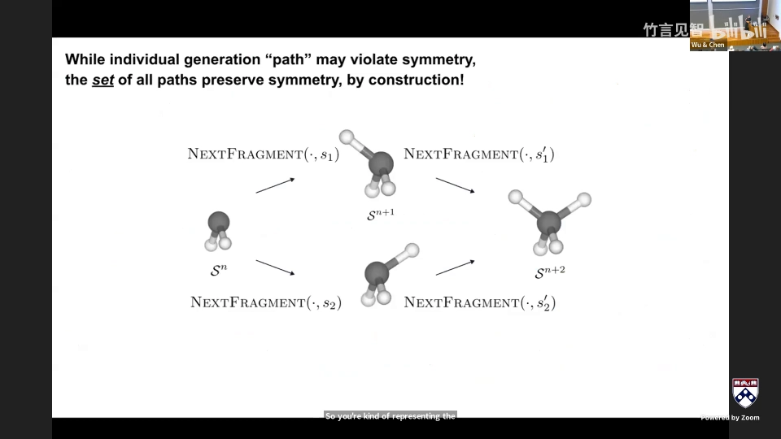

## 九、这些结论落到工程上

讲者后半段铺了一圈应用，这里只挑与「群的选择」直接相关的几条：

- **机器学习势**：从结构预测能量，再用自动微分对坐标求导得到力，得到保守力场；也有人直接回归力，避免非保守风险和反向传播的开销。[【跳转到 42:51】](https://www.bilibili.com/video/BV1Y8DwYfEmw/?t=2571) 这类任务的输出是能量（偶标量）和力（向量），E(3) 等变是合适的假设。讲者顺手点了一串同代模型——Allegro、MACE、TorchMD 等，它们的区别主要在张量积的具体形式和「体有序」相互作用；Allegro 曾进入戈登·贝尔奖决赛，把量子力学精度的预测推到 HIV 囊膜这种约 440 万原子的体系。[【跳转到 43:41】](https://www.bilibili.com/video/BV1Y8DwYfEmw/?t=2621) 这些模型全部把「能量是偶标量、力是向量」当前提——按第三节的类型规则，这类输出本身就不携带手性信息。
- **等变图 Transformer（EquiformerV2）**：注意力里用张量积而不只是点积，阶数一路开到 $l=6$ 甚至 $l=8$；讲者提到归一化层必须考虑不同 irrep 的维度不能假设无关。[【跳转到 48:51】](https://www.bilibili.com/video/BV1Y8DwYfEmw/?t=2931) 阶数开得越高，可用的宇称组合越多，表达手性的余地也越大。
- **生成模型**：自回归的 Symphony 用球谐函数参数化「下一个原子出现在哪个方向」的分布，再分别采样径向和角度部分。[【跳转到 54:20】](https://www.bilibili.com/video/BV1Y8DwYfEmw/?t=3260) 如果生成目标本身有手性（比如只生成 L-氨基酸组成的骨架），采样环节就是打破对称的地方。
- **蛋白质自编码器**：把主链粗化成点，在潜空间上做扩散；讲者提到在学到的潜空间里插值能得到物理上合理的形变，而直接插值坐标会一团糟。[【跳转到 58:51】](https://www.bilibili.com/video/BV1Y8DwYfEmw/?t=3531)

## 小结

- **E(3) 与 SE(3) 只差一项**：$E(3)=O(3)\rtimes\mathbb{R}^3$ 含 $\det=-1$ 的反射/反演，$SE(3)=SO(3)\rtimes\mathbb{R}^3$ 只含 $\det=+1$ 的旋转。平移和旋转两者都有，差别全在「认不认镜像」。
- **反射约束在特征上就是宇称**：反演下翻号是奇（伪标量、向量），不翻号是偶（标量、伪向量）。宇称是守恒标签，偶宇称输入造不出奇宇称输出。
- **手性是伪标量**：一对对映体只能靠反射互换，所以「区分对映体」等价于「要求函数对反射敏感」。
- **E(3) 等变网络会抹平手性**：输出偶标量时 $f(-x)=f(x)$，两个对映体得到同一预测。这对能量是正确的，对旋光度、手性识别是结构性的错误。
- **三条处理路线**：只用距离/点积（天然不变、天然手性盲）；保留奇宇称通道（能造伪标量）；把群缩到 SE(3)（对镜像不作承诺）。
- **宇称只能整块丢**：剪枝时留下某个 irrep 的一部分会破坏等变，不存在「半个宇称」。
- **球谐自带宇称** $(-1)^l$，这就是 e3nn 里 `0e/1o/2e/3o` 后缀的来源。
- **等变更省数据，但不总是更对**：任务要求的对称性如果不是 E(3)，硬套 E(3) 等于把正确答案从假设空间里删掉。

## 关键术语速查

| 术语 | 一句话解释 |
| :--- | :--- |
| $O(3)$ | 三维正交群，所有满足 $Q^{\top}Q=I$ 的矩阵，行列式可正可负 |
| $SO(3)$ | $O(3)$ 中行列式为 $+1$ 的那一半，即纯旋转，保持手性 |
| $E(3)$ | $O(3)\rtimes\mathbb{R}^3$，旋转 + 平移 + 反射/反演 |
| $SE(3)$ | $SO(3)\rtimes\mathbb{R}^3$，只有旋转 + 平移，不含反射 |
| 反演 | $x\mapsto -x$，即乘 $-I_3$，行列式 $-1$，是所有反射的代表 |
| 宇称 parity | 反演下是否翻号的标签；翻号为奇，不翻号为偶 |
| 标量 / 伪标量 | $l=0$ 的偶 / 奇宇称量；伪标量的典型例子是手性标签 |
| 向量 / 伪向量 | $l=1$ 的奇 / 偶宇称量；坐标是向量，旋转轴、叉乘是伪向量 |
| irrep | 不可约表示，$(l,\text{parity})$ 标定的一块特征，块与块之间不混合 |
| 手性 / 对映体 | 不能与镜像重合的分子；互为镜像又不能重合的一对叫对映体 |
| 等变 | $f(D_X(g)x)=D_Y(g)f(x)$，先变换再算等于先算再变换 |
| 球谐宇称 | $L$ 阶球谐的宇称为 $(-1)^L$，对应 e3nn 的 `e` / `o` 后缀 |