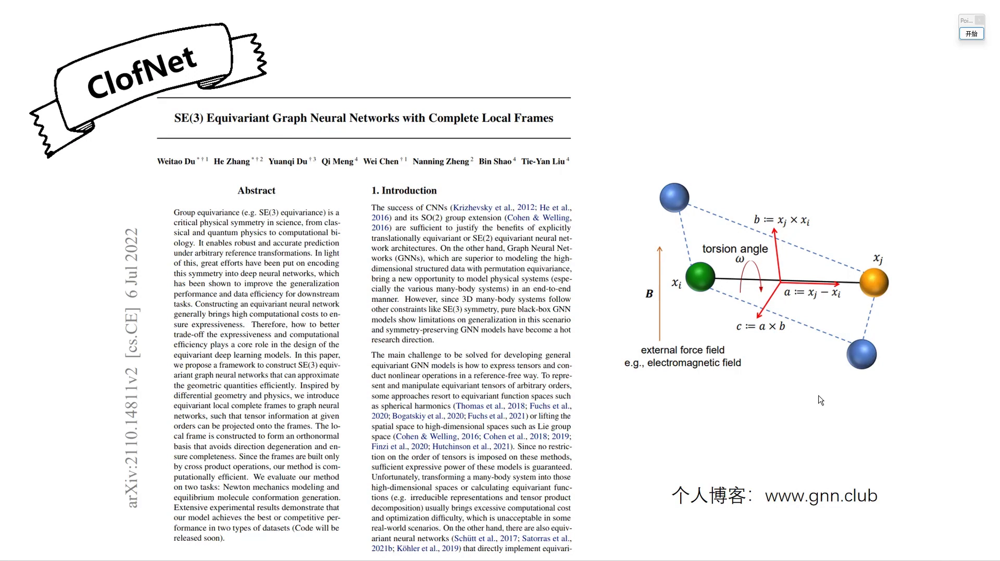
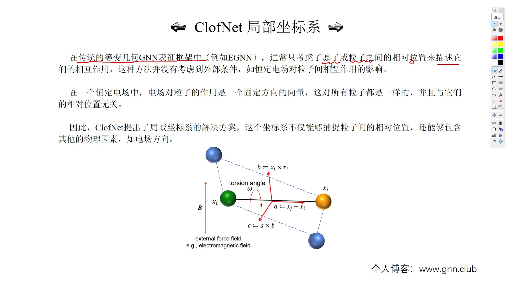
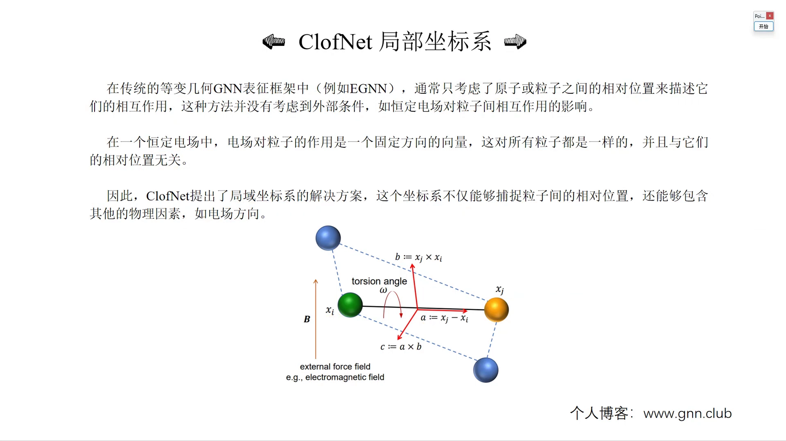
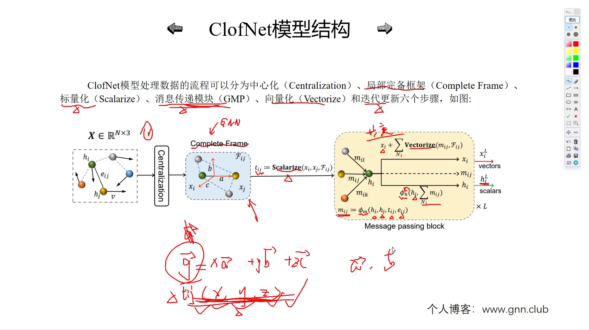
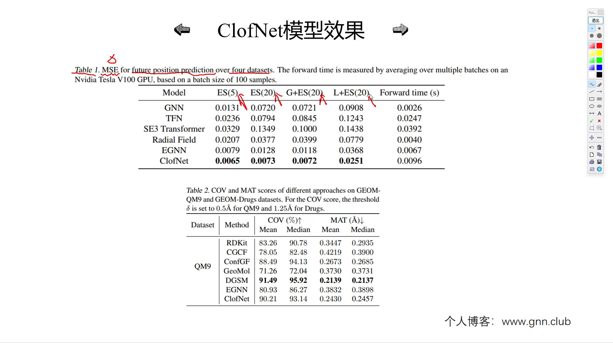

# 局部坐标框架与几何注意力：把向量压成系数，再按框架搬回全局

> 视频来源：[几何深度学习（八）：ClofNet 基于局部坐标系的等变几何图神经网络](https://www.bilibili.com/video/BV1bQkiYAEfQ/)（B 站 · DeepFinder）｜时长约 20 分钟
> 简要导读：这是一支论文精读视频，讲的是 ClofNet（*SE(3) Equivariant Graph Neural Networks with Complete Local Frames*）。本文只取"局部坐标系怎么造、向量怎么压成系数、系数怎么搬回全局"这条主线，并说明它与 AlphaFold2 的 IPA 是什么关系。框架构造的基础（Gram-Schmidt、相对变换）在 [§3.2.2](../../../README.md#m03-3-2-2) 已经讲过，本文不重复推导，只补它没讲的那一步：**框架怎样变成注意力权重**。

## 本讲要解决的核心问题（SCQA）

**背景**：几何图神经网络（GNN）把原子坐标当输入。为了对旋转、平移不敏感，最常见的做法是只用相对位置 $x_j-x_i$，或者干脆只用距离、夹角、二面角这些标量。EGNN 这类模型就是这么做的。

**冲突**：只用粒子之间的相对量，等于假设"所有几何信息都来自粒子之间的相互作用"。可现实里还有**外部条件**——比如一个恒定电场，它对每个粒子都施加同一个方向的力，这个力跟粒子之间的相对位置毫无关系。视频里的说法很直接：这类外部力"并不是原子之间的相互作用，而是来自分子之外的力"，之前讲过的所有模型（距离、夹角、二面角、向量几条路线）都没有把它考虑进去。

**疑问**：要让模型既能表达相对位置、又能表达外部力，需要什么表示？这种表示怎么保证换一个参考系后结果仍然一致（等变）？它又和 AlphaFold2 里那套"几何注意力"是什么关系？

**回答（中心思想）**：需要一套**以当前粒子为中心、跟着整个体系一起转的局部坐标系**。做法是三步：用两个点加一次叉乘造出正交基；把任何向量投影到这组基上，得到三个**系数**（标量，旋转不变）；网络在这些系数上算消息和权重，再把结果按同一组基**搬回全局**变成向量，加回坐标。因为"搬进去"和"搬出来"用的是同一组随体系旋转的基，整个过程自动满足等变。ClofNet 把这套流程固化成六步流水线；AlphaFold2 的 IPA 是同一配方在"残基框架 + 点特征"上的特例，完整推导留给 [P01 §2.2.4](../../../../../../生命科学/生物建模/P01_生物分子结构预测/README.md#p01-2-2-4)。

---

## 一、相对位置不够用：外部力逼出一个坐标系

[【跳转到 00:00】](https://www.bilibili.com/video/BV1bQkiYAEfQ/?t=0)

讲者一上来就把论文的定位讲清楚：ClofNet 的核心是**一种局部坐标系**，目标是"对空间里的几何信息做更全面的表征"。全文按三点展开——局部坐标系、模型结构、模型效果。

[【跳转到 01:15】](https://www.bilibili.com/video/BV1bQkiYAEfQ/?t=75)

为什么"更全面"？讲者给的例子是恒定电场：电场对粒子的作用是一个**固定方向的向量**，对所有粒子都一样，与它们的相对位置无关。传统等变 GNN 只建模粒子之间的相对位置，天生表达不了这种"来自体系外部"的量。

这里值得停一下，因为它解释了"为什么非要一个坐标系"。距离、夹角、二面角都是**内蕴量**：只跟几个点的相对摆放有关，跟外部世界无关。可一旦要描述"电场朝上"这种信息，就必须有一个能同时容纳"体系内部的相对位置"和"体系外部的固定方向"的参照物。局部坐标系正好是这个参照物：它以某个粒子为原点，三条轴由体系自身的点决定，于是外部向量也能被它"读数"。

## 二、两个点加一次叉乘，就得到一组正交基

[【跳转到 02:55】](https://www.bilibili.com/video/BV1bQkiYAEfQ/?t=175)

ClofNet 的局部坐标系构造极其省事。取目标节点 $i$ 和它的一个邻居 $j$，令

$$
a := x_j - x_i,\qquad b := x_j \times x_i,\qquad c := a \times b
$$

讲者的口述顺序是：先取 $x_j-x_i$ 的方向作为 $a$（相当于三维坐标系里的 $X$ 轴）；再让 $x_j$ 和 $x_i$ 的叉积作为 $b$（第二个方向分量）；最后把 $a$ 和 $b$ 叉乘得到 $c$（第三个分量）。三个向量 $a,b,c$ 就定义了一套局部坐标系。

**为什么它一定是正交的**：$b=x_j\times x_i$ 按叉积定义同时垂直于 $x_j$ 和 $x_i$，而 $a=x_j-x_i$ 落在 $x_i,x_j$ 张成的平面里，所以 $b\perp a$；再由 $c=a\times b$，$c$ 同时垂直于 $a$ 和 $b$。三条轴两两垂直，正交性不需要额外的 Gram-Schmidt 步骤，一次叉乘就补齐了。讲者把这一点称为"一个数学基础"。

这也是它和 [§3.2.2](../../../README.md#m03-3-2-2) 里那套构造的差别所在：那边是"先定第一条轴、再定第二条轴、叉乘补第三条"的三步走，这里把第二条轴换成了**两个绝对位置的叉积**，于是第一、二条轴天然垂直，省掉了正交化。

## 三、投影：把任何向量压成三个系数

[【跳转到 04:35】](https://www.bilibili.com/video/BV1bQkiYAEfQ/?t=275)

坐标系建好之后，关键一步是**读数**。讲者的说法是：不管是分子间的内力（邻居 $x_j$ 对目标 $x_i$ 的影响力，比如静电力），还是外部的力，你都可以"给它做一种投影"。设某个要表示的向量为 $d$，它在 $a,b,c$ 三条轴上各有一个分量：

$$
d = x\,a + y\,b + z\,c
$$

只要三个系数 $x,y,z$ 定下来，$d$ 就被完全确定了。同理，外部力 $B$ 也能用同样的方式读数。讲者强调这是"基础的线性代数知识点"：任何向量都可以映射到一个局部坐标系下，用三个轴做线性组合来表示。

### 3.1 "标量化"这个名字的陷阱

[【跳转到 07:55】](https://www.bilibili.com/video/BV1bQkiYAEfQ/?t=475)

ClofNet 把这三个系数记作 $T_{ij}$，并把这一步叫**标量化（Scalarize）**。讲者特意澄清了这个名字：$T_{ij}$ 本身是一个三元组，"倒不是说 $x,y,z$ 是一个标量（它其实是一个向量）"。

那为什么还叫标量化？因为**这三个系数没有方向性**。它们只是"在这组基下的坐标读数"，换一套基就会变成另一组数，但它们本身不随体系旋转而旋转——旋转的是基，读数不变。讲者原话是："标量化之后这个东西没有方向性，或者说没有等变性……它其实是一种基于不变性的特征。"

这句话是整篇的技术核心：**投影把等变的向量换成了不变的系数**。后面网络里所有的非线性、MLP、softmax 都只作用在这些不变系数上，因此不可能破坏对称性。

## 四、六步流水线：不变的在框架里算，等变的按框架搬回

[【跳转到 05:50】](https://www.bilibili.com/video/BV1bQkiYAEfQ/?t=350)

讲者把 ClofNet 的前向过程拆成六步：**中心化（Centralization）→ 局部完备框架（Complete Frame）→ 标量化（Scalarize）→ 消息传递模块（GMP）→ 向量化（Vectorize）→ 迭代更新**。前三步已经把几何量变成不变系数，后三步负责把结果变回几何。

### 4.1 中心化：先把平移消掉

[【跳转到 06:15】](https://www.bilibili.com/video/BV1bQkiYAEfQ/?t=375)

第一步是对每个点的位置减去所有点位置的平均值，也就是把质心挪到原点。讲者给的理由是：这样模型不会把空间里任何一个特定位置当成参考点，无论体系怎么平移，输出都保持不变。

这一步还有一层隐含作用：$b=x_j\times x_i$ 用的是**绝对位置**的叉积，本身并不平移不变；只有先中心化，这个叉积才变成一个只跟形状有关的量。换句话说，中心化是"用绝对位置做叉乘"能被接受的前提。

### 4.2 消息传递：权重只由不变系数算

[【跳转到 09:10】](https://www.bilibili.com/video/BV1bQkiYAEfQ/?t=550)

消息传递块里，送进神经网络的是这几样东西：目标节点 $i$ 与邻居 $j$ 的节点特征 $h_i,h_j$、标量化得到的 $T_{ij}$、以及边特征 $e_{ij}$。输出是更新后的消息：

$$
m_{ij} = \phi_m\left(h_i,\ h_j,\ T_{ij},\ e_{ij}\right)
$$

然后对所有邻居的消息求和，再和节点自身的信息一起过网络，得到新的节点特征：

$$
h_i^{L} = \phi_h\left(h_i,\ \sum_{j\in N_i} m_{ij}\right)
$$

注意这里**没有任何一项依赖绝对坐标**：几何信息全部通过 $T_{ij}$ 这三个不变系数进入网络。这正是"在框架内计算"的含义——网络看到的是读数，不是方向。

### 4.3 向量化：把系数按同一组基搬回全局

[【跳转到 10:50】](https://www.bilibili.com/video/BV1bQkiYAEfQ/?t=650)

位置更新走另一条支路。讲者的表述是：$x_i$ 会加上一个"更新之后的偏移"，这个偏移由**向量化（Vectorize）**得到——把更新后的消息按局部坐标系 $a,b,c$ 重新映射回一个向量，再加到位置上：

$$
x_i^{L} = x_i + \sum_{j\in N_i} \mathrm{Vectorize}\left(m_{ij},\ \mathcal{F}_{ij}\right)
$$

讲者说这一步"也贼简单"：你知道系数，又知道局部坐标系 $a,b,c$，重新加回去就得到了那个向量；而这个向量本身有方向性，可以直接加到位置上。

### 4.4 为什么这样就等变了

把 4.2 和 4.3 连起来看，等变性是**结构保证**的，不靠损失函数去"学出来"：

1. 体系整体旋转 $R$ 时，每个局部框架的三条轴跟着转，$a\mapsto Ra$、$b\mapsto Rb$、$c\mapsto Rc$；
2. 投影系数 $T_{ij}$ 是"向量在基上的读数"，基转了、向量也转了，读数**不变**；
3. 网络只在 $T_{ij}$ 上做运算，输出还是同一组不变的数；
4. 向量化时用**已经转过的**基把系数重新组装，得到的向量自然跟着转，即 $x_i^{L}\mapsto R\,x_i^{L}$（平移同理）。

这就是"框架内计算 + 框架变换"这套范式的全部秘密：**不变性来自投影，等变性来自组装**。

## 五、这就是几何注意力的通用配方，IPA 是它的一个特例

[【跳转到 12:05】](https://www.bilibili.com/video/BV1bQkiYAEfQ/?t=725)

讲者在总结时说，ClofNet 和之前的 EGNN、PAINN、GVP 是"一样的道理"：都在模型里划分两个分支——一个分支对不变性特征做建模（节点属性等），另一个分支对等变性信息做更新（位置坐标加上学到的偏移），有的模型（比如 PAINN）两个分支之间还有信息交互。

把这条思路往前推一步，就得到**几何注意力**的通用配方。注意力需要两样东西：一个标量权重 $\alpha_{ij}$（要能进 softmax），和一个被加权聚合的内容。既然权重最终要乘到向量上再搬回全局，那么**权重本身必须是旋转不变的标量**，否则"权重变了、基也变了"两件事会互相打架，等变性立刻失效。于是配方只有一条路：

1. 为每个节点（或每条边）建局部框架；
2. 把相对位置、查询点、外部场等一切有方向的量投影进框架，得到不变系数；
3. 用这些系数算注意力 logits，softmax 得权重；
4. 把加权结果按同一组框架搬回全局，得到等变的向量输出。

ClofNet 的第 4.2 节是这条配方里"权重由 MLP 算"的版本；AlphaFold2 的 **IPA（Invariant Point Attention，不变点注意力）**是"权重由框架内的点距离算"的版本——它把查询点投到每个残基自己的局部框架里，用框架内的坐标差构造几何偏置项，因此整体刚体变换下注意力权重不变、输出向量随框架旋转。

> **与 P01 §2.2.4 的分工**：IPA 的完整公式（标量注意力项、点注意力项、pair 偏置三者如何相加、$\gamma$ 系数怎么定、输出怎么再投影）属于蛋白质结构预测那条脉络，见 [P01 §2.2.4 Invariant Point Attention](../../../../../../生命科学/生物建模/P01_生物分子结构预测/README.md#p01-2-2-4)。本文只负责"局部框架为什么能造出几何注意力、它凭什么等变"这个一般机制；读 IPA 时把本文的四步配方套上去即可，不必在这里再推一遍。

## 六、框架选择的代价：正交性、退化与完备性

[【跳转到 08:20】](https://www.bilibili.com/video/BV1bQkiYAEfQ/?t=500)

讲者在讲完标量化后留了一个伏笔：ClofNet 用的是"局部**完备**框架"，而"完备性其实也是 GNN 里一个非常重要的讨论点、一个热点"，他留到下个视频（LEFTNet）展开。这句话点出了框架路线的两个软肋。

**第一，框架可能不存在。** 按这套构造推下去，它依赖两次叉乘：$b=x_j\times x_i$，$c=a\times b$。如果 $x_i$ 与 $x_j$ 共线（中心化之后仍平行），$b$ 就是零向量，$c$ 也跟着为零，三条轴退化成一条，框架塌掉。工程上通常要加一个极小量或者换一组邻居来兜底。**框架一旦不唯一，投影系数就不唯一**，同一个几何构型会读出两组不同的数，等变性虽然还在（因为基和向量一起退化），但表示的可比性没了。

**第二，框架的选择本身是建模自由度。** 用哪两个点定第一条轴、第三个轴取 $a\times b$ 还是 $b\times a$（手性）、要不要引入外部向量一起定基，都会改变模型能区分什么。§3.2.2 里已经讨论过"第三个轴取哪个方向是建模选择"以及"分母为零时框架不存在"，这里只补一句：ClofNet 把外部力 $B$ 也纳入了考量——这正是它宣称比只用相对位置的模型"更全面"的地方，因为 $B$ 提供的信息不在任何一对粒子的相对位置里。

**第三，"完备"是有代价的。** 讲者反复强调这类模型是"同时对不变性和等变性特征建模"，表征潜力更大；但框架要按边构造（每条边一套 $\mathcal{F}_{ij}$），叉乘、投影、组装都是额外开销。这一点在实验结果里能直接看到（见下一节的前向时间一列）。

## 七、实验结果与讲者的保留意见

[【跳转到 13:45】](https://www.bilibili.com/video/BV1bQkiYAEfQ/?t=825)

讲者展示了两组实验。第一组是**未来坐标预测**：在四个数据集上比 MSE，讲者没有细查这四个数据集，但推测是类似分子动力学模拟的设定——给当前时刻坐标，预测下一时刻的坐标。

从表里能读出两件事：

- **精度**：ClofNet 在四个数据集上的 MSE 都是最低的（0.0065、0.0073、0.0072、0.0251），明显好于 EGNN（0.0079、0.0128、0.0118、0.0368）。
- **代价**：表里还给了前向时间一列，ClofNet 是 0.0096 s，比普通 GNN 的 0.0026 s 慢，也比 EGNN 的 0.0067 s 慢。讲者只评价了精度（"比 EGNN 要好上不少"），这行开销要读者自己看。

第二组是大家熟悉的 **QM9 分子属性预测**。讲者的态度很有意思：ClofNet 的精度"好像并不是最好的"，最好的是另一个模型（表里是 DGSM），"一般来讲，如果你的精度达不到最好，是不会把它放在这里的……作者还挺诚实的"。

[【跳转到 14:35】](https://www.bilibili.com/video/BV1bQkiYAEfQ/?t=875)

接着他给了一段方法论提醒，值得单独记下来：**这类实验结果"大家看看就好，不用百分之百去信任它"**。理由不是造假，而是调参占了很大一部分——"你可能把 EGNN 好好调一调、多用一些训练技巧和小 trick，又可能会超越 ClofNet 的精度"。

[【跳转到 15:25】](https://www.bilibili.com/video/BV1bQkiYAEfQ/?t=925)

他举的类比是计算机视觉：2018 年前后 Transformer 以碾压姿态进入 CV，各榜单都压过卷积模型；后来 ConvNeXt 把 Transformer 的训练技巧和结构技巧搬到卷积网络上，精度又反超了 Transformer。所以结论不是"Transformer 天生比卷积好"，而是"多年积累的训练技巧和设计经验造成了这个差距"。讲者由此提醒：看到"新结构比老结构高一点点"，先想想这里面有多少是调参。

[【跳转到 16:40】](https://www.bilibili.com/video/BV1bQkiYAEfQ/?t=1000)

最后他给这一支方法画了个谱系：基于等变性的几何 GNN 有一个子分支专门对**向量**建模（EGNN、PAINN、GVP、ClofNet 都属于这一支），另一个子分支基于**高阶可导向特征**（张量场网络 TFN、SE(3)-Transformer），后者留到后续视频。

## 小结

- **局部框架解决的是"外部量无处安放"的问题**：距离、夹角、二面角只描述体系内部，恒定电场这类固定方向的量需要一个以粒子为中心的参照系才能被读数。
- **ClofNet 的框架只要两次叉乘**：$a=x_j-x_i$、$b=x_j\times x_i$、$c=a\times b$，正交性由叉积自动保证，不需要额外的 Gram-Schmidt。
- **标量化的实质是"换基不换信息"**：投影得到三个系数 $T_{ij}$，基随体系旋转、系数不变，所以它是**不变特征**，尽管它看起来像个向量。
- **等变性是结构保证的**：网络只在不变系数上算（消息、权重），再用同一组已旋转的基把结果组装回向量，于是输出跟着转。
- **几何注意力的通用配方就是这四步**：建框架 → 投影得不变系数 → 用系数算权重 → 按框架搬回全局。IPA 是"权重由框架内点距离算"的特例，完整推导见 [P01 §2.2.4](../../../../../../生命科学/生物建模/P01_生物分子结构预测/README.md#p01-2-2-4)。
- **框架路线有软肋**：两点共线时框架塌掉、系数不唯一；框架怎么选（手性、用哪些点）是建模自由度；按边建框架带来额外计算，实验里表现为前向时间偏高。
- **读结果要留一分怀疑**：ClofNet 在未来坐标预测上全面领先，但在 QM9 上并非最优；讲者提醒"新结构赢一点点"很可能只是调参差距（ConvNeXt 的类比）。

## 关键术语速查

| 术语 | 一句话解释 |
| --- | --- |
| 局部坐标系（local frame） | 以某个粒子为原点、由体系自身的点定出三条正交轴的参照系，随体系一起旋转 |
| 标量化（Scalarize） | 把向量投影到局部框架上，得到三个系数；系数没有方向性，属于不变特征 |
| 向量化（Vectorize） | 把框架内的系数按同一组基重新组装成向量，得到等变的输出 |
| 完备框架（complete frame） | 论文标题里的说法，指框架足以区分不同的局部几何构型；退化时不再完备 |
| 等变（equivariant） | 输入转 $R$，输出也转 $R$；与"不变"（输出完全不动）相对 |
| 几何注意力 | 注意力权重由框架内的不变几何量算出，聚合结果再按框架搬回全局 |
| IPA | Invariant Point Attention，AlphaFold2 结构模块的核心，几何注意力的一个具体实例 |
| 中心化（Centralization） | 所有坐标减去质心，消掉平移自由度，让绝对位置的叉积只反映形状 |