# 几何向量感知机：标量通道管数值、向量通道管方向，门控只缩放不转向

> 视频来源：[几何深度学习（七）：GVP-GNN 几何向量感知机](https://www.bilibili.com/video/BV1RwkBY5EXu/)（B 站 · 前沿论文精讲系列）｜时长约 17 分钟
> 简要导读：这支视频逐行拆了 GVP 的伪代码——两个线性层、L2 归一化、模长拼接、$\sigma^+$ 门控，再把 GVP 装回残基图的消息传递里。本文只跟这条主线走：讲清"标量通道 / 向量通道"的分工与三类合法操作，不扩成等变架构综述；EGNN 的坐标更新推导见 4.1.2，此处只做分工对照。字幕中的"JVP""规划""remove"已订正为 GVP、归一化、ReLU。

## 本讲要解决的核心问题（SCQA）

**背景**：蛋白质是三维对象，给它建模的图神经网络（GNN）要在残基图上做消息传递。此前的做法（如 SchNet、DimeNet）主要吃距离、夹角这类标量：分子怎么转、怎么平移，这些数都不变。

**冲突**：标量安全但不带方向。可蛋白质里真正有信息的东西常常是"指向"——残基之间的相对方位、侧链朝哪边伸。一旦把方向向量直接塞进网络，普通的线性层加 ReLU 就会出问题：网络对向量三个分量各自做非线性，转一下坐标系，输出就不再跟着一起转，等变性被破坏。

**疑问**：能不能让网络"处理向量"，又保证输出随输入一起旋转？

**回答（中心思想）**：GVP（Geometric Vector Perceptron，几何向量感知机）的办法是把特征分成两条通道，并给每条通道规定允许的操作。向量通道只做三件事——用标量系数做线性组合、取模长降成标量、用标量门控按比例缩放；所有逐元素非线性都留给标量通道。这样"方向"从头到尾只被整体缩放和加权，不会被逐分量扭曲，等变性自然成立。GVP-GNN 就是把这套模块当作消息传递里的基本单元。

---

## 一、GVP 处理的是残基图上的两类特征

### 1.1 两个任务：从骨架预测序列、给候选结构打分

[【跳转到 00:00】](https://www.bilibili.com/video/BV1RwkBY5EXu/?t=0)

视频用论文里的两个任务开场。第一个是**蛋白质设计**：输入是蛋白质的骨架结构（图中彩色球形表示的那串坐标），输出是预测的氨基酸序列——也就是右边给出的那串字母。任务目标是，给定骨架的空间位置，模型要说出"折叠成这个形状的序列应该是哪些残基"。

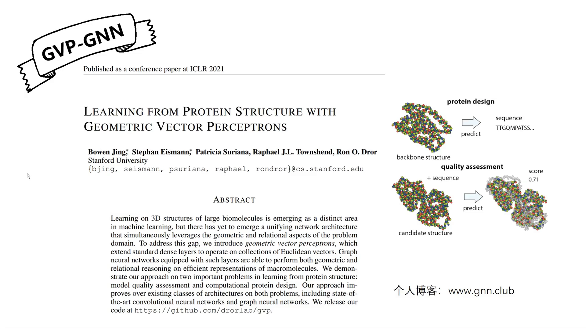

第二个是**质量评估**（model quality assessment）：输入是候选蛋白质结构加上氨基酸序列，输出是一个标量分数，比如 0.71，衡量这个候选结构与实验测定的参考结构有多像 [【跳转到 00:50】](https://www.bilibili.com/video/BV1RwkBY5EXu/?t=50)。左边彩色的是模型预测的结构，右边灰色的是实验室测出来的真实结构，两者的重叠程度就折算成这个分数。

两个任务一输出序列、一输出标量，但共用同一个编码器。这个编码器就是本节要拆的 GVP-GNN。

### 1.2 与 EGNN、PAINN 同一思路：同时接收标量和向量

[【跳转到 01:56】](https://www.bilibili.com/video/BV1RwkBY5EXu/?t=116)

讲者把 GVP 放在 EGNN、PAINN 同一行列里：三者思路相同，都是让模型**同时接收标量和向量两种输入**。标量是典型的不变性特征，向量因为具有方向性，是典型的等变性特征。前置知识也不多——会图神经网络的基本概念、知道群论里什么叫等变性、什么叫不变性就够了。

差别在于"向量怎么被使用"。EGNN 让向量去更新坐标，GVP 则把向量留在特征通道里，用一套受类型约束的运算去更新它。这条分工在第八节展开。

---

## 二、分通道的依据：标量不变、向量等变

### 2.1 两类通道的形状与变换行为

[【跳转到 02:21】](https://www.bilibili.com/video/BV1RwkBY5EXu/?t=141)

先看 GVP 的输入输出签名。输入是一对标量特征与向量特征 $(s, V)$，输出是另一对 $(s', V')$。伪代码把形状写得很清楚：

$$
(s, V) \in \mathbb{R}^{n} \times \mathbb{R}^{\nu \times 3}, \qquad (s', V') \in \mathbb{R}^{m} \times \mathbb{R}^{\mu \times 3}
$$

这里 $n$ 是输入标量的通道数，$\nu$ 是输入向量的个数（每个向量是三维的，所以写成 $\nu \times 3$）；输出侧的 $m$、$\mu$ 同理。要强调的是：**"向量通道"不是"一列很长的数"，而是 $\nu$ 个真正带方向的三维向量**。$s$ 那一路才是普通神经网络熟悉的标量数组。

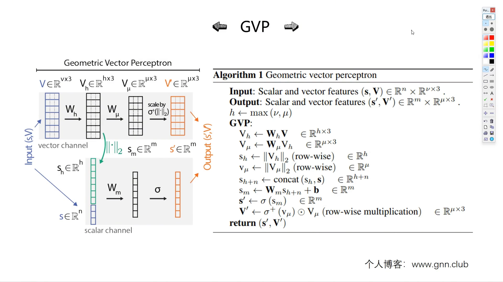

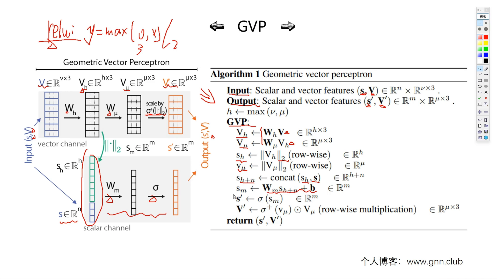

两类通道的区别不在"是数组还是标量"，而在**旋转坐标系时它们怎么变**。标量不变：把整个蛋白质转一下，某个残基的疏水性分数、某个距离值都不动。向量等变：坐标系转了 $Q$，向量 $v$ 就变成 $Qv$——转多少跟多少，长度不变、方向跟着转。

这条判据在 3.2.3 已经立过：判断一个量属于哪类，看它在旋转下的行为，不看它有几个数。GVP 的整个设计就是围绕这条判据展开的。

### 2.2 一般 MLP 为什么不能直接吃向量：类型约束与权重形状

[【跳转到 02:46】](https://www.bilibili.com/video/BV1RwkBY5EXu/?t=166)

如果照搬普通 MLP，做法会是把 $s$ 和 $V$ 摊平成一个长向量，过一层 $W$，再套 ReLU。问题出在两步上。

第一步是**非线性**。ReLU 是逐元素的 $\max(0, x)$，它作用在向量的三个分量上，等于对 $x$、$y$、$z$ 各自设阈值。旋转之后，同一个物理方向会落到不同的分量组合上，被截断的部分也就不同——$f(Qv) \neq Qf(v)$，等变就断了。所以 GVP 里所有逐元素非线性（$\sigma$、$\sigma^+$）都只作用在**标量**上，向量一次都没被逐分量处理过。

第二步是**权重形状**。伪代码里 $V_h \leftarrow W_h V$，其中

$$
W_h \in \mathbb{R}^{h \times \nu}, \qquad V_h \in \mathbb{R}^{h \times 3}
$$

注意 $W_h$ 是 $h \times \nu$ 的矩阵，乘在 $\nu \times 3$ 的 $V$ 左边，混合的是**"第几个向量"这个通道维**，最后那个 3（三维分量）原封不动地留着。换句话说，$V_h$ 的每一行都是输入 $\nu$ 个向量的一组合，而组合系数是矩阵里的标量。

这就是"几何类型约束"的具体含义：GVP 的线性层不是"任意矩阵乘任意向量"，而是**标量系数矩阵 × 向量列表**，输出仍是同阶的向量列表。一般 MLP 的隐藏层没有这个限制，权重可以把空间分量也混进去，一旦混了，$Q$ 就提不出来。

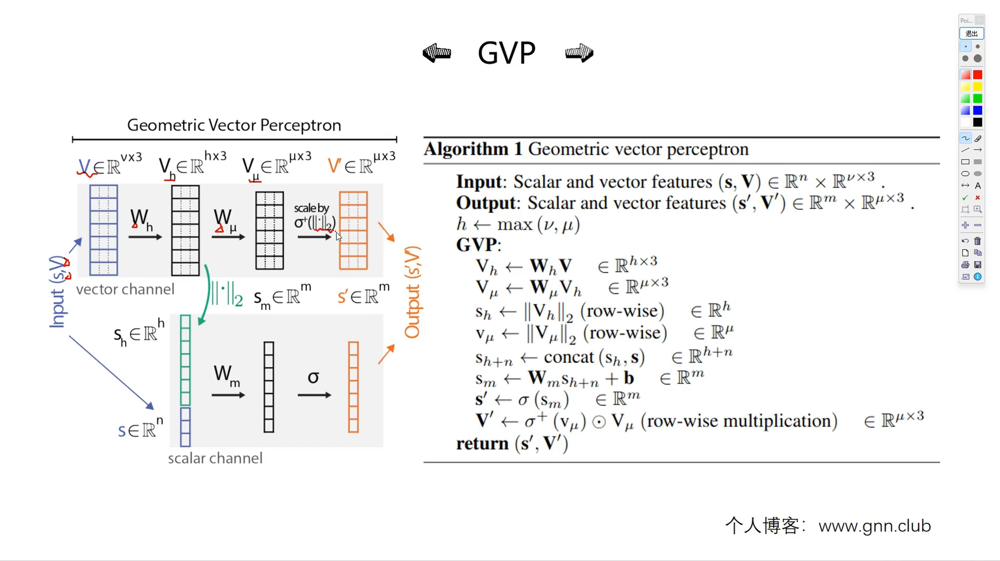

---

## 三、向量线性组合：用标量系数混合通道，不动空间分量

### 3.1 W_h 与 W_mu 各做一次通道混合

[【跳转到 04:26】](https://www.bilibili.com/video/BV1RwkBY5EXu/?t=266)

向量支路第一步是把 $V$ 送进一个线性层，用参数 $W_h$ 做映射，得到中间结果 $V_h$；$V_h$ 再送给第二个线性层，得到另一个中间结果 $V_\mu$。伪代码写作

$$
V_h \leftarrow W_h V \in \mathbb{R}^{h \times 3}, \qquad V_\mu \leftarrow W_\mu V_h \in \mathbb{R}^{\mu \times 3}
$$

两层各管一件事：$W_h$ 把 $\nu$ 个输入向量重新组合成 $h$ 个，$W_\mu$ 再把 $h$ 个压成 $\mu$ 个输出向量。视频里把 $h$ 取成 $\max(\nu, \mu)$，也就是中间层宽度取输入、输出通道数的较大者。

为什么需要两层而不是一层？因为后面两条支路要的东西不一样：标量支路要"模长"，门控支路要"待缩放的向量"。分两步走，$V_h$ 可以专门供出模长，$V_\mu$ 专门供出被门控的对象，两条支路各取所需。

### 3.2 为什么这一步等变：系数是标量，Q 可以提出来

这一步的等变性可以直接验算。设坐标旋转 $Q$，输入向量变成 $QV$（每一行都左乘 $Q$）。代入：

$$
W_h (QV) = (W_h Q) V
$$

但这里要小心：$Q$ 是作用在每个三维向量上的，$W_h$ 只作用在"第几个向量"这一维，两者作用在不同的轴上，可以交换顺序：

$$
W_h (QV) = Q (W_h V) = Q V_h
$$

也就是说，"先旋转再过线性层"和"先过线性层再旋转"结果一样。原因只有一个：**$W_h$ 里的每个系数都是标量**，标量在旋转下不变，所以能穿过 $Q$。如果 $W_h$ 里混进了依赖方向的量，这个交换就不成立。

这就是"向量线性组合"作为一类合法操作的根据：它是若干个向量按不变系数加权求和，求和与数乘都保方向，结果仍是向量。

---

## 四、模长：把向量降成标量，才有资格进入非线性

### 4.1 s_h = ||V_h||_2 拼进标量通道

[【跳转到 04:51】](https://www.bilibili.com/video/BV1RwkBY5EXu/?t=291)

向量 $\mathbb{R}^{h \times 3}$ 不能直接喂给 MLP，但它有一个量可以：每一行的模长。伪代码里

$$
s_h \leftarrow \lVert V_h \rVert_2 \ \text{(row-wise)} \in \mathbb{R}^{h}
$$

逐行取 L2 范数，$h$ 个向量就得到 $h$ 个标量。然后把这 $h$ 个标量与原来的 $n$ 个标量拼起来：

$$
s_{h+n} \leftarrow \mathrm{concat}(s_h, s) \in \mathbb{R}^{h+n}
$$

拼接后的向量才送进普通神经网络：$s_m \leftarrow W_m s_{h+n} + b$，再过激活 $\sigma$ 得到 $s' \leftarrow \sigma(s_m)$。视频里强调这一步"就是典型的神经网络——线性层加激活函数"。

模长的妙处在于它是**旋转不变量**：$\lVert Qv \rVert_2 = \lVert v \rVert_2$。向量转了，长度不变，所以模长可以安全地进入标量通道，接受任意非线性而不破坏等变。这也是 3.2.3 里那条"模长是把向量降成标量的通道"的具体实现。

### 4.2 L2 归一化：方向保留、尺度统一

[【跳转到 07:21】](https://www.bilibili.com/video/BV1RwkBY5EXu/?t=441)

除了取模长，向量本身还要做一次 L2 归一化（视频里说的"规划"就是归一化）。归一化的作用是**只改大小、不改方向**：把每个向量缩到单位长度，方向信息完整保留。

为什么要统一尺度？讲者给了两条理由：一是计算稳定性，二是优化效率。如果不同向量的模长差异过大，训练时容易出现梯度弥散或梯度爆炸。归一化把所有向量拉到相近的规模，梯度就不会被个别大向量主导。

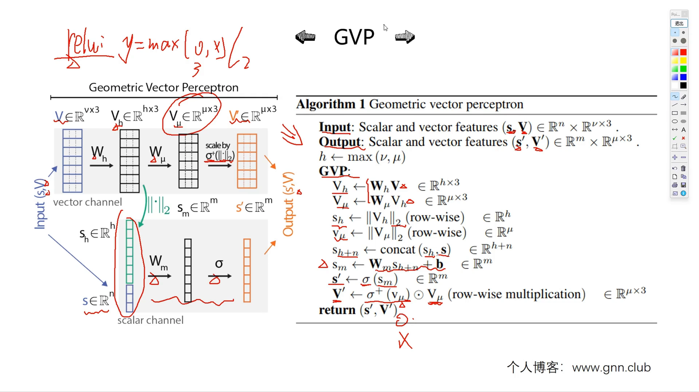

---

## 五、标量门控：σ+ 只缩放向量，不改变方向

### 5.1 为什么用 σ+ 而不是 ReLU

[【跳转到 03:36】](https://www.bilibili.com/video/BV1RwkBY5EXu/?t=216)

向量支路的最后一步需要一个"缩放因子"。GVP 用的是 $\sigma^+$，视频称它是 ReLU 的修正版本。ReLU 的公式大家都熟：

$$
\mathrm{ReLU}(x) = \max(0, x)
$$

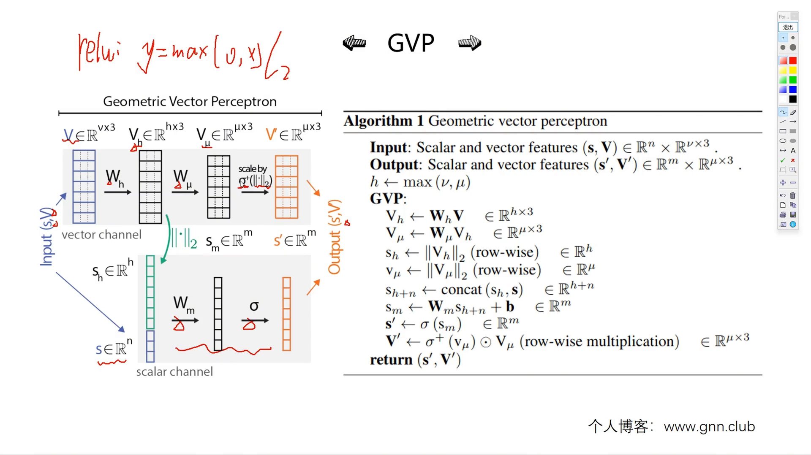

$\sigma^+$ 只改了一处：把下界的 0 换成一个非常非常小的正数。为什么要避免 0？因为接下来要拿这个因子去乘向量：

$$
V' \leftarrow \sigma^+(\nu_\mu) \odot V_\mu \ \text{(row-wise multiplication)}
$$

如果因子是 0，乘出来整个向量就变成零向量——不只是"这个方向不重要"，而是"这个方向的信息被彻底抹掉，梯度也过不去"。换成极小值，等于说"几乎不重要但还留一口气"，向量的方向和梯度都还在。

### 5.2 V' = σ+(ν_mu) ⊙ V_mu：逐元素缩放

[【跳转到 06:06】](https://www.bilibili.com/video/BV1RwkBY5EXu/?t=366)

这一步的乘法是**逐元素**的：$\nu_\mu$ 是 $\mu$ 个标量（每个向量一个），$V_\mu$ 是 $\mu$ 个向量，一个标量配一个向量，整体乘一个比例。视频把它解释得很直白：这个操作在几何上就是"按元素缩放每个向量"，让网络能调整每个方向向量的大小，而不改变其方向。

结果 $V'$ 的维度跟原来一样，每个向量的大小被调整过，方向没变。讲者明确说：**这其实是等变性的一种实现**。验算也简单：标量因子在旋转下不变，所以

$$
\sigma^+(\nu_\mu) \odot (Q V_\mu) = Q \big( \sigma^+(\nu_\mu) \odot V_\mu \big)
$$

缩放和旋转可以交换顺序——这正是"门控"能进等变网络的原因。

### 5.3 归一化与门控的分工：一个定尺度，一个定重要性

[【跳转到 06:56】](https://www.bilibili.com/video/BV1RwkBY5EXu/?t=416)

归一化把向量压到统一大小，门控又把大小调回去，看上去矛盾，讲者说这两个操作其实相辅相成：

- **归一化负责"起点公平"**：把所有向量拉到同一尺度，保证方向信息被保留、数值稳定、优化高效。
- **门控负责"重新分配重要性"**：网络在训练中学到的权重决定哪些方向特征更重要，通过相乘把它们的模长放大或缩小。这一步是**学出来的**，不是手工设的。

一句话总结视频里的说法：归一化提供数值稳定性和优化效率，同时保住方向；向量大小的调整交给网络学习和门控机制，用来强调某些特征的重要性。

顺带一提，讲者把这个机制类比到 RNN 系列的门控：$\sigma^+$ 输出的就是一组 0 到 1 之间的权重，只不过它乘的不是隐藏状态，而是方向向量。

---

## 六、装回残基图：GVP-GNN 的消息传递

### 6.1 消息：拼接节点与边特征，过三个 GVP

[【跳转到 08:49】](https://www.bilibili.com/video/BV1RwkBY5EXu/?t=529)

有了 GVP 这个积木，GVP-GNN 的结构就很朴素——讲者说"其实就是普通 GNN 的结构"。消息的定义是

$$
h_m^{(j \to i)} := g\left(\mathrm{concat}\left(h_v^{(j)},\ h_e^{(j \to i)}\right)\right)
$$

其中 $h_v^{(j)}$ 是邻居节点 $j$ 的嵌入，$h_e^{(j \to i)}$ 是边 $j \to i$ 的嵌入，两者拼接后送进 $g$。$g$ 不是单个 GVP，而是一个 **sequential 容器，里面堆叠了三个 GVP**——这一点在幻灯片上被专门划了线。

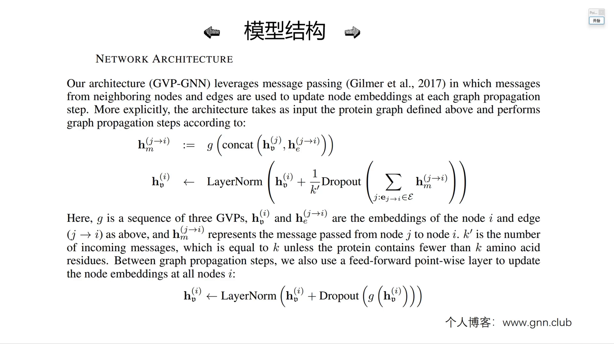

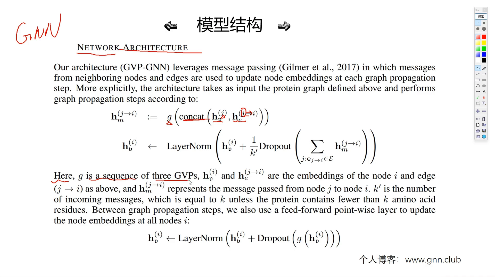

这里要留意：残基图上的节点特征和边特征本身就同时带标量和向量两部分（骨架坐标给出的方向信息就装在向量通道里），所以拼接后的对象仍然是 $(s, V)$ 这一对，正好是 GVP 的输入签名。等变性和不变性就是靠三个 GVP 一路保下来的。

### 6.2 聚合：1/k'、dropout、LayerNorm 与 k 近邻

[【跳转到 09:44】](https://www.bilibili.com/video/BV1RwkBY5EXu/?t=584)

消息算完要聚合，更新式是

$$
h_v^{(i)} \leftarrow \mathrm{LayerNorm}\left(h_v^{(i)} + \frac{1}{k'}\,\mathrm{Dropout}\left(\sum_{j:\, e_{j \to i} \in \mathcal{E}} h_m^{(j \to i)}\right)\right)
$$

三个零件各有分工：

- **求和**：把送进节点 $i$ 的所有消息加起来，这是消息传递里的标准聚合。
- **dropout**：视频顺带讲了来历——2012 年 AlexNet 里提出的技术，用来防止训练过拟合。
- **$1/k'$ 归一化**：$k'$ 是 incoming message 的数量，也就是送进当前节点的消息条数。除以它相当于取平均，避免邻居多的节点数值被撑爆。
- **LayerNorm 加残差**：把聚合结果加回原特征再归一化，跟普通 GNN 的更新写法一致。

$k'$ 还有一个额外的限制：它等于 $k$，除非蛋白质的残基数量少于 $k$。讲者举了个具体例子——设 $k = 10$，如果目标节点有 20 个甚至更多邻居，就只挑**最近的 10 个**做聚合；如果这个节点只有 6 个邻居，那 $k'$ 就取 6。设这个上限是为了防止计算量爆炸：很多图结构非常密集，无限制地聚合下去计算量会非常大。

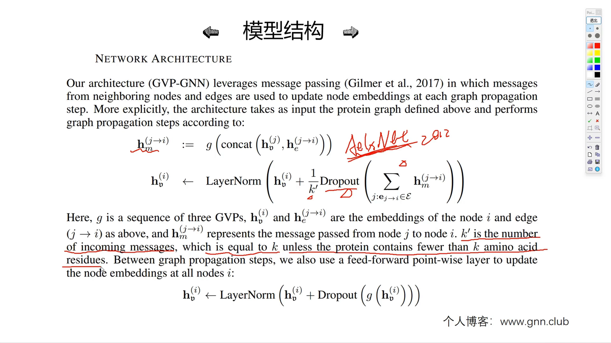

### 6.3 pointwise layer：只看自己

[【跳转到 11:49】](https://www.bilibili.com/video/BV1RwkBY5EXu/?t=709)

图传播步之间还插了一个前馈的 **pointwise layer**：

$$
h_v^{(i)} \leftarrow \mathrm{LayerNorm}\left(h_v^{(i)} + \mathrm{Dropout}\left(g\left(h_v^{(i)}\right)\right)\right)
$$

"pointwise"的意思是它只关注单个节点的信息计算和更新，不考虑节点之间的关系——输入里没有邻居、也没有边，只把节点自己的 $(s, V)$ 过一遍 $g$（同样是三个 GVP 堆叠）。

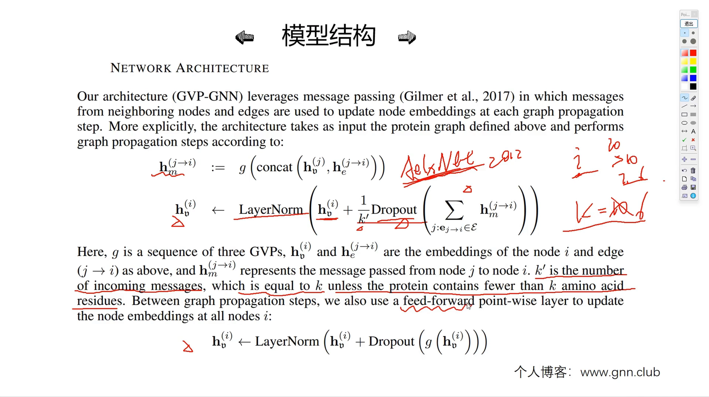

讲者最后把整个结构对回普通 GNN 的三步：消息定义、消息聚合、消息更新，再加上一个独立的 pointwise 层。GVP 只替换了其中的"函数"，没有改消息传递的骨架。

---

## 七、等变与不变的差距：MQA 上的对照

[【跳转到 13:43】](https://www.bilibili.com/video/BV1RwkBY5EXu/?t=823)

实验结果对应开场那两个任务。蛋白质设计这一项，GVP-GNN 在 CATH 4.2 测试集上取得 SOTA：困惑度 7.10 / 7.44 / 5.29（short / single-chain / all，越低越好），恢复率 32.1 / 32.0 / 40.2（越高越好），三项都优于 Structured GNN 与 Structured Transformer。

质量评估这一项更有对照意义。对手是 DimeNet——它同时对距离信息和夹角信息建模，属于**基于不变性**的 GNN。讲者指出，在对三维结构、空间位置比较敏感的问题上，基于等变性的模型结果比基于不变性的要好很多，差距接近 20%。

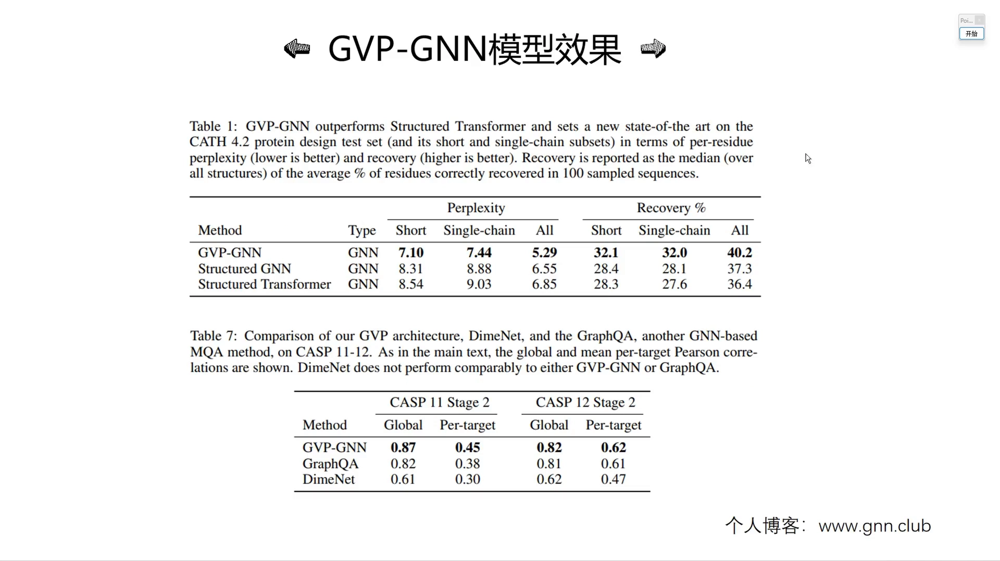

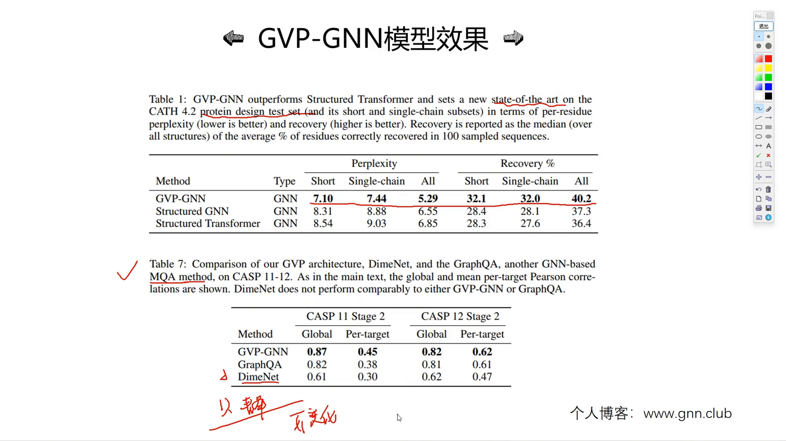

这个对照说明的是本节开头那个取舍：只喂不变量（距离、夹角）虽然安全，但把方向信息压缩掉了；把向量作为一等公民留在通道里，模型能多拿到一部分几何信息。当然，讲者也提醒这只是两个任务的证据，不构成对所有任务的结论。

---

## 八、与 EGNN 的分工：一个更新坐标，一个更新向量通道

[【跳转到 15:11】](https://www.bilibili.com/video/BV1RwkBY5EXu/?t=911)

讲者评价 GVP-GNN"比之前讲过的 EGNN、DimeNet 都要简单，不管从设计思想还是模型结构上"，但效果很好。这句话点出了两条路线的差别，值得单独说清，避免和 4.1.2 混在一起：

- **EGNN 更新坐标**。它的向量流是坐标本身 $x_i$，用 $\hat m_{ij} = (x_i - x_j)\phi(m_{ij})$ 这样的项去移动原子位置，等变性靠"坐标随 $Q$ 变换"直接保证。推导见 4.1.2，本节不重复。
- **GVP 更新向量通道**。坐标不作为被更新的对象，方向信息存在 $\nu$ 个特征向量里，由 $W_h$、$W_\mu$、$\sigma^+$ 在通道维上更新。等变性靠"系数是标量、模长不变、门控不转向"三条性质保证。

换句话说，EGNN 把等变押在"几何量本身怎么变"上，GVP 把等变押在"允许哪些运算"上。前者是几何直觉，后者是类型系统。两者都能做出等变网络，选哪条取决于你要不要输出坐标。

---

## 小结

- GVP 的输入输出都是一对标量与向量：$(s, V) \in \mathbb{R}^n \times \mathbb{R}^{\nu \times 3}$，$(s', V') \in \mathbb{R}^m \times \mathbb{R}^{\mu \times 3}$。向量通道是 $\nu$ 个真正带方向的三维向量，不是一列长数组。
- 三类合法操作撑起整个模块：**向量线性组合**（$W_h V$，标量系数只混合通道）、**模长转标量**（$\lVert V_h \rVert_2$ 拼进标量通道）、**标量门控**（$\sigma^+(\nu_\mu) \odot V_\mu$，逐元素缩放不改方向）。
- 等变性的根据就一句话：系数是标量、模长是标量、门控因子是标量，三者都能穿过旋转矩阵 $Q$，所以"先转再过模块"等于"先过模块再转"。
- 一般 MLP 与 GVP 的差别在类型约束：MLP 对向量逐分量做非线性、权重可以混空间分量，等变会断；GVP 把非线性全留给标量通道，线性层只沿通道维混合（$W_h \in \mathbb{R}^{h \times \nu}$）。
- 归一化与门控分工明确：归一化统一尺度、保方向、稳梯度；门控按学到的权重重新分配各方向的重要性。
- GVP-GNN 只是把消息传递里的函数换成三个 GVP 的堆叠，聚合仍是求和、$1/k'$ 归一化、dropout、LayerNorm，另加一个只看自身的 pointwise 层。
- 与 EGNN 的分工：EGNN 用向量去更新坐标，GVP 用受约束的运算去更新向量通道；本节不重复 EGNN 的坐标推导。

## 关键术语速查

| 术语 | 一句话解释 |
| --- | --- |
| 不变性（invariance） | 输入做旋转、平移后，输出数值不变；距离、夹角、模长属于这类。 |
| 等变性（equivariance） | 输入转了 $Q$，输出也跟着转 $Q$；向量属于这类。 |
| 标量通道 | 一组在旋转下不变的数，可以接受任意逐元素非线性。 |
| 向量通道 | $\nu$ 个三维向量，形状 $\nu \times 3$，整体随 $Q$ 变换。 |
| 几何向量感知机（GVP） | 同时吃 $(s, V)$、吐出 $(s', V')$ 的基本模块，内部只允许三类保等变的向量操作。 |
| 向量线性组合 | $V_h = W_h V$，用标量系数矩阵沿通道维加权求和若干向量。 |
| 模长（L2 范数） | $\lVert v \rVert_2$，旋转不变，是把向量降成标量、接入非线性网络的通道。 |
| L2 归一化 | 把向量缩到单位长度，只改大小不改方向，用于数值稳定与优化效率。 |
| 标量门控 | 用标量因子逐元素乘向量，缩放模长而不改变方向；GVP 里因子由 $\sigma^+$ 给出。 |
| $\sigma^+$ | ReLU 的修正版，把下界的 0 换成极小正数，避免门控把向量乘成零向量。 |
| 消息传递 | 先由邻居与边算消息，再聚合到目标节点并更新其表示的三步流程。 |
| pointwise layer | 只处理单个节点自身特征、不涉及邻居与边的前馈层。 |
| $k'$ | 实际参与聚合的消息条数，等于 $k$ 或该节点的邻居数（取较小者）。 |
| 质量评估（MQA） | 给候选蛋白质结构打一个与实验结构相似度的分数，输出是标量。 |