# 局部消息传递看不远：多尺度图U-Net如何用粗化扩大感受野

> 视频来源：[Multi Scale Protein Structure Modelling with Geometric Graph U Nets](https://www.youtube.com/watch?v=3izeKw4G53I)（YouTube · Computational Intelligence Group 组会 · 讲者 Chang Liu，剑桥大学）｜时长约 52 分钟
> 一支把"蛋白质结构本身是多尺度的"讲成网络架构设计理由的报告。本文按视频顺序覆盖：蛋白质的层级组织与折叠分类任务、局部消息传递为什么够不到别构位点、全连接注意力的代价、三条扩大感受野的路线（局部池化、虚拟节点、虚拟边）、几何图 U-Net 的粗化与细化、点池化与稀疏池化的公式、压缩代价与采样比例，以及折叠分类与 K 链两组实验。字幕为英文自动生成，本文已按上下文订正断句与术语拼写（如 pooling、coarsening、allosteric regulation、SCOPe）。

## 本讲要解决的核心问题（SCQA）

**背景**：几何图神经网络（geometric GNN）把蛋白质画成一张图：节点是残基（氨基酸），边是空间邻接或化学键，节点上带坐标与标量特征。每一层消息传递让一个节点收集邻居的信息，所以层数决定了一个节点能"看多远"。

**冲突**：蛋白质的功能不由单个残基决定，而由跨越大段序列的结构关系决定——整块结构域（domain）、别构位点（allosteric site）与活性位点之间的远程调控。这些关系在图上相隔很远，靠几层邻域聚合够不到；换成全连接的图 Transformer，又要在每个蛋白质上付出全局注意力的代价。

**疑问**：既然"看远"要么靠堆层、要么靠全连接，有没有第三条路？能不能用更少的计算，在一张稀疏图上获得接近全局的感受野？

**回答（中心思想）**：有。把图本身按层级粗化（coarsening）——每一步把一片节点压成一个超节点（super node），再在粗化后的图上继续做消息传递——一次消息传递就跨越了整片区域，于是在少数几层里就能把感受野抬到接近整张图的尺度。代价是压缩：超节点把一片节点的信息挤进一个向量，采样比例、重叠方式、是否考虑节点重要性，都会决定丢掉什么。[【跳转到 12:15】](https://www.youtube.com/watch?v=3izeKw4G53I&t=735)

## 一、蛋白质本身就是多尺度的，网络架构应该照着这个层级长

报告开篇先立了一个前提：蛋白质结构有四层组织，一层比一层粗。[【跳转到 03:02】](https://www.youtube.com/watch?v=3izeKw4G53I&t=182)

- **一级结构**：氨基酸的线性序列。
- **二级结构**：这条序列通过主链氢键折叠成局部的 α 螺旋（alpha helix）与 β 折叠（beta sheet）。
- **三级结构**：这些二级元件在侧链相互作用下堆积成唯一的三维形状。
- **四级结构**：多条折叠好的肽链组装成一个功能复合物。

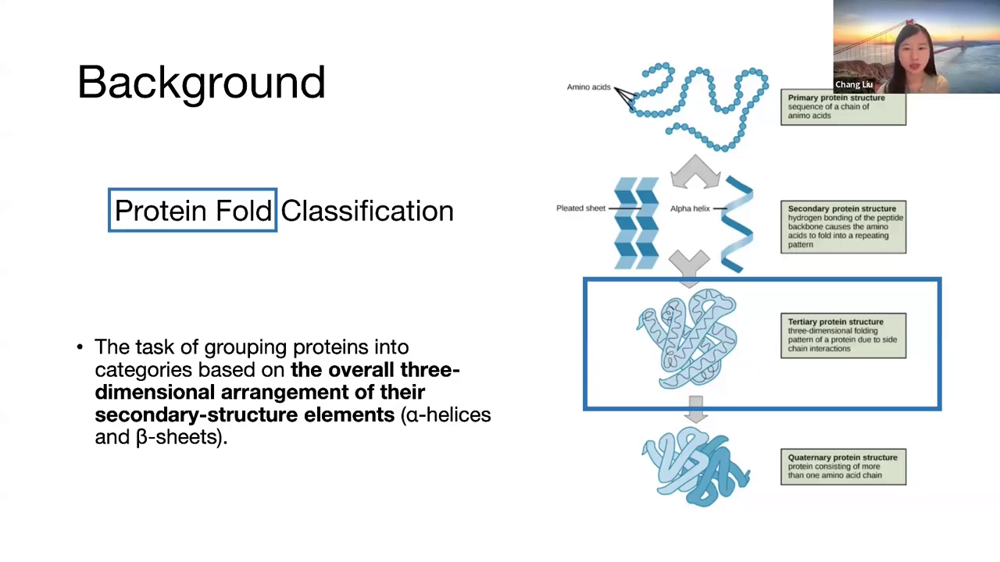

**折叠（fold）** 在这个层级里指三级结构那一层：它既包括二级结构之间的连接与顺序（拓扑），也包括 α 螺旋和 β 折叠在空间中的排布，也就是一个结构域的整体三维架构。[【跳转到 03:27】](https://www.youtube.com/watch?v=3izeKw4G53I&t=207)

这个前提直接决定了后面所有设计。讲者的原话是：**网络架构本身应该去镜像我们观察到的这种生物层级**。[【跳转到 12:10】](https://www.youtube.com/watch?v=3izeKw4G53I&t=730) 换句话说，如果数据是多尺度的，而模型只有一种尺度（残基级、固定半径邻域），那缺的不是参数，而是尺度本身。

## 二、折叠分类是"全局结构理解"的试金石

论文选的任务是**蛋白质折叠分类（protein fold classification）**：按二级结构元件的整体三维排布，把蛋白质分到不同类别里。[【跳转到 03:52】](https://www.youtube.com/watch?v=3izeKw4G53I&t=232)

为什么这个任务值得做？讲者给了两条理由。其一是任务本身重要：折叠分类把结构与功能、演化、注释连起来，尤其在序列相似度不够用的时候。其二是它适合当**试金石（litmus test）**：一个模型如果连折叠类别都分不开，那它学到的结构表示大概率是有限或低质量的。[【跳转到 05:01】](https://www.youtube.com/watch?v=3izeKw4G53I&t=301)

这句话把任务和表示能力绑在了一起：折叠类别是由"整块二级结构怎么摆"决定的，而"怎么摆"恰恰是局部邻域里看不出来的信息。所以折叠分类的准确率，可以直接读作"模型有没有抓住全局结构"。

## 三、局部消息传递的天花板：感受野够不到别构位点

问题陈述只有两条，但两条正好卡住了本节的主题。[【跳转到 10:37】](https://www.youtube.com/watch?v=3izeKw4G53I&t=637)

第一条：**传统几何 GNN 依赖消息传递，因此抓不住支配蛋白质功能的层级相互作用**，例如全局结构域和远程别构调控。幻灯片左侧画的是标准的局部消息传递：第 $\ell$ 层的节点 $i$ 只从它的邻居 $j$ 收消息，

$$
h_i^{\ell+1} = f\left(h_i^{\ell}, \{h_j^{\ell} : j \to i\}\right)
$$

第二条：**基于 Transformer 的模型消耗大量计算资源**，因为它不管输入什么蛋白质，都建一张全连接图。

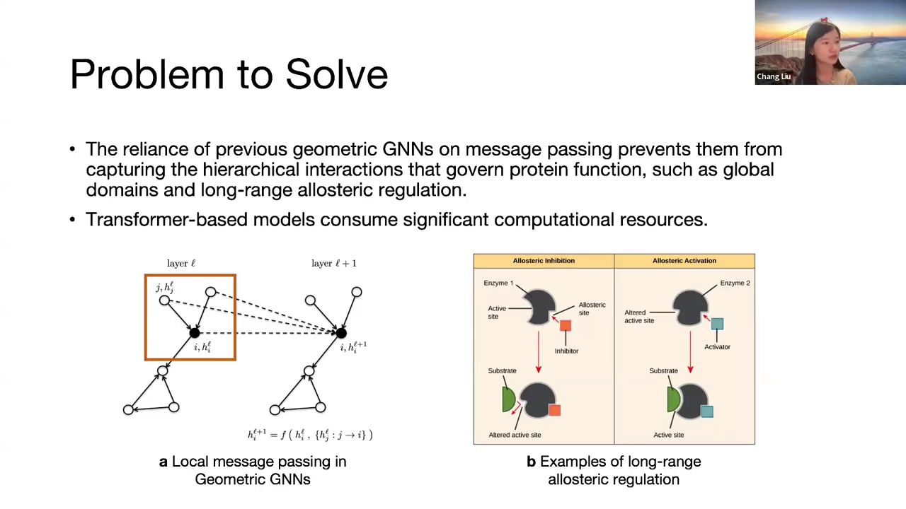

右侧那张别构调控的示意图是本节最直观的论据：别构位点（allosteric site）与活性位点（active site）在空间上相隔一段距离，抑制剂或激活剂结合在别构位点上，却能改变活性位点的形状与功能。[【跳转到 11:02】](https://www.youtube.com/watch?v=3izeKw4G53I&t=662) 要让模型学到这种关系，信息必须从别构位点走到活性位点。在稀疏图上，这段距离要靠层数一步步"接力"；而每接力一层，信息就被聚合、压缩一次。

这里只需记住结论：**局部邻接擅长刻画"谁挨着谁"，长程接触刻画的是"谁影响谁"，两者不是同一种信息**。堆层虽然能扩大感受野，但会把远程依赖挤进固定长度的向量里——那条故障路径（过压缩）属于另一节的内容，见 [2.2.3 过压缩不是过平滑](../../../2_图上的学习机制/2.2_表达能力与失败模式/2.2.3_图网络过压缩、信息瓶颈与远程依赖/过压缩不是过平滑：图神经网络的远程依赖为什么被挤进固定长度向量.md)。本节关心的是另一条出路：不去挤，而是**换一张更粗的图**。

## 四、全连接是一条出路，但代价随蛋白质规模一起涨

Transformer 在讲者的分类里被归为"特殊的一类图神经网络"：它建的是全连接图，任意两个残基之间都有边。[【跳转到 09:47】](https://www.youtube.com/watch?v=3izeKw4G53I&t=587) 这样一条边就跨越了任意距离，长程依赖在结构上不再是问题。

代价也很直接：全连接图的边数随节点数平方增长，而蛋白质的残基数从几十到上千不等。讲者的措辞是"无论输入什么蛋白质结构，都要建这样一张全连接图"，因此**计算开销与蛋白质大小无关地居高不下**。[【跳转到 11:52】](https://www.youtube.com/watch?v=3izeKw4G53I&t=712)

于是局面变成一个三选一：

| 方案 | 感受野 | 代价 |
| --- | --- | --- |
| 堆层的稀疏 GNN | 随层数缓慢增长 | 远程信息被反复压缩 |
| 全连接图 Transformer | 一步到全局 | 边数随节点数平方增长 |
| 多尺度粗化（本文） | 每粗化一级就跳一个尺度 | 压缩带来的信息损失 |

第三条路要回答的问题因此很具体：**能不能在保持稀疏的前提下，让一次消息传递跨越一大片区域？**

## 五、三条扩大感受野的路线：局部池化、虚拟节点、虚拟边

在设计自己的架构之前，讲者把已有的层级几何 GNN 工作归成三类。[【跳转到 12:40】](https://www.youtube.com/watch?v=3izeKw4G53I&t=760)

1. **局部池化（local pooling）**：在每个 GNN 层把节点聚成新节点，供下一层使用；具体做法从基础聚类一直到可学习的、基于注意力的自适应池化。
2. **虚拟节点（virtual nodes）**：加一个与所有节点相连的"总节点"，让任意两个节点通过它两步可达。
3. **虚拟边（virtual edges）**：直接给远距离节点补边，把图变"短"。

这三类其实是在不同的地方动手：虚拟节点和虚拟边改的是**图的连接**，池化改的是**图的分辨率**。本文走的是第三条，并且把它从"每层池化一次"扩展成一个完整的编码—解码结构（借自点云处理里的 U-Net）。[【跳转到 13:05】](https://www.youtube.com/watch?v=3izeKw4G53I&t=785)

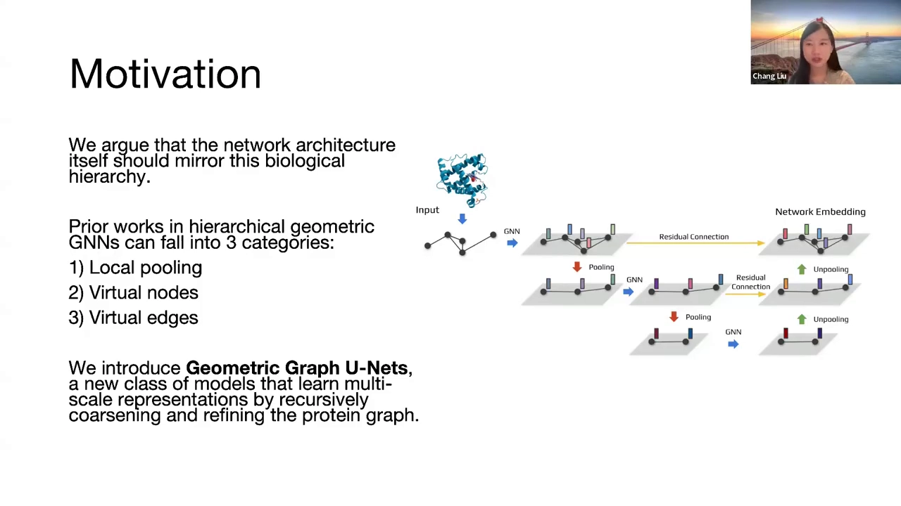

## 六、几何图 U-Net：编码器逐级粗化，解码器逐级细化

整体流程沿用 ProteinWorkshop 的五段式管线：蛋白质结构数据集 → 特征化（featurisation）→ GNN 层 → GNN 模型 → 评估头。[【跳转到 13:53】](https://www.youtube.com/watch?v=3izeKw4G53I&t=833) 论文的新意集中在第四段"GNN 模型"上。

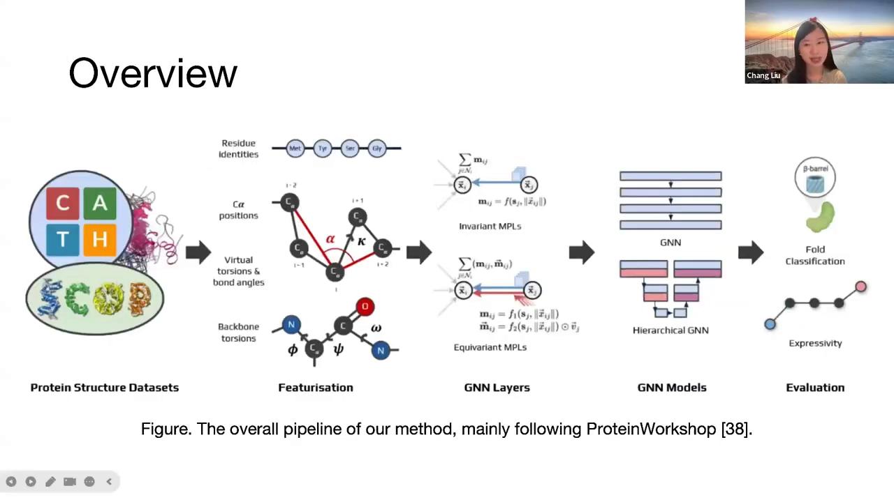

具体到架构，它是一个 U 形模型，由若干组池化与反池化（unpooling）块组成，分成编码阶段与解码阶段。[【跳转到 17:25】](https://www.youtube.com/watch?v=3izeKw4G53I&t=1045) 编码阶段反复粗化，把表示从局部推到全局；解码阶段再把它细化回残基分辨率。

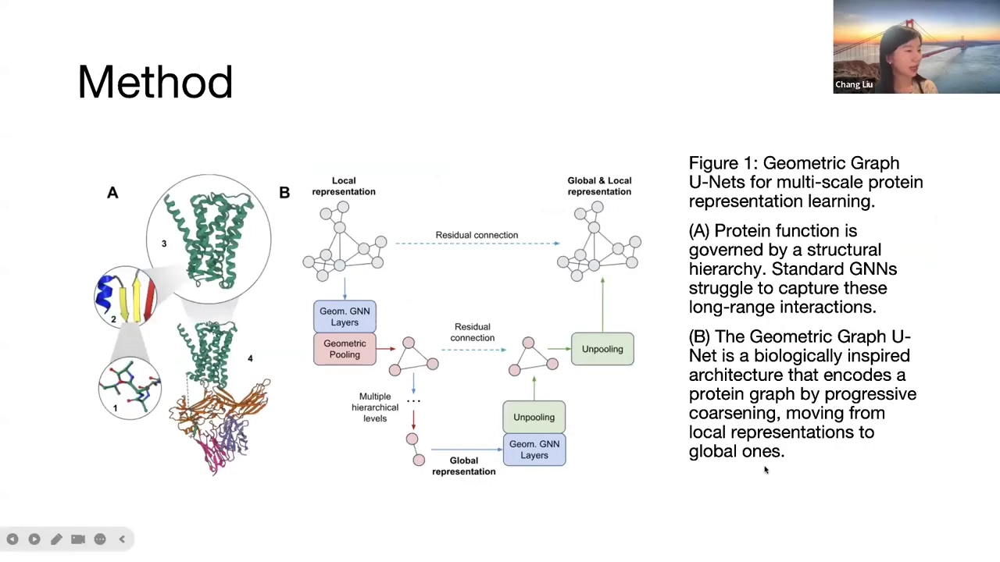

**感受野是怎么被放大的**，讲者给了一句关键解释：池化层先采样出一部分节点作为超节点，再把超节点邻域内所有原始节点的信息聚合到超节点上，**这样就放大了感受野的尺度，同时减少了图中的节点数**，因此比 Transformer 省资源。[【跳转到 19:10】](https://www.youtube.com/watch?v=3izeKw4G53I&t=1150)

这句话值得拆开看，因为它同时解释了两件事：

- **为什么感受野变大**：粗化后一个超节点代表一整片原始节点。在粗图上做一次邻域聚合，等价于在原图上跨越了整片区域，所以同样层数能覆盖更大的范围。
- **为什么计算变省**：节点数在每一级按采样比例减少，粗图上的消息传递比原图便宜；这与全连接图"边数随节点数平方增长"形成对照。

解码端的反池化块负责把粗化的特征放回原图。它的做法是：用反池化层重建图，并用**跳连（skip connection）**把对应池化块缓存的特征拼接进来，重建时标量与向量特征都初始化为零。[【跳转到 29:25】](https://www.youtube.com/watch?v=3izeKw4G53I&t=1765) 讲者强调这是整个设计里最重要的一处：跳连把**不同尺度感受野上的特征**整合到一起，而反池化块只用很简单的层，不额外引入图网络层，所以几乎没有增加参数。[【跳转到 30:40】](https://www.youtube.com/watch?v=3izeKw4G53I&t=1840)

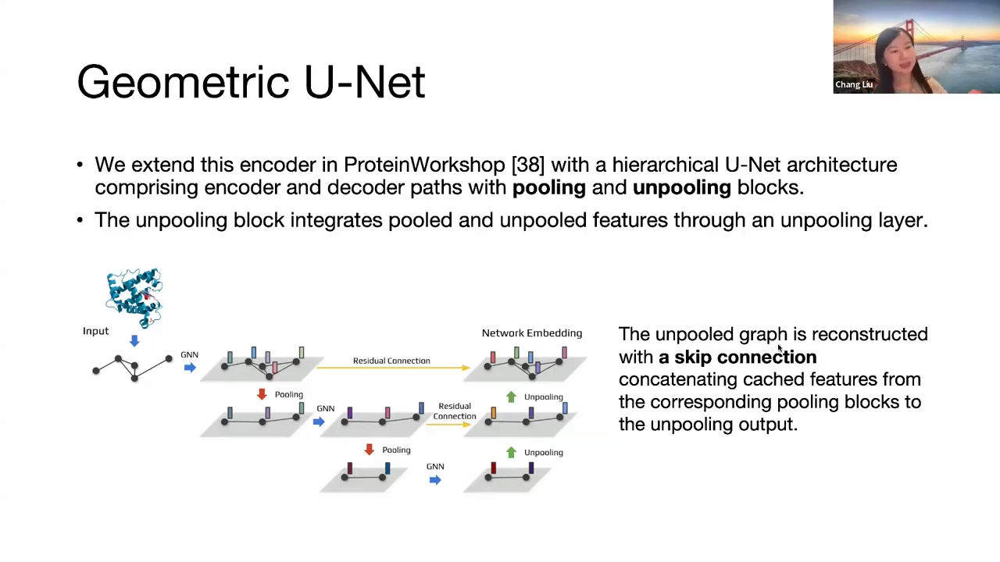

## 七、两种池化：点池化允许重叠，稀疏池化只认最近超节点

粗化要回答两个问题：**哪些节点当超节点**，以及**每个原始节点归给谁**。论文用了两种池化层，区别就在第二个问题上。[【跳转到 18:45】](https://www.youtube.com/watch?v=3izeKw4G53I&t=1125)

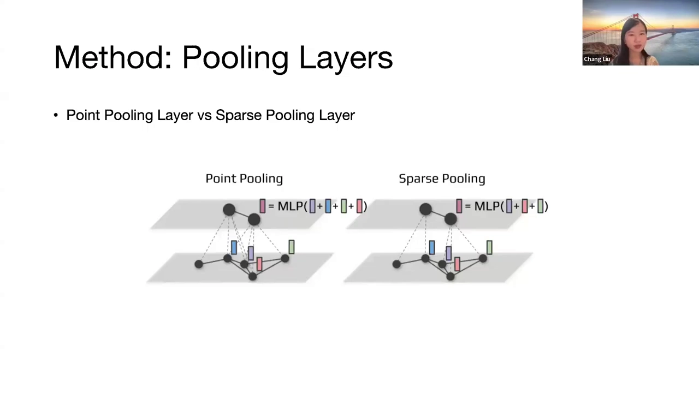

### 7.1 点池化：按邻域归属，允许一个节点被多次聚合

点池化借自点云网络 PointNet++。对每一对节点 $v_i$ 与超节点 $v_j^{sn}$（$v_i \notin V_P$，$V_P$ 是采样出的超节点集合），定义**簇分配矩阵（cluster assignment matrix）** $C$：

$$
C_{j,i} =
\begin{cases}
1 & \text{若 } i \in \mathcal{N}_j \\
0 & \text{其他}
\end{cases}
$$

其中 $\mathcal{N}_j$ 是第 $j$ 个超节点的邻域。超节点的特征用 GIN 的消息传递层更新：

$$
s_j^{sn} = \mathrm{MLP}\left(C_j^{\top} S\right) = \mathrm{MLP}\left(s_j + \sum_{i \in \mathcal{N}_j} s_i\right)
$$

讲者提到聚合算子试过求和与拼接，**求和效果更好**，所以最终用求和。[【跳转到 22:35】](https://www.youtube.com/watch?v=3izeKw4G53I&t=1355)

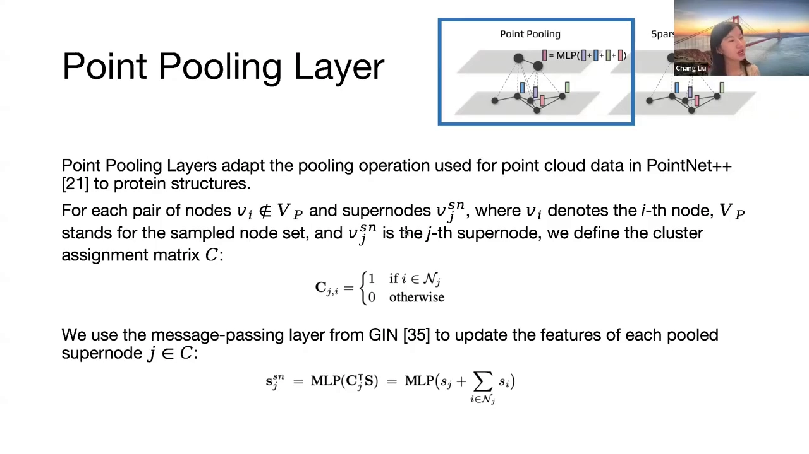

这个定义有一个副作用：不同超节点的邻域可能重叠，于是一个原始节点的信息会被**聚合多次**。讲者用图说明了这一点——右边超节点的邻域是四个原始节点，左边超节点的邻域是另外四个，两者重叠了三个。他也直说这会"降低图表示的能力"，并在实验里验证了。[【跳转到 22:10】](https://www.youtube.com/watch?v=3izeKw4G53I&t=1330)

### 7.2 稀疏池化：每个节点只归最近的那个超节点

稀疏池化把结构切成互不重叠的区域：每个节点只分配给离它最近的超节点。分配矩阵的条件因此变成

$$
C_{j,i} =
\begin{cases}
1 & \text{若 } i = \arg\min_{k \neq j} \lVert \mathbf{x}_j - \mathbf{x}_k \rVert_2 \text{ 或 } i = j \\
0 & \text{其他}
\end{cases}
$$

归约函数仍是求和，标量与向量特征分别按同一分配矩阵聚合：

$$
s_j^{sn} = C_j^{\top} S, \qquad \vec{v}_j^{sn} = C_j^{\top} \vec{V}
$$

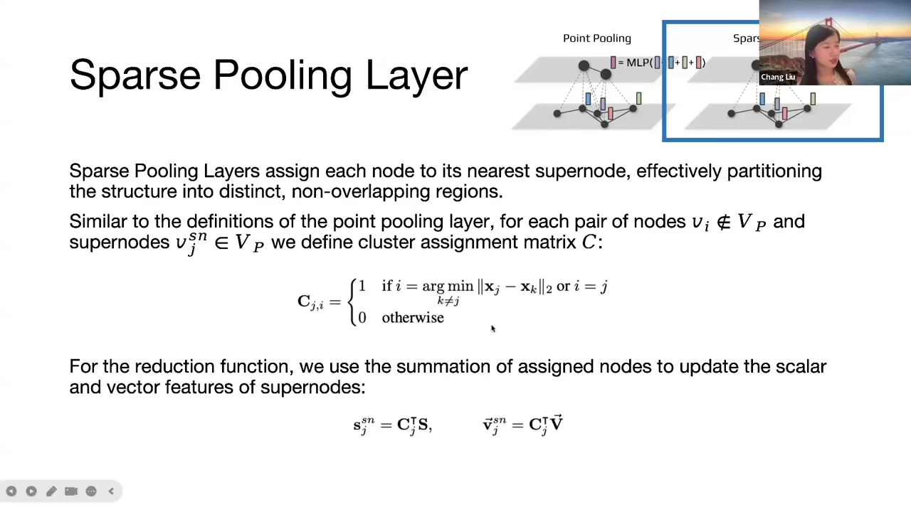

注意这里的向量特征 $\vec{V}$ 也一起被求和归约——这正是几何图网络与普通图网络的区别：粗化不只是聚合标量，还要聚合带方向的量。

### 7.3 超节点怎么选：最远点采样

超节点本身是**从原始节点里采样出来的子集**，用最远点采样（FPS, farthest point sampling）选取，目的是让采样点在整个图上尽量均匀分布。有听众追问采样是局部的还是全局的，讲者确认是**在整条蛋白质链上全局采样**；他也提到可以换成按邻域或按节点重要性采样的策略，但本文沿用 ProteinWorkshop 的做法。[【跳转到 25:00】](https://www.youtube.com/watch?v=3izeKw4G53I&t=1500)

这里藏着一个后面会被追问的隐患：FPS 只看几何上的均匀性，**不看节点的重要性**。哪些残基"重要"要到训练中才知道，而采样发生在前面。

## 八、代价：压缩、采样比例与被采样掉的节点

多尺度不是免费的。这一节把代价拆成三层，正好对应三种不同的风险。

**第一层：单个超节点装不下太多细节。** 有听众问，如果一个超节点压缩了过多信息会怎样。讲者的回答分两半：一方面这个超节点会变得很重要；另一方面，因为采样用的是 FPS、默认不考虑节点重要性，**重要的超节点反而有可能没被采到下一层**。补救办法是在采样算法里加上重要性权重。[【跳转到 32:20】](https://www.youtube.com/watch?v=3izeKw4G53I&t=1940)

**第二层：采样比例直接决定丢多少。** 论文把采样比例设为 0.6，讲者承认这会带来信息损失；比例调到 0.7 会保留更多超节点。但他也说明，他们没有系统比较过不同比例与不同采样策略的效果。[【跳转到 48:34】](https://www.youtube.com/watch?v=3izeKw4G53I&t=2914)

**第三层：三维结构会不会在粗化中塌掉。** 有听众顺着"几何池化"追问：如果超节点信息过载，会不会导致三维结构塌缩？讲者的回答很关键：**三维信息在特征化阶段就已经被编码进每个节点了**，所以池化面对的是抽象图而不是坐标本身；重要信息可能被采样掉，但"塌缩"属于极端情形。[【跳转到 35:15】](https://www.youtube.com/watch?v=3izeKw4G53I&t=2115)

把这三层合起来看，多尺度表示的代价可以写成一句话：**粗化用"分辨率"换"感受野"**。每粗化一级，一片节点的差异被压成一个向量；压得越狠，感受野越大，可分辨的细节越少。这与堆层导致的过压缩在机制上不同——过压缩是"向量容量不够装下指数增长的邻域"，粗化是"主动决定哪些节点合并、哪些被采样掉"——但两者都会让细粒度的差异消失，所以实践中的调节手段也相似：控制压缩比、保留重要性权重、用跳连把细尺度信息接回来。

## 九、实验：折叠分类的提升与 K 链上的表达力

**第一组实验：折叠分类。** 数据用 SCOPe 1.75，按 fold、superfamily、family 三个子集评估，共 1,195 个折叠类别，报告准确率与 F1，取三次随机运行的平均。基线是 SchNet（不变网络）与 GVP（等变网络），并且都先做了调参，所以表里的基线数字高于它们在原论文里的成绩。[【跳转到 38:17】](https://www.youtube.com/watch?v=3izeKw4G53I&t=2297)

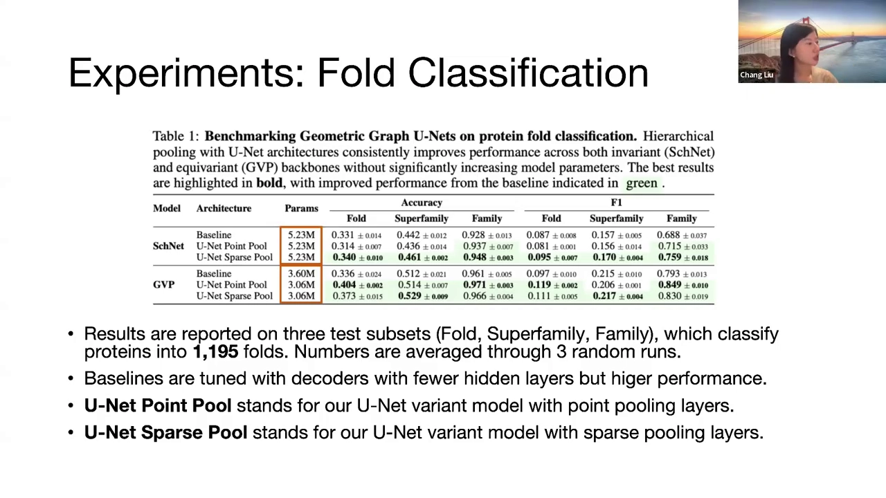

两个结论值得注意。其一，**稀疏池化版本整体最好**，而点池化版本在部分设置下不如稀疏池化——这与第七节的分析一致：点池化的邻域重叠会让同一节点被重复聚合，稀释了区分度。其二，为了公平比较，作者压缩了解码器参数，使 U-Net 变体的总参数量与基线持平甚至更少；也就是说，提升不是靠加参数换来的。[【跳转到 40:22】](https://www.youtube.com/watch?v=3izeKw4G53I&t=2422)

**第二组实验：K 链上的合成表达力测试。** K 链是一类抽象图：K 个节点排成一条线，两端各加一个端点，靠两个端点的朝向区分不同实例。这类图不是蛋白质，只是用来测表达力的符号。[【跳转到 43:04】](https://www.youtube.com/watch?v=3izeKw4G53I&t=2584)

理论上的参照是几何 Weisfeiler-Leman（GWL）测试：区分 K 链需要 $\lfloor K/2 \rfloor + 1$ 次迭代，也就是同样多的层。实验问两个问题：模型能不能用**比理论要求更少的层**区分 K 链？池化能不能提升表达力？[【跳转到 42:14】](https://www.youtube.com/watch?v=3izeKw4G53I&t=2534)

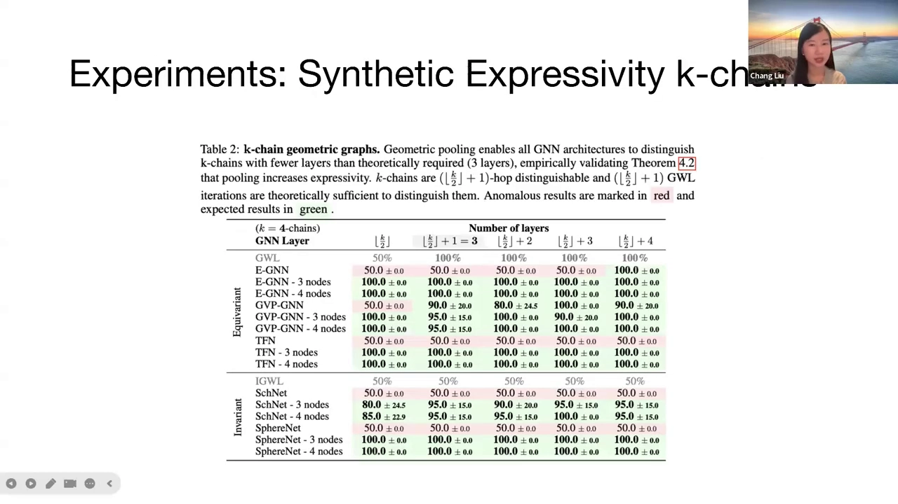

答案都是肯定的。$K=4$ 时理论需要 3 层，而带池化的变体在更少层数上就达到了区分能力。讲者的总结是：**池化通过让模型区分它此前无法区分的几何图，提升了表达力**。[【跳转到 44:51】](https://www.youtube.com/watch?v=3izeKw4G53I&t=2691) 这与"粗化扩大有效感受野"是同一件事的两种说法：层数不够时，粗化把远处的差异拉近到一次聚合之内。

## 小结

- 蛋白质结构本身是分层的（序列 → 二级 → 三级 → 四级），折叠类别由"二级元件怎么整体排布"决定，因此折叠分类可以当作全局结构理解的试金石。
- 局部邻接能刻画"谁挨着谁"，但别构位点与活性位点这类长程接触需要额外的信息通路；堆层能扩大感受野，却会把远程信息反复压缩。
- 全连接图 Transformer 一步跨到全局，代价是边数随节点数平方增长，与蛋白质规模无关地昂贵。
- 第三条路是改图的分辨率：池化把一片节点聚成超节点，粗图上的**一次消息传递就跨越整片区域**，感受野按尺度而非按层数增长，同时节点数下降、计算变省。
- 几何图 U-Net 把这件事做成编码—解码结构：编码器逐级粗化，解码器用反池化加跳连把不同尺度的特征接回来，几乎不增加参数。
- 粗化方式决定丢什么：点池化允许邻域重叠、同一节点被多次聚合；稀疏池化按最近超节点划分、互不重叠，实验里后者更好。
- 代价是压缩：超节点容量有限、采样比例（0.6）直接决定信息损失、FPS 不看节点重要性，重要节点可能被采掉；三维信息在特征化阶段已进入节点，所以"塌缩"是极端情形而非常态。
- 实验支持两点：折叠分类上稀疏池化 U-Net 在同等参数量下优于不变与等变基线；K 链上池化让模型用少于理论要求的层数完成区分，即提升表达力。

## 关键术语速查

| 术语 | 一句话解释 |
| --- | --- |
| 几何图神经网络（geometric GNN） | 节点带三维坐标与标量特征的图网络，消息里可以包含距离与方向 |
| 感受野（receptive field） | 一个节点的表示实际能汇集到信息的原图范围，随层数与粗化程度增长 |
| 折叠（protein fold） | 二级结构元件的连接顺序与空间排布，即三级结构那一层的整体架构 |
| 折叠分类（fold classification） | 按二级结构元件的整体三维排布把蛋白质分到 1,195 个类别之一 |
| 别构调控（allosteric regulation） | 效应物结合在别构位点上，远程改变活性位点形状与功能 |
| 粗化（coarsening） | 把一片节点压成更少的节点，使图的分辨率下降、单跳覆盖范围上升 |
| 超节点（super node） | 粗化后代表一组原始节点的新节点，特征是这些节点特征的聚合 |
| 簇分配矩阵（cluster assignment matrix） | 记录"哪个原始节点归哪个超节点"的 0/1 矩阵 $C$ |
| 点池化（point pooling） | 按邻域归属分配，允许一个节点属于多个超节点，信息被重复聚合 |
| 稀疏池化（sparse pooling） | 每个节点只归最近的超节点，划分互不重叠 |
| 最远点采样（FPS） | 在整张图上迭代选取彼此最远的点，使超节点分布均匀，但不考虑重要性 |
| 反池化与跳连（unpooling, skip connection） | 把粗化特征放回原图，并拼接对应池化块缓存的特征以恢复细节 |
| GWL 测试（geometric WL test） | 判断两个几何图是否可区分的表达力基准，区分 K 链需要 $\lfloor K/2 \rfloor + 1$ 层 |