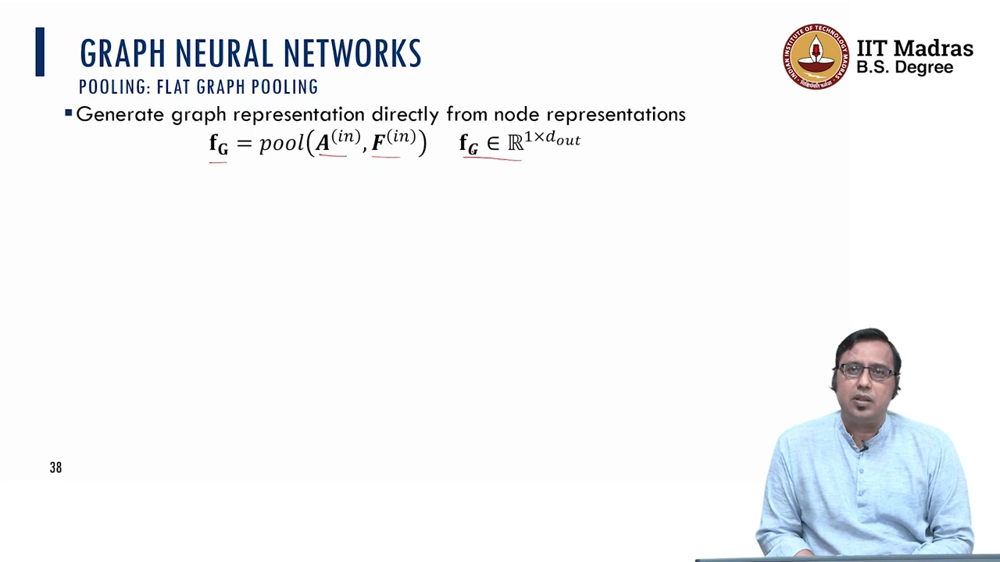
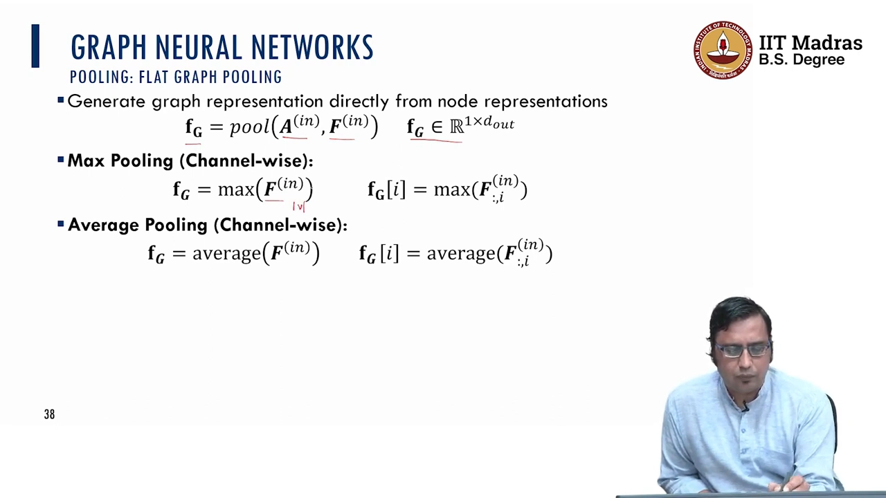
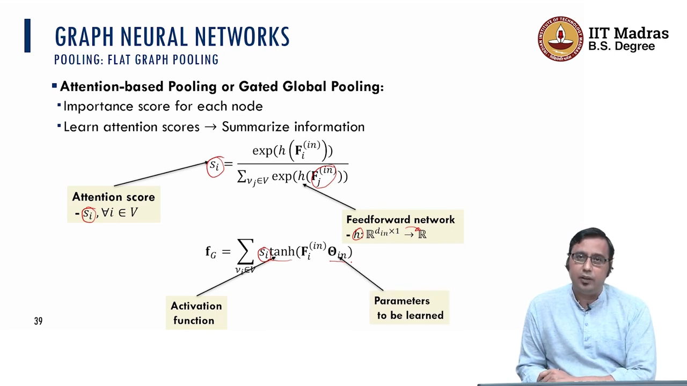
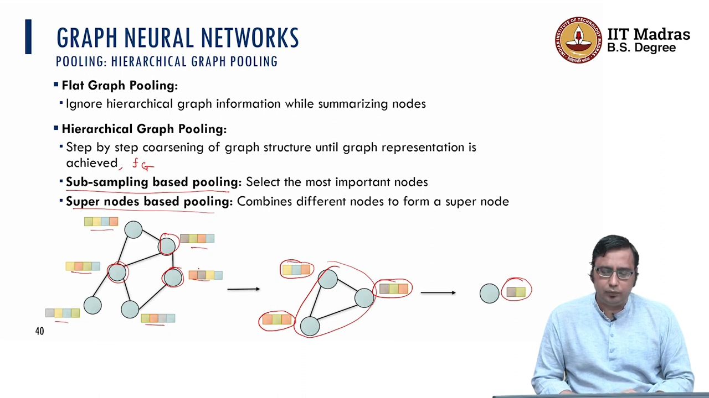
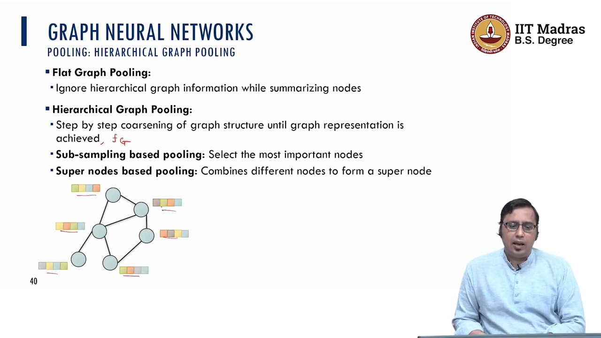
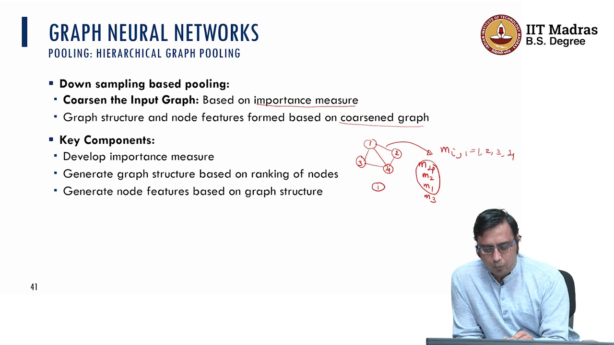
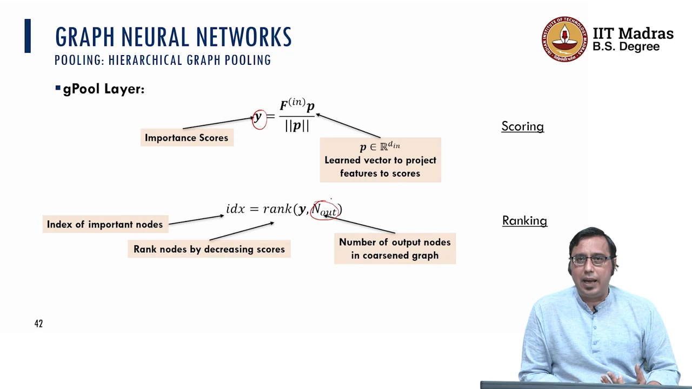
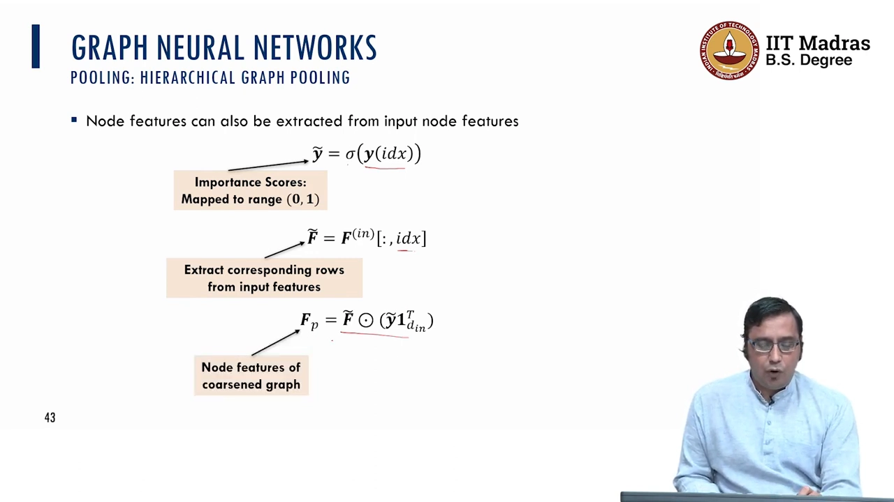
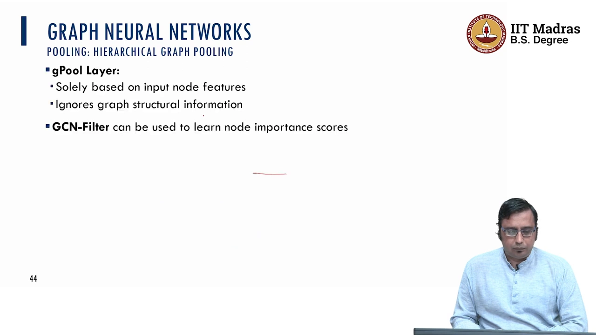

# 池化要一层层粗化：图池化如何把邻域压成超节点并扩大感受野

> 视频来源：[W11_L11.7: Graph neural networks: pooling - part 1](https://www.youtube.com/watch?v=G6hvieeylj4)（YouTube · IIT Madras BS Degree Programme 课程录像）｜时长约 28 分钟
> 一支把"池化"从最大/平均聚合一路讲到 gPool 层的课堂录像。本文按讲课顺序覆盖：平坦池化（通道方向 max/mean）、门控全局池化、平坦池化为什么看不见层级结构、层级池化与粗化的定义、子采样与超节点两条路线、下采样池化的三要素与手算例子，以及 gPool 层的打分—排序—抽取—缩放四步及其"只看节点特征、不看结构"的局限。本文只取"池化如何改变感受野与信息容量"这条线；图级读出在任务侧的用法属于 [2.3.4 图级表示：节点读出、池化与层级结构](../../../README.md#m03-2-3-4) 的范围。

## 本讲要解决的核心问题（SCQA）

**背景**：图神经网络的主体操作是图滤波（graph filtering）：把每个节点的特征反复更新，得到更好的**节点级**表示。节点级表示够用时，任务就结束了。

**冲突**：很多任务要的是**图级**答案——这个分子有没有某种性质。此时节点级特征再多也没法直接回答：谁把它们汇总成一个向量？最直接的汇总方式是把所有节点压成一个向量，可这样一来，节点之间的组织关系就消失了。

**疑问**：汇总能不能不丢掉结构？如果"一组节点先组成更大的单元、这些单元再组成图"才是数据真实的组织方式，那池化应该怎么设计？

**回答（中心思想）**：池化要分层做，而不是一次压平。**层级池化**（hierarchical graph pooling）通过一步一步**粗化**（coarsening）图结构来构造图表示：每一步先决定哪些节点成为下一层的代表，再据此重建边与节点特征。粗化同时做两件事——把一片节点的信息聚成一个代表（扩大单跳覆盖范围），把节点数降下来（降低后续计算量）。代价是压缩：谁被选中、谁被合并、合并后还剩多少差异，全部由那一步的规则决定。[【跳转到 10:46】](https://www.youtube.com/watch?v=G6hvieeylj4&t=646)

## 一、图滤波解决节点，池化才解决整张图

课程把池化放在图滤波之后讲，理由是任务层级不同。图滤波关心的是"如何精炼节点特征"，让某个节点的表示更好；这类操作服务的是**节点级任务**。[【跳转到 00:46】](https://www.youtube.com/watch?v=G6hvieeylj4&t=46)

但很多任务与整张图有关，例如分子性质预测，属于**图级任务**。这时需要的不再是某个节点的特征，而是整张图的特征。池化正是在这个位置登场：它接收节点级特征与图结构，输出一个 $d_{out}$ 维的图表示向量 $\mathbf{f}_G$。[【跳转到 02:01】](https://www.youtube.com/watch?v=G6hvieeylj4&t=121)

用一句话概括两者的分工：**图滤波决定每个节点"是什么"，池化决定整张图"怎么被概括"**。

## 二、平坦池化：直接在通道方向上取最大或平均

最直接的池化叫**平坦图池化**（flat graph pooling）：直接从节点表示与结构信息生成图表示，

$$
\mathbf{f}_G = \mathrm{pool}\left(A^{(in)}, F^{(in)}\right), \qquad \mathbf{f}_G \in \mathbb{R}^{1 \times d_{out}}
$$

注意这个式子的输入里既有邻接矩阵 $A^{(in)}$ 又有节点特征 $F^{(in)}$——但接下来的具体实现只用到后者。

具体做法借自卷积网络，只是把空间窗口换成了"所有节点"：**按通道**（channel-wise）聚合。最大池化取每个通道在所有节点上的最大值，平均池化取平均值：

$$
\mathbf{f}_G[i] = \max\left(F^{(in)}_{:,i}\right), \qquad \mathbf{f}_G[i] = \mathrm{average}\left(F^{(in)}_{:,i}\right)
$$

讲者用一个小矩阵演示了这两种操作：在 $2 \times 2$ 的窗口上做最大池化得到 5、9、8、8，做平均池化则得到四个窗口各自的均值。区别只在于"取极值"还是"取平均"，两者都直接产出图级向量。[【跳转到 05:21】](https://www.youtube.com/watch?v=G6hvieeylj4&t=321)

平坦池化的关键特征是：**它一次就把所有节点压成一个向量，中间没有层级**。这正是后面所有问题的来源。

## 三、门控全局池化：给每个节点学一个重要性分数

平坦池化的一个明显缺陷是"一视同仁"：无论节点重要与否，最大池化只留极值、平均池化同等加权。改进办法是给每个节点学一个**注意力分数**，这类做法叫**门控全局池化**（gated global pooling）。[【跳转到 06:36】](https://www.youtube.com/watch?v=G6hvieeylj4&t=396)

分数由一个小前馈网络给出，再经 softmax 归一化：

$$
s_i = \frac{\exp\left(h\left(\mathbf{F}_i^{(in)}\right)\right)}{\sum_{v_j \in V} \exp\left(h\left(\mathbf{F}_j^{(in)}\right)\right)}
$$

其中 $h: \mathbb{R}^{d_{in}} \to \mathbb{R}$ 把节点特征映射成一个标量。图表示则是按分数加权的特征和：

$$
\mathbf{f}_G = \sum_{v_i \in V} s_i \tanh\left(\mathbf{F}_i^{(in)} \Theta_{in}\right)
$$

讲者特别点出公式里的 $\Theta_{in}$ 是**需要学习的参数**，而激活函数也可以是恒等映射——那时它就退化成加权求和。[【跳转到 08:16】](https://www.youtube.com/watch?v=G6hvieeylj4&t=496)

门控池化解决了"重要性"问题，但没有解决"结构"问题：它仍然是把所有节点平铺开来加权，节点之间的邻接关系依旧没有进入汇总过程。

## 四、平坦池化的盲点：分子里真正有意义的单位是"一组节点"

讲者用一个化学例子说明了这个盲点。看分子图时，我们关心的往往不是某一个原子，而是**一组原子共同造成的性质**——在化学与生物里这叫**官能团**（functional group），例如醇类基团。官能团是"若干节点组合起来"才成立的结构单元。[【跳转到 09:31】](https://www.youtube.com/watch?v=G6hvieeylj4&t=571)

平坦池化没有机会利用这种"成组"的结构：它把节点当作互不相干的个体来汇总。因此讲者的结论是：**层级池化能比平坦池化更好地捕捉这类信息**。[【跳转到 10:21】](https://www.youtube.com/watch?v=G6hvieeylj4&t=621)

这个例子也解释了"层级"到底指什么：不是指网络层数多，而是指**数据本身有"节点 → 官能团 → 分子"的嵌套组织**，池化应当按这个嵌套逐级压缩。

## 五、层级池化：一步一步粗化，直到得到图表示

层级池化的定义很朴素：**一步一步地缩减图结构，也就是粗化，直到得到图表示**。[【跳转到 10:46】](https://www.youtube.com/watch?v=G6hvieeylj4&t=646)

注意它与平坦池化的目标相同——都是给每张图分配一个特征向量 $\mathbf{f}_G$——**不同的只是分配的过程**：平坦池化一步到位，层级池化分多步，每一步都同时更新图结构与节点特征。[【跳转到 11:11】](https://www.youtube.com/watch?v=G6hvieeylj4&t=671)

这里可以把"粗化为什么扩大感受野"讲清楚。设原始图有 $n$ 个节点，粗化后剩 $n' < n$ 个节点，每个新节点代表原图上的一片区域。于是在粗图上做**一层**消息传递，等价于在原图上跨越了整片区域——感受野不再只随层数线性增长，而是随"粗化级数"按尺度跃升。这也是层级池化与"堆层"最本质的区别：堆层是在同一张图上多走几步，粗化是**换一张更小的图再走**。

## 六、粗化的两条路：选出重要节点，或合并成超节点

文献里的层级池化分两类，区别在于**粗化操作怎么做**。[【跳转到 11:36】](https://www.youtube.com/watch?v=G6hvieeylj4&t=696)

1. **基于子采样的池化（sub-sampling based pooling）**：从原图里**挑选重要节点**留下，其余丢弃。
2. **基于超节点的池化（super node based pooling）**：把**一组节点合并**成一个全新的节点。

讲者的措辞很精确：超节点池化生成的是"一个完全新的节点"，而子采样池化只是"选择原本就重要的节点"。[【跳转到 14:31】](https://www.youtube.com/watch?v=G6hvieeylj4&t=871)

这个区分直接决定了信息损失的形式：**子采样丢的是"没被选中的节点"，超节点丢的是"合并后无法区分的差异"**。前者是离散的取舍，后者是连续的压缩。

## 七、下采样池化的三要素与一个手算例子

课程随后把重点放在子采样路线上，因为它的流程最容易拆解。典型的下采样池化分三步，讲者称为三个关键要素。[【跳转到 16:11】](https://www.youtube.com/watch?v=G6hvieeylj4&t=971)

1. **构造重要性度量**：给每个节点算一个分数 $m_i$，据此决定选谁。
2. **按排序生成图结构**：对分数降序排序，保留前若干个节点，再从原邻接矩阵里抽出对应的行与列，得到粗化后的图。
3. **按新结构生成节点特征**：用选中的节点特征与重要性分数，算出粗图的节点特征。

讲者用一个四节点的小图手算了一遍：四个节点各有分数 $m_1, m_2, m_3, m_4$，排序结果是 $m_4 > m_2 > m_1 > m_3$，于是保留前三个（节点 1、2、4）；接着用求和函数在这三个节点之间重建边，最后为新的图结构生成特征。这个过程可以不断重复，直到得到整张图的特征向量。[【跳转到 18:16】](https://www.youtube.com/watch?v=G6hvieeylj4&t=1096)

这段流程里最容易被忽略的是第二步：**粗化不只是删节点，还要重建边**。邻接矩阵按行列同时抽取，等于假设"保留下来的节点之间的边仍然有效"；而"用求和函数重建边"则是在这个假设不成立时另造一套连接规则。

## 八、gPool 层：打分、排序、抽取、缩放

**gPool 层**是最早采用下采样池化的方法之一，它的思路就是把上面的三要素写成可微的四步。[【跳转到 19:56】](https://www.youtube.com/watch?v=G6hvieeylj4&t=1196)

**第一步，打分。** 用一个可学习的投影向量 $\mathbf{p}$ 把节点特征投成标量分数：

$$
\mathbf{y} = \frac{F^{(in)} \mathbf{p}}{\lVert \mathbf{p} \rVert}
$$

**第二步，排序。** 按分数降序排序，保留前 $N_{out}$ 个，得到重要节点的索引：

$$
idx = \mathrm{rank}\left(\mathbf{y}, N_{out}\right)
$$

**第三步，抽取子矩阵。** 从输入邻接矩阵（或任何 $n \times n$ 的相似度矩阵）中取出被选中节点对应的行与列，得到粗化图。

**第四步，缩放特征。** 把分数映射到 $(0,1)$ 区间作为门控，再与抽出的特征逐元素相乘：

$$
\tilde{\mathbf{y}} = \sigma\left(\mathbf{y}(idx)\right), \qquad
\tilde{F} = F^{(in)}[:, idx], \qquad
F_p = \tilde{F} \odot \left(\tilde{\mathbf{y}} \mathbf{1}_{d_{in}}^{\top}\right)
$$

四步合起来，gPool 做的事情可以概括成：**用特征算重要性，用重要性选节点，用选中的节点造一张更小的图**。它没有生成新的超节点，因此属于子采样路线。

## 九、gPool 的局限：只看节点特征、不看结构

课程最后指出了 gPool 的一个结构性缺陷：**它的分数完全由输入节点特征算出，因此完全忽略了图结构信息**。[【跳转到 25:46】](https://www.youtube.com/watch?v=G6hvieeylj4&t=1546)

这个缺陷的后果很具体：一个节点的"重要性"往往来自它所在的局部环境——它连接了谁、处在什么位置——而 gPool 的打分看不到这些。讲者给出的修法是**用 GCN 滤波器来学重要性分数**：把邻接矩阵 $A$ 与输入特征一起送进图卷积层，输出单通道分数，再过 tanh 激活。[【跳转到 27:26】](https://www.youtube.com/watch?v=G6hvieeylj4&t=1646)

讲者的总结句是：**gPool 层与 GCN 打分层的最大区别，就在于对 $A$ 的利用**。[【跳转到 27:51】](https://www.youtube.com/watch?v=G6hvieeylj4&t=1671)

把这一节的批评放回本节的主题，可以得到一条更一般的判断：**粗化的规则决定了感受野扩大的方式，也决定了什么会被丢掉**。按特征打分选节点，等于假设"重要性可以从节点自身读出"；一旦重要性来自结构（例如某个残基只是因为它处在两个结构域的界面上才重要），这种打分就会系统性地选错。这也是为什么后来的方法要么把结构纳入打分，要么改用超节点合并而不是硬性挑选。

## 小结

- 图滤波产出节点级表示，池化产出图级表示；两者解决的是不同层级的任务。
- 平坦池化（通道方向的最大/平均）一步把全部节点压成一个向量，简单但丢掉了节点之间的组织关系。
- 门控全局池化给每个节点学一个 softmax 重要性分数再加权求和，补上了"重要性"，但依然不看邻接结构。
- 分子里的官能团说明数据本身是"节点 → 组 → 图"的嵌套结构，平坦池化无法利用这种成组信息，这正是层级池化的动机。
- 层级池化 = 一步一步粗化图结构直到得到图表示；粗化让**一层消息传递跨越一整片原图区域**，感受野按尺度跃升，而不只随层数线性增长。
- 粗化有两条路：子采样（选出重要节点）与超节点（合并成新节点）。前者丢没被选中的节点，后者丢合并后无法区分的差异。
- 下采样池化的三要素是重要性度量、按排序重建结构、按新结构生成特征；gPool 层把它写成打分、排序、抽取子矩阵、门控缩放四步。
- gPool 的分数只来自节点特征、忽略 $A$；改用 GCN 打分把结构纳入，说明"粗化规则"本身就是设计变量。

## 关键术语速查

| 术语 | 一句话解释 |
| --- | --- |
| 图滤波（graph filtering） | 反复更新节点特征的操作，产出节点级表示 |
| 平坦图池化（flat graph pooling） | 一步把所有节点按通道聚合成一个图向量，没有中间层级 |
| 门控全局池化（gated global pooling） | 学一个节点重要性分数并 softmax 归一化，再按分数加权求和 |
| 官能团（functional group） | 分子中由一组原子共同构成的、决定性质的结构单元 |
| 层级池化（hierarchical graph pooling） | 逐步粗化图结构直到得到图表示，保留嵌套组织 |
| 粗化（coarsening） | 减少节点数、让每个节点代表更大一片原图区域的操作 |
| 子采样池化（sub-sampling pooling） | 按重要性挑选部分节点留下，其余丢弃 |
| 超节点池化（super node pooling） | 把一组节点合并成一个全新的节点 |
| 重要性度量（importance measure） | 决定哪些节点被保留的分数，可由特征或结构算出 |
| gPool 层 | 用可学习投影向量打分、排序取前 $N_{out}$ 个、抽取子矩阵并门控缩放的下采样池化 |
| GCN 打分 | 把邻接矩阵与特征一起送进图卷积来算重要性分数，使打分看见结构 |