# 结构合法性怎么判：键长、键角、原子排斥与硬软两道关卡

> 视频来源：[Phenix User Workshop 9/16/2020 - Validation](https://www.youtube.com/watch?v=C_oLnH3w6zc)（YouTube · Phenix Tutorials，讲者 Jane Richardson，杜克大学）｜时长约 59 分钟
> 导读：MolProbity 作者本人讲“怎么判断一个三维结构是否合理”。本文只取与键长、键角、原子排斥和判据分工有关的主线，不重复力场能量项的公式推导；能量项一侧请对照同目录《GROMACS 系统课 05》。

## 本讲要解决的核心问题（SCQA）

**背景**：无论是实验解析还是模型预测，拿到一个三维结构后都要回答同一个问题：这个结构合理吗？化学上，键长、键角有公认的取值范围，原子之间不能重叠，主链构象也有偏好的区域。这些都可以算成具体的数。

**冲突**：能算出数，不等于知道“多少算不合格”。键长偏离 0.02 Å 要不要紧？两个原子靠得多近才算“撞上了”？更麻烦的是，同一套判据在高分辨率结构上很灵，到了 3–4 Å 的低分辨率结构上却可能给出“满分”的错误结论。

**疑问**：判断结构合法性到底该看哪些量？这些量的阈值和参考分布从哪里来？硬性的验证判据与软性的能量项各自负责什么，又各自在哪里失效？

**回答（中心思想）**：结构合法性可以拆成三类可量化的偏离——键长与键角相对理想值的偏离、非键原子相对范德华表面的重叠、主链与侧链构象相对参考分布的偏离。阈值不是拍脑袋定的，而是从一批高质量、高分辨率的参考结构里统计出来的。验证判据是“硬”的：给出允许区间和离群判定；能量项与精修里的几何约束是“软”的：用带权重的惩罚把结构往合理区拉。硬判据负责事后裁决，软惩罚负责优化过程，两者互补，但都不能单独保证结构正确。

## 一、判断合法性靠“偏离参考值多少”，不是“有没有键”

初学者容易把结构检查理解成“看看键连对没有”。但真正决定一个结构是否合法的，是**每一类几何量偏离参考值多少**，以及这个偏离在参考分布里有多罕见。MolProbity 把这件事拆成一组固定的标记：

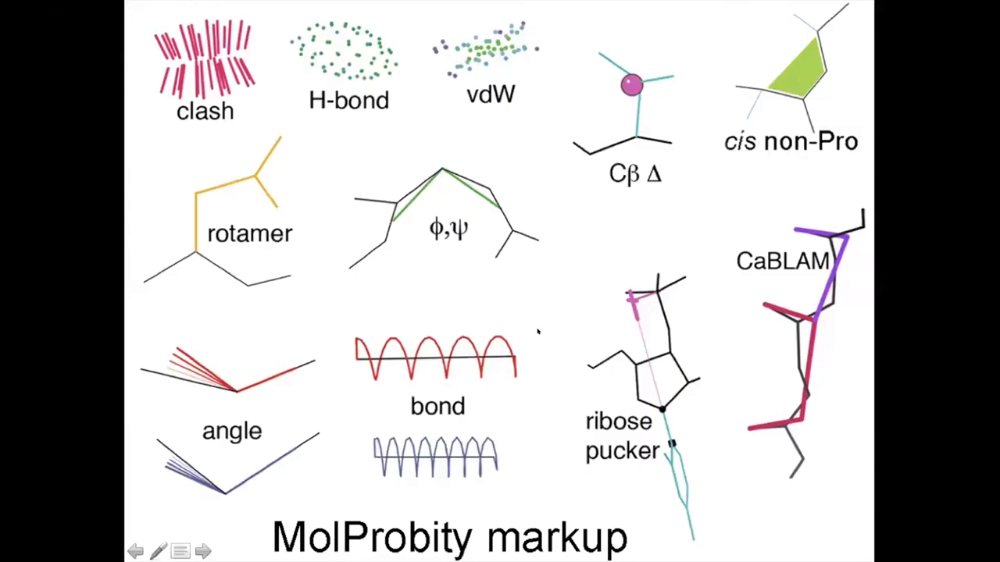

这张图相当于一张“体检项目表”。红色尖刺是原子重叠（clash），绿色点阵是氢键，蓝绿点是范德华接触；金色是侧链 rotamer 不在常见构象，黄色是主链二面角 $\phi,\psi$ 落在不允许区；此外还有键长（bond）、键角（angle）、Cβ 偏差、cis 非脯氨酸、核糖皱褶，以及后文要讲的 CaBLAM。每一项都对应一个可计算的量和一个参考分布，而不是“看起来怪不怪”。[【跳转到 09:28】](https://www.youtube.com/watch?v=C_oLnH3w6zc&t=568)

这也解释了为什么同一套判据要“一起用”。键长、键角、接触、构象各自只能看到局部的一类错误：键长几乎总是被约束得很紧，真正泄漏应变的是键角；原子重叠能抓到“放错位置”，却抓不到“朝向反了”；二面角能抓到主链构象异常，却可能被低分辨率密度掩盖。单一指标都不足以裁决合法性。

本节讨论的是“判断”，不是“计算能量”。能量项的函数形式（键伸缩、键角弯曲、二面角、Lennard-Jones 排斥）在[《GROMACS 系统课 05》](<../../../../../../生命科学/生物建模/P10_分子动力学与构象系综/2_分子力场、积分与统计系综/2.1_化学连接、能量与拓扑/2.1.3_分子力场：键合项、非键合项与参数来源/GROMACS系统课05_GROMACS力场介绍.md>)里已经推导过，这里只把它当作“软惩罚”一侧来对照，不重复公式。

## 二、键长与键角：用 sigma 计偏离，超过 4σ 记为离群

最直接的判据来自精修软件自己的几何约束表。下面这张图是 Phenix 验证界面里的 Geometry Restraints 面板：

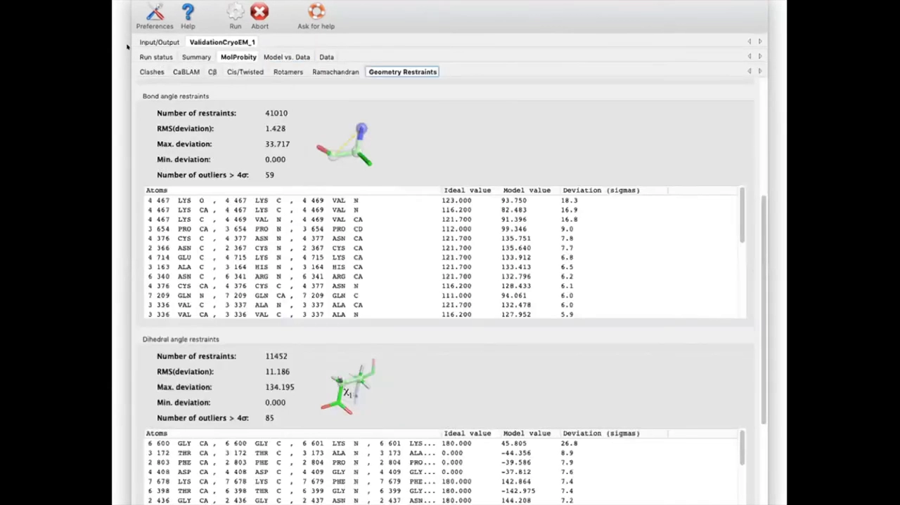

面板里有三个关键信息。第一，**理想值**（Ideal value）是这条键或这个角“应该”是多少，例如表中一个键角理想值 123.000°，模型值 82.483°，偏差 18.3σ。第二，偏差不是用角度或埃直接报，而是**换算成 sigma**（标准差）——18.3σ 的意思是“偏离了 18 个标准差”，比“偏了 40 度”更能说明罕见程度。第三，界面直接统计**超过 4σ 的约束条数**，作为离群（outlier）的硬判据。[【跳转到 14:30】](https://www.youtube.com/watch?v=C_oLnH3w6zc&t=870)

理想值从哪里来？讲者的说法是“你已知的无应变答案”（the unstrained answer）：精修时对几何施加紧约束（tight restraints），让键长、键角尽量贴近未受力的理想几何。她特别强调，对键长和键角这样做不会“把结构带坏”，因为**键长和键角基本只有一个合理取值**，不存在另一个能量低谷可以合理地跑过去；紧约束只是让模型更贴近这个唯一答案。[【跳转到 15:04】](https://www.youtube.com/watch?v=C_oLnH3w6zc&t=904)

两类量的“硬度”还不一样。结构里积累的应变（strain）主要泄放到**键角**上，键长通常被约束得很紧、变化很小。所以当精修“卡住”时——比如某个侧链转反了、rotamer 选错了、主链 $\phi,\psi$ 落在错误区域——应变会堆到键角上，把键角推出 4σ，变成离群项。反过来说，看到键角离群，不能只骂键角，它往往是别处错误的“压力表”。[【跳转到 15:29】](https://www.youtube.com/watch?v=C_oLnH3w6zc&t=929)

这里的局限也要说清：4σ 是相对**约束库给出的理想值和标准差**而言的，不是相对实验测量。它回答的是“这个模型有多违背自己的几何规则”，不直接回答“这个模型有多接近真实结构”。

## 三、非键排斥：加氢、范德华球、0.5 Å 探针滚出接触点

键长和键角管的是成键原子，原子重叠管的是**不成键的原子靠得太近**。这一步的第一个前提常被忽略：大多数结构模型只建了重原子，而蛋白质里约 75% 的接触至少有一侧是氢原子。没有氢，接触判断会系统性出错。[【跳转到 05:12】](https://www.youtube.com/watch?v=C_oLnH3w6zc&t=312)

MolProbity 的做法是先用 Reduce 把氢加上并优化可旋转氢的取向（它会同时考虑整个氢键网络），再在每个原子外面套一层范德华球，然后用一个直径只有 0.5 Å 的小探针，在未被共价键遮挡的范德华表面上滚动，看它是否碰到别的非共价原子。碰到的地方就画点：

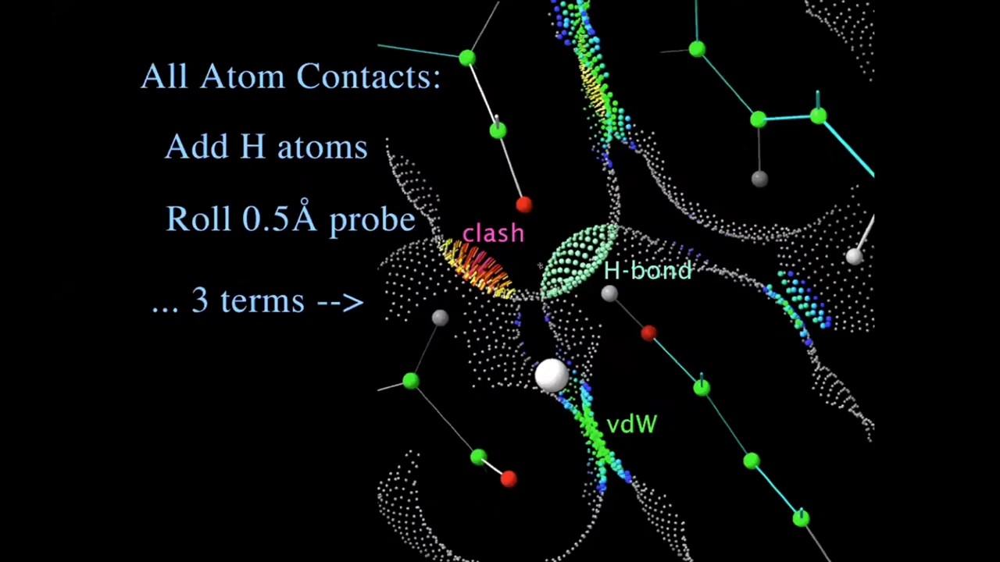

点的颜色就是判据的刻度：**蓝色**表示还有 0.5 Å 间隙的接触，**绿色**表示刚好落在最佳范德华距离，**黄色并开始出现尖刺**表示轻微重叠，**亮色长尖刺**表示严重重叠，也就是真正的 clash。氢键供体与受体之间的重叠不算冲突，会显示成平缓的浅绿色“氢键枕”。[【跳转到 07:02】](https://www.youtube.com/watch?v=C_oLnH3w6zc&t=422)

这个判据的参考基准来自高分辨率结构：在真正高分辨率结构的良好区域里，氢原子表面会漂亮地互相嵌合，几乎整圈都有接触；如果这不是普遍现象，这套方法根本不会成立。也正因如此，原子并非完美球体带来的少量真实重叠通常只落在黄色档，不被当作严重问题。[【跳转到 07:27】](https://www.youtube.com/watch?v=C_oLnH3w6zc&t=447)

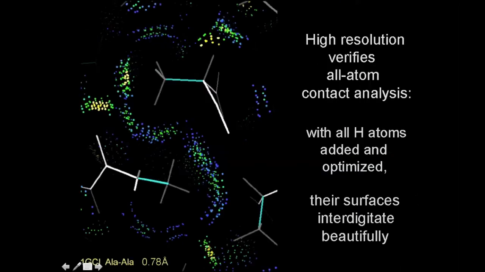

把这一步和能量项对照：Lennard-Jones 里的 $1/r^{12}$ 排斥项说的是“原子太近，能量急剧上升”；全原子接触说的是“原子太近，几何上重叠了多少”。一个是连续的能量代价，一个是离散的接触分类，但指向同一件事——**非键原子之间不允许重叠**。前者用于优化，后者用于裁决。

## 四、一个“不合法”的结构长什么样：四类典型信号

把上面的量组合起来，一个不合法结构通常不是“到处都错”，而是出现几类可辨认的信号。

第一类是**原子重叠**。下面这个组氨酸（His40）在原本的模型里有两处严重冲突：一处对着一个水分子，另一处对着主链羰基氧——后者是必须接受的氢键受体，不可能让开。把组氨酸翻转 180°（交换碳和氮的位置）后，密度拟合几乎不变，但两处冲突消失，换来两个漂亮的氢键。[【跳转到 08:13】](https://www.youtube.com/watch?v=C_oLnH3w6zc&t=493)

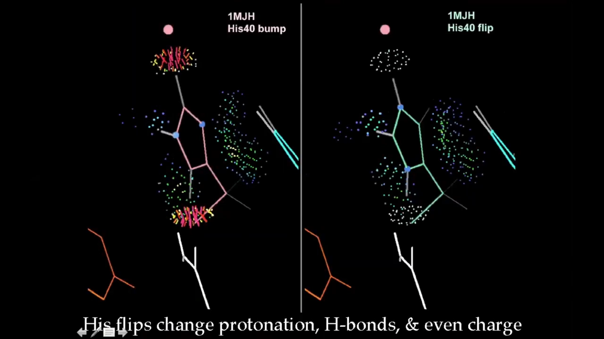

第二类是**键长、键角离群**，在标记体系里显示为“弹簧”和“拉紧的弦”，也就是第二节里超过 4σ 的那些约束。

第三类是**构象离群**：侧链 rotamer 落在金色标记区，主链 $\phi,\psi$ 落在黄色区（Ramachandran 不允许区）。这类错误常常和第一类同时出现——朝向错了，接触和构象都会报警。

第四类是**该有的接触没有**。讲者提醒，3–4 Å 结构里常见氢键数量明显偏少，这本身就是坏信号，即使一个 clash 都没有。[【跳转到 10:09】](https://www.youtube.com/watch?v=C_oLnH3w6zc&t=609)

| 信号 | 用什么量判断 | 典型表现 |
| --- | --- | --- |
| 键长异常 | 相对理想键长的偏差（sigma） | 超过 4σ 的约束条目 |
| 键角异常 | 相对理想键角的偏差（sigma） | 应变泄放到键角，离群条目成簇 |
| 原子重叠 | 全原子接触点的颜色与 clash score | 黄色尖刺到亮色长尖刺 |
| 构象异常 | rotamer、$\phi,\psi$ 相对参考分布 | 金色 rotamer、黄色 Ramachandran 区 |
| 接触缺失 | 氢键数量与网络 | 低分辨率结构氢键明显偏少 |

## 五、阈值与参考分布从哪来：按残基筛选的高分辨率参考集

“超过 4σ 算离群”只是第一层。像 rotamer、Ramachandran 这类构象判据，阈值来自**参考结构里实际出现的频率**：把高质量、高分辨率结构里每个残基的构象画成散点，再取等高线包住绝大多数正常点，落在等高线外足够远的点就是离群。

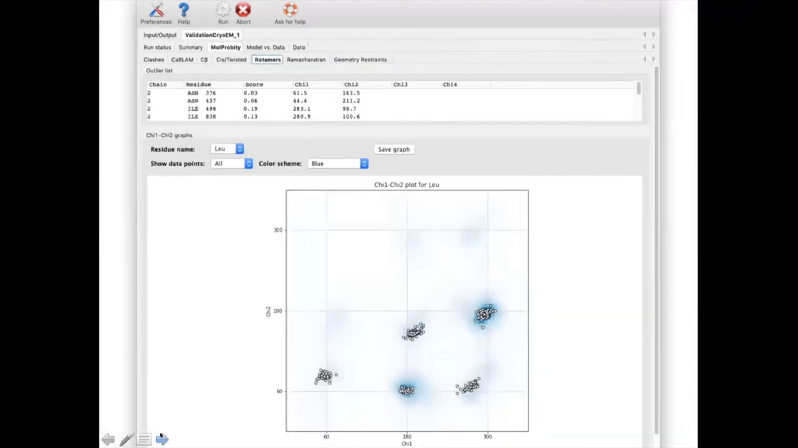

这张图里，亮氨酸的侧链构象集中在几个离散的“岛”上，背景的蓝色等高线就是参考分布。讲者提到，亮氨酸最常见的两种 rotamer 合起来约占 95%，所以参考分布本身就是高度不均匀的；把模型约束到最常见的那个构象通常没问题，前提是**你确实在正确的那个构象里**。[【跳转到 16:19】](https://www.youtube.com/watch?v=C_oLnH3w6zc&t=979)

参考集怎么选也有讲究。讲者明确说，不能只按“文件分辨率”筛，必须**按残基筛**：即使是最高分辨率的文件，也会有无序区域或多种交替构象，那些残基不该进参考集。她还给了一个经验值：如果能选，1.4 Å 左右是“甜点”，细节多到足以看清，又不至于多到让人误判。[【跳转到 04:08】](https://www.youtube.com/watch?v=C_oLnH3w6zc&t=248)

离群阈值是**分位数**，不是物理常数。CaBLAM 面板直接把这件事写在了标题上：

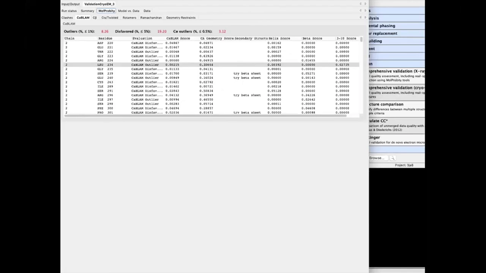

讲者在问答里把规则说得很直白：离群的定义来自参考结构里实际发生的情况，所以取 **1% 离群、5% 以下 disfavored** 就相当于“和参考结构一样好”；Ramachandran 因为可用好数据多得多，离群水平定得更低。[【跳转到 54:55】](https://www.youtube.com/watch?v=C_oLnH3w6zc&t=3295) 这带来一个重要推论：参考集越大、质量越高，越能把阈值推到极低概率处；反过来，参考集不足时，阈值只能定得宽松，判据的分辨力就下降。

## 六、硬判据与软惩罚的分工：约束把结构拉回，验证判它有没有回来

到这里可以把两类东西分开。

**软惩罚**是优化过程中使用的能量项或带权重的约束。它给每一个偏离量乘一个权重，偏离越大代价越高，优化器沿着梯度把结构往理想值拉。精修里的“紧约束”就是加大权重，让键长、键角更贴近理想几何。它的优点是连续、可导、能参与优化；缺点是**它只保证“尽量靠近”，不保证“已经合格”**，而且权重选择本身会影响结果：太松约束不住，太紧会压制真实的构象差异。

**硬判据**是验证阶段使用的阈值。术语上要注意：精修里的“几何约束”（restraint）是软惩罚，验证里的“允许区间/阈值”（criterion）才是硬判据，两者常被同一个“约束”二字混在一起。它不参与优化，只在优化结束后问：这个键角是不是超过 4σ？这个接触点是不是亮色长尖刺？这个 rotamer 是不是落在 1% 以外？它的优点是给出明确的合法/不合法裁决；缺点是**阈值依赖参考集，且不告诉你怎么改**。

| 维度 | 验证判据与允许区间（硬） | 能量项与精修约束（软） |
| --- | --- | --- |
| 形式 | 允许区间、sigma 阈值、离群比例 | 带权重的二次惩罚，连续可导 |
| 参数来源 | 约束库理想值、参考结构分布 | 力场参数 $r_0$、$k$ 与权重 |
| 在流程中的位置 | 优化后裁决，也可作为筛选条件 | 优化中把结构拉回合理区 |
| 主要作用 | 判断合法/不合法、定位问题 | 让结构收敛到低偏离构象 |
| 局限 | 阈值依赖参考集；低分辨率失效；离群不总是错 | 权重难调；只保证靠近，不保证合格；会转移应变 |

两者其实是同一组几何量的两种用法：$r_0$、$\theta_0$ 和范德华半径，既可以写进能量项当极小点，也可以写进判据当参考值。真正的分工在于**时机**：软惩罚负责“把结构拉回来”，硬判据负责“检查它有没有回来”。讲者描述的那个现象正好说明二者的衔接——精修卡在错误局部极小值时，应变会堆到键角上，直到键角超过 4σ 变成离群；此时离群不是原因，而是“软惩罚拉不回来”的证据。[【跳转到 15:04】](https://www.youtube.com/watch?v=C_oLnH3w6zc&t=904)

## 七、低分辨率为什么让判据失效：羰基方向看不见了

上面这套判据有一个明确的有效范围。讲者反复强调：MolProbity 工具在约 2.5 Å 以内工作得很好，到 3–4 Å 就“基本没用”了；此时满分不代表结构正确，有离群也不代表你能改对，你其实不知道结构有多好。[【跳转到 00:50】](https://www.youtube.com/watch?v=C_oLnH3w6zc&t=50)

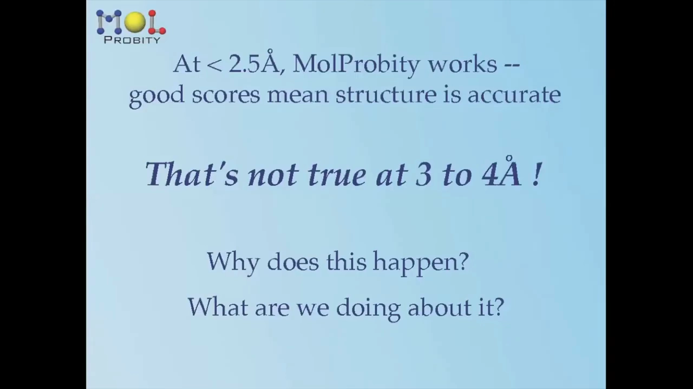

原因很具体：高分辨率下，羰基氧会在主链密度管的侧面鼓出一个小凸起，这个小凸起告诉你肽平面朝哪边；到 3 Å 或更低，这个凸起缩回管子里，你无法从密度判断羰基氧的方向。而羰基方向和 Cβ 正是拟合每个肽段的关键。肽段朝向错了，主链构象、侧链、氢键会跟着一起错。[【跳转到 19:20】](https://www.youtube.com/watch?v=C_oLnH3w6zc&t=1160)

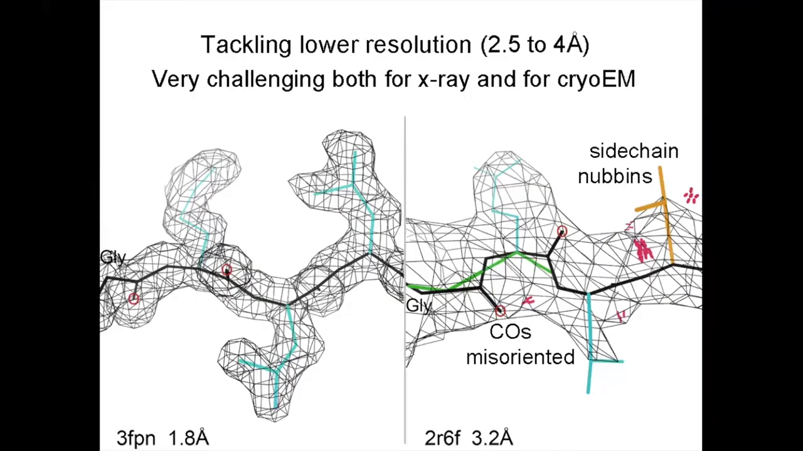

后果是：3–4 Å 下许多不同的模型与同一团模糊密度同样兼容，甚至多个“几何良好”的模型都成立；如果不加约束，链的走向都可能反掉。[【跳转到 20:11】](https://www.youtube.com/watch?v=C_oLnH3w6zc&t=1211) 这解释了为什么低分辨率反而更需要紧约束——不是约束更可信，而是数据提供的信息更少，必须靠先验补足。

## 八、新判据：CaBLAM 用虚拟二面角补上羰基方向

既然传统判据依赖羰基氧的可见性，就需要一种不依赖它的判据。CaBLAM 的思路是：用**虚拟 Cα 二面角**判断这段主链该是螺旋还是 β 链，再用**相邻羰基之间的虚拟二面角**判断羰基朝向对不对。

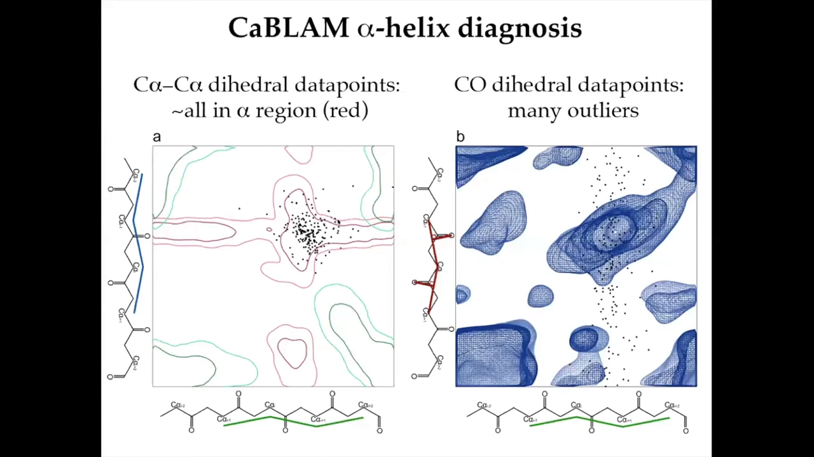

这张图把分工展示得很清楚：Cα 虚拟二面角说“这段是螺旋”，看起来没问题；羰基虚拟二面角说“很多点落在参考等高线外”，问题就暴露了。参考等高线同样来自经过质量筛选的高分辨率参考数据，所以它仍然是“相对参考分布的偏离”，只是换了一个更稳健的观测量。[【跳转到 41:06】](https://www.youtube.com/watch?v=C_oLnH3w6zc&t=2466)

CaBLAM 的判读规则很具体：β 结构里连续两个离群，几乎总是中间那个羰基错了；连续三个相邻羰基指向同一方向，几乎一定错（两个连续可以是真的转角）。[【跳转到 42:54】](https://www.youtube.com/watch?v=C_oLnH3w6zc&t=2574) 这也说明“离群”不是孤立的点，**空间上成簇的离群**比单个离群更有诊断价值。

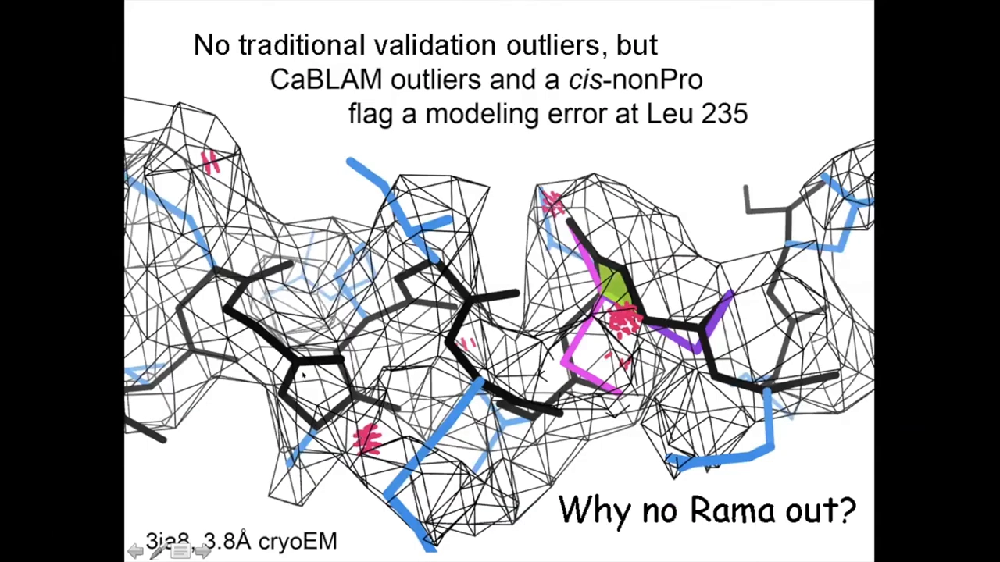

这张图是“传统判据全绿但结构仍然错”的典型：老判据看不出问题，新判据（CaBLAM、cis 非脯氨酸）却标出了错误。它直接说明，判据的覆盖范围本身也是有限的，需要不断补充新的观测量。[【跳转到 22:48】](https://www.youtube.com/watch?v=C_oLnH3w6zc&t=1368)

## 九、判据的局限：离群不总是错，零离群反而是过拟合

最后必须回答“这些判据有多可信”。讲者在冷冻电镜模型挑战赛的数据里给了一张相关性图：横轴是各种验证指标，纵轴是与“接近正确答案”的相关性。

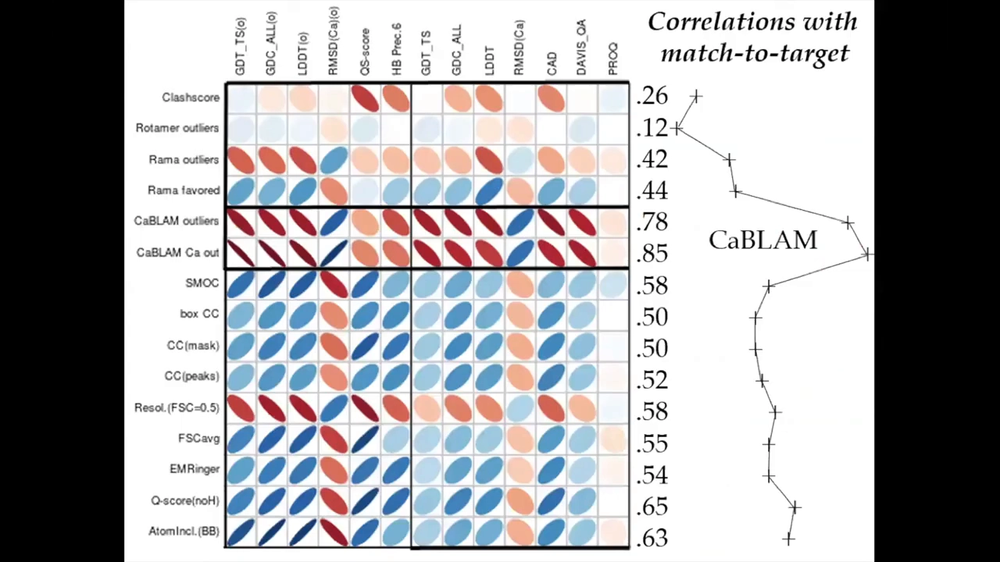

数字很说明问题：clash score 与 rotamer 离群的相关性只有 0.26 和 0.12，Ramachandran 在 0.42–0.44，而 CaBLAM 达到 0.78–0.85，比分辨率和 map-to-model fit 都高。讲者自己也说统计上还不够强，但趋势是真的：**不同判据的“诊断力”差别很大，不能等权看待**。[【跳转到 49:29】](https://www.youtube.com/watch?v=C_oLnH3w6zc&t=2969)

第二个局限是离群不等于错误。真实结构里确实存在罕见但正确的构象，它们往往有功能意义：cis 非脯氨酸只占约 0.03%，但真实的那些大多在功能位点；在糖活性酶里出现频率还要高约五倍。[【跳转到 31:47】](https://www.youtube.com/watch?v=C_oLnH3w6zc&t=1907)

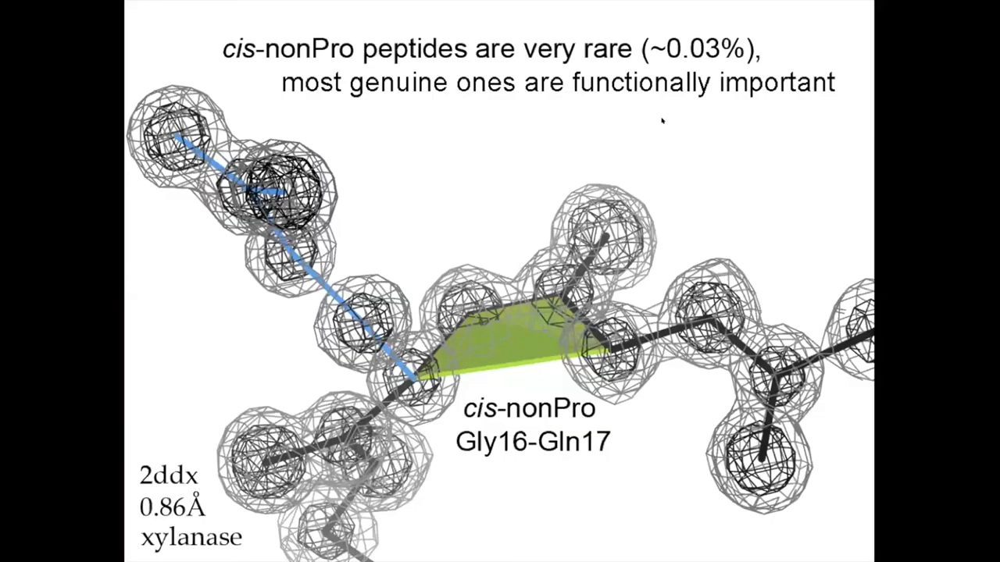

第三个局限是**过拟合判据本身**。2006–2009 年间出现过一波 cis 非脯氨酸滥用：因为 cis 肽更紧凑，在模糊或收缩的低分辨率密度里反而拟合得“更好”，于是被大量错误地建进去。判据被当成优化目标后，反而制造了系统性偏差。[【跳转到 34:09】](https://www.youtube.com/watch?v=C_oLnH3w6zc&t=2049)

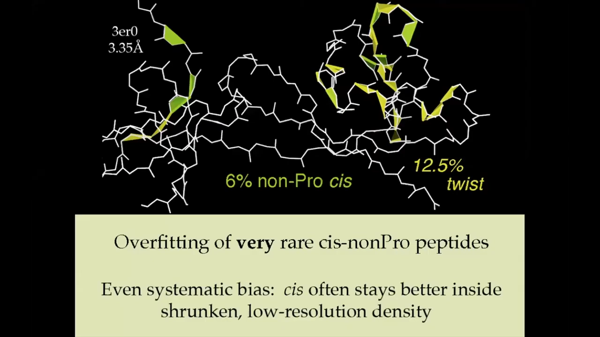

所以讲者给出的目标不是“零离群”，而是“**合理可修的离群尽量少，但不为零**”。大结构里零离群通常意味着过拟合；应该优先看最差的、成簇的离群，因为那背后往往有一个卡在错误局部极小的共同原因。她也给了操作顺序：先修容易修的（二级结构内部的 CaBLAM 离群直接正则化，连续两个离群就旋转中间羰基），再精修；不要一上来就追求把所有离群清零。[【跳转到 52:50】](https://www.youtube.com/watch?v=C_oLnH3w6zc&t=3170)

## 小结

- 结构合法性由三类可量化的偏离决定：键长/键角相对理想值的 sigma 偏离、非键原子相对范德华表面的重叠、主链与侧链构象相对参考分布的偏离。
- 键长和键角用“理想值 + 标准差”计偏离，超过 4σ 记为离群；键长被约束得很紧，应变主要泄放到键角，所以键角离群常是别处错误的压力表。
- 非键排斥用全原子接触判断：加氢、套范德华球、用 0.5 Å 探针滚表面，接触点从蓝到绿到黄到亮色尖刺，对应从间隙到最佳接触到严重重叠。
- 阈值不是物理常数，而是从按残基筛选的高质量高分辨率参考结构统计出来的分位数：1% 离群、5% disfavored 相当于“和参考结构一样好”。
- 验证判据（阈值、允许区间）是硬判据，负责事后裁决；能量项与精修里的几何约束是软惩罚，负责把结构拉回合理区。软惩罚只保证靠近，硬判据只负责判定，二者必须配合。
- 判据有明确的有效范围：3–4 Å 下羰基方向不可见，传统判据失效；CaBLAM 用虚拟 Cα 二面角与羰基二面角补位，相关性也更高。
- 离群不总是错，零离群反而可能是过拟合；正确目标是“可修的尽量修，保留真实的罕见构象”。

## 关键术语速查

| 术语 | 一句话解释 |
| --- | --- |
| 几何约束（restraint） | 精修时把键长、键角、二面角拉向理想值的带权重惩罚项，是“软”的。 |
| 验证判据（validation criteria） | 优化结束后用来裁决结构是否合法的阈值规则，是“硬”的。 |
| sigma（σ） | 标准差；把偏离量除以参考分布的标准差，得到“偏离了几个标准差”。 |
| 离群值（outlier） | 落在参考分布极端尾部的观测；本文语境下常指超过 4σ 或落在 1% 以外的条目。 |
| 全原子接触（all-atom contact） | 加上氢原子后，用探针滚过范德华表面，判断非键原子之间是间隙、接触还是重叠。 |
| clash score | 把原子重叠按严重程度汇总成的分数，越高表示重叠越多。 |
| 范德华半径 | 把原子近似成球时使用的有效半径，决定两个非键原子“最近能靠多近”。 |
| Ramachandran 图 | 主链二面角 $\phi,\psi$ 的允许/不允许区域图，参考分布来自高质量结构。 |
| rotamer | 侧链可旋转键取某组二面角时形成的稳定构象；离群表示落在罕见构象。 |
| 虚拟二面角 | 用不直接相连的原子（如相邻 Cα、相邻羰基）定义的二面角，用于在低分辨率下判断主链走向。 |
| CaBLAM | 用虚拟 Cα 二面角与相邻羰基二面角共同判断主链构象与羰基朝向的验证工具。 |
| 精修（refinement） | 在保持几何合理的前提下调整原子坐标，使模型更好地拟合实验数据的过程。 |
| 过拟合（overfitting） | 为了让某个判据变好而扭曲模型，使指标优于真实结构；零离群是典型征兆。 |